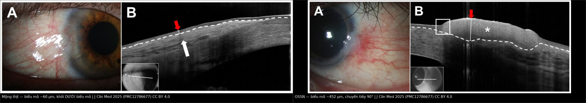
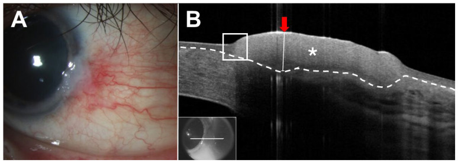
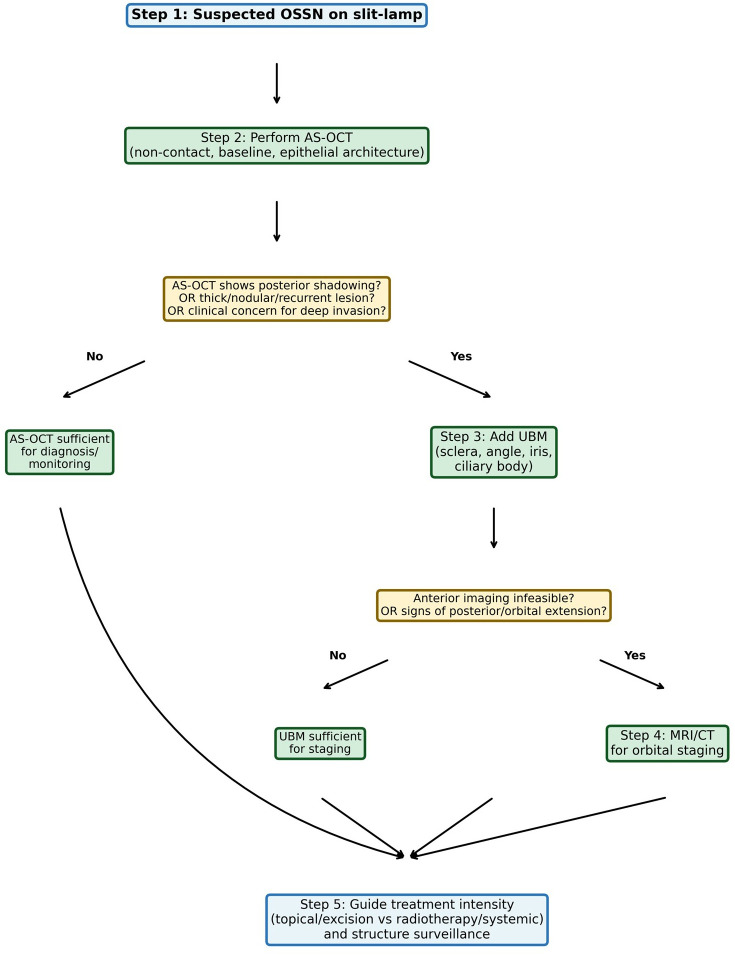
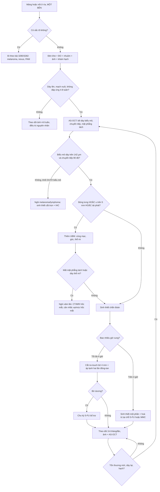
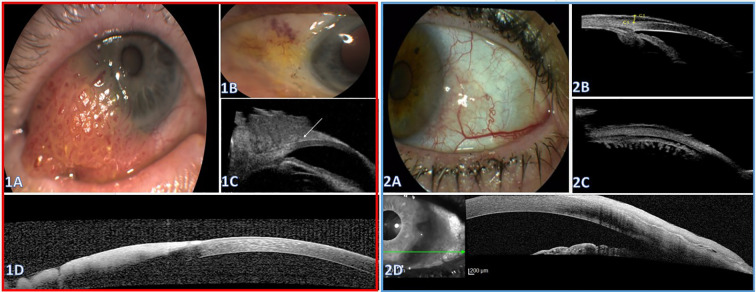
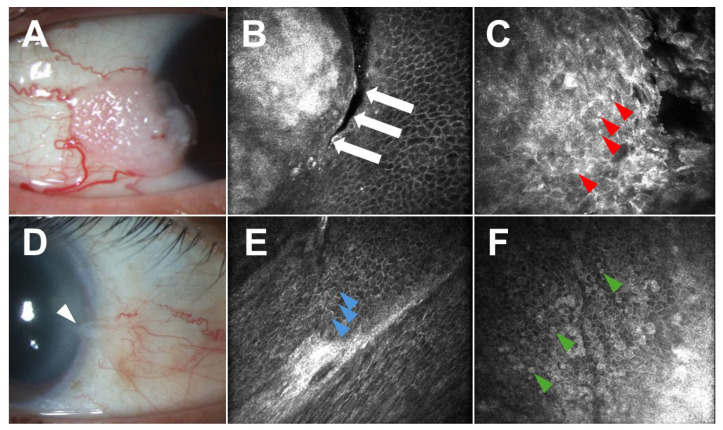
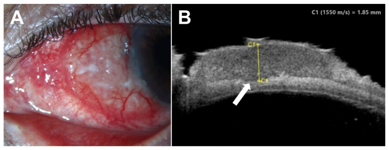

# 3285 — U tân sinh biểu mô bề mặt nhãn cầu (OSSN): mảng nhú sùi/gelatin ở rìa, MỘT BÊN, "mộng thịt không khỏi"

**Tags:** `pattern:mat-mot-ben` `pattern:khong-sac-to` `pattern:mach-nuoi` `pattern:khong-lanh` `pattern:u-be-mat-nhan-cau` `pattern:giap-pterygium` `pattern:giap-viem-ket-mac` `vung:mat` `vung:ket-mac` `vung:giac-mac` `protocol:den-khe` `protocol:AS-OCT` `protocol:UBM` `protocol:IVCM` `protocol:sinh-thiet` `protocol:te-bao-hoc` `protocol:ap-lanh` `protocol:5-FU` `protocol:MMC` `protocol:theo-doi-tai-phat` `score:AJCC8` `incidentaloma:khong`

**Mức chắc chắn (certainty):** tổng hợp y văn (literature synthesis) — dựng từ **1 bài tổng quan hình ảnh bề mặt nhãn cầu có ca minh hoạ kèm số đo AS-OCT/UBM** (J Clin Med 2025, PMC12786677), **1 tổng quan UBM + AS-OCT 5 ca** (Front Ophthalmol 2026, PMC13017243), **đoàn hệ 114 mắt/109 bệnh nhân Nam Phi** (Eye 2025, PMC12446432), **nghiên cứu 5-FU 1% so với phẫu thuật** (BMC Ophthalmol 2025, PMC12560575), **tổng quan tác dụng phụ hoá trị tại chỗ** (Oncol Res 2025, PMC12494095), **loạt UBM 15 ca** (Indian J Ophthalmol 2026, PMC13614684), **loạt 153 ca có 11 ca chẩn đoán nhầm** (Indian J Ophthalmol 2025, PMC12178429), **nghiên cứu HPV trên mẫu lưu trữ Nam Phi** (Infection 2024, PMC11289340) và **tổng quan carcinoma vảy kết mạc** (Cancers 2026, PMC13026025). Nhóm **không có bệnh nhân của mình**; chỗ chưa đủ chắc ghi **"chưa rõ"**. **Không ghi tên tác giả** — attribution = **tạp chí + năm + PMCID/DOI** (xem `images/CREDITS.md`).

> **Câu chốt:** OSSN (ocular surface squamous neoplasia) là **ung thư biểu mô bề mặt nhãn cầu phổ biến nhất**, và nó **không có màu sắc cảnh báo** — đa số **không sắc tố**, **mọc đúng chỗ mộng thịt hay mọc**, và **đỏ–cộm như viêm kết mạc**. Bốn câu hỏi quyết định: **(1) MỘT BÊN, mới, dày lên, có mạch nuôi?** — nếu có, **không được theo dõi bằng thuốc nhỏ**. **(2) Tổn thương ở BIỂU MÔ hay DƯỚI biểu mô?** — AS-OCT: **OSSN = biểu mô dày, tăng hồi âm, chuyển tiếp 90°**; **melanoma = khối DƯỚI biểu mô** (bài 3282). **(3) Có xâm lấn củng mạc/nội nhãn không?** — **UBM** khi u **dày > 5 mm**, thể nốt, tái phát, hoặc AS-OCT bị **bóng lưng che**. **(4) Bề dày biểu mô bao nhiêu micromet?** — ngưỡng phân biệt đã có số: **OSSN 295–346 µm** so với **mộng thịt 80–101 µm**, cắt **97–142 µm** cho **độ nhạy 87–100%, độ đặc hiệu 94,7–100%** (PMC13017243).

## 1. Tổng quan bệnh học – cơ chế hình ảnh (TẠI SAO)

### 1.1 OSSN là một phổ, không phải một bệnh: CIN 1 → CIN 3 → CiS → SCC xâm lấn

- **Phổ mô học:** loạn sản nhẹ (**CIN 1**, dưới 1/3 bề dày biểu mô) → loạn sản vừa (**CIN 2**, 1/3–2/3) → loạn sản nặng (**CIN 3**, trên 2/3) → **carcinoma in situ (CiS)** phá vỡ toàn bộ bề dày nhưng **màng đáy còn nguyên** → **carcinoma vảy xâm lấn (SCC)** khi tế bào **xuyên màng đáy vào mô đệm**. Trong đoàn hệ 114 mắt: **CIN 1 31%, CIN 2 25%, CIN 3 29%, CiS 4%, SCC 11%** (PMC12446432).
- **TẠI SAO mọc ở RÌA:** vùng rìa củng giác mạc là nơi tập trung **tế bào gốc biểu mô** (limbal stem cells) — tế bào phân chia nhanh, sống lâu, và là **bia trực tiếp của tia UVB**. UVB gây **đột biến TP53 và promoter TERT**, gặp ở tới **48%** ca CiS/SCC kết mạc (PMC13026025). Mất chức năng p53 → tế bào loạn sản **không bị apoptosis** dù DNA hỏng → **dày lên thành mảng/nốt**.
- **Dịch tễ định lượng:** **0,02–3,5/100.000/năm** trên toàn cầu (tương đương **2–35/1 triệu**); **Anh 0,4/1 triệu**; **Australia và Bắc Mỹ 19–35/1 triệu**; **Zimbabwe 3,4 (nam) và 3,0 (nữ)/100.000** (PMC13026025). Tỉ lệ mắc **giảm 49% cho mỗi 10° vĩ độ** tăng thêm — bằng chứng dịch tễ mạnh nhất cho vai trò UV (PMC13026025).
- **Hai bệnh cảnh dịch tễ khác nhau:** ở nước thu nhập cao là **nam da sáng, > 65 tuổi, phơi nắng nhiều**; ở nước thu nhập trung bình–thấp là **người trẻ, HIV dương, tổn thương lan rộng và tái phát nhiều hơn** (PMC13026025; PMC12446432). Trong đoàn hệ Nam Phi: **trung vị tuổi 45 (IQR 36–53)**, **70% (80/109) HIV dương**, **97% người da đen châu Phi** (PMC12446432).
- **HPV là đồng yếu tố, không phải nguyên nhân duy nhất:** **66,7%** mẫu OSSN Nam Phi dương HPV (95% CI 54–77,3); kiểu phổ biến là **HPV 11 (61,9%), HPV 16 (52,4%), HPV 18 (33,3%)**; **88,9%** mẫu đến từ người HIV dương, **56,4%** có **CD4 < 200 tế bào/µL** (PMC11289340). Phân tích gộp cho thấy **nguy cơ CSIN/CSCC tăng ~8 lần** ở người nhiễm HPV so với đối chứng (dẫn trong PMC13026025).

### 1.2 TẠI SAO OSSN trông "gelatin/nhú sùi + mạch nuôi" — và vì sao dễ bị gọi là mộng thịt

- **Biểu mô dày + tăng sinh mạch:** khối tế bào loạn sản chồng lớp làm bề mặt **nhô lên, bóng như gelatin** (tế bào giàu nước, ít keratin) hoặc **nhú sùi/sừng hoá** khi có keratin hoá. Mô đệm bị kích thích tiết VEGF → **mạch nuôi lớn (feeder vessels)** đi từ cùng đồ tới tổn thương — dấu hiệu **không có** ở mộng thịt điển hình (PMC12786677; PMC11886548).
- **TẠI SAO dễ bị đọc là "mộng thịt" hoặc "viêm kết mạc":** cùng vị trí rìa, cùng màu hồng, cùng triệu chứng **cộm–chảy nước mắt–đỏ một bên**. Trong một loạt 153 ca OSSN, **7,2% (11 ca) bị chẩn đoán ban đầu là viêm/nhiễm bề mặt**, hay gặp nhất là **thoái hoá/loạn dưỡng giác mạc (18%)** và **viêm củng mạc hoại tử (18%)**; **2 ca phải múc nội nhãn mở rộng sau trễ chẩn đoán 9 tháng** (PMC12178429). Trong đoàn hệ Nam Phi, **hình thái dạng mảng dẹt (placoid) 83%**, **dạng sùi sừng trắng (leukoplakic) 63%**, **gelatin 37%**, **nhú 11%** — nghĩa là **"mộng thịt" chỉ là một phần nhỏ của phổ** (PMC12446432).
- **TẠI SAO có thể KHÔNG thấy khối:** thể **thâm nhiễm** lan trong biểu mô giác mạc hoặc **xuyên củng mạc** mà không tạo khối kết mạc; khi đó bệnh nhân được điều trị như **viêm giác mạc dai dẳng, loét giác mạc, viêm củng mạc**. Đây là lý do **mọi "viêm" một bên không đáp ứng 4–8 tuần phải soi bề mặt có nhuộm và cân nhắc sinh thiết** (PMC12178429).

### 1.3 TẠI SAO AS-OCT nhìn được "biểu mô dày" — vật lý tán xạ ngược

- AS-OCT dùng ánh sáng **bước sóng ~1300 nm**, **phân giải trục 2–7 µm**, **xuyên sâu 2–3 mm** (PMC13017243). Tín hiệu trở về tỉ lệ với **mật độ hạt tán xạ** trong mô.
- **Biểu mô bình thường:** một vài lớp tế bào, giàu nước, **tán xạ thấp → dải tối, mỏng**. **Biểu mô loạn sản:** **nhiều lớp tế bào, nhân to, tỉ lệ nhân/bào tương cao, keratin hoá** → **tán xạ mạnh → dải TĂNG HỒI ÂM, DÀY** (PMC13017243; PMC12786677).
- **Bộ ba chẩn đoán kinh điển trên AS-OCT:** (1) **biểu mô dày tăng hồi âm**; (2) **chuyển tiếp đột ngột (abrupt transition) 90°** giữa biểu mô lành mỏng–tối và biểu mô bệnh dày–sáng; (3) **ranh giới biểu mô/mô đệm rõ** khi còn **trong biểu mô** (PMC13017243; PMC12786677).
- **Số đo thực tế:** trong ca minh hoạ, AS-OCT đo **~452 µm** ở chỗ dày nhất của OSSN, so với **~60 µm** của biểu mô phủ trên mộng thịt (PMC12786677). Trong y văn tổng hợp: **OSSN 295–346 µm** vs **mộng thịt 80–101 µm**; **ngưỡng cắt 97–142 µm** cho **độ nhạy 87–100%** và **độ đặc hiệu 94,7–100%** (PMC13017243).
- **TẠI SAO có BÓNG LƯNG (posterior shadowing):** bề mặt sừng hoá và mật độ tán xạ rất cao **hấp thụ/tán xạ ngược gần hết photon** → không còn tín hiệu để dựng lớp bên dưới. Hệ quả thực hành: **AS-OCT KHÔNG loại trừ xâm lấn sâu** khi có bóng lưng — phải chuyển **UBM** (PMC13017243; PMC13017243 Fig. 4).
- **Giới hạn vật lý phải nhớ:** củng mạc trước dày **682–818 µm** (cách rìa 1–6 mm) — **dày hơn giới hạn xuyên sâu hữu ích** của AS-OCT, nhất là ở tổn thương **có sắc tố** (hắc tố hấp thụ thêm ánh sáng). Vì vậy AS-OCT **không đánh giá được xâm lấn củng mạc sâu** (PMC13017243).

### 1.4 TẠI SAO cần UBM — siêu âm tần số cao nhìn xuyên củng mạc

- **UBM 35–50 MHz**, **xuyên sâu 4–5 mm**, phân giải thấp hơn AS-OCT nhưng **đi qua được củng mạc, bè góc, thể mi** — đúng vùng AS-OCT "mù" (PMC13017243).
- **Dấu hiệu xâm lấn trên UBM:** **mất mặt phẳng tách** giữa tổn thương và củng mạc; tổn thương **giảm hồi âm**; **dày thể mi** cạnh vùng củng mạc tổn thương; **khối tăng hồi âm trong tiền phòng** (tế bào u/dịch viêm) (PMC13017243).
- **Số liệu kiểm chứng:** so với mô bệnh học sau mổ, UBM dự đoán OSSN xâm lấn với **độ chính xác 73,3%, độ nhạy 71,4%, độ đặc hiệu 100%** (15 ca; bề dày trung bình **2,66 ± 1,24 mm**; **93,3%** thực sự xâm lấn trên mô bệnh) (PMC13614684). **Độ đặc hiệu 100%** nghĩa là **UBM nói "xâm lấn" thì rất đáng tin**, nhưng **UBM nói "không xâm lấn" vẫn có thể sai** (độ nhạy 71,4%).
- **Ngưỡng nghi xâm lấn sâu:** u **cao > 5 mm** có **chiều cao trung bình 5,06 mm** ở nhóm có xâm lấn nội nhãn so với **2,93 mm** ở nhóm không xâm lấn (PMC13017243). Xâm lấn nội nhãn gặp ở **~2–12%** ca SCC xâm lấn (PMC13017243).
- **Vì sao khám lâm sàng không đủ:** độ chính xác của khám lâm sàng so với mô bệnh chỉ **40–86%**, và **không đo được bề dày u hay bờ sau** (PMC13017243).

### 1.5 TẠI SAO tái phát — và vì sao theo dõi phải dài

- **Biểu mô là "đồng ruộng" (field cancerization):** tia UV làm tổn thương **toàn bộ vùng rìa**, không chỉ điểm có khối; cắt "khối" mà bỏ **biểu mô loạn sản xung quanh** → tái phát tại chỗ.
- **Số liệu tái phát theo cách xử lý:** cắt đơn thuần **không áp lạnh** tái phát tới **56%** khi bờ dương và **33%** khi bờ âm; thêm **áp lạnh hai lần đông–tan** giảm từ **28,5% → 7,7%** (PMC12446432). Đoàn hệ Nam Phi (cắt 4 mm + áp lạnh + 5-FU bờ dương) có tái phát **1,8% (2/114)** trong 24 tháng (PMC12446432).
- **Sau điều trị tại chỗ:** theo dõi **258 mắt** cho **xác suất tái phát tích luỹ 4% (6 tháng), 8% (1 năm), 19% (2 năm)** (dẫn trong PMC12560575). Tái phát **muộn sau nhiều năm** đã được báo cáo, nên **không "xuất viện" ở mốc 1–2 năm** (PMC12446432).
- **Di căn:** hạch vùng tới **24%**, di căn xa **~6–18%** ở SCC xâm lấn (PMC13026025) — lý do **khám hạch trước tai/cổ** mỗi lần tái khám và **chụp hạch khi u dày, tái phát, có triệu chứng**.

| Đại lượng | Số liệu | Nguồn |
|---|---|---|
| Tỉ lệ mắc toàn cầu | **0,02–3,5/100.000/năm**; **2–35/1 triệu** | PMC13026025 |
| Ảnh hưởng vĩ độ | **giảm 49% mỗi 10° vĩ độ** | PMC13026025 |
| Trung vị tuổi (đoàn hệ HIV cao) | **45 tuổi (36–53)**; **70% HIV dương** | PMC12446432 |
| HPV trong OSSN | **66,7%** (95% CI 54–77,3); HPV 16 **52,4%** | PMC11289340 |
| Bề dày biểu mô AS-OCT | OSSN **295–346 µm**; mộng thịt **80–101 µm**; cắt **97–142 µm** | PMC13017243 |
| AS-OCT phân biệt OSSN | nhạy **87–100%**, đặc hiệu **94,7–100%** | PMC13017243 |
| UBM phát hiện xâm lấn | chính xác **73,3%**, nhạy **71,4%**, đặc hiệu **100%** | PMC13614684 |
| Xâm lấn nội nhãn | **2–12%** SCC xâm lấn; u **> 5 mm** nguy cơ cao | PMC13017243 |
| Tái phát sau cắt + áp lạnh | **1,8%** (24 tháng) vs **28,5% → 7,7%** nhờ áp lạnh | PMC12446432 |
| Tái phát sau 5-FU tại chỗ | **4%/6 tháng · 8%/1 năm · 19%/2 năm** | PMC12560575 |

## 2. Mẫu hình + chẩn đoán phân biệt theo vị trí (gamut)

**Mẫu hình A — mảng/nốt GELATIN ở rìa, MỘT BÊN, có mạch nuôi, lớn dần:** *cộm–chảy nước mắt–đỏ một bên nhiều tuần; hay ở khe mi (phơi nắng).* Gamut: **OSSN (CIN/CiS/SCC)**, **melanoma kết mạc không sắc tố (3282)**, **u hạt sinh mủ**, **lymphoma kết mạc**, **nevus không sắc tố**, **di căn kết mạc**.

**Mẫu hình B — mảng TRẮNG sùi sừng (leukoplakia) ở rìa/giác mạc:** Gamut: **OSSN (thể sừng hoá)**, **loạn sản biểu mô do thiếu vitamin A**, **áctin keratosis kết mạc**, **u nhú do HPV**, **sẹo giác mạc cũ**.

**Mẫu hình C — tổn thương CHỈ ở GIÁC MẠC (không thấy khối kết mạc), "viêm giác mạc/loét dai dẳng":** Gamut: **OSSN thể giác mạc**, **viêm giác mạc do HSV**, **loét do kính tiếp xúc (6132)**, **loạn dưỡng biểu mô**, **limbal stem cell deficiency (LSCD)**.

**Mẫu hình D — "mộng thịt" MỘT BÊN không điển hình, tái phát đúng chỗ sau cắt:** Gamut: **OSSN giả mộng thịt**, **mộng thịt thật tái phát**, **pseudo-pterygium do LSCD**, **u hạt sinh mủ**, **lymphoma**.

**Mẫu hình E — nốt củng mạc/viêm củng mạc hoại tử một bên:** Gamut: **OSSN xuyên củng mạc (thể thâm nhiễm)**, **viêm củng mạc hoại tử tự miễn**, **giả u viêm (myositis)**, **di căn/nấm**, **scleromalacia perforans**.

**Mẫu hình F — tổn thương ở người TRẺ + HIV dương, lan rộng, hai bên, tái phát:** Gamut: **OSSN liên quan HIV (thể hung hãn)**, **lymphoma**, **sarcoma Kaposi kết mạc**, **viêm kết mạc do HPV**, **lao kết mạc**.

- **Bộ ba dùng thay "màu sắc" của melanoma (3280/3282):** **một bên + mới/dày lên + mạch nuôi** → **AS-OCT + sinh thiết**. Ghi hồ sơ mỗi lần khám: số giờ cung, kích thước 2 chiều mm, bề mặt (gelatin/nhú/sừng), mạch nuôi, và **bề dày biểu mô µm trên AS-OCT**.
- **Không có "OSSN điển hình" để yên tâm bỏ qua:** trong đoàn hệ 114 mắt, **51% tổn thương CÓ sắc tố** — nghĩa là **sắc tố không loại trừ OSSN**, và **OSSN sắc tố là hàng phân biệt sát của melanoma kết mạc** (PMC12446432).

## 3. Bảng so sánh phân biệt (ma trận đối chiếu)

| Thực thể (entity) | Hình ảnh điển hình (đèn khe / AS-OCT / UBM / mô học) | Chốt vào (rule-in) | Chốt loại (rule-out) | Gợi ý xác nhận |
|---|---|---|---|---|
| **OSSN trong biểu mô (CIN 1–3, CiS)** | Mảng gelatin/nhú/sừng ở rìa, một bên, có **mạch nuôi**; AS-OCT **biểu mô dày tăng hồi âm**, **chuyển tiếp 90°**, **còn mặt phẳng tách** với mô đệm | **Bề dày biểu mô > 142 µm + chuyển tiếp đột ngột + còn mặt phẳng tách** | **Khối DƯỚI biểu mô** + biểu mô phủ mỏng → melanoma/lymphoma; **nang trong tổn thương** → nevus | Sinh thiết/cytology; AS-OCT đo µm; theo dõi đáp ứng bằng bề dày |
| **SCC kết mạc xâm lấn** | Khối dày, **nốt/nhú loét**, dính củng mạc, có thể **giảm di động**; UBM **mất mặt phẳng tách**, dày thể mi; AS-OCT **bóng lưng che** | **UBM mất mặt phẳng tách** (đặc hiệu 100%) hoặc **u > 5 mm** + dính | Chỉ dày biểu mô, mặt phẳng tách rõ, u **< 2 mm** → nghiêng trong biểu mô | UBM + CT/MRI hốc mắt khi nghi lan; mô bệnh xác nhận xâm lấn |
| **Mộng thịt (pterygium)** | **Hình tam giác** từ kết mạc về rìa, **mạch thẳng đều**; AS-OCT **biểu mô mỏng bình thường (~60 µm)** + **khối dưới biểu mô** dạng sợi | **Biểu mô mỏng + tổn thương dưới biểu mô + vị trí/hình tam giác kinh điển** | **Biểu mô dày > 142 µm, chuyển tiếp 90°** → OSSN; **tái phát đúng chỗ + mạch nuôi lớn** → phải mô học | Gửi mô bệnh **mọi mộng thịt đã cắt** (0,30% chứa tổn thương hắc tố ác — bài 3282) |
| **Pinguecula** | Nốt **vàng nhỏ**, khu trú, không qua giác mạc, ổn định nhiều năm, thường hai bên | **Nhỏ, vàng, đối xứng, không đổi nhiều năm** | **Lớn nhanh, loét, mạch nuôi, một bên** → OSSN/khối | Ảnh chuẩn hoá + đo; cắt khi thay đổi |
| **Melanoma kết mạc không sắc tố** | Khối **hồng–trắng dưới biểu mô**, có mạch nuôi; AS-OCT **khối DƯỚI biểu mô**, biểu mô phủ mỏng, **không bóng lưng** | **Khối dưới biểu mô + melanocytic markers dương** | **Biểu mô dày + chuyển tiếp 90°** → OSSN; **cytokeratin dương** → OSSN | Sinh thiết cắt trọn + **S100/SOX10/Melan-A/HMB45** (bài 3282) |
| **Lymphoma kết mạc** | Mảng **hồng cá hồi, nhẵn, "bánh mì"**, hay ở cùng đồ; AS-OCT **khối dưới biểu mô giảm hồi âm đồng nhất** | **Nhẵn, mềm, nhiều ổ, cùng đồ** + tế bào lympho đơn dòng | **Bề mặt nhú sùi/sừng + biểu mô dày** → OSSN | Sinh thiết + **CD20/CD3**, dòng tế bào; CT toàn thân |
| **Loạn sản biểu mô / squamous metaplasia** | Mảng **mờ opal**, nhạt, không mạch nuôi lớn; IVCM thấy **cụm tế bào chuyển sản** lẫn tế bào lành | **Tế bào lành xen kẽ, không có chuyển tiếp đột ngột** | **IVCM chuyển tiếp đột ngột + tế bào đa hình, nhân tăng hồi âm, nhiều phân bào** → OSSN | Sinh thiết; **IVCM không đủ độ nhạy/đặc hiệu để chốt** |
| **Limbal stem cell deficiency (LSCD)** | **Thiếu "hàng rào" rìa**, biểu mô kết mạc mọc lên giác mạc, **nhuộm fluorescein dạng chấm**, có thể hai bên | **Mất hàng rào rìa + nhuộm chấm + hai bên/tiền sử bỏng–thuốc** | **Khối/mảng dày khu trú một bên, mạch nuôi** → OSSN | Phân biệt bằng **AS-OCT (biểu mô dày khu trú)** + sinh thiết nếu một bên |
| **Viêm củng mạc hoại tử / giả u viêm** | Đỏ sâu, đau nhiều, **củng mạc mỏng**, không có khối biểu mô; đáp ứng corticoid toàn thân | **Đau sâu + đáp ứng corticoid + không tăng sinh biểu mô** | **"Viêm củng mạc" một bên không đáp ứng + tăng sinh mạch bất thường/keratin** → sinh thiết (OSSN thâm nhiễm) | AS-OCT/UBM; sinh thiết sâu; theo dõi sau corticoid |
| **U hạt sinh mủ (pyogenic granuloma)** | Nốt đỏ–đen, bóng, **dễ chảy máu**, mọc nhanh sau chấn thương/mổ | **Khởi phát sau chấn thương, loét, mềm, chảy máu** | **Khối đặc, không chảy máu tự nhiên, có mạch nuôi dài** → OSSN | Cắt trọn + mô học |

*Cùng một thang đo, hai bệnh cảnh "đỏ ở rìa": **trái — mộng thịt**, AS-OCT cho thấy **biểu mô phủ mỏng bình thường (~60 µm, mũi tên đỏ)** và **tổn thương nằm DƯỚI biểu mô** dạng sợi/xơ (mũi tên trắng). **Phải — OSSN**, **biểu mô dày tăng hồi âm (~452 µm, dấu sao)** với **chuyển tiếp 90°** sang biểu mô lành (ô vuông trắng). Đây là câu hỏi duy nhất cần trả lời trước khi quyết định: **dày BIỂU MÔ hay khối DƯỚI biểu mô?** Nguồn: J Clin Med 2025 (PMC12786677), CC BY 4.0. Ảnh ghép letterbox, không crop.*

*Đèn khe (A): mảng **gelatin ở rìa** từ 2:30 đến 4:00, **không sắc tố**, bề mặt bóng, có mạch. AS-OCT (B): **biểu mô dày tăng hồi âm (dấu sao)**, **chuyển tiếp đột ngột** với biểu mô lành (ô vuông trắng), bề dày đo **~452 µm** (thang trắng cạnh mũi tên đỏ), **mặt phẳng tách** với mô đệm vẫn còn (đường đứt trắng) — phù hợp **tổn thương trong biểu mô**, nhưng **chỉ mô học mới phân biệt CIN 3 với CiS/SCC vi xâm lấn**. Nguồn: J Clin Med 2025 (PMC12786677), CC BY 4.0.*

## 4. Protocol chẩn đoán – điều trị + phân giai đoạn AJCC 8

### 4.1 Trình tự khám (mỗi lần tái khám làm lại từ đầu)

1. **Thị lực, đồng tử, vận nhãn** hai mắt — phát hiện lan hốc mắt/cơ.
2. **Đèn khe có ĐO:** kích thước 2 chiều **mm**, **số giờ cung** rìa, bề mặt (gelatin/nhú/sừng), **mạch nuôi**, dính củng mạc.
3. **Nhuộm vital dye:** fluorescein, **lissamine green** hoặc **rose bengal** — làm rõ **bờ tổn thương** và vùng biểu mô bất thường quanh khối.
4. **Lật mi + khám cùng đồ** (tổn thương có thể lan sau mi) và **khám hạch trước tai, dưới hàm, cổ** hai bên.
5. **Ảnh màu chuẩn hoá** toàn bộ bề mặt (gồm sau khi nhuộm) — công cụ phát hiện "đổi" qua các lần khám.
6. **AS-OCT** mọi tổn thương rìa nghi ngờ: đo **bề dày biểu mô (µm)**, tìm **chuyển tiếp 90°**, **mặt phẳng tách**, **bóng lưng**.
7. **Quyết định:** khối **một bên, dày lên, có mạch nuôi, không đáp ứng 4–8 tuần** → **sinh thiết**, không theo dõi mù.

### 4.2 Bậc thang hình ảnh — mỗi phương thức trả lời một câu hỏi

| Câu hỏi | Công cụ | Ngưỡng/đặc điểm cần ghi |
|---|---|---|
| Biểu mô hay dưới biểu mô? | **AS-OCT** (1300 nm; 2–7 µm; sâu 2–3 mm) | **Biểu mô dày tăng hồi âm + chuyển tiếp 90° = OSSN**; **> 142 µm** là vùng nghi; **khối dưới biểu mô = melanoma/lymphoma/nevus** |
| Có xâm lấn củng mạc/nội nhãn? | **UBM** (35–50 MHz; sâu 4–5 mm) | **Mất mặt phẳng tách**, dày thể mi, khối tiền phòng; **u > 5 mm** nguy cơ cao; độ đặc hiệu **100%** nhưng độ nhạy **71,4%** |
| Đáp ứng hoá trị tại chỗ? | **AS-OCT lặp** | Bề dày biểu mô **giảm dần**, mất tăng hồi âm, **trở lại ranh giới biểu mô–đệm** = đáp ứng |
| Lan hốc mắt/hạch? | **CT/MRI hốc mắt** (T1 fat-sat sau tiêm + T2 fat-sat) + **siêu âm hạch** | Lan mô mỡ hốc mắt, cơ trực, xoang; hạch **tròn, mất rốn** |
| Chẩn đoán mô học | **Sinh thiết cắt trọn** (≤ 4 giờ cung) hoặc **sinh thiết một phần** (> 4 giờ cung/khối lớn) | Độ loạn sản CIN 1–3, CiS, xâm lấn, **bề dày xâm lấn mm**, bờ cắt |

- **Không có "AS-OCT âm tính" nào thay thế mô học:** AS-OCT **không đọc được tế bào**, không phân biệt **CIN 1 với CIN 3**, và **bị bóng lưng che** ở tổn thương sừng hoá (PMC13017243).
- **IVCM (kính hiển vi đồng tiêu in vivo)** thấy **chuyển tiếp đột ngột, tế bào đa hình, nhân tăng hồi âm, nhiều phân bào** — rất gợi ý, nhưng **không đủ độ nhạy/đặc hiệu để chốt** và **luôn phải đi cùng mô bệnh** (PMC12786677, Fig. 7).

*Sơ đồ thực hành của bài tổng quan: **Bước 1** nghi OSSN trên đèn khe → **Bước 2** AS-OCT (không tiếp xúc, đo bề dày biểu mô, kiến trúc) → nếu **có bóng lưng HOẶC u dày/nốt/tái phát HOẶC lo ngại xâm lấn sâu** → **Bước 3** thêm UBM (củng mạc, góc, mống mắt, thể mi) → nếu **không khám được phía trước HOẶC có dấu hiệu lan ra sau/hốc mắt** → **Bước 4** MRI/CT hốc mắt → **Bước 5** dùng kết quả để chọn cường độ điều trị (tại chỗ/phẫu thuật/xạ/toàn thân) và theo dõi. Nguồn: Front Ophthalmol 2026 (PMC13017243), CC BY 4.0.*

### 4.3 Điều trị theo kích thước — ngưỡng "4 giờ cung"

- **Tổn thương ≤ 4 giờ cung rìa:** **cắt trọn "no-touch" với bờ 4 mm** + **áp lạnh hai lần đông–tan** ở rìa củng mạc và bờ kết mạc tự do; kèm **bóc biểu mô bằng cồn** (46%) và **cắt phiến củng mạc** (10%) khi cần (PMC12446432).
- **Tổn thương > 4 giờ cung/khối lớn:** **sinh thiết một phần xác nhận** rồi **hoá trị tại chỗ** (5-FU 1% hoặc MMC 0,04%) — tránh cắt quá rộng gây **LSCD** và dính cùng đồ (PMC12446432).
- **Bờ dương:** gặp **36% (38/107)** ca cắt trong đoàn hệ Nam Phi; xử trí bằng **chu kỳ 5-FU bổ trợ** thay vì mổ lại ngay — tái phát chung chỉ **1,8%** (PMC12446432).
- **Hoá trị tại chỗ — liều và hiệu quả:**

| Thuốc | Liều thường dùng | Tỉ lệ khỏi hoàn toàn | Thời gian đáp ứng | Tác dụng phụ chính |
|---|---|---|---|---|
| **MMC 0,04%** | 4 lần/ngày, **1 tuần dùng/1 tuần nghỉ** | **80–100%** (RCT: **93%**) | **4–6 tuần** | **LSCD tới 80%**, hẹp lệ đạo **36%**, loét/tiêu mô **1–3%**, ngừng thuốc **5–18%** |
| **5-FU 1%** | 4 lần/ngày, **1 tuần dùng/1 tháng nghỉ** | **80–90%** (nhóm 14 mắt: **78,6%**) | **4–8 tuần** | **LSCD 10–30%**, hẹp lệ đạo **22%**, loét giác mạc **< 1%** |
| **IFNα-2b** | 1 triệu UI/mL, 4 lần/ngày | **80–90%** | **8–16 tuần** (chậm nhất) | Nhẹ, hồi phục: đỏ, viêm kết mạc nang, triệu chứng giả cúm **12,9%** |

(Nguồn bảng: Oncol Res 2025, PMC12494095; BMC Ophthalmol 2025, PMC12560575.)

- **5-FU so với phẫu thuật (chưa có khác biệt có ý nghĩa):** khỏi hoàn toàn **78,6% (11/14)**; tái phát **18,2% vs 14,3%** (p > 0,99); tái phát tích luỹ 3 năm **18,2% vs 28,9%** (log-rank p = 0,898); tác dụng phụ **45,5% vs 57,1%** (PMC12560575). Kết luận thực hành: **5-FU là lựa chọn hợp lý cho tổn thương lan rộng/không mổ được**, nhưng **không thay thế mô học** khi chưa rõ chẩn đoán.
- **AJCC 8 cho ung thư biểu mô kết mạc:** **Tis** (trong biểu mô) → **T1** (u kết mạc ≤ 5 mm) → **T2** (xâm lấn giác mạc hoặc kết mạc sụn mi) → **T3** (xâm lấn củng mạc/mi/hốc mắt trước) → **T4** (hốc mắt/lan ra ngoài hốc mắt); N và M theo chuẩn chung (PMC12494095; PMC13026025). **Giai đoạn quyết định cường độ điều trị** — T3/T4 cần **xạ áp (plaque)/xạ ngoài**, có khi **múc hốc mắt**.
- **Theo dõi:** khám **3 tháng/lần trong năm đầu**, sau đó **4–6 tháng/lần**, **tối thiểu 24 tháng** trong các nghiên cứu, và **dài hơn trên thực hành** vì tái phát muộn; mỗi lần đều **đo + ảnh + AS-OCT** (PMC12446432; PMC12560575).

*Hai ca cho thấy **giới hạn của từng phương thức**. **Trái (1A–1D):** khối **gelatin dày** phủ rìa và giác mạc; UBM (1C) thấy **mặt phẳng tách rõ** với củng mạc (mũi tên) → **không xâm lấn**; nhưng AS-OCT (1D) bị **bóng lưng hoàn toàn** do bề mặt phản xạ mạnh — **không đánh giá được bờ sau**. **Phải (2A–2D):** mảng OSSN dẹt; UBM (2B, 2C) đo **0,58 mm**, góc/mống mắt/thể mi **không bị xâm lấn**; AS-OCT (2D) thấy **mảng tăng hồi âm** và **mặt phẳng tách sau tương đối rõ**. Bài học: **AS-OCT để chẩn đoán và đo bề dày, UBM để loại trừ xâm lấn sâu** — không dùng một phương thức thay cả hai. Nguồn: Front Ophthalmol 2026 (PMC13017243), CC BY 4.0.*

## 5. Biến thể bình thường và cạm bẫy

- **"Không sắc tố nên không phải ung thư"** — sai: đa số OSSN **không sắc tố**; ngược lại **51%** tổn thương trong đoàn hệ Nam Phi **có sắc tố** (PMC12446432). **Màu không quyết định chẩn đoán.**
- **Mộng thịt là "chẩn đoán tạm" nguy hiểm nhất:** mộng thịt **một bên, tái phát đúng chỗ, có mạch nuôi lớn** phải được **mô học**. Trong 2.298 mộng thịt đã cắt, **0,30%** chứa tổn thương hắc tố ác — và tỉ lệ tương tự về mặt logic áp cho **OSSN ẩn** (bài 3282; PMC12446432).
- **"Viêm củng mạc/viêm giác mạc một bên không đáp ứng"** là cờ đỏ: **2/11 ca chẩn đoán nhầm phải múc nội nhãn mở rộng sau 9 tháng**; tổn thương có thể **không tạo khối** (PMC12178429). **Luôn soi bề mặt có nhuộm + AS-OCT trước khi tăng corticoid.**
- **Bóng lưng trên AS-OCT ≠ "không xâm lấn":** bóng lưng chỉ có nghĩa **không nhìn thấy**; phải chuyển **UBM** (PMC13017243).
- **UBM "không xâm lấn" không loại trừ:** độ nhạy chỉ **71,4%** — **9/10** ca xâm lấn được phát hiện, nhưng **1/10 bị bỏ** (PMC13614684). Nếu u **> 5 mm**, **dính**, **giảm di động**, vẫn phải **CT/MRI** và **mô bệnh**.
- **IVCM đẹp nhưng chưa đủ:** hình ảnh tế bào rất thuyết phục nhưng **không phân định được lành/ác** — bài gốc nói rõ **thiếu độ nhạy/đặc hiệu**, chỉ dùng **kèm mô bệnh** (PMC12786677, Fig. 7).
- **Loạn sản biểu mô (squamous metaplasia) là bắt chước lành tính:** mảng **opal mờ**, nhuộm lissamine, tế bào **lẫn với tế bào lành** trên IVCM — nếu không có **chuyển tiếp đột ngột**, có thể theo dõi; nhưng **không được kết luận "lành" chỉ bằng IVCM** (PMC12786677).
- **HIV: bệnh cảnh trẻ hơn, lan rộng hơn, tái phát nhiều hơn** — **70%** đoàn hệ Nam Phi HIV dương, trung vị **45 tuổi**; **CD4 thấp** liên quan **SCC xâm lấn** (p = 0,0198) (PMC12446432; PMC11289340). Ở người trẻ **"đỏ mắt một bên kéo dài"** phải nghĩ OSSN, **không chỉ viêm kết mạc**.
- **Sắc tố ở vùng nhiệt đới:** tổn thương có **hắc tố nâu bề mặt** (đặc biệt ở người da sẫm màu) vẫn có thể là **SCC** — đừng mặc định là melanoma (PMC13026025).
- **Satisfaction of search:** thấy mộng thịt/pinguecula **không loại trừ** OSSN ở **vùng rìa khác** cùng mắt — khám **360°** và ghi ảnh từng giờ cung.

*Trên (A–C): **OSSN đã có mô bệnh** — (A) tổn thương **nhú sùi ở rìa** với hai mạch nuôi lớn; (B) IVCM: **chuyển tiếp đột ngột** (mũi tên trắng) giữa tế bào lành và tế bào **to, đa hình, tăng hồi âm**; (C) tế bào **sừng hoá đa hình, nhiều phân bào (đầu mũi tên đỏ)**, nhân tăng hồi âm. Dưới (D–F): **loạn sản biểu mô lành tính** — (D) mảng **opal mờ nhạt** (đầu mũi tên trắng); (E, F) cụm tế bào chuyển sản (mũi tên xanh) **xen giữa tế bào lành**. Bài gốc nhấn mạnh **IVCM không đủ để phân định lành/ác** — phải kèm mô bệnh. Nguồn: J Clin Med 2025 (PMC12786677), CC BY 4.0.*

## 6. Tự lượng giá — Blind Quiz ngay trên trang tĩnh

**Ca 1 — nam 60 tuổi, mảng bóng ở rìa mắt trái, "nhỏ giọt nước mắt" 3 tháng**

- Gợi ý lâm sàng: nam **60 tuổi**, mắt trái **cộm–chảy nước mắt**, tổn thương **gelatin từ 2:30 đến 4:00** ở rìa, **không sắc tố**, không đau; đã nhỏ kháng sinh–corticoid 3 tuần không đỡ.
- Câu hỏi: Dấu hiệu nào trên AS-OCT **chốt tổn thương nằm trong biểu mô**? Bề dày bao nhiêu? Ba chẩn đoán phân biệt và bước tiếp theo?

<b>Bấm để hiện đáp án (findings + chẩn đoán)</b>

- Dấu hiệu (findings): **biểu mô dày tăng hồi âm (dấu sao)** với **chuyển tiếp 90°** sang biểu mô lành (ô vuông trắng); bề dày **~452 µm** ở chỗ dày nhất; **mặt phẳng tách** với mô đệm còn thấy (đường đứt trắng) → **tổn thương trong biểu mô**.
- Chẩn đoán (diagnosis): **OSSN** — phổ CIN 1–3/CiS/SCC; ca gốc chỉ khẳng định OSSN, **không nêu phân độ mô học**, nên kết luận đúng là **"OSSN, cần mô học để phân độ"**.
- Vì sao: AS-OCT **không đọc được tế bào**; bề dày **> 142 µm** đã vượt ngưỡng nghi, nhưng **chẩn đoán xác định là sinh thiết**; melanoma sẽ là **khối DƯỚI biểu mô** với **biểu mô phủ mỏng**.
- Nguồn ảnh: J Clin Med 2025 (PMC12786677), Fig. 2, CC BY 4.0.

**Ca 2 — nữ 53 tuổi, khối dày lan rộng, nghi "viêm kết mạc"**

- Gợi ý lâm sàng: nữ **53 tuổi**, khối **gelatin dày từ 7:00 đến 10:30**, đỏ và cộm nhiều tuần, không đáp ứng thuốc nhỏ.
- Câu hỏi: Vì sao phải làm **UBM** chứ không chỉ AS-OCT? UBM đo được gì và dấu hiệu nào nói **xâm lấn**?

<b>Bấm để hiện đáp án (findings + chẩn đoán)</b>

- Dấu hiệu (findings): UBM: tổn thương **giảm hồi âm dày 1,85 mm**, **mất mặt phẳng tách** với củng mạc (mũi tên) → **xâm lấn dưới biểu mô/củng mạc**.
- Chẩn đoán (diagnosis): **carcinoma vảy xâm lấn của kết mạc** — UBM định hướng **mức xâm lấn**, mô bệnh xác nhận.
- Vì sao: AS-OCT chỉ xuyên **2–3 mm** và **bị bóng lưng** ở khối dày/sừng; UBM xuyên **4–5 mm** nên thấy **củng mạc và thể mi**. Bài gốc lưu ý UBM **không cho chi tiết trong u** như AS-OCT/mô bệnh → **dùng phối hợp**, không thay thế nhau.
- Nguồn ảnh: J Clin Med 2025 (PMC12786677), Fig. 6, CC BY 4.0.

**Ca 3 — nam 55 tuổi, "mộng thịt" có hai mạch máu lớn, IVCM chuyển tiếp đột ngột**

- Gợi ý lâm sàng: nam **55 tuổi**, tổn thương **nhú ở rìa 8:00–10:00** với **hai mạch nuôi lớn** ở phía dưới–thái dương; mắt kia bình thường.
- Câu hỏi: Trên IVCM, dấu hiệu nào **khác với loạn sản biểu mô lành tính**? Có được kết luận ung thư chỉ bằng IVCM không?

<b>Bấm để hiện đáp án (findings + chẩn đoán)</b>

- Dấu hiệu (findings): IVCM: **chuyển tiếp đột ngột** (mũi tên trắng) giữa biểu mô lành và tế bào **to, đa hình, tăng hồi âm**; tế bào **sừng hoá, nhiều phân bào, nhân tăng hồi âm**. Ở loạn sản lành tính: cụm tế bào chuyển sản **xen giữa tế bào lành**, không có chuyển tiếp rõ.
- Chẩn đoán (diagnosis): **OSSN đã được mô bệnh xác nhận** trong bài gốc. IVCM **gợi ý mạnh** nhưng **không đủ** để chốt.
- Vì sao: IVCM **thiếu độ nhạy/đặc hiệu** phân định lành–ác; **tiêu chuẩn vàng vẫn là mô bệnh**, IVCM chỉ bổ trợ theo dõi và chọn chỗ sinh thiết.
- Nguồn ảnh: J Clin Med 2025 (PMC12786677), Fig. 7, CC BY 4.0.

## 7. Câu hỏi nghiên cứu & điểm chưa đồng thuận (tính đến 11/2026)

1. **[Tranh cãi] Ở bệnh nhân OSSN nguyên phát, hoá trị tại chỗ (5-FU/MMC/IFN) có cho tỉ lệ tái phát và kết cục thị giác không kém phẫu thuật cắt trọn + áp lạnh hay không?**
   - **Đã biết:** khỏi hoàn toàn **80–100%** với MMC, **80–90%** với 5-FU/IFN (PMC12494095); so sánh trực tiếp 5-FU vs phẫu thuật: tái phát **18,2% vs 14,3%** (p > 0,99), tích luỹ 3 năm **18,2% vs 28,9%** (p = 0,898), nhưng **n = 25** (PMC12560575).
   - **Chưa rõ:** chưa có RCT đủ lực so **tái phát, thời gian tái phát, thị lực, LSCD** giữa hai chiến lược; phác đồ 5-FU (1 tuần dùng/1 tuần nghỉ vs 1 tháng nghỉ) chưa chuẩn hoá.
   - **Hướng nghiên cứu:** RCT đa trung tâm phân tầng theo **kích thước/giờ cung, HIV, bề dày AS-OCT**, outcome **tái phát 2 năm + LSCD + thị lực**.
   - **Nguồn:** PMC12560575 (2025); PMC12494095 (2025).

2. **[Khoảng trống] Ngưỡng bề dày biểu mô trên AS-OCT (97–142 µm) có đủ chắc để BỎ sinh thiết ở tổn thương nghi OSSN nhỏ, và giá trị của nó ở tổn thương có sắc tố/sẹo là bao nhiêu?**
   - **Đã biết:** AS-OCT phân biệt OSSN với mộng thịt với **độ nhạy 87–100%, độ đặc hiệu 94,7–100%** ở các loạt nhỏ, ngưỡng **97–142 µm** (PMC13017243); nhưng **không đọc được tế bào** và **bị bóng lưng** ở tổn thương sừng hoá/sắc tố (PMC13017243; PMC12786677).
   - **Chưa rõ:** chưa có nghiên cứu **diagnostic accuracy tiến cứu** với chuẩn mô học trên **quần thể liên tiếp**, và chưa rõ ngưỡng ở **mắt có sẹo/mộng thịt cũ** — nơi bề dày biểu mô cũng tăng.
   - **Hướng nghiên cứu:** nghiên cứu accuracy tiến cứu, phân tầng **sắc tố, sẹo, HIV**, outcome **bỏ sót OSSN** và **tỉ lệ sinh thiết không cần thiết**.
   - **Nguồn:** PMC13017243 (2026); PMC12786677 (2025).

3. **[Khác biệt thực hành] Có nên tầm soát HPV/HIV và tư vấn vắc-xin HPV cho bệnh nhân OSSN — hay chỉ xử lý tổn thương tại chỗ?**
   - **Đã biết:** **66,7%** mẫu OSSN Nam Phi dương HPV, **88,9%** từ người HIV dương, **56,4%** có CD4 < 200 (PMC11289340); phân tích gộp cho thấy **nguy cơ tăng ~8 lần** ở người nhiễm HPV (dẫn trong PMC13026025).
   - **Chưa rõ:** chưa có guideline về **tầm soát HPV thường quy** hay **vắc-xin HPV để phòng OSSN**; các trung tâm khác nhau về việc **xét nghiệm HIV** cho mọi ca OSSN trẻ.
   - **Hướng nghiên cứu:** đoàn hệ tiến cứu **HIV/HPV + OSSN** với outcome **tái phát và tiến triển SCC**, kèm phân tích chi phí–hiệu quả của tầm soát.
   - **Nguồn:** PMC11289340 (2024); PMC13026025 (2026).

## Bài liên quan chéo
- [3282 – Melanoma kết mạc KHÔNG sắc tố: **khối DƯỚI biểu mô** — cặp phân biệt sát nhất với OSSN trên AS-OCT](../3282-melanoma-ket-mac-khong-sac-to/lesson.md)
- [3280 – Melanoma kết mạc & melanoma bờ mi: **mảng/nốt sắc tố MỘT BÊN** — khi tổn thương rìa CÓ sắc tố](../3280-melanoma-ket-mac-mi/lesson.md)
- [3267 – Viêm kết mạc rìa trên (SLK): **đỏ + nhuộm dải 1/3 trên** — bảng phân biệt "đỏ rìa một bên"](../3267-viem-ket-mac-ria-tren/lesson.md)
- [6132 – Viêm giác mạc nhiễm khuẩn liên quan kính tiếp xúc: **"đỏ mắt một bên"** ở người trẻ](../6132-viem-giac-mac-kinh-tiep-xuc/lesson.md)
- [3276 – Carcinoma tuyến bã của mi: **"chắp" tái phát + mất lông mi** — cùng nguyên lý "tổn thương dai dẳng phải mô học"](../3276-carcinoma-tuyen-ba-mi/lesson.md)
- [400 – Tổng quan Mắt & thị giác](../400-tong-quan-mat-thi-giac/lesson.md)

## Ảnh
- **7 ảnh nguồn + 1 ảnh ghép**, tải từ **PubMed Central (open access)**, **nguyên bản — không crop, không đổi màu**; ảnh ghép tạo bằng `tools/make_composite.py` (letterbox nền đen, giữ tỉ lệ). Tất cả **CC BY 4.0**: PMC12786677 — J Clin Med/MDPI; PMC13017243 — Front Ophthalmol/Frontiers. Chi tiết trong `images/CREDITS.md`.
- Tên file: `3285_ossn-be-mat-nhan-cau_<chủ đề>_<Modality>_<PMCID>-Fig<N>.jpg`.
- **Không dùng** ảnh từ bài CC BY-NC/CC BY-NC-SA/CC BY-NC-ND (chỉ dùng số liệu: PMC12494095, PMC12446432, PMC12560575, PMC13614684, PMC12178429, PMC11289340, PMC13026025); **không dùng** hình có ghi bản quyền của bên thứ ba (đã loại Hình 1 của PMC11886548 vì in dòng "© Dr George Mukhari Academic Hospital").
- Không tải ảnh từ nguồn không rõ giấy phép hoặc trang có bản quyền (AuntMinnie, atlas sách).

> Không dùng để chẩn đoán độc lập khi chưa có người hướng dẫn.
