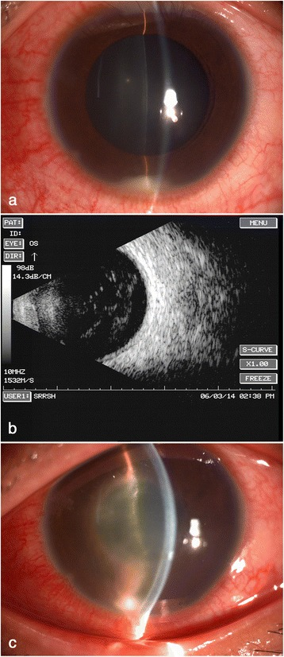
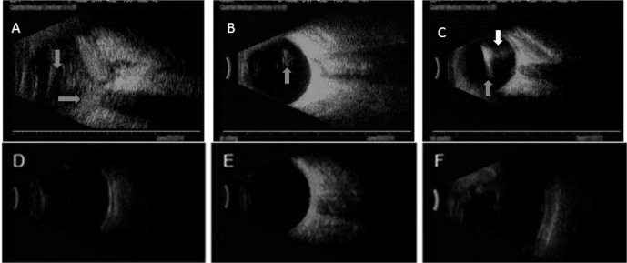
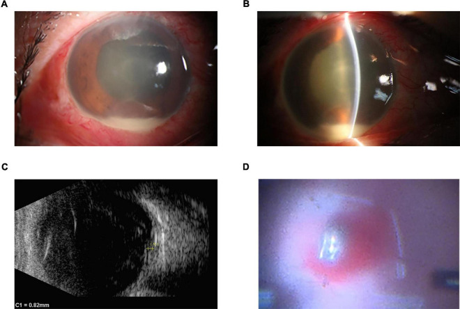
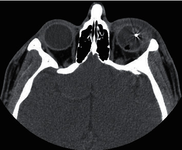
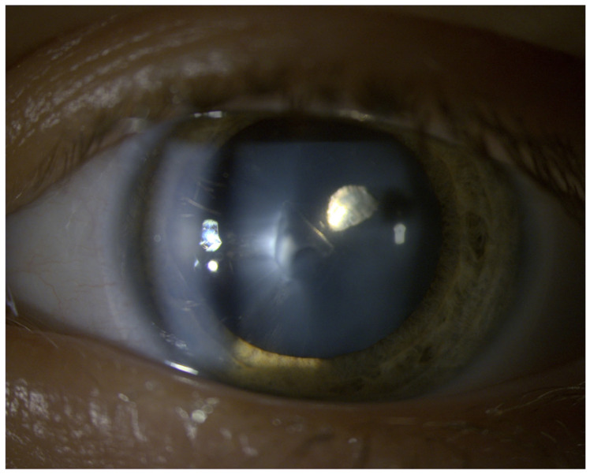
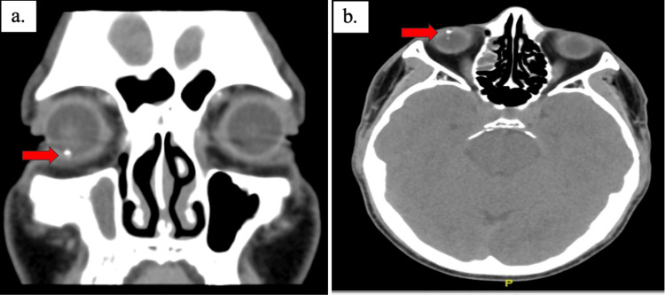
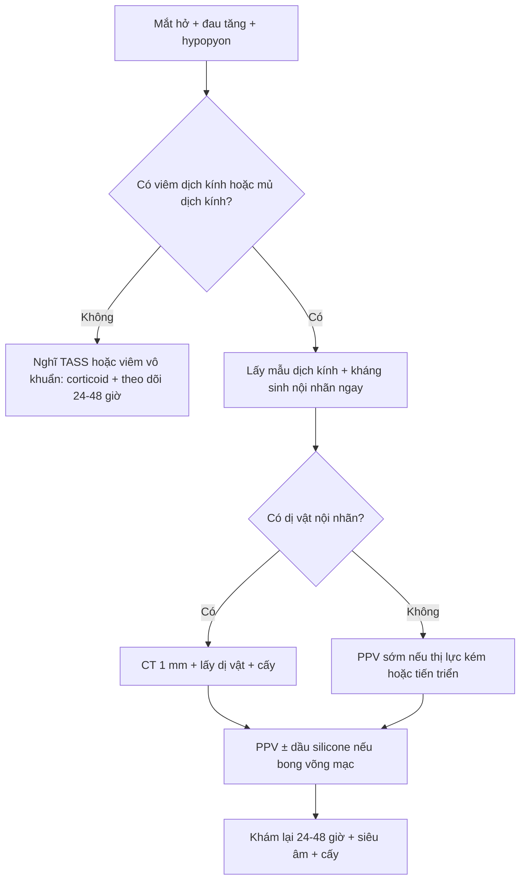
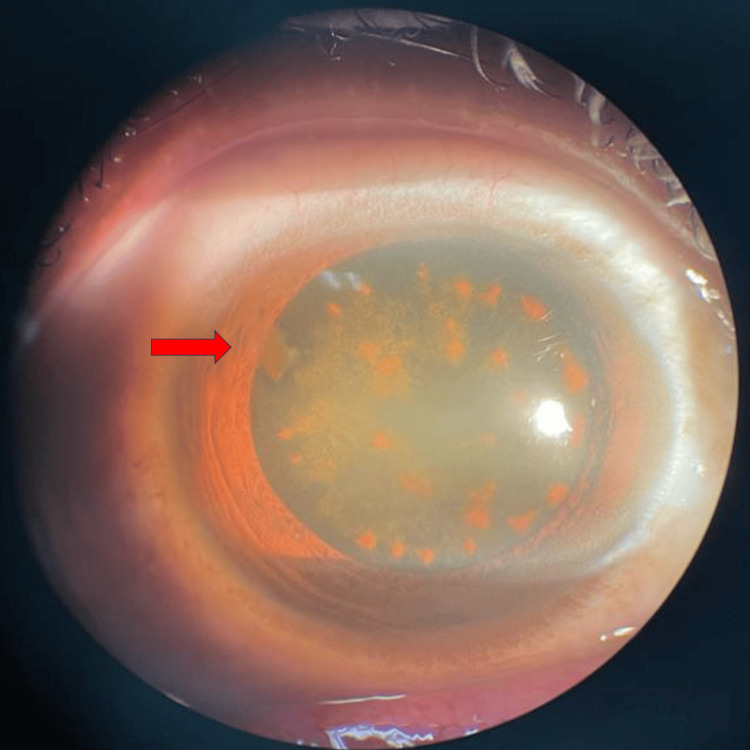
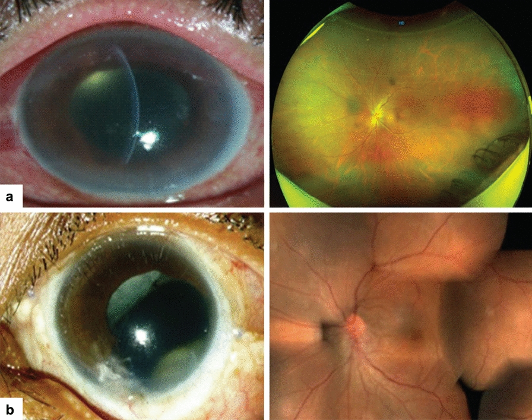

# 3286 — Viêm nội nhãn sau chấn thương mắt hở: hypopyon + viêm dịch kính sau vết thương xuyên nhãn cầu

**Tags:** `pattern:viem-noi-nhan` `pattern:mu-tien-phong` `pattern:hypopyon` `pattern:virtitis` `pattern:sau-chan-thuong` `pattern:iofb` `pattern:mat-mot-ben` `vung:mat` `vung:tien-phong` `vung:dich-kinh` `vung:vong-mac` `protocol:CT-lat-mong` `protocol:sie-u-B` `protocol:AS-OCT` `protocol:cay-dich-kinh` `protocol:PPV` `protocol:khang-sinh-noi-nhan` `protocol:du-phong` `score:OTS` `score:BETT` `incidentaloma:iofb`

**Mức chắc chắn (certainty):** tổng hợp y văn (literature synthesis) — dựng từ **phân tích toàn quốc 23.455 ca nhập viện vì mắt hở** (Ophthalmic Epidemiol 2026, PMID 43002133), **phân tích gộp 15 nghiên cứu/8.497 mắt về thời điểm khâu** (PMID 39218161), **phân tích gộp 57 nghiên cứu/4.558 mắt viêm nội nhãn sau chấn thương ở trẻ** (Graefes Arch Clin Exp Ophthalmol 2026, PMID 43049922), **đoàn hệ 515 vết thương xuyên nhãn cầu tại TP.HCM** (Klin Monbl Augenheilkd 2003, PMID 12886508), **đoàn hệ 591 mắt mắt hở** (J Ophthalmic Inflamm Infect 2021, PMC8326234), **301 trẻ** (Antibiotics 2025, PMC11762764), **nghiên cứu 424 mắt dự phòng moxifloxacin nội tiền phòng** (Eye 2026, PMC13161291), cùng các ca nguyên văn có ảnh minh hoạ. Nhóm **không có bệnh nhân của mình**; chỗ chưa đủ chắc ghi **"chưa rõ"**. **Không ghi tên tác giả** — attribution = **tạp chí + năm + PMCID/DOI** (xem `images/CREDITS.md`).

> **Câu chốt:** Viêm nội nhãn sau chấn thương (post-traumatic endophthalmitis, PTE) là **cấp cứu mù nhanh** nhưng chẩn đoán lại nằm ở **ba dấu hiệu lâm sàng**: **đau tăng dần**, **mủ tiền phòng (hypopyon)** và **viêm dịch kính (vitritis)** — không phải ở phim. Ba câu hỏi quyết định: **(1) Có dị vật nội nhãn (intraocular foreign body, IOFB) không?** — vì IOFB làm **tăng nguy cơ 1,9 lần** và là yếu tố tiên lượng xấu độc lập (**aOR 4,62**). **(2) Vết thương đã khâu trong 24 giờ chưa?** — khâu **< 24 giờ** giảm nguy cơ còn **OR 0,39**; đến muộn **> 24 giờ** làm tăng **OR 3,9**. **(3) Tác nhân là "nhanh" hay "chậm"?** — **Bacillus cereus gây mất thị lực/mất mắt trong 12–48 giờ**, còn **nấm** diễn tiến **hàng tuần** và thường bị chẩn đoán muộn. Điều trị không chờ cấy: **kháng sinh nội nhãn ± cắt dịch kính (pars plana vitrectomy, PPV)**, và **dự phòng tại lúc khâu** vẫn là điểm tranh luận lớn nhất.

## 1. Tổng quan bệnh học – cơ chế hình ảnh (TẠI SAO)

### 1.1 Vì sao "mắt hở" là bệnh cảnh nhiễm trùng khác hẳn "sau phaco"

- **Định nghĩa:** PTE là nhiễm khuẩn/nấm **các mô trong nhãn cầu** (tiền phòng, thể thủy tinh, dịch kính, võng mạc) sau **chấn thương xuyên nhãn cầu (open globe injury, OGI)** — khác hoàn toàn viêm nội nhãn sau mổ, nơi tác nhân thường là **khuẩn cư trú da** và liều cấy rất thấp.
- **Tần suất (số liệu định lượng):**
  - Phân tích toàn quốc Mỹ 2016–2022: **93/4.691 ca mắt hở = 1,98%** (đại diện 23.455 ca nhập viện có trọng số) (PMID 43002133).
  - Các đoàn hệ đơn trung tâm: **4–16%** (PMC11347439), **7–13%** vết thương xuyên (PMC13674035), **11,8% (61/515)** tại TP.HCM (PMID 12886508), **20,9% (42/201)** ở Trung Quốc (PMC11224860), **29,8%** trong loạt 34 mắt được cắt dịch kính (PMC9860693).
  - Trẻ em: **4,9–54,2%** tuỳ khu vực (PMC11762764) — PTE ở trẻ **cao gấp khoảng 10 lần** viêm nội nhãn sau mổ (PMC11762764).
  - Có **IOFB**: **6–30%**, và trong một đoàn hệ **13,43%** so với **7,46%** khi không có IOFB (PMC11224860).
- **TẠI SAO cao hơn sau mổ — bốn cơ chế:**
  1. **Liều cấy trực tiếp và đa tạp:** dị vật/vết thương đưa thẳng **đất, bụi, nước, mảnh hữu cơ** vào nội nhãn — không phải một loài khuẩn da. Vì thế phổ gồm **Gram dương, Gram âm, Bacillus, nấm**, và **nhiều loài cùng lúc**.
  2. **IOFB là "ổ nhớ" vi khuẩn:** bề mặt kim loại và đặc biệt **gỗ/mảnh hữu cơ xốp** tạo **màng sinh học (biofilm)**; kháng sinh nội nhãn **không diệt được vi khuẩn trong biofilm**, nên **phải lấy dị vật** chứ không chỉ tiêm.
  3. **Dịch kính là môi trường nuôi cấy:** dịch kính giàu **collagen và acid hyaluronic**, ít tế bào miễn dịch (vùng **miễn dịch ưu tiên — immune privilege**), nên vi khuẩn **nhân lên nhanh** mà phản ứng thực bào yếu; khi viêm bùng phát, **fibrin và mủ** lấp tiền phòng/dịch kính.
  4. **Hàng rào đã vỡ + can thiệp muộn:** vết thương hở cho vi khuẩn vào **liên tục** cho tới khi khâu kín; **khâu muộn > 24 giờ** làm tăng nguy cơ (OR 3,9) (PMC8326234) và **khâu < 24 giờ** giảm nguy cơ (OR 0,39; 15 nghiên cứu, 8.497 mắt, độ chắc chắn thấp vì toàn hồi cứu) (PMID 39218161).
- **Yếu tố nguy cơ có số:**
  - **IOFB:** OR **1,9** (KTC 95% 1,2–3,0) (PMC8326234); IOFB gặp **55,1%** ở nhóm viêm nội nhãn so với **27,3%** nhóm không viêm (PMC8326234).
  - **Đến muộn > 24 giờ:** OR **3,9** (2,3–6,4) (PMC8326234).
  - **Vết thương ở giác mạc/trước:** OR **2,0** (1,1–3,7) (PMC8326234); tại TP.HCM, **vết thương giác mạc thuần** và **chiều dài < 5 mm** đều là yếu tố nguy cơ (PMID 12886508) — nghĩa là **vết thương nhỏ tự bít còn nguy hiểm hơn vết thương lớn** vì dễ bị bỏ qua.
  - **Tốc độ cao/dị vật bay:** **55,9%** ca viêm so với **32,6%** ca không viêm (PMC8326234).
  - **Kích thước vết thương ≥ 3 mm** và **bong võng mạc** liên quan thị lực xấu (PMC9860693).
- **Phản biện nguồn:** phân tích hành chính NIS ghi nhận **loét giác mạc** là yếu tố liên quan mạnh nhất (**OR 17,81**; 8,96–33,81) và **vỡ nhãn cầu lại có OR thấp hơn (0,31)** (PMID 43002133) — trái với các đoàn hệ lâm sàng. Cách giải thích hợp lý: **mã ICD-10 và tiêu chuẩn chọn ca** khác nhau, không nên dùng OR này để loại trừ vỡ nhãn cầu. Đây là ví dụ điển hình của **khác biệt giữa dữ liệu hành chính và dữ liệu lâm sàng**.

### 1.2 Ba nhịp thời gian — "đồng hồ" quyết định tác nhân và tiên lượng

- **Nhịp 1 — 12–48 giờ (tối cấp):** **Bacillus cereus** (và streptococci, một số Gram âm) nhân lên nhanh, tiết độc tố, gây **mất thị lực hoặc mất mắt trong 12–48 giờ** (PMC7113113). Trong loạt 66 mắt PTE, **Bacillus cereus chiếm 33%** — nhiều nhất (PMC7708365).
- **Nhịp 2 — 2–7 ngày (cấp):** phần lớn vi khuẩn thường gặp. Trong loạt 42 ca: khởi phát **1 ngày ở 23,8%**, **2–7 ngày ở 73,8%**, **7–14 ngày ở 2,38%** (PMC11224860). Trong loạt 33 trẻ cắt dịch kính 25G: **trung bình 4,72 ± 3,75 ngày** từ chấn thương đến khởi phát (PMID 41996231).
- **Nhịp 3 — 1–4 tuần (bán cấp):** **nấm** và vi khuẩn chậm (Cutibacterium, Nocardia, Mycobacterium không điển hình). Tại TP.HCM, **thời gian trung bình từ chấn thương đến chẩn đoán là 16,8 ± 5,6 ngày**; cấy dương **50%**, trong đó **nấm 16%**, Gram dương **51%**, Gram âm **33%** (PMID 12886508). Loạt Fusarium: **50% do chấn thương**, thị lực cuối trung bình **2,25 logMAR**, **71% có biến chứng** (PMC13284917).
- **TẠI SAO "nhịp" quan trọng hơn tên vi khuẩn:** cùng một hypopyon, nhưng **khởi phát < 48 giờ sau chấn thương đất/nông nghiệp** buộc phải xử trí như **Bacillus** (kháng sinh + cắt dịch kính sớm, không chờ cấy); còn **hypopyon xuất hiện sau 2 tuần, đã "đỡ" với corticoid rồi tái phát** là chân dung của **nấm**.

### 1.3 TẠI SAO hình ảnh trông như vậy — vật lý từng phương thức

- **Siêu âm B (B-scan, 10–20 MHz):** dịch kính bình thường **đồng nhất, không có giao diện → trống âm (anechoic)**. Khi có **mủ (tế bào, fibrin, protein)**, vô số giao diện nhỏ phản xạ sóng → **echo điểm và cụm (dot/clump echoes) mức thấp–trung bình**, có thể lắng thành lớp; **đục dày che võng mạc**. Vì vậy B-scan trả lời được **"dịch kính có đục không, có dị vật/bong võng mạc không"**, nhưng **không phân biệt mủ với máu** — phải đối chiếu lâm sàng.
  - **Quy tắc an toàn:** **không đè đầu dò lên mắt chưa khâu** (nguy cơ đẩy nội nhãn ra ngoài); chỉ siêu âm **sau khi khâu kín** hoặc khi đã loại trừ mắt hở.
- **CT sọ–hốc mắt không cản quang, lát ≤ 1 mm:** kim loại có **hệ số suy giảm (Z) cao → tăng đậm độ rất mạnh + giả ảnh tia (streak artifact)** — dấu hiệu gần như chẩn đoán IOFB kim loại. **Gỗ và nhựa** có tỉ trọng gần mỡ/nước nên **dễ bỏ sót**. Phân tích gộp 12 nghiên cứu/937 bệnh nhân: **độ nhạy 75%** (65–85), **độ đặc hiệu 83%** (76–90), **PPV 90%** (84–96) cho chẩn đoán mắt hở (PMID 40694213). Một nghiên cứu 190 mắt (54 mắt hở) cho **nhạy 71,3%, đặc hiệu 98,5%, PPV 83,6%, NPV 95,75%, độ chính xác 94,9%** (PMC12240278) — **CT âm không loại trừ mắt hở**, và **CT dương tính giả** có thật (dị vật nằm trên mặt củng mạc, khí do giả ảnh).
- **MRI:** **chống chỉ định khi nghi dị vật kim loại** (từ trường làm dị vật di chuyển, giả ảnh nặng). Chỉ dùng khi **đã loại trừ kim loại** và cần đánh giá mô mềm/hốc mắt.
- **AS-OCT:** mủ tiền phòng là **dải tăng hồi âm lắng ở đáy**; nhưng khi **phù giác mạc nặng** tín hiệu bị tán xạ, **không xuyên qua được mủ dày** — AS-OCT hữu ích cho **theo dõi đáp ứng**, không dùng để chẩn đoán PTE.
- **X-quang:** chỉ thấy dị vật **cản quang lớn**; **bỏ sót gỗ/nhựa/thuỷ tinh nhỏ**, nên không còn là chuẩn.

### 1.4 Ngưỡng định lượng cần nhớ (một dòng mỗi ngưỡng)

- Khâu **< 24 giờ**: **OR 0,39** (0,19–0,79) cho viêm nội nhãn (PMID 39218161).
- Đến muộn **> 24 giờ**: **OR 3,9** (2,3–6,4) (PMC8326234).
- **IOFB**: **OR 1,9** (1,2–3,0) cho nhiễm; **aOR 4,62** (1,04–20,53) cho thị lực xấu (PMC8326234; PMC7708365).
- **Hypopyon** gặp ở **45,4%** trẻ có PTE (PMID 41996231).
- **Cấy dương** **39%** (phân tích gộp trẻ) (PMID 43049922) đến **47,2%** (301 trẻ) (PMC11762764); tại TP.HCM **50%** (PMID 12886508).
- **Kết cục xấu vẫn phổ biến:** thị lực cuối **≥ 20/200 chỉ 28%**, **không còn cảm giác sáng (NLP) 27%**, **teo nhãn 14%**, **bỏ mắt 2%** trong phân tích gộp trẻ (PMID 43049922); tại TP.HCM **múc nội nhãn 14%**, **teo nhãn 29%**, **chỉ 10% thị lực tốt hơn đếm ngón tay** (PMID 12886508).

*BN 24 tuổi, 2 tuần sau lấy dị vật sắt: (a) tiền phòng tế bào 4+, **hypopyon 2 mm**; (b) B-scan **đục dịch kính nặng**, không bong dịch kính sau; (c) ngày 4 sau tiêm kháng sinh nội nhãn, mủ tăng và không còn thấy đáy mắt. Nguồn: BMC Ophthalmol 2017 (PMC5637324), CC BY 4.0.*

## 2. Mẫu hình + chẩn đoán phân biệt theo vị trí (gamut)

### 2.1 Mẫu hình trung tâm

**Mắt hở + đau tăng dần + đỏ + hypopyon + viêm dịch kính** — trong đó **đau tăng sau khi đã khâu** là dấu hiệu "động" quan trọng hơn hypopyon tĩnh. Mủ có thể **chưa có** ở lần khám đầu (45,4% trẻ có hypopyon tại thời điểm chẩn đoán — nghĩa là **hơn một nửa không có** lúc đầu) (PMID 41996231).

### 2.2 Gamut theo thời điểm khởi phát

- **< 48 giờ:** Bacillus cereus, streptococci, Staphylococcus aureus, vi khuẩn Gram âm đường ruột; đồng thời phải loại **TASS** (sau khâu) và **viêm vô khuẩn do mảnh thể thủy tinh**.
- **2–7 ngày:** Staphylococcus coagulase âm, streptococci, Gram âm; đây là **cửa sổ điển hình** của PTE (73,8% ca) (PMC11224860).
- **1–4 tuần:** nấm (Aspergillus, Fusarium), Nocardia, Mycobacterium không điển hình, Cutibacterium; cấy có thể âm.

### 2.3 Gamut theo vật liệu dị vật (quan trọng vì quyết định kháng sinh và theo dõi)

- **Kim loại (sắt, thép):** Staphylococcus, streptococci; **nguy cơ nhiễm sắt (siderosis bulbi) về lâu dài** nếu bỏ sót — **không phụ thuộc nhiễm khuẩn**.
- **Đất, gỗ, mảnh nông nghiệp:** **Bacillus**, nấm, Pseudomonas, Nocardia — **nguy cơ cao nhất** và **không được đóng vết thương mà bỏ dị vật**.
- **Thuỷ tinh, nhựa:** ít độc lực hơn nhưng **khó thấy trên CT**; có thể gây viêm mạn.
- **Dị vật trong thể thủy tinh:** thường **khu trú**, có thể chỉ gây **đục thể thủy tinh khu trú** rồi **viêm do protein thể thủy tinh** — hình ảnh giống viêm nội nhãn nhưng **cấy âm**, và điều trị là **lấy thể thủy tinh/dị vật**, không phải chỉ kháng sinh.

### 2.4 Gamut theo ngăn tổn thương

- **Chỉ tiền phòng:** TASS, viêm màng bồ đào chấn thương, phản ứng mảnh thể thủy tinh, hypopyon do herpes.
- **Tiền phòng + dịch kính:** PTE thực sự; viêm màng bồ đào nặng; PAN.
- **Dịch kính/võng mạc đơn thuần:** nấm (dạng dây, "string of pearls"), độc tố Bacillus, bong võng mạc kèm xuất huyết.

### 2.5 Gợi nhớ **BLAST** — yếu tố nguy cơ của PTE

- **B** — **Bacillus/đất bẩn** (dị vật hữu cơ, tai nạn nông nghiệp).
- **L** — **Lens (thể thủy tinh) vỡ** (vỡ bao thể thủy tinh giải phóng protein và tạo môi trường).
- **A** — **Antibiotic trễ** (không dự phòng tại lúc khâu, kháng sinh không đúng phổ).
- **S** — **Soil/organic IOFB** (dị vật đất/gỗ xốp).
- **T** — **Time to repair > 24 giờ**, **Trauma zone I** (giác mạc/rìa) và **trẻ nhỏ**.

*B-scan 10 MHz của 6 mắt viêm nội nhãn do **Bacillus cereus** sau chấn thương: (A–C) trước mổ — đục dịch kính từ mức độ nặng (A, mũi tên) đến nhẹ (B, C); (D–F) sau mổ — dịch kính trong hơn, võng mạc bám. Nguồn: PLoS ONE 2016 (PMC4757555), CC BY 4.0. Ảnh nguyên bản, không chỉnh sửa.*

## 3. Bảng so sánh phân biệt (ma trận đối chiếu)

| Thực thể (entity) | Hình ảnh điển hình (lâm sàng/US/CT) | Chốt vào (rule-in) | Chốt loại (rule-out) | Gợi ý xác nhận |
|---|---|---|---|---|
| **PTE vi khuẩn cấp** (Staph/Strep/Gram âm) | Hypopyon vàng, fibrin tiền phòng, viêm dịch kính; B-scan echo điểm/cụm; khởi phát 2–7 ngày | **Đau tăng + hypopyon + vitritis tiến triển sau 24–48 giờ** | Không có vitritis, đáp ứng corticoid trong 24 giờ → nghĩ TASS/vô khuẩn | Cấy dịch kính + PCR 16S; kháng sinh nội nhãn ngay |
| **Bacillus cereus** | Khởi phát **12–48 giờ**, đau dữ dội, **ring infiltrate** giác mạc, mủ ồ ạt, tiến triển panophthalmitis; B-scan đục rất nặng | **< 48 giờ + dị vật đất/nông nghiệp + tiến triển cực nhanh** | Diễn tiến > 1 tuần, đau ít → nghĩ nấm/vi khuẩn chậm | Cấy máu thạch, Gram dương trực khuẩn; **không chờ kết quả** |
| **Nấm** (Aspergillus/Fusarium) | Khởi phát **1–4 tuần**, viêm nhẹ hơn, **dịch kính dạng dây/chuỗi hạt**, retinitis trắng; sau dị vật gỗ/đất | **Tiền sử hữu cơ + khởi phát muộn + không đáp ứng kháng sinh** | Khởi phát < 48 giờ, mủ ồ ạt → vi khuẩn | Cấy nấm, soi tươi, PCR; sinh thiết dịch kính |
| **TASS** (hội chứng tiền phòng nhiễm độc) | **12–48 giờ sau mổ khâu**, **phù giác mạc limbus-to-limbus**, tế bào tiền phòng, **KHÔNG vitritis**, đau ít | **Sau mổ + phù toàn chu vi + không vitritis + đáp ứng corticoid** | Vitritis, hypopyon lớn, đau tăng → nhiễm khuẩn | Diễn tiến + đáp ứng steroid; cấy âm |
| **Viêm vô khuẩn do mảnh thể thủy tinh** | Ngay sau chấn thương, tế bào tiền phòng, hypopyon nhỏ do protein thủy tinh; **không tiến triển** | **Bắt đầu ngay, ổn định/giảm với corticoid, cấy âm** | Tăng dần sau 48 giờ, vitritis → nhiễm | Theo dõi 24–48 giờ + cấy; lấy mảnh thể thủy tinh nếu kéo dài |
| **Siderosis bulbi** (nhiễm sắt) | **Hàng tuần–tháng** sau dị vật sắt: cataract vàng nâu, **đốm rỉ trên bao/thể thủy tinh**, heterochromia, ERG giảm; CT có IOFB | **Vết thương cũ tự bít + đốm rỉ + IOFB trên CT** | Không IOFB, không đốm rỉ → loạn dưỡng khác | CT/X-quang, ERG; lấy dị vật + PPV |
| **Viêm mắt giao cảm** (sympathetic ophthalmia) | **0,19%** sau mắt hở (0,14–0,24%); viêm màng bồ đào **hai bên**, u hạt, Dalen–Fuchs; sau nhiều tuần | **Mắt lành viêm sau chấn thương mắt kia** + tế bào tiền phòng/vitritis hai bên | Một bên, có mủ, tiến triển cấp → nhiễm | Lâm sàng + FFA/ICGA; corticoid/ức chế miễn dịch |
| **Xuất huyết dịch kính đơn thuần** | Đục dịch kính nhưng **không hypopyon**, không đau tăng; B-scan echo thấp–trung bình, có thể lắng; CT tăng đậm độ nhẹ | **Chấn thương, không mủ, ổn định qua 24–48 giờ** | Hypopyon + fibrin + đau tăng → nhiễm | B-scan lặp lại; theo dõi |

### 3.1 Đọc hypopyon: ba câu hỏi tại giường

1. **Có đau tăng không?** Đau tăng sau khâu là **dấu hiệu nhiễm** mạnh hơn độ cao hypopyon.
2. **Có viêm dịch kính không?** Nhìn qua đồng tử: **mất đỏ phản xạ đáy mắt**, dịch kính đục; siêu âm sau khâu xác nhận.
3. **Có dị vật không?** Luôn chủ động tìm **IOFB** — kể cả khi vết thương **nhỏ, tự bít, không triệu chứng ban đầu**.

*BN nam 40 tuổi, 3 ngày sau dị vật thép: (A, B) đỏ mắt, **vết vào tự bít** ở kết mạc/củng mạc mũi, **hypopyon 2,0 mm**, màng fibrin, tế bào 4+ che thể thủy tinh; (C) B-scan **dịch vật + đục dịch kính dày trước võng mạc** (caliper 0,92 mm); (D) ảnh đáy mắt sau điều trị. Cấy dịch kính: *Acinetobacter johnsonii*. Nguồn: Front Med 2024 (PMC11347439), CC BY 4.0.*

### 3.2 Đọc CT: dị vật kim loại và bẫy "một dị vật"

*CT ngang không cản quang: **nốt tăng đậm độ rất mạnh** ở nhãn cầu phải kèm **giả ảnh tia** — dị vật kim loại nội nhãn. Nguồn: J Ophthalmol 2022 (PMC9458393), CC BY 4.0.*

- **Giả ảnh tia (streak artifact)** giúp nhận ra kim loại nhưng cũng **che các dị vật nhỏ thứ hai** — phải cửa sổ rộng, đọc cả **hai bên** và **mặt phẳng trục/vành**.
- **CT âm không loại trừ** gỗ/nhựa/thuỷ tinh nhỏ: nghiên cứu trên mô hình cho thấy siêu âm 3D phát hiện **gỗ > 250 µm**, **nhựa > 300 µm**, trong khi **CT chỉ thấy dị vật lớn hơn** (PMC11128014). Đây là dữ liệu **mô hình ex vivo**, chưa phải chuẩn lâm sàng.

## 4. Protocol chụp + hệ phân độ/điểm chuẩn hóa

### 4.1 Cấp cứu — 6 việc trong 60 phút đầu

1. **Che chắn (shield)**, không băng ép, **không đè mắt**, không tra thuốc khi chưa loại trừ mắt hở.
2. **Không ăn uống** (gây mê), chống nôn, giảm đau; **không dùng thuốc nhỏ có corticoid** trước khi loại trừ nhiễm.
3. **Kháng sinh toàn thân** phổ rộng (bao Bacillus và Gram âm) **càng sớm càng tốt** — nhưng nhớ: bằng chứng lợi ích toàn thân **yếu** (xem 4.3).
4. **Uốn ván** theo lịch.
5. **CT hốc mắt không cản quang, lát ≤ 1 mm**, trục + vành, cửa sổ xương và mô mềm — **trước khi khâu** nếu bệnh nhân ổn định.
6. **Khâu kín trong < 24 giờ**; nếu nghi PTE, **lấy mẫu dịch kính/aqueous + kháng sinh nội nhãn ngay trong thì khâu**.

### 4.2 Protocol hình ảnh (theo thứ tự an toàn)

- **Bước 1 — CT hốc mắt 1 mm** (không cản quang): tìm **IOFB, khí nội nhãn, mất thể tích nhãn cầu, bờ củng mạc không liên tục, đục thể thủy tinh, xuất huyết dịch kính**. Độ nhạy gộp cho mắt hở **75%**, đặc hiệu **83%** (PMID 40694213).
- **Bước 2 — Siêu âm B sau khi khâu kín** (hoặc khi đã loại trừ mắt hở): đánh giá **dịch kính, võng mạc, dị vật cản âm**, theo dõi đáp ứng điều trị.
- **Bước 3 — MRI chỉ khi đã loại trừ kim loại**; **AS-OCT** khi cần theo dõi tiền phòng/giác mạc nhưng không thay thế khám lâm sàng.
- **Không** làm siêu âm đè lên mắt chưa khâu; **không** MRI khi nghi dị vật kim loại.

*BN 9 tuổi, dị vật kim loại **trong thể thủy tinh** sau khi đập vào khung xe đạp: vết rách giác mạc dạng vạt, **đục thể thủy tinh khu trú**, dị vật ánh kim nằm trong thể thủy tinh. Dị vật trong thể thủy tinh chỉ chiếm khoảng **2%** tổng số IOFB. Nguồn: Diagnostics 2026 (PMC13298824), CC BY 4.0.*

### 4.3 Khâu vết thương, cấy và dự phòng — phần tranh luận nhất

- **Nguyên tắc:** khâu kín **< 24 giờ**, **lấy dị vật**, **cấy dịch kính/aqueous** (Gram, nhuộm, cấy, PCR 16S), **kháng sinh nội nhãn tại thì khâu**.
- **Liều chuẩn:** **vancomycin 1 mg/0,1 mL** + **ceftazidime 2,25 mg/0,1 mL** (hoặc **amikacin 400 µg/0,1 mL** thay ceftazidime khi dị ứng/kháng thuốc); cân nhắc **kháng nấm nội nhãn** nếu dị vật đất/gỗ (PMC11762764).
- **Dự phòng nội nhãn — bằng chứng:**
  - Phân tích gộp **3 thử nghiệm**: kháng sinh nội tiền phòng/nội nhãn giảm viêm nội nhãn **RR 0,19** (0,06–0,57), nhưng **không cải thiện thị lực** (**RR 1,17**; 0,61–2,23) (PMC5678325).
  - Nghiên cứu 424 mắt (2002–2023): **moxifloxacin nội tiền phòng 0,7% (2/294)** so với **3,9% (5/130)** không dự phòng; **RR 0,18** (0,04–0,78), **giảm nguy cơ tương đối 82%**, **aOR 0,20** (0,04–0,86) (PMC13161291).
  - Tổng quan hệ thống: **kéo dài > 24 giờ không tốt hơn**, **đường tiêm không tốt hơn đường uống**, và **ciprofloxacin đơn trị kém hơn** các phác đồ khác (PMC9672185).
- **Dự phòng toàn thân — bằng chứng yếu:** 2 thử nghiệm ngẫu nhiên (1.555 bệnh nhân): **2,26%** với kháng sinh uống so với **2,11%** với IV (± uống), **OR 1,07** (0,54–2,12) (PMID 37406735). Nghĩa là **không có lợi ích rõ**, và nếu dùng thì **uống không kém IV**.
- **Kết luận thực hành:** dự phòng nội nhãn **hợp lý ở nhóm nguy cơ cao** (IOFB, đất bẩn, đến muộn, vỡ thể thủy tinh) nhưng **không có bằng chứng mức cao**; **không được thay thế** việc **khâu sớm + lấy dị vật + cấy**.

*CT hốc mắt không cản quang: (a) mặt phẳng vành — **một ổ tăng đậm độ** ở cực dưới nhãn cầu phải; (b) mặt phẳng trục — **hai ổ tăng đậm độ** ở cực dưới, đo **2,6 mm và 2,5 mm**, gợi ý dị vật kim loại. Lưu ý: phẫu thuật chỉ lấy được **một** dị vật — CT có thể **đếm quá** do mảnh vỡ/giả ảnh. Nguồn: Cureus 2024 (PMC10924439), CC BY 4.0.*

### 4.4 Điều trị viêm nội nhãn đã xác định

- **Chọc hút dịch kính (vitreous tap) + tiêm kháng sinh** khi thị lực **còn tốt** và tổn thương **chưa lan toả**; **PPV sớm** khi **thị lực ≤ đếm ngón tay**, dịch kính đục dày, IOFB, hoặc **không cải thiện sau 24–48 giờ**.
- **Số liệu:** trong phân tích gộp trẻ, **PPV được dùng ở 90%**, kháng sinh nội nhãn **97%**, kháng sinh toàn thân **81%** (PMID 43049922); loạt 33 trẻ 25G: **giải quyết nhiễm 90%**, **võng mạc bám 72,7%**, **33,3% đạt ≥ 3/60** (PMID 41996231).
- **Bacillus/nấm/dị vật hữu cơ:** **PPV sớm + kháng sinh toàn thân** (Bacillus), **kháng nấm nội nhãn + toàn thân** (nấm); **lấy toàn bộ dị vật** và **cắt thể thủy tinh nếu vỡ bao**.
- **Bong võng mạc kèm PTE:** PPV + **dầu silicone/gas**; dùng **dầu silicone** khi có rách lớn/PVR (trong loạt 25G, **30%** dùng dầu, **9,1%** dùng gas) (PMID 41996231).
- **Theo dõi:** khám lại **24–48 giờ**, tiêm nhắc nếu cần, siêu âm lại; **không đánh giá đáp ứng chỉ bằng hypopyon** — phải nhìn **vitritis và đau**.

### 4.5 Phân độ BETT và điểm chấn thương mắt (OTS)

- **BETT (Birmingham Eye Trauma Terminology):** cơ chế **đụng dập vs xuyên**; loại **kín** (đụng dập, rách lớp) vs **hở** (rách, vỡ, xuyên, dị vật); **vùng I** = giác mạc/rìa, **vùng II** = củng mạc ≤ 5 mm sau rìa, **vùng III** = sau 5 mm/tới hậu cực.
- **OTS (Ocular Trauma Score)** — điểm thô:

| Biến số | Điểm |
|---|---|
| Thị lực ban đầu: NLP | 60 |
| LP–HM | 70 |
| 1/200–19/200 | 80 |
| 20/200–20/50 | 90 |
| ≥ 20/40 | 100 |
| Vỡ nhãn cầu | −23 |
| Viêm nội nhãn | −28 |
| Chấn thương xuyên (perforating) | −14 |
| Bong võng mạc | −11 |
| RAPD | −10 |

- **Nhóm OTS:** **1 = 0–44**, **2 = 45–65**, **3 = 66–80**, **4 = 81–91**, **5 = 92–100**. Kiểm định 150 mắt: OTS tương quan với thị lực cuối (**r = 0,53**, p < 0,001); **73%** mắt OTS 1 còn NLP, **89%** mắt OTS 5 đạt ≥ 20/40 (PMC12178410).
- **Cách dùng:** OTS dùng để **tư vấn tiên lượng**, **không** dùng để trì hoãn khâu hay kháng sinh.

### 4.6 Sơ đồ quyết định

## 5. Biến thể bình thường và cạm bẫy

- **Vết thương nhỏ tự bít — bẫy nguy hiểm nhất.** Vết rách **< 5 mm** ở giác mạc/củng mạc có thể **tự kín**, bệnh nhân **không đau, không giảm thị lực** ban đầu; dị vật nằm lại **hàng tháng** gây **siderosis** hoặc **nhiễm muộn**. Tại TP.HCM, **vết thương < 5 mm** là yếu tố nguy cơ độc lập của PTE (PMID 12886508). Ca siderosis dưới đây: **4 tháng** mờ mắt, **phủ nhận chấn thương**, chỉ có **vết sẹo giác mạc tự bít + đốm rỉ**.
- **CT âm không loại trừ dị vật.** Ca thứ hai trong loạt siderosis có **nghi chấn thương rõ** nhưng **CT không thấy dị vật**; gỗ/nhựa/thuỷ tinh nhỏ **dưới ngưỡng** (PMC10924439).
- **"Hai ổ" trên CT ≠ hai dị vật.** Mảnh vỡ, giả ảnh tia và **mảnh kim loại nằm ngoài nhãn cầu** đều tạo ổ tăng đậm độ; phải **đối chiếu trong mổ** (PMC10924439).
- **TASS giả nhiễm:** phù giác mạc **limbus-to-limbus**, khởi phát **12–48 giờ sau mổ**, **không vitritis**, đáp ứng corticoid — nếu gọi là nhiễm và **tiêm kháng sinh lặp** thì bỏ lỡ **corticoid**; ngược lại nếu **giảm liều corticoid quá sớm** sẽ bùng viêm (PMID 30703402).
- **Corticoid che dấu nấm:** bệnh nhân "đỡ" sau corticoid rồi **tái phát sau 1–3 tuần** là chân dung nấm; **không** coi đáp ứng corticoid là bằng chứng loại nấm (PMC13284917).
- **Sai sót do "thoả mãn tìm kiếm" (satisfaction of search):** thấy **vết rách giác mạc** là dừng, bỏ qua **dị vật ở hậu cực**; phải **khám toàn bộ nhãn cầu** và **đọc CT theo hệ thống** (bờ, thể tích, khí, đậm độ, dị vật).
- **Siêu âm trước khi khâu:** đè đầu dò có thể **đẩy nội nhãn** ra ngoài; chỉ làm **sau khi khâu kín**.
- **Trẻ nhỏ:** **90,74%** trẻ trong một đoàn hệ là **nông thôn**, **76,85% nam**, và **nhập viện muộn** — trẻ **không mô tả được triệu chứng**, nên **hypopyon nhẹ** dễ bị bỏ qua (PMC12872539).
- **Sau PPV có dầu silicone:** B-scan bị **giả ảnh/echo mạnh**, dễ đọc nhầm là "đục dịch kính"; phải biết **đã bơm dầu** và đọc **võng mạc** thay vì dịch kính.
- **Biến thể bình thường:** **hypopyon 1–2 mm** có thể thoáng qua sau chấn thương do **protein thể thủy tinh** hoặc **phản ứng fibrin**, không nhất thiết nhiễm — theo dõi **24 giờ** và **cấy** quyết định.

*BN 38 tuổi, mờ mắt phải **4 tháng**, phủ nhận chấn thương: **sẹo giác mạc tự bít** ở góc trên–thái dương (mũi tên), **khuyết mống mắt** tương ứng, **đốm rỉ nâu** trên thể thủy tinh đục vàng. CT sau đó phát hiện dị vật **2,6 và 2,5 mm**. Nguồn: Cureus 2024 (PMC10924439), CC BY 4.0.*

*Hàng dưới (b): **viêm nội nhãn nấm sau chấn thương** — hypopyon, fibrin tiền phòng, đục dịch kính; hàng trên (a) là viêm nội nhãn nấm sau mổ để đối chiếu. Nấm sau chấn thương thường **khởi phát muộn hàng tuần**, đau ít hơn vi khuẩn và **không đáp ứng kháng sinh**. Nguồn: Eye Vis 2025 (PMC12516872), CC BY 4.0.*

## 6. Tự lượng giá — Blind Quiz

**Ca 1 — Nam 40 tuổi, 3 ngày sau dị vật thép, mắt phải đau tăng và nhìn kém. Nhìn ảnh, mô tả trước khi mở đáp án.**

- Gợi ý: thị lực **đếm ngón tay 10 cm**, nhãn áp **25 mmHg**; vết vào **tự bít** ở kết mạc/củng mạc mũi.
- Câu hỏi: (1) Dấu hiệu chính ở tiền phòng là gì? (2) B-scan cho thấy gì? (3) Ba chẩn đoán phân biệt và dấu hiệu nào **chốt nhiễm**?

<b>Bấm để hiện đáp án (findings + chẩn đoán)</b>

- **Dấu hiệu:** **hypopyon 2,0 mm**, **màng fibrin**, tế bào tiền phòng **4+** che thể thủy tinh; B-scan có **dị vật kèm đục dịch kính dày** trước võng mạc (caliper **0,92 mm**).
- **Chẩn đoán:** **viêm nội nhãn sau chấn thương + dị vật nội nhãn**; cấy dịch kính *Acinetobacter johnsonii*. Điều trị: **vitreous biopsy + cắt thể thủy tinh + PPV + kháng sinh nội nhãn**, lấy dị vật; thị lực **20/63** sau 1 tháng.
- **Vì sao chốt nhiễm:** **đau tăng + mủ tiền phòng + vitritis** ở mắt có **vết thương hở**; không phải TASS vì có **vitritis** và **không sau mổ**.
- **Nguồn ảnh:** Front Med 2024 (PMC11347439), CC BY 4.0.

**Ca 2 — Nam 38 tuổi, mờ mắt phải 4 tháng, không nhớ chấn thương. CT dưới đây có gì bất thường?**

- Gợi ý: thị lực **1/60**, giác mạc có **sẹo tự bít** và **đốm rỉ**, thể thủy tinh đục vàng.
- Câu hỏi: (1) Mô tả hai ổ tăng đậm độ và vị trí; (2) chẩn đoán? (3) Vì sao **không được kết luận chỉ dựa vào CT**?

<b>Bấm để hiện đáp án (findings + chẩn đoán)</b>

- **Dấu hiệu:** mặt phẳng vành có **một ổ**, mặt phẳng trục có **hai ổ** tăng đậm độ ở **cực dưới hậu đoạn**, đo **2,6 mm và 2,5 mm** — dị vật kim loại.
- **Chẩn đoán:** **siderosis bulbi** do **dị vật sắt bỏ sót**; đốm rỉ trên thể thủy tinh + sẹo giác mạc tự bít là chìa khoá.
- **Vì sao không chỉ dựa vào CT:** phẫu thuật **chỉ lấy được một** dị vật — ổ thứ hai có thể là **mảnh vỡ/giả ảnh**; ngược lại, ca thứ hai của loạt này **CT âm** vẫn có dị vật. CT là **bản đồ**, không phải chẩn đoán.
- **Nguồn ảnh:** Cureus 2024 (PMC10924439), CC BY 4.0.

**Ca 3 — B-scan của 6 mắt viêm nội nhãn do Bacillus. Nhìn trước, đoán mức độ và tiên lượng.**

- Gợi ý: tất cả sau chấn thương, khởi phát **trong 48 giờ**, đau dữ dội.
- Câu hỏi: (1) Hàng trên khác hàng dưới thế nào? (2) Vì sao Bacillus được xếp vào **cấp cứu 12–48 giờ**? (3) Điều trị khác gì vi khuẩn chậm?

<b>Bấm để hiện đáp án (findings + chẩn đoán)</b>

- **Dấu hiệu:** hàng trên (A–C) **đục dịch kính nặng**, có mắt gần như **không thấy võng mạc** (mũi tên); hàng dưới (D–F) sau mổ **dịch kính trong hơn, võng mạc bám**.
- **Chẩn đoán:** **viêm nội nhãn do *Bacillus cereus*** sau chấn thương — trực khuẩn Gram dương, tiết độc tố, **mất thị lực/mất mắt trong 12–48 giờ** (PMC7113113).
- **Điều trị:** **PPV sớm + kháng sinh nội nhãn + kháng sinh toàn thân**; **không chờ cấy**. Bacillus chiếm **33%** ca PTE trong một loạt 66 mắt (PMC7708365).
- **Nguồn ảnh:** PLoS ONE 2016 (PMC4757555), CC BY 4.0.

## 7. Câu hỏi nghiên cứu & điểm chưa đồng thuận (tính đến 11/2026)

1. **[Tranh cãi] Ở bệnh nhân mắt hở có nguy cơ cao (IOFB, đất bẩn, đến muộn), kháng sinh nội nhãn/nội tiền phòng tại lúc khâu có giảm viêm nội nhãn và cải thiện thị lực so với giả dược không?**
   - **Đã biết:** phân tích gộp 3 thử nghiệm cho **RR 0,19** (0,06–0,57) nhưng **không cải thiện thị lực** (RR 1,17; 0,61–2,23) (PMC5678325); đoàn hệ 424 mắt gần đây cho **0,7% vs 3,9%**, **RR 0,18** (PMC13161291).
   - **Chưa rõ:** các thử nghiệm cũ **cỡ nhỏ**, **không phân tầng theo IOFB/đất bẩn**, và **không đủ lực** cho thị lực; lợi ích ở nhóm **nguy cơ rất cao** vẫn là **suy luận từ đoàn hệ**.
   - **Hướng nghiên cứu:** RCT đa trung tâm **phân tầng IOFB hữu cơ**, outcome **viêm nội nhãn + thị lực 6 tháng**.
   - **Nguồn:** PMC5678325 (2017); PMC13161291 (2026).

2. **[Khoảng trống] Ở viêm nội nhãn sau chấn thương, cắt dịch kính ngay trong 24 giờ có tốt hơn chờ 48–72 giờ kháng sinh không?**
   - **Đã biết:** **90%** trẻ trong phân tích gộp được PPV, **97%** nhận kháng sinh nội nhãn (PMID 43049922); loạt 33 trẻ 25G đạt **giải quyết nhiễm 90%**, võng mạc bám **72,7%** (PMID 41996231).
   - **Chưa rõ:** **không có RCT** so sánh thời điểm PPV; các đoàn hệ **gộp nhiều tác nhân** và **khác mức độ nặng**, nên không tách được lợi ích của "sớm" khỏi "bệnh nhẹ hơn".
   - **Hướng nghiên cứu:** đoàn hệ tiến cứu có **phân tầng tác nhân và thị lực ban đầu**, hoặc **thử nghiệm cluster** theo trung tâm.
   - **Nguồn:** PMID 43049922, DOI 10.1007/s00417-026-07617-2 (2026); PMID 41996231, DOI 10.31348/2026/17 (2026).

3. **[Khác biệt thực hành] Kháng sinh toàn thân dự phòng sau khâu mắt hở: có nên dùng, dùng đường nào và bao lâu?**
   - **Đã biết:** 2 RCT (1.555 bệnh nhân) **không thấy khác biệt** giữa uống và IV (**2,26% vs 2,11%**, OR 1,07; 0,54–2,12) (PMID 37406735); tổng quan hệ thống cho thấy **> 24 giờ không tốt hơn** và **đường tiêm không tốt hơn uống** (PMC9672185).
   - **Chưa rõ:** thực hành vẫn rất khác nhau: nhiều trung tâm dùng **IV 3–5 ngày**, nơi khác **chỉ uống 24 giờ** hoặc **không dùng**; chưa có **ngưỡng nguy cơ** để chọn.
   - **Hướng nghiên cứu:** khảo sát thực hành đa quốc gia + **registry** đối chiếu phác đồ với tỉ lệ nhiễm và **tác dụng phụ/kháng thuốc**.
   - **Nguồn:** DOI 10.1016/j.oret.2023.06.022 (2023); PMC9672185 (2022).

> **Ghi chú mục 7:** các "chưa rõ" ở trên đều suy ra từ **giới hạn của nghiên cứu đã dẫn** (cỡ mẫu, phân tầng, thiết kế hồi cứu), không phải từ cảm nhận. Không có tranh cãi nào được tạo thêm ngoài nguồn.

## Bài liên quan chéo
- [3283 – Đứt thị thần kinh do chấn thương](../3283-dut-thi-than-kinh-chan-thuong/lesson.md) (cùng bệnh cảnh chấn thương mắt hở, khác cơ chế mù)
- [449 – Chấn thương mắt do dị vật](../449-chan-thuong-mat-dich-vat/lesson.md) (lấy dị vật, phân loại)
- [1425 – Viêm nội nhãn sau tiêm nội nhãn](../1425-viem-noi-nhan-sau-tiem-noi-nhan/lesson.md) (so sánh tác nhân và thời điểm)
- [3264 – Bong màng Descemet sau phaco](../3264-bong-mang-descemet-sau-phaco/lesson.md) (phù giác mạc sau mổ, phân biệt với nhiễm)
- [3291 – Đổi IOL sau ghép giác mạc](../3291-doi-iol-sau-ghep-giac-mac/lesson.md) (mắt đã phẫu thuật, nguy cơ nhiễm)

## Ảnh
- Tên file: `3286_viem-noi-nhan-sau-chan-thuong_Modality_SourceID.jpg`; nguồn + giấy phép từng ảnh trong `images/CREDITS.md`.
- Toàn bộ ảnh tải từ **PubMed Central open access**, dùng **nguyên bản** (không crop, không ghép, không đổi màu).

> Không dùng để chẩn đoán độc lập khi chưa có người hướng dẫn.
