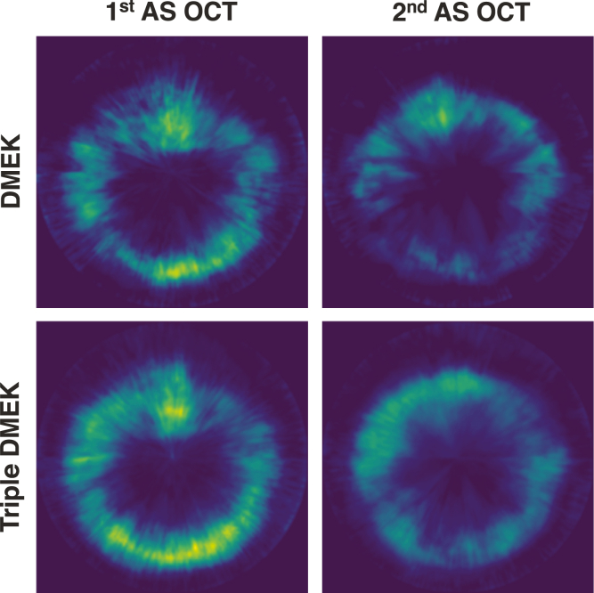
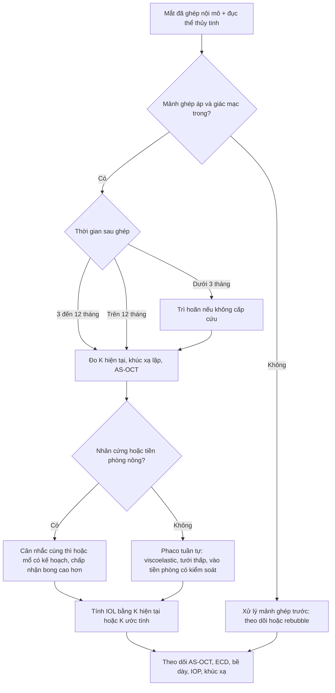
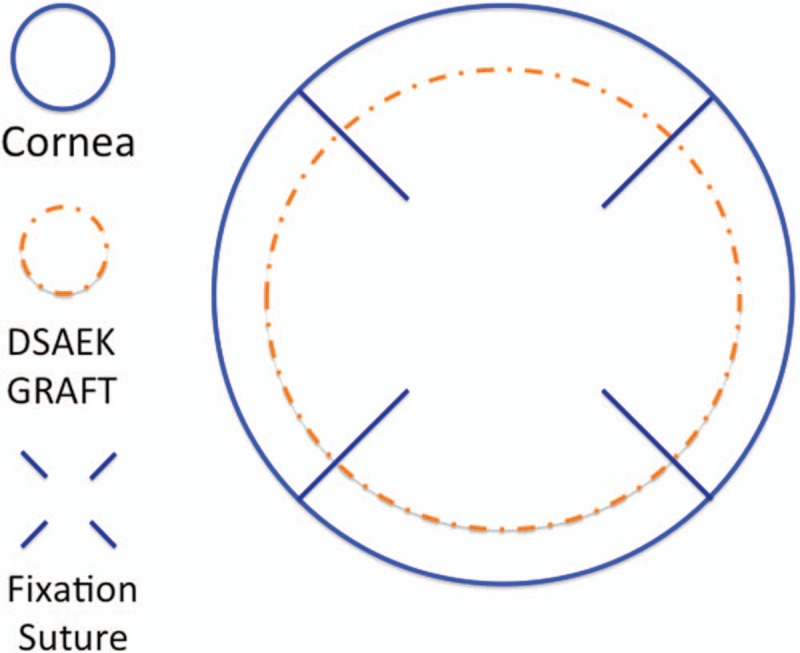
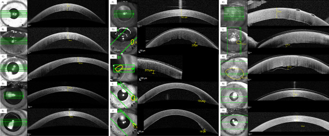
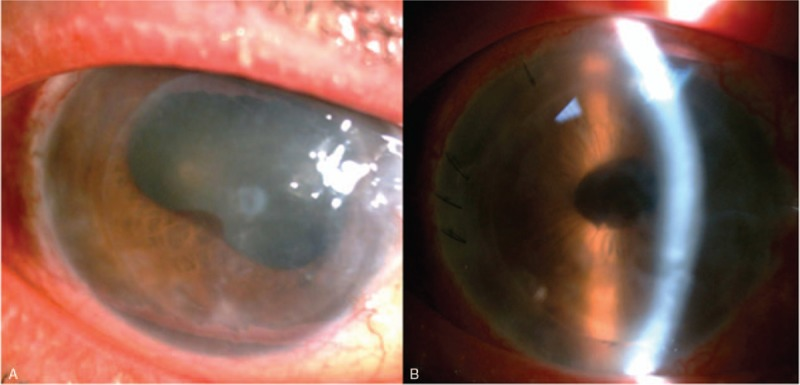
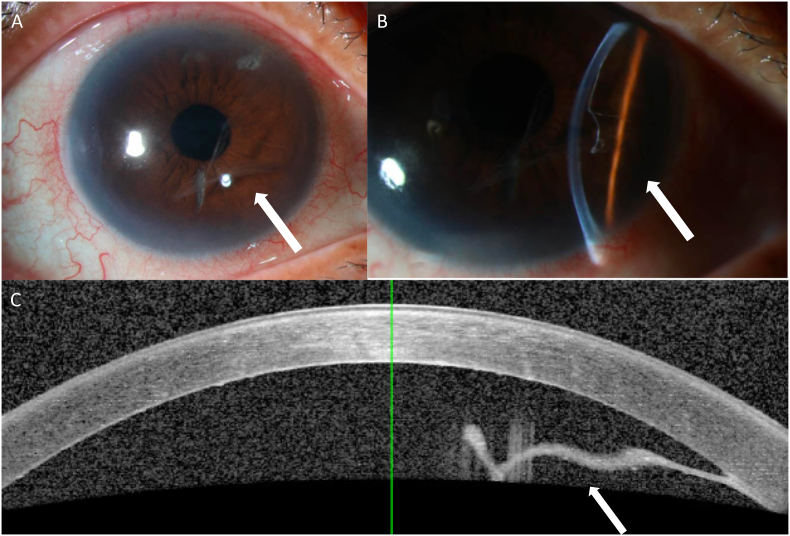

# 3287 — Phaco trên mắt đã ghép nội mô (DMEK/DSAEK): thời điểm, mất nội mô, bong mảnh ghép và công suất IOL — Phacoemulsification after endothelial keratoplasty

**Tags:** `pattern:duc-the-thuy-tinh` `pattern:bong-manh-ghep` `pattern:phu-giac-mac` `pattern:mat-gia-the-thuy-tinh` `pattern:sai-khuc-xa` `pattern:giam-noi-mo` `vung:mat` `vung:giac-mac` `vung:tien-phong` `vung:the-thuy-tinh` `vung:rang-the-mi` `protocol:AS-OCT` `protocol:sinh-hien-vi` `protocol:den-khe` `protocol:UBM` `protocol:sinh-trac-IOL` `protocol:phaco` `score:khong-co` `incidentaloma:khong`

**Mức chắc chắn (certainty):** tổng hợp y văn (literature synthesis) — dựng từ: đoàn hệ **261 mắt DMEK còn thể thủy tinh**, trong đó **35 mắt (13,4%)** phải phaco sau DMEK (*J Refract Surg* 2021, **PMID 33577698**); loạt **106 mắt DMEK còn thể thủy tinh**, **5 mắt (4,7%)** phaco sau DMEK (*J Cataract Refract Surg* 2013, **PMID 23571287**); phân tích gộp **12 nghiên cứu/1.932 mắt** so sánh DMEK cùng thì – trước – sau phaco (*Indian J Ophthalmol* 2023, **PMC10230002**, CC BY-NC-SA); phân tích gộp **667 mắt/5 nghiên cứu** DMEK cùng thì so với tuần tự (*Acta Ophthalmol* 2024, **PMID 37155336**); **270 mắt** đo diện tích bong bằng AS-OCT sau DMEK đơn so với triple-DMEK (*Ophthalmol Sci* 2022, **PMC9754956**, CC BY-NC-ND); ca DSAEK + phaco có khâu cố định mảnh ghép (*Medicine* 2019, **PMC6336656**, CC BY); **112 mắt** tính công suất IOL sau phaco + DMEK (*J Refract Surg* 2025, **PMID 41369663**); **31 mắt** triple-DMEK với keratometry ước tính (*J Refract Surg* 2026, **PMID 41793364**); phân tích gộp khúc xạ sau DMEK (**PMID 37144644**); **97 mắt** thay đổi SimK/TK (*J Clin Med* 2025, **PMC12083999**, CC BY 4.0); **61 mắt/nhóm** bề dày giác mạc sau DMEK so với phaco đơn thuần (**PMID 41921039**); **2.956 mắt** kết cục 10 năm (**PMC11707042**, CC BY 4.0). Nhóm **không có bệnh nhân của mình**; chỗ suy luận ghi **[suy luận]**. **Không ghi tên tác giả** — attribution = **tạp chí + năm + PMCID/DOI**.

> **Ranh giới với bài đã có:** [3291](../3291-doi-iol-sau-ghep-giac-mac/lesson.md) trả lời **"mắt đã ghép, nay phải ĐỔI IOL — đường nào, lúc nào, giá nội mô bao nhiêu"**; [1462](../1462-sinh-trac-iol-sau-ghep-giac-mac/lesson.md) trả lời **"tính công suất IOL sau ghép"**; [1445](../1445-bong-manh-ghep-dsaek-dmek-rebubble/lesson.md) trả lời **"bong mảnh ghép DMEK/DSAEK và khi nào rebubble"**; [3284](../3284-ghep-noi-mo-giac-mac-ong-dan-luu/lesson.md) trả lời **"ghép nội mô trên mắt có ống dẫn lưu"**. Bài này trả lời câu hỏi **ngược chiều**: **mảnh ghép đã ổn, nay thể thủy tinh đục — có nên mổ, mổ lúc nào, mất thêm bao nhiêu nội mô, làm sao không bong mảnh ghép, và lấy keratometry nào để tính IOL?**

> **Câu chốt — sáu nhóm số phải thuộc:** **(1) Đục thể thủy tinh sau DMEK không hiếm nhưng không phải "mổ ngay":** **13,4% (35/261)** trong theo dõi **54,2 ± 28 tháng**, trung bình **18 ± 13 tháng** sau DMEK; xác suất **6% ở 1 năm** và **17% ở 10 năm** (**PMID 33577698**). **(2) Phaco tuần tự làm mất thêm nội mô, nhưng mức độ dao động lớn:** **ECD 1.314 → 1.167 tế bào/mm² (−11%)** (**PMID 33577698**) so với **1.535 → 1.158 (−24,6%)** ở loạt nhỏ (**PMID 23571287**). **(3) Trong các loạt tuần tự, KHÔNG ca nào bong mảnh ghép:** **0/35** và **0/5** (**PMID 33577698**; **PMID 23571287**) — khác hẳn **31% bong** khi phaco **cùng thì** với DMEK (**PMC10230002**). **(4) Cùng thì làm bong nhiều hơn có ý nghĩa:** diện tích bong **38% vs 28%** ngày 3, **25% vs 16%** tuần 2; **rebubbling 20% vs 9%**, **aRR 3,1** (1,3–7,1) cho triple-DMEK (**PMC9754956**). **(5) Giác mạc sau DMEK đã "dịch chuyển" khúc xạ:** cầu tương đương **+0,43 D** (95% CI 0,31–0,55) so với trước ghép; nếu mổ cùng thì nên nhắm **−0,5 D** (**PMID 37144644**) — vì vậy phaco **sau** DMEK phải dùng **keratometry HIỆN TẠI**, không dùng K trước ghép. **(6) Dự trữ nội mô sau DMEK không dư dả:** xác suất **ECD > 1.000 tế bào/mm² ở 10 năm chỉ 3%** sau DMEK (DSAEK 8%, PK 18%) (**PMC11707042**) — mỗi lần mổ thêm đều là một lần rút vốn.

## 1. Tổng quan bệnh học – cơ chế hình ảnh (TẠI SAO)

### 1.1 Vì sao mảnh ghép nội mô là "mô đích" của mọi thao tác trong tiền phòng

- **Mảnh ghép DMEK (Descemet membrane endothelial keratoplasty)** chỉ gồm **màng Descemet + một lớp tế bào nội mô**, dày **10–15 µm**, **không có mô đệm đỡ lực**, **không mạch nuôi**, và **tế bào nội mô người trưởng thành không tái sinh**. Mảnh **DSAEK (Descemet stripping automated endothelial keratoplasty)** dày hơn nhiều (mảnh **UT-DSAEK** được định nghĩa **< 100 µm**) nhưng **lớp tế bào nội mô vẫn chỉ một lớp** [giáo khoa].
- **Bơm nội mô** đẩy nước từ mô đệm ra tiền phòng. Khi **mật độ nội mô (endothelial cell density, ECD) < 500 tế bào/mm²**, bơm không đủ → mô đệm **ngậm nước**, bề dày trung tâm từ **~540 µm** tăng lên **> 700 µm**, giác mạc mờ, rồi xơ hóa. Vì vậy **mọi mất mát tế bào đều là mất vĩnh viễn**, và **ECD là "tài khoản tiết kiệm"** chứ không phải chỉ số trang trí.
- **Vì sao phaco lại nguy hiểm cho mảnh ghép:** đầu tip, dòng tưới/hút (irrigation–aspiration, I/A), bong bóng, viscoelastic, nhân và IOL đều **quét qua lớp tế bào nội mô** ở khoảng cách vài trăm micromet. Tổn thương do **lực cắt của dòng chảy**, **chạm cơ học**, và **tăng nhiệt/năng lượng siêu âm** — không phải do "độc tính" [suy luận từ cơ học tiền phòng, khớp với mức ECD giảm sau phaco].

### 1.2 Vì sao phaco sau DMEK làm mất nội mô — con số và cách diễn giải

- **Hai loạt duy nhất đo ECD trước–sau phaco tuần tự cho hai mức khác nhau:**
  - **261 mắt DMEK**, **35 mắt phaco** sau trung bình **18 ± 13 tháng**: ECD **1.314 ± 524 → 1.167 ± 443 tế bào/mm² (−11%)** ở **1–6 tháng**, **p = 0,333** (không có ý nghĩa thống kê vì cỡ mẫu nhỏ và phương sai lớn) (**PMID 33577698**).
  - **106 mắt DMEK**, **5 mắt phaco** sau **9,2 ± 3,7 tháng**: ECD **1.535 ± 195 → 1.158 ± 250 tế bào/mm² (−24,6%)** ở **6–12 tháng** (**PMID 23571287**).
- **Vì sao chênh lệch 11% và 24,6%?** Cả hai đều **cỡ mẫu rất nhỏ**, khác **độ cứng nhân**, **thời gian phaco**, **lượng dịch tưới**, **kinh nghiệm phẫu thuật viên**, và **thời điểm đo**; khoảng tin cậy rộng. Cách đọc đúng: **"mất thêm khoảng 10–25% dự trữ nội mô"**, không phải một con số cố định [suy luận từ hai loạt].
- **So sánh với phaco trên mắt KHÔNG ghép:** mất nội mô sau phaco thường **thấp hơn nhiều**; ở mắt đã ghép, **toàn bộ lớp tế bào hiến tặng nằm ngay dưới nội mô nhận** và **không có lớp dự trữ phía sau** — nên cùng một lượng năng lượng gây hậu quả lớn hơn [suy luận].
- **Hệ quả dài hạn:** **2.956 mắt** cho thấy xác suất **ECD > 1.000 tế bào/mm² ở 10 năm** chỉ **3%** sau DMEK, **8%** sau DSAEK, **18%** sau PK (**PMC11707042**). Nói cách khác: **mảnh ghép DMEK sống được 10 năm nhưng "mỏng vốn"**, và **một lần phaco thêm có thể là lần rút vốn cuối cùng** trước khi phải ghép lại [suy luận].

### 1.3 Vì sao "đục thể thủy tinh sau DMEK" lại hay gặp — và vì sao thời điểm khó

- **Phaco làm tăng tốc đục thể thủy tinh** (stress oxy hóa, thay đổi thủy dịch, corticoid sau ghép), và bệnh nhân DMEK thường **50–70 tuổi** — đúng tuổi đục thể thủy tinh. Trong đoàn hệ **261 mắt**, **13,4%** phải mổ trong **54 tháng**; xác suất tích lũy **6% ở 1 năm**, **17% ở 10 năm** (**PMID 33577698**).
- **Hai lựa chọn khi mắt vừa đục giác mạc vừa đục thể thủy tinh:**
  - **Triple-DMEK (cùng thì):** một lần mổ, một lần gây mê, **một tiền phòng đã mở**; nhưng **bong mảnh ghép và rebubbling cao hơn** (**PMC9754956**; **PMC10230002**).
  - **Tuần tự:** DMEK trước, chờ mảnh ghép ổn định rồi phaco; **ít bong hơn** trong các loạt tuần tự (**PMID 33577698**; **PMID 23571287**), nhưng **thêm một lần vào tiền phòng** và **ECD giảm thêm** (**PMID 33577698**).
- **Vì sao không có "con số vàng":** các nghiên cứu **không phải RCT**, khác **định nghĩa bong** (đèn khe so với AS-OCT), khác **loại ghép**, **độ cứng nhân**, **có/không khâu cố định**, và **thời gian theo dõi**. Vì vậy phải quyết định theo **mảnh ghép, độ cứng nhân, tiền phòng, bệnh nền** — không theo một mốc "3 tháng" tuyệt đối [suy luận].

### 1.4 Vì sao phaco tuần tự ít bong hơn triple — cơ chế "mảnh ghép đã take"

- **Ngay sau ghép, mảnh ghép chưa dính:** bong **< 1/3 diện tích** tự khỏi **22,7%**, bong **> 1/3** cần **rebubbling 3,4%**, thời điểm rebubble trung bình **16 ± 9,4 ngày** (**PMC10397279** — dẫn qua [3291](../3291-doi-iol-sau-ghep-giac-mac/lesson.md)). Trong **2–4 tuần đầu**, mảnh ghép còn "lỏng" nhất.
- **Sau vài tháng, mảnh ghép dính vào mô đệm nhận** nhờ bơm nội mô và lực hút của mô đệm; **bong chủ yếu ở rìa** (**PMC9754956**). Khi mảnh ghép đã dính, **dòng tưới/hút của phaco ít có khả năng bóc toàn bộ mảnh ghép** — giải thích vì sao **0/35** và **0/5** ca tuần tự không bong trong hai loạt trên [suy luận, khớp dữ liệu].
- **Nhưng "không bong" không có nghĩa "không hại":** cùng một dòng chảy đủ để **bóc tế bào nội mô** dù mảnh ghép vẫn áp; vì vậy **ECD giảm 11–25%** mà **giác mạc vẫn trong** (**PMID 33577698**; **PMID 23571287**). Đây là cạm bẫy "giác mạc trong = mọi thứ ổn".

### 1.5 Vì sao công suất IOL sau DMEK lại khó — hình học giác mạc đã đổi

- **DMEK làm thay đổi cả mặt trước và mặt sau giác mạc:** phân tích gộp cho **cầu tương đương +0,43 D** (95% CI 0,31–0,55) so với trước ghép; khuyến nghị **nhắm −0,5 D** nếu DMEK **cùng thì** với phaco (**PMID 37144644**). Nghĩa là **giác mạc sau DMEK "phẳng" hơn về khúc xạ** và mắt có xu hướng **viễn thị**.
- **Số liệu tomography:** **97 mắt** sau DMEK có **SimK thay đổi −0,21 ± 0,68 D** và **total keratometry (TK) −0,62 ± 1,09 D** (**PMC12083999**). Thay đổi **không đồng nhất** giữa bệnh nhân — vì vậy **không thể lấy K trước ghép trừ một hằng số cố định**.
- **Vì sao dùng K trước ghép là sai:** K trước ghép đo trên giác mạc **còn phù, còn guttae**; sau DMEK giác mạc **mỏng hơn bình thường** (bề dày 6 tháng **526 µm** sau pseudophakic-DMEK và **529 µm** sau triple-DMEK, so với **550 µm** ở phaco đơn thuần — **PMID 41921039**), nên **K thật đã khác**. Mổ phaco **sau** DMEK phải đo **keratometry hiện tại sau khi khúc xạ ổn định**, rồi dùng công thức chuẩn; **không áp thêm hệ số bù hyperopic lần nữa** [suy luận].
- **Nếu buộc phải tính trước (triple hoặc mắt chưa đo được K):** mô hình hồi quy **ΔK = 5,281 + 1,926 × Rant − 1,493 × Rpost** giảm **sai số viễn thị trung bình từ > +1,00 D xuống ~ +0,50 D**; **Haigis và EVO 2.0 đạt 52% mắt trong ±0,50 D** (**PMID 41793364**). Một loạt **112 mắt** khác cho **MAE 0,62 D, MedAE 0,52 D** với hiệu chỉnh Haigis-D; **83,8% trong ±1,00 D** với HaigisCombi (**PMID 41369663**).
- **Kết luận thực hành:** với phaco **tuần tự sau DMEK**, dùng **K đo sau ghép** + công thức hiện đại (**Barrett/EVO/Kane/Haigis**); mục tiêu **chính xác 0** (hoặc **−0,25 D** nếu bệnh nhân quen nhìn gần), **không dùng mục tiêu −0,5 D của triple** vì cú dịch chuyển **đã xảy ra rồi** [suy luận].

### 1.6 Vì sao triple làm bong nhiều hơn — bằng chứng định lượng

- **270 mắt** (75 DMEK đơn, 195 triple-DMEK) đo bong bằng **AS-OCT + mạng nơ-ron phân đoạn**: diện tích bong **28% (DMEK đơn) vs 38% (triple)** ở ngày 3; **16% vs 25%** ở tuần 2; **diện tích 1,85×** (95% CI 1,34–2,56) và **thể tích 2,41×** (1,51–3,86) ở triple; **rebubbling 9% vs 20%**, **aRR 3,1** (1,3–7,1) (**PMC9754956**).
- **Phân tích gộp 12 nghiên cứu/1.932 mắt:** bong mảnh ghép **31%** khi DMEK **cùng thì**, **8%** khi DMEK **trước** phaco, **13%** khi DMEK **sau** phaco; rebubbling **15% / 4% / 10%**; **thải ghép, sống ghép và ECL 12 tháng không khác** giữa cùng thì và DMEK sau phaco (**PMC10230002**).
- **Vì sao cùng thì bong nhiều:** mảnh ghép **chưa take** đã phải chịu **dòng tưới/hút, xoay nhân, bơm viscoelastic, đặt IOL**; bong bắt đầu từ **rìa** nơi mảnh ghép mỏng nhất (**PMC9754956**; **PMC9754956** Fig. 3) [suy luận cơ học].
- **Nhưng đừng đọc "tuần tự an toàn tuyệt đối":** các loạt tuần tự dùng **đèn khe**, có thể **bỏ sót bong ngoại vi nhỏ**; nghiên cứu dùng AS-OCT phát hiện bong **ngay cả khi thị lực tốt** (**PMC9754956**; **PMC11377527**). Vì vậy **theo dõi bằng AS-OCT** sau mổ là bắt buộc nếu nghi ngờ.

## 2. Mẫu hình + chẩn đoán phân biệt theo vị trí (Gamut)

### 2.1 Sáu bệnh cảnh lâm sàng — cùng "mắt đã ghép + đục thể thủy tinh" nhưng khác quyết định

| Bệnh cảnh | Dấu hiệu chính | Câu hỏi quyết định |
|---|---|---|
| **A. Đục thể thủy tinh sau DMEK, mảnh ghép trong, ECD còn tốt** | Giác mạc trong, **nhân độ 2–3**, ECD **> 1.000**, không bong | **Phaco tuần tự** sau khi mảnh ghép ổn định; **đo K hiện tại** để tính IOL |
| **B. Đục thể thủy tinh sau DSAEK** | Mảnh ghép **dày hơn**, có thể **sẹo/glôcôm**, tiền phòng nông | **Phaco + bảo vệ mảnh ghép** (dòng tưới thấp, viscoelastic đủ); cân nhắc **khâu cố định** nếu mảnh ghép lỏng |
| **C. Nhân cứng + tiền phòng nông** | **Nhân độ 4–5**, phản xạ đồng tử kém, tiền phòng **< 2 mm** | **Năng lượng phaco cao** = ECD giảm nhiều; cân nhắc **mổ có kế hoạch**, tránh phaco xé nhân kéo dài |
| **D. Mảnh ghép đang bong nhẹ/đường bong ngoại vi** | **Đường bong hình liềm**, **dịch diện** trên AS-OCT, phù khu trú | **Rebubble trước** rồi mới phaco? Hay **mổ cùng lúc**? (**1445**, **3291**) |
| **E. Đã YAG bao sau** | Lỗ bao sau rõ, **không còn đỡ bao** | Nguy cơ **rơi nhân/dịch kính**; cân nhắc **đặt IOL rãnh** hoặc **cố định củng mạc** |
| **F. Khúc xạ sai nhưng thể thủy tinh còn tốt** | Giác mạc trong, **IOL đúng vị trí**, **sai khúc xạ** | **Không mổ**; chỉnh kính/**IOL phụ** — xem [3291](../3291-doi-iol-sau-ghep-giac-mac/lesson.md) |

### 2.2 Gamut theo vị trí tổn thương

- **Diện mảnh ghép (interface):** **dịch diện** (dải giảm hồi âm giữa mô đệm nhận và mảnh ghép), **bong từng phần**, **máu diện**, **màng xơ sau ghép**.
- **Mô đệm (stroma):** **phù do mất bù nội mô** (bề dày **> 700 µm**), **phù do tăng nhãn áp**, **sẹo/xơ** (mờ không hết dù mảnh ghép áp), **xâm nhập biểu mô** (epithelial downgrowth).
- **Tiền phòng (anterior chamber):** **phản ứng tế bào/KP** (thải ghép), **mảnh thể thủy tinh sót** (xem [1442](../1442-manh-the-thuy-tinh-con-sot/lesson.md)), **IOL lệch**, **thoát mống mắt**, **tăng nhãn áp do pupil block**.
- **Bao sau (posterior capsule):** **đục bao sau (PCO)**, **phimosis**, **lỗ YAG**, **vỡ bao trong mổ** — quyết định **nơi đặt IOL** và **nguy cơ rơi nhân**.
- **Hoàng điểm (macula):** **CME** sau mổ — nguyên nhân "mờ" **không do giác mạc**; **ERM**; **bong võng mạc**.
- **Thần kinh thị (optic nerve):** **tăng nhãn áp** sau ghép/steroid — mờ mắt **không do mảnh ghép**; cần đo IOP và soi đáy mắt trước khi quy cho giác mạc.

### 2.3 Cửa sổ thời gian — cùng triệu chứng, khác chẩn đoán

- **< 1 tháng sau DMEK:** **bong mảnh ghép**, **phù do mổ**, **tăng nhãn áp do khí**, **viêm nội nhãn** (hiếm nhưng cấp cứu) — **chưa phải lúc phaco** trừ bắt buộc.
- **1–3 tháng:** **bong muộn/dịch diện**, **phù còn lại**, **CME**, **đục thể thủy tinh tiến triển**; vẫn là **pha mất nội mô nhanh** — **tránh mổ thêm nếu không cần**.
- **3–12 tháng:** **khúc xạ ổn định**, **mảnh ghép đã take**, **đục thể thủy tinh rõ** — **cửa sổ thuận lợi** cho phaco tuần tự [suy luận từ dữ liệu ECL và các loạt tuần tự].
- **> 12 tháng:** **PCO/phimosis**, **IOL đục (nếu đã có IOL)**, **thải ghép muộn**, **glôcôm**; phaco khó hơn nếu **bao xơ co** hoặc **đã YAG**.

## 3. Bảng so sánh phân biệt (ma trận đối chiếu)

| Thực thể (entity) | Hình ảnh / phép đo điển hình | Chốt vào (rule-in) | Chốt loại (rule-out) | Gợi ý xác nhận |
|---|---|---|---|---|
| **Đục thể thủy tinh sau ghép nội mô** | Đèn khe: **nhân/bao đục**, **giác mạc trong**, **mảnh ghép áp**; AS-OCT: mảnh ghép sát, không dịch diện | **Giác mạc trong + ECD đo được + đục thể thủy tinh giải thích giảm thị lực** | **Giác mạc còn phù/bong** hoặc **CME** giải thích mờ → chưa mổ thể thủy tinh | Đèn khe giãn đồng tử; AS-OCT; OCT hoàng điểm; ECD |
| **Bong mảnh ghép (graft detachment)** | **Đường bong hình liềm**, **dịch diện**, **phù khu trú**; AS-OCT đo **diện tích/thể tích** | **Bong > 1/3 diện tích** → **rebubbling**; bong **< 1/3** có thể tự khỏi **22,7%** (**PMC10397279**) | **Dịch diện mỏng, không tiến triển, giác mạc trong** → theo dõi, không can thiệp | AS-OCT lặp 3–7 ngày; chụp đèn khe; đo bề dày |
| **Dịch diện (interface fluid)** | Dải **giảm hồi âm** giữa mô đệm và mảnh ghép; **không có bờ mảnh ghép cuộn** | **Dải dịch mới + phù tăng** sau phaco | **Mảnh ghép cuộn/lật rìa** → bong thật, không chỉ dịch diện | AS-OCT; so sánh với ảnh trước mổ |
| **Thải ghép (rejection)** | **Đường KP**, **tế bào tiền phòng**, **phù đột ngột**, **mảnh ghép đục**; **không mủ** | **KP + tế bào + phù mới** ở mắt ghép | **Chỉ phù, không KP/tế bào** → nghĩ **mất bù/hết nội mô** hoặc **tăng nhãn áp** | Đèn khe; AS-OCT; đáp ứng corticoid |
| **Thất bại nguyên phát (primary graft failure)** | **Phù không giảm từ tuần đầu**, mảnh ghép không áp, **không KP**; ECD rất thấp | **Giác mạc không trong sau 4–6 tuần** dù mảnh ghép áp | **Có KP/tế bào** → thải ghép | AS-OCT + đèn khe + theo dõi 4–6 tuần |
| **Sai khúc xạ sau DMEK (refractive surprise)** | Giác mạc trong, **IOL đúng vị trí**, **khúc xạ viễn thị**; K hiện tại khác K trước ghép | **Cầu tương đương lệch > +0,43 D** so với mục tiêu (**PMID 37144644**); **SimK −0,21 D, TK −0,62 D** (**PMC12083999**) | **IOL lệch/nghiêng** hoặc **mảnh ghép bong trung tâm** → nguyên nhân cơ học | Khúc xạ chủ quan lặp; tomography; AS-OCT |
| **CME sau mổ** | **OCT hoàng điểm**: phù dạng nang, mất liên tục lớp ngoài; **méo hình** | **OCT có CME** giải thích mờ dù giác mạc trong | **OCT bình thường, không méo hình** → loại | OCT hoàng điểm; Amsler |
| **PCO/phimosis bao sau** | **Mờ bao sau**, **co bao trước**, **lỗ YAG**; IOL có thể nghiêng | **Mờ bao sau + giảm thị lực** sau nhiều tháng | **Mờ do giác mạc/mảnh ghép** → loại | Đèn khe; chụp sau YAG; AS-OCT |
| **Tăng nhãn áp sau ghép** | **IOP cao**, **tiền phòng nông**, **phù giác mạc nhanh**, có thể **khí còn lại** | **IOP cao + phù mới**; **pupil block** hoặc **steroid response** | **IOP bình thường, tiền phòng sâu** → loại | Đo IOP; soi góc; AS-OCT |

*Bản đồ 3 chiều chồng các ca bong mảnh ghép trên AS-OCT sau **DMEK đơn (hàng trên)** và **triple-DMEK (hàng dưới)**, ở lần chụp thứ nhất (ngày 3) và thứ hai (tuần 2). Màu càng sáng/vàng = **diện tích bong càng lớn, càng nhiều mắt cùng vị trí**; bong tập trung ở **rìa mảnh ghép**, còn trung tâm thường áp. Triple-DMEK có **diện tích bong 1,85×** và **thể tích 2,41×** so với DMEK đơn ở tuần 2; **rebubbling 20% vs 9%** (aRR 3,1). Nguồn: *Ophthalmol Sci* 2022 (PMC9754956), Fig. 3, **CC BY-NC-ND 4.0** (nguyên bản, không crop/ghép).*

### 3.1 Ba câu hỏi đọc ma trận

- **"Mờ mắt là do thể thủy tinh hay do mảnh ghép?"** → chỉ kết luận "do đục thể thủy tinh" khi **giác mạc trong, mảnh ghép áp, ECD đo được**, và **OCT hoàng điểm không có CME**. Nếu còn **dịch diện/bong**, xử lý mảnh ghép trước — mổ phaco lúc mảnh ghép đang bong sẽ **làm bong nặng hơn** [suy luận].
- **"Có nên mổ cùng thì hay tuần tự?"** → **tuần tự** khi mảnh ghép chưa ổn định, bệnh nhân mổ được hai lần, hoặc cần **đo K sau ghép** để tính IOL chính xác; **cùng thì** khi **không thể chờ** (nhân cứng, tiền phòng nông, bệnh nhân không mổ hai lần) và chấp nhận **bong/rebubbling cao hơn** (**PMC9754956**; **PMC10230002**).
- **"Lấy K nào để tính IOL?"** → **K đo trên giác mạc đã ghép, sau khi khúc xạ ổn định (≥ 3 tháng)**, không phải K trước ghép; nếu tính trước mổ, dùng **mô hình hồi quy/keratometry ước tính** và nói rõ **sai số ±0,5 D** (**PMID 37144644**; **PMID 41793364**; **PMID 41369663**).

## 4. Protocol + ngưỡng định lượng

### 4.1 Trước khi quyết định — 10 bước bắt buộc

1. **Mốc sự kiện:** ngày ghép, **loại ghép (DMEK/DSAEK/UT-DSAEK)**, kích thước mảnh ghép, **số lần rebubbling**, loại IOL/vật liệu/công suất, **đã YAG chưa**.
2. **Triệu chứng – chức năng:** **CDVA**, độ nhạy tương phản, **chói/quầng**, khúc xạ chủ quan lặp 2 lần; phân biệt **mờ do giác mạc** với **mờ do thể thủy tinh/hoàng điểm**.
3. **Đèn khe giãn đồng tử:** **độ đục nhân**, **bao trước/sau**, **đường bong mảnh ghép**, **KP/tế bào**, **vị trí IOL** (nếu đã có).
4. **AS-OCT tiền phòng:** **mức áp mảnh ghép**, **dịch diện**, **bề dày mô đệm**, **khoảng cách mảnh ghép–mống mắt**, **vị trí IOL**.
5. **Sinh hiển vi phản chiếu:** **ECD** — chỉ tin khi giác mạc đủ trong; nếu không đo được, ghi rõ và dùng **bề dày** làm proxy.
6. **Bản đồ bề dày (Pentacam/AS-OCT):** trung tâm **> 700 µm** = phù đáng kể; so với mốc sau ghép để biết **đang xấu đi** hay **ổn định**.
7. **Sinh trắc IOL:** **IOLMaster 700/Lenstar** với **K hiện tại**; ghi rõ **công thức**, **mục tiêu khúc xạ**, **độ sâu tiền phòng**, **trục**.
8. **OCT hoàng điểm:** loại **CME/ERM** — nguyên nhân mờ **không do giác mạc**.
9. **Nhãn áp – góc:** loại **pupil block**, **tăng nhãn áp do khí/steroid**, **dính góc**; ghi thuốc hạ nhãn áp và **ống dẫn lưu** (ảnh hưởng đường vào).
10. **Kế hoạch dự phòng:** **đường vào xa mảnh ghép**, **viscoelastic bảo vệ nội mô**, **áp lực tưới thấp**, **hạn chế số lần vào tiền phòng**, **sẵn sàng khâu cố định/rebubble** nếu mảnh ghép bong.

### 4.2 Ngưỡng định lượng dùng trong bài

| Biến số | Ngưỡng / giá trị | Ý nghĩa thực hành | Nguồn |
|---|---|---|---|
| **Xác suất phaco sau DMEK** | **6% ở 1 năm**, **17% ở 10 năm**; **13,4% (35/261)** trong 54 tháng | Tư vấn bệnh nhân **trước ghép**; theo dõi thể thủy tinh | PMID 33577698 |
| **Thời gian DMEK → phaco** | Trung bình **18 ± 13 tháng** (3–69) và **9,2 ± 3,7 tháng** (4–14) | Thực hành thực tế **muộn hơn 3 tháng**; không có mốc RCT | PMID 33577698; PMID 23571287 |
| **ECD sau phaco tuần tự** | **−11%** (1.314 → 1.167) và **−24,6%** (1.535 → 1.158) | Tư vấn **mất thêm 10–25% dự trữ**; theo dõi ECD 3–6 tháng | PMID 33577698; PMID 23571287 |
| **ECD mất bù** | **< 500 tế bào/mm²** | Ngưỡng kinh điển của **mất bù**; dưới ngưỡng này không còn dự trữ | Giáo khoa [suy luận] |
| **Bề dày giác mạc** | Bình thường **~540 µm**; **> 700 µm** = phù rõ; sau DMEK **526–529 µm** | So với **550 µm** ở phaco đơn thuần: **đừng đọc 520 µm là "mỏng bất thường"** | PMID 41921039 |
| **Bong mảnh ghép** | **< 1/3** tự khỏi **22,7%**; **> 1/3** → **rebubbling 3,4%**; thời điểm rebubble **16 ± 9,4 ngày** | Ngưỡng can thiệp **trước và sau phaco** | PMC10397279 (qua 3291) |
| **Bong khi cùng thì vs tuần tự** | **31% vs 13%** (gộp); **38% vs 28%** ngày 3; **25% vs 16%** tuần 2 | Cùng thì **không "miễn phí"**; tuần tự **ít bong hơn** | PMC10230002; PMC9754956 |
| **Rebubbling triple vs DMEK đơn** | **20% vs 9%**; **aRR 3,1** (1,3–7,1) | Tư vấn **nguy cơ mổ lại** khi chọn cùng thì | PMC9754956 |
| **Khúc xạ sau DMEK** | **+0,43 D** (95% CI 0,31–0,55); nhắm **−0,5 D** nếu triple | Dùng **K hiện tại** khi phaco tuần tự; **không bù hai lần** | PMID 37144644 |
| **Thay đổi K sau DMEK** | **SimK −0,21 ± 0,68 D**; **TK −0,62 ± 1,09 D** | Không dùng K trước ghép; đo lại sau 3 tháng | PMC12083999 |
| **Sai số IOL với K ước tính** | **PE viễn thị > +1,00 D → ~ +0,50 D**; **52% trong ±0,50 D**; **MAE 0,62 D; MedAE 0,52 D** | Nói rõ **sai số** với bệnh nhân; tránh IOL cao cấp nếu K chưa ổn định | PMID 41793364; PMID 41369663 |
| **Dự trữ ECD 10 năm** | **ECD > 1.000 ở 10 năm: DMEK 3%, DSAEK 8%, PK 18%** | Mỗi lần mổ thêm là **rút vốn**; theo dõi dài hạn | PMC11707042 |
| **Kết cục chức năng** | **CDVA 0,27 → 0,07 logMAR**; **5/5 mắt ≥ 20/30** và **trong ±0,50 D** | Phaco tuần tự **cải thiện thị lực tốt** nếu chọn đúng | PMID 33577698; PMID 23571287 |

### 4.3 Cây quyết định

### 4.4 Kỹ thuật mổ — sáu nguyên tắc "đừng đánh thức mảnh ghép"

1. **Đường vào:** **giác mạc trong (clear cornea) phía thái dương**, **xa mảnh ghép và xa ống dẫn lưu** nếu có; **tránh đường vào xuyên qua vùng mảnh ghép mỏng** [suy luận].
2. **Duy trì tiền phòng:** bơm **viscoelastic cohesive** đủ để **tách đầu tip khỏi nội mô**, nhưng **không bơm quá căng** làm mảnh ghép căng rìa; **giữ áp lực tưới thấp**.
3. **Mở bao trước (capsulorhexis):** đây là **thời điểm áp lực thay đổi đột ngột** — bao mở ra làm **tiền phòng sâu nhanh**, dòng dịch có thể **hút/bóc rìa mảnh ghép**. Dùng **viscoelastic đủ**, **tưới thấp**, **mở bao chậm và kiểm soát**, **không để tiền phòng xẹp** [suy luận cơ học; khớp kỹ thuật "tưới tắt cho đến khi đầu tip vào tiền phòng" — **PMC6336656**].
4. **Phaco:** **chia nhân trong bao**, **dùng năng lượng vừa đủ**, **tránh phaco trong tiền phòng nông**, **không day đầu tip sát mảnh ghép**; **hạn chế tổng thời gian siêu âm** vì **năng lượng là yếu tố quyết định ECD** [suy luận].
5. **Hút I/A:** **để đầu I/A xa mảnh ghép**, **hút từ từ**, **không để dòng chảy chạm trực diện mảnh ghép**; **kiểm tra tiền phòng trước khi rút**.
6. **Kết thúc:** **bơm viscoelastic/BSS**, **khâu/hydrat hóa kín**, **kiểm tra mảnh ghép bằng AS-OCT hoặc đèn khe**; nếu mảnh ghép bong **> 1/3** hoặc **chạm trục quang**, **rebubble** theo [1445](../1445-bong-manh-ghep-dsaek-dmek-rebubble/lesson.md).

*Sơ đồ **4 mối khâu cố định hướng tâm bằng Nylon 10-0** xuyên **giác mạc – mảnh ghép DSAEK – rìa củng giác mạc** ở các vị trí **45°, 135°, 225°, 315°**, dùng khi mảnh ghép **còn lỏng** và phải phaco tuần tự. Ca gốc: DSAEK 1 năm trước, phaco với **áp lực tưới hạ thấp**, **tắt tưới cho đến khi đầu tip vào hẳn tiền phòng**; mảnh ghép **áp trong và sau mổ**, chỉ phù nhẹ ngày 1; khâu được **gỡ cuối mổ** (**PMC6336656**). Đây là **phương án dự phòng**, không phải quy trình thường quy. Nguồn: *Medicine (Baltimore)* 2019 (PMC6336656), Fig. 1, **CC BY 4.0**.*

### 4.5 Công suất IOL — quy trình 5 bước

1. **Đo K sau ghép** khi giác mạc trong và khúc xạ ổn định (thường **≥ 3 tháng**); ghi **nguồn K** (topography/tomography/IOLMaster).
2. **Dùng công thức hiện đại** (Barrett Universal II, EVO 2.0, Kane, Haigis, Hoffer QST) — **không dùng SRK/T đơn thuần** ở mắt đã ghép [suy luận từ các loạt].
3. **Nếu K chưa đo được** (giác mạc còn phù): dùng **mô hình hồi quy ΔK** hoặc **K ước tính**, và **nói rõ sai số**; **tránh IOL đa tiêu/toric cao cấp** khi sai số dự kiến lớn (**PMID 41793364**; **PMID 41369663**).
4. **Mục tiêu khúc xạ:** phaco **tuần tự** → **0 đến −0,25 D**; triple → **−0,5 D** (**PMID 37144644**). Không áp mục tiêu triple cho tuần tự.
5. **Kiểm tra lại:** khúc xạ **1 tháng, 3 tháng**; nếu lệch **> 0,75 D** và ổn định, cân nhắc **IOL phụ/đổi IOL** theo [3291](../3291-doi-iol-sau-ghep-giac-mac/lesson.md) — nhưng nhớ **ECL 57,7–85,3%** khi đổi IOL sau DMEK (**DOI 10.1097/ICO.0000000000003649**).

### 4.6 Theo dõi sau mổ

- **Ngày 1–7:** **IOP**, **mức áp mảnh ghép** (đèn khe/AS-OCT), **tiền phòng**, **bề dày**, **khúc xạ thô**; cảnh báo bệnh nhân **đau tăng/mờ đột ngột**.
- **Tuần 2–4:** **bong mảnh ghép** (thời điểm rebubble trung bình **16 ± 9,4 ngày**), **KP/tế bào**, **CME**, **PCO sớm**.
- **Tháng 3:** **ECD** (khi hết phù), **bề dày**, **khúc xạ ổn định**, **AS-OCT** — mốc đánh giá kết quả và **quyết định chỉnh khúc xạ**.
- **6–12 tháng và hằng năm:** **ECD**, **bề dày**, **mảnh ghép**, **IOP**, **đáy mắt**; nhắc bệnh nhân **chói/mờ mới** = **IOL đục**, **thải ghép muộn**, hoặc **PCO**.

## 5. Biến thể bình thường và cạm bẫy

- **Cạm bẫy 1 — "giác mạc trong là mảnh ghép khỏe":** phaco có thể **bóc tế bào nội mô** mà **mảnh ghép vẫn áp, giác mạc vẫn trong**; ECD giảm **11–25%** mà không có dấu hiệu lâm sàng (**PMID 33577698**; **PMID 23571287**). Phải **đo ECD 3–6 tháng** sau mổ.
- **Cạm bẫy 2 — đọc bề dày 520 µm là "mỏng bất thường":** sau DMEK, bề dày trung tâm **526–529 µm**, **thấp hơn** mức **550 µm** của người bình thường/phaco đơn thuần (**PMID 41921039**). Đừng gọi là **teo/mỏng bệnh lý** nếu giác mạc trong và bề dày ổn định.
- **Cạm bẫy 3 — dùng K trước ghép để tính IOL:** K trước DMEK đo trên giác mạc **phù/guttae**; sau ghép **SimK −0,21 D, TK −0,62 D** và **cầu tương đương +0,43 D** (**PMC12083999**; **PMID 37144644**). Dùng K cũ = **viễn thị sau mổ**.
- **Cạm bẫy 4 — bù hyperopic hai lần:** nếu đã chọn **mục tiêu −0,5 D** cho triple rồi lại **trừ thêm hệ số** cho DMEK, mắt sẽ **cận thị**. Chỉ bù **một lần**, theo **thì mổ thực tế** [suy luận].
- **Cạm bẫy 5 — gọi dịch diện là bong:** **dịch diện mỏng, không tiến triển, giác mạc trong** có thể tự tiêu; chỉ **bong > 1/3** hoặc **chạm trung tâm** mới cần **rebubble** (**PMC10397279**; **PMC11377527**). Chụp lại **3–7 ngày** thay vì can thiệp ngay.
- **Cạm bẫy 6 — bỏ sót CME:** bệnh nhân **mờ + méo hình** sau phaco có thể do **CME**, không do giác mạc; **OCT hoàng điểm** bắt buộc trước khi kết luận "mảnh ghép hỏng" [suy luận].
- **Cạm bẫy 7 — YAG trước, quyết định sau:** **YAG bao sau** làm **mất hỗ trợ bao**, tăng độ khó và có thể **làm bong mảnh ghép**; nếu đang cân nhắc phaco/đổi IOL, **quyết định trước YAG** [suy luận; dữ liệu mắt không ghép: **PMC11980882** dẫn qua 3291].
- **Cạm bẫy 8 — "mổ cùng thì luôn tốt hơn":** cùng thì **tiện hơn** nhưng **bong 31% vs 13%**, **rebubbling 15% vs 10%** (**PMC10230002**) và **aRR 3,1** (**PMC9754956**); chọn theo **mảnh ghép, nhân, bệnh nhân**, không theo khẩu hiệu.
- **Biến thể bình thường:** **mảnh ghép hơi dày nhưng trong, áp, bề dày ổn định** không phải thất bại; **đường bong ngoại vi nhỏ, không tiến triển** có thể chỉ theo dõi; **bong bóng khí nhỏ tồn tại vài ngày** sau rebubble không phải "bong mới" [suy luận].

## 6. Tự lượng giá — Blind Quiz

**Ca 1 — Nữ 68 tuổi, DMEK mắt phải 5 tháng trước vì Fuchs; nay nhìn mờ dần, giác mạc trong, ECD 1.420 tế bào/mm², bề dày 528 µm. AS-OCT tiền phòng ở ba mức bong khác nhau (A–E, F–J, K–O).**

- Gợi ý: **giác mạc trong**, **ECD còn tốt**, nhưng cần loại **bong mảnh ghép** trước khi quy mờ cho thể thủy tinh.
- Câu hỏi: Ba nhóm ảnh **A–E, F–J, K–O** khác nhau ở đâu? Nhóm nào **cần rebubble**? Nếu bệnh nhân có **nhân độ 2** và **không bong**, bước tiếp theo là gì?

<b>Bấm để hiện đáp án (findings + chẩn đoán)</b>

- **Findings:** **A–E** không bong — mảnh ghép áp, **CCT** ổn định; **F–J** bong **< 1/3** diện tích — đường bong ngoại vi, có thể tự khỏi; **K–O** bong **≥ 1/3** — **đường bong rộng + mức bong lớn**, chỉ định **rebubbling**.
- **Chẩn đoán:** **bong mảnh ghép DMEK** phân độ theo **diện tích** (không bong / < 1/3 / ≥ 1/3), đo trên **AS-OCT** chứ không ước lượng bằng đèn khe.
- **Vì sao quan trọng:** bong **≥ 1/3** làm **CCT tăng** và **thị lực giảm**; trong loạt này, **CCT < 600 µm ở 1 tuần** gặp ở **90%** mắt không bong, **50%** mắt bong **< 1/3**, và chỉ **36,4%** mắt bong **≥ 1/3**; thị lực cải thiện ở **90% / 86,7% / 18,2%** tương ứng (**PMC11377527**). Bong **< 1/3** có thể **tự khỏi 22,7%** (**PMC10397279**).
- **Bước tiếp theo:** nếu **không bong**, **nhân độ 2**, **K hiện tại ổn định** → **phaco tuần tự** với **tưới thấp, viscoelastic, mở bao kiểm soát**; đo **K hiện tại** để tính IOL. Nếu **bong ≥ 1/3** → **rebubble trước**, chờ mảnh ghép áp rồi mới phaco.
- Nguồn: *Graefes Arch Clin Exp Ophthalmol* 2024 (PMC11377527), Fig. 1, **CC BY 4.0**.

**Ca 2 — Nam 59 tuổi, DSAEK 1 năm trước vì phù giác mạc sau viêm nội mô herpes; nay nhân đục nhiều, thị lực 0,1. Giác mạc còn trong, mảnh ghép áp.**

- Gợi ý: **mảnh ghép DSAEK dày**, **giác mạc trong**, **nhân đục**; đây là **phaco tuần tự**.
- Câu hỏi: Hai nguy cơ chính của phaco trên mắt đã DSAEK? **Ba biện pháp** trong mổ để giữ mảnh ghép? Khi nào dùng **khâu cố định**?

<b>Bấm để hiện đáp án (findings + chẩn đoán)</b>

- **Findings:** **(A)** trước mổ — giác mạc còn hơi mờ, **nhân đục**; **(B)** ngày 1 sau phaco — **mảnh ghép áp**, chỉ **phù nhẹ**, tiền phòng yên.
- **Chẩn đoán:** **đục thể thủy tinh sau DSAEK** — phaco tuần tự có kiểm soát.
- **Hai nguy cơ:** **bong/dislocation mảnh ghép** và **tổn thương tế bào nội mô** do dòng chảy/năng lượng.
- **Ba biện pháp:** **đường vào giác mạc trong phía thái dương**, **hạ áp lực tưới**, **tắt tưới cho đến khi đầu tip vào hẳn tiền phòng**; thêm **viscoelastic** và **hạn chế thao tác trong tiền phòng**.
- **Khi nào khâu cố định:** khi mảnh ghép **còn lỏng**, **đường bong ngoại vi**, hoặc **mắt đã trải qua nhiều lần mổ**; ca gốc dùng **4 mối Nylon 10-0 hướng tâm**, gỡ cuối mổ (**PMC6336656**). Đây là **dự phòng cá nhân hóa**, không phải chuẩn bắt buộc.
- Nguồn: *Medicine (Baltimore)* 2019 (PMC6336656), Fig. 2, **CC BY 4.0**.

**Ca 3 — Nữ 72 tuổi, mổ **cùng thì DMEK + phaco** 2 tuần trước; nay thị lực 20/200, giác mạc phù nhiều, AS-OCT thấy **mảnh ghép bong gần toàn bộ**, rìa cuộn.**

- Gợi ý: **mổ cùng thì**, **bong gần toàn bộ**, **rìa cuộn**, giác mạc phù; bệnh nhân **không đau**.
- Câu hỏi: Đây là **bong mảnh ghép** hay **dịch diện**? Có **rebubble ngay** không? Vì sao ca này lại có thể **tự trong**?

<b>Bấm để hiện đáp án (findings + chẩn đoán)</b>

- **Findings:** **(A)** ảnh ngoài — **rìa mảnh ghép cuộn**, nổi trong tiền phòng; **(B)** đèn khe — **vùng bong lớn**, chỉ còn **một phần dính phía mũi**; **(C)** AS-OCT — **mảnh ghép tách khỏi mặt sau giác mạc**, **dịch diện** rộng.
- **Chẩn đoán:** **bong mảnh ghép gần toàn bộ sau DMEK + phaco cùng thì** — không phải chỉ dịch diện.
- **Có rebubble ngay không?** Theo ngưỡng thông thường, bong **≥ 1/3** hoặc **chạm trục quang** → **rebubble**. Tuy nhiên ca gốc được **theo dõi**, và giác mạc **tự trong**: tuần 2 bong **75%**, thị lực đếm ngón tay; tháng 6 **20/30**, giác mạc trong, **chỉ còn 1/4 mảnh ghép dính** — tác giả kết luận có **di chuyển tế bào nội mô** từ phần mảnh ghép còn dính (**PMC12304695**). Đây là **ngoại lệ**, không phải lựa chọn mặc định.
- **Vì sao quan trọng:** **cùng thì** làm bong nhiều hơn (**aRR 3,1** — **PMC9754956**); khi bong lớn, **không được hứa "sẽ tự khỏi"**, phải **theo dõi AS-OCT sát** và **rebubble nếu trục quang bị đe dọa** hoặc **không cải thiện**.
- Nguồn: *Am J Ophthalmol Case Rep* 2025 (PMC12304695), Fig. 2, **CC BY-NC-ND 4.0** (nguyên bản, không crop/ghép).

## 7. Câu hỏi nghiên cứu & điểm chưa đồng thuận (tính đến 11/2026)

1. **[Tranh cãi] Ở mắt đã DMEK và nay đục thể thủy tinh, phaco tuần tự sau ≥ 3 tháng có làm giảm bong mảnh ghép và mất nội mô so với triple-DMEK khi theo dõi ≥ 1 năm?**
   - **Đã biết:** phân tích gộp **12 nghiên cứu/1.932 mắt** cho bong **31%** khi cùng thì, **13%** khi DMEK sau phaco, **8%** khi DMEK trước phaco; rebubbling **15% / 10% / 4%**; **ECL 12 tháng không khác** (**PMC10230002**). **270 mắt** đo AS-OCT: triple bong **1,85× diện tích**, **2,41× thể tích**, **rebubbling aRR 3,1** (**PMC9754956**). Hai loạt tuần tự **0/35** và **0/5** ca bong (**PMID 33577698**; **PMID 23571287**).
   - **Chưa rõ:** **không có RCT**; các loạt tuần tự **cỡ nhỏ**, **định nghĩa bong khác nhau** (đèn khe vs AS-OCT), **thời gian chờ khác nhau**, và **không đo ECD dài hạn**; chưa rõ **ngưỡng thời gian tối ưu** (3, 6 hay 12 tháng).
   - **Hướng nghiên cứu:** RCT/đoàn hệ tiến cứu phân tầng **thời gian chờ** và **cùng thì vs tuần tự**, outcome **bong đo bằng AS-OCT, rebubbling, ECD 1–5 năm, khúc xạ, sống mảnh ghép**.
   - **Nguồn:** PMC10230002 (2023); PMC9754956 (2022); PMID 33577698 (2021); PMID 23571287 (2013).

2. **[Khoảng trống] Sau phaco tuần tự trên mắt DMEK, ECD và sống mảnh ghép ở 5–10 năm là bao nhiêu — và có khác nhau theo độ cứng nhân, năng lượng phaco, loại mảnh ghép?**
   - **Đã biết:** ECD giảm **11%** ở 1–6 tháng (**PMID 33577698**) và **24,6%** ở 6–12 tháng (**PMID 23571287**); xác suất **ECD > 1.000 ở 10 năm chỉ 3%** sau DMEK (**PMC11707042**); **triple-DMEK** mất **41% ở 1 năm** so với **33%** khi DMEK đơn (**PMID 32437670**).
   - **Chưa rõ:** **không có loạt nào theo dõi ECD ≥ 5 năm sau phaco tuần tự**; chưa rõ **ảnh hưởng của năng lượng phaco (cumulative dissipated energy)**, **độ cứng nhân**, **tiền phòng nông**, **glôcôm/ống dẫn lưu** lên tốc độ mất nội mô.
   - **Hướng nghiên cứu:** registry đa trung tâm ghi **CDE, thời gian phaco, ECD lặp lại, bề dày, AS-OCT**; phân tích sống mảnh ghép **5–10 năm** theo **mức năng lượng** và **bệnh nền**.
   - **Nguồn:** PMID 33577698 (2021); PMID 23571287 (2013); PMC11707042 (2025); PMID 32437670 (2020).

3. **[Khác biệt thực hành] Khi phaco sau DMEK, nên tính IOL bằng keratometry đo trực tiếp sau ghép, bằng mô hình hồi quy ΔK, hay bằng ray-tracing — và có nên dùng IOL cao cấp?**
   - **Đã biết:** cầu tương đương sau DMEK **+0,43 D** (0,31–0,55), nhắm **−0,5 D** nếu triple (**PMID 37144644**); **SimK −0,21 ± 0,68 D**, **TK −0,62 ± 1,09 D** (**PMC12083999**); mô hình ΔK giảm **PE viễn thị từ > +1,00 D xuống ~ +0,50 D**, **52% trong ±0,50 D** (**PMID 41793364**); hiệu chỉnh Haigis-D cho **MAE 0,62 D; MedAE 0,52 D**, **83,8% trong ±1,00 D** (**PMID 41369663**).
   - **Chưa rõ:** **không có so sánh trực tiếp** giữa **K đo sau ghép** và **K ước tính** ở nhóm phaco **tuần tự** (phần lớn dữ liệu là **triple**); chưa rõ **độ chính xác của ray-tracing**, **vai trò IOL toric/đa tiêu**, và **mục tiêu khúc xạ tối ưu** ở mắt đã ghép.
   - **Hướng nghiên cứu:** nghiên cứu tiến cứu so sánh **K thực đo vs K ước tính vs ray-tracing** ở phaco tuần tự, outcome **sai số cầu tương đương, tỷ lệ trong ±0,50 D, hài lòng, đổi IOL**.
   - **Nguồn:** PMID 37144644 (2023); PMID 41793364 (2026); PMID 41369663 (2025); PMC12083999 (2025).

## Bài liên quan chéo

- [3291 – Đổi IOL ở mắt đã ghép giác mạc](../3291-doi-iol-sau-ghep-giac-mac/lesson.md) (đổi IOL, ECL 57,7–85,3%, một thì vs hai thì)
- [1445 – Bong mảnh ghép DSAEK/DMEK và rebubble](../1445-bong-manh-ghep-dsaek-dmek-rebubble/lesson.md) (ngưỡng bong, kỹ thuật bơm khí)
- [1462 – Sinh trắc IOL sau ghép giác mạc](../1462-sinh-trac-iol-sau-ghep-giac-mac/lesson.md) (công suất IOL, dịch chuyển hyperopic)
- [3284 – Ghép nội mô ở mắt có ống dẫn lưu glôcôm](../3284-ghep-noi-mo-giac-mac-ong-dan-luu/lesson.md) (bong quanh ống, cắt ngắn ống)
- [3273 – Rách bao trước trong phaco](../3273-rach-bao-truoc-phaco/lesson.md) (biến chứng bao, xử trí trong mổ)
- [3274 – Phaco trên mắt đã cắt dịch kính](../3274-phaco-mat-da-cat-dich-kinh/lesson.md) (tiền phòng sâu, LIDRS)
- [3264 – Bong màng Descemet sau phaco](../3264-bong-mang-descemet-sau-phaco/lesson.md) (giác mạc đục sau mổ, AS-OCT)
- [1442 – Mảnh thể thủy tinh sót](../1442-manh-the-thuy-tinh-con-sot/lesson.md) (phù khu trú, viêm tiền phòng kéo dài)
- [400 – Tổng quan Mắt & thị giác](../400-tong-quan-mat-thi-giac/lesson.md)

## Ảnh

- `images/3287_phaco-sau-ghep-noi-mo_AS-OCT_PMC11377527-Fig1.jpg` — *Graefes Arch Clin Exp Ophthalmol* 2024 (PMC11377527), Fig. 1, **CC BY 4.0**.
- `images/3287_phaco-sau-ghep-noi-mo_Mo_DSAEK-PMC6336656-Fig1.jpg` — *Medicine (Baltimore)* 2019 (PMC6336656), Fig. 1, **CC BY 4.0**.
- `images/3287_phaco-sau-ghep-noi-mo_DenKhe-truoc-sau_PMC6336656-Fig2.jpg` — *Medicine (Baltimore)* 2019 (PMC6336656), Fig. 2, **CC BY 4.0**.
- `images/3287_phaco-sau-ghep-noi-mo_BanDo-bong_PMC9754956-Fig3.jpg` — *Ophthalmol Sci* 2022 (PMC9754956), Fig. 3, **CC BY-NC-ND 4.0** (nguyên bản).
- `images/3287_phaco-sau-ghep-noi-mo_AS-OCT-bong_PMC12304695-Fig2.jpg` — *Am J Ophthalmol Case Rep* 2025 (PMC12304695), Fig. 2, **CC BY-NC-ND 4.0** (nguyên bản).

> Không dùng để chẩn đoán độc lập khi chưa có người hướng dẫn.
