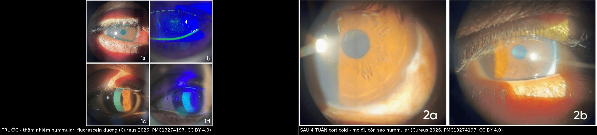
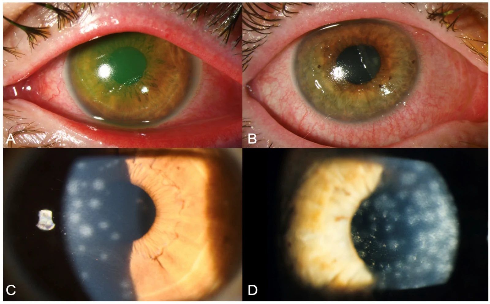
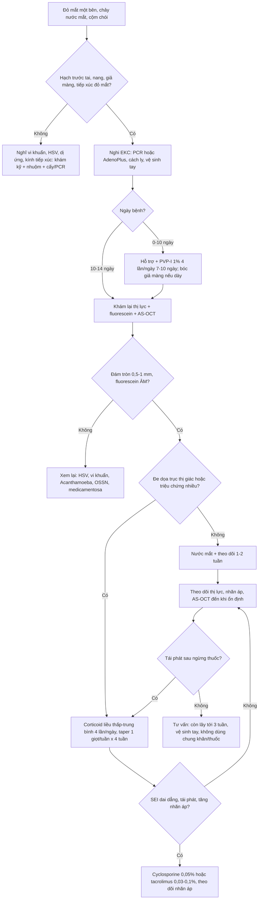
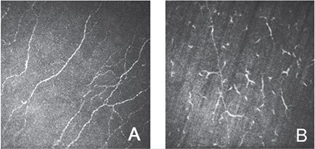
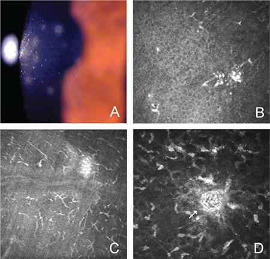
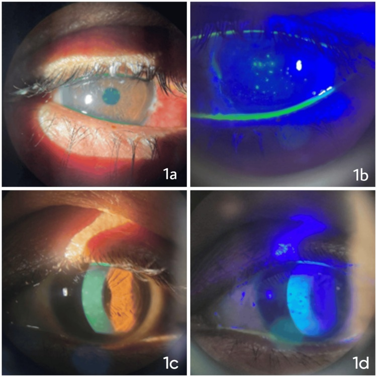
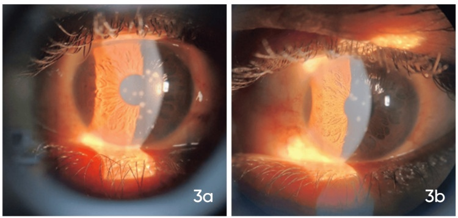

# 3288 — Viêm giác mạc–kết mạc do adenovirus (EKC): giả màng + thâm nhiễm dưới biểu mô đến MUỘN, và vì sao corticoid đúng lúc–sai lúc

**Tags:** `pattern:mat-mot-ben` `pattern:gia-mang` `pattern:hach-truoc-tai` `pattern:thamnhiem-duoi-bieu-mo` `pattern:nummular` `pattern:viem-ket-mac` `pattern:hau-virus` `vung:mat` `vung:ket-mac` `vung:giac-mac` `protocol:den-khe` `protocol:nhuom-fluorescein` `protocol:AS-OCT` `protocol:IVCM` `protocol:PCR` `protocol:adenoplus` `protocol:PVP-I` `protocol:corticoid` `protocol:cyclosporine` `protocol:tacrolimus` `protocol:kiem-soat-nhiem` `score:CSIS` `incidentaloma:khong`

**Mức chắc chắn (certainty):** tổng hợp y văn (literature synthesis) — dựng từ **đoàn hệ 13 năm 2012–2025 tại Zurich, chẩn đoán bằng PCR/AdenoPlus** (Microorganisms 2026, PMC13707637), **loạt 8 ca nummular keratitis sau EKC có ảnh đèn khe trước–sau** (Cureus 2026, PMC13274197), **tổng quan 25 nghiên cứu điều trị viêm kết mạc virus** (Microorganisms 2025, PMC12388293), **102 mắt/95 bệnh nhân thâm nhiễm dưới biểu mô điều trị tacrolimus ± prednisolone** (Biomedicines 2025, PMC12024548), **điều tra ổ dịch HAdV-D53 tại phòng khám mắt** (MMWR 2018, PMC6329482), **phân tích chuỗi thời gian 120 ca/77 ngày với can thiệp vệ sinh** (Graefes Arch Clin Exp Ophthalmol 2022, PMC8763748), **38 mắt theo dõi AS-OCT** (J Curr Ophthalmol 2021, PMC8772485 — chỉ dùng số liệu) và **20 mắt/12 bệnh nhân IVCM** (Turk J Ophthalmol 2018, PMC6330670). Nhóm **không có bệnh nhân của mình**; chỗ chưa đủ chắc ghi **"chưa rõ"**. **Không ghi tên tác giả** — attribution = **tạp chí + năm + PMCID/DOI** (xem `images/CREDITS.md`).

> **Câu chốt:** EKC là **"đỏ mắt một bên, chảy nước mắt, hạch trước tai, có giả màng"** — nhưng câu hỏi thật của bác sĩ không nằm ở pha cấp mà ở **pha thứ hai**: khoảng **10–14 ngày** sau, khi mắt đã bớt đỏ, bệnh nhân quay lại vì **nhìn mờ + chói** và trên giác mạc xuất hiện **các đám tròn xám 0,5–1 mm** (thâm nhiễm dưới biểu mô, subepithelial infiltrates — SEI, "nummuli"). Bốn câu quyết định: **(1) Đúng ngày thứ mấy?** — ngày 7 tổn thương **trong biểu mô**, ngày 14 ở **Bowman**, ngày 30 mới thành **dải ở mô đệm trước** (AS-OCT). **(2) Có giả màng thật hay giả màng?** — bóc sớm để tránh dính, nhưng **không bóc mù khi chưa loại trừ HSV**. **(3) Corticoid lúc này là đúng hay sai?** — corticoid **không diệt virus**; dùng **ngắn ngày** khi có giả màng/SEI đe dọa trục thị giác, **luôn taper**, và **SEI tái phát 17,5%** sau khi ngừng. **(4) Đã loại trừ bệnh bắt chước chưa?** — **HSV, vi khuẩn, SJS, OSSN một bên, medicamentosa, microsporidia** — vì điều trị ngược hẳn nhau.

## 1. Tổng quan bệnh học – cơ chế hình ảnh (TẠI SAO)

### 1.1 Virus không có vỏ → cồn vô hiệu, tồn tại trên bề mặt, lây theo dụng cụ

- **Adenovirus là virus DNA sợi đôi, KHÔNG có vỏ (non-enveloped)** thuộc chi *Mastadenovirus*. Vỏ lipid là thứ mà **cồn 70%** phá hủy — không có vỏ nghĩa là **cồn kém hiệu quả**, virus **bền trên bề mặt nhiều tuần** (PMC13707637; PMC6329482).
- **TẠI SAO bùng phát ở phòng khám mắt:** đầu đo nhãn áp, đèn khe, lọ thuốc nhỏ nhiều liều, tay nhân viên. Trong ổ dịch Los Angeles 2017, **17 ca** (15 ca liên quan phòng khám + 2 ca trong nhà) nhiễm **HAdV-D53**; phòng khám **lau đầu đo nhãn áp bằng khăn cồn isopropyl 70%** thay vì **ngâm 5–10 phút trong chlorine hoặc ethyl alcohol** — đúng sai sót đã được mô tả (PMC6329482).
- **Liều lây rất thấp, thời gian ủ dài:** ủ bệnh **5–12 ngày** (trung bình **9 ngày**, khoảng **5–19** trong ổ dịch), bệnh nhân **còn lây tới 3 tuần** sau khởi phát (PMC13707637; PMC6329482; PMC8763748). Vì vậy **"hết đỏ" không có nghĩa "hết lây"**.
- **Typ gây EKC:** chủ yếu **species D — typ 8, 19, 37, 53, 54, 56** (một số bài còn nêu **64/19a**); typ **3, 4, 7** gây **sốt–viêm họng–viêm kết mạc (pharyngoconjunctival fever, PCF)** ở trẻ, thể nhẹ hơn và **ít tổn thương giác mạc** (PMC13707637; PMC8763748; PMC12388293).
- **Không có thuốc kháng virus được duyệt:** adenovirus **không có thymidine kinase** nên **acyclovir/valacyclovir vô hiệu**; cidofovir có hiệu lực nhưng **độc và đắt**, idoxuridine bị bỏ vì độc; các thuốc mới còn trong nghiên cứu (PMC12388293). Đây là lý do **điều trị là hỗ trợ + kiểm soát viêm + kiểm soát lây**, không phải "diệt virus".

### 1.2 Hai pha của bệnh — và vì sao pha 2 mới là pha gây mờ mắt

| Pha | Thời điểm | Cơ chế | Hình ảnh |
|---|---|---|---|
| **Pha 1 — nhiễm trùng** | ngày 0–10 | virus nhân lên trong biểu mô kết mạc/giác mạc, viêm nang lympho | đỏ, chảy nước mắt, cộm, **nang (follicles)**, **hạch trước tai**, **xuất huyết điểm**, **giả màng/màng thật**; **viêm giác mạc chấm (punctate epithelial keratitis)** |
| **Pha 2 — miễn dịch** | ngày 10–30, kéo dài hàng tháng | **phản ứng quá mẫn type IV** với kháng nguyên virus tồn dư; lympho–histiocyte–fibroblast tụ ở **mô đệm trước**, phá **màng Bowman** | **SEI hình tròn/nummular 0,5–1 mm**, tập trung **trung tâm giác mạc**, **không nhuộm fluorescein**, gây **chói, quầng, loạn thị không đều, giảm thị lực** |

- **TẠI SAO SEI đến muộn:** tổn thương ban đầu là **tế bào biểu mô nhiễm virus**; khi virus giảm, **tế bào trình diện kháng nguyên (Langerhans)** đã "học" kháng nguyên và kéo tế bào viêm vào **mô đệm nông** — quá trình này cần **1–2 tuần**. Vì vậy **mắt càng bớt đỏ thì SEI càng dễ xuất hiện** (PMC8772485; PMC6330670).
- **TẠI SAO SEI không nhuộm fluorescein:** tổn thương nằm **dưới biểu mô còn nguyên vẹn**; fluorescein chỉ bắt biểu mô mất liên kết. Đây là điểm phân biệt với **loét/viêm giác mạc biểu mô** (HSV, vi khuẩn, Acanthamoeba) — nơi fluorescein **dương rõ**.
- **Số lượng và thời điểm:** SEI xuất hiện ở **~40–60%** ca EKC (tùy nguồn), thường **10–14 ngày** sau khởi phát, đường kính **0,5–1 mm**, tròn–bầu dục, **đều nhau**, tập trung **trung tâm**, hiếm ở rìa (PMC13274197; PMC12024548). Trong 38 mắt theo dõi AS-OCT, **64% hai bên**, tuổi trung bình **35,8 ± 17,5**, thị lực vào viện **0,28 logMAR** (PMC8772485).
- **TẠI SAO có thể mất thị lực vĩnh viễn:** SEI thường **mờ dần** nhưng khi xơ hóa để lại **plaque tăng hồi âm bờ rõ**, **gián đoạn Bowman**, **biểu mô dày lên +15 ± 6 µm** và **giác mạc mỏng đi −8 ± 16 µm** (p = 0,005) — đủ gây **loạn thị không đều** và **giảm thị lực lâu dài** (PMC8772485).

### 1.3 TẠI SAO AS-OCT nhìn được "đúng ngày" của EKC

- AS-OCT dùng ánh sáng **~1300 nm**, phân giải trục **2–7 µm**, xuyên **2–3 mm**; tín hiệu về tỉ lệ với **mật độ hạt tán xạ**. **Biểu mô bình thường giàu nước → tối**; **cụm tế bào viêm/nhân to → tăng hồi âm**. Mô đệm **giàu collagen → tán xạ mạnh**, nên một **dải tăng hồi âm trong mô đệm** nổi bật trên nền tối (PMC8772485).
- **Diễn tiến đo được trên 38 mắt:**
  - **Ngày 7:** **điểm tăng hồi âm giới hạn trong biểu mô**, hơi nhô trên bề mặt — tương ứng **chấm viêm giác mạc hợp dòng**.
  - **Ngày 14:** **đường tăng hồi âm ở Bowman**, biểu mô còn nguyên.
  - **Ngày 30:** dải lan nhanh vào **mô đệm trước**, dày và sáng hơn — đúng vị trí **SEI** trên đèn khe.
  - Sau corticoid: giảm dần ở **71,4%**; tổn thương **dai dẳng 2 bệnh nhân (4 mắt)** thành **plaque bờ rõ**.
- **Giới hạn:** AS-OCT **không đọc được tế bào**, không phân biệt SEI do adenovirus với **nummular do thuốc/microsporidia**; chỉ có giá trị **theo dõi động học và đo bề dày**.

### 1.4 TẠI SAO IVCM chứng minh "viêm bắt đầu TRƯỚC triệu chứng"

- IVCM (kính hiển vi đồng tiêu in vivo) cho thấy trong **giai đoạn tiền triệu (prodrome)**, khi đèn khe **hoàn toàn bình thường**, **tế bào Langerhans ở đám rối dưới đáy (subbasal plexus) đã tăng** (20 mắt/12 bệnh nhân; PMC6330670).
- Tiến triển: **chấm viêm giác mạc** → cụm tế bào tăng hồi âm ở **biểu mô đáy**, **tế bào hình gai (dendritic) trong Bowman**; **viêm giác mạc biểu mô sâu** → bờ tròn; **thâm nhiễm dưới biểu mô** → **plaque tăng hồi âm tròn ở mô đệm trước**, trong khi **mô đệm sâu và nội mô KHÔNG đổi** (PMC6330670).
- **Hệ quả lâm sàng:** **giảm cảm giác giác mạc** gặp ở **74%** bệnh nhân EKC (dẫn trong PMC6330670) — nên **test cảm giác** giúp phân biệt với HSV, và giải thích vì sao bệnh nhân **không đau tương xứng** dù giác mạc có tổn thương.

### 1.5 TẠI SAO giả màng hình thành — và vì sao phải phân biệt với màng thật

- **Giả màng (pseudomembrane):** **fibrin + bạch cầu** đông trên **biểu mô kết mạc bị bong**, **dễ bóc**, **không chảy máu** khi bóc, để lại biểu mô còn nguyên.
- **Màng thật (true membrane):** tổ chức hóa **có mạch máu/mô liên kết**, **dính chặt**, **bóc chảy máu**, để lại **sẹo/dính**.
- **TẠI SAO phải bóc:** màng dai gây **dính mi–kết mạc (symblepharon)**, **hạn chế vận nhãn**, khô mắt và **sẹo kết mạc**; bóc + corticoid sớm giảm di chứng (PMC12388293).

### 1.6 Dịch tễ định lượng — vì sao "chỉ là đỏ mắt" lại tốn kém

| Đại lượng | Số liệu | Nguồn |
|---|---|---|
| Viêm kết mạc cấp do virus | **~80%** ca viêm kết mạc cấp; adenovirus **65–90%** ca virus ở người lớn | PMC12388293 |
| Ca ở Mỹ | **> 6 triệu** ca/năm; **430 triệu USD** chi cho điều trị không cần thiết | PMC12388293 |
| Kháng sinh không cần | **~60%** bệnh nhân viêm kết mạc cấp nhiễm virus vẫn được kê kháng sinh tại chỗ | PMC12388293 |
| Nhật Bản | **~1 triệu** ca EKC/năm | PMC8763748 |
| Đức | **2.145 ca (2012) → 647 ca (2019)** | PMC8763748 |
| Thụy Sĩ (2020–2022) | **1,15 → 0,57 ca/tháng** trong đại dịch; **nam:nữ 1,39:1**; đỉnh **mùa thu** | PMC13707637 |
| Ổ dịch bệnh viện | **120 ca/77 ngày**; **1,4 → 0,6 ca/ngày**; **R₀ 1,18 → 0,52** (giảm **2,2 lần**) | PMC8763748 |
| Ổ dịch phòng khám | **17 ca** (15 ca phòng khám + 2 ca trong nhà); ủ bệnh trung bình **9 ngày (5–19)** | PMC6329482 |

- **TẠI SAO giảm trong COVID:** giãn cách, khẩu trang, rửa tay — chính là **cùng cơ chế lây** (dịch tiết mắt, bề mặt, tay), nên can thiệp vệ sinh **có hiệu quả đo được** (PMC13707637; PMC8763748).
- **Bilateral và thời gian giữa hai mắt:** **70%** hai bên trong đoàn hệ Zurich; **54,8%** đã hai bên ngay lúc khám; trung vị **4 ngày (1–12)** giữa hai mắt (PMC13707637; PMC8763748). **Diễn biến "một bên rồi hai bên" là dấu hiệu, không phải ngoại lệ.**

## 2. Mẫu hình + chẩn đoán phân biệt theo vị trí (gamut)

**Mẫu hình A — đỏ mắt MỘT BÊN, chảy nước mắt nhiều, cộm–chói, hạch trước tai, nang kết mạc:** *người lớn, tiếp xúc người đỏ mắt, đi khám mắt gần đây.* Gamut: **EKC (adenovirus)**, **PCF (typ 3/4/7)**, **HSV kết mạc**, **vi khuẩn (tụ cầu/phế cầu)**, **Chlamydia inclusion**, **medicamentosa**, **dị vật/kính tiếp xúc**.

**Mẫu hình B — GIẢ MÀNG/MÀNG ở kết mạc sụn mi, chảy máu khi bóc:** Gamut: **EKC (hay gặp nhất)**, **SJS/TEN**, **viêm kết mạc ligneous**, **vi khuẩn (tụ cầu, phế cầu, bạch hầu)**, **bỏng hóa chất**, **viêm kết mạc do thuốc**.

**Mẫu hình C — sau 10–14 ngày, đỏ đã bớt nhưng NHÌN MỜ + CHÓI, nhiều đám tròn xám 0,5–1 mm ở trung tâm giác mạc, fluorescein ÂM:** Gamut: **SEI sau EKC (nummular)**, **nummular do brimonidine/medicamentosa**, **microsporidia**, **thâm nhiễm sau ghép giác mạc (rejection)**, **viêm giác mạc đĩa do HSV (disciform)**, **di chứng loạn dưỡng**.

**Mẫu hình D — đỏ một bên DAI DẲNG nhiều tuần, không đáp ứng kháng sinh/corticoid:** Gamut: **OSSN (3285)**, **SLK (3267)**, **medicamentosa (3268)**, **Chlamydia**, **lao/nấm hiếm**, **dị vật sót**.

**Mẫu hình E — trẻ sốt cao + đau họng + đỏ hai bên, ít tổn thương giác mạc:** Gamut: **PCF (adenovirus 3/4/7)**, **viêm họng liên cầu + viêm kết mạc**, **bệnh Kawasaki**, **sởi**, **nhiễm enterovirus**.

**Mẫu hình F — đau DỮ DỘI không tương xứng + vòng thâm nhiễm + kính tiếp xúc:** Gamut: **Acanthamoeba (1472)**, **Pseudomonas (6132)**, **nấm**, **HSV hoại tử** — **không phải EKC**, dù cùng "đỏ mắt một bên".

- **Bộ ba dùng để nghĩ EKC trong 10 giây:** **(1) một bên → hai bên; (2) hạch trước tai + nang/giả màng; (3) mờ mắt xuất hiện MUỘN sau khi đỏ giảm.** Ghi hồ sơ mỗi lần khám: **ngày bệnh**, thị lực, **số nang/giả màng**, vị trí và **số SEI**, **nhuộm fluorescein**, **hạch**, **nhãn áp**.
- **Không có "EKC điển hình" để bỏ qua mô học:** tổn thương **một bên, dai dẳng, không đáp ứng 4–8 tuần** phải loại trừ **OSSN/ung thư** trước khi gọi "viêm".

## 3. Bảng so sánh phân biệt (ma trận đối chiếu)

| Thực thể (entity) | Hình ảnh điển hình (đèn khe / nhuộm / AS-OCT) | Chốt vào (rule-in) | Chốt loại (rule-out) | Gợi ý xác nhận |
|---|---|---|---|---|
| **EKC — pha cấp (adenovirus)** | Một bên rồi hai bên; **nang**, **hạch trước tai**, **xuất huyết điểm**, **giả màng**; chấm viêm giác mạc ngày 4–7; **AS-OCT: điểm tăng hồi âm trong biểu mô** | **Hạch trước tai + nang + tiền sử tiếp xúc đỏ mắt**; **PCR adenovirus dương** | **Mủ đặc, không hạch, một bên đơn thuần** → vi khuẩn; **dendrite + giảm cảm giác** → HSV | PCR dịch kết mạc (chuẩn vàng); AdenoPlus **nhạy 40–63%**, đặc hiệu cao — **âm không loại trừ** |
| **EKC — pha SEI (nummular)** | **10–14 ngày** sau khởi phát; đám tròn **0,5–1 mm**, đều, **trung tâm**, **fluorescein âm**; AS-OCT ngày 14 **đường ở Bowman**, ngày 30 **dải mô đệm trước** | **Đúng mốc ngày + nhiều đám tròn đều + fluorescein âm + tiền sử viêm kết mạc virus** | **Loét biểu mô (fluorescein dương)** → HSV/vi khuẩn/Acanthamoeba; **một bên, dày biểu mô, chuyển tiếp 90°** → OSSN | AS-OCT đo bề dày/biểu mô; theo dõi 1–2 tuần; **không sinh thiết** khi bệnh cảnh điển hình |
| **PCF (typ 3/4/7)** | Trẻ, **sốt + viêm họng + đỏ hai bên**, nang; giác mạc **ít/không tổn thương** | **Tam chứng sốt–đau họng–đỏ mắt**, hai bên, theo mùa | **SEI nhiều + hạch + một bên khởi phát** → EKC; **giả màng nặng** → EKC/SJS | PCR; hỏi dịch tễ trường học |
| **HSV kết mạc–giác mạc** | **Một bên**, **dendrite/nhánh có đầu phình**, **giảm cảm giác**, có thể giả màng; **fluorescein dương**; **không hạch to rõ** | **Dendrite + giảm cảm giác + tái phát cùng vị trí** | **Đám tròn đều hai bên, fluorescein âm, hạch trước tai** → EKC; **PCR HSV âm** | PCR/soi tươi; **không corticoid đơn thuần khi chưa loại HSV** |
| **Viêm kết mạc vi khuẩn (kể cả giả màng)** | **Mủ đặc, dính mi sáng ngủ dậy**, một hoặc hai bên; phế cầu/tụ cầu có thể giả màng; **không hạch** hoặc hạch nhỏ | **Mủ + đáp ứng kháng sinh nhanh (24–48 giờ)** | **Nang + hạch + nước mắt** → virus; **không đáp ứng kháng sinh** → xem lại | Cấy/nhuộm Gram khi nặng/tái phát; **không kê kháng sinh mặc định** |
| **SJS/TEN** | **Hai bên**, **hoại tử biểu mô kết mạc**, **giả màng dày**, loét miệng/sinh dục, **phát ban da**; toàn thân nặng | **Thuốc mới + tổn thương da/niêm + bong biểu mô** | **Không tổn thương da/niêm, không đau da** → EKC; **chỉ một bên** → ít nghĩ SJS | Hội chẩn da liễu; **ngừng thuốc nghi ngờ ngay** |
| **Viêm kết mạc ligneous** | **Giả màng fibrin dày, tái phát**, trẻ nhỏ, có thể **dính mi**, kèm bệnh toàn thân (thiếu plasminogen) | **Giả màng tái phát + không đáp ứng kháng sinh/corticoid + tiền sử gia đình** | **Đáp ứng corticoid, tự khỏi sau 2–3 tuần** → EKC | Xét nghiệm plasminogen; sinh thiết kết mạc |
| **Chlamydia inclusion** | Bán cấp, **nang lớn**, hạch trước tai, **một bên**, tiết nhầy mủ; **bệnh lây qua đường tình dục** | **Nang + hạch + tiết nhầy + tiền sử sinh dục** | **Cấp tính, nước mắt, giả màng, hai bên** → EKC | PCR Chlamydia; **điều trị cả bạn tình** |
| **Medicamentosa (brimonidine)** | **Hai bên**, đỏ–cộm vùng **1/3 dưới**, **SEI/nummular**, khỏi khi **ngừng thuốc** | **Tiền sử nhỏ brimonidine/apraclonidine; khỏi sau ngừng 4–6 tuần** | **Hạch trước tai + giả màng + đúng mốc ngày** → EKC | Ngừng thuốc thử; xem bài 3268 |
| **OSSN (3285)** | **Một bên**, mảng/nốt **nhú sùi/gelatin**, **có mạch nuôi**, **dai dẳng**, **không đáp ứng 4–8 tuần**; AS-OCT **biểu mô dày > 142 µm, chuyển tiếp 90°** | **Một bên + mạch nuôi + dày biểu mô trên AS-OCT** | **Hai bên + hạch + tự khỏi/đáp ứng corticoid** → EKC | Sinh thiết khi nghi; **không theo dõi mù** |
| **Microsporidia keratoconjunctivitis** | **Nummular keratitis** rất giống SEI, **một hoặc hai bên**, đau–chói; **tiếp xúc nước/bụi/đất** | **Soi tươi/nhuộm thấy bào tử**; tiền sử phơi nhiễm | **Bệnh cảnh EKC điển hình có hạch + tiếp xúc người** → EKC | Nhuộm calcofluor/soi tươi; PCR |
| **Acanthamoeba (1472)** | **Đau dữ dội vượt mức**, **vòng thâm nhiễm**, **viêm thần kinh dạng tia**, tiền sử **kính tiếp xúc/nước** | **Đau nhiều + vòng + kính tiếp xúc** | **Không đau nhiều, có hạch, tự giới hạn** → EKC | Soi tươi/nuôi cấy/PCR; **không corticoid đơn thuần** |

*Cùng một mắt, hai thời điểm. **Trái — trước điều trị:** kết mạc còn cương tụ, nhiều **đám tròn xám (nummuli)** ở trục đồng tử, **fluorescein dương** ở vài đám; **phải — sau 4 tuần loteprednol 0,5% taper:** đám mờ đi rõ nhưng còn **sẹo nummular** và giác mạc không hoàn toàn trong. Bài học: corticoid **làm mờ** thâm nhiễm chứ **không xóa** tổn thương đã xơ; vì vậy phải **đo thị lực + AS-OCT** chứ không chỉ nhìn "đỡ đỏ". Nguồn: Cureus 2026 (PMC13274197), CC BY 4.0; ảnh ghép letterbox, không crop.*

*Bốn ảnh đèn khe của EKC. **(A, B)** cương tụ kết mạc và **viêm kết mạc sụn mi**, biểu mô giác mạc **sần, không đều**, có **trợt biểu mô**; **(C, D)** sau đợt cấp, **thâm nhiễm dưới biểu mô (nummuli)** hình tròn, xám, **rải rác trung tâm** — đúng vị trí "pha 2" của bệnh. Đây là tổn thương **miễn dịch**, không phải ổ virus đang nhân lên. Nguồn: Microorganisms 2026 (PMC13707637), CC BY 4.0.*

## 4. Protocol chẩn đoán – điều trị + phân độ

### 4.1 Trình tự khám (mỗi lần tái khám làm lại từ đầu)

1. **Thị lực hai mắt** (kính tối ưu) — SEI ở trung tâm làm giảm thị lực dù đỏ ít.
2. **Đèn khe:** ghi **ngày bệnh**, cương tụ, **nang**, **giả màng/màng**, **xuất huyết điểm**, **chấm viêm giác mạc**, **vị trí/số lượng SEI**.
3. **Nhuộm fluorescein** (và **lissamine green** nếu nghi khô/mất tế bào đài) — **SEI điển hình fluorescein ÂM**; fluorescein dương ở trung tâm SEI gợi ý **biểu mô bị phá** hoặc chẩn đoán khác.
4. **Lật mi trên + khám cùng đồ** tìm giả màng/dính; **khám hạch trước tai, dưới hàm**.
5. **Đo nhãn áp** (trước corticoid, và mỗi lần tái khám).
6. **Ảnh màu chuẩn hóa** — công cụ phát hiện SEI mới/tiến triển.
7. **Loại trừ bệnh bắt chước** trước khi kê corticoid: **HSV (dendrite, cảm giác), vi khuẩn (mủ), SJS (da/niêm), OSSN (một bên dai dẳng), kính tiếp xúc (Acanthamoeba/Pseudomonas)**.

### 4.2 Xét nghiệm — khi nào cần và độ tin cậy

| Câu hỏi | Công cụ | Ngưỡng/đặc điểm cần ghi |
|---|---|---|
| Có phải adenovirus? | **PCR (real-time) dịch kết mạc** | **Chuẩn vàng**, độ nhạy/đặc hiệu cao; dùng khi ca nặng, nghi ổ dịch, hoặc chẩn đoán không rõ (PMC12388293; PMC13707637) |
| Có nhanh tại giường? | **AdenoPlus** | **Độ nhạy 40–63%**, **đặc hiệu cao** → **âm tính KHÔNG loại trừ** (PMC12388293) |
| Tổn thương ở lớp nào, ngày thứ mấy? | **AS-OCT** | Ngày 7 **điểm trong biểu mô**; ngày 14 **đường Bowman**; ngày 30 **dải mô đệm trước**; xơ: **plaque bờ rõ + Bowman gián đoạn + biểu mô +15 ± 6 µm, CCT −8 ± 16 µm** (PMC8772485) |
| Viêm đã bắt đầu trước triệu chứng? | **IVCM** (nghiên cứu) | **Langerhans tăng ở đám rối dưới đáy** ngay giai đoạn tiền triệu; **plaque tròn ở mô đệm trước** khi có SEI; **mô đệm sâu/nội mô không đổi** (PMC6330670) |
| Có phải bệnh khác? | **Soi tươi/nhuộm Gram, PCR HSV, nuôi cấy** | Làm ngay khi **một bên + đau nhiều**, **nghi giả màng do vi khuẩn**, **kính tiếp xúc**, **thất bại điều trị** |

### 4.3 Điều trị — theo pha, theo mức độ (không có kháng virus đặc hiệu)

**Pha 1 — nhiễm trùng (ngày 0–10):**

- **Hỗ trợ là nền tảng:** nước mắt nhân tạo không chất bảo quản, **chườm lạnh**, vệ sinh mi, **nghỉ học/nghỉ làm 10–14 ngày** (còn lây tới 3 tuần) (PMC12388293; PMC13707637).
- **Povidone-iodine (PVP-I) tại chỗ:** một lần **rửa kết mạc 2,5–5%** tại phòng khám (trẻ nhỏ/sơ sinh/thai phụ **2,5%**), sau đó **PVP-I 1% × 4 lần/ngày trong 7–10 ngày**; bằng chứng: trẻ nhỏ **2,5% một lần** rút ngắn hồi phục **12 → 7 ngày**; **2% × 4 lần/ngày × 7 ngày** khỏi **77%** trong tuần đầu (PMC12388293).
- **KHÔNG kháng sinh thường quy** (không diệt virus, tăng đề kháng, độc bề mặt); chỉ khi có **bằng chứng bội nhiễm vi khuẩn**.
- **Bóc giả màng/màng** tại phòng khám khi dày, gây dính hoặc che trục thị giác (PMC12388293).
- **Corticoid:** chỉ khi **giả màng nặng, viêm dữ dội, hoặc SEI đe dọa trục thị giác** — không dùng cho "đỏ mắt đơn thuần" trong tuần đầu.

**Pha 2 — SEI (ngày 10–30+):**

- **Corticoid tại chỗ liều thấp–trung bình:** **dexamethasone 0,1%, loteprednol 0,5% hoặc fluorometholone 0,1% × 4 lần/ngày**, sau đó **giảm 1 giọt/tuần trong 4 tuần**; **loteprednol** ít tăng nhãn áp hơn dexamethasone (PMC12388293).
- **Bằng chứng hiệu quả:** trong 8 ca nummular, **75% (6/8) khỏi hoàn toàn** với corticoid taper; **25% (2/8)** cần **cyclosporine 0,09%** dài hạn (PMC13274197). Trong 38 mắt theo dõi AS-OCT, SEI **giảm ở 71,4%**, **75%** lui; **1 ca tái phát sau 1 năm** (PMC8772485).
- **Tái phát khi ngừng corticoid: 17,5%** — lý do phải **taper chậm** và hẹn tái khám sau khi ngừng (PMC12388293).
- **SEI dai dẳng/tái phát hoặc không dung nạp corticoid:** **cyclosporine A 0,05% × 2 lần/ngày** hoặc **tacrolimus 0,03% mỡ × 2 lần/ngày**; nghiên cứu 102 mắt cho thấy **tacrolimus 0,1% đơn trị** và **tacrolimus + prednisolone 1%** đều cải thiện, **không khác biệt ở 18 tháng**, nhưng **phối hợp nhanh hơn**; **4 ca tăng nhãn áp > 21 mmHg sau 3 tháng** ở nhóm phối hợp (PMC12024548; PMC12388293).
- **Theo dõi nhãn áp mỗi 4–6 tuần** khi dùng corticoid; ngưỡng can thiệp **> 21 mmHg** (PMC12024548).

### 4.4 Kiểm soát nhiễm — phần "điều trị" quan trọng nhất ở phòng khám

- **Rửa tay bằng dung dịch diệt virus** trước/sau mỗi bệnh nhân; **găng dùng một lần**; **không dùng lọ thuốc nhiều liều** cho nhiều bệnh nhân (PMC6329482; PMC8763748).
- **Khử khuẩn đầu đo nhãn áp/đèn khe:** **ngâm 5–10 phút trong chlorine hoặc ethyl alcohol** (hoặc dùng **đầu đo dùng một lần**); **lau bằng cồn isopropyl 70% KHÔNG đủ** vì adenovirus không có vỏ (PMC6329482).
- **Cách ly bệnh nhân nghi EKC** ở phòng riêng, hẹn cuối ngày, khử bề mặt sau khám (PMC8763748).
- **Hiệu quả đo được:** can thiệp vệ sinh giảm **1,4 → 0,6 ca/ngày**, **R₀ 1,18 → 0,52** (giảm **2,2 lần**) (PMC8763748). Đây là con số mạnh nhất chứng minh "vệ sinh là điều trị".

### 4.5 Phân độ dùng trong theo dõi (không phải RADS)

- **CSIS (corneal subepithelial infiltrate score):** **0** không có; **1** 1–5 đám; **2** 6–10; **3** 11–15; **4** > 15 đám — đếm trên đèn khe (PMC12024548).
- **Fantes corneal haze grading (FCHGS)** dùng kèm trong nghiên cứu tacrolimus để theo dõi mờ giác mạc (PMC12024548).
- **Thị lực + AS-OCT** là hai đầu ra thực hành: **CSIS giảm** nhưng thị lực không cải thiện → nghi **sẹo/loạn thị**, không phải "còn viêm".

## 5. Biến thể bình thường và cạm bẫy

- **"Đỏ một bên nên là vi khuẩn"** — sai: EKC **khởi phát một bên** ở **55,8%** ca và **chuyển hai bên sau trung vị 4 ngày**; kháng sinh không đỡ là dấu hiệu **phải nghĩ virus** (PMC8763748).
- **"Hết đỏ là hết bệnh"** — sai: **SEI xuất hiện sau khi đỏ giảm**, đúng lúc bệnh nhân bỏ tái khám; **hẹn lại ở ngày 10–14** cho mọi ca EKC có tổn thương giác mạc.
- **AdenoPlus âm không loại trừ** (độ nhạy **40–63%**); **PCR** mới là chuẩn (PMC12388293).
- **Giả màng ≠ màng thật:** bóc mù một **màng thật do HSV/bỏng** có thể làm nặng; luôn **nhuộm + soi** và **hỏi thuốc/bỏng** trước khi bóc.
- **Corticoid sai pha:** dùng corticoid trong tuần đầu khi chưa loại HSV, hoặc **ngừng đột ngột** → **rebound SEI** (tái phát **17,5%**); luôn taper (PMC12388293).
- **Corticoid không chữa khỏi sẹo:** sau 4 tuần vẫn còn **nummular opacity**; đừng tăng liều mãi — **đo thị lực/AS-OCT** và chuyển hướng (PMC13274197).
- **Tăng nhãn áp do corticoid:** **4/68** mắt nhóm phối hợp tăng **> 21 mmHg** sau 3 tháng; **đo nhãn áp mỗi lần tái khám** (PMC12024548).
- **Bỏ sót HSV:** dendritic cells tăng trên IVCM gặp ở **cả EKC và HSV**; **cảm giác giác mạc giảm 74%** ở EKC nên **test cảm giác không đủ phân biệt** — cần **PCR/soi tươi** khi nghi (PMC6330670).
- **Nhầm với microsporidia:** cùng **nummular**, nhưng **tiền sử nước/bụi/đất**, **soi tươi thấy bào tử**; điều trị khác (kháng sinh/khử trùng, không chỉ corticoid).
- **Nhầm với OSSN:** tổn thương **một bên, dai dẳng, có mạch nuôi**, **không đáp ứng 4–8 tuần** → **AS-OCT + sinh thiết**, không theo dõi "viêm" (bài 3285).
- **Satisfaction of search:** thấy SEI đẹp rồi bỏ qua **viêm nội nhãn/viêm màng bồ đào** ở bệnh nhân đau nhiều, hoặc bỏ qua **bội nhiễm** khi có mủ.
- **Trẻ nhỏ:** PCF nhẹ hơn nhưng **giả màng gây dính mi**; khám **lật mi** bắt buộc.

*IVCM đám rối dưới đáy. **(A) Giác mạc lành:** mật độ tế bào hình gai thưa. **(B) Giai đoạn tiền triệu EKC:** **tế bào Langerhans tăng rõ** dù đèn khe chưa thấy gì — bằng chứng viêm **bắt đầu trước triệu chứng**. Nguồn: Turk J Ophthalmol 2018 (PMC6330670), CC BY 2.5.*

*Giai đoạn **thâm nhiễm dưới biểu mô**. **(A)** đèn khe: đám mờ tròn; **(B)** ổ viêm tăng hồi âm ở biểu mô đáy; **(C)** kết nối tế bào Langerhans ở đám rối dưới đáy; **(D)** **plaque tăng hồi âm bờ tròn ở mô đệm trước (mũi tên)** — tương ứng "nummulus" trên lâm sàng. Mô đệm sâu và nội mô **không đổi**. Nguồn: Turk J Ophthalmol 2018 (PMC6330670), CC BY 2.5.*

## 6. Tự lượng giá — Blind Quiz ngay trên trang tĩnh

**Ca 1 — nam 42 tuổi, đỏ–chảy mủ cả hai mắt 3 tuần, nay nhìn mờ + chói**

- Gợi ý lâm sàng: nam **42 tuổi**, đỏ–chảy mủ–ngứa **hai mắt 3 tuần**, đã nhỏ ciprofloxacin 1 tuần rồi ngừng; nay **mờ mắt + sợ ánh sáng**; thị lực **6/18 hai mắt**.
- Câu hỏi: Tổn thương chính nằm **biểu mô hay dưới biểu mô**? Vì sao **fluorescein chỉ dương từng đám**? Chẩn đoán và bước tiếp theo?

<b>Bấm để hiện đáp án (findings + chẩn đoán)</b>

- Dấu hiệu (findings): kết mạc cương tụ lan tỏa; **nhiều đám tròn xám (nummuli)** tập trung **trung tâm giác mạc** phải, kèm **trợt biểu mô từng điểm** (fluorescein dương ở vài đám); mắt trái ít cương tụ hơn, cũng có nummuli.
- Chẩn đoán (diagnosis): **thâm nhiễm dưới biểu mô sau EKC (nummular keratitis)** — pha miễn dịch, không phải nhiễm khuẩn đang hoạt động.
- Vì sao: tổn thương nằm **dưới biểu mô** nên **fluorescein âm ở phần lớn đám**; các điểm dương là chỗ **biểu mô phủ bị trợt**. Điều trị trong ca gốc: **moxifloxacin 0,5% + loteprednol 0,5% 4 lần/ngày, taper 1 giọt/tuần**; sau **2 tuần** thị lực **6/6 phải, 6/9 trái**, đám mờ đi nhưng còn **nummular opacities**.
- Nguồn ảnh: Cureus 2026 (PMC13274197), Fig. 1, CC BY 4.0.

**Ca 2 — nam 30 tuổi, đỏ 1 tuần, điều trị kháng sinh thì thị lực TỤT**

- Gợi ý lâm sàng: nam **30 tuổi**, đỏ–chảy mủ **hai mắt 1 tuần**, đã nhỏ kháng sinh; ngày 3 thị lực **6/12 phải, 6/18 trái**; nay **chấm viêm biểu mô** rồi thành **đám tròn fluorescein âm** ở trung tâm.
- Câu hỏi: Vì sao **kháng sinh làm bệnh không đỡ**? Dấu hiệu nào cho biết đã sang **pha 2**? Điều trị gì và theo dõi bao lâu?

<b>Bấm để hiện đáp án (findings + chẩn đoán)</b>

- Dấu hiệu (findings): **viêm giác mạc chấm nông** lan tỏa → trong **5 ngày** chuyển thành **SEI fluorescein âm**, tập trung **trung tâm**; không mủ tiền phòng.
- Chẩn đoán (diagnosis): **EKC, pha thâm nhiễm dưới biểu mô**.
- Vì sao: kháng sinh **không có tác dụng với adenovirus**; tổn thương pha 2 là **miễn dịch**, đáp ứng **corticoid**. Ca gốc dùng **loteprednol 0,5% 5 lần/ngày rồi taper**; sau **6 tuần** thị lực **6/9 hai mắt**, đám mờ nhạt. Theo dõi: thị lực + nhãn áp + đèn khe mỗi 2–4 tuần đến khi hết viêm.
- Nguồn ảnh: Cureus 2026 (PMC13274197), Fig. 3, CC BY 4.0.

**Ca 3 — mắt ở giai đoạn thâm nhiễm dưới biểu mô, IVCM cho thấy gì?**

- Gợi ý lâm sàng: mắt trong loạt **20 mắt/12 bệnh nhân EKC**, đang ở giai đoạn **thâm nhiễm dưới biểu mô**; đèn khe thấy đám mờ tròn ở trục.
- Câu hỏi: Trên IVCM, tổn thương nằm ở **lớp nào**? Vì sao **mô đệm sâu và nội mô bình thường** lại quan trọng cho tiên lượng?

<b>Bấm để hiện đáp án (findings + chẩn đoán)</b>

- Dấu hiệu (findings): **(B)** ổ tăng hồi âm ở **biểu mô đáy**; **(C)** tế bào Langerhans ở **đám rối dưới đáy**; **(D)** **plaque tăng hồi âm bờ tròn ở mô đệm TRƯỚC (mũi tên)**; mô đệm sâu và nội mô **không đổi**.
- Chẩn đoán (diagnosis): **thâm nhiễm dưới biểu mô sau EKC** — tổn thương **nông**, không phải viêm nội mạc/viêm màng bồ đào.
- Vì sao: vị trí **nông** giải thích **fluorescein âm**, đáp ứng corticoid và **tiên lượng thị lực tốt hơn** tổn thương nội mô; nhưng nếu xơ hóa để lại **gián đoạn Bowman + mỏng mô đệm (−8 ± 16 µm)** thì **loạn thị không đều** vẫn có thể tồn tại.
- Nguồn ảnh: Turk J Ophthalmol 2018 (PMC6330670), Fig. 4, CC BY 2.5.

## 7. Câu hỏi nghiên cứu & điểm chưa đồng thuận (tính đến 11/2026)

1. **[Tranh cãi] Ở bệnh nhân EKC cấp, corticoid tại chỗ ngắn ngày có làm kéo dài thời gian phát tán virus hoặc tăng tái phát SEI so với chỉ điều trị hỗ trợ không?**
   - **Đã biết:** tổng quan 25 nghiên cứu kết luận lo ngại về **kéo dài phát tán virus, tăng nhãn áp, tái hoạt HSV** "không được bằng chứng chất lượng cao ủng hộ" khi dùng ngắn ngày; dexamethasone 0,1% × 1 tuần cải thiện triệu chứng; nhưng **SEI tái phát 17,5%** sau khi ngừng corticoid (PMC12388293); theo dõi AS-OCT 38 mắt cho thấy SEI giảm ở **71,4%** nhưng **1 ca tái phát sau 1 năm** (PMC8772485).
   - **Chưa rõ:** chưa có RCT đo **đồng thời** tải lượng virus bằng PCR theo ngày và **tỉ lệ tái phát SEI** ở cùng một quần thể; chưa rõ **thời điểm "cửa sổ"** corticoid an toàn (ngày 7? ngày 14?).
   - **Hướng nghiên cứu:** RCT đa trung tâm, phân tầng theo **ngày bệnh và mức tổn thương giác mạc**, outcome **PCR shedding × 14 ngày + tái phát 6 tháng + nhãn áp**.
   - **Nguồn:** PMC12388293 (2025); PMC8772485 (2021).

2. **[Khoảng trống] Với SEI dai dẳng hoặc tái phát, tacrolimus hay cyclosporine hay corticoid liều thấp cho thời gian lui bệnh và tỉ lệ tái phát tốt nhất?**
   - **Đã biết:** 102 mắt cho thấy **tacrolimus 0,1% đơn trị** và **tacrolimus + prednisolone 1%** đều cải thiện, **không khác biệt ở 18 tháng**, phối hợp **nhanh hơn** nhưng **4 ca tăng nhãn áp > 21 mmHg** (PMC12024548); cyclosporine A 0,05% × 2 lần/ngày và tacrolimus 0,03% × 2 lần/ngày là lựa chọn khi không dung nạp corticoid (PMC12388293).
   - **Chưa rõ:** **không có RCT so sánh trực tiếp** tacrolimus vs cyclosporine; định nghĩa "lui bệnh" khác nhau (CSIS đếm số đám, FCHGS, thị lực) nên **không so sánh được giữa các nghiên cứu**; chưa rõ thời gian điều trị tối thiểu.
   - **Hướng nghiên cứu:** RCT 3 nhánh với **cùng định nghĩa lui bệnh (CSIS + AS-OCT + thị lực)**, outcome **tái phát 12 tháng và nhãn áp**.
   - **Nguồn:** PMC12024548 (2025); PMC12388293 (2025).

3. **[Khác biệt thực hành] Khử khuẩn đầu đo nhãn áp và dụng cụ tiếp xúc: ngâm chlorine/ethyl alcohol 5–10 phút hay lau cồn isopropyl 70% — và ai đang làm đúng?**
   - **Đã biết:** ổ dịch **17 ca HAdV-D53** liên quan phòng khám dùng **lau cồn 70%** thay vì **ngâm 5–10 phút chlorine/ethyl alcohol**; can thiệp vệ sinh cắt chuỗi lây (PMC6329482). Can thiệp vệ sinh có kiểm chứng giảm **1,4 → 0,6 ca/ngày**, **R₀ 1,18 → 0,52** (PMC8763748).
   - **Chưa rõ:** **chưa có khảo sát tuân thủ** quy trình này ở phòng khám mắt nói chung, và **chưa rõ hiệu quả của dung dịch đơn liều** so với lọ nhiều liều trong thực hành thường quy.
   - **Hướng nghiên cứu:** audit tuân thủ đa trung tâm + nghiên cứu can thiệp (trước–sau) đo **ca EKC liên quan chăm sóc sức khỏe**.
   - **Nguồn:** PMC6329482 (2018); PMC8763748 (2022).

## Bài liên quan chéo
- [3285 – OSSN: **mảng nhú sùi/gelatin ở rìa MỘT BÊN, "mộng thịt không khỏi"** — bệnh bắt chước "viêm một bên dai dẳng"](../3285-ossn-be-mat-nhan-cau/lesson.md)
- [3267 – Viêm kết mạc rìa trên (SLK): **đỏ + nhuộm dải 1/3 trên** — bảng phân biệt "đỏ mắt một bên"](../3267-viem-ket-mac-ria-tren/lesson.md)
- [3268 – Viêm kết mạc do thuốc nhỏ mắt: **nummular do brimonidine** — cặp phân biệt sát với SEI sau EKC](../3268-vien-ket-mac-do-thuoc-nho-mat/lesson.md)
- [6132 – Viêm giác mạc nhiễm khuẩn liên quan kính tiếp xúc: **đỏ mắt một bên + đau nhiều**](../6132-viem-giac-mac-kinh-tiep-xuc/lesson.md)
- [1472 – Viêm giác mạc do Acanthamoeba: **đau vượt mức + vòng thâm nhiễm**](../1472-viem-giac-mac-acanthamoeba/lesson.md)
- [400 – Tổng quan Mắt & thị giác](../400-tong-quan-mat-thi-giac/lesson.md)

## Ảnh
- **6 ảnh nguồn + 1 ảnh ghép**, tải từ **PubMed Central (open access)**, **nguyên bản — không crop, không đổi màu**; ảnh ghép tạo bằng `tools/make_composite.py` (letterbox nền đen, giữ tỉ lệ). Giấy phép: PMC13274197 và PMC13707637 **CC BY 4.0**; PMC6330670 **CC BY 2.5**. Chi tiết trong `images/CREDITS.md`.
- Tên file: `3288_ekc-giac-mac-ket-mac_<Modality>_<PMCID>-Fig<N>.jpg`.
- **Không dùng ảnh** từ bài CC BY-NC/CC BY-NC-SA/CC BY-NC-ND (chỉ dùng số liệu: PMC12388293, PMC12024548, PMC8763748, PMC8772485, PMC6329482 là public domain/CC BY nhưng không có hình phù hợp — chỉ dùng số liệu).
- Không tải ảnh từ nguồn không rõ giấy phép hoặc trang có bản quyền (AuntMinnie, atlas sách).

> Không dùng để chẩn đoán độc lập khi chưa có người hướng dẫn.
