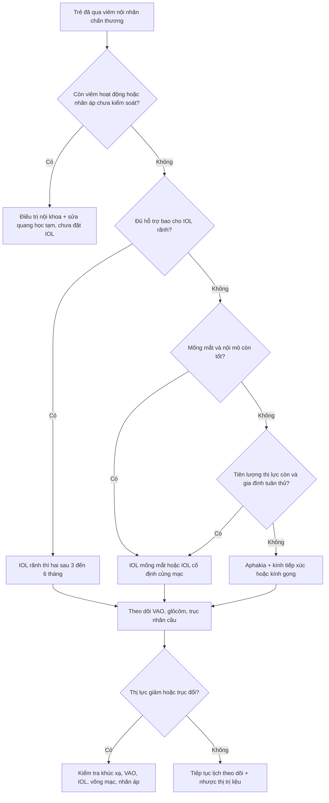
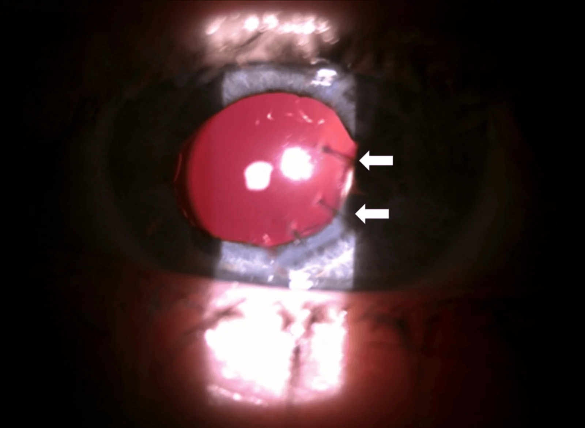
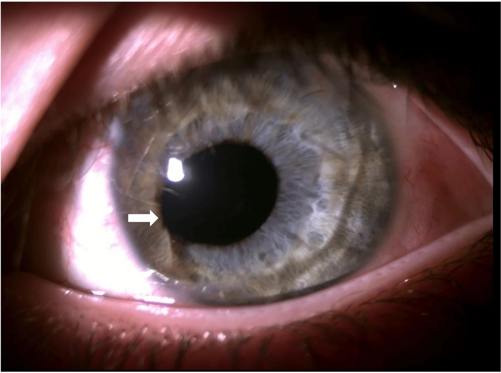
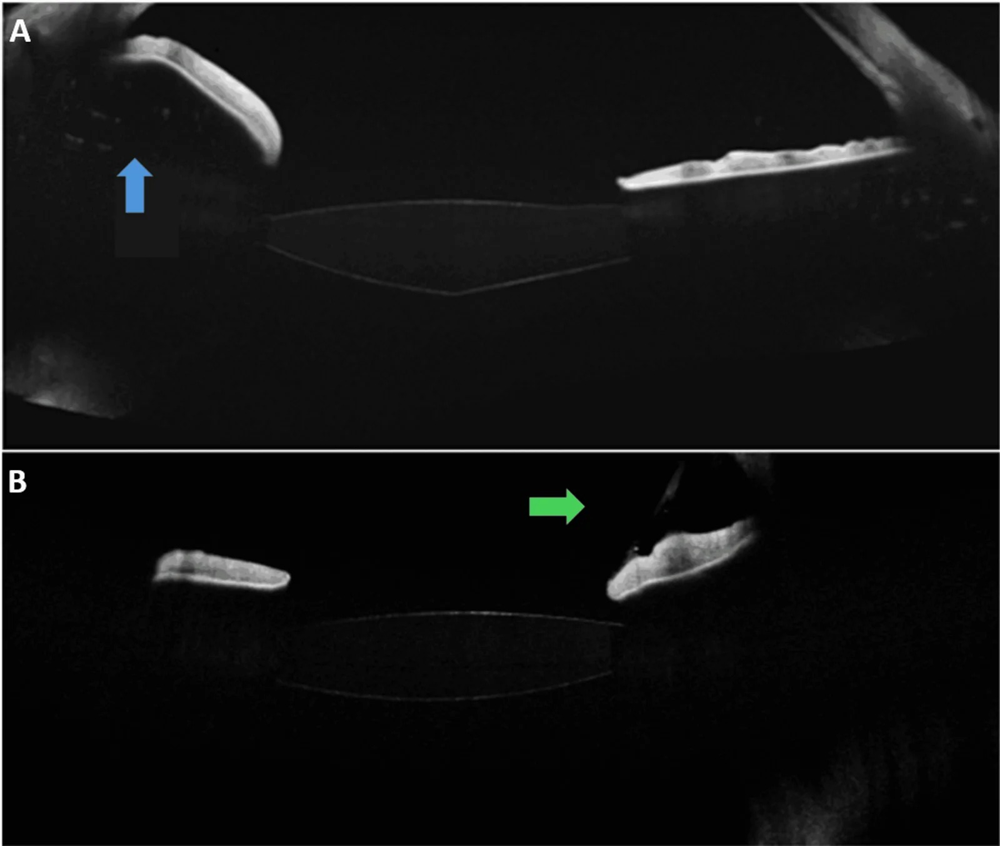

# 3289 — Theo dõi dài hạn sau viêm nội nhãn chấn thương ở trẻ: IOL thứ phát, nhược thị và bong võng mạc muộn

**Tags:** `pattern:aphakia` `pattern:nhược-thị` `pattern:bong-vong-mac-muon` `pattern:pvr` `pattern:duc-bao-sau` `pattern:lech-iol` `pattern:glocom-thu-phat` `pattern:sai-khuc-xa` `pattern:mat-mot-ben` `vung:mat` `vung:the-thuy-tinh` `vung:tien-phong` `vung:vong-mac` `vung:cung-mac` `protocol:AS-OCT` `protocol:UBM` `protocol:sinh-trac-do-truc` `protocol:khuc-xa-lieu` `protocol:PPV` `protocol:IOL-thu-phat` `protocol:kinh-tiep-xuc` `protocol:bit-mat` `score:OTS` `incidentaloma:khong`

**Mức chắc chắn (certainty):** tổng hợp y văn (literature synthesis) — dựng từ **đoàn hệ 301 trẻ viêm nội nhãn sau chấn thương** (Antibiotics 2025, **PMC11762764**, CC BY), **đoàn hệ tiến cứu 75 trẻ đục thể thủy tinh chấn thương theo dõi 5 năm của PEDIG** (JAMA Ophthalmol 2025, **PMC12593669**), **62 mắt aphakia sau chấn thương mắt hở đặt IOL thứ phát** (Korean J Ophthalmol 2021, **PMC8521333**, CC BY-NC), **279 mắt IOL cố định củng mạc ở trẻ** (Can J Ophthalmol 2018, PMID 29426441), **thử nghiệm ngẫu nhiên 30 mắt** so sánh IOL xuyên củng mạc không khâu với IOL mống mắt (Acta Ophthalmol 2019, PMID 30884195), **ca Carlevale theo dõi 5 năm** (Cureus 2026, **PMC13589642**, CC BY 4.0), các phân tích của **IATS** và **phân tích gộp bong võng mạc sau mổ đục thể thủy tinh trẻ** (**PMC12531611**). Nhóm **không có bệnh nhân của mình**; chỗ suy luận ghi **[suy luận]**, chỗ nguồn chưa đủ chắc ghi **"chưa rõ"**. **Không ghi tên tác giả** — attribution = **tạp chí + năm + PMCID/DOI**.

> **Câu chốt:** Sau khi qua đợt cấp, **trẻ không "khỏi" — trẻ chuyển sang một bệnh cảnh khác**: mắt **không còn thể thủy tinh**, có thể **dính mống mắt–thể mi**, và đang ở đúng **cửa sổ nhược thị**. Ba câu hỏi của giai đoạn dài hạn: **(1) Quang học được sửa thế nào — kính tiếp xúc, kính gọng hay IOL thứ phát?** **(2) IOL đặt lúc nào, và công suất bao nhiêu khi mắt còn lớn?** **(3) Ai theo dõi võng mạc, glôcôm và bao sau trong 5–10 năm tới?** Trong đoàn hệ 301 trẻ, **76,4% phải lấy thể thủy tinh**, **9,0% đã bong võng mạc lúc vào**, và chỉ **53,5% đạt thị lực cuối ≥ 0,05** (PMC11762764); ở đoàn hệ PEDIG 5 năm, thị lực trung vị là **20/63** với mắt có IOL và **20/258** với mắt aphakia, trong khi **47%** mắt giả thủy tinh phải mổ lại vì **đục trục thị giác** (PMC12593669). Nghĩa là: **kết cục dài hạn không do kháng sinh quyết định nữa, mà do quang học và theo dõi quyết định.**

## 1. Tổng quan bệnh học – cơ chế hình ảnh (TẠI SAO)

### 1.1 Vì sao giai đoạn dài hạn là một bệnh cảnh mới, không phải "hậu quả tồn dư"

- **Mất thể thủy tinh là mất một thấu kính + mất một hàng rào:** thể thủy tinh vừa là thấu kính công suất cao (**+20 D** ở trẻ), vừa là **hàng rào giữa tiền phòng và dịch kính**. Khi lấy thể thủy tinh, mắt trở thành **aphakia** — một quang hệ **thiếu 20 D**, đồng thời **dịch kính mất nâng đỡ** ở tiền phòng.
- **Ba "đồng hồ" chạy song song, không cùng tốc độ** (khung của bài 3272, áp lại cho mắt chấn thương):
  1. **Đồng hồ nhược thị: 0–8 tuổi**, nhạy nhất **< 3 tuổi**; mỗi tháng không có ảnh võng mạc rõ là mất một phần vĩnh viễn.
  2. **Đồng hồ trục nhãn cầu:** mắt lớn nhanh trong **18 tháng đầu** và **dậy thì**; IOL cố định công suất sẽ **"cận thị hóa"** theo thời gian.
  3. **Đồng hồ biến chứng muộn:** **bong võng mạc/PVR**, **glôcôm**, **đục bao sau**, **lệch IOL** — xuất hiện **hàng tháng đến hàng chục năm**.
- **Hệ quả thực hành:** một mắt **"ổn định" lúc 3 tháng** vẫn có thể **mất chức năng lúc 10 tuổi** — vì nhược thị không được điều trị hoặc vì bong võng mạc không triệu chứng. Theo dõi là **điều trị**, không phải "hẹn khám lại".

### 1.2 Vì sao mắt chấn thương để lại aphakia nhiều hơn mắt đục thể thủy tinh thường

- **Bao và dây chằng bị phá hủy:** trong 301 trẻ PTE, **76,4% (230/301)** phải **lấy thể thủy tinh** (PMC11762764). Lý do: vỡ bao, mủ trong bao, thể thủy tinh di lệch, hoặc không thể làm sạch ổ nhiễm nếu giữ thể thủy tinh.
- **Không đủ hỗ trợ bao để đặt IOL vào bao:** sau chấn thương xuyên, **bao trước–sau mất liên tục**, **dây chằng thể mi đứt** từng vùng → IOL rãnh cũng có thể không vững. Đây là lý do phải có **IOL cố định củng mạc** hoặc **IOL mống mắt**.
- **Sẹo giác mạc làm biometry sai:** sẹo trung tâm, khâu giác mạc còn tại vị trí, và **bề mặt giác mạc không đều** làm keratometry và **công suất IOL** kém tin cậy; trong ca Carlevale, nhóm phải **lấy số đo mắt lành** (AL **22,76 mm**, ACD **3,49 mm**, K1 **7,94**, K2 **7,59**) và dùng **SRK/II** để chọn **22,0 D** (PMC13589642).
- **Viêm mạn và dính:** sau PTE, **dính mống mắt–bao trước**, **màng fibrin**, **nang mống mắt** là di chứng thường gặp; AS-OCT trong ca Carlevale 5 năm cho thấy **nang mống mắt mũi** và **dính giác mạc–mống mắt thái dương** dù IOL vững (PMC13589642). Những tổn thương này **không gây mờ ngay** nhưng làm **phẫu thuật thì hai khó hơn**.

### 1.3 Vì sao IOL ở mắt trẻ "sai công suất" theo thời gian — vật lý của trục nhãn cầu đang lớn

- **Công thức mỏng:** công suất hiệu dụng của một IOL cố định tăng khi **khoảng cách từ IOL đến võng mạc tăng**. Trẻ lớn → **trục nhãn cầu dài ra** (**+1,7 đến +5,8 mm** trong các đoàn hệ nhi khoa; tổng quan *Medicina* 2026, PMC12843486) → ảnh hội tụ **trước võng mạc** → **cận thị**.
- **Tốc độ thực đo (IATS, đục thể thủy tinh bẩm sinh — dùng làm mô hình, không phải số của mắt chấn thương):** **0,35 D/tháng** trong **1,5 năm đầu**, sau đó **0,97 D/năm**; trẻ mổ lúc **1 tháng** mất **8,97 D** đến 5 tuổi, trẻ mổ lúc **6 tháng** mất **7,22 D**; để có **chính thị lúc 5 tuổi** phải nhắm **+10,5 D** ở 4–6 tuần và **+8,50 D** ở 7 tuần–6 tháng (PMC5507620).
- **Vì sao không thể "đặt đúng ngay"**: IOL công suất cố định trong mắt đang lớn là **bài toán dự báo**, không phải bài toán đo. Tổng quan 12 nghiên cứu cho thấy **thiên cận từ −1,8 D sau 2 năm đến −11,6 D sau 15 năm**, biến thiên do tuổi mổ, AL, độ dài theo dõi và công thức (PMC12843486) — **không có công thức nào đúng cho mọi trẻ**.
- **[suy luận]** Ở mắt **chấn thương**, bài toán còn khó hơn: **AL có thể đo được nhưng K thì không đáng tin** (sẹo, khâu), và **mắt lành không cùng kích thước** với mắt chấn thương. Vì thế **đặt IOL muộn** (khi mắt đã gần hết giai đoạn lớn nhanh) cho khúc xạ **dự đoán tốt hơn** — đúng với quan sát IATS: IOL thứ phát ở **5,4 tuổi** cho **sai số tuyệt đối 1,00 ± 0,70 D**, khúc xạ **−3,20 D** so với **−5,50 D** ở IOL cùng thì (PMC7936988).

### 1.4 Vì sao nhược thị là "kẻ thù số một" — và vì sao nó bị bỏ qua

- **Nhược thị do mất ảnh:** mắt aphakia **không được sửa đủ** sẽ nhận ảnh **mờ + méo + to hơn** mắt lành (kính gọng +20 D gây **độ phóng đại 20–30%** và **ám điểm vòng**). Não **ức chế** ảnh xấu → **nhược thị do thiếu hụt (deprivation amblyopia)** cộng thêm **nhược thị do khúc xạ lệch (anisometropic amblyopia)**.
- **Số liệu hệ thống:** trong **106 trẻ** đục thể thủy tinh chấn thương, **chấn thương mắt hở** làm tăng nguy cơ thị lực kém (**OR 2,8**, p = 0,03) và **nhược thị** làm tăng nguy cơ thị lực kém (**OR 2,4**, p = 0,04); **tuổi < 5** làm tăng nguy cơ **khúc xạ kém** (**OR 2,88**, p = 0,02) (J Cataract Refract Surg 2018, PMID 29502623).
- **Nhưng nhược thị chữa được:** **147 trẻ** đục thể thủy tinh chấn thương, sau phẫu thuật + **điều trị nhược thị đúng**, đạt **6/18 hoặc tốt hơn ở 87,9% (1 tháng), 97,3% (6 tháng), 97,9% (36 tháng)** (Eur J Ophthalmol 2019, PMID 29609478). Khác biệt giữa hai nghiên cứu không phải mâu thuẫn: **một bên đo "đã điều trị nhược thị", một bên đo "kết cục tự nhiên"**.
- **TẠI SAO phải bắt đầu trước khi "biết thị lực":** trẻ **< 3 tuổi** không đo được Snellen; chờ đến khi đo được là **đã muộn**. Vì thế phải dùng **đo khúc xạ có liệt điều tiết**, **thử kính tiếp xúc**, **theo dõi orthoptic** và **đo thị lực ưu tiên nhìn (preferential looking)** thay vì chờ.

### 1.5 Vì sao bong võng mạc đến muộn — cơ chế PVR và các con số

- **Cơ chế:** chấn thương xuyên → **phá vỡ hàng rào máu–võng mạc**, **xuất huyết dịch kính**, **viêm** → tế bào **biểu mô sắc tố (RPE)** và **nguyên bào sợi** di chuyển vào dịch kính, tiết **collagen + yếu tố tăng trưởng** → **màng tiền võng mạc co kéo (proliferative vitreoretinopathy, PVR)** → **bong võng mạc co kéo–rách (rhegmatogenous/tractional)**. Quá trình này **mất hàng tháng đến hàng năm**, nên **bong võng mạc muộn** là quy luật, không phải biến cố ngẫu nhiên.
- **Số liệu trong PTE trẻ:** **9,0% (27/301)** đã có bong võng mạc **lúc vào**; bài tổng quan dẫn y văn cho rằng bong võng mạc trong PTE trẻ có thể tới **38%**, so với **8,3%** ở người lớn (PMC11762764, phần trích dẫn). Bong võng mạc là **yếu tố tiên lượng xấu độc lập** cho thị lực cuối (**OR 0,191**; 0,065–0,560; p = 0,002) (PMC11762764).
- **Sau mổ đục thể thủy tinh ở trẻ nói chung:** phân tích gộp **5.922 mắt/9 nghiên cứu** cho **bong võng mạc rách (RRD) 2,4%** (0,7–5,0%), **6,1%** ở mắt không đặt IOL so với **1,9%** ở mắt có IOL (khác biệt **không có ý nghĩa**, p = 0,2667), và **11,0%** ở trẻ **chậm phát triển** (PMC12531611).
- **Bong võng mạc ở trẻ nói chung không "dễ":** **348 mắt** bong võng mạc trẻ, **44,8% do chấn thương**; thành công giải phẫu lần đầu **66,9%**, sau mổ thêm **88,5%**, nhưng **thành công chức năng chỉ 46,3%** (Indian J Ophthalmol 2025, PMC12659836, CC BY-NC-SA).
- **Vì sao "không thấy" bong võng mạc ở trẻ:** trẻ **không kể triệu chứng**, **media đục** (bao sau, dầu silicon), và **bong võng mạc nông nhiều ổ** có thể chỉ là **đốm "leopard"** trên đáy mắt (BMC Ophthalmol 2024, PMC11658082, CC BY-NC-ND — chỉ dùng số liệu, không dùng ảnh). Vì thế **siêu âm B** và **OCT hoàng điểm** là một phần của theo dõi, không phải chỉ khi bệnh nhân kêu mờ.

### 1.6 Vì sao đục trục thị giác (VAO) gần như chắc chắn ở mắt trẻ có IOL

- **Cơ chế:** tế bào **biểu mô thể thủy tinh (lens epithelial cells)** còn lại trên **bao trước/bao sau** tăng sinh, di chuyển ra sau tạo **Soemmerring ring** và **màng đục** ngay trên **trục thị giác**. Ở trẻ, khả năng tăng sinh **mạnh hơn người lớn**.
- **Số liệu:** trong đoàn hệ PEDIG 5 năm, **47%** mắt giả thủy tinh phải **mổ lại vì VAO** (31–60%), so với **13%** ở mắt aphakia; mắt **không được cắt dịch kính trước** có nguy cơ **84%** so với **15%** khi có **cắt dịch kính trước** — **aHR 11,4** (4,6–33,1), p < 0,001 (PMC12593669). Một nghiên cứu 135 mắt trẻ cho thấy VAO xuất hiện **trung vị 10 tháng** (IQR 10–12), và **IOL 1 mảnh acrylic** có nguy cơ cao hơn **IOL 3 mảnh** (**aHR 32,8**; 3,3–327) (Ophthalmology 2022, PMID 35595073).
- **Phản biện nguồn [quan trọng]:** PEDIG tuyển **đục thể thủy tinh chấn thương** nói chung, **không chọn riêng trẻ có viêm nội nhãn** — đây là **mô hình gần nhất** cho "mắt trẻ mất thể thủy tinh sau chấn thương", không phải số liệu riêng của PTE. Vì vậy không được trích các tỷ lệ này như "tỷ lệ của PTE"; dùng để **đặt kỳ vọng và lập lịch theo dõi**, còn nguy cơ cụ thể của PTE lấy từ PMC11762764.
- **Hệ quả thực hành:** **VAO là biến chứng có thể dự đoán và phòng được một phần** — và nó **bắt chước nhược thị** (trẻ "không tiến bộ" dù đeo kính đúng). Phải **soi đèn khe + đo lại khúc xạ** trước khi kết luận "nhược thị khó chữa".

## 2. Mẫu hình + chẩn đoán phân biệt theo vị trí (gamut)

### 2.1 Mẫu hình trung tâm

**Trẻ đã qua PTE, mắt hết đỏ — nay mờ dần, lệch trục, hoặc "không chịu đeo kính".** Khám có thể **bình thường ở tiền phòng** nhưng bất thường ở **một trong năm tầng**: **quang học (khúc xạ/aphakia)**, **bao sau (VAO)**, **vị trí IOL**, **nhãn áp/glôcôm**, **võng mạc (PVR/bong)**. Vì vậy mỗi lần khám phải **đi qua đủ năm tầng**, không dừng ở "mắt yên".

### 2.2 Gamut theo mốc thời gian sau đợt cấp

- **0–3 tháng:** **viêm còn hoạt động**, **dính mống mắt**, **màng fibrin**, **nhãn áp dao động**; chưa vội đặt IOL. Mục tiêu là **kiểm soát viêm + sửa quang học tạm (kính tiếp xúc/kính gọng) + bắt đầu nhược thị trị liệu**.
- **3–12 tháng:** **VAO** (trung vị ~10 tháng), **IOL lệch**, **nhãn áp tăng**, **dính bao trước**; đây là **cửa sổ đặt IOL thứ phát** ở nhiều trung tâm (**trung bình 3,79 ± 4,04 tháng** trong loạt 62 mắt; PMC8521333).
- **1–5 năm:** **cận thị hóa do trục lớn**, **nhược thị chững**, **glôcôm**, **lệch IOL muộn**; cần **đo trục nhãn cầu** và **đổi kính** theo từng năm.
- **> 5 năm:** **bong võng mạc/PVR**, **đứt/hở vết mổ cũ**, **IOL trôi**, **glôcôm mất bù**, **teo nhãn**; **theo dõi suốt đời**.

### 2.3 Gamut của "mờ mắt muộn sau PTE đã ổn định"

| Nhóm nguyên nhân | Ví dụ hay gặp | Dấu hiệu phân biệt nhanh |
|---|---|---|
| **Quang học** | aphakia chưa sửa đủ, kính sai, **cận thị hóa** sau IOL | Thị lực **tốt lên khi thử kính**/pinhole; khúc xạ lệch nhiều so với lần trước |
| **Trục thị giác** | **VAO/PCO**, màng đồng tử, **màng fibrin cũ** | Đục **ngay sau IOL/bao sau**, thấy rõ trên đèn khe; **YAG** cải thiện |
| **Vị trí IOL** | lệch nghiêng, **"capture" đồng tử**, disenclavation | **Đồng tử không tròn**, **phản quang lệch**, **AS-OCT/UBM** thấy haptic/vị trí |
| **Glôcôm** | glôcôm thứ phát sau chấn thương/viêm/dầu | **Nhãn áp > 21 mmHg**, lõm đĩa thị, **RNFL** mỏng; có thể **không triệu chứng** |
| **Giác mạc** | sẹo trung tâm, **band keratopathy**, phù | Sẹo **trên trục**, nhuộm fluorescein, **AS-OCT** bề dày/độ trong |
| **Võng mạc** | **PVR**, bong võng mạc, **ERM**, hoàng điểm | **B-scan** khi media đục; **OCT** khi thấy; **áp lực/khúc xạ đổi** |
| **Thần kinh** | teo thị sau chấn thương, **đứt thị** | **APD**, đĩa thị nhợt, **OCT RNFL** |
| **Nhược thị** | deprivation + anisometropia | **Không có tổn thương thực thể giải thích mức mờ**; **cải thiện khi bịt mắt lành** |

### 2.4 Gamut của lựa chọn quang học cho mắt aphakia

- **Kính gọng:** rẻ, dễ, nhưng **phóng đại 20–30%**, **ám điểm vòng**, **lệch trục** khi liếc — trẻ **không dung nạp**, và **nhược thị nặng hơn**.
- **Kính tiếp xúc (mềm/RGP/củng mạc):** quang học tốt nhất về **độ phóng đại**, nhưng phụ thuộc **tuân thủ + bề mặt nhãn cầu + vệ sinh**. Loạt **50 trẻ** đeo **kính củng mạc**: **34%** đạt **≥ 20/40**, **nhược thị 50%**, **lác 56%**, **tuân thủ 96%**, **không có nhiễm giác mạc**, **16 mắt loạn dưỡng biểu mô chấm** (Eye 2023, PMC9905087).
- **IOL cùng thì:** một lần mổ, nhưng **khó tính công suất**, **VAO cao**, **mổ lại nhiều** — trong IATS (bẩm sinh), nhóm IOL có **63%** phải mổ lại trong năm đầu so với **12%** nhóm kính tiếp xúc (PMC3512571).
- **IOL thứ phát:** đặt khi mắt **hết viêm, đủ hỗ trợ, đã đo được**; khúc xạ **dự đoán tốt hơn** nhưng vẫn cần **mổ thì hai** và **theo dõi VAO/glôcôm**.
- **Chấp nhận aphakia vĩnh viễn:** hợp lý khi **không có hỗ trợ bao**, **mắt độc nhất**, **tiên lượng thị lực kém**, hoặc **gia đình không thể theo kính tiếp xúc**.

## 3. Bảng so sánh phân biệt (ma trận đối chiếu)

| Thực thể (entity) | Hình ảnh/lâm sàng điển hình | Chốt vào (rule-in) | Chốt loại (rule-out) | Gợi ý xác nhận |
|---|---|---|---|---|
| **Aphakia chưa sửa đủ** | Trẻ mổ lấy thể thủy tinh, **không có IOL**, thị lực thấp; tiền phòng sâu, **không có phản quang IOL** | **Thị lực tăng rõ khi thử kính tiếp xúc/kính gọng đúng** | Thị lực **không đổi dù sửa đúng** → tìm nguyên nhân khác (võng mạc/glôcôm/nhược thị) | Khúc xạ có liệt điều tiết; thử kính; **AS-OCT** xác nhận không có IOL |
| **IOL rãnh vững** | IOL sau mống mắt, **đồng tử tròn**, phản quang trung tâm; **đủ bao** trên AS-OCT/UBM | **Hỗ trợ bao 360°**, **không dính mống mắt–bao trước**, **trục nhãn ổn định** | **Thiếu bao > 120°**, dính rộng, **dây chằng đứt** → không đặt rãnh | AS-OCT/UBM tiền phòng; đo AL/K; đèn khe sau giãn đồng tử |
| **IOL cố định củng mạc (sutured/sutureless)** | IOL sau, **haptic ra củng mạc**, có **vạt củng mạc/nút**; không cần bao | **Không còn hỗ trợ bao** nhưng **mắt yên, tiên lượng thị lực còn** | **Mắt còn viêm/tiền phòng tế bào**, **nhãn áp không kiểm soát**, **teo nhãn** → hoãn | Đèn khe + AS-OCT; **B-scan** trước mổ; theo dõi **RD 5,73%**, **lệch 4,6%** (PMID 29426441) |
| **IOL mống mắt (retropupillary iris-claw)** | IOL **kẹp mống mắt**, đồng tử tròn; mổ **ngắn hơn** | **Không đủ bao**, **mống mắt còn tốt**, **giác mạc nội mô đủ** | **Mống mắt teo/dính nhiều**, **nang mống mắt lớn**, **giác mạc nội mô kém** → tránh | So sánh RCT 30 mắt: **BCVA ≥ 0,3: 80% vs 53,3%**; ECC **−11% vs −14,6%**; **disenclavation 3 mắt** (PMID 30884195) |
| **Kính tiếp xúc (aphakia)** | Trẻ đeo kính, **giác mạc trong**, không có IOL | **Gia đình tuân thủ**, **bề mặt nhãn cầu tốt**, **trẻ chịu đeo** | **Tuân thủ kém**, **bụi bẩn**, **bề mặt nhãn cầu kém**, **không có người chăm sóc** | Thử kính 1–2 tuần; chụp fluorescein; **theo dõi 3 tháng/lần** |
| **VAO/PCO** | **Đục sau IOL**, **màng trắng trên trục**, thị lực giảm dần | **Đục đúng trục thị giác**, **thấy rõ trên đèn khe**, **YAG cải thiện** | Đục **không đúng trục**, **IOL đục**, **màng trước võng mạc** → OCT phân biệt | Đèn khe + **OCT hoàng điểm**; chụp ảnh sau YAG |
| **Bong võng mạc/PVR muộn** | **Mờ đột ngột hoặc tiến triển**, **ám điểm**, **B-scan có màng/dịch**, **OCT có dịch dưới võng mạc** | **Rách/ly giải + dịch dưới võng mạc**, **màng co kéo**, **siêu âm xác nhận** | **Không rách, không dịch**, chỉ **ERM**/mờ do media → theo dõi | **B-scan** khi không thấy đáy mắt; **OCT** khi thấy; **UW-field** nếu hợp tác |
| **Glôcôm thứ phát** | **Nhãn áp > 21 mmHg** (hoặc theo tuổi), **lõm đĩa**, **RNFL mỏng**, có thể **không triệu chứng** | **IOP tăng + tổn thương đĩa thị/OCT**, loại trừ **IOP tăng thoáng qua** | **IOP bình thường + đĩa thị bình thường** → không glôcôm | **Đo IOP nhiều lần**, **OCT RNFL**, thị trường khi hợp tác |

### 3.1 Ba câu hỏi tại giường trước khi kết luận "nhược thị"

1. **Quang học đã đúng chưa?** Khúc xạ **có liệt điều tiết**, thử **kính tiếp xúc**, kiểm tra **khoảng cách đỉnh** và **trục kính**.
2. **Trục thị giác có trong không?** Đèn khe sau giãn đồng tử; **VAO** có thể xuất hiện **10 tháng** sau mổ.
3. **Võng mạc và nhãn áp có ổn không?** **B-scan/OCT** nếu nghi; **IOP** mỗi lần khám — **glôcôm trẻ thường im lặng**.

## 4. Protocol chụp + hệ phân độ/điểm chuẩn hóa

### 4.1 Bộ hình ảnh tối thiểu của giai đoạn dài hạn

- **Đèn khe + ảnh màu tiền phòng:** vị trí IOL, đồng tử, dính, **nang mống mắt**, phản quang.
- **AS-OCT / UBM:** **hỗ trợ bao**, **dính mống mắt–bao trước**, **nang mống mắt**, **vị trí haptic**, **độ dày giác mạc**. Đây là **bản đồ phẫu thuật** trước khi đặt IOL thứ phát; trong ca Carlevale, AS-OCT 5 năm phát hiện **nang mống mắt** và **dính** mà đèn khe khó định lượng (PMC13589642).
- **Sinh trắc (biometry):** **AL cả hai mắt**, **K**, **ACD**; **đo lại K sau khi cắt chỉ giác mạc** (chỉ còn làm K sai); nếu **không đo được mắt bệnh**, dùng **mắt lành** và ghi rõ giả định (PMC13589642).
- **Siêu âm B (10–20 MHz):** **khi media đục** (VAO dày, dầu silicon, mủ cũ) để tìm **bong võng mạc, màng PVR, dị vật**; **không đè lên mắt chưa khâu**; sau **dầu silicon** phải biết để không đọc nhầm echo.
- **OCT hoàng điểm:** khi thấy được đáy mắt — phát hiện **ERM, dịch dưới võng mạc, teo hoàng điểm**; là **chuẩn theo dõi** sau PPV.
- **CT/MRI:** **không thường quy**. Chỉ khi nghi **dị vật còn lại**, **biến chứng hốc mắt**, hoặc **không giải thích được mất thị lực**. **MRI chống chỉ định** khi chưa loại trừ dị vật kim loại.

### 4.2 Lịch theo dõi đề xuất (khung thực hành, không phải guideline duy nhất)

- **1 ngày – 1 tuần – 1 tháng – 3 tháng** sau đợt cấp/mổ.
- **Mỗi 3 tháng đến 5 tuổi**, **mỗi 6 tháng đến 10 tuổi**, **mỗi năm sau đó** — nhưng **tăng nhịp** nếu: đang trị nhược thị, **IOL đã đặt**, **nhãn áp cao**, **võng mạc mỏng/hẹp**, hoặc **mắt độc nhất**.
- **Mỗi lần khám:** thị lực **theo tuổi**, **khúc xạ có liệt điều tiết**, **IOP**, **đèn khe**, **đáy mắt**; **orthoptic**; **AL mỗi 6–12 tháng** ở trẻ < 5 tuổi.
- **Ngưỡng hành động gợi ý [suy luận từ các đoàn hệ]:**
  - **Cận thị tăng > 0,5 D/năm** hoặc **AL tăng nhanh** → xem lại công suất/đổi kính, không chờ "ổn định".
  - **VAO trên trục + thị lực giảm** → **YAG** (nếu bao sau còn) hoặc mổ làm sạch trục.
  - **IOP > 21 mmHg** hai lần, hoặc **lõm đĩa/RNFL bất thường** → điều trị glôcôm, không chờ triệu chứng.
  - **Nghi bong võng mạc** → **B-scan ngay**, mổ trong **ngày–vài ngày**, không "hẹn 1 tháng".

### 4.3 Điểm chấn thương mắt (OTS) — dùng để tư vấn, không để trì hoãn

- **OTS** (Ocular Trauma Score) tính từ **thị lực ban đầu** và các yếu tố **vỡ nhãn cầu, viêm nội nhãn, chấn thương xuyên, bong võng mạc, RAPD**; nhóm **1–5** tương ứng tiên lượng.
- **Cách dùng đúng:** OTS **dự báo kết cục** để **tư vấn gia đình** và **phân bổ nguồn lực**; **không** dùng để **hoãn mổ** hoặc **từ chối điều trị nhược thị**. Trong loạt 62 mắt aphakia sau chấn thương, **90,3%** thuộc **OTS 2–3**, và ở **trẻ** OTS **không tương quan** với thị lực cuối — nghĩa là **tiên lượng xấu theo OTS không loại trừ khả năng phục hồi ở trẻ** (PMC8521333).

### 4.4 Sơ đồ quyết định: đặt IOL thứ phát hay tiếp tục aphakia

### 4.5 Nhược thị trị liệu — phần "không được quên"

- **Bịt mắt lành (occlusion)** là nền tảng; **atropine** là lựa chọn thay thế khi trẻ không chịu bịt. **Liều/thời gian** theo mức nặng và tuổi, **tái khám chặt** vì nguy cơ **nhược thị đảo ngược** ở mắt lành.
- **Nguyên tắc:** **sửa quang học đúng trước**, rồi mới bịt; **bịt mà kính sai = vô ích**. Ở trẻ **aphakia**, **kính tiếp xúc** thường là cách duy nhất để có ảnh đủ rõ.
- **Số liệu tích cực:** với **phẫu thuật + điều trị nhược thị**, **97,9%** trẻ đục thể thủy tinh chấn thương đạt **≥ 6/18 sau 36 tháng** (PMID 29609478) — nhưng **không có nghĩa mọi trẻ đều đạt**: đoàn hệ PEDIG chỉ **21%** mắt giả thủy tinh đạt **thị lực ngang tuổi** sau 5 năm (PMC12593669).
- **Theo dõi tuân thủ:** hỏi **số giờ bịt thực tế**, không hỏi "có bịt không"; ghi **nhật ký bịt**; kiểm tra **mắt lành** mỗi lần.

## 5. Biến thể bình thường và cạm bẫy

- **"Mắt yên" không phải "mắt ổn định".** **Glôcôm trẻ** và **bong võng mạc nông** có thể **không đỏ, không đau, không giảm thị lực rõ**. Đo **IOP** và **đáy mắt** mỗi lần, kể cả khi trẻ "bình thường".
- **Nang mống mắt và dính sau chấn thương là di chứng, không phải u.** Ca Carlevale: AS-OCT 5 năm thấy **nang mống mắt mũi** và **dính giác mạc–mống mắt thái dương**, ổn định, **không cần can thiệp** (PMC13589642). Cạm bẫy: gọi là "u mống mắt" hoặc "nang tiên lượng xấu" rồi mổ không cần thiết.
- **Đường ranh giới sắc tố ngoại vi = có thể là bong võng mạc cũ không triệu chứng.** Trong ca Carlevale, 5 năm thấy **đường ranh giới sắc tố ngoại vi dưới–thái dương**, không dịch, không rách — theo dõi (PMC13589642). Không được gọi là "sẹo vô nghĩa" mà bỏ qua **B-scan/OCT**.
- **Keratometry sau khâu giác mạc sai.** **Cắt chỉ làm K đổi**; đo IOL khi còn chỉ → **sai công suất**. Phải **cắt chỉ, đợi bề mặt ổn định**, rồi đo lại (PMC13589642; PMC8521333).
- **Dùng mắt lành để tính IOL là giải pháp tạm, không phải chuẩn.** Nó giả định **hai mắt cùng kích thước** — sai ở trẻ bị chấn thương một bên, và sai hơn nữa nếu mắt bệnh **đã thay đổi AL** do mổ/teo. Ghi rõ giả định trong hồ sơ.
- **Siêu âm B sau dầu silicon:** echo mạnh từ dầu và **giả ảnh** dễ đọc thành "đục dịch kính" hoặc "màng"; phải biết **đã bơm dầu** và đọc **võng mạc** thay vì môi trường.
- **"Nhược thị" có thể là VAO/IOL lệch/glôcôm.** Nếu trẻ **không tiến bộ dù bịt đúng**, phải **soi lại trục, đo IOP, chụp OCT/B-scan** trước khi tăng giờ bịt.
- **Sai sót do "thỏa mãn tìm kiếm":** thấy **IOL đẹp** là dừng, bỏ qua **võng mạc ngoại vi**, **dây chằng**, **góc tiền phòng**. Ở mắt chấn thương, **một tổn thương không loại trừ tổn thương thứ hai**.
- **Biến thể bình thường:** **đồng tử không đều** sau dính, **seclusio pupillae nhẹ**, **mống mắt thoái hóa** — có thể **không ảnh hưởng thị lực**; đừng "điều trị hình ảnh".

## 6. Tự lượng giá — Blind Quiz

**Ca 1 — Bé trai 8 tuổi, vết thương xuyên giác mạc do dao, đã khâu và lấy một phần thể thủy tinh. Ảnh dưới đây chụp 2 tháng sau. Nhìn trước, mô tả trước khi mở đáp án.**

- Gợi ý lâm sàng: thị lực **đếm ngón tay 50 cm**, nhãn áp **12 mmHg**, **không thấy tổn thương võng mạc**.
- Câu hỏi: (1) Vì sao mắt này **không đặt được IOL vào bao/rãnh**? (2) Cần **đo gì trước khi tính công suất IOL**? (3) Ba lựa chọn quang học và **tiêu chí chọn**?

<b>Bấm để hiện đáp án (findings + chẩn đoán)</b>

- **Dấu hiệu:** **vết rách giác mạc toàn bộ bề dày hình chữ C** (2–7 giờ) đã khâu **7 mũi nylon 10/0**; **thể thủy tinh đã lấy một phần**, **còn lại rất ít bao** → **không đủ hỗ trợ cho IOL trong bao hoặc rãnh**.
- **Chẩn đoán:** **aphakia chấn thương + thiếu hỗ trợ bao**; cần **IOL cố định củng mạc** hoặc **IOL mống mắt**, hoặc **aphakia + kính tiếp xúc**.
- **Trước khi tính IOL:** cắt chỉ/đợi giác mạc ổn định, **đo AL và K**; nếu không đo được mắt bệnh, **dùng mắt lành** (AL **22,76 mm**, ACD **3,49 mm**, K1 **7,94**, K2 **7,59**) và **ghi rõ giả định**; chọn **SRK/II**, **22,0 D** trong ca này.
- **Nguồn ảnh:** Cureus 2026 (**PMC13589642**), CC BY 4.0.

**Ca 2 — Cùng bệnh nhi, 8 tháng sau đặt IOL cố định củng mạc. Ảnh đèn khe dưới đây: IOL có vững không, và dấu hiệu nào cần theo dõi?**

- Gợi ý: thị lực **1,1 logMAR ngày 1**, **0,15 logMAR sau 1 năm** với kính; chỉ giác mạc **đã cắt 4 tháng sau mổ**.
- Câu hỏi: (1) Mô tả vị trí IOL và bất thường mống mắt; (2) Vì sao vẫn phải **theo dõi 5 năm** dù ảnh đẹp? (3) Hai biến chứng muộn cần tầm soát?

<b>Bấm để hiện đáp án (findings + chẩn đoán)</b>

- **Dấu hiệu:** IOL **trung tâm**, **gai mống mắt nhẹ phía mũi** (mũi tên), **không tilt**, **không "capture"**; phản quang trung tâm.
- **Vì sao theo dõi 5 năm:** mắt trẻ **còn lớn**, IOL **cố định công suất** → **cận thị hóa**; **VAO** có thể xuất hiện muộn; **glôcôm** và **bong võng mạc/PVR** có thể **không triệu chứng**. Trong ca này, 5 năm sau **UCVA 0,0 logMAR**, IOL **vẫn trung tâm**, **không ăn mòn củng mạc**; nhưng **AS-OCT** phát hiện **nang mống mắt** và **dính** — ổn định, theo dõi.
- **Hai biến chứng muộn:** **bong võng mạc/PVR** (B-scan/OCT) và **glôcôm** (IOP + OCT RNFL); thêm **lệch/disenclavation IOL**.
- **Nguồn ảnh:** Cureus 2026 (**PMC13589642**), CC BY 4.0.

**Ca 3 — Ảnh AS-OCT 5 năm sau mổ của cùng bệnh nhi. Có gì bất thường, và có cần mổ lại không?**

- Gợi ý: mắt **không đỏ, không đau**, nhãn áp **11 mmHg**, thị lực **0,0 logMAR**.
- Câu hỏi: (1) Hai tổn thương trên AS-OCT là gì? (2) Chúng có phải "biến chứng" cần mổ? (3) Khi nào **nang mống mắt** trở thành chỉ định can thiệp?

<b>Bấm để hiện đáp án (findings + chẩn đoán)</b>

- **Dấu hiệu:** **(A)** **nang mống mắt phía mũi** (mũi tên xanh) — cấu trúc **trống âm, bờ đều**, nằm trong mống mắt; **(B)** **dính giác mạc–mống mắt phía thái dương** (mũi tên xanh lá) — mống mắt **dính vào mặt sau giác mạc**.
- **Chẩn đoán:** **di chứng chấn thương/viêm**, **không phải nhiễm hoạt động**, **không phải u**. Trong ca này **ổn định 5 năm**, **không cần can thiệp**.
- **Khi nào can thiệp:** nang **to lên**, **gây bít góc tiền phòng/tăng nhãn áp**, **che trục thị giác**, **gây đau**, hoặc **nghi ngờ u** (không điển hình trên AS-OCT/UBM). Còn lại: **theo dõi bằng ảnh AS-OCT**.
- **Nguồn ảnh:** Cureus 2026 (**PMC13589642**), CC BY 4.0.

## 7. Câu hỏi nghiên cứu & điểm chưa đồng thuận (tính đến 11/2026)

1. **[Tranh cãi] Ở trẻ aphakia sau chấn thương mắt hở/viêm nội nhãn, đặt IOL thứ phát sớm (≤ 6 tháng) có cải thiện thị lực cuối và nhược thị so với đặt muộn (> 12 tháng) không?**
   - **Đã biết:** trong 62 mắt aphakia sau chấn thương, **thời gian đặt IOL không tương quan với thị lực cuối ở người lớn** (r = 0,140; p = 0,319) nhưng ở **nhóm trẻ** (16 mắt < 10 tuổi) có tương quan **rất mạnh** (r = 0,895; p < 0,01) — đặt càng muộn, thị lực càng kém (PMC8521333); IATS cho thấy IOL thứ phát ở **trung vị 5,4 tuổi** vẫn cho thị lực **tương đương aphakia** ở 10,5 tuổi (0,9 vs 0,8 logMAR) (PMC7936988).
   - **Chưa rõ:** **không có RCT**; các đoàn hệ **gộp nhiều mức độ nặng**, và "đặt muộn" thường gắn với **mắt nặng hơn**, nên không tách được lợi ích của "sớm" khỏi "mắt nhẹ hơn".
   - **Hướng nghiên cứu:** đoàn hệ tiến cứu **phân tầng theo tuổi, tình trạng bao, thị lực ban đầu**; outcome **thị lực 2 năm + giờ bịt + số mổ lại**.
   - **Nguồn:** PMC8521333 (2021); PMC7936988 (2021).

2. **[Khoảng trống] Công suất IOL và mục tiêu khúc xạ nào đúng cho mắt trẻ chấn thương khi không đo được K/AL đáng tin — dùng mắt lành, dùng công thức nào, và under-correction bao nhiêu?**
   - **Đã biết:** ca Carlevale dùng **mắt lành** (AL 22,76 mm), **SRK/II**, chọn **22,0 D** và đạt **0,0 logMAR ở 5 năm** (PMC13589642); ở trẻ bẩm sinh, IATS phải nhắm **+10,5 D** ở 4–6 tuần và **+8,50 D** ở 7 tuần–6 tháng để có chính thị lúc 5 tuổi, với **myopic shift 0,35 D/tháng** trong 1,5 năm đầu (PMC5507620); tổng quan nhi khoa ghi **thiên cận −1,8 đến −11,6 D** và **AL tăng 1,7–5,8 mm** (PMC12843486).
   - **Chưa rõ:** **không có công thức riêng cho mắt chấn thương** có sẹo giác mạc, khâu, hoặc AL lệch; **không rõ** nên dùng **AL mắt lành** hay **AL ước tính từ mắt bệnh**, và **mức under-correction** tối ưu theo tuổi chấn thương.
   - **Hướng nghiên cứu:** đoàn hệ có **AL/K lặp lại** và so sánh **SRK/II, Holladay, Barrett** ở mắt chấn thương; mô hình dự báo **thiên cận** theo tuổi + AL + K.
   - **Nguồn:** PMC13589642 (2026); PMC12843486 (2026); PMC5507620 (2017).

3. **[Khác biệt thực hành] Với trẻ aphakia sau chấn thương, nên **chấp nhận aphakia + kính tiếp xúc** hay **đặt IOL thứ phát** — và tiêu chí nào quyết định?**
   - **Đã biết:** ở trẻ bẩm sinh, **IATS** cho thấy **thị lực tương đương** giữa IOL và kính tiếp xúc ở 1 năm (0,97 vs 0,80 logMAR; p = 0,19) nhưng **mổ lại 63% vs 12%**, **biến cố 77% vs 25%** (PMC3512571; PMC3230731); **glôcôm 22%** và **glôcôm + nghi glôcôm 40%** ở 10 năm, **không khác giữa hai nhóm** (PMC7747044). Kính củng mạc ở trẻ aphakia cho **34% ≥ 20/40**, **tuân thủ 96%**, **nhược thị 50%**, **lác 56%** (PMC9905087). Đoàn hệ PEDIG 5 năm: **20/63** (IOL) vs **20/258** (aphakia), **21% vs 13%** đạt thị lực ngang tuổi (PMC12593669).
   - **Chưa rõ:** **không có dữ liệu riêng cho mắt chấn thương**; các so sánh đều **chọn lọc** (mắt nặng hơn thường để aphakia), và **tuân thủ kính tiếp xúc** phụ thuộc **hoàn cảnh gia đình** — yếu tố **không đo được** trong hồ sơ.
   - **Hướng nghiên cứu:** nghiên cứu **so sánh tiến cứu** ở trẻ chấn thương, **phân tầng theo hỗ trợ bao và điều kiện gia đình**, outcome **thị lực + chất lượng sống + chi phí**.
   - **Nguồn:** PMC3512571 (2010); PMC12593669 (2025); PMC9905087 (2023).

> **Ghi chú mục 7:** các "chưa rõ" đều suy ra từ **giới hạn thiết kế** của nghiên cứu đã dẫn (hồi cứu, chọn lọc, cỡ mẫu nhỏ, không phân tầng), không phải từ cảm nhận. Không thêm tranh cãi ngoài nguồn.

## Bài liên quan chéo
- [3286 – Viêm nội nhãn sau chấn thương mắt hở](../3286-viem-noi-nhan-sau-chan-thuong-mat-ho/lesson.md) (đợt cấp: chẩn đoán, kháng sinh, PPV)
- [3278 – Đục thể thủy tinh bẩm sinh một bên: IOL hay aphakia + kính tiếp xúc](../3278-duc-the-thuy-tinh-bam-sinh-mot-ben-iol-hay-aphakia/lesson.md) (cùng bài toán quang học ở trẻ)
- [3271 – Iridodialysis ở trẻ em](../3271-iridodialysis-tre-em-khi-nao-khau/lesson.md) (dính mống mắt, tổn thương đồng tử sau chấn thương)
- [3272 – Bơm dầu silicon ở trẻ em](../3272-dau-silicone-tre-em/lesson.md) (theo dõi võng mạc, nhược thị, biến chứng dầu)
- [456 – Bệnh võng mạc trẻ sinh non](../456-benh-vong-mac-tre-sinh-non/lesson.md) (mô hình bong võng mạc trẻ và theo dõi dài hạn)

## Ảnh
- Tên file: `3289_theo-doi-sau-viem-noi-nhan_Modality_SourceID.jpg`; nguồn + giấy phép từng ảnh trong `images/CREDITS.md`.
- Toàn bộ ảnh tải từ **PubMed Central open access** (Cureus 2026, **PMC13589642**), **CC BY 4.0**, dùng **nguyên bản** — chỉ chuyển định dạng WebP → JPEG, **không crop, không ghép, không đổi màu**.

> Không dùng để chẩn đoán độc lập khi chưa có người hướng dẫn.
