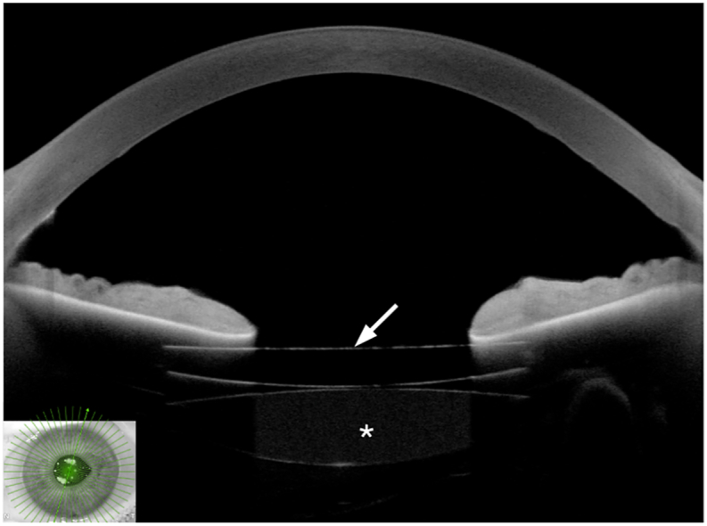
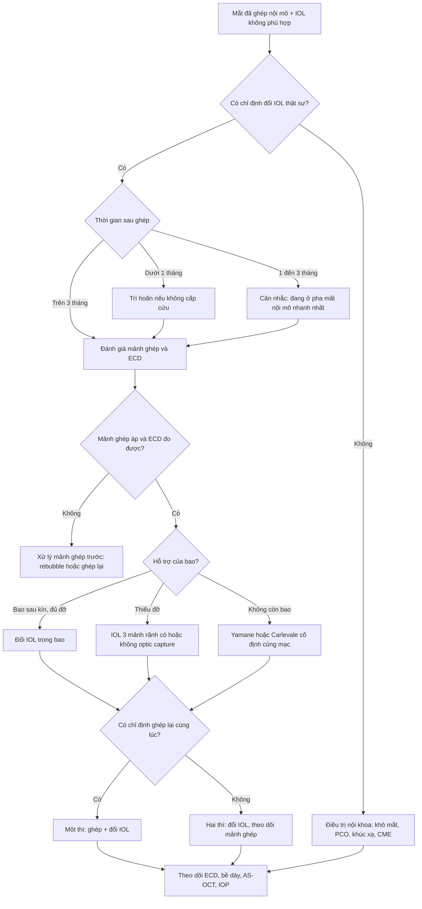
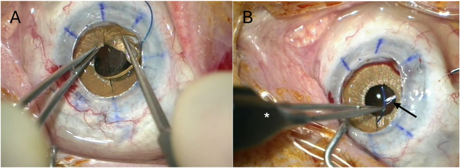
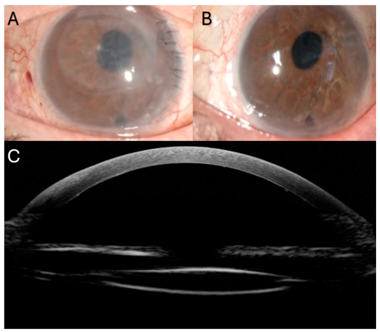
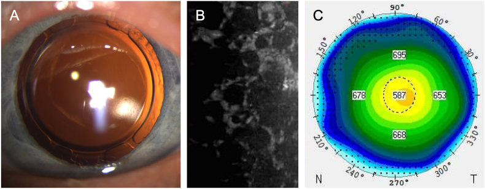
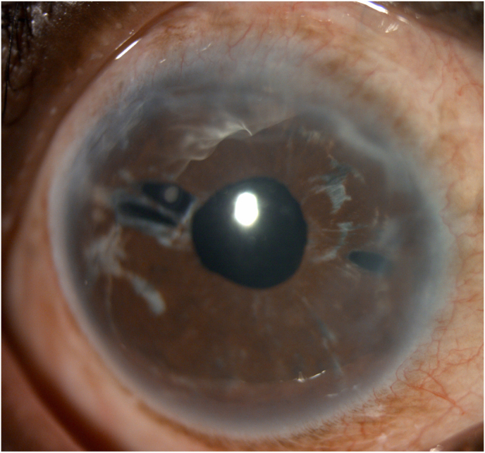

# 3291 — Đổi IOL ở mắt đã ghép giác mạc (DSAEK/DMEK): mất nội mô hiến tặng, thời điểm và đường vào — IOL exchange in a corneal graft

**Tags:** `pattern:mat-gia-the-thuy-tinh` `pattern:duc-giac-mac-sau-ghep` `pattern:duc-iol` `pattern:iol-lech` `pattern:bong-manh-ghep` `pattern:phu-giac-mac` `pattern:sai-khuc-xa` `vung:mat` `vung:giac-mac` `vung:tien-phong` `vung:the-thuy-tinh` `vung:rang-the-mi` `vung:cung-mac` `protocol:AS-OCT` `protocol:UBM` `protocol:sinh-hien-vi` `protocol:den-khe` `protocol:sieu-am-B` `score:khong-co` `incidentaloma:khong`

**Mức chắc chắn (certainty):** tổng hợp y văn (literature synthesis) — dựng từ: loạt **4 mắt** đổi IOL sau DMEK vì IOL đục (*Cornea* 2024, **DOI 10.1097/ICO.0000000000003649**); loạt **24 mắt** ghép DSAEK + đổi IOL bằng Yamane cùng thì (*Can J Ophthalmol* 2026, **DOI 10.1016/j.jcjo.2026.01.004**); so sánh **124 mắt** ghép nội mô + IOL thứ phát một thì so với hai thì (*Cornea* 2023, **PMC10277315**, CC BY-NC-ND); **19 mắt** DSAEK + đổi IOL so với **188 mắt** DSAEK đơn (*Am J Ophthalmol* 2010, **PMID 20172066**); **30 mắt** DSAEK phức tạp (*Cornea* 2013, **PMID 23086374**); **21 mắt** DMEK + IOL khâu củng mạc (*Cornea* 2023, **PMID 36729033**); **8 mắt** DMEK trên mắt đã cố định IOL củng mạc (*J Clin Med* 2024, **PMC11594376**, CC BY 4.0); **24 mắt** Yamane ở mắt sẹo giác mạc (*Eur J Ophthalmol* 2025, **PMID 40302391**); **34 mắt** DMEK đơn so với **80 mắt** triple-DMEK (*Am J Ophthalmol* 2020, **PMID 32437670**); **136 mắt** DMEK 1 năm (*Ophthalmology* 2011, **PMID 21872938**); **176 mảnh ghép** DMEK theo dõi 5 năm (*Eye* 2023, **PMC10397279**, CC BY 4.0); **48 mắt** DMEK với mô hiến nhập khẩu (*Front Med* 2024, **PMC10881667**, CC BY 4.0); **170 mắt** phân tích 12 yếu tố bong mảnh ghép (*Sci Rep* 2025, **PMC12297530**, CC BY 4.0); mô hình ECL hai pha **65 mắt** (*J Clin Med* 2024, **PMC10856122**, CC BY 4.0); **29 mắt** đặt IOL thứ phát sau ghép xuyên (*Cornea* 2019, **PMID 30640247**); **46 mắt** IOL thứ phát sau ghép xuyên (*J Ophthalmol* 2018, **PMC6157166**, CC BY 4.0). Nhóm **không có bệnh nhân của mình**; chỗ suy luận ghi **[suy luận]**. **Không ghi tên tác giả** — attribution = **tạp chí + năm + PMCID/DOI**.

> **Ranh giới với bài đã có:** [3279](../3279-doi-iol-cao-cap-muon/lesson.md) trả lời **"đổi IOL ở mắt KHÔNG ghép — khi nào kết luận IOL hỏng, đổi trong bao hay rãnh"**; [3253](../3253-iol-canxi-hoa-sau-phaco/lesson.md) trả lời **"vì sao IOL trắng đục"**; [1462](../1462-sinh-trac-iol-sau-ghep-giac-mac/lesson.md) trả lời **"tính công suất IOL sau ghép"**; [3226](../3226-nam-ghep-giac-mac-tu-nguoi-hien/lesson.md) trả lời **"nhiễm nấm mảnh ghép"**; [1447](../1447-rach-the-mi-sau-migs-va-yamane/lesson.md) trả lời **"rách thể mi sau Yamane"**; [3264](../3264-bong-mang-descemet-sau-phaco/lesson.md) trả lời **"bong DM sau phaco"**. Bài này trả lời câu hỏi hẹp hơn nhưng khó hơn: **mắt đã có mảnh ghép nội mô hiến tặng, nay phải thay IOL — thay bằng đường nào, lúc nào, và cái giá nội mô là bao nhiêu?**

> **Câu chốt — năm nhóm số phải thuộc:** **(1) Đổi IOL sau DMEK có thể "đốt" gần hết nội mô hiến:** **4 mắt** đổi IOL vì IOL đục sau DMEK mất **57,7–85,3%** tế bào nội mô, dù **không ca nào thất bại mảnh ghép** ngay (**DOI 10.1097/ICO.0000000000003649**). **(2) Ghép cùng thì với IOL củng mạc có kết cục chấp nhận được:** **24 mắt** DSAEK + Yamane: **20/590 → 20/93**, **rebubbling 16,7%**, **thất bại mảnh ghép 8,3%**, **không thải ghép** (**DOI 10.1016/j.jcjo.2026.01.004**). **(3) Một thì hay hai thì không khác nhau ở mốc 6–9 tháng:** **124 mắt** — giai đoạn **1–2 tháng** nhóm hai thì tốt hơn (p = 0,011), nhưng **6–9 tháng** không còn khác (p = 0,591), **không khác** tỷ lệ thất bại nguyên phát/bong (**PMC10277315**). **(4) Ghép ba thành phần tốn nội mô hơn ghép đơn:** **triple-DMEK 35% ở 1 tháng và 41% ở 1 năm** so với **25% và 33%** khi DMEK đơn (**PMID 32437670**). **(5) Vật liệu IOL quyết định nguy cơ đục sau DMEK:** IOL **hàm lượng nước cao** có **OR 65,5**; **mỗi lần rebubbling** có **OR 9,51**; **9,05% (21/232)** mắt DMEK có IOL đục (**DOI 10.1097/ICO.0000000000003649**).

## 1. Tổng quan bệnh học – cơ chế hình ảnh (TẠI SAO)

### 1.1 Vì sao nội mô mảnh ghép là mô mỏng manh nhất trong phẫu thuật đoạn trước

- **Mảnh ghép DMEK** chỉ gồm **màng Descemet + một lớp tế bào nội mô**, dày khoảng **10–15 µm** — **không có mô đệm** để chịu lực, không có mạch nuôi, và **không tái sinh**. Mọi tế bào mất đi là mất vĩnh viễn; mật độ nội mô (endothelial cell density, **ECD**) là **dự trữ sống còn** của giác mạc.
- **Bơm nội mô** đẩy nước từ mô đệm ra tiền phòng. Khi **ECD giảm dưới ngưỡng bù trừ** (kinh điển **< 500 tế bào/mm²**), mô đệm **ngậm nước** → **dày giác mạc** (bình thường **~540 µm**, phù rõ khi **> 700 µm**), **mờ nhu mô**, **bọng biểu mô**, rồi **xơ hóa**.
- **Hệ quả hình ảnh:** **soi hiển vi phản chiếu (specular microscopy)** đếm ECD nhưng **không đo được khi giác mạc còn phù**; **AS-OCT** cho **bề dày mô đệm**, **mức áp của mảnh ghép**, **dịch diện (interface fluid)** và **vị trí IOL**; **Pentacam** cho **bản đồ bề dày**. Vì vậy câu hỏi "còn bao nhiêu nội mô" thường phải trả lời **gián tiếp** bằng bề dày và mức trong của giác mạc.
- **Vì sao đây là mô đích của mọi thao tác trong tiền phòng:** đầu tip, bong bóng khí, dịch cân bằng (BSS), viscoelastic và **thân IOL** đều **quét qua lớp tế bào này**; tổn thương do **lực cắt** và do **tiếp xúc trực tiếp**, không phải do "độc tính" [suy luận từ cơ học dịch trong tiền phòng, khớp với mức ECL rất cao sau đổi IOL].

### 1.2 Vì sao đổi IOL trên mắt đã ghép lại tốn nội mô đến vậy — con số và cơ chế

- **Đổi IOL là thao tác "hai lần" trong một tiền phòng nhỏ:** lấy IOL cũ (cắt hoặc rút), bơm viscoelastic, đưa IOL mới, căn chỉnh và cố định. Trên mắt đã ghép, **toàn bộ chuỗi này diễn ra ngay sát mảnh ghép**.
- **Bằng chứng trực tiếp:** **4 mắt** đổi IOL sau DMEK vì IOL đục có **ECL 57,7–85,3%**, dù **không có thất bại mảnh ghép** trong theo dõi trung vị **45 tháng** (**DOI 10.1097/ICO.0000000000003649**). Đây là mức **gần như xóa sổ dự trữ nội mô hiến tặng**.
- **So sánh có kiểm soát:** ở mắt **không ghép**, RCT **104 bệnh nhân** đổi IOL muộn cho thấy mất nội mô **17,5% sau 2 năm** so với **15,3%** khi chỉ cố định lại IOL (p = 0,15) (**PMID 32304486** — số liệu dẫn qua [3279](../3279-doi-iol-cao-cap-muon/lesson.md)). Nghĩa là **bản thân đổi IOL không "đốt" 60–85% nội mô**; **cái làm nên khác biệt là mảnh ghép mỏng manh nằm ngay dưới tay phẫu thuật viên**.
- **Ghép "ba thành phần" cũng tốn hơn ghép đơn:** **triple-DMEK** (phaco + IOL + DMEK) mất **35 ± 15% ở 1 tháng** và **41 ± 16% ở 1 năm**, so với **25 ± 16%** và **33 ± 13%** khi DMEK đơn (p = 0,016 và p = 0,034) (**PMID 32437670**). Đây là **mức "giá" của một thao tác thủy tinh thể thêm vào** — dùng làm **mốc tham chiếu** cho cái giá của đổi IOL [suy luận, cùng bản chất thao tác].
- **Vì sao vẫn có ca "ECL 85% mà mảnh ghép vẫn trong"?** Nội mô còn lại có thể **tăng kích thước và bù chức năng** trong ngắn–trung hạn; **ECD thấp không đồng nghĩa mất bù tức thì**, nhưng **dự trữ cho 10–20 năm tới đã hết** — đây là lý do phải theo dõi dài hạn, không chỉ nhìn "giác mạc trong lúc ra viện" [suy luận].

### 1.3 Vì sao chính IOL lại là "thủ phạm" sau DMEK — cơ chế đục và hình ảnh

- **IOL acrylic ưa nước (hydrophilic)** hấp thụ nước trong thủy dịch; khi **tiếp xúc với khí/gas** dùng để ép mảnh ghép (air, SF6), **canxi và phosphat kết tủa** trên/trong vật liệu → **đục dạng hạt trắng–xám**. Đây là **biến chứng vật liệu**, không phải viêm [cơ chế khớp với **39079758** và bài [3253](../3253-iol-canxi-hoa-sau-phaco/lesson.md)].
- **Tần suất và yếu tố nguy cơ:** trong **232 mắt** DMEK hồi cứu, **21 mắt (9,05%)** có IOL đục; mô hình đa biến trên **105 mắt** cho thấy **IOL hàm lượng nước cao OR 65,5** (p = 0,0005) và **số lần rebubbling OR 9,51** (p = 0,0138) (**DOI 10.1097/ICO.0000000000003649**). Nói cách khác: **càng nhiều lần bơm khí để cứu mảnh ghép, càng dễ phải thay IOL về sau** — một vòng xoáy cần lường trước.
- **Hình ảnh:** đèn khe thấy **chấm/lớp trắng xám trên mặt quang**, **hồi chiếu không đỏ đều**; **AS-OCT** thấy **mặt quang dày, không đồng nhất**; **straylight tăng** dù **CDVA có thể còn tốt** (ngưỡng straylight **> 1,56 log(s)** — xem [3279](../3279-doi-iol-cao-cap-muon/lesson.md), **PMC11610101**). Vì vậy **"giác mạc trong mà bệnh nhân vẫn mờ"** sau DMEK phải **soi kỹ IOL**, không chỉ nhìn mảnh ghép.

### 1.4 Vì sao "lúc nào" quan trọng — đường cong mất nội mô và độ bám của mảnh ghép

- **Mất nội mô xảy ra chủ yếu trong 3 tháng đầu:** **136 mắt** DMEK mất **36 ± 20%** ở 1 năm, trong đó **31 ± 18%** đã mất ngay trong **3 tháng đầu** (**PMID 21872938**). Mô hình hai pha trên **65 mắt** cho **thời gian bán hủy 3,03 tháng** ở pha sớm và **131,50 tháng** ở pha muộn; dự báo **chạm 500 tế bào/mm² sau 218 tháng** nếu không thêm tổn thương (**PMC10856122**).
- **Hệ quả thực hành:** **thao tác thêm trong 3 tháng đầu** rơi đúng **cửa sổ mất nội mô nhanh nhất**; chờ qua **3 tháng** không làm mảnh ghép "khỏe hơn" về tế bào, nhưng **tránh cộng dồn hai tổn thương lên cùng một pha** [suy luận từ đường cong ECL].
- **Nhưng chờ quá lâu cũng có giá:** mảnh ghép **dính chặt**, bao xơ co, **YAG** có thể đã mở bao sau — làm ca đổi IOL khó hơn (dữ liệu mạnh ở mắt **không ghép**: **PMC11980882**, xem [3279](../3279-doi-iol-cao-cap-muon/lesson.md)); ở mắt đã ghép, **chờ không làm nội mô hồi phục**, chỉ làm **kỹ thuật khó hơn** [suy luận].
- **Mảnh ghép cần thời gian "take":** **bong > 1/3 diện tích** phải **rebubbling** ở **3,4%**; **bong < 1/3 tự khỏi 22,7%**; thời điểm rebubble trung bình **16 ± 9,4 ngày** (**PMC10397279**). Vì vậy **mổ lại trong 2–4 tuần đầu** là lúc **mảnh ghép còn "lỏng" nhất** — trừ khi **bắt buộc** vì lý do khác.

### 1.5 Vì sao "một thì" hấp dẫn — và khi nào dữ liệu ủng hộ

- **Một thì** (ghép nội mô + đổi IOL) có lợi: **một lần gây mê**, **một lần phục hồi**, **một tiền phòng đã mở**, tránh **hai lần tổn thương nội mô**. Loạt **24 mắt** DSAEK + Yamane cùng thì đạt **20/590 → 20/93**, **rebubbling 16,7%**, **thất bại mảnh ghép 8,3%**, **không thải ghép**; **62,5%** có glaucoma, **47%** đã đặt ống (**DOI 10.1016/j.jcjo.2026.01.004**). Đây là **bệnh cảnh nặng** — kết cục này là **tốt hơn kỳ vọng**, không phải "dễ".
- **Nhưng so sánh trực tiếp lại không cho một thì thắng:** **124 mắt** ghép nội mô + IOL thứ phát cho thấy nhóm **hai thì** có **CDVA tốt hơn ở 1–2 tháng** (p = 0,011), nhưng **không còn khác biệt ở 6–9 tháng** (p = 0,591), và **không khác** về **thất bại mảnh ghép nguyên phát** hay **bong mảnh ghép** (**PMC10277315**). Nghĩa là **một thì không nguy hiểm hơn rõ rệt**, nhưng **cũng không nhanh hồi phục hơn**.
- **Với ghép xuyên (PK)**, chiến lược **hai thì có kiểm soát** rất mạnh: **29 mắt** đặt IOL thứ phát **13,3 ± 2,2 tháng** sau PK + lấy thể thủy tinh, khi **đã cắt chỉ**; **mất nội mô chỉ 7,3% ở 6 tháng**, **giác mạc trong suốt tới lần khám cuối** (**PMID 30640247**). **46 mắt** IOL thứ phát sau PK cũng cho **CDVA cải thiện** với cả ba kỹ thuật (**PMC6157166**). Đây là **mốc so sánh quan trọng**: **can thiệp vào mắt ghép không nhất thiết phải tốn 60–85% nội mô** — **đường vào và thời điểm quyết định**.

## 2. Mẫu hình + chẩn đoán phân biệt theo vị trí (Gamut)

### 2.1 Năm bệnh cảnh lâm sàng — cùng "mắt ghép + IOL" nhưng khác quyết định

| Bệnh cảnh | Dấu hiệu chính | Câu hỏi quyết định |
|---|---|---|
| **A. IOL đục sau DMEK** | Giác mạc trong, **IOL trắng–xám**, chói, **CDVA có thể tốt**, **straylight cao** | **Đổi IOL** hay **chấp nhận + tư vấn**? Đổi **trong bao hay rãnh**? |
| **B. IOL lệch/ACIOL + phù giác mạc** | **IOL nghiêng/lệch**, sắc tố mống mắt, **phù mô đệm**, ECD thấp | **Đổi IOL + ghép nội mô**; **một thì hay hai thì**? |
| **C. IOL tốt nhưng khúc xạ sai** | Giác mạc trong, **IOL đúng vị trí**, **sai khúc xạ hệ thống** | **Đổi IOL** hay **IOL phụ (piggyback)** hay **phẫu thuật khúc xạ**? |
| **D. Mảnh ghép bong + IOL vấn đề** | **Đường bong** trên đèn khe/AS-OCT, **dịch diện**, phù | **Rebubble trước** hay **mổ lại một thì**? |
| **E. IOL canxi hóa muộn sau nhiều năm** | **Đục dạng hạt**, **hồi chiếu không đều**, có thể kèm **phimosis bao** | **Đổi IOL**; đường vào nào **ít chạm nội mô**? |

### 2.2 Gamut theo vị trí tổn thương

- **Mặt trước mảnh ghép / diện (interface):** **dịch diện** (interface fluid) — dải giảm hồi âm giữa mô đệm nhận và mảnh ghép; **máu diện**; **bong từng phần**; **màng xơ sau ghép**.
- **Mô đệm (stroma):** **phù do mất bù nội mô** (dày > 700 µm), **phù do tăng nhãn áp**, **sẹo/xơ** (mờ không hết dù mảnh ghép áp), **xâm nhập tế bào biểu mô** (epithelial downgrowth — mờ đục bờ rõ, tiền phòng có màng).
- **Tiền phòng (anterior chamber):** **IOL lệch/nghiêng**, **thân IOL cọ mống mắt** (sắc tố, UGH), **mảnh thể thủy tinh sót**, **thoát mống mắt**, **tăng nhãn áp do pupil block** (mống mắt áp sát mảnh ghép/IOL).
- **Rãnh thể mi (ciliary sulcus):** **IOL rãnh quá lớn** (chạm góc, chafing), **IOL rãnh quá nhỏ** (lệch, " sunrise/sunset"), **haptic lệch vào tiền phòng**.
- **Củng mạc (sclera):** **flange/haptic Yamane** lộ, **u hạt quanh chỉ**, **mỏng củng mạc** tại đường vào — nguồn **rò tiền phòng muộn** và **viêm nội nhãn**.
- **Hoàng điểm (macula):** **CME** sau mổ — nguyên nhân "mờ" **không do giác mạc**; **ERM**; **bong võng mạc**.

### 2.3 Cửa sổ thời gian — cùng triệu chứng, khác chẩn đoán

- **< 1 tháng:** **bong mảnh ghép**, **phù do mổ**, **tăng nhãn áp do khí**, **IOL lệch sớm**, **viêm nội nhãn** (hiếm nhưng cấp cứu).
- **1–3 tháng:** **bong mảnh ghép muộn**, **interface fluid**, **phù còn lại**, **CME**, **IOL đục bắt đầu**; đây cũng là **pha ECL nhanh nhất**.
- **3–12 tháng:** **thất bại nguyên phát muộn**, **thải ghép**, **IOL đục rõ**, **khúc xạ ổn định để đánh giá**; **thời điểm hợp lý để đổi IOL có kế hoạch** [suy luận].
- **> 12 tháng:** **thải ghép muộn**, **mảnh ghép mờ dần**, **IOL canxi hóa**, **phimosis**, **glaucoma tiến triển** — phải **phân biệt nguyên nhân giác mạc với nguyên nhân IOL**.

## 3. Bảng so sánh phân biệt (ma trận đối chiếu)

| Thực thể (entity) | Hình ảnh / phép đo điển hình | Chốt vào (rule-in) | Chốt loại (rule-out) | Gợi ý xác nhận |
|---|---|---|---|---|
| **IOL đục sau DMEK** | Đèn khe: **hạt/lớp trắng–xám trên mặt quang**; **hồi chiếu không đỏ đều**; **straylight tăng**; AS-OCT **mặt quang dày/không đồng nhất** | **IOL hàm lượng nước cao** + **đã rebubble** + **giác mạc trong** mà **chói/mờ** (**OR 65,5; OR 9,51**) (DOI 10.1097/ICO.0000000000003649) | **Giác mạc còn phù/bong** hoặc **PCO/ERM** giải thích được triệu chứng → chưa kết luận IOL | Soi đèn khe giãn đồng tử + hồi chiếu; straylight; đối chiếu nhãn/hộp IOL |
| **Bong mảnh ghép (graft detachment)** | **Đường bong** hình liềm; **dịch diện** trên AS-OCT; **phù khu trú**; **mất áp một vùng** | **Bong > 1/3 diện tích** → **rebubbling** (3,4%); **bong < 1/3** thường **tự khỏi 22,7%** (PMC10397279) | **Dịch diện mỏng không tiến triển** + giác mạc trong → theo dõi, không can thiệp | AS-OCT lặp 3–7 ngày; chụp đèn khe; đo bề dày |
| **Thải ghép (rejection)** | **Đường KP**, **tế bào tiền phòng**, **phù đột ngột**, **mảnh ghép đục**; **không mủ** | **KP + tế bào + phù mới** ở mắt **giảm miễn dịch tại chỗ** (PMC10397279: thải **5,1–8,8%**) | **Chỉ phù không KP, không tế bào** → nghĩ **mất bù/hết nội mô** hoặc **tăng nhãn áp** | Đèn khe; AS-OCT; đáp ứng corticoid |
| **Thất bại nguyên phát (primary graft failure)** | **Phù không giảm từ tuần đầu**, **mảnh ghép không áp**, **không KP** | **Giác mạc không trong sau 4–6 tuần** dù mảnh ghép áp; **ECD rất thấp/không đo được** | **Có KP/tế bào** → thải ghép, không phải thất bại nguyên phát | AS-OCT + đèn khe + theo dõi 4–6 tuần |
| **IOL lệch/nghiêng + cọ mống mắt** | **IOL nghiêng**, **một haptic trong bao một trong rãnh**, **sắc tố mống mắt**, **phù kèm UGH** | **Sắc tố + tăng nhãn áp + phù** và **IOL sai vị trí** (PMID 20172066; PMID 23086374) | **IOL đúng trục**, **không sắc tố**, **khúc xạ ổn** → theo dõi | Đèn khe giãn đồng tử; AS-OCT/UBM; soi góc |
| **Mảnh thể thủy tinh sót** | **Mảnh tăng hồi âm** trong tiền phòng/góc; **phù khu trú tiếp xúc**; **viêm nhẹ kéo dài** | **Phù đúng vùng tiếp xúc + không đáp ứng corticoid + thấy mảnh** | **Phù lan tỏa limbus-to-limbus 12–48 giờ** → nghĩ **TASS**, không phải mảnh sót | Soi góc/AS-OCT; đèn khe; xem lại mổ |
| **CME sau mổ** | **OCT hoàng điểm**: phù dạng nang, mất liên tục lớp ngoài; **metamorphopsia** | **OCT có CME** giải thích mờ dù giác mạc trong | **OCT bình thường + không méo hình** → loại | OCT hoàng điểm; Amsler |
| **Tăng nhãn áp / pupil block** | **Tiền phòng nông**, **mống mắt áp**, **IOL sát mống mắt**, **giác mạc phù nhanh** | **IOP cao + tiền phòng nông + phù mới**; **khí/gas còn** trong tiền phòng | **Tiền phòng sâu, IOP bình thường** → loại | Đo IOP; AS-OCT; soi góc |

*AS-OCT sau **DMEK + IOL phụ trong rãnh**: **mũi tên** = IOL phụ trong rãnh thể mi, **dấu sao** = IOL chính trong bao; **giác mạc trong, mảnh ghép áp**. Đây là hình mẫu của chiến lược **"không đổi IOL"** khi vấn đề chỉ là **khúc xạ**, không phải vị trí hay vật liệu. Nguồn: *Am J Ophthalmol Case Rep* 2025 (PMC12336521), Fig. 3, **CC BY 4.0**.*

### 3.1 Ba câu hỏi đọc ma trận

- **"Có thật sự phải đổi IOL không?"** → chỉ sau khi loại **bong mảnh ghép, thải ghép, mất bù nội mô, CME, PCO, khô mắt**. Nếu **giác mạc còn phù**, đổi IOL **không làm bệnh nhân thấy tốt hơn** mà còn **đốt thêm nội mô**.
- **"Đổi bằng đường nào?"** → ưu tiên **ít chạm nội mô nhất**: **trong bao** khi bao còn đỡ; **rãnh 3 mảnh ± optic capture** khi thiếu đỡ; **Yamane/Carlevale** khi không còn bao; **tránh ACIOL** nếu có lựa chọn khác vì **cọ góc và mất nội mô** (PMID 20172066; PMID 23086374).
- **"Một thì hay hai thì?"** → **một thì** khi **cả hai vấn đề đều cấp** hoặc bệnh nhân **không chịu được hai lần mổ**; **hai thì** khi cần **đợi mảnh ghép ổn định, cắt chỉ (PK), khúc xạ ổn** — dữ liệu **124 mắt** cho thấy **không khác ở 6–9 tháng** (**PMC10277315**), nên **lựa chọn theo bệnh nhân và kỹ thuật**, không theo "một thì tốt hơn".

## 4. Protocol + ngưỡng định lượng

### 4.1 Trước khi quyết định — 9 bước bắt buộc

1. **Mốc sự kiện:** ngày ghép, **loại ghép (DMEK/DSAEK/PK)**, **kích thước mảnh ghép**, **số lần rebubbling**, **loại IOL + vật liệu + công suất**, **đã YAG chưa**.
2. **Triệu chứng – chức năng:** **CDVA**, **straylight** (nếu có), **độ nhạy tương phản**, **khúc xạ chủ quan lặp 2 lần**; hỏi **chói/quầng** để phân biệt **IOL** với **giác mạc**.
3. **Đèn khe giãn đồng tử:** **vị trí IOL**, **haptic**, **sắc tố mống mắt**, **mặt quang IOL**, **PCO**, **đường bong mảnh ghép**, **KP/tế bào**.
4. **AS-OCT tiền phòng:** **mức áp mảnh ghép**, **dịch diện**, **bề dày mô đệm**, **khoảng cách IOL–mống mắt**, **vị trí IOL** (bao/rãnh/ACIOL).
5. **Sinh hiển vi phản chiếu:** **ECD** — **chỉ tin khi giác mạc đủ trong**; nếu **không đo được**, ghi rõ và dùng **bề dày** làm proxy.
6. **Bản đồ bề dày (Pentacam)**: **trung tâm > 700 µm** = phù đáng kể; so với **mốc sau ghép** để biết **đang xấu đi** hay **ổn định**.
7. **OCT hoàng điểm:** loại **CME/ERM** — nguyên nhân mờ **không do giác mạc**.
8. **Nhãn áp – góc:** loại **pupil block**, **tăng nhãn áp do khí**, **dính góc**; ghi **thuốc hạ nhãn áp** và **ống dẫn lưu** (ảnh hưởng đường vào).
9. **Kế hoạch dự phòng:** **vị trí đường vào xa mảnh ghép**, **viscoelastic bảo vệ nội mô**, **áp lực tiền phòng thấp**, **hạn chế số lần đưa vào tiền phòng**, **sẵn sàng ghép lại** nếu mảnh ghép hỏng.

### 4.2 Ngưỡng định lượng dùng trong bài

| Biến số | Ngưỡng / giá trị | Ý nghĩa thực hành | Nguồn |
|---|---|---|---|
| **ECD** | **< 500 tế bào/mm²** | Ngưỡng kinh điển của **mất bù**; dưới ngưỡng này **giác mạc không còn dự trữ** | Giáo khoa [suy luận] |
| **Bề dày giác mạc trung tâm** | **~540 µm** bình thường; **> 700 µm** = phù rõ | Theo dõi **mất bù** khi không đo được ECD | Giáo khoa [suy luận] |
| **ECL sau đổi IOL ở mắt DMEK** | **57,7–85,3%** (4 mắt) | Mức **rất cao**; phải tư vấn **trước** về nguy cơ mất dự trữ nội mô | DOI 10.1097/ICO.0000000000003649 |
| **ECL sau triple-DMEK** | **35% / 41%** (1 tháng / 1 năm) so với **25% / 33%** DMEK đơn | Mốc tham chiếu "giá" của một thao tác thủy tinh thể thêm | PMID 32437670 |
| **ECL sau DMEK đơn** | **36 ± 20%** ở 1 năm; **31 ± 18%** trong 3 tháng đầu | Giải thích vì sao **tránh mổ thêm trong 3 tháng đầu** | PMID 21872938 |
| **ECL sau đổi IOL ở mắt KHÔNG ghép** | **17,5%** sau 2 năm | Mốc so sánh: **mảnh ghép là yếu tố làm ECL tăng vọt** | PMID 32304486 |
| **Bong mảnh ghép cần rebubble** | **> 1/3 diện tích** → rebubbling **3,4%**; **< 1/3** tự khỏi **22,7%** | Quyết định **can thiệp hay theo dõi** | PMC10397279 |
| **Bong "có ý nghĩa"** | **> 20% diện tích hoặc chạm trung tâm** (15% số mắt) | Ngưỡng dùng trong phân tích đa biến | PMC12297530 |
| **IOP 2 giờ sau mổ** | **< 20 mmHg** → **OR 25,1** cho bong mảnh ghép | Tránh **hạ nhãn áp quá mức** sau ghép; kiểm IOP sớm | PMC10881667 |
| **Khí tamponade** | **SF6** so với **air**: **OR 0,20** cho bong | **SF6 làm giảm bong**; cân nhắc ở mắt nguy cơ cao | PMC12297530 |
| **Tuổi người nhận** | **> 72,5 tuổi** → **OR 2,84** cho bong | Yếu tố nguy cơ **không sửa được** — dùng để **tư vấn và theo dõi sát** | PMC12297530 |
| **IOL hàm lượng nước cao** | **OR 65,5** cho **IOL đục sau DMEK** | **Chọn vật liệu IOL** ngay từ đầu; tránh ở mắt sẽ ghép nội mô | DOI 10.1097/ICO.0000000000003649 |
| **Mỗi lần rebubbling** | **OR 9,51** cho **IOL đục** | Càng nhiều rebubble, càng dễ **phải thay IOL** | DOI 10.1097/ICO.0000000000003649 |
| **Sống mảnh ghép 5 năm** | **98%** gắn hoàn toàn · **90%** bong một phần · **83%** đã rebubble | Tư vấn **tiên lượng dài hạn**; bong/rebubble **không lành tính** | PMC10397279 |
| **DMEK + IOL khâu củng mạc** | Sống mảnh ghép **76,19%** so với **90,9%** ở Phaco-DMEK (18 tháng) | **Đường vào phức tạp làm giảm sống mảnh ghép** | PMID 36729033 |
| **DSAEK + Yamane cùng thì** | **Thất bại mảnh ghép 8,3%**, **rebubbling 16,7%** | Kết cục **chấp nhận được** ở mắt phức tạp | DOI 10.1016/j.jcjo.2026.01.004 |
| **IOL thứ phát sau PK (hai thì)** | **ECL 7,3%** ở 6 tháng, đặt IOL lúc **13,3 ± 2,2 tháng** | **Chờ + cắt chỉ** giúp **giảm tổn thương nội mô** | PMID 30640247 |

### 4.3 Cây quyết định

### 4.4 Chọn đường vào — bảng quyết định kỹ thuật

| Đường vào | Khi nào chọn | Ưu điểm | Giá phải trả / dữ liệu |
|---|---|---|---|
| **Trong bao (in-the-bag)** | **Bao sau kín**, bao trước còn đủ, **không có YAG** | **Ít chạm nội mô nhất**, khúc xạ ổn định | Khó nếu **bao xơ co/phimosis**; **ECL thấp nhất** trong các loạt đổi IOL (PMID 20172066) |
| **Rãnh 3 mảnh ± optic capture** | **Thiếu đỡ nhẹ**, bao sau mở nhưng còn **vành bao** | Không cần cố định củng mạc; **giữ được trục quang** | **IOL rãnh quá lớn** → cọ góc/chafing; theo dõi **sắc tố, IOP** |
| **Yamane (xuyên củng mạc, flange)** | **Không còn bao**, **ACIOL cần thay**, mắt **đã cắt dịch kính** | Không chỉ, **cố định chắc**, đường vào nhỏ | **Haptic-optic junction** có thể xoay/lệch (**8,3%** trong loạt 24 mắt, DOI 10.1016/j.jcjo.2026.01.004); cần **kinh nghiệm** |
| **Carlevale / IOL cố định củng mạc một mảnh** | **Không bao**, mắt **đã cắt dịch kính**, cần **cố định chắc** | **Sutureless**, thiết kế **neo T** | Có thể **lộ/hỏng neo**; dữ liệu dài hạn còn ít (PMC10336406; PMC11594376) |
| **ACIOL (tiền phòng)** | **Cuối cùng** — không còn lựa chọn nào khác | Đơn giản, không cần bao | **Cọ góc, mất nội mô, UGH**; **CME 9,6%** so với **1,3%** trong bao (PMC10041992) |
| **Iris-claw / khâu mống mắt** | Không bao, **mống mắt đủ khỏe** | Cố định tốt | **Trật 10,3%** với iris-sutured (PMC10041992); **khó căn trục** |
| **Open-sky + PK** | **Đổi IOL + ghép xuyên cùng lúc**, mắt **phức tạp** (mống mắt nhân tạo, dính) | Kiểm soát **toàn bộ tiền phòng** | **Ca nặng**, chảy máu, **thời gian mổ dài**; kỹ thuật **"saloon door"** giữ mống mắt nhân tạo (PMC12466138) |

*Đổi IOL **open-sky** trong mổ **ghép xuyên**: **(A)** IOL luồn qua **đường rạch trên mống mắt nhân tạo** vào hậu phòng; **(B)** **kẹp (dấu sao)** giữ haptic để **kéo ra ngoài** và **flange**, trong khi **kim kẹp (mũi tên đen)** tạo đường xuyên củng mạc. Đây là ví dụ **đường vào "phá vỡ quy tắc"** khi mắt đã quá phức tạp — nhưng cũng là **phương án cuối** vì **nguy cơ nội mô và chảy máu cao**. Nguồn: *Am J Ophthalmol Case Rep* 2025 (PMC12466138), Fig. 2, **CC BY 4.0**.*

### 4.5 Thời điểm: một thì hay hai thì — bằng chứng và cách chọn

- **Ghép nội mô + IOL thứ phát:** **124 mắt** — **hai thì** tốt hơn ở **1–2 tháng** (p = 0,011) nhưng **bằng nhau ở 6–9 tháng**; **không khác** **thất bại nguyên phát** và **bong mảnh ghép**; **không khác** giữa các kiểu cố định IOL (**PMC10277315**).
- **Ghép xuyên + IOL:** **hai thì có kiểm soát** (đợi **13,3 tháng**, cắt chỉ) cho **ECL 7,3%** ở 6 tháng (**PMID 30640247**) — thấp hơn nhiều so với **đổi IOL trên mắt DMEK** (**57,7–85,3%**). **Đây là bằng chứng mạnh nhất rằng "chờ đúng lúc" có giá trị.**
- **Một thì khi:** **cả hai bệnh đều tiến triển** (ví dụ **IOL lệch gây phù + mất bù nội mô**), hoặc **bệnh nhân không thể mổ hai lần**, hoặc **mảnh ghép đã thất bại và cần ghép lại**.
- **Hai thì khi:** **mảnh ghép còn bong/dịch diện**, **giác mạc còn phù**, **chưa cắt chỉ (PK)**, **khúc xạ chưa ổn**, hoặc **cần đánh giá lại ECD** trước khi quyết định.
- **Bẫy thời gian:** **YAG bao sau** trước khi quyết định đổi IOL làm **mất hỗ trợ bao** và **tăng độ khó** — nếu đang cân nhắc đổi IOL, **chuyển phẫu thuật viên có kinh nghiệm trước khi YAG** (dữ liệu mắt không ghép: **PMC11980882**).

### 4.6 Theo dõi sau mổ

- **Ngày 1–7:** **IOP** (đặc biệt **2 giờ đầu**: **< 20 mmHg** làm tăng bong — **PMC10881667**), **mức áp mảnh ghép** trên đèn khe/AS-OCT, **tiền phòng**, **khúc xạ thô**.
- **Tuần 2–4:** **bong mảnh ghép** (thời điểm rebubble trung bình **16 ± 9,4 ngày** — **PMC10397279**), **KP/tế bào**, **IOL đục sớm** (thường muộn hơn), **CME**.
- **Tháng 3:** **ECD** (khi hết phù), **bề dày**, **khúc xạ ổn định**, **AS-OCT**; đây là mốc để **đánh giá kết quả** và **quyết định có cần can thiệp thêm**.
- **6–12 tháng và hằng năm:** **ECD**, **bề dày**, **IOL**, **nhãn áp**, **đáy mắt**; **cảnh báo bệnh nhân** về **chói/mờ mới** = có thể **IOL đục** hoặc **thải ghép muộn**.

*Ca **DMEK** trên mắt đã có **IOL cố định củng mạc một mảnh**: **(A)** trước mổ — **phù giác mạc**, giác mạc mờ; **(B)** sau **3 tháng** — giác mạc trong, IOL trung tâm; **(C)** **UBM/AS-OCT** — mảnh ghép áp, IOL sau mống mắt. Trong loạt **8 mắt**, **ECD giảm 33,4%** sau 12 tháng, **1 mắt rebubble**, **không đục IOL** trong 12 tháng. Nguồn: *J Clin Med* 2024 (PMC11594376), Fig. 4, **CC BY 4.0**.*

## 5. Biến thể bình thường và cạm bẫy

- **Cạm bẫy 1 — "giác mạc trong = mảnh ghép ổn":** **IOL đục** có thể là nguyên nhân **chói/mờ** dù **giác mạc trong** và **CDVA còn tốt**; **straylight** mới phản ánh triệu chứng (**DOI 10.1097/ICO.0000000000003649**; **PMC11610101**). Luôn **soi mặt quang IOL** và **hồi chiếu**.
- **Cạm bẫy 2 — đo ECD khi còn phù:** **sinh hiển vi phản chiếu không đo được** khi mô đệm phù; ghi "không đo được" và dùng **bề dày/AS-OCT** thay vì **suy ra ECD từ một trị số cũ** [suy luận].
- **Cạm bẫy 3 — gọi dịch diện là bong:** **dịch diện mỏng, không tiến triển, giác mạc trong** có thể **tự tiêu**; chỉ **bong > 1/3** hoặc **chạm trung tâm** mới cần **rebubble** (**PMC10397279**; **PMC12297530**). Chụp lại **3–7 ngày** thay vì can thiệp ngay.
- **Cạm bẫy 4 — bỏ sót CME:** bệnh nhân **mờ + méo hình** sau mổ có thể do **CME**, không do giác mạc; **OCT hoàng điểm** là bắt buộc trước khi quyết định đổi IOL (**PMID 20172066**).
- **Cạm bẫy 5 — "một thì luôn tốt hơn":** dữ liệu **124 mắt** cho thấy **lợi thế hai thì chỉ ở 1–2 tháng**, **mất đi ở 6–9 tháng** (**PMC10277315**); chọn theo **bệnh nhân, mảnh ghép, hỗ trợ bao**, không theo khẩu hiệu.
- **Cạm bẫy 6 — YAG trước, quyết định sau:** **YAG** làm mất hỗ trợ bao, tăng độ khó và **tăng nguy cơ IOL đục** (mỗi rebubble **OR 9,51**) — **quyết định đổi IOL trước khi YAG** (**PMC11980882**; **DOI 10.1097/ICO.0000000000003649**).
- **Cạm bẫy 7 — bỏ qua khí trong mắt đã cắt dịch kính:** ở mắt **vitrectomy + IOL củng mạc**, khí dễ **di chuyển ra sau** làm **mảnh ghép không áp**; làm **air leak test** và **pupilloplasty** khi cần (**PMC11594376**).
- **Cạm bẫy 8 — tính công suất IOL như mắt chưa ghép:** sau ghép nội mô có **dịch chuyển hyperopic** và **thay đổi keratometry**; dùng **công thức/điều chỉnh phù hợp** và **khúc xạ mục tiêu thận trọng** — xem [1462](../1462-sinh-trac-iol-sau-ghep-giac-mac/lesson.md).
- **Biến thể bình thường:** **IOL phụ trong rãnh** (piggyback) **có chủ đích** không phải "hai IOL do sai sót"; **mảnh ghép hơi dày** nhưng **trong, áp, bề dày ổn định** không phải thất bại; **đường bong ngoại vi nhỏ, không tiến triển** có thể chỉ theo dõi (**PMC10397279**).
- **Cạm bẫy 9 — tư vấn "đổi IOL là hết mờ":** ở mắt đã ghép, **ECL có thể 57,7–85,3%**, **thất bại mảnh ghép 8,3%** trong loạt ghép cùng thì, và **sống mảnh ghép 5 năm chỉ 83%** nếu đã rebubble — phải nói **kết cục trung bình**, không hứa ca tốt nhất (**DOI 10.1097/ICO.0000000000003649**; **DOI 10.1016/j.jcjo.2026.01.004**; **PMC10397279**).

## 6. Tự lượng giá — Blind Quiz

**Ca 1 — Nữ 74 tuổi, Fuchs, mắt trái đã phaco đặt IOL acrylic ưa nước 7 năm trước; nay khúc xạ +5,25 −1,00 × 68°, BCVA 20/40, giác mạc phù, ECD không đo được. Mắt phải đã DMEK + phaco 6 tháng, BCVA 20/20, ECD 1.587 tế bào/mm².**

- Gợi ý: bệnh nhân **hyperopic cao** sau phaco, **giác mạc phù**, **không đo được ECD**; IOL **acrylic ưa nước**.
- Câu hỏi: Chọn **đổi IOL** hay **IOL phụ trong rãnh**? Vì sao **đổi IOL** có thể **tệ hơn** ở mắt này? Kế hoạch **một thì** gồm những bước nào?

<b>Bấm để hiện đáp án (findings + chẩn đoán)</b>

- **Findings:** **(A)** đèn khe — **giác mạc phù**, **guttae**, IOL trong bao; **(B)** sinh hiển vi phản chiếu — **mật độ nội mô rất thấp/không đo được**; **(C)** bản đồ bề dày — **dày trung tâm** so với mắt đối diện.
- **Chẩn đoán:** **Fuchs + phù giác mạc do mất bù nội mô**, kèm **hyperopia sau phaco** — cần **DMEK** và **chỉnh khúc xạ**.
- **Vì sao không đổi IOL:** **đổi IOL** ở mắt sắp ghép làm **mất hỗ trợ bao**, **tăng ECL**, và **không giải quyết được hyperopia** nếu IOL cũ **dính chắc**; **IOL phụ +8 D trong rãnh** là lựa chọn **ít xâm lấn** [suy luận khớp với ca gốc].
- **Kết cục ca gốc:** **DMEK + IOL phụ trong rãnh**; **2 tháng** khúc xạ **−0,25 −1,75 × 62°**, **BCVA 20/25**, **ECD 1.920**; **10 tháng** **BCVA 20/20**, **ECD 1.778**, **không đục IOL** (**PMC12336521**).
- Nguồn: *Am J Ophthalmol Case Rep* 2025 (PMC12336521), Fig. 1 + Fig. 2 + Fig. 3, **CC BY 4.0**.

**Ca 2 — Nam 59 tuổi, 7 năm trước phaco biến chứng (vỡ bao sau, cắt dịch kính), đã đặt IOL iris-claw; nay giác mạc phù, thị lực đếm ngón tay, IOL lệch mũi.**

- Gợi ý: **mắt đã cắt dịch kính**, **không còn bao**, **IOL iris-claw lệch**, **giác mạc phù**.
- Câu hỏi: Vì sao **không đặt IOL trong bao/rãnh**? **Carlevale** giải quyết vấn đề gì? **Nguy cơ nội mô** của phương án này?

<b>Bấm để hiện đáp án (findings + chẩn đoán)</b>

- **Findings:** **giác mạc phù** (bề dày trung tâm **651 µm**), **IOL iris-claw lệch mũi**, **dịch kính** trong tiền phòng, **teo mống mắt khu trú**.
- **Chẩn đoán:** **phù giác mạc giả thể thủy tinh (pseudophakic bullous keratopathy)** + **IOL lệch** trên mắt **đã cắt dịch kính, không bao**.
- **Chiến lược:** **DMEK** + **thay IOL bằng Carlevale cố định củng mạc không chỉ** — vì **không còn bao**, **rãnh không đủ đỡ**, và **ACIOL/iris-claw** đã thất bại; kỹ thuật **"cornea press"** giúp **mở mảnh ghép** trong tiền phòng **đã cắt dịch kính**.
- **Kết cục:** **15 tháng** — giác mạc **trong**, mảnh ghép **áp**, **Carlevale trung tâm**, thị lực cải thiện (**PMC10336406**).
- Nguồn: *Am J Ophthalmol Case Rep* 2023 (PMC10336406), Fig. 2, **CC BY-NC-ND 4.0** (nguyên bản, không crop).

**Ca 3 — Nữ 57 tuổi, mống mắt nhân tạo + IOL tiền phòng sau nhiều lần mổ, nay IOL lệch và giác mạc phù tái diễn; cần đổi IOL nhưng mống mắt nhân tạo đang che tiền phòng.**

- Gợi ý: **mống mắt nhân tạo** không thể tháo dễ, **IOL tiền phòng lệch**, **giác mạc đã phù nhiều lần**.
- Câu hỏi: Làm sao **đưa IOL mới vào hậu phòng** mà **không tháo mống mắt nhân tạo**? Vì sao phải **mổ open-sky**? **Theo dõi gì** sau mổ?

<b>Bấm để hiện đáp án (findings + chẩn đoán)</b>

- **Findings:** **IOL tiền phòng lệch**, **mống mắt nhân tạo** cố định, **giác mạc phù**; sau mổ: **hai đường rạch xuyên mống mắt nhân tạo** (**mũi tên trắng**), **IOL 3 mảnh hậu phòng** cố định củng mạc, **giác mảnh ghép trong**.
- **Kỹ thuật:** **"saloon door"** — rạch **hai đường 180°** trên mống mắt nhân tạo, luồn IOL qua **"cửa lùa"**, rồi **kéo haptic ra ngoài và flange** theo **Yamane cải biên**; thực hiện **open-sky trong mổ ghép xuyên** (**PMC12466138**).
- **Vì sao open-sky:** cần **kiểm soát toàn bộ tiền phòng** và **giữ mống mắt nhân tạo**; đây là **phương án cuối**, **nguy cơ nội mô/chảy máu cao** [suy luận].
- **Theo dõi:** **IOP**, **mức áp mảnh ghép**, **vị trí IOL**, **thải ghép**, **thị lực**; ca gốc **ổn định, mảnh ghép trong** ở lần khám cuối.
- Nguồn: *Am J Ophthalmol Case Rep* 2025 (PMC12466138), Fig. 2, **CC BY 4.0**.

## 7. Câu hỏi nghiên cứu & điểm chưa đồng thuận (tính đến 11/2026)

1. **[Tranh cãi] Ở mắt cần cả ghép nội mô và thay IOL, phẫu thuật một thì có làm tăng bong mảnh ghép/thất bại mảnh ghép so với hai thì khi theo dõi ≥ 1 năm?**
   - **Đã biết:** so sánh **124 mắt** cho thấy **hai thì** tốt hơn ở **1–2 tháng** (p = 0,011) nhưng **không còn khác biệt ở 6–9 tháng** (p = 0,591), **không khác** thất bại nguyên phát/bong (**PMC10277315**); loạt **24 mắt** ghép cùng thì với Yamane có **rebubbling 16,7%**, **thất bại 8,3%** (**DOI 10.1016/j.jcjo.2026.01.004**).
   - **Chưa rõ:** **không có RCT**; các loạt **hồi cứu, cỡ nhỏ**, khác **loại ghép, loại IOL, bệnh nền glaucoma**, và **thời gian theo dõi ngắn**.
   - **Hướng nghiên cứu:** RCT/đoàn hệ tiến cứu phân tầng **một thì vs hai thì**, outcome **ECL, bong mảnh ghép, sống mảnh ghép 1–5 năm, CDVA**.
   - **Nguồn:** PMC10277315 (2023); DOI 10.1016/j.jcjo.2026.01.004 (2026).

2. **[Khoảng trống] Hệ quả dài hạn (≥ 5 năm) của việc đổi IOL trên mắt đã ghép nội mô: ECD, mất bù muộn và sống mảnh ghép là bao nhiêu?**
   - **Đã biết:** **4 mắt** đổi IOL sau DMEK có **ECL 57,7–85,3%**, theo dõi trung vị **45 tháng**, **không thất bại mảnh ghép** trong thời gian đó (**DOI 10.1097/ICO.0000000000003649**); **24 mắt** ghép cùng thì chỉ theo dõi **1 năm** (**DOI 10.1016/j.jcjo.2026.01.004**); **8 mắt** DMEK + IOL củng mạc giảm **ECD 33,4%** ở 12 tháng (**PMC11594376**).
   - **Chưa rõ:** **ECD giảm 60–85% có dẫn tới mất bù sau 5–10 năm** không; **tỷ lệ ghép lại**; **ảnh hưởng của glaucoma/ống dẫn lưu**; **vai trò của SF6** trong các ca này.
   - **Hướng nghiên cứu:** registry đa trung tâm **≥ 5 năm** với **ECD lặp lại, bề dày, AS-OCT**, outcome **mất bù, ghép lại, thị lực**.
   - **Nguồn:** DOI 10.1097/ICO.0000000000003649 (2024); DOI 10.1016/j.jcjo.2026.01.004 (2026); PMC11594376 (2024).

3. **[Khác biệt thực hành] Ở mắt sẽ ghép nội mô, nên chọn IOL acrylic ưa nước (opacification cao) hay IOL kỵ nước/vật liệu khác — và có nên đặt IOL phụ trong rãnh thay vì đổi IOL?**
   - **Đã biết:** IOL **hàm lượng nước cao** có **OR 65,5** cho **đục sau DMEK**; **9,05%** mắt DMEK có IOL đục (**DOI 10.1097/ICO.0000000000003649**); **IOL phụ kỵ nước trong rãnh + DMEK** đạt **ECD 1.778** và **BCVA 20/20** ở 10 tháng, **không đục IOL** (**PMC12336521**); **triple-DMEK** tốn nội mô hơn DMEK đơn (**PMID 32437670**).
   - **Chưa rõ:** **không có so sánh ngẫu nhiên** giữa **đổi IOL** và **IOL phụ** ở mắt đã ghép; **tỷ lệ đục IOL kỵ nước** dài hạn; **ảnh hưởng của IOL phụ lên góc/IOP**; **kinh tế và nguy cơ phải mổ lần ba**.
   - **Hướng nghiên cứu:** so sánh **đổi IOL vs IOL phụ** với outcome **ECD, khúc xạ, IOP, đục IOL, mổ lại**; phân tầng **vật liệu IOL ban đầu**.
   - **Nguồn:** DOI 10.1097/ICO.0000000000003649 (2024); PMC12336521 (2025); PMID 32437670 (2020).

## Bài liên quan chéo

- [3279 – Đổi IOL cao cấp muộn do không dung nạp](../3279-doi-iol-cao-cap-muon/lesson.md) (ngưỡng straylight, đường vào, YAG trước đổi IOL)
- [3253 – IOL canxi hóa sau phaco](../3253-iol-canxi-hoa-sau-phaco/lesson.md) (vì sao IOL trắng đục, vật liệu)
- [1462 – Sinh trắc IOL sau ghép giác mạc](../1462-sinh-trac-iol-sau-ghep-giac-mac/lesson.md) (công suất IOL, dịch chuyển hyperopic)
- [3226 – Nấm ghép giác mạc từ người hiến](../3226-nam-ghep-giac-mac-tu-nguoi-hien/lesson.md) (nhiễm mảnh ghép, chẩn đoán phân biệt)
- [1447 – Rách thể mi sau MIGS và Yamane](../1447-rach-the-mi-sau-migs-va-yamane/lesson.md) (biến chứng cố định củng mạc)
- [3264 – Bong màng Descemet sau phaco](../3264-bong-mang-descemet-sau-phaco/lesson.md) (giác mạc đục sau mổ, AS-OCT)
- [3274 – Phaco trên mắt đã cắt dịch kính](../3274-phaco-mat-da-cat-dich-kinh/lesson.md) (tiền phòng sâu, LIDRS)
- [400 – Tổng quan Mắt & thị giác](../400-tong-quan-mat-thi-giac/lesson.md)

## Ảnh

- `images/3291_doi-iol-sau-ghep-giac-mac_Slit-lamp_PMC12336521-Fig1.jpg` — *Am J Ophthalmol Case Rep* 2025 (PMC12336521), Fig. 1, **CC BY 4.0**.
- `images/3291_doi-iol-sau-ghep-giac-mac_Slit-lamp_PMC12336521-Fig2.jpg` — *Am J Ophthalmol Case Rep* 2025 (PMC12336521), Fig. 2, **CC BY 4.0**.
- `images/3291_doi-iol-sau-ghep-giac-mac_AS-OCT_PMC12336521-Fig3.jpg` — *Am J Ophthalmol Case Rep* 2025 (PMC12336521), Fig. 3, **CC BY 4.0**.
- `images/3291_doi-iol-sau-ghep-giac-mac_Mo-hop_PMC12466138-Fig2.jpg` — *Am J Ophthalmol Case Rep* 2025 (PMC12466138), Fig. 2, **CC BY 4.0**.
- `images/3291_doi-iol-sau-ghep-giac-mac_Slit-lamp_PMC11594376-Fig4.jpg` — *J Clin Med* 2024 (PMC11594376), Fig. 4, **CC BY 4.0**.
- `images/3291_doi-iol-sau-ghep-giac-mac_Slit-lamp_PMC10336406-Fig2.jpg` — *Am J Ophthalmol Case Rep* 2023 (PMC10336406), Fig. 2, **CC BY-NC-ND 4.0** (nguyên bản, không crop/ghép).

> Không dùng để chẩn đoán độc lập khi chưa có người hướng dẫn.
