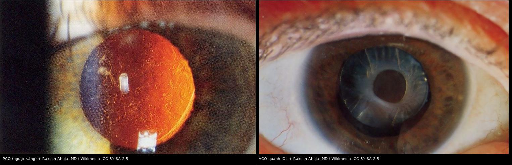
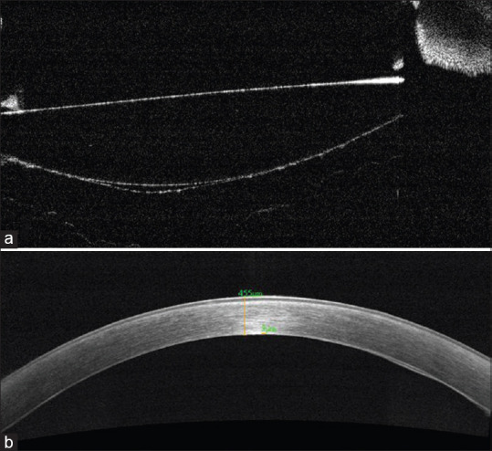
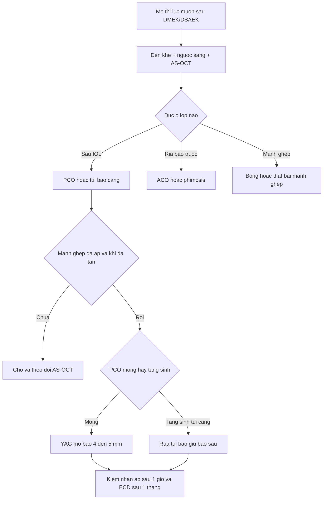
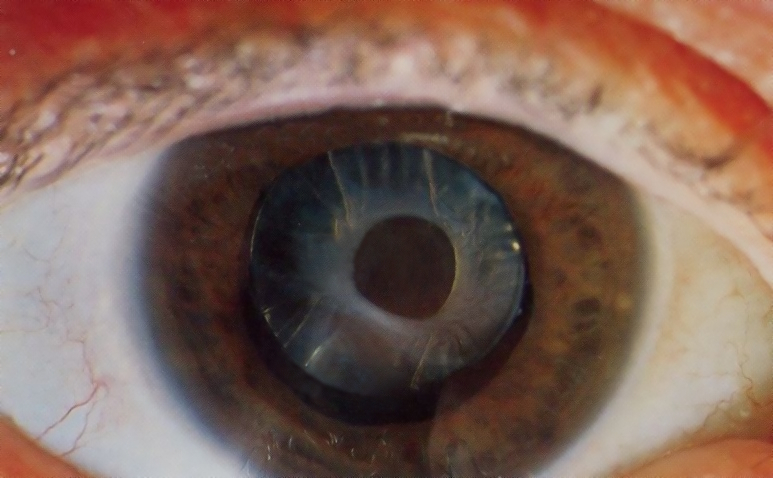
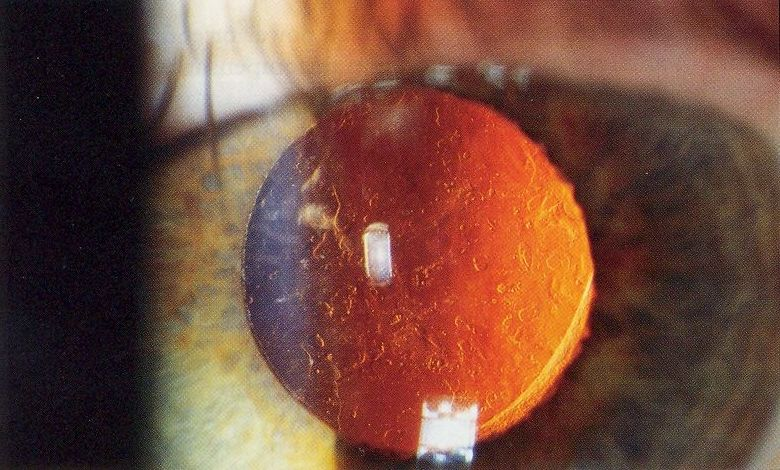
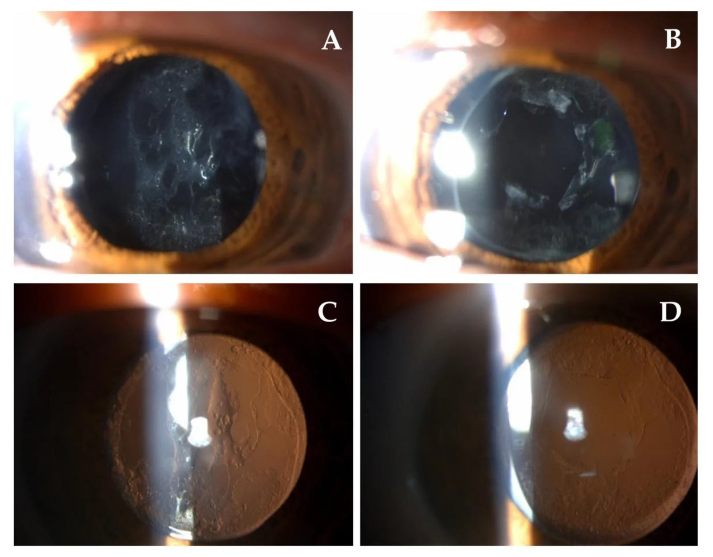

# 3292 — Đục bao sau (PCO) và YAG bao sau trên mắt đã ghép nội mô (DMEK/DSAEK) — Posterior capsule opacification and Nd:YAG capsulotomy after endothelial keratoplasty

**Tags:** `pattern:duc-bao-sau` `pattern:duc-bao-truoc` `pattern:bong-manh-ghep` `pattern:phu-giac-mac` `pattern:giam-noi-mo` `pattern:mat-gia-the-thuy-tinh` `vung:mat` `vung:giac-mac` `vung:the-thuy-tinh` `vung:tien-phong` `protocol:AS-OCT` `protocol:den-khe` `protocol:YAG` `protocol:sinh-hien-vi` `protocol:UBM` `score:khong-co` `incidentaloma:khong`

**Mức chắc chắn (certainty):** tổng hợp y văn (literature synthesis) — dựng từ tổng quan YAG 2026 (**PMC13676808**, CC BY-NC 4.0); loạt **11 mắt PCO tăng sinh sau EK** (4 DSAEK, 7 DMEK) (**PMC8597509**, CC BY-NC-SA 4.0); ca DMEK đầu tiên theo dõi **10 năm**, YAG ở năm **4 và 5** (**PMID 27941386**); loạt **75 mắt DSAEK** (**PMID 21767695**); ca IOL trôi ra dịch kính sau DSAEK ở mắt đã YAG (**PMID 20098315**); **14 mắt DMEK đã cắt dịch kính** (**PMID 33751304**); ECD sau YAG ở mắt ghép xuyên (**PMID 37399913**); phân tích gộp **1.221 mắt** co bao trước (**PMID 37831171**); **320 mắt** so sánh hydrophilic/hydrophobic (**PMC8764210**). Chỗ suy luận ghi **[suy luận]**. **Không ghi tên tác giả** — attribution = **tạp chí + năm + PMCID/PMID**.

> **Ranh giới với bài đã có:** [3287](../3287-phaco-sau-ghep-noi-mo-giac-mac/lesson.md) trả lời **"mắt đã ghép nay đục thể thủy tinh — phaco lúc nào, mất bao nhiêu nội mô"**; [3291](../3291-doi-iol-sau-ghep-giac-mac/lesson.md) trả lời **"đổi IOL sau ghép"**; [1445](../1445-bong-manh-ghep-dsaek-dmek-rebubble/lesson.md) trả lời **"bong mảnh ghép và khi nào rebubble"**; [1462](../1462-sinh-trac-iol-sau-ghep-giac-mac/lesson.md) trả lời **"tính công suất IOL"**. Bài này trả lời câu hỏi **sau khi mảnh ghép đã ổn**: **mờ dần là do đâu, có phải PCO không, YAG có an toàn cho mảnh ghép, làm YAG trước hay sau phaco, và mất hỗ trợ bao thì chọn IOL nào**.

> **Câu chốt — sáu nhóm số phải thuộc:** **(1) PCO là chuyện của nhiều năm, không phải vài tuần:** 5 năm sau mổ đục thể thủy tinh, PCO gặp **7,1–22,6%** và **5,8–19,3%** phải YAG (**PMC13676808**); ở mắt đã EK, một loạt **500 mắt DMEK** chỉ báo **0,8% ở 6 tháng** (**trích trong PMC8597509**) — nên **"mờ ở tháng thứ 2" hiếm khi là PCO**. **(2) Ở mắt đã EK, YAG không phải thủ thuật vô hại:** mở bao sau làm **mất hàng rào giữ khí/không khí** trong tiền phòng; loạt DSAEK cho thấy bong mảnh ghép **50%** khi **không còn hỗ trợ bao** so với **22,5%** chung (**PMID 21767695**). **(3) Hậu quả xấu nhất đã được ghi nhận:** mắt DSAEK có YAG từ trước, khi bơm khí để xử lý bong, **IOL plate-haptic trôi vào dịch kính** (**PMID 20098315**); mắt đã cắt dịch kính có **3/14** mảnh ghép trôi ra sau trong mổ (**PMID 33751304**). **(4) YAG có giá nội mô:** sau ghép xuyên, ECD giảm **6,25%** ở tháng đầu so với **1,44%** ở mắt chứng (p = 0,024) (**PMID 37399913**) — với mảnh ghép nội mô vốn đã mất **43–45% ECD ở 1 năm** và **68–72% ở 10 năm** (**PMID 27941386**), mỗi lần YAG là một lần rút vốn. **(5) Có lựa chọn giữ nguyên bao sau:** **11 mắt** PCO tăng sinh + **túi bao căng** sau EK được **rửa túi bao giữ bao sau**, tất cả lên **1–3 dòng Snellen**, **không ca nào thất bại/bong/thải ghép trong 1 năm** (**PMC8597509**). **(6) Thứ tự quyết định hỗ trợ bao:** YAG **trước** phaco/IOL sẽ lấy mất chỗ đặt IOL trong bao; đã mất bao thì chọn **IOL rãnh** hoặc **cố định củng mạc**, không ép vào bao (**PMC12336521**) — với trẻ, đánh giá hỗ trợ bao bằng UBM/AS-OCT trước khi đặt IOL thứ phát (bài 3294, đang chờ viết).

## 1. Tổng quan bệnh học – cơ chế hình ảnh

- **Bệnh học:** sau khi lấy nhân, **tế bào biểu mô thể thủy tinh (lens epithelial cells, LEC)** còn lại ở **xích đạo bao trước** tăng sinh, di chuyển ra sau và **chuyển dạng trung mô – cơ (epithelial–mesenchymal transition, EMT)**. Hai kiểu hình: **PCO xơ (fibrous)** — màng trắng đục, co kéo, hay gặp ở mắt đái tháo đường/viêm; và **PCO hạt (Elschnig pearls)** — chuỗi hạt trong suốt như bọt, hay gặp ở IOL tròn cạnh. **Vòng Soemmering** là khối LEC kẹt giữa rìa bao trước và bao sau, không phải PCO trục.
- **Vì sao IOL "cạnh sắc" ít PCO:** cạnh vuông **chặn cơ học** đường di chuyển của LEC; **hydrophobic** bám dính bao tốt hơn và **ít PCO hơn hydrophilic** (**PMID 34843687**), đồng thời **co bao trước ít hơn** — phân tích gộp **1.221 mắt** cho thấy bao trước co nhiều hơn có ý nghĩa ở nhóm hydrophilic từ **1 tháng đến 1 năm** (**PMID 37831171**).
- **Ba khác biệt của mắt đã ghép nội mô (EK):**
  1. **Hầu hết đã là pseudophakia** (phaco trước đó hoặc triple) → PCO là chuyện sẽ đến, chỉ là khi nào.
  2. **Tiền phòng sống nhờ khí/không khí (air/gas tamponade)** sau EK; **bao sau nguyên vẹn + mặt phẳng mống mắt–IOL** là cái van giữ khí. Mở bao sau = **mở van** → khí thoát ra dịch kính, **mảnh ghép mất lực ép**.
  3. **Dự trữ nội mô thấp:** ECD giảm **43–45% ở 1 năm, 52–59% ở 5 năm, 68–72% ở 10 năm** sau DMEK (**PMID 27941386**), nên mọi can thiệp nội nhãn đều đắt.
- **Vì sao có "PCO tăng sinh + túi bao căng" (proliferative PCO with capsular bag distension):** dịch vẩn đục và **chất vỏ thể thủy tinh hóa lỏng** bị giữ trong **túi bao kín** giữa IOL và bao sau; túi **căng ra sau**, chất lắng thành **cặn bông (flocculent)**. Đây là lý do **YAG không giải quyết được** — mở một lỗ trên bao sau chỉ để chất đục **chảy vào dịch kính**, và **bao vẫn căng** (**PMC8597509**).
- **Vật lý hình ảnh:**
  - **Đèn khe ngược sáng (retroillumination):** ánh sáng tán xạ từ sợi xơ/hạt LEC làm vùng đục **tối trên nền đỏ cam** của phản xạ đáy mắt — PCO nằm **sau IOL**, còn đục bao trước nằm **trước IOL** và bám theo **rìa bao**.
  - **AS-OCT (anterior segment OCT):** bước sóng hồng ngoại gần, phân giải **5–10 µm**, cho **vị trí tương đối** của mảnh ghép – bao sau – IOL. Đo được mảnh ghép **dày 9 µm** và bề dày giác mạc toàn phần **455 µm** (**PMC8597509**) — tức là phân biệt **mờ do mảnh ghép** với **mờ do bao** bằng **độ dày và vị trí**, không bằng cảm giác.
  - **Soi nội mô (specular microscopy):** đếm **ECD** trước và sau YAG để biết giá phải trả.
- **Dịch tễ định lượng:** PCO sau mổ đục thể thủy tinh **7,1–22,6% ở 5 năm**, YAG **5,8–19,3%** (**PMC13676808**); tỷ lệ chung sau mổ đục thể thủy tinh được trích là **< 5% đến 50%** tùy IOL/theo dõi (**PMC8597509**). Sau EK, **tỷ lệ PCO dài hạn chưa được đánh giá đầy đủ** — chính bài 11 mắt phải viết như vậy (**PMC8597509**).

## 2. Mẫu hình + chẩn đoán phân biệt theo vị trí (gamut)

**Mẫu hình trung tâm:** *mắt đã DMEK/DSAEK, mảnh ghép từng áp tốt, nay thị lực mờ dần sau nhiều tháng — đèn khe ngược sáng thấy vùng đục, AS-OCT cho biết đục ở lớp nào.*

Gamut theo **vị trí so với IOL và mảnh ghép**:

| Vị trí | Nhóm nguyên nhân | Dấu hiệu nhận diện |
|---|---|---|
| **Sau IOL** (giữa IOL và bao sau) | PCO xơ, PCO hạt, **túi bao căng** | Đục di động theo IOL, thấy rõ trên ngược sáng; AS-OCT: vật liệu sau IOL, bao sau **cong ra sau** |
| **Rìa bao trước** | Đục bao trước (ACO), **phimosis** | Vòng xơ trắng bám rìa mở bao; lỗ bao **co nhỏ**, có thể **lệch trục IOL**, khúc xạ **dịch về cận thị** |
| **Mảnh ghép / mặt sau giác mạc** | Bong mảnh ghép, thất bại mảnh ghép, **thải ghép**, phù giác mạc | Giác mạc **dày**, mảnh ghép **tách** trên AS-OCT, nếp gấp, **phù không đáp ứng corticoid** |
| **Mặt phân cách (interface)** | **Mọc biểu mô vào mặt phân cách**, mờ mặt phân cách | Đám mờ **khu trú**, AS-OCT: tăng phản hồi **dạng nốt** ở interface, không phải bao sau |
| **Trong IOL** | **Vôi hóa IOL hydrophilic**, đục IOL | Đục **trong thân IOL**, hay sau EK có khí/khí SF₆ (**PMID 34843687**) |
| **Sau đáy mắt** | **Phù hoàng điểm dạng nang (CME)**, màng trước võng mạc | Đáy mắt/AS-OCT hoàng điểm; hay gặp sau YAG, trung vị **4,8 tháng** (3 tuần–11 tháng) (**PMC13676808**) |

- **Ảnh ghép đối chiếu (mục 3):** `` — PCO (ngược sáng) bên trái, ACO quanh IOL bên phải: **cùng "mờ sau IOL" nhưng khác lớp**.

## 3. Bảng so sánh phân biệt (ma trận đối chiếu)

| Thực thể (entity) | Hình ảnh điển hình | Chốt vào (rule-in) | Chốt loại (rule-out) | Gợi ý xác nhận |
|---|---|---|---|---|
| **PCO** | Đục sau IOL, ngược sáng thấy đám xám; hạt Elschnig lấp lánh | **Đục nằm sau IOL**, di động cùng IOL, **giác mạc trong**, mảnh ghép áp trên AS-OCT | **Không đục bao trước**, **không dày giác mạc**, **không tách mảnh ghép** | Đèn khe ngược sáng + AS-OCT; chụp ảnh trước/sau để so |
| **Túi bao căng / PCO tăng sinh** | Bao sau **cong ra sau**, chất bông trắng đục sau IOL; tiền phòng **nông giả tạo** | **AS-OCT: khoảng IOL–bao sau rộng bất thường**, chất phản hồi trong túi | **Không có mảnh trôi tự do** trong dịch kính; **không phải màng xơ đơn thuần** | AS-OCT + iOCT trong mổ; **YAG đơn thuần không giải quyết** (**PMC8597509**) |
| **ACO / phimosis** | Vòng xơ trắng ở **rìa bao trước**, lỗ bao nhỏ dần | **Lỗ bao trước co** (< 4–5 mm) [suy luận], bờ dày, có thể **IOL lệch** | **Đục không nằm sau IOL**; **không cải thiện** khi soi ngược sáng qua vùng trung tâm | Ảnh đèn khe trước/sau; đo đường kính lỗ bao; AS-OCT vị trí rìa |
| **Thất bại / bong mảnh ghép** | Giác mạc mờ **lan tỏa**, nếp gấp; mảnh ghép **tách** | **AS-OCT: mảnh ghép tách khỏi mặt sau**, bề dày giác mạc **tăng** | **PCO không làm dày giác mạc**; **không đáp ứng corticoid** | AS-OCT + soi nội mô; so với ảnh ngay sau ghép |
| **Mọc biểu mô vào interface** | Đám mờ **khu trú**, thường cạnh rìa mảnh ghép | **AS-OCT: nốt tăng phản hồi ở interface**, tiến triển chậm | **Không phải đục bao sau**; **không có hạt Elschnig** | AS-OCT + confocal; YAG liều thấp có thể dùng (**PMID 32384302**) |
| **Vôi hóa IOL** | Đục **trong thân IOL**, dạng hạt/vân, thường IOL hydrophilic | **Đục nằm trong IOL**, không phải sau IOL; hay sau EK dùng khí (**PMID 34843687**) | **Không mất khi YAG**; **không phải PCO** | Đèn khe + AS-OCT; xác định vật liệu IOL |

## 4. Protocol chụp + hệ phân độ/điểm chuẩn hóa + quyết định YAG

### 4.1. Đánh giá trước can thiệp

- **Lâm sàng:** BCVA, khúc xạ (phimosis gây **dịch cận thị**), nhãn áp, đèn khe có **ngược sáng**, đáy mắt/AS-OCT hoàng điểm khi nghi CME.
- **AS-OCT tiền phòng:** bề dày mảnh ghép, **mảnh ghép có áp không**, **khoảng IOL–bao sau**, dấu **túi bao căng**, vị trí IOL. Ảnh dưới cho thấy **bao sau nguyên vẹn** và **mảnh ghép 9 µm** trên giác mạc **455 µm** (**PMC8597509**):

- **Soi nội mô (specular):** ECD nền — quyết định có dám YAG hay không.
- **Đo IOL/khúc xạ:** nếu đang cân nhắc phaco hoặc đổi IOL, làm **trước** khi YAG (xem 4.4).

### 4.2. Kỹ thuật YAG bao sau (áp dụng cho mắt đã EK)

1. **Giãn đồng tử** tối đa; dùng **kính tiếp xúc** nếu cần ổn định nhãn cầu.
2. **Hội tụ trên bao sau**, không hội tụ trên IOL; bắt đầu **năng lượng thấp** rồi tăng đến khi rách bao — mục tiêu là **tổng năng lượng tối thiểu** vì **rỗ IOL (pitting) gặp 7,8–36,9%** và tăng theo năng lượng (**PMC13676808**).
3. **Kiểu mở:** **hình chữ thập (cruciate)** là phổ biến nhất (**47%**); **64,4%** bác sĩ chủ động mở **rộng hơn đường kính đồng tử** (**PMC13676808**). Lỗ **quá nhỏ** → tái đục và chói.
4. **Tránh bắn vào mảnh ghép:** với mắt đã EK, giữ đầu laser **xa mặt sau giác mạc**, hướng về phía sau; nếu PCO **dày, dính sát IOL**, cân nhắc **phẫu thuật giữ bao** thay vì YAG (4.3).
5. **Sau YAG:** đo **nhãn áp sau 1 giờ** (bùng nhãn áp), **corticoid tại chỗ 1 tuần** (61,8% bác sĩ kê 1 tuần), hẹn **1–4 tuần**; đo lại **ECD** và **AS-OCT** nếu thị lực không cải thiện như mong đợi (**PMC13676808**).
6. **Cảnh báo bắt buộc:** bệnh nhân đã YAG **và** sắp/đang có bong mảnh ghép → **không bơm khí mù**; khí có thể đẩy IOL ra sau qua lỗ bao (**PMID 20098315**).

### 4.3. Khi nào KHÔNG dùng YAG: PCO tăng sinh + túi bao căng

- **Nhận diện:** bao sau **căng ra sau**, chất bông đục sau IOL, tiền phòng nông giả tạo, YAG xong **vẫn mờ**.
- **Xử trí đã báo cáo:** tách **rìa bao trước khỏi IOL**, tạo **vết rạch tỏa** trên rìa, **rửa hút hai tay** chất bông trong túi, **giữ nguyên bao sau**, bơm khí cuối mổ — **11 mắt**, lên **1–3 dòng**, **không thất bại/bong/thải ghép trong 1 năm** (**PMC8597509**).
- **Vì sao giữ bao sau:** bao sau nguyên vẹn giữ **khí tamponade** cho lần ghép lại sau này; mất bao → **sa dịch kính, IOL lệch, khó ghép lại**; tỷ lệ **ghép lại sau EK 5–10,5%** (**PMC8597509**).

### 4.4. Thứ tự YAG ↔ phaco ↔ IOL: nguyên tắc "đừng tự phá chỗ đứng"

- **Nếu còn kế hoạch phaco/đổi IOL:** **làm phaco/đổi IOL trước**, YAG **sau** — vì YAG mở bao sau, IOL **không còn chỗ trong bao**; khi đó lựa chọn là **IOL rãnh (sulcus)** hoặc **cố định củng mạc**, không phải IOL trong bao (**PMC12336521**); với trẻ, đánh giá hỗ trợ bao bằng UBM/AS-OCT trước khi đặt IOL thứ phát (bài 3294, đang chờ viết).
- **Nếu PCO quá dày, không nhìn thấy đáy mắt/mảnh ghép:** cân nhắc YAG **trước** — nhưng phải biết **mất hàng rào khí**; nếu mảnh ghép chưa áp hoàn toàn, **trì hoãn** [suy luận].
- **Thời điểm YAG sau EK:** chỉ sau khi **mảnh ghép áp hoàn toàn** và **khí/không khí đã tan hết**; thực hành thường **≥ 2–4 tuần**, nhưng **chưa có ngưỡng thời gian được chứng minh** [suy luận] — ca DMEK đầu tiên YAG ở **năm 4 và 5** mà không biến chứng (**PMID 27941386**), cho thấy **chờ được thì nên chờ**.
- **Chọn IOL về sau:** ưu tiên **hydrophobic** (ít PCO, ít co bao trước, ít vôi hóa sau EK) (**PMID 34843687**; **PMID 37831171**).

> **Hệ phân độ:** **không có thang PCO riêng cho mắt đã EK**. Thang dùng chung là **EPCO/POCOman** trên ảnh ngược sáng (đánh giá độ mờ theo vùng đồng tử), nhưng **chưa được hiệu chuẩn** cho mắt có mảnh ghép nội mô — ghi rõ là **khoảng trống** (mục 7). Quyết định YAG vì vậy dựa trên **triệu chứng + vị trí trên AS-OCT**, không dựa trên điểm số.

## 5. Biến thể bình thường và cạm bẫy

- **Vòng Soemmering** (khối LEC ở xích đạo) và **nếp gấp bao** không phải PCO trục — đừng YAG.
- **Đục bao trước (ACO) ≠ PCO:** vòng xơ bám **rìa bao trước**; nếu lỗ bao co nhỏ, đó là **phimosis**, xử trí bằng **vết rạch tỏa bằng YAG** hoặc mổ, không phải mở bao sau.
- **Đục IOL do vôi hóa** (hydrophilic, sau EK có khí/SF₆) trông giống PCO nhưng **YAG không cải thiện** và có thể làm nặng (**PMID 34843687**).
- **"PCO" thực ra là mảnh ghép bong:** mờ **lan tỏa + giác mạc dày**; soi ngược sáng không thấy hạt Elschnig. **AS-OCT là chốt**.
- **Bẫy khí sau YAG:** ở mắt đã mở bao sau, bơm khí để xử lý bong có thể đẩy **IOL plate-haptic ra dịch kính** (**PMID 20098315**); ở mắt đã cắt dịch kính, **3/14** mảnh ghép trôi ra sau trong mổ (**PMID 33751304**) — cần **kế hoạch giữ mảnh ghép** trước khi mổ.
- **Bẫy "YAG trước cho nhanh":** YAG trước khi mảnh ghép áp → mất tamponade → bong; YAG trước phaco → mất chỗ đặt IOL trong bao.
- **Bẫy bỏ sót CME:** mờ sau YAG có thể do **phù hoàng điểm**, trung vị **4,8 tháng** sau laser (**PMC13676808**) — đo OCT hoàng điểm nếu thị lực không lên.
- **Biến chứng YAG phải nhớ:** rách/bong võng mạc **0,60% ở 90 ngày**, tích lũy **1,39% ở 12 tháng**, tập trung **5 tháng đầu**; rỗ IOL **7,8–36,9%** (**PMC13676808**).

## 6. Tự lượng giá — Blind Quiz

**Ca 1 — mờ dần sau mổ đục thể thủy tinh**

- Bối cảnh: bệnh nhân đã mổ đục thể thủy tinh nhiều tháng, nay nhìn mờ, chói; giác mạc trong.
- Câu hỏi: (1) Mô tả dấu hiệu chính. (2) Ba chẩn đoán phân biệt. (3) Dấu hiệu nào chốt chẩn đoán?

<b>Bấm để hiện đáp án (findings + chẩn đoán)</b>

- **Dấu hiệu:** trên nền phản xạ đỏ cam, **đám mờ xám – trắng lan tỏa sau IOL**, bờ không đều, không có vòng xơ ở rìa bao trước.
- **Chẩn đoán:** **đục bao sau (PCO)** — LEC còn lại tăng sinh và EMT trên bao sau; ánh sáng tán xạ nên vùng đục **tối trên ngược sáng**.
- **Phân biệt:** ACO/phimosis (vòng xơ ở rìa bao trước, lỗ bao co), vôi hóa IOL (đục trong thân IOL), bong mảnh ghép (giác mạc dày, mảnh ghép tách trên AS-OCT).
- **Nguồn ảnh:** Rakesh Ahuja, MD / Wikimedia Commons, **CC BY-SA 2.5**.

**Ca 2 — trước và sau YAG**

- Bối cảnh: PCO xơ dày đúng trục thị giác, thị lực giảm; không có bệnh giác mạc.
- Câu hỏi: (1) Panel A và C khác B và D ở đâu? (2) Sau YAG cần kiểm gì trong giờ đầu và 1 tháng? (3) Biến chứng nào phải cảnh báo bệnh nhân?

<b>Bấm để hiện đáp án (findings + chẩn đoán)</b>

- **Dấu hiệu:** **A** đèn khe — màng xơ trắng đục giữa đồng tử; **B** ngay sau YAG — **lỗ mở trung tâm**, trục thị giác thông; **C** ngược sáng trước — vùng trung tâm tối; **D** sau — trục trong, chỉ còn vùng ngoại vi.
- **Theo dõi:** **nhãn áp sau 1 giờ** (bùng nhãn áp), **corticoid 1 tuần**, khám lại **1–4 tuần**; đo **ECD** và **AS-OCT** nếu thị lực không cải thiện.
- **Cảnh báo:** rách/bong võng mạc (**0,60% ở 90 ngày; 1,39% tích lũy 12 tháng**), **CME** (trung vị 4,8 tháng), **rỗ IOL** (7,8–36,9%) — **PMC13676808**.
- **Nguồn ảnh:** Med Hypothesis Discov Innov Ophthalmol 2026 (**PMC13676808**), Fig. 1, **CC BY-NC 4.0**.

**Ca 3 — mắt đã DMEK, đọc AS-OCT trước khi YAG**

- Bối cảnh: mắt đã DMEK, mảnh ghép từng áp; nay mờ nhẹ, đang cân nhắc YAG.
- Câu hỏi: (1) Panel a cho biết gì về bao sau và IOL? (2) Panel b đo được gì? (3) Nếu YAG, điều gì quyết định "được hay không được"?

<b>Bấm để hiện đáp án (findings + chẩn đoán)</b>

- **Panel a:** IOL **đứng yên**, **bao sau còn nguyên** — hàng rào giữ khí còn; đây là điều kiện để YAG mà không làm mất tamponade ngay.
- **Panel b:** mảnh ghép DMEK **dày 9 µm**, bề dày giác mạc toàn phần **455 µm** — mảnh ghép **áp**, không phù đáng kể.
- **Quyết định:** YAG **chỉ khi** mảnh ghép đã áp hoàn toàn, khí đã tan, và **PCO là nguyên nhân mờ** (không phải mảnh ghép/bề mặt); nếu là **túi bao căng/tăng sinh**, chọn **rửa túi bao giữ bao sau** (**PMC8597509**).
- **Nguồn ảnh:** Indian J Ophthalmol 2021 (**PMC8597509**), Fig. 2, **CC BY-NC-SA 4.0**.

## 7. Câu hỏi nghiên cứu & điểm chưa đồng thuận (tính đến 11/2026)

1. **[Tranh cãi] Ở mắt đã DMEK/DSAEK, YAG bao sau có làm tăng nguy cơ bong hoặc thất bại mảnh ghép so với phẫu thuật giữ bao sau không?**
   - **Đã biết:** về cơ học, mở bao sau làm mất tamponade khí; loạt DSAEK cho thấy bong **50%** khi không còn hỗ trợ bao so với **22,5%** chung (**PMID 21767695**), và đã có ca **IOL trôi ra dịch kính** sau khi bơm khí ở mắt có lỗ YAG (**PMID 20098315**).
   - **Chưa rõ:** **tỷ lệ bong/thải ghép sau YAG** ở mắt EK chưa được đo trong nghiên cứu đủ lớn; các báo cáo hiện có là ca và loạt nhỏ.
   - **Hướng nghiên cứu:** cohort hồi cứu lớn có đối chứng (YAG sớm/muộn/không YAG), outcome = rebubble, thất bại mảnh ghép, ECD 12 tháng.
   - **Nguồn:** PMC8597509 (2021); PMID 20098315 (2010); PMID 21767695 (2011).

2. **[Khoảng trống] Tỷ lệ PCO dài hạn sau EK và ngưỡng thời điểm YAG tối ưu là bao nhiêu?**
   - **Đã biết:** PCO sau mổ đục thể thủy tinh **7,1–22,6% ở 5 năm**, YAG **5,8–19,3%** (**PMC13676808**); ca DMEK đầu tiên YAG ở **năm 4–5** (**PMID 27941386**).
   - **Chưa rõ:** bài 11 mắt nêu thẳng **"tỷ lệ PCO dài hạn sau EK chưa được đánh giá toàn diện"** và **thiếu y văn** về kết cục điều trị PCO ở nhóm này (**PMC8597509**).
   - **Hướng nghiên cứu:** registry theo dõi ≥ 5 năm sau DMEK/DSAEK, ghi **thời điểm PCO, tỷ lệ YAG, ECD, rebubble**; so sánh mốc YAG ≥ 3 tháng vs ≥ 12 tháng.
   - **Nguồn:** PMC8597509 (2021); PMC13676808 (2026); PMID 27941386 (2017).

3. **[Khác biệt thực hành] Kích thước/kiểu mở bao, thuốc và lịch theo dõi sau YAG chưa thống nhất — kể cả ở mắt đã EK.**
   - **Đã biết:** **64,4%** bác sĩ chủ động mở **rộng hơn đường kính đồng tử**, **47%** dùng kiểu **chữ thập**; **42,4%** kê corticoid, **61,8%** kê 1 tuần; vẫn **thiếu đồng thuận** về lịch theo dõi (**PMC13676808**).
   - **Chưa rõ:** ở mắt đã EK, có nên **giảm năng lượng/mở nhỏ hơn** để bảo vệ nội mô, và có cần **AS-OCT kiểm tra mảnh ghép sau YAG** thường quy hay không.
   - **Hướng nghiên cứu:** khảo sát Delphi chuyên gia giác mạc + thử nghiệm so sánh **kích thước lỗ mở** với **ECD và độ áp mảnh ghép**.
   - **Nguồn:** PMC13676808 (2026); PMC12741075 (2025); PMID 37399913 (2023).

## Bài liên quan chéo

- [3287 – Phaco trên mắt đã ghép nội mô (DMEK/DSAEK)](../3287-phaco-sau-ghep-noi-mo-giac-mac/lesson.md)
- [3291 – Đổi IOL ở mắt đã ghép giác mạc](../3291-doi-iol-sau-ghep-giac-mac/lesson.md)
- [1445 – Bong mảnh ghép DSAEK/DMEK và khi nào rebubble](../1445-bong-manh-ghep-dsaek-dmek-rebubble/lesson.md)
- [1462 – Sinh trắc IOL sau ghép giác mạc](../1462-sinh-trac-iol-sau-ghep-giac-mac/lesson.md)
- [3284 – Ghép nội mô trên mắt có ống dẫn lưu glôcôm](../3284-ghep-noi-mo-giac-mac-ong-dan-luu/lesson.md)
- [3266 – Vỡ bao sau trong phaco và IOL rãnh mi](../3266-vo-bao-sau-phaco-iol-ranh-mi/lesson.md)
- [3273 – Rách bao trước trong phaco](../3273-rach-bao-truoc-phaco/lesson.md)

## Ảnh

- Nguồn + giấy phép từng ảnh: `images/CREDITS.md`.
- Ảnh Wikimedia (CC BY-SA 2.5) và ảnh PMC (CC BY-NC 4.0 / CC BY-NC-SA 4.0) dùng **nguyên bản**; chỉ ảnh ghép `composite_pco-vs-aco.jpg` là ảnh phái sinh, giữ **CC BY-SA 2.5**.
- Không tải được: không có (mọi ảnh dùng đều có giấy phép rõ ràng).

> Không dùng để chẩn đoán độc lập khi chưa có người hướng dẫn.
