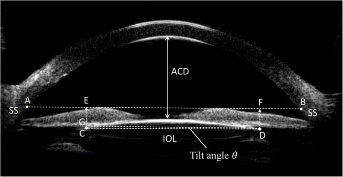
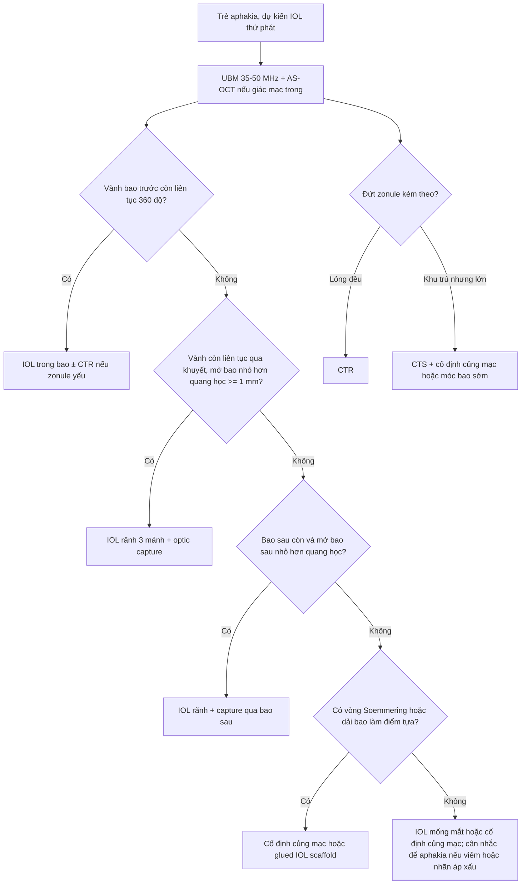
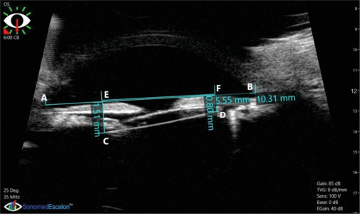
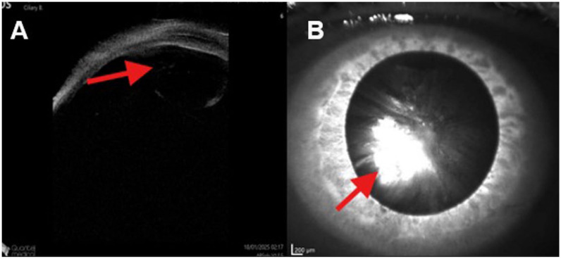

# 3294 — Trẻ aphakia trước IOL thứ phát: bao trước còn bao nhiêu là đủ? UBM/AS-OCT để chọn trong bao – rãnh thể mi – optic capture – cố định củng mạc

**Tags:** `pattern:aphakia` `pattern:iol-nghieng-lech` `pattern:vo-bao-sau` `pattern:duc-bao-sau` `pattern:soemmering-ring` `vung:mat` `vung:the-thuy-tinh` `vung:tien-phong` `protocol:UBM` `protocol:AS-OCT` `protocol:sinh-trac` `protocol:IOL-thu-phat` `protocol:IOL-co-dinh-cung-mac` `score:khong-co` `incidentaloma:khong`

**Mức chắc chắn (certainty):** tổng hợp y văn (literature synthesis) — ghép **40 mắt/26 trẻ** so sánh IOL rãnh thể mi với IOL trong bao bằng UBM, theo dõi **6,81 ± 1,82 năm** (PLoS ONE 2017, **PMC5354427**, CC BY 4.0); **44 mắt/25 trẻ** thử nghiệm lâm sàng so sánh IOL rãnh với **optic capture**, UBM trước mổ và ở 3–6 tháng (Indian J Ophthalmol 2025, **PMC12707385**, CC BY-NC-ND); **89 mắt** đặt vòng căng bao (CTR) với **trung vị đứt zonule 30° (0–120°)** (North Clin Istanb 2026, **PMC13771681**, CC BY-NC); **83 mắt** cố định IOL xuyên củng mạc có/không giữ bao (2025, **PMC11921500**); **11 mắt** aphakia + vòng Soemmering ở microcornea (2025, **PMC12178416**); **57 mắt/30 trẻ** dị dạng hình–vị trí thể thủy tinh trên UBM (2026, **PMC13585348**); **291 mắt/148 trẻ** mổ đục thể thủy tinh 2019–2025 (2026, **PMC13512980**, CC BY 4.0); **41 mắt/34 trẻ** IOL mống mắt (2025, **PMC11856017**, CC BY 4.0); tổng quan **optic capture 35 năm** (2026, **PMC13033519**, CC BY 4.0); tổng quan **IOL rãnh thể mi** (2026, **PMC13047016**, CC BY-NC 4.0); ca **tổn thương bao kín** với UBM 50 MHz (2026, **PMC13077139**, CC BY-NC 4.0); giao thức đo **tái lặp trên UBM nhi** (2025, **PMC13705174**). Không có thử nghiệm ngẫu nhiên nào so sánh **các ngưỡng hỗ trợ bao**; mọi con số dưới đây là **đoàn hệ/quan sát**, chỗ suy luận ghi **[suy luận]**. **Không ghi tên tác giả** — attribution = **tạp chí + năm + PMCID**.

> **Câu chốt:** câu hỏi "bao nhiêu bao là đủ" **không có đáp số bằng một con số** trong y văn — nhưng **có đáp số bằng hình ảnh**: **vành bao trước còn liên tục hay không, còn ở cung nào, và mỏm haptic tựa vào đâu**. Trên UBM, IOL rãnh thể mi ở trẻ **nghiêng nhiều hơn** IOL trong bao (**7,08 ± 4,16° so với 4,75 ± 2,27°**, p = 0,01), **lệch dọc 0,43 so với 0,25 mm** (p = 0,02), **tiền phòng nông hơn 3,75 so với 4,28 mm** (p = 0,02), **chạm mống mắt 61,9% so với 5,3%** và **glôcôm thứ phát 28,6% so với 10,5%** (p = 0,007) (PMC5354427). Nghĩa là **"đặt rãnh cho xong" không phải lựa chọn trung tính** ở mắt trẻ — và **một vành bao trước đủ vững để "bắt" mép quang học (optic capture)** là thứ hình ảnh phải trả lời trước khi mổ.

> **Ranh giới với bài đã có:** [3289](../3289-theo-doi-dai-han-sau-viem-noi-nhan-chan-thuong-tre/lesson.md) trả lời **"sau khi qua đợt cấp, theo dõi dài hạn thế nào"**; [3292](../3292-duc-bao-sau-yag-sau-ghep-noi-mo/lesson.md) trả lời **"PCO/YAG trên mắt đã ghép nội mô"**; [3278](../3278-duc-the-thuy-tinh-bam-sinh-mot-ben-iol-hay-aphakia/lesson.md) trả lời **"đục thể thủy tinh bẩm sinh một bên — IOL hay aphakia"**; [3252](../3252-hoi-chung-bao-chet-dead-bag-syndrome/lesson.md) trả lời **"bao chết, IOL trôi muộn"**. Bài này chỉ trả lời **một câu hỏi tiền phẫu**: **trước khi đặt IOL thứ phát ở trẻ, UBM/AS-OCT phải đo cái gì, và kết quả đổi lựa chọn phẫu thuật ra sao**.

## 1. Tổng quan bệnh học – cơ chế hình ảnh (TẠI SAO)

### 1.1 Vì sao "bao" là cấu trúc quyết định, không phải "tuổi" hay "công suất IOL"

- Ở mắt còn nguyên, **bao thể thủy tinh (lens capsule)** là **một túi collagen liên tục** neo vào **dây chằng Zinn**; IOL đặt trong bao được giữ **360°** và **đồng tâm với trục thị giác**.
- Khi bao mất một phần, IOL buộc phải tựa vào **rãnh thể mi (ciliary sulcus)** — một **rãnh không phải ổ chứa** của IOL: khoảng cách **sulcus-to-sulcus** thay đổi theo tuổi và bệnh, **mống mắt nằm ngay trước**, **thể mi nằm ngay sau**. Vì vậy mỗi milimét và mỗi độ nghiêng đều **có giá**: chạm mống mắt → **giải phóng sắc tố, UGH**; tựa lệch → **nghiêng, lệch trục, cận thị hóa**; nông tiền phòng → **góc hẹp, glôcôm**.
- **Trẻ không phải người lớn thu nhỏ:** bao trẻ **đàn hồi, phản ứng mạnh, co rút và tiếp tục thay đổi theo tăng trưởng nhãn cầu**. Trong loạt **291 mắt/148 trẻ**, bác sĩ vẫn phải chọn giữa **trong bao – rãnh – cố định mống mắt – để aphakia** tùy **hỗ trợ bao và zonule tại mổ**; ở nhóm trước 3/2023, **55,6% để aphakia, 30,7% trong bao, 9,8% rãnh, 3,9% cố định mống mắt** (PMC13512980) — tức **"để trống" vẫn là lựa chọn thật**, không phải thất bại.
- **Điểm mấu chốt về mặt hình ảnh:** câu hỏi không phải "bao có bị rách không" mà là **"vành bao còn liên tục ở bao nhiêu cung, và mỏm haptic có chỗ tựa không"**. Đây là thứ **đèn khe không thấy hết** khi mống mắt che, và **chính là lý do UBM/AS-OCT tồn tại**.

### 1.2 TẠI SAO UBM nhìn được sau mống mắt, còn AS-OCT thì không — vật lý quyết định chỉ định

| Thông số | UBM (ultrasound biomicroscopy) | AS-OCT / SS-OCT (anterior segment OCT) |
|---|---|---|
| Nguồn | **siêu âm 35–50 MHz** | **ánh sáng 1310 nm** |
| Phân giải trục | **~50 µm (35 MHz)**, **~35 µm (50 MHz)** | **~5–10 µm** |
| Độ xuyên | **4–5 mm**, **xuyên được giác mạc đục, mống mắt, vết sẹo** | **vài milimét**, **bị chặn bởi sắc tố mống mắt và đục nặng** |
| Nhìn được | **rãnh thể mi, mỏm haptic sau mống mắt, vành bao sau mống mắt, thể mi, zonule** | **vành bao trước trong vùng đồng tử, dính mống mắt–bao, độ dày bao, mép quang học** |
| Trẻ nhỏ | **làm được khi ngủ mê/đặt thuốc, không cần hợp tác** | **cần mắt mở, hợp tác hoặc gây mê; trẻ quấy làm mất tín hiệu** |

- **Vì sao UBM "thấy sau mống mắt":** sóng âm **phản xạ ở mặt phân cách trở kháng** (collagen bao ↔ dịch ↔ mô mống mắt) nên **không cần đường quang trong suốt**; mống mắt chỉ là **một lớp mô phản âm**, sóng đi qua và trở về. Đó là lý do UBM **50 MHz phát hiện được khuyết bao trước khu trú ở 6 giờ** trong một mắt đục dày mà **AS-OCT không xác nhận được bao sau** (PMC13077139).
- **Vì sao AS-OCT "sắc nét nhưng nông":** ánh sáng **không qua được sắc tố mống mắt** → vùng sau mống mắt **luôn là bóng (shadow)**; đổi lại, với **vành bao trước nằm trong đồng tử**, AS-OCT cho **mép bao, dính mống mắt–bao, vòng Soemmering** với chi tiết **µm**, đủ để đo **đường kính mở bao** — biến số quyết định **optic capture**.
- **Hệ quả thực hành:** **hai phương thức bổ sung, không thay thế**. AS-OCT trả lời "mở bao còn bao nhiêu, dính bao nhiêu"; UBM trả lời "haptic tựa ở đâu, bao sau mống mắt còn không, rãnh thể mi rộng bao nhiêu". Trong so sánh **67 mắt** chấn thương, **SS-OCT tương đương hoặc tốt hơn UBM** trong phát hiện khuyết bao — nhưng nghiên cứu đó **không phải trẻ nhỏ, không phải mắt đục dày** (PMC13077139).

### 1.3 Vì sao "hỗ trợ bao" đổi thẳng sang kết cục — các con số phải thuộc

- **Nghiêng và lệch (UBM, trẻ, 6,8 năm):** IOL rãnh thể mi **nghiêng dọc 7,08 ± 4,16°** so với **4,75 ± 2,27°** trong bao (p = 0,01); **lệch dọc 0,43 ± 0,30 mm** so với **0,25 ± 0,19 mm** (p = 0,02); **lệch ngang** khác biệt **không có ý nghĩa** (0,29 so với 0,22 mm) (PMC5354427). Ngưỡng được dùng trong nghiên cứu nhi khác: **nghiêng > 2–5°** và **lệch > 1 mm** là **đáng kể** (PMC12707385).
- **Tiền phòng và góc:** IOL rãnh làm **tiền phòng nông hơn** (**3,75 ± 0,74 so với 4,28 ± 0,52 mm**, p = 0,02), **AOD500 445,8 so với 471,2 µm** (p = 0,03), **TIA 45,3 so với 51,7°** (p = 0,04) (PMC5354427).
- **Hậu quả:** **chạm mống mắt–IOL 61,9% so với 5,3%** (p = 0,001), **dính góc trước 28,6% so với 10,5%** (p = 0,03), **nhãn áp trung bình 17,10 ± 6,06 so với 14,15 ± 4,74 mmHg** (p = 0,01), **glôcôm thứ phát 28,6% so với 10,5%** (p = 0,007) (PMC5354427).
- **Nhưng "có bao" không đồng nghĩa "hết nghiêng":** trong **83 mắt cố định xuyên củng mạc**, nhóm **giữ bao (26 mắt)** so với **mất bao (57 mắt)** có **cùng độ nghiêng/lệch/ACD**, khác biệt duy nhất là **bắt giữ đồng tử (pupillary capture): 8 mắt, tất cả ở nhóm mất bao** (PMC11921500). **[suy luận]** Vậy bao có hai vai trò tách biệt: **chống bắt giữ đồng tử** (rõ) và **ổn định trục** (yếu hơn ta tưởng khi đã cố định củng mạc).
- **Vòng Soemmering không phải "rác":** là **vòng biểu mô thể thủy tinh còn lại** sau khi lấy nhân/vỏ; trong **11 mắt microcornea**, vòng đo được **5,2 ± 2,4 cung giờ (3–10)**, và được dùng làm **giá đỡ cho IOL khâu keo (glued IOL scaffold)** — thị lực **1,64 → 0,68 logMAR**, nội mô **2.463 → 2.265 tế bào/mm²** (PMC12178416). Nghĩa là **vòng Soemmering vừa là "hỗ trợ" vừa là "vật cản"** — tùy nó nằm ở đâu và rộng bao nhiêu.

### 1.4 Vì sao phải đo bằng "cung giờ" (clock hours) chứ không "nhiều/ít"

- **Cung giờ là đơn vị chung của phòng mổ và của hình ảnh**: một khuyết **3 giờ cung = 90°**, **6 giờ cung = 180°**. Trong **89 mắt đặt CTR**, **trung vị đứt zonule là 30° (0–120°)**; mỗi **10° đứt zonule** làm **odds đặt IOL rãnh tăng 1,10 lần**, và **sa dịch kính trong mổ** làm **OR 5,84 (95% CI 1,27–26,9)** (PMC13771681). Đây là con số duy nhất trong y văn đã đọc **lượng hóa được "bao nhiêu là nhiều"** — nhưng ở **người lớn**, không phải trẻ.
- **Trong trẻ**, dữ liệu định lượng mới dừng ở **mô tả**: **57 mắt/30 trẻ** dị dạng hình–vị trí thể thủy tinh có **tiền phòng nông hơn, góc hẹp hơn, thể thủy tinh dày và nhỏ hơn, đồng tử hẹp hơn, khoảng cách sulcus-to-sulcus lớn hơn** nhóm chứng; **lệch thể thủy tinh 1,6 ± 1,1 mm ngang và 1,5 ± 1,2 mm dọc** (PMC13585348).
- **Vì vậy bài này trình bày ngưỡng như "khung ra quyết định", không như "khuyến cáo mức bằng chứng cao"**: mỗi ngưỡng dưới đây đều ghi rõ **nguồn nào đo được**, **nguồn nào chỉ là thực hành**.

## 2. Mẫu hình + chẩn đoán phân biệt theo vị trí (gamut)

**Mẫu hình trung tâm:** *aphakia + một vành bao trước không liên tục* → câu hỏi **"vành còn liên tục 360° không, nếu không thì còn ở cung nào và mỏm haptic tựa vào đâu"**.

| Mẫu hình hỗ trợ bao (trên UBM/AS-OCT) | Nghĩa giải phẫu | Gamut lựa chọn |
|---|---|---|
| **Bao liên tục 360°, vành bao trước–sau khép kín** | túi còn nguyên, zonule còn | **IOL trong bao** ± CTR nếu zonule yếu |
| **Khuyết bao trước khu trú, vành còn liên tục qua khuyết** | "cửa sổ" nhưng **vành vẫn là một vòng** | **IOL rãnh 3 mảnh + optic capture** (rhexis fixation) hoặc trong bao + CTR |
| **Vành bao trước đứt đoạn, không còn vòng liên tục** | không còn "vành" để bắt mép quang học | **rãnh 3 mảnh** ± **capture qua bao sau** nếu bao sau còn; nếu không → **cố định củng mạc** |
| **Chỉ còn vòng Soemmering / bao xơ co** | "giá đỡ" rời rạc, không liên tục | **cố định củng mạc (Yamane/Carlevale)**, **glued IOL scaffold** trên vòng, hoặc **IOL mống mắt** |
| **Mất bao gần như hoàn toàn ± microcornea ± mống mắt tổn thương** | không còn mặt tựa trong | **IOL mống mắt (Artisan)** hoặc **cố định củng mạc**; **cân nhắc để aphakia** nếu viêm/tăng nhãn áp |
| **Đứt zonule kèm theo (dialysis)** | "hỗ trợ bao" và "hỗ trợ zonule" là hai trục khác nhau | **CTR** (lỏng đều), **CTS + cố định củng mạc** (khu trú nhưng lớn), **móc bao** sớm khi dialysis vài cung giờ (PMC13077139) |

- **Mnemonic "R-I-S-E"** cho câu hỏi chọn vị trí: **R**im (vành bao còn liên tục?) – **I**ris (mống mắt có đủ để claw? có dính?) – **S**ulcus (rãnh đủ rộng, không hẹp?) – **E**ndothelium/ACD (nội mô và tiền phòng có chịu được IOL tiền phòng?). **[suy luận]** Đây là cách nhớ của bài, không phải thang điểm đã validate.
- **Gamut theo tuổi:** **< 2 tuổi** — rãnh thể mi **chưa phát triển đủ** để nâng đỡ haptic lâu dài, nên **trong bao ± CTR** được ưu tiên; **> 8 tuổi** — mắt gần kích thước người lớn, **rãnh/cố định củng mạc** khả thi hơn (nhận định cơ học, dựa trên mô tả "ciliary sulcus in very young eyes is underdeveloped" — PMC13512980; **[suy luận]** về ngưỡng tuổi cụ thể).

## 3. Bảng so sánh phân biệt (ma trận đối chiếu)

| Thực thể (vị trí IOL) | Hình ảnh điển hình trên UBM/AS-OCT | Chốt vào (rule-in) | Chốt loại (rule-out) | Gợi ý xác nhận |
|---|---|---|---|---|
| **IOL trong bao** | AS-OCT: **mép bao trước–sau khép kín quanh mép quang học**; UBM: haptic **nằm trong túi**, bao sau liên tục sau IOL | **Vành bao liên tục 360° + haptic trong túi** | Vành đứt đoạn, haptic nằm trước bao sau → **không phải trong bao** | AS-OCT vùng đồng tử + UBM xoay 12 kinh tuyến |
| **IOL rãnh 3 mảnh (đơn thuần)** | UBM: **haptic tựa vào rãnh thể mi**, **mép quang học trước bao trước**; ACD **nông hơn** | **Haptic thấy ở rãnh + vành bao trước còn ít nhất một cung để chặn trước** | Haptic **trước mống mắt** (tiền phòng) → AC IOL; haptic **sau bao sau** → lạc vị trí | UBM 35–50 MHz qua mống mắt; đo ACD, góc |
| **IOL rãnh + optic capture (rhexis fixation)** | AS-OCT: **mép quang học nằm SAU vành bao trước**, mở bao **nhỏ hơn quang học ≥ 1 mm**; UBM: haptic rãnh, mép quang **kẹt sau bao** | **Đường kính mở bao < đường kính quang học ≥ 1 mm + vành bao còn liên tục** | Mở bao **≥ quang học** hoặc vành đứt → **không capture được** | AS-OCT đo đường kính mở bao; thử "bắt" mép trong mổ |
| **Capture qua bao sau** | UBM: haptic rãnh, **mép quang sau bao sau**; AS-OCT thấy bao sau nếu trong đồng tử | **Bao sau còn + mở bao sau < quang học** | Bao sau rách rộng / không thấy → không làm được | UBM + đánh giá trong mổ |
| **IOL cố định củng mạc (Yamane/Carlevale)** | UBM: **mỏm/haptic đi xuyên củng mạc**, không tựa bao; **góc tiền phòng mở hơn**; AS-OCT: mép quang **sau mống mắt**, không có bao quanh | **Haptic xuyên củng mạc + không còn vành bao tựa** | Còn vành bao liên tục → **không cần** cố định củng mạc | UBM vùng rìa; AS-OCT kiểm mép quang–mống mắt |
| **IOL mống mắt (Artisan, retropupillary)** | UBM: **mỏm kẹp mống mắt**, khoảng cách mống mắt–IOL nhỏ; AS-OCT: **mép quang sát mặt sau mống mắt** | **Mống mắt đủ mô để kẹp + tiền phòng đủ sâu** | Mống mắt teo/rách lớn, dính góc nặng → loại | Đèn khe + UBM đo khoảng cách mống mắt–IOL |
| **Aphakia để trống** | Không có IOL; **vòng Soemmering/bao xơ** trên UBM; **ACD sâu** | **Viêm hoạt động, nhãn áp không kiểm soát, mắt còn cửa sổ nhược thị** | Đã ổn định + có thể đeo kính tiếp xúc → cân nhắc lại | Theo dõi khúc xạ + nhược thị |

*Đường AB nối hai **gai củng mạc (scleral spur)** là mốc chuẩn; **ACD** đo từ mặt trong giác mạc đến điểm trước nhất của IOL; **lệch = (|AE − FB|)/2**; **nghiêng θ** là góc giữa đường nối hai mép quang học và đường AB. Nguồn: PLoS ONE 2017 (PMC5354427), CC BY 4.0 — nguyên bản.*

### 3.1 Hai kiểu "hỗ trợ" khác nhau — đừng gộp

- **Hỗ trợ vành (rim support):** vành bao trước còn **liên tục** → dùng để **chặn mép quang học** (optic capture) hoặc **giữ haptic trong túi**. Đây là hỗ trợ **theo chu vi**.
- **Hỗ trợ điểm (focal support):** chỉ còn **một vòng Soemmering** hoặc **một dải bao xơ** → IOL tựa **một điểm**, dễ nghiêng. Đây là hỗ trợ **theo điểm**, và **không tương đương** dù nhìn "vẫn còn bao".
- **Hệ quả:** một mắt "còn 6 giờ cung bao" nhưng **rời rạc** khác hoàn toàn một mắt "còn 3 giờ cung nhưng liên tục thành vòng". **Hình ảnh phải mô tả hình học, không chỉ số lượng.**

## 4. Protocol chụp + hệ phân độ/điểm chuẩn hóa

### 4.1 UBM — giao thức tối thiểu trước IOL thứ phát ở trẻ

- **Đầu dò:** **35 MHz** cho xuyên sâu 4–5 mm (đo rãnh, bao sau mống mắt); **50 MHz** khi cần chi tiết bao/mép (phân giải ~35 µm) như ca khuyết bao trước khu trú (PMC13077139).
- **Tư thế:** nằm ngửa, **gây tê tại chỗ ± an thần/gây mê** ở trẻ nhỏ; **không ấn đầu dò** (ấn làm **nông giả tiền phòng** và **hẹp giả góc**).
- **Quét:** **12 kinh tuyến (radial)** + **quét ngang (transverse)** qua trung tâm; ghi **cung giờ** của mọi khuyết (đỉnh = 12 giờ, mũi = 3 giờ ở mắt phải).
- **Bắt buộc đo và ghi:**
  1. **ACD** (mm) — từ mặt trong giác mạc đến điểm trước nhất của IOL/thể thủy tinh.
  2. **Độ lệch (decentration, mm)** = **(|AE − FB|)/2**; **độ nghiêng (tilt, °)** = góc giữa đường nối hai mép quang học và đường nối hai gai củng mạc (Hình 1).
  3. **Cung bao trước còn lại** (clock hours) và **vị trí khuyết** — mô tả **liên tục hay đứt đoạn**.
  4. **Dính mống mắt–bao (iridocapsular adhesion)** — vị trí, số cung.
  5. **Vòng Soemmering** — kích thước (mm) và **số cung giờ** (mẫu: **5,2 ± 2,4 cung, 3–10**; PMC12178416).
  6. **Sulcus-to-sulcus** (mm) và **AOD500 (µm)**, **TIA (°)** nếu cân nhắc IOL rãnh.
- **Ngưỡng đọc kết quả (dùng trong nghiên cứu, không phải guideline):** **nghiêng > 2–5°**, **lệch > 1 mm** là **đáng kể** (PMC12707385); IOL rãnh ở trẻ trong thực tế đo được **nghiêng 6,6–7,1°** và **lệch dọc 0,43 mm** (PMC5354427) — tức **thường vượt ngưỡng "đáng kể"**.
- **Tái lặp:** trên **25 mắt trẻ (tuổi trung bình 2,0 ± 1,2)**, đo **4 ảnh/mắt** cho **ICC > 0,6** và **hệ số tương quan > 0,7** với **cùng một giao thức**; **chất lượng ảnh và xử lý bờ không phải yếu tố quyết định** (PMC13705174). **[suy luận]** Vì vậy phải **chuẩn hóa kinh tuyến và mốc gai củng mạc**, không chỉ "chụp đẹp".

### 4.2 AS-OCT — khi nào dùng, đo gì

- **Chỉ định:** giác mạc **còn trong**, trẻ **hợp tác hoặc đã gây mê**, cần đo **đường kính mở bao** và **dính mống mắt–bao** trước **optic capture**.
- **Đo:** đường kính **mở bao trước (mm)** so với **đường kính quang học** — capture cần mở bao **nhỏ hơn quang học ≥ 1 mm** (PMC13033519); **độ dày và liên tục của vành bao**; **dính mống mắt–bao**; **vòng Soemmering**; **khoảng cách mép quang–mống mắt**.
- **Giới hạn:** **bóng mống mắt** che rãnh thể mi và haptic → **không được kết luận "không còn bao"** chỉ từ AS-OCT; phải xoay UBM.

### 4.3 Sơ đồ quyết định (dùng trong hội chẩn, không thay phán đoán mổ)

## 5. Biến thể bình thường và cạm bẫy

- **Ấn đầu dò làm nông giả tiền phòng:** ACD đo được **nhỏ hơn thật**, góc **hẹp giả**, dễ kết luận sai "góc đóng". Cách tránh: **gel đủ, đầu dò chỉ chạm nhẹ**, so sánh với AS-OCT/đèn khe.
- **Quét chéo kinh tuyến làm nghiêng giả:** nếu mặt phẳng quét **không đi qua hai gai củng mạc đối diện**, góc θ bị **phóng đại**. Cách tránh: **căn đường AB đúng hai gai**, ghi rõ kinh tuyến.
- **Bóng mống mắt trên AS-OCT:** vùng sau mống mắt **luôn đen** — **không phải "mất bao"**. Cách tránh: **bổ sung UBM** trước khi kết luận thiếu hỗ trợ.
- **Vòng Soemmering và mép IOL cùng tăng hồi âm:** dễ **nhầm mép quang học với vòng bao**, làm đo sai đường kính mở bao. Cách tránh: đối chiếu **AS-OCT** (mép quang nhẵn, vòng bao có bờ LEC) và **ghi nhận hai cấu trúc riêng**.
- **"Thấy một khuyết là xong" (satisfaction of search):** đã thấy khuyết bao trước thì **dễ bỏ sót đứt zonule, sa dịch kính, vòng Soemmering lớn**. Cách tránh: **luôn quét 12 kinh tuyến** và ghi **cả zonule**.
- **Trẻ lớn lên, số đo đổi:** **không so tuyệt đối ACD/sulcus-to-sulcus giữa các tuổi**; theo dõi **theo từng mắt, cùng giao thức**.
- **Mắt đục dày:** UBM **50 MHz có thể không xuyên đủ** → **hạ tần số 35 MHz** hoặc chấp nhận **"chưa rõ bao sau"** và **mổ với phương án dự phòng** (chuẩn bị cố định củng mạc) thay vì khẳng định.

## 6. Tự lượng giá — Blind Quiz

**Ca 1 — Trẻ 4 tuổi, aphakia sau mổ đục thể thủy tinh bẩm sinh, đang cân nhắc IOL thứ phát. Ảnh UBM dưới đây đo gì?**

- Gợi ý: mắt đã có IOL; hai chấm trắng hai bên là **gai củng mạc**.
- Câu hỏi: (1) đường AB là gì? (2) **ACD** đo từ đâu đến đâu? (3) **độ lệch** và **độ nghiêng** tính thế nào, ngưỡng nào là "đáng kể"?

<b>Bấm để hiện đáp án (findings + chẩn đoán)</b>

- **AB** = đường nối **hai gai củng mạc (scleral spur)** — mốc chuẩn của đoạn trước.
- **ACD** = từ **mặt trong giác mạc trung tâm** đến **điểm trước nhất của IOL** (mũi tên dọc).
- **Lệch** = **(|AE − FB|)/2**; **nghiêng θ** = góc giữa **đường nối hai mép quang học** và **đường AB**.
- **Ngưỡng đáng kể:** nghiêng **> 2–5°**, lệch **> 1 mm** (PMC12707385). Ở trẻ, IOL rãnh thể mi thường đo **7,08 ± 4,16°** nghiêng dọc — **vượt ngưỡng** (PMC5354427).
- Nguồn ảnh: PLoS ONE 2017 (**PMC5354427**), CC BY 4.0, nguyên bản.

**Ca 2 — Trẻ 7 tuổi, aphakia chấn thương, một mỏm IOL nằm dưới vành bao, mỏm kia ở rãnh. UBM cho thấy mép quang học nghiêng.**

- Gợi ý: chú ý **hai mép quang học không cùng độ sâu**; các số đo trên ảnh là **khoảng cách và độ lệch**.
- Câu hỏi: (1) kiểu tựa này gọi là gì? (2) vì sao nó gây nghiêng? (3) hai cách xử lý?

<b>Bấm để hiện đáp án</b>

- **Hỗ trợ không đối xứng:** một mép **dưới vành bao trước**, mép kia **tựa rãnh thể mi** → **mô-men lệch trục** → nghiêng.
- Đây là **"một chân trên bờ, một chân dưới vực"**: vành bao nâng một bên, bên kia tụt vào rãnh.
- Xử lý: (a) **đưa cả hai mỏm vào rãnh + optic capture** nếu vành bao còn liên tục; (b) **đổi sang cố định củng mạc** nếu vành bao đứt đoạn/không đủ bắt mép. Trong loạt nhi, nhóm capture có **nghiêng 1,8–2,2°** so với **0,8–0,9°** của rãnh đơn thuần, nhưng **ACD sâu hơn (3,6 so với 3,01 mm)** và không ảnh hưởng khúc xạ mục tiêu (PMC12707385).
- Nguồn ảnh: Indian J Ophthalmol 2025 (**PMC12707385**), CC BY-NC-ND 4.0, nguyên bản.

**Ca 3 — Trẻ 3 tuổi, đục thể thủy tinh dày sau nhiều lần tiêm nội dịch kính. UBM 50 MHz phát hiện một khuyết bao trước; AS-OCT không xác nhận được bao sau.**

- Gợi ý: (A) là **UBM 50 MHz**, (B) là **ảnh hồng ngoại của AS-OCT**; mũi tên đỏ chỉ cùng một vị trí tổn thương.
- Câu hỏi: (1) vì sao chọn UBM mà không phải AS-OCT? (2) khuyết này đổi kế hoạch mổ thế nào? (3) có được kết luận "bao sau còn nguyên" không?

<b>Bấm để hiện đáp án</b>

- **UBM 50 MHz** xuyên qua **thể thủy tinh đục** và thấy **khuyết bao trước khu trú ở 6 giờ, kèm đứt zonule lân cận**; **AS-OCT** (ảnh hồng ngoại) chỉ thấy **đục khu trú phía dưới** và **không xác nhận được bao sau**.
- Kế hoạch: **chuẩn bị móc bao/CTR**, **không đặt IOL trong bao một cách máy móc**, và **chuẩn bị phương án rãnh/cố định củng mạc**; khuyết bao trước **làm thay đổi cách xử lý nhân** (tránh lan rách).
- **Không** được kết luận bao sau nguyên: khi **không thấy**, phải ghi **"chưa rõ"** và **mổ với dự phòng**.
- Nguồn ảnh: SAGE Open Med Case Rep 2026 (**PMC13077139**), CC BY-NC 4.0, nguyên bản.

## 7. Câu hỏi nghiên cứu & điểm chưa đồng thuận (tính đến 11/2026)

1. **[Tranh cãi] Ở trẻ aphakia thiếu hỗ trợ bao, IOL rãnh thể mi có làm tăng glôcôm thứ phát so với cố định củng mạc hoặc IOL mống mắt không?**
   - **Đã biết:** trong đoàn hệ UBM **40 mắt/26 trẻ**, nhóm rãnh có **glôcôm thứ phát 28,6% so với 10,5%** (p = 0,007) và **chạm mống mắt 61,9% so với 5,3%** (PMC5354427); ở **41 mắt/34 trẻ** IOL mống mắt, **đặt trước** có **nhãn áp cao hơn và lệch/bung nhiều hơn** đặt sau mống mắt (PMC11856017).
   - **Chưa rõ:** đây là **tác dụng của vị trí** hay **confounding do chấn thương, tuổi nhỏ, viêm**; không có phân nhóm ngẫu nhiên theo vị trí.
   - **Hướng nghiên cứu:** đoàn hệ tiến cứu **phân tầng theo cung bao còn lại**, hoặc registry **đăng ký trước mổ** với outcome **nhãn áp 5 năm**.
   - **Nguồn:** PMC5354427 (2017); PMC11856017 (2025).

2. **[Khoảng trống] Chưa có thang điểm hình ảnh (UBM/AS-OCT) định lượng "đủ hỗ trợ bao" với độ tái lặp liên quan sát viên ở trẻ.**
   - **Đã biết:** giao thức UBM nhi **25 mắt** đạt **ICC > 0,6** cho các thông số đoạn trước (PMC13705174); **giữ bao** trong cố định củng mạc làm giảm **bắt giữ đồng tử** nhưng **không đổi nghiêng/lệch** (PMC11921500) — tức "còn bao" không đồng nghĩa "đủ hỗ trợ".
   - **Chưa rõ:** **bao nhiêu cung, liên tục hay rời rạc, ở kinh tuyến nào** thì đủ cho từng kiểu IOL; chưa có **hệ số đồng thuận giữa hai người đọc** cho biến số này.
   - **Hướng nghiên cứu:** nghiên cứu **độ chính xác chẩn đoán** + **Delphi** thống nhất bộ biến số; so **quyết định mổ dựa trên ảnh** với **phát hiện trong mổ**.
   - **Nguồn:** PMC13705174 (2025); PMC11921500 (2025).

3. **[Khác biệt thực hành] Với trẻ nghi tổn thương bao, SS-OCT hay UBM là lựa chọn đầu tay?**
   - **Đã biết:** ở **67 mắt** chấn thương, **SS-OCT tương đương hoặc tốt hơn UBM** phát hiện khuyết bao (PMC13077139); nhưng UBM là phương thức **duy nhất xuyên được đục dày và thấy sau mống mắt**, và trẻ **< 3 tuổi thường cần gây mê**.
   - **Chưa rõ:** chưa có so sánh trực tiếp **ở trẻ nhỏ, mắt đục dày**, với outcome là **thay đổi kế hoạch mổ** chứ không chỉ "thấy tổn thương".
   - **Hướng nghiên cứu:** nghiên cứu **so sánh hai phương thức trên cùng bệnh nhi dưới gây mê**, outcome **tỉ lệ đổi vị trí IOL** và **biến chứng 1 năm**.
   - **Nguồn:** PMC13077139 (2026); PMC13705174 (2025).

## Bài liên quan chéo

- [3289 – Theo dõi dài hạn sau viêm nội nhãn chấn thương ở trẻ: IOL thứ phát, nhược thị, bong võng mạc muộn](../3289-theo-doi-dai-han-sau-viem-noi-nhan-chan-thuong-tre/lesson.md)
- [3292 – Đục bao sau (PCO) và YAG sau ghép nội mô: mất hỗ trợ bao thì chọn IOL nào](../3292-duc-bao-sau-yag-sau-ghep-noi-mo/lesson.md)
- [3278 – Đục thể thủy tinh bẩm sinh một bên: IOL hay aphakia](../3278-duc-the-thuy-tinh-bam-sinh-mot-ben-iol-hay-aphakia/lesson.md)
- [3279 – Đổi IOL cao cấp muộn: khi nào đổi, chọn loại nào](../3279-doi-iol-cao-cap-muon/lesson.md)
- [3252 – Hội chứng bao chết (dead bag syndrome): bao trong, nhăn, IOL trôi muộn](../3252-hoi-chung-bao-chet-dead-bag-syndrome/lesson.md)
- [1454 – Đặt IOL ở mắt phacolytic: trong bao, rãnh hay cố định](../1454-dat-iol-mat-phacolytic/lesson.md)
- [400 – Tổng quan Mắt & thị giác](../400-tong-quan-mat-thi-giac/lesson.md)

## Ảnh

- Năm ảnh: UBM đo ACD/lệch/nghiêng (PMC5354427), UBM so sánh ACD rãnh với capture và UBM nghiêng do một mép dưới vành bao (PMC12707385), UBM 50 MHz khuyết bao trước (PMC13077139), sơ đồ rhexis fixation (PMC13033519). Nguồn + giấy phép từng ảnh trong `images/CREDITS.md`.
- Không tạo ảnh ghép: các ảnh then chốt mang **CC BY-NC-ND** (cấm phái sinh) và **CC BY-NC** — dùng **nguyên bản**.

> Không dùng để chẩn đoán độc lập khi chưa có người hướng dẫn.
