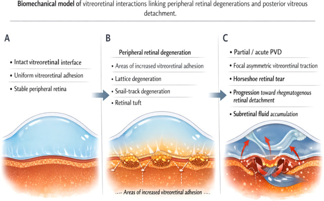
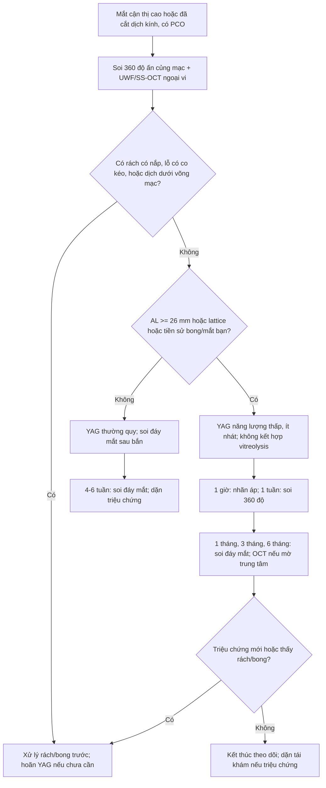
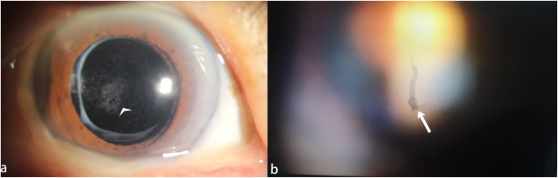
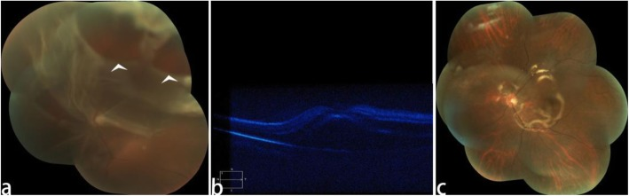
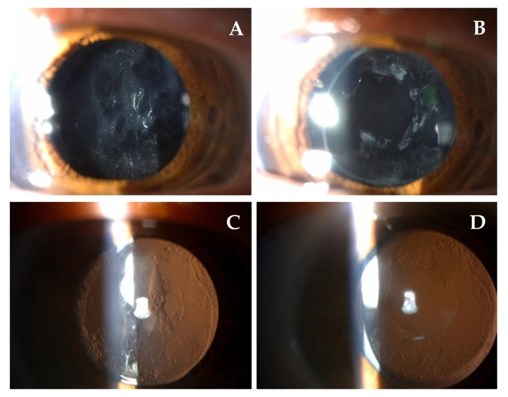
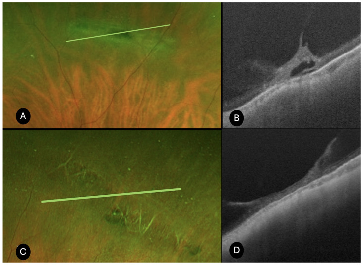

# 3295 — YAG bao sau ở mắt CẬN THỊ CAO: rách – bong võng mạc, thời điểm nào, theo dõi bao lâu / Nd:YAG capsulotomy in high myopia — retinal tear, detachment, timing and follow-up

**Tags:** `pattern:duc-bao-sau` `pattern:rach-vong-mac` `pattern:bong-vong-mac` `pattern:lattice` `pattern:pvd` `pattern:ruoi-bay` `pattern:chop-sang` `vung:mat` `vung:vong-mac` `vung:the-thuy-tinh` `vung:dich-kinh` `protocol:YAG` `protocol:UWF` `protocol:SS-OCT` `protocol:soi-day-mat` `protocol:sie-u-am-B` `score:khong-co` `incidentaloma:khong`

**Mức chắc chắn (certainty):** tổng hợp y văn (literature synthesis) — dựng từ tổng quan YAG 2026 (**PMC13676808**, CC BY-NC 4.0); **594 mắt** làm YAG tại một trung tâm, phân tích 5 năm (**PMC13585354**, CC BY-NC-SA 4.0); **120 mắt** theo dõi tiến cứu sau YAG (**PMC13584622**, CC BY 4.0); **1.222 bệnh nhân** bong võng mạc có lỗ (RRD) đã mổ rồi đục thể thủy tinh (**PMC12932135**, CC BY 4.0); **23.642 mắt** phaco, tìm yếu tố nguy cơ RRD (**PMC12870959**, CC BY 4.0); **1.776 mắt** sàng lọc thoái hóa dạng lưới (**PMC12984566**, CC BY 4.0); **679 mắt cận thị cao** theo dõi PCO (**PMC12914886**, CC BY-NC-ND 4.0); **197 mắt** phacovitrectomy (**PMC12979282**, CC BY 4.0); **408 mắt** so thời điểm YAG ở mắt đã cắt dịch kính (**PMC4020170**, CC BY 4.0); **34 mắt** đã cắt dịch kính làm YAG (**PMC2697513**); **107 mắt** chụp SS-OCT ngoại vi (**PMC12650825**, CC BY 4.0); tổng quan phân tầng nguy cơ thoái hóa võng mạc ngoại vi (**PMC13212168**, CC BY 4.0); **TriNetX** về lattice ở mắt bạn (**PMC13308635**, CC BY-NC-ND 4.0); ca bong võng mạc cấp 7 ngày sau YAG (**PMC7168856**, CC BY 4.0). Không có thử nghiệm ngẫu nhiên nào về **khoảng theo dõi** sau YAG; mọi ngưỡng dưới đây là **đoàn hệ/quan sát**, chỗ suy luận ghi **[suy luận]**. **Không ghi tên tác giả** — attribution = **tạp chí + năm + PMCID**.

> **Câu chốt:** ở mắt **cận thị cao**, YAG bao sau **không phải thủ thuật "bắn rồi về"**: bong võng mạc sau YAG hiếm nhưng **tập trung vào 3–6 tháng đầu** — trong đoàn hệ dân số lớn, **rách 0,21% trong 90 ngày**, **bong 0,60% trong 90 ngày**, **tích lũy 1,39% ở 12 tháng**, và **nguy cơ tăng thêm chỉ nằm trong 5 tháng đầu** (PMC13676808); các loạt kinh điển ghi **2–3,6%**, với **84,6% ca bong xảy ra trong năm đầu** (11/13; PMID 2712134) và **thời gian YAG → bong trung bình 3,6 tháng** (PMID 8496561). Ở mắt **cận thị cao**, nguy cơ nền đã cao: **cận thị cao làm odds RRD sau phaco tăng 12,04 lần**, **thoái hóa dạng lưới tăng 12,78 lần** (23.642 mắt; PMC12870959) — nhưng **odds lớn không đồng nghĩa nguy cơ tuyệt đối lớn**: RRD chung chỉ **0,07%/năm** trong đoàn hệ đó. Vì vậy câu trả lời đúng không phải "đừng làm YAG", mà là **phân tầng trước, bắn tối thiểu, và hẹn soi đáy mắt đúng cửa sổ 1 tuần – 1 tháng – 3 tháng – 6 tháng**.

> **Ranh giới với bài đã có:** [1492](../1492-duc-bao-sau-iol-yag-sau-cat-dich-kinh/lesson.md) trả lời **"PCO ở mắt đã cắt dịch kính: YAG hay chờ, năng lượng bao nhiêu, có hỏng IOL không"**; [3292](../3292-duc-bao-sau-yag-sau-ghep-noi-mo/lesson.md) trả lời **"YAG trên mắt đã ghép nội mô"**; [1518](../1518-tach-lop-vong-mac-ngoai-vi/lesson.md) trả lời **"tách lớp võng mạc ngoại vi hay bong thật"**; [1469](../1469-bong-vong-mac-co-lo-sau-tiem-noi-nhan/lesson.md) trả lời **"bong võng mạc sau tiêm nội nhãn"**. Bài này chỉ trả lời câu hỏi **của mắt cận thị cao (và mắt đã cắt dịch kính) trước và sau YAG**: **ai có nguy cơ rách–bong, soi gì trước khi bắn, bắn khác gì, và theo dõi bao lâu**; phần **năng lượng – kỹ thuật – tổn thương IOL** đã có ở 1492, chỉ nhắc lại ngắn.

## 1. Tổng quan bệnh học – cơ chế hình ảnh (TẠI SAO)

### 1.1 YAG làm gì, và vì sao sóng xung kích đi xa hơn "một lỗ trên bao"

- **YAG bao sau (Nd:YAG, 1.064 nm)** cắt bao bằng **quang đập vỡ (photodisruption)**: năng lượng hội tụ tạo **plasma** tại tiêu điểm → **sóng xung kích + bọng khí** làm đứt sợi collagen của bao sau. Đây là **cắt cơ học bằng sóng**, không phải "đốt" bằng nhiệt.
- **Vì sao tổng năng lượng và số nhát quan trọng:** sóng xung kích **không dừng ở bao**. Trong **277 mắt** làm YAG, **màng hyaloid trước bị tổn thương (anterior hyaloid damage, AHD) ở 19,2% (49/255)**; nhóm AHD có **số nhát, năng lượng mỗi nhát và tổng năng lượng cao hơn** (p < 0,001; p = 0,024; p < 0,001), và **biến chứng võng mạc cao gấp 12,7 lần** sau khi hiệu chỉnh tổng năng lượng (p < 0,001) — có **1 ca bong võng mạc khu trú** (PMID 24257893, tổng hợp trong PMC13676808). Nói cách khác: **càng nhiều nhát, càng nhiều năng lượng → càng dễ rách màng hyaloid → càng dễ có PVD cấp và rách võng mạc**.
- **Hệ quả hình ảnh:** sau YAG, có thể thấy **tế bào sắc tố trôi trong dịch kính (pigment cells)**, **xuất huyết dịch kính nhẹ**, hoặc **vệt Weiss** — đó là dấu của **PVD cấp**, không phải "dị ứng laser". Nếu kèm **chớp sáng – ruồi bay tăng nhanh**, phải soi đáy mắt **360° có ấn củng mạc** ngay, vì **rách có thể đã hình thành trước khi bong**.

### 1.2 Vì sao CẬN THỊ CAO là "đất đã xấu" trước khi bắn

- **Trục nhãn cầu dài (AL ≥ 26 mm)** → củng mạc – hắc mạc **mỏng hơn**, võng mạc **căng hơn** theo định luật Laplace (bán kính lớn → lực căng thành lớn với cùng nhãn áp), và **dịch kính hóa lỏng – PVD sớm**. Vì vậy cùng một lực xung kích, mắt cận thị cao **dễ rách ở nơi võng mạc đã mỏng** hơn.
- **Thoái hóa dạng lưới (lattice degeneration)** là tổn thương **bám dính – co kéo** điển hình: vùng võng mạc mỏng, **mạch máu xuyên**, **bờ dính dịch kính mạnh**, dễ sinh **lỗ trong vùng lattice** khi PVD xảy ra. Trong **1.776 mắt**, **lattice 13,3%**; **cận thị 15,5% so với không cận 10,5%**; mỗi **1 mm AL tăng** làm **OR 1,53** (PMC12984566). Trên **1.222 bệnh nhân** đã mổ RRD rồi phaco, tỉ lệ **bong lại tăng dần theo độ cận: 8,5% – 9,5% – 15,6%** (không cận – cận – cận cao; p = 0,36), và **tuổi 18–35 có tỉ lệ bong lại cao nhất** (PMC12932135).
- **Bong võng mạc sau phaco cũng đã có nguy cơ nền:** trong **23.642 mắt**, chỉ **0,07%** bong trong 1 năm, nhưng **cận thị cao aOR 12,04 (4,25–34,09)** và **lattice aOR 12,78 (3,58–45,65)** (PMC12870959). Bài học kép: **yếu tố nguy cơ rất mạnh về odds**, nhưng **nguy cơ tuyệt đối vẫn thấp** — nên **không hoảng, nhưng cũng không được bỏ qua**.

### 1.3 Vì sao "đã cắt dịch kính" không tự động là an toàn — và cũng không tự động là nguy hiểm

- **Một mặt:** mắt đã **cắt dịch kính (PPV)** không còn **thể dịch kính** để co kéo; màng hyaloid trước đã mất, nên **không còn "van" AHD**. Trong **34 mắt phacovitrectomy** làm YAG, **không ca nào bong võng mạc, lệch IOL hay tăng nhãn áp kéo dài**; nhóm tác giả cho rằng **dịch kính đóng vai trò trong biến chứng sau YAG** (PMC2697513) — nhưng đây là **loạt rất nhỏ**, không đủ để kết luận.
- **Mặt khác:** mắt đã PPV thường **đã có bệnh võng mạc nền** (bong võng mạc, lỗ hoàng điểm, ERM, dầu silicone). Trong **197 mắt phacovitrectomy**, **27,41% phải YAG trong 6 năm**, và **mổ vì bong võng mạc làm odds phải YAG tăng 25,4 lần** (PMC12979282) — nghĩa là **chọn mắt phacovitrectomy vì bong võng mạc** đã là **nhóm nguy cơ cao**, không phải YAG tạo ra nguy cơ đó. YAG ở mắt đã PPV cũng đến **sớm hơn** (HR 1,337 so với phaco đơn thuần; PMC4020170).
- **Kết luận thực hành:** với mắt **cận thị cao + đã cắt dịch kính**, phải xử lý như **hai yếu tố nguy cơ cộng lại**, không phải "đã cắt dịch kính thì yên tâm". Ngược lại, **không được dọa bệnh nhân** rằng YAG chắc chắn gây bong — bằng chứng **không cho thấy YAG là nguyên nhân độc lập** ở phaco hiện đại (xem 1492 và mục 7).

### 1.4 Vì sao hình ảnh ngoại vi phải là UWF/SS-OCT, không phải "đáy mắt trung tâm"

- **Soi đáy mắt 360° có ấn củng mạc** là chuẩn vàng lâm sàng, nhưng **vùng xích đạo – cực trước** hay bị bỏ sót vì **đồng tử nhỏ, PCO che, hoặc mắt đau sau laser**.
- **UWF (ultra-widefield)** chụp **200° võng mạc** bằng **scanning laser ophthalmoscope** (532/633 nm): ánh sáng laser quét, **không cần tiếp xúc**, thấy **lattice, vết rách, máu, bong ngoại vi** trong một ảnh — nhưng **biến dạng ngoại vi** và **không thấy chi tiết cắt lớp**.
- **SS-OCT ngoại vi (1.060 nm)** cho **cắt lớp dọc trục**: thấy **dính dịch kính – co kéo – dịch dưới võng mạc** mà **soi đèn khe không thấy**. Trong **107 mắt / 130 tổn thương ngoại vi**, SS-OCT phát hiện **co kéo dịch kính, bờ lỗ lật, dịch dưới võng mạc** ở những ca **không thấy trên lâm sàng**, và **thay đổi xử trí** ở một số ca (PMC12650825).
- **Siêu âm B-scan** chỉ dùng khi **môi trường trong suốt mất** (đục giác mạc, máu dịch kính, dầu silicone): thấy **màng bong dạng dải**, nhưng **không loại trừ rách nhỏ**.

### 1.5 Thời điểm: vì sao "3–6 tháng đầu" là cửa sổ phải hẹn

- **Tổng quan 2026:** nguy cơ **tăng thêm tập trung trong 5 tháng đầu**, sau đó **trở về mức nền**; **tích lũy 1,39% ở 12 tháng** (PMC13676808).
- **Các loạt kinh điển:** **84,6%** ca bong xảy ra **trong năm đầu** (11/13; PMID 2712134); thời gian từ YAG đến bong **trung bình 3,6 tháng (1–8 tháng)** trong 144 ca (PMID 8496561); **trung vị 3,5 tháng** trong 25 mắt (PMID 3684199); **trung bình 4,42 tháng** trong 20 mắt (PMID 2724863).
- **Ca cấp tính:** **2 mắt cận thị cao** bị **lỗ hoàng điểm + bong võng mạc** chỉ **4 ngày và 1 tuần** sau YAG (PMID 18721725); ca **58 tuổi cận thị** bị **bong hoàng điểm 7 ngày** sau YAG **kết hợp vitreolysis** (PMC7168856). Vì vậy **hẹn 1 tuần** không phải "quá sớm", mà là **đúng lúc bắt đầu cửa sổ nguy hiểm**.

## 2. Mẫu hình + chẩn đoán phân biệt theo vị trí (gamut)

**Mẫu hình trung tâm:** *mắt cận thị cao (AL ≥ 26 mm) hoặc đã cắt dịch kính, sau YAG bao sau 2 tuần–6 tháng, than mờ/thấy **chớp sáng – ruồi bay – màn che**; soi đáy mắt phải trả lời: có **rách/bong ngoại vi**, **lỗ hoàng điểm**, **bong do lỗ trung tâm**, hay **chỉ là PVD – mảnh bao**.*

| Vị trí tổn thương | Gamut | Dấu hiệu nhận diện |
|---|---|---|
| **Võng mạc ngoại vi (xích đạo – cực trước)** | **Lattice + rách/horseshoe tear · lỗ tròn atrophic · snail track · dialysis · tách lớp (retinoschisis)** | **Nắp rách (flap) + co kéo dịch kính** = nguy cơ cao; **lỗ tròn không nắp, không dịch** = thường lành; **dialysis** ở miệng cá (ora) sau chấn thương |
| **Hoàng điểm** | **Lỗ hoàng điểm + bong (MHRD) · bong do lỗ hoàng điểm · tách lớp cận thị (foveoschisis)** | **Lỗ trung tâm + dịch dưới hoàng điểm** trên OCT; **AL > 30 mm**, **staphyloma sau**, **màng trước võng mạc** |
| **Dịch kính** | **PVD cấp · xuất huyết dịch kính · mảnh bao sau (PCO debris)** | **Tế bào sắc tố + vệt Weiss** = PVD; **mảnh trắng lơ lửng** sau YAG = mảnh bao, **không phải rách** |
| **Hắc mạc** | **Tràn dịch hắc mạc · xuất huyết hắc mạc (suprachoroidal)** | **Bóng hắc mạc nổi, không di chuyển**, **đau** (nếu xuất huyết), **nhãn áp thấp**; không có **lỗ võng mạc** |
| **Đoạn trước** | **Tăng nhãn áp thoáng qua · CME · viêm nhẹ** | **Đau + nhãn áp tăng trong giờ đầu**; **mờ trung tâm + dày hoàng điểm** xuất hiện **vài tuần đến vài tháng** (trung vị ~4,8 tháng) |

- **Ba câu hỏi định vị, theo thứ tự:** (1) **Có lỗ/nắp và co kéo không?** → nếu có, đó là **rách cần xử lý**, bất kể vị trí. (2) **Dịch dưới võng mạc có lan tới hoàng điểm không?** → quyết định **mổ sớm**. (3) **Có bệnh nền (lattice, bong mắt bạn, AL dài, staphyloma) không?** → quyết định **ngưỡng can thiệp và lịch theo dõi**.

## 3. Bảng so sánh phân biệt (ma trận đối chiếu)

| Thực thể | Hình ảnh điển hình | Chốt vào (rule-in) | Chốt loại (rule-out) | Gợi ý xác nhận |
|---|---|---|---|---|
| **Rách có nắp (horseshoe tear) sau YAG** | **Nắp võng mạc** hướng về phía dịch kính, **co kéo dịch kính** ở bờ; thường **thái dương trên** | **Nắp + co kéo + triệu chứng chớp sáng/ruồi bay mới** | **Lỗ tròn không nắp, không co kéo** → không phải rách có nắp | Soi 360° ấn củng mạc + UWF; SS-OCT thấy **dính dịch kính ở bờ** |
| **Lỗ tròn atrophic (round hole)** | Lỗ **tròn, bờ đều**, **không nắp**, **không dịch**; trong vùng lattice hoặc võng mạc mỏng | **Tròn + không co kéo + không dịch** | **Có nắp/co kéo** → rách; **có dịch** → bong khu trú | SS-OCT ngoại vi: **không cầu nối dịch kính** |
| **Lattice degeneration có co kéo** | **Vùng mỏng hình bầu dục**, **đường trắng bắc cầu**, **chấm sắc tố**, **mạch xuyên**; OCT: **co kéo + dịch kính dày** | **Bờ dính dịch kính mạnh + mỏng võng mạc + chấm sắc tố** | **Paving-stone / WWOP**: mỏng nhưng **không co kéo**, **không dính** | UWF + SS-OCT; **không** chẩn đoán lattice chỉ bằng "đốm trắng" |
| **Snail track** | **Dải lấp lánh như vệt ốc sên**, mỏng võng mạc, ít co kéo | **Dải lấp lánh + mỏng + không nắp** | **Lattice**: có **mạch xuyên + co kéo rõ** | Soi đáy mắt + SS-OCT; nguy cơ **thấp hơn lattice** |
| **Tách lớp võng mạc ngoại vi (retinoschisis)** | **Tách lớp trong–ngoài**, **cột trụ (columns)**, **"saw-tooth"**, thường **thái dương dưới**; **không có lỗ toàn bộ** | **Cột nối + tách lớp + không lỗ toàn bộ** | **Có lỗ toàn bộ + dịch lan** → **bong thật** (xem 1518) | SS-OCT: **vách tách lớp**, **không có lỗ** |
| **Bong võng mạc có lỗ (RRD) sau YAG** | **Màng võng mạc xám nhạt, mất chi tiết**, **nếp gấp**, **dịch di chuyển theo tư thế**; tìm **lỗ** | **Có lỗ + dịch dưới võng mạc + khiếm khuyết thị trường** | **Không lỗ, dịch không di chuyển** → nghĩ **tràn dịch hắc mạc/ bong thanh dịch** | Soi đáy mắt + B-scan khi mờ; **UWF** đánh dấu lỗ |
| **Bong do lỗ hoàng điểm (MHRD)** | **Lỗ trung tâm** + **dịch dưới hoàng điểm**; **AL > 30 mm**, **staphyloma** | **Lỗ hoàng điểm + dịch** trên OCT | **Bong ngoại vi không tới hoàng điểm** → không phải MHRD | OCT hoàng điểm + AL + soi ngoại vi |
| **CME sau YAG** | **Dày hoàng điểm dạng nang**, **mờ trung tâm**, không có lỗ | **OCT: nang trong hoàng điểm + dày > 300 µm** | **Không có dịch dưới võng mạc ngoại vi** | OCT; **3 tuần – 11 tháng**, trung vị ~**4,8 tháng** (PMC13676808); đáp ứng corticoid |
| **Tràn dịch hắc mạc** | **Bóng hắc mạc** nổi, **nhãn áp thấp**, có thể sau **acetazolamide** | **Bóng đặc, không di chuyển, không lỗ** | **Có lỗ + dịch di chuyển** → RRD | B-scan/UWF; ngừng thuốc nghi ngờ |

*Ba bước: **(A)** mặt phân cách dịch kính – võng mạc nguyên vẹn; **(B)** vùng thoái hóa ngoại vi (lattice, snail track, tuft) tạo **dính khu trú**; **(C)** **PVD cấp** → co kéo không đối xứng → **rách có nắp** → **bong**. Nguồn: Front Ophthalmol 2026 (PMC13212168), CC BY 4.0 — nguyên bản.*

## 4. Protocol chụp – đánh giá – bắn – theo dõi

### 4.1 Phân tầng nguy cơ TRƯỚC khi bắn (bắt buộc ghi vào hồ sơ)

| Mức | Tiêu chuẩn | Hành động |
|---|---|---|
| **Cao** | **AL ≥ 26 mm** + ít nhất 1: **lattice**, **bong mắt bạn**, **tiền sử RRD cùng mắt**, **đã cắt dịch kính vì RRD/dầu silicone**, **tuổi < 60**, **nam**, **PVD chưa xảy ra hoặc mới xảy ra**, **tổng năng lượng dự kiến cao** | **Soi 360° ấn củng mạc + UWF/SS-OCT ngoại vi trước YAG**; **bắn năng lượng thấp nhất, ít nhát**; **hẹn 1 tuần – 1 tháng – 3 tháng – 6 tháng**; **dặn quay lại ngay** nếu chớp sáng/ruồi bay/màn che |
| **Trung bình** | **AL 24–26 mm** hoặc **lattice đơn độc**, **không tiền sử bong** | Soi 360° trước; **hẹn 1 tháng – 3 tháng**; dặn triệu chứng |
| **Thấp** | **AL < 24 mm**, **không lattice**, **không tiền sử bong**, **PVD hoàn toàn**, **tuổi ≥ 70** | Soi đáy mắt sau YAG; **hẹn 4–6 tuần**; không cần corticoid thường quy |

- **Vì sao "tuổi trẻ + nam" vào nhóm cao:** trong **594 mắt**, **88% ca có biến chứng có yếu tố nguy cơ nền**, và biến chứng gắn với **nhiều nhát, công suất cao, tổng năng lượng lớn** (PMC13585354); trong **23.642 mắt**, **nam giới aOR 1,92** cho RRD sau phaco (PMC12870959); trong **1.222 bệnh nhân**, **tuổi 18–35** có tỉ lệ bong lại cao nhất (PMC12932135).
- **Không có thang điểm được validate** cho "nguy cơ bong sau YAG ở mắt cận thị cao" — bảng trên là **khung thực hành** tổng hợp từ các yếu tố đã được đo, không phải score chính thức. **[suy luận]**

### 4.2 Trước YAG: soi gì, chụp gì

1. **Thị lực, khúc xạ, nhãn áp, sinh hiển vi** — xác nhận PCO là nguyên nhân mờ (không phải **phù giác mạc, CME, bong hoàng điểm**).
2. **Soi đáy mắt 360° có ấn củng mạc**, ghi rõ **vị trí lattice/rách/nắp** theo **cung giờ** và **khoảng cách tới ora**.
3. **UWF** nếu có: lưu ảnh **trước – sau** để so; **SS-OCT ngoại vi** khi nghi **co kéo mà soi không rõ** (PMC12650825).
4. **Đo AL** (IOLMaster/OCULUS) — **AL ≥ 26 mm** đổi phân tầng; **AL > 30 mm** là nhóm **cực đoan** (PCO nặng hơn, HR PCO giảm 41% nếu IOL kỵ nước; PMC12914886).
5. **Hỏi kỹ:** tiền sử **bong mắt bạn**, **bong cùng mắt**, **cắt dịch kính**, **dầu silicone**, **chấn thương**, **ROP**, **bệnh Stickler/Marfan**.
6. **Đánh giá PVD:** có **vệt Weiss**, **vòng tách dịch kính sau**, hay **PVD chưa hoàn toàn** — PVD **chưa xảy ra** ở mắt lattice là **nguy cơ cao nhất** vì lần PVD đầu tiên chính là lúc rách.

### 4.3 Bắn: nguyên tắc cho mắt nguy cơ cao

- **Năng lượng thấp nhất có hiệu quả**, tăng từng bước **0,2–0,4 mJ**, **hội tụ sau bao sau 100–200 µm**, dùng **kính tiếp xúc** để giảm năng lượng (chi tiết kỹ thuật và ngưỡng hỏng IOL: xem [1492](../1492-duc-bao-sau-iol-yag-sau-cat-dich-kinh/lesson.md), dẫn PMC12375400).
- **Số nhát tối thiểu:** mở **đủ trục quang**, tránh "bắn cho sạch" — **nhiều nhát và tổng năng lượng cao** là yếu tố nguy cơ **đã đo được** (PMC13585354; PMID 24257893).
- **Không kết hợp YAG vitreolysis cùng lúc** ở mắt cận thị cao: ca **58 tuổi cận thị** bị bong **7 ngày** sau khi làm **capsulotomy + vitreolysis** cùng thì (PMC7168856). Nếu bệnh nhân than ruồi bay nhiều, **hẹn lần sau** và **soi đáy mắt giữa hai lần**. **[suy luận]** từ ca nguyên văn.
- **Tránh để bao tự lan (spontaneous extension)** sau khi mở — đây là yếu tố nguy cơ **đã được ghi nhận** trong loạt 1989 (PMID 2751470).
- **Mắt đã cắt dịch kính:** vẫn bắn được, nhưng **không có "đệm" dịch kính**; dùng **năng lượng thấp**, **tránh hội tụ sâu**, và **soi đáy mắt ngay sau bắn** vì **không có màng hyaloid làm "van"**. **[suy luận]** — bằng chứng lâm sàng ở mắt PPV còn nhỏ và mâu thuẫn (PMC2697513 so với PMC12979282).

### 4.4 Theo dõi sau YAG — cửa sổ 6 tháng

| Thời điểm | Việc làm | Lý do |
|---|---|---|
| **1 giờ** | **Nhãn áp** | Tăng nhãn áp thoáng qua; **tổng năng lượng cao** làm tăng nguy cơ (PMC13584622) |
| **1 tuần** | **Soi đáy mắt 360°** + hỏi triệu chứng | Rách/bong có thể xuất hiện **4–7 ngày** (PMID 18721725; PMC7168856); nhóm nguy cơ cao |
| **1 tháng** | Soi đáy mắt + **OCT hoàng điểm nếu mờ trung tâm** | CME có thể xuất hiện **3 tuần – 11 tháng** (trung vị ~4,8 tháng); PVD cấp thường đã hoàn tất |
| **3 tháng** | Soi đáy mắt + UWF nếu nguy cơ cao | Đỉnh nguy cơ **3–6 tháng** (PMID 8496561; PMID 3684199) |
| **6 tháng** | Soi đáy mắt lần cuối; dặn tái khám nếu triệu chứng | Nguy cơ tăng thêm **hết sau ~5 tháng** (PMC13676808) |

- **Không có bằng chứng** rằng **corticoid dự phòng** làm giảm bong võng mạc; trong **594 mắt**, dùng thuốc chống viêm sau laser **không tương quan** với biến chứng (p = 0,63), và nhóm nguy cơ thấp **có thể không cần** theo dõi sớm thường quy (PMC13585354). Ngược lại, **nhóm nguy cơ cao** cần **theo dõi sát** — đừng đọc ngược quan hệ "hẹn 1 tuần" thành "hẹn 1 tuần gây biến chứng" (đó là **confounding do chỉ định**).
- **Dặn bệnh nhân bằng 4 từ:** **chớp sáng, ruồi bay mới, màn che, nhìn méo** → **quay lại ngay**, không chờ lịch.

### 4.5 Sơ đồ quyết định

## 5. Biến thể bình thường và cạm bẫy

- **"Ruồi bay sau YAG" không phải lúc nào cũng là mảnh bao:** mảnh bao thường **trắng, lơ lửng, không thay đổi**, và **không kèm chớp sáng**. **Ruồi bay mới + chớp sáng + tế bào sắc tố** = **PVD cấp**, phải soi 360°.
- **PCO che đáy mắt:** nhìn không rõ ngoại vi **không có nghĩa là không có rách**. Ở mắt nguy cơ cao, **soi trước khi bắn** (ấn củng mạc có thể vẫn thấy qua vùng trong), và **soi lại ngay sau khi mở bao**.
- **Cận thị cao có nhiều "nốt trắng" lành tính:** **paving-stone**, **WWOP**, **vết tích dịch kính**, **lattice không co kéo** — đừng gọi tất cả là "rách". Chốt bằng **co kéo/nắp/dịch** trên SS-OCT, không bằng màu sắc.
- **"Đau, đỏ sau YAG"** trong **giờ đầu** = **tăng nhãn áp**, không phải nhiễm trùng; nhưng **đau tăng + mủ tiền phòng** về sau là **viêm nội nhãn** (rất hiếm) — cần phân biệt bằng **nhãn áp, tiền phòng, đáy mắt**.
- **Mắt đã dầu silicone:** YAG qua dầu khó hơn, bong bóng khí/dầu làm **ánh sáng tán xạ**; **không suy ra "võng mạc đã áp thì YAG vô hại"**. Xem [1416](../1416-glaucom-do-dau-silicone/lesson.md) và [3263](../3263-benh-than-kinh-thi-dau-silicone/lesson.md).
- **Bắn hai mắt cùng lúc:** ở mắt nguy cơ cao, **không nên** làm hai mắt trong cùng buổi nếu chưa chắc đáp ứng/không có biến chứng — nếu một mắt bong, mắt còn lại vẫn là **mắt duy nhất**; **[suy luận]** từ nguyên tắc an toàn, không có thử nghiệm.
- **Bong võng mạc "không triệu chứng":** ở mắt đã cắt dịch kính/đục thể thủy tinh, bong ngoại vi có thể **chỉ thấy khi soi**; vì vậy **soi đáy mắt theo lịch**, không chỉ khi bệnh nhân than.

## 6. Tự lượng giá — Blind Quiz

**Ca 1 — Nữ 58 tuổi, cận thị, PCO nhiều và ruồi bay nhiều. Ảnh dưới cho thấy gì, và nếu làm YAG + vitreolysis cùng lúc thì nguy cơ là gì?**

- Gợi ý: (a) là **đèn khe**, mũi tên chỉ **hạt Elschnig**; (b) là **đáy mắt**, mũi tên chỉ **đục dịch kính**.
- Câu hỏi: (1) hai tổn thương này nằm ở đâu? (2) vì sao **không nên** làm YAG bao sau + YAG vitreolysis cùng thì ở mắt cận thị? (3) hẹn theo dõi thế nào?

<b>Bấm để hiện đáp án (findings + chẩn đoán)</b>

- **(a)** PCO dạng **hạt Elschnig** ở **trục quang** (sau IOL); **(b)** **đục dịch kính** (ruồi bay) phía sau.
- Ca nguyên văn: bệnh nhân được **YAG capsulotomy + YAG vitreolysis cùng lúc**; **7 ngày sau** bị **bong võng mạc cấp có hoàng điểm** (PMC7168856). Cơ chế: **hai nguồn xung kích cộng lại** trên mắt **cận thị** đã có **võng mạc mỏng**; **vitreolysis** làm **PVD cấp** ngay tại chỗ bắn.

*(a) Ảnh đáy mắt: **bong võng mạc phần trên – mũi**, **hai lỗ lớn** (đầu mũi tên); (b) OCT: **bong lan tới hố hoàng điểm**; (c) sau mổ: võng mạc áp. Nguồn: BMC Ophthalmol 2020 (PMC7168856), CC BY 4.0 — nguyên bản.*

- Cách làm an toàn hơn: **soi 360° trước**, **chỉ làm một thủ thuật mỗi lần**, **năng lượng thấp**, **hẹn 1 tuần** và **dặn quay lại ngay nếu chớp sáng/màn che**. **[suy luận]** từ ca nguyên văn — không có thử nghiệm so sánh.
- Nguồn ảnh: BMC Ophthalmol 2020 (**PMC7168856**), CC BY 4.0, nguyên bản.

**Ca 2 — Nữ 63 tuổi, PCO xơ dày trung tâm (ảnh nguyên văn). Giả định mắt này có AL 27,8 mm và lattice ở thái dương trên: ảnh trước – sau YAG dưới đây cho thấy gì, và bạn đổi kế hoạch thế nào?**

- Gợi ý: (A, C) là **trước**, (B, D) là **sau**; (C, D) là **ngược sáng**.
- Câu hỏi: (1) mô tả **A–D**; (2) trước khi bắn, bạn phải soi/gọi tên gì ở **thái dương trên**? (3) lịch theo dõi và **dấu hiệu nào** khiến bạn mổ cấp?

<b>Bấm để hiện đáp án</b>

- **(A)** đèn khe: **PCO xơ dày** che trục quang; **(B)** ngay sau YAG: **lỗ mở trung tâm, trục quang thông**; **(C)** ngược sáng trước: **đục trung tâm lan rộng**; **(D)** ngược sáng sau: **lỗ thông, vùng trung tâm trong** (PMC13676808).
- Trước khi bắn: **soi 360° ấn củng mạc**, ghi **lattice thái dương trên**, tìm **nắp/co kéo/dịch**; nếu có **rách có nắp** → **xử lý rách trước**, hoãn YAG nếu chưa cần.
- Theo dõi: **1 giờ (nhãn áp) – 1 tuần – 1 tháng – 3 tháng – 6 tháng**; **mổ cấp** khi có **bong lan tới hoàng điểm**, **lỗ hoàng điểm**, hoặc **bong tiến triển** trên soi/UWF.
- Nguồn ảnh: Med Hypothesis Discov Innov Ophthalmol 2026 (**PMC13676808**), CC BY-NC 4.0, nguyên bản.

**Ca 3 — Bệnh nhân cận thị than chớp sáng; ảnh UWF + SS-OCT ngoại vi dưới đây (từ loạt 107 mắt tổn thương ngoại vi) là tổn thương gì, nguy cơ ra sao?**

- Gợi ý: (A, C) là **ảnh màu ngoại vi**, đường xanh là **mặt cắt OCT**; (B, D) là **SS-OCT** tương ứng.
- Câu hỏi: (1) gọi tên tổn thương; (2) dấu hiệu nào trên OCT nói **có nguy cơ**? (3) xử lý thế nào nếu **chưa có lỗ toàn bộ**?

<b>Bấm để hiện đáp án</b>

- **Thoái hóa dạng lưới (lattice degeneration)**: vùng võng mạc mỏng, **đường trắng bắc cầu**, **chấm sắc tố**, **mạch xuyên**; trên SS-OCT thấy **co kéo dịch kính**, **lắng đọng tăng phản hồi**, và **dịch dưới võng mạc khu trú** (PMC12650825).
- **Dấu hiệu nguy cơ:** **co kéo dịch kính còn hoạt động**, **dịch dưới võng mạc**, **triệu chứng chớp sáng mới**; nếu chỉ **mỏng + không co kéo + không dịch** thì nguy cơ thấp hơn.
- **Xử lý:** nếu **chưa có lỗ toàn bộ**, theo dõi sát **1–3 tháng** và **dặn triệu chứng**; nếu **có rách có nắp/dịch tiến triển**, **laser quang đông** hoặc **mổ** tùy vị trí và mức lan tới hoàng điểm. **Không** đốt dự phòng mọi lattice không triệu chứng (xem mục 7).
- Nguồn ảnh: Diagnostics 2025 (**PMC12650825**), CC BY 4.0, nguyên bản.

## 7. Câu hỏi nghiên cứu & điểm chưa đồng thuận (tính đến 11/2026)

1. **[Tranh cãi] YAG bao sau có thật sự làm tăng nguy cơ bong võng mạc, hay nguy cơ chỉ phản ánh mắt nền bệnh?**
   - **Đã biết:** đoàn hệ dân số lớn cho **rách 0,21% / bong 0,60% trong 90 ngày**, **tích lũy 1,39% ở 12 tháng** (PMC13676808); phân tích gộp cho **RR 1,57** nhưng **dị biệt lớn**; loạt **594 mắt** có **0,5% rách/bong**, và **88% ca biến chứng có yếu tố nguy cơ nền** (PMC13585354).
   - **Chưa rõ:** không tách được **tác dụng của tia laser** khỏi **cận thị cao, lattice, tiền sử bong, tuổi trẻ** — không có nhóm chứng ngẫu nhiên "YAG giả".
   - **Hướng nghiên cứu:** **target trial emulation** trên dữ liệu registry, **phân tầng theo AL, lattice, PVD**, với outcome **rách/bong trong 12 tháng**.
   - **Nguồn:** PMC13676808 (2026); PMC13585354 (2026).

2. **[Khoảng trống] Chưa có lịch theo dõi tối ưu sau YAG cho mắt cận thị cao — 1 tuần, 1 tháng hay chỉ khi có triệu chứng?**
   - **Đã biết:** nguy cơ tăng thêm **tập trung 5 tháng đầu**; thời gian YAG → bong **trung bình 3,6 tháng (1–8)** trong 144 ca (PMID 8496561), **trung vị 3,5 tháng** (PMID 3684199); **SS-OCT ngoại vi** phát hiện co kéo/dịch mà lâm sàng bỏ sót (PMC12650825).
   - **Chưa rõ:** **khoảng cách nào** bắt được nhiều ca nhất với chi phí thấp nhất; **giá trị của UWF/SS-OCT lặp lại** so với soi đáy mắt; **có nên soi 1 tuần cho mọi mắt** hay chỉ nhóm nguy cơ cao.
   - **Hướng nghiên cứu:** đoàn hệ tiến cứu **phân tầng nguy cơ**, so **soi 1 tuần + 1 tháng + 3 tháng** với **soi theo triệu chứng**, outcome **tỉ lệ phát hiện rách trước khi bong hoàng điểm**.
   - **Nguồn:** PMC13676808 (2026); PMC12650825 (2025).

3. **[Khác biệt thực hành] Có nên laser dự phòng lattice/rách nhỏ ở mắt cận thị cao TRƯỚC hoặc SAU YAG không?**
   - **Đã biết:** ở mắt bạn có lattice, **tiền sử RRD làm OR 4,47**, **cận thị làm OR 5,67**, và **NNT để ngăn 1 bong là 4,63** nếu đã có RRD mắt bạn, nhưng **43,29** nếu chưa có (PMC13308635); tổng quan 2026 khuyến cáo **chỉ đốt khi có rách triệu chứng, bong mắt bạn, hoặc bất ổn co kéo trên OCT** (PMC13212168).
   - **Chưa rõ:** **lattice không triệu chứng ở mắt cận thị cao sắp YAG** có lợi từ laser dự phòng không, và **thời điểm** (trước hay sau YAG); AAO 2025 vẫn coi bằng chứng là **chưa đủ** cho mắt bạn không triệu chứng (PMC12579876).
   - **Hướng nghiên cứu:** thử nghiệm ngẫu nhiên **laser dự phòng trước YAG** ở mắt **AL ≥ 26 mm + lattice**, outcome **RRD trong 12 tháng** và **khiếm khuyết thị trường**.
   - **Nguồn:** PMC13308635 (2026); PMC13212168 (2026); PMC12579876 (2025).

## Bài liên quan chéo

- [1492 – PCO sau phacovitrectomy: YAG lúc nào, năng lượng bao nhiêu, nguy cơ bong võng mạc](../1492-duc-bao-sau-iol-yag-sau-cat-dich-kinh/lesson.md)
- [1481 – Lỗ rách võng mạc cấp chưa bong: laser dự phòng hay theo dõi](../1481-lo-rach-vong-mac-laser-du-phong/lesson.md)
- [1518 – Tách lớp võng mạc ngoại vi so với bong võng mạc](../1518-tach-lop-vong-mac-ngoai-vi/lesson.md)
- [1469 – Bong võng mạc có lỗ sau tiêm nội nhãn](../1469-bong-vong-mac-co-lo-sau-tiem-noi-nhan/lesson.md)
- [3292 – Đục bao sau (PCO) và YAG sau ghép nội mô](../3292-duc-bao-sau-yag-sau-ghep-noi-mo/lesson.md)
- [3294 – Trẻ aphakia trước IOL thứ phát: UBM/AS-OCT đánh giá hỗ trợ bao](../3294-tre-aphakia-danh-gia-ho-tro-bao-ubm-as-oct/lesson.md)
- [1480 – Đục thể thủy tinh sau bóc màng (ERM): mổ phối hợp hay hai thì](../1480-duc-the-thuy-tinh-sau-boc-mang-erm/lesson.md)
- [1416 – Glôcôm do dầu silicone](../1416-glaucom-do-dau-silicone/lesson.md)
- [400 – Tổng quan Mắt & thị giác](../400-tong-quan-mat-thi-giac/lesson.md)

## Ảnh

- Năm ảnh: PCO trước/sau YAG (PMC13676808), PCO hạt Elschnig + ruồi bay (PMC7168856 Fig 1), bong võng mạc cấp 7 ngày sau YAG (PMC7168856 Fig 3), sơ đồ cơ chế PVD – lattice – rách (PMC13212168), lattice trên UWF + SS-OCT ngoại vi (PMC12650825). Nguồn + giấy phép từng ảnh trong `images/CREDITS.md`.
- Không tạo ảnh ghép: các ảnh then chốt mang **CC BY-NC** hoặc **CC BY-NC-ND** — dùng **nguyên bản**, không crop/ghép.

> Không dùng để chẩn đoán độc lập khi chưa có người hướng dẫn.
