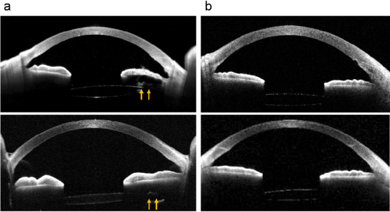
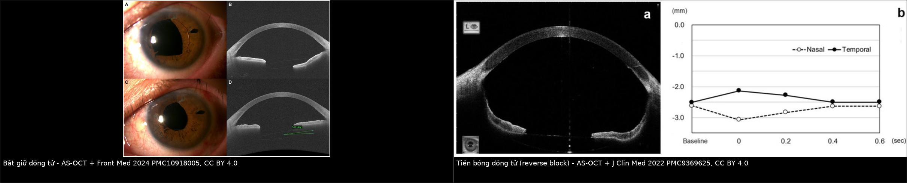
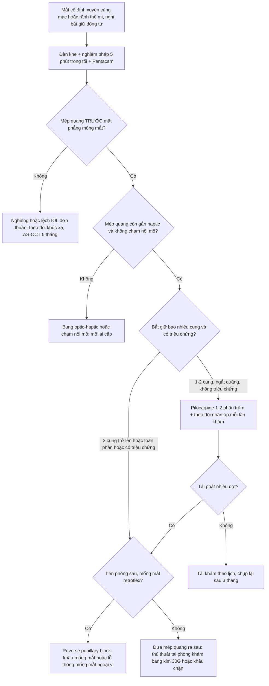
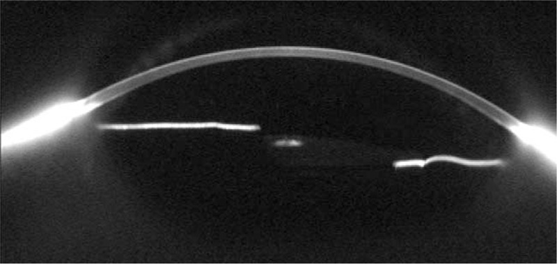
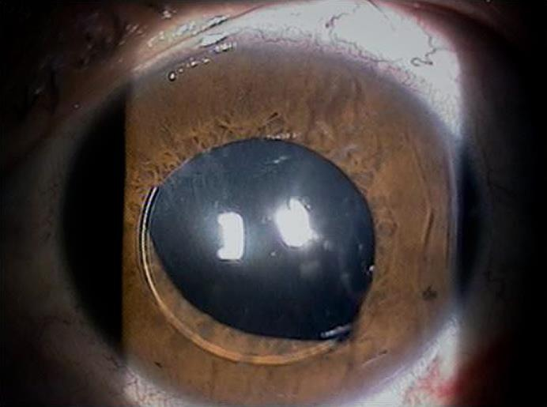
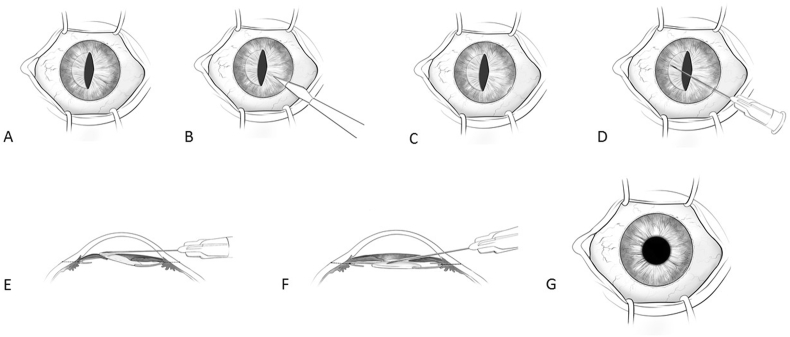

# 3296 — Bắt giữ đồng tử (pupillary capture) sau cố định IOL xuyên củng mạc ở trẻ: vì sao mống mắt "nuốt" mép quang học, đọc AS-OCT thế nào, khi nào theo dõi và khi nào phải mổ lại

**Tags:** `pattern:bat-giu-dong-tu` `pattern:iol-truoc-mong-mat` `pattern:reverse-pupillary-block` `pattern:iris-flutter` `pattern:dong-tu-meo` `vung:mat` `vung:the-thuy-tinh` `vung:tien-phong` `protocol:AS-OCT` `protocol:Pentacam` `protocol:UBM` `protocol:co-dong-tu-toi` `protocol:IOL-co-dinh-cung-mac` `score:khong-co` `incidentaloma:khong`

**Mức chắc chắn (certainty):** tổng hợp y văn (literature synthesis) — ghép các đoàn hệ **nhi** có số liệu định lượng: **26 mắt/15 trẻ Marfan** cố định xuyên củng mạc không khâu, so **2,0 so với 2,5 mm** từ rìa (Int J Ophthalmol 2023, **PMC10626357**); **18 mắt/11 trẻ** ectopia lentis, trung vị **3,5 tuổi** (Middle East Afr J Ophthalmol 2017, **PMC5793446**); **29 mắt/21 trẻ Marfan** so **Yamane với vòng Cionni** (BMC Ophthalmol 2026, **PMC12895746**, CC BY-NC-ND); **60 mắt 6–18 tuổi** so **IOL mống mắt với SFIOL Gore-Tex** (Indian J Ophthalmol 2022, **PMC9359268**); **57 mắt** so **IOL mống mắt với SFIOL** (Oman J Ophthalmol 2021, **PMC8095304**); **40 mắt** aphakia thứ phát (J Ophthalmol 2016, **PMC4995346**). Cơ chế và chẩn đoán hình ảnh: **83 mắt** người lớn cố định xuyên củng mạc, **8 mắt bắt giữ đồng tử** (BMC Ophthalmol 2025, **PMC11921500**, CC BY-NC-ND); **29 mắt** cố định xuyên củng mạc so **15 mắt** chứng, đo **rung mống mắt** bằng AS-OCT (J Clin Med 2022, **PMC9369625**, CC BY 4.0); ca **6 tuổi** bắt giữ **ngắt quãng** trong tối (Medicine 2017, **PMC5369920**, CC BY-NC-SA); **495 mắt** có **18 mắt (3,6%)** bắt giữ, xử lý tại phòng khám (Am J Ophthalmol Case Rep 2022, **PMC8819374**, CC BY-NC-ND). Không có thử nghiệm ngẫu nhiên nào về dự phòng/xử lý bắt giữ đồng tử; mọi con số là **đoàn hệ/quan sát**, chỗ suy luận ghi **[suy luận]**. **Không ghi tên tác giả** — attribution = **tạp chí + năm + PMCID**.

> **Câu chốt:** bắt giữ đồng tử (pupillary capture) **không phải "IOL to quá"** mà là **bài toán van một chiều**: khi không còn bao thể thủy tinh, **mống mắt trở thành van** — dịch đi từ sau ra trước được, nhưng **không quay lại được**, nên mống mắt bị đẩy ra sau rồi **mép đồng tử trượt ra TRƯỚC mép quang học**. Vì vậy dấu chốt trên hình ảnh **không phải độ nghiêng IOL** mà là **quan hệ giữa mép quang học và mặt phẳng mống mắt**, và dấu chốt trên lâm sàng là **tiền phòng SÂU** (tới **7,07 mm** trong một ca tiền bóng đồng tử), **ngược hẳn** với glôcôm góc đóng cấp.

> **Ranh giới với bài đã có:** [3294](../3294-tre-aphakia-danh-gia-ho-tro-bao-ubm-as-oct/lesson.md) trả lời **câu hỏi tiền phẫu** ("còn bao nhiêu bao là đủ, chọn trong bao – rãnh – củng mạc"); [3289](../3289-theo-doi-dai-han-sau-viem-noi-nhan-chan-thuong-tre/lesson.md) trả lời **theo dõi dài hạn sau viêm nội nhãn chấn thương**; [3252](../3252-hoi-chung-bao-chet-dead-bag-syndrome/lesson.md) trả lời **bao chết, IOL trôi muộn**; [3266](../3266-vo-bao-sau-phaco-iol-ranh-mi/lesson.md) trả lời **vỡ bao sau — đặt rãnh thể mi**. Bài này chỉ trả lời **biến chứng sau mổ**: **nhận diện bắt giữ đồng tử, phân biệt với 6 thực thể giống, và quyết định theo dõi – thuốc – mổ lại**.

## 1. Tổng quan bệnh học – cơ chế hình ảnh (TẠI SAO)

### 1.1 Vì sao mất bao là điều kiện tiên quyết: mống mắt thành van một chiều

- Ở mắt còn bao, **bao thể thủy tinh là một vách liên tục** giữa mống mắt và IOL: mép quang học **luôn nằm sau** mặt phẳng mống mắt, và **vành bao trước** là vật cản cơ học cho mép đồng tử.
- Khi mất bao (aphakia, vỡ bao sau, đứt zonule, cố định xuyên củng mạc), **mống mắt là cấu trúc duy nhất** còn nằm giữa tiền phòng và buồng dịch kính. Mép đồng tử **tựa trực tiếp lên mặt trước mép quang học**.
- Cơ chế **van một chiều**: mỗi lần mắt liếc (saccade), dịch thủy dịch/dịch kính dồn qua khe giữa mép quang học và mống mắt. Dịch **vào tiền phòng được** nhưng **không thoát ngược lại** vì mép đồng tử áp sát mép quang học → áp lực sau mống mắt tăng → **mống mắt bị đẩy ra sau (retroflexion)** → mép đồng tử **trượt qua mép quang học** → **bắt giữ**.
- **Định lượng rung mống mắt (iris fluttering)** trên AS-OCT động, **29 mắt** cố định xuyên củng mạc so **15 mắt** chứng, ngay sau một saccade (mốc 0 giây): độ cao **mống mắt phía mũi giảm −0,68 ± 0,43 mm** so với **−0,05 ± 0,09 mm** ở mắt chứng (p < 0,001); **mống mắt phía thái dương tăng +0,45 ± 0,31 mm** so với **+0,03 ± 0,06 mm** (p < 0,001) (PMC9369625). **Biên độ ~0,7 mm** này chính là "hành trình" mà mép đồng tử có thể đi qua mép quang học.
- **Tiền phòng sâu hơn là dấu của cơ chế này, không phải dấu của góc đóng:** ACD nhóm cố định xuyên củng mạc **5,82 ± 0,58 mm** so với **5,25 ± 0,31 mm** (p < 0,001) (PMC9369625); ở ca **tiền bóng đồng tử (impending pupillary block)**, ACD đo được **7,07 mm** — mống mắt bị hút ra sau, **góc mở rộng**, đúng kiểu **reverse pupillary block** (PMC9369625).

### 1.2 Vì sao "còn bao" gần như loại trừ bắt giữ: bằng chứng từ 83 mắt

- Trong **83 mắt** cố định xuyên củng mạc (Yamane, IOL 3 mảnh quang **7,0 mm**, theo dõi **1 năm**), bắt giữ đồng tử gặp ở **8 mắt (14,0%)**, và **toàn bộ 8 mắt đều ở nhóm mất bao**; nhóm **giữ bao trước (26 mắt) có 0 ca** (p = 0,044) (PMC11921500).
- **Điểm phản trực giác:** **ACD, độ nghiêng và độ lệch IOL không khác nhau** giữa hai nhóm (p > 0,05). Nghĩa là **không phải IOL nằm thấp hay nghiêng** gây bắt giữ, mà **sự có mặt của bao** — trên AS-OCT thấy **bao nằm chen giữa mống mắt và mép quang học** (Hình 2 của PMC11921500). **[suy luận]** Vì vậy "đặt IOL thật chuẩn trục" không bảo vệ được mắt mất bao; và ngược lại một IOL hơi nghiêng nhưng còn bao vẫn ít bắt giữ.
- Hệ quả thực hành: khi còn bao trước, **giữ lại vành bao và đặt IOL xuống dưới bao** là biện pháp dự phòng **cơ học**, rẻ hơn mọi kỹ thuật khâu.

*AS-OCT tiền đoạn hai ca: **(a) nhóm còn bao** — dải bao nằm giữa mống mắt và mặt trước IOL, đóng vai trò **vách cơ học**; **(b) nhóm mất bao** — mống mắt tựa trực tiếp lên mép quang học, đây là nhóm duy nhất có bắt giữ đồng tử (8/57 mắt). Nguồn: BMC Ophthalmol 2025 (PMC11921500), CC BY-NC-ND 4.0 — nguyên bản.*

### 1.3 Số phải thuộc — theo quần thể, không gộp chung

| Quần thể | n | Bắt giữ đồng tử | Nguồn |
|---|---|---|---|
| Trẻ **Marfan**, cố định xuyên củng mạc không khâu | 26 mắt/15 trẻ | **8 mắt (30,8%)** — khởi phát **3 ngày – 18 tháng** | PMC10626357 |
| Trẻ **ectopia lentis vô căn**, SFIOL có khâu | 18 mắt/11 trẻ, trung vị **3,5 tuổi** | **2 mắt (11,1%)** | PMC5793446 |
| **Ectopia lentis bẩm sinh** (mọi cách cố định) | 89 mắt | **39 mắt (43,8%)** ở tháng thứ 1 | Curr Eye Res 2020, DOI 10.1080/02713683.2019.1668418 |
| Người lớn, cố định xuyên củng mạc (Yamane) | 83 mắt | **8 mắt (14,0%)** | PMC11921500 |
| Người lớn, SFIOL có khâu | 495 mắt | **18 mắt (3,6%)** | PMC8819374 |
| Trẻ, SFIOL không khâu (ectopia lentis ≤ 18 tuổi) | — | không có ca bắt giữ được báo cáo; **hyphaema 10%**, sa IOL 1 ca | PMC6136496 |

- **Vì sao trẻ nhiều hơn người lớn:** đồng tử trẻ **giãn rộng hơn trong tối**, mô mống mắt mềm, và **trục nhãn cầu đang lớn** làm thay đổi tương quan sulcus–mống mắt. Trong **83 mắt** người lớn, bắt giữ gặp **ở người trẻ hơn có ý nghĩa**; **3 ca có viêm da cơ địa** (dụi mắt mạn) và **3 ca có tiền sử chấn thương** — tức **mống mắt đã bị tổn thương cơ học từ trước** (PMC11921500).
- **Yếu tố nguy cơ lâm sàng đã được nêu:** tuổi nhỏ, **hội chứng Marfan**, **mống mắt mềm (floppy iris)**, **đồng tử giãn rộng trong tối**, tiền phòng sâu, tiền sử chấn thương/dụi mắt (PMC11921500; PMC5369920). Trong **89 mắt ectopia lentis bẩm sinh**, **mức độ sa thể thủy tinh nặng hơn** và **lác trước mổ** là yếu tố nguy cơ độc lập (DOI 10.1080/02713683.2019.1668418).

### 1.4 Vì sao vị trí cố định haptic đổi thẳng tỉ lệ: 2,0 so với 2,5 mm

- Ở **26 mắt trẻ Marfan**, cùng một kỹ thuật không khâu, khác **duy nhất** vị trí xuyên củng mạc: **2,0 mm** so với **2,5 mm** sau rìa. Bắt giữ: **7/14 mắt (50%)** so với **1/12 mắt (8,3%)**, p = 0,02 — **giảm 6 lần** chỉ bằng **0,5 mm** (PMC10626357). Thị lực cải thiện ở cả hai nhóm (**0,77 → 0,17** và **0,66 → 0,24 logMAR**), nên **không phải "mổ tốt hơn" mà là "đặt trước hơn"** gây bắt giữ.
- Ở **495 mắt** người lớn, **tái bắt giữ** cũng gặp **nhiều hơn khi cố định < 2 mm** so với **2 mm** từ rìa (PMC8819374) — hai quần thể khác nhau, **cùng một quan hệ hình học**.
- **Giải thích hình học [suy luận]:** đường xuyên củng mạc càng **ra trước**, haptic càng kéo mép quang học **ra trước** tương đối so với mặt phẳng mống mắt → **khoảng nhô ra trước** của mép quang học tăng → mép đồng tử chỉ cần **trượt một đoạn ngắn** là bắt được. Đây là lý do **không có "công thức tuyệt đối"** nhưng **có ngưỡng thực hành**: **≥ 2,5 mm** ở trẻ Marfan trong loạt trên.
- **Một biến cố khác cũng mang tên "capture" nhưng cơ chế khác:** trong **29 mắt trẻ Marfan** so **Yamane với vòng Cionni**, **1 mắt** bị **mép quang học lọt ra trước mống mắt sau khi bung mối nối optic–haptic (optic–haptic disenclavation)** — phải **mổ Yamane lại**, và có **giảm tế bào nội mô đáng kể do mép quang học chạm nội mô giác mạc** (PMC12895746). **Đây là cấp cứu**, không phải "capture lành tính".

## 2. Mẫu hình + chẩn đoán phân biệt theo vị trí (gamut)

**Mẫu hình trung tâm:** *mép quang học nhìn thấy TRONG đồng tử, đồng tử méo theo cung, IOL **không di động** khi rọi ánh sáng* — ở mắt đã cố định xuyên củng mạc/rãnh thể mi, **không còn bao**.

| Mẫu hình (pattern) | Vị trí giải phẫu | Gamut theo vị trí |
|---|---|---|
| **Bắt giữ một phần (partial)** — một cung mép quang trước mống mắt | mép quang học **trước** một cung mống mắt | bắt giữ **một phần**, thường **thái dương/mũi**, đáy đồng tử méo |
| **Bắt giữ toàn phần (total)** — toàn bộ mép quang trước mống mắt | toàn bộ chu vi mống mắt **sau** mép quang | bắt giữ **toàn phần**; đồng tử bị "đậy" bởi IOL, thị lực giảm, nguy cơ **UGH** |
| **Bắt giữ ngắt quãng ("ghost")** — chỉ xuất hiện trong tối/sau liếc mắt | mép quang **trượt qua lại** mặt phẳng mống mắt | bắt giữ **động**; đèn khe thường **âm tính**, chỉ Pentacam/AS-OCT sau **5 phút trong tối** mới thấy |
| **Bắt giữ HAPTIC** | **mỏm haptic** (không phải mép quang) trước mống mắt | IOL **trong bao bị trôi ra trước**; haptic lọt qua đồng tử (J Cataract Refract Surg 2026, DOI 10.1097/j.jcrs.0000000000001870) |
| **Bung optic–haptic** | mép quang **rời khỏi haptic**, lọt ra trước | **biến cố cấp**, mép quang **trôi tự do** trong tiền phòng, **chạm nội mô** (PMC12895746) |
| **IOL mống mắt bị "bắt" bởi mống mắt** | mỏm kẹp mống mắt tuột | **iris capture** của IOL mống mắt/cố định mống mắt — **khác** bắt giữ đồng tử (cơ chế kẹp, không phải van) |
| **Đồng tử dính (seclusio) / màng đồng tử** | mặt sau mống mắt **dính** bao/IOL | **dính sau (posterior synechiae)**, màng đồng tử — đồng tử **không tròn**, không di động, nhưng **không có** mép quang trước mống mắt |
| **Chỉ nghiêng/lệch IOL, KHÔNG bắt giữ** | mép quang **sau** mống mắt, trục lệch | **IOL tilt/decentration** đơn thuần: **0,80 ± 0,27°** (Yamane) so với **1,33 ± 0,93°** (Cionni), lệch **3/16 (10,3%)** so với **4/13 (13,7%)** (PMC12895746) |

- **Cách nhớ 3 câu hỏi (mỗi câu đổi một quyết định) [suy luận — khung thực hành, không phải thang điểm đã validate]:**
  1. **Mép quang ở TRƯỚC hay SAU mặt phẳng mống mắt?** → quyết định **có/không bắt giữ**.
  2. **Bắt giữ bao nhiêu cung, và có thường xuyên hay chỉ trong tối?** → quyết định **theo dõi so với can thiệp**.
  3. **Mép quang còn gắn haptic không, và có chạm nội mô/giác mạc không?** → quyết định **mổ lại cấp so với thủ thuật tại phòng khám**.

## 3. Bảng so sánh phân biệt (ma trận đối chiếu)

| Thực thể | Hình ảnh điển hình (đèn khe / AS-OCT / Pentacam) | Chốt vào (rule-in) | Chốt loại (rule-out) | Gợi ý xác nhận |
|---|---|---|---|---|
| **Bắt giữ đồng tử một phần** | Đèn khe: **mép quang hình bán nguyệt trong đồng tử**; AS-OCT: **mép quang trước mống mắt ở một cung**, đồng tử **méo** | **Mép quang trước mặt phẳng mống mắt + đồng tử méo theo cung** | Mép quang **sau** mống mắt toàn chu vi → không bắt giữ | Chụp đèn khe có **rọi sáng trực tiếp** + AS-OCT qua đồng tử |
| **Bắt giữ toàn phần** | **Toàn bộ mép quang trước mống mắt**; đồng tử "bị đậy"; thị lực giảm; có thể **tăng nhãn áp** | **360° mép quang trước mống mắt** | Còn thấy **mống mắt phủ lên mép quang** ở ít nhất một cung → chưa toàn phần | AS-OCT 0–180°; đo ACD, nhãn áp |
| **Bắt giữ ngắt quãng ("ghost")** | Đèn khe **bình thường**; Pentacam sau **5 phút trong tối** thấy **mép quang lọt vào đồng tử**; rọi sáng → **tự trượt về** | **Tái hiện được sau giãn đồng tử trong tối + tự hồi phục khi co đồng tử** | Không tái hiện sau **5 phút tối** và sau liếc mắt → không phải bắt giữ động | Pentacam/Scheimpflug **sau 5 phút trong tối** (PMC5369920) |
| **Bắt giữ HAPTIC** | **Mỏm haptic** (hình chữ J) trong đồng tử; IOL còn **trong bao nhưng trôi ra trước** | **Haptic** (không phải mép quang) **trước mống mắt** | Chỉ mép quang trước, haptic còn sau → bắt giữ mép quang | Đèn khe giãn đồng tử; AS-OCT |
| **Bung optic–haptic** | **Mép quang rời**, trôi tự do; **chạm nội mô**; có thể **phù giác mạc** | **Mép quang tự do + mất liên tục với haptic** | Mép quang vẫn gắn haptic → không bung | AS-OCT + đèn khe; **mổ lại**, không chọc kim |
| **Nghiêng/lệch IOL đơn thuần** | AS-OCT: mép quang **sau mống mắt**, **góc nghiêng** đo với đường **gai củng mạc–gai củng mạc**; lệch ngang | **Góc nghiêng/lệch đo được, mép quang SAU mống mắt** | Mép quang **trước** mống mắt → có bắt giữ | AS-OCT (Anterion/SS-OCT) 6 tháng; phần mềm đo tilt |
| **Reverse pupillary block (tiền bóng)** | AS-OCT: **mống mắt hút ra sau**, **ACD rất sâu (7,07 mm)**, **góc mở rộng**; mống mắt **sát mặt trước IOL** | **ACD sâu + mống mắt retroflex + góc mở** | ACD **nông**, góc hẹp → **pupillary block kinh điển**, không phải reverse | AS-OCT tĩnh + động; so ACD 2 mắt |
| **Dính sau / màng đồng tử** | Đồng tử **không tròn, dính từng điểm**, màng trắng sau đồng tử; **không có mép quang trước mống mắt** | **Dính mống mắt vào bao/IOL** khi giãn đồng tử | Mép quang **nhìn thấy rõ trong đồng tử** → capture, không phải dính | Đèn khe sau giãn đồng tử; AS-OCT |

*Trái: **mép quang học lọt ra trước mống mắt** (A đèn khe, B/D AS-OCT với đường đo) — bắt giữ đồng tử. Phải: **mống mắt bị hút ra sau, tiền phòng rất sâu (7,07 mm)** — tiền bóng đồng tử (reverse pupillary block) ở mắt cố định xuyên củng mạc **không đặt lỗ thông mống mắt ngoại vi**. Nguồn: Front Med 2024 (PMC10918005), CC BY 4.0 và J Clin Med 2022 (PMC9369625), CC BY 4.0 — ảnh ghép nguyên bản, letterbox, không crop.*

## 4. Protocol chụp + hệ phân độ/điểm chuẩn hóa

### 4.1 Khám đèn khe — phải có "nghiệm pháp tối"

- **Bước 1 — tư thế sáng:** đèn khe **khe hẹp, rọi sáng trực tiếp**, đánh giá **mép quang có nằm trong đồng tử không**, **đồng tử có méo**, có **haptic** trong đồng tử.
- **Bước 2 — nghiệm pháp tối (bắt buộc khi nghi ngắt quãng):** cho bệnh nhân **ở phòng tối 5 phút** (hoặc nhìn màn hình điện thoại trong tối — đúng cách ca **6 tuổi** được phát hiện, PMC5369920), rồi **khám lại ngay** và **chụp Pentacam/Scheimpflug**. Bắt giữ **ngắt quãng** chỉ hiện ra ở bước này.
- **Bước 3 — co đồng tử:** **pilocarpine 1–2%** vừa là **nghiệm pháp** (mép quang **trượt về sau**, đồng tử tròn lại = xác nhận capture động) vừa là **điều trị tạm** (ca 6 tuổi dùng **pilocarpine 1% + pranoprofen 2 lần/ngày trong 1 tháng**, không còn bắt giữ "ghost" ở các lần sau — PMC5369920).
- **Bước 4 — đo nhãn áp và soi góc** mỗi lần khám: capture có thể kèm **UGH** (viêm – glôcôm – xuất huyết tiền phòng) và **tăng nhãn áp**.
- **Bước 5 — tìm biến cố nặng:** **mép quang tự do (bung optic–haptic)**, **chạm nội mô**, **phù giác mạc khu trú** → chuyển mổ, không can thiệp tại phòng khám.

### 4.2 AS-OCT / Pentacam — đo cái gì, ngưỡng nào

| Thông số | Cách đo | Ngưỡng/giá trị tham chiếu |
|---|---|---|
| **Quan hệ mép quang – mặt phẳng mống mắt** | lát cắt qua **tâm đồng tử**, 0–180° và 90–270° | **mép quang TRƯỚC mống mắt** = bắt giữ; **sau** = không |
| **ACD** | mặt trong giác mạc trung tâm → **điểm trước nhất của IOL** | nhóm cố định xuyên củng mạc **5,82 ± 0,58 mm**; **tiền bóng 7,07 mm** (PMC9369625) |
| **Độ nghiêng (tilt)** | góc giữa **đường nối hai mép quang** và **đường gai củng mạc–gai củng mạc** | Yamane **0,80 ± 0,27°**, Cionni **1,33 ± 0,93°** (p = 0,240) (PMC12895746); **nghiêng > 2–5°** được coi là đáng kể trong nghiên cứu nhi (PMC12707385, dẫn qua 3294) |
| **Độ lệch (decentration)** | khoảng cách **trục IOL ↔ tâm đồng tử** | **10,3%** (Yamane) so với **13,7%** (Cionni) (PMC12895746) |
| **Vị trí bao** | AS-OCT: **dải bao giữa mống mắt và mép quang** | có bao chen giữa = **yếu tố bảo vệ** (0/26 ca bắt giữ) (PMC11921500) |
| **Rung mống mắt động** | SS-OCT quay liên tiếp **mỗi 0,2 giây** sau saccade | biên độ mũi **−0,68 mm**, thái dương **+0,45 mm** ở 0 giây; trở về **0,2 giây** (PMC9369625) |

- **Vì sao SS-OCT (1310 nm) làm được việc này:** bước sóng dài **xuyên qua sắc tố mống mắt và qua chính IOL**, nên thấy được **mặt sau mống mắt và mặt sau mép quang**; tốc độ quét cao cho phép **dựng "phim" rung mống mắt** (PMC9369625). AS-OCT thường (ánh sáng) **bị bóng mống mắt** che vùng sau mống mắt → **không kết luận "không bắt giữ"** chỉ từ một lát cắt.
- **UBM (35–50 MHz)** khi cần **vị trí haptic sau mống mắt**, độ dày bao, hoặc **mắt đục/không hợp tác**; ở trẻ nhỏ thường phải **an thần/gây mê** (chi tiết giao thức UBM nhi: bài [3294](../3294-tre-aphakia-danh-gia-ho-tro-bao-ubm-as-oct/lesson.md)).

### 4.3 Phân độ: chưa có thang điểm được validate — dùng mô tả 3 trục

Không có hệ phân độ (grading system) chuẩn cho bắt giữ đồng tử trong y văn đã đọc. **[suy luận — khung thực hành, không phải guideline]** Ghi **3 trục** để theo dõi và quyết định:

| Trục | Giá trị | Ý nghĩa thực hành |
|---|---|---|
| **Số cung bị bắt giữ** | 1–2 cung / 3–5 cung / **toàn phần 360°** | ≥ 3 cung hoặc toàn phần → nguy cơ **UGH, loạn thị, giảm thị lực** → can thiệp |
| **Tính chất** | **thường xuyên** / **ngắt quãng (chỉ trong tối)** | ngắt quãng + không triệu chứng + nhãn áp bình thường → **theo dõi + pilocarpine** |
| **Tiền phòng (ACD)** | **sâu** (reverse block) / **bình thường** / **nông** | sâu + mống mắt retroflex → **cân nhắc lỗ thông mống mắt ngoại vi/khâu mống mắt**; nông + góc hẹp → **pupillary block kinh điển**, xử trí khác |

### 4.4 Sơ đồ quyết định

## 5. Biến thể bình thường và cạm bẫy

- **Rung IOL (pseudophakodonesis) không phải bắt giữ:** IOL "lúc lắc" khi liếc mắt nhưng **mép quang vẫn sau mống mắt**. Cách tránh: đánh giá **quan hệ mép quang–mống mắt**, không đánh giá "IOL có di động".
- **Bắt giữ "ghost" bị bỏ sót vì khám trong phòng sáng:** ca 6 tuổi có **đèn khe bình thường**, chỉ Pentacam **sau 5 phút trong tối** mới thấy (PMC5369920). Cách tránh: **luôn làm nghiệm pháp tối** ở mắt mất bao có triệu chứng mờ thoáng qua, đặc biệt khi **nhìn màn hình trong tối**.
- **Cạm bẫy chết người: gọi là "glôcôm góc đóng cấp".** Bắt giữ + **tiền phòng SÂU (7,07 mm)** + góc mở = **reverse pupillary block**; dùng **atropine/mydriatic** hoặc **laser mống mắt** theo phác đồ góc đóng kinh điển sẽ **làm nặng** vì giãn đồng tử thêm. Cách tránh: **đo ACD trước khi kết luận**; nếu ACD sâu → nghĩ **van một chiều**, dùng **pilocarpine**.
- **Satisfaction of search:** đã thấy mép quang trước mống mắt là dừng lại, **bỏ sót** (a) **bung optic–haptic** (mép quang tự do, chạm nội mô), (b) **haptic lọt đồng tử**, (c) **phù hoàng điểm**, (d) **tăng nhãn áp**. Cách tránh: khám theo **5 bước ở mục 4.1**, không theo "một dấu hiệu".
- **AS-OCT một lát cắt:** bóng sắc tố mống mắt che vùng sau mống mắt; **một lát cắt âm không loại trừ** bắt giữ ở cung khác. Cách tránh: **2 kinh tuyến vuông góc** + xoay qua vùng nghi ngờ, bổ sung **UBM** khi cần.
- **Trẻ không hợp tác:** ảnh mờ, đầu di động → dễ đọc âm tính giả. Cách tránh: **chụp khi trẻ ngủ/an thần**, cố định đầu, chấp nhận ghi **"chưa đánh giá được"** thay vì kết luận "không bắt giữ".
- **"Đã mổ cố định củng mạc là yên tâm":** bắt giữ có thể xuất hiện **3 ngày – 18 tháng** sau mổ (PMC10626357) và **tái phát nhiều đợt** (10/18 mắt trong loạt người lớn, PMC8819374). Cách tránh: **lịch khám dài hạn**, tư vấn gia đình **triệu chứng mờ thoáng qua khi ở trong tối**.

## 6. Tự lượng giá — Blind Quiz

**Ca 1 — Trẻ 6 tuổi, ectopia lentis bẩm sinh, đã cố định xuyên củng mạc có khâu 3 tháng. Khám trong phòng sáng: tiền đoạn bình thường. Sau 5 phút trong tối (dùng điện thoại), chụp Scheimpflug thấy mép quang lọt vào đồng tử.**

- Gợi ý: bệnh nhi **không đau**, nhãn áp **13 mmHg**, thị lực **25/50**.
- Câu hỏi: (1) dấu hiệu chính là gì? (2) vì sao chỉ xuất hiện trong tối? (3) xử trí bước đầu?

<b>Bấm để hiện đáp án (findings + chẩn đoán)</b>

- **Dấu hiệu:** **mép quang học nằm TRƯỚC mống mắt** ở phía mũi — **bắt giữ đồng tử ngắt quãng** ("ghost capture"); đèn khe trong phòng sáng **bình thường**.
- **Vì sao trong tối:** đồng tử **giãn**, mép đồng tử rời khỏi mép quang → dịch dồn qua khe → mống mắt retroflex → mép đồng tử **trượt ra trước** mép quang (van một chiều). Rọi sáng làm đồng tử co → mép quang **tự trượt về sau**.
- **Xử trí:** **pilocarpine 1%** (làm co đồng tử, chặn van) ± kháng viêm; ca nguyên văn dùng **pilocarpine 1% + pranoprofen 2 lần/ngày trong 1 tháng**, các lần sau **không còn bắt giữ "ghost"**; nhãn áp theo dõi **13 → 13,4 mmHg**.
- **Nguồn ảnh:** Medicine 2017 (**PMC5369920**), CC BY-NC-SA 4.0, nguyên bản.

**Ca 2 — Trẻ 9 tuổi, Marfan, aphakia sau lấy thể thủy tinh, đang cân nhắc cố định xuyên củng mạc. Ảnh chụp tiền đoạn cho thấy mép quang nằm trong đồng tử, đồng tử méo.**

- Gợi ý: IOL đã cố định củng mạc; mép quang **nhìn thấy rõ trong đồng tử** và **không di động** khi rọi sáng.
- Câu hỏi: (1) mô tả dấu hiệu? (2) hai cơ chế khả dĩ? (3) ba lựa chọn xử lý và tiêu chí chọn?

<b>Bấm để hiện đáp án (findings + chẩn đoán)</b>

- **Dấu hiệu:** **mép quang học trước mống mắt**, đồng tử **méo theo cung** — **bắt giữ đồng tử một phần**; IOL **không di động** theo ánh sáng (khác IOL trôi tự do).
- **Cơ chế:** (a) **van một chiều** của mống mắt trên mép quang (dịch vào không ra) — cơ chế chính; (b) **vị trí xuyên củng mạc quá ra trước** (2,0 so với 2,5 mm làm bắt giữ **50% so với 8,3%**, PMC10626357) đẩy mép quang ra trước tương đối.
- **Xử lý:** (1) **thuốc co đồng tử** nếu ngắt quãng/nhẹ; (2) **thủ thuật tại phòng khám bằng kim 30G** đẩy mép quang ra sau (18 mắt/495 mắt = **3,6%**, 54 lần làm, **không biến chứng** trong loạt — PMC8819374); (3) **mổ khâu chặn/tram-track** khi tái phát nhiều đợt — **4 mắt**, không tái phát (PMC4943309); **hoặc khâu mống mắt tại đúng vị trí bắt giữ** — ca tái phát sau khâu 12h+6h được khâu lại tại **8h** và ổn định (PMC13489607).
- **Nguồn ảnh:** Case Rep Ophthalmol 2016 (**PMC4943309**), CC BY-NC 4.0, nguyên bản.

**Ca 3 — Bệnh nhân 72 tuổi, cố định củng mạc có khâu, thị lực mờ và khó chịu; mép quang lọt ra trước mống mắt phía mũi. Bác sĩ xử lý ngay tại đèn khe.**

- Gợi ý: ảnh **A** là trước, ảnh **B** là bước tạo đường vào; dụng cụ là **kim 30G**.
- Câu hỏi: (1) thủ thuật làm gì? (2) điều kiện nào phải loại trừ trước khi làm? (3) vì sao **không** dùng cách này khi nghi bung optic–haptic?

<b>Bấm để hiện đáp án (findings + chẩn đoán)</b>

- **Thủ thuật:** sau **gây tê tại chỗ + betadine 5%**, dùng **kim 30G** (đôi khi qua đường vào 15°) đi **song song trên mặt mống mắt** tới **mép quang bị bắt**, móc ở **vùng ngoại vi** (tránh trục thị giác) và **đẩy nhẹ ra sau**; sau đó **pilocarpine 2%** để giảm nguy cơ bắt lại. **54 lần làm trên 18 mắt**, **không** viêm nội nhãn/chảy máu/phòi mống mắt/viêm giác mạc; **8 mắt 1 đợt**, **10 mắt nhiều đợt** (PMC8819374).
- **Phải loại trừ trước:** **bung optic–haptic** (mép quang tự do — đẩy kim sẽ làm mép quang **chạm nội mô** hoặc rơi vào dịch kính), **nhiễm trùng**, **mống mắt dính chắc**, **nhãn áp không kiểm soát**.
- **Vì sao không dùng khi bung optic–haptic:** mép quang **không còn điểm neo**, đẩy ra sau **không giữ được** → phải **mổ lại** (thay/cố định lại IOL); ca trong loạt trẻ Marfan phải **mổ Yamane lại** và có **giảm nội mô do chạm mép quang** (PMC12895746).
- **Nguồn ảnh:** Am J Ophthalmol Case Rep 2022 (**PMC8819374**), CC BY-NC-ND 4.0, nguyên bản.

## 7. Câu hỏi nghiên cứu & điểm chưa đồng thuận (tính đến 11/2026)

1. **[Tranh cãi] Ở trẻ mất bao cần cố định xuyên củng mạc, đặt lỗ thông mống mắt ngoại vi (PI) dự phòng có làm giảm bắt giữ đồng tử so với không đặt không?**
   - **Đã biết:** PI được coi là biện pháp dự phòng kinh điển, nhưng trong **29 mắt** cố định xuyên củng mạc, PI **không làm giảm biên độ rung mống mắt** ở bất kỳ mốc thời gian nào, và ca **tiền bóng đồng tử (ACD 7,07 mm)** duy nhất nằm ở nhóm **không PI**; tác giả suy đoán PI chặn **dòng chảy ngược** chứ không chặn rung (PMC9369625).
   - **Chưa rõ:** đây là **so sánh quan sát, cỡ mẫu nhỏ (20 PI so với 9 không PI)**, không phân nhóm ngẫu nhiên; **chưa có** tỉ lệ bắt giữ đồng tử làm **outcome chính** ở trẻ.
   - **Hướng nghiên cứu:** thử nghiệm/đoàn hệ tiến cứu ở trẻ cố định xuyên củng mạc, phân nhóm **PI so với không PI**, outcome **bắt giữ đồng tử lúc 12 tháng** và **nhãn áp**.
   - **Nguồn:** PMC9369625 (2022); PMC10626357 (2023).

2. **[Khoảng trống] Ngưỡng "bao nhiêu cung bắt giữ thì phải mổ" và thang điểm hình ảnh cho bắt giữ đồng tử chưa được thiết lập, đặc biệt ở trẻ.**
   - **Đã biết:** bắt giữ gặp ở **30,8%** (8/26) trẻ Marfan (PMC10626357), **11,1%** (2/18) trẻ ectopia lentis (PMC5793446), **43,8%** (39/89) bệnh nhân ectopia lentis bẩm sinh (DOI 10.1080/02713683.2019.1668418); xử lý trải từ **theo dõi + pilocarpine** đến **kim 30G tại phòng khám** (3,6% ở 495 mắt người lớn, PMC8819374) và **khâu chặn** (4 mắt, PMC4943309).
   - **Chưa rõ:** **không có nghiên cứu nào** đối chiếu trực tiếp **số cung bắt giữ/ACD** với **kết cục chức năng** (thị lực, loạn thị, nhãn áp, phù hoàng điểm); chưa có **hệ số đồng thuận giữa hai người đọc** AS-OCT cho biến số này.
   - **Hướng nghiên cứu:** nghiên cứu **độ chính xác chẩn đoán** + **Delphi** thống nhất bộ biến số (số cung, thường xuyên/ngắt quãng, ACD), rồi đoàn hệ tiến cứu theo ngưỡng đó.
   - **Nguồn:** PMC10626357 (2023); PMC8819374 (2022); DOI 10.1080/02713683.2019.1668418 (2020).

3. **[Khác biệt thực hành] Khi bắt giữ tái phát sau khi đã khâu chặn, nên khâu mống mắt tại đúng vị trí bắt giữ, hay chuyển sang kỹ thuật cố định khác (flange 7-0, tram-track, đổi IOL)?**
   - **Đã biết:** khâu mống mắt tại **12h và 6h** vẫn **tái phát sau 1 tháng**; khâu lại **tại đúng vị trí bắt giữ (8h)** thì ổn định (PMC13489607); kỹ thuật **flange 7-0 polypropylene** cho **2 mắt tái phát**, **không tái phát trong 1 năm** (PMC10918005); **tram-track 10-0** cho **4 mắt**, không tái phát (PMC4943309); **một mối khâu chặn đơn** cho **10 bệnh nhân**, không tái phát (DOI 10.1007/s10792-025-03822-w).
   - **Chưa rõ:** các loạt này **rất nhỏ (1–10 mắt)**, khác nhau về **tuổi, quần thể, thời gian theo dõi**, và **không có nhóm chứng**; chưa rõ kỹ thuật nào **bền nhất ở mắt trẻ đang lớn**.
   - **Hướng nghiên cứu:** so sánh trực tiếp có đối chứng giữa **khâu mống mắt định vị** và **khâu chặn xuyên củng mạc**, outcome **tái phát 2 năm** + **giảm nội mô** + **nhãn áp**.
   - **Nguồn:** PMC13489607 (2026); PMC10918005 (2024); PMC4943309 (2016); DOI 10.1007/s10792-025-03822-w (2025).

## Bài liên quan chéo

- [3294 – Trẻ aphakia trước IOL thứ phát: bao trước còn bao nhiêu là đủ? UBM/AS-OCT](../3294-tre-aphakia-danh-gia-ho-tro-bao-ubm-as-oct/lesson.md)
- [3289 – Theo dõi dài hạn sau viêm nội nhãn chấn thương ở trẻ: IOL thứ phát, nhược thị, bong võng mạc muộn](../3289-theo-doi-dai-han-sau-viem-noi-nhan-chan-thuong-tre/lesson.md)
- [3252 – Hội chứng bao chết (dead bag syndrome): bao trong, nhăn, IOL trôi muộn](../3252-hoi-chung-bao-chet-dead-bag-syndrome/lesson.md)
- [3266 – Vỡ bao sau trong phaco: đặt IOL rãnh thể mi và hệ quả lâu dài](../3266-vo-bao-sau-phaco-iol-ranh-mi/lesson.md)
- [3262 – Rách chân mống mắt do chấn thương (iridodialysis): notch/D-pupil, ngưỡng khâu](../3262-rach-chan-mong-mat-iridodialysis/lesson.md)
- [3238 – Hội chứng UGH sau IOL phakic (ICL): chà sát, sắc tố, xuất huyết](../3238-ugh-sau-icl-phakic-iol/lesson.md)
- [400 – Tổng quan Mắt & thị giác](../400-tong-quan-mat-thi-giac/lesson.md)

## Ảnh

- Năm ảnh gốc: AS-OCT bao chen giữa mống mắt và mép quang (PMC11921500, CC BY-NC-ND), Scheimpflug bắt giữ sau 5 phút trong tối và đèn khe bắt giữ thái dương (PMC5369920, CC BY-NC-SA), đèn khe bắt giữ trước xử lý (PMC4943309, CC BY-NC), thủ thuật kim 30G tại phòng khám (PMC8819374, CC BY-NC-ND).
- Một ảnh ghép đối chiếu `images/composite_3296_as-oct.jpg` tạo bằng `tools/make_composite.py` từ **hai nguồn CC BY 4.0** (PMC10918005, PMC9369625) — letterbox nền đen, giữ aspect gốc, dải attribution.
- Nguồn + giấy phép từng ảnh trong `images/CREDITS.md`.

> Không dùng để chẩn đoán độc lập khi chưa có người hướng dẫn.
