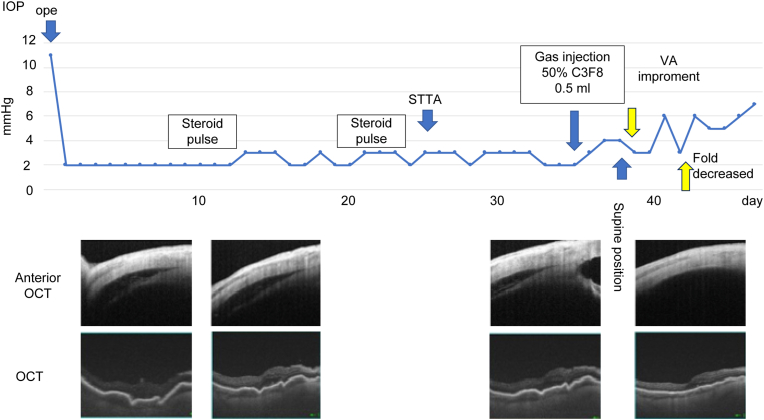
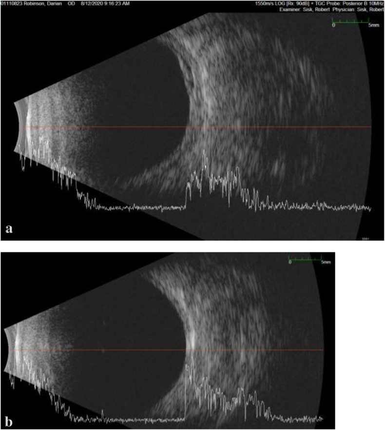
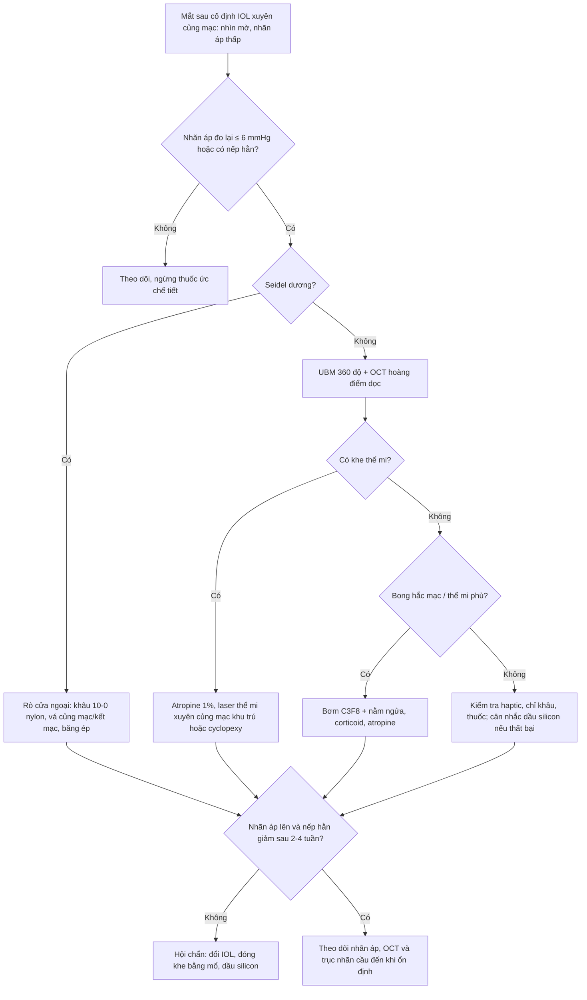
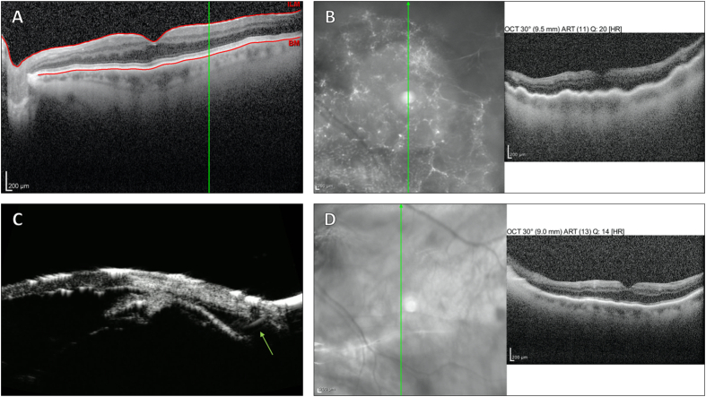
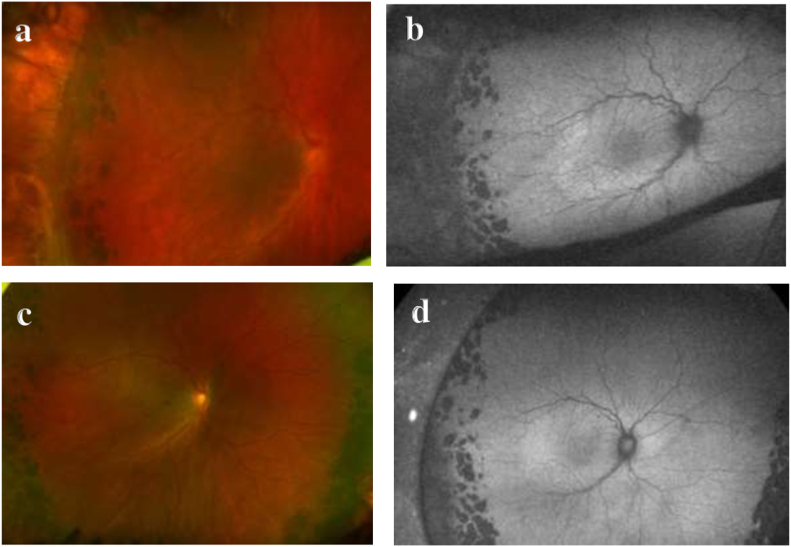

# 3298 — Hạ nhãn áp và bệnh hoàng điểm do hạ nhãn áp sau cố định IOL xuyên củng mạc ở trẻ: vì sao mắt "xẹp" làm nhăn võng mạc, đọc UBM/OCT thế nào, khi nào khâu – bơm khí – laser thể mi

**Tags:** `pattern:ha-nhan-ap` `pattern:nep-han-vong-mac` `pattern:phu-dia-thi` `pattern:bong-hac-mac` `pattern:phu-hoang-diem` `pattern:ro-cung-mac` `pattern:khe-the-mi` `vung:mat` `vung:cung-mac` `vung:hac-mac` `vung:vong-mac` `vung:hoang-diem` `vung:the-thuy-tinh` `vung:tien-phong` `protocol:UBM` `protocol:AS-OCT` `protocol:OCT-hoang-diem` `protocol:sieu-am-B` `protocol:sinh-hien-vi` `protocol:do-nhan-ap` `protocol:IOL-co-dinh-cung-mac` `score:khong-co` `incidentaloma:khong`

**Mức chắc chắn (certainty):** tổng hợp y văn (literature synthesis) — ghép **đoàn hệ nhi** với **ca nguyên văn người lớn** và **cơ chế trên mắt người lớn**. Số liệu nhi: **45 mắt/43 trẻ** cố định củng mạc, **hạ nhãn áp thoáng qua 3 mắt (6,7%)** (Eur J Ophthalmol 2021, **PMID 33073609**, DOI 10.1177/1120672120965493); **33 nghiên cứu/1.531 mắt** 1–18 tuổi: **tăng nhãn áp thoáng qua 8,1%**, **glôcôm 0,31%**, **đứt/ăn mòn chỉ 1,19%**, mổ lại **5,3%** ở nhóm dán keo (Br J Ophthalmol 2026, DOI 10.1136/bjo-2024-327028) — **hạ nhãn áp không nằm trong bộ kết cục**; **36 mắt ectopia lentis**, tuổi trung bình **5,1**, theo dõi **6,5 năm**, sa IOL **14%** (BMC Ophthalmol 2026, **PMC13248399**). Số liệu người lớn: **51 nghiên cứu**, hạ nhãn áp **5,5%** với kỹ thuật đường hầm củng mạc (Surv Ophthalmol 2025, **PMID 39672475**, DOI 10.1016/j.survophthal.2024.12.001); **77 mắt** sau mổ lọc: **14 mắt bệnh hoàng điểm do hạ nhãn áp**, giảm trục nhãn cầu **2,8% so với 0,7%**, **≥ 2% → OR 11,67** (PLoS One 2018, **PMC5786308**); tổng quan định nghĩa/điều trị (Ophthalmol Ther 2015, **PMC4675727**). Ca nguyên văn: **khe thể mi sau Yamane**, UBM và laser thể mi (Am J Ophthalmol Case Rep 2022, **PMC8889342**); **bơm C3F8 + nằm ngửa** (Am J Ophthalmol Case Rep 2022, **PMC8858868**); **trẻ 17 tuổi hạ nhãn áp do chèn ép về đêm** (Am J Ophthalmol Case Rep 2022, **PMC9396541**). Chỗ suy luận từ người lớn sang trẻ ghi **[suy luận]**. **Không ghi tên tác giả** — attribution = **tạp chí + năm + PMCID/DOI**.

> **Câu chốt:** hạ nhãn áp (hypotony) **không phải "nhãn áp thấp" đơn thuần** mà là **mất áp lực xuyên thành** của nhãn cầu: khi áp lực trong mắt thấp hơn áp lực mô quanh mắt, **củng mạc bị ép lún vào trong**, **trục nhãn cầu ngắn lại**, và **hắc mạc–võng mạc bị gấp thành nếp** — đó là **bệnh hoàng điểm do hạ nhãn áp (hypotony maculopathy)**. Vì vậy dấu chốt **không phải một con số nhãn áp** mà là **cặp đôi: nhãn áp thấp + nếp hằn hắc mạc–võng mạc xuyên hoàng điểm**; và trên mắt đã cố định IOL xuyên củng mạc, nguyên nhân **không chỉ là rò vết mổ** mà còn là **lỗ thông nội bộ (khe thể mi)** — **Seidel âm không loại trừ**.

> **Ranh giới với bài đã có:** [3296](../3296-bat-giu-dong-tu-sau-co-dinh-iol-cung-mac-tre/lesson.md) trả lời **mặt TĂNG áp/lệch trục** (bắt giữ đồng tử); [3294](../3294-tre-aphakia-danh-gia-ho-tro-bao-ubm-as-oct/lesson.md) trả lời **chọn mặt phẳng đặt IOL trước mổ**; [1447](../1447-rach-the-mi-sau-migs-va-yamane/lesson.md) trả lời **khe thể mi sau MIGS/Yamane ở người lớn**; [3262](../3262-rach-chan-mong-mat-iridodialysis/lesson.md) và [1498](../1498-sieu-am-bscan-truoc-phaco-hau-doan/lesson.md) trả lời **chấn thương mống mắt** và **siêu âm B trước phaco**. Bài này chỉ trả lời **biến chứng hạ áp sau cố định xuyên củng mạc**: **cơ chế xẹp thành mắt, bộ ba hình ảnh (UBM – OCT hoàng điểm – B-scan), phân biệt 7 nguyên nhân, và trình tự xử lý từ khâu – bơm khí – laser thể mi**.

## 1. Tổng quan bệnh học – cơ chế hình ảnh (TẠI SAO)

### 1.1 Hai ngưỡng, không phải một: hạ nhãn áp "thống kê" và hạ nhãn áp "lâm sàng"

- **Hạ nhãn áp thống kê (statistical hypotony)** = nhãn áp **< 6,5 mmHg**, tức **3 độ lệch chuẩn** dưới giá trị trung bình quần thể (~15,5 mmHg) (PMC4675727). Đây là **định nghĩa để nghiên cứu**, không phải ngưỡng điều trị.
- **Hạ nhãn áp lâm sàng (clinical hypotony)** = nhãn áp **đủ thấp để gây thay đổi cấu trúc hoặc chức năng**: **phù đĩa thị**, **nếp hằn võng mạc–hắc mạc ở cực sau**, **giảm thị lực trung tâm**, **nhìn méo**, **tăng khúc xạ dương (hyperopic shift)** do trục nhãn cầu ngắn lại (PMC4675727).
- **Ngưỡng 6 mmHg không phải chốt tuyệt đối:** trong ca trẻ **17 tuổi** cận thị nặng, **nhãn áp đo 10 mmHg bằng Tonopen** vẫn có **phù đĩa thị + nếp hằn hắc mạc + bong hắc mạc nông** (PMC9396541) — vì hạ áp **từng đợt về đêm** (do chèn ép mắt) mà lần đo ban ngày đã "bình thường". **Đo một lần không loại trừ hạ áp từng đợt.**
- **Tần suất tham chiếu:** bệnh hoàng điểm do hạ nhãn áp gặp tới **20%** sau mổ lọc glôcôm có antimetabolite; **yếu tố nguy cơ: nam, tuổi trẻ, cận thị, mổ lọc nguyên phát** (PMC4675727). **"Tuổi trẻ" và "cận thị" chính là hai đặc điểm của nhóm trẻ được cố định IOL xuyên củng mạc** — nên đây là nhóm **nguy cơ cao về lý thuyết**, dù dữ liệu nhi trực tiếp còn mỏng.

### 1.2 Đường thoát dịch sau cố định xuyên củng mạc: ba cửa, chỉ một cửa "nhìn thấy" bằng Seidel

- **(a) Cửa ngoại (external fistula)** — đường hầm **27–30G xuyên kết mạc–củng mạc** ở chỗ đưa haptic ra, hoặc **vết mổ rìa giác mạc**: dịch đi từ tiền phòng ra dưới kết mạc. **Nghiệm pháp Seidel dương**; tiền phòng **nông**; **không có khe thể mi** trên UBM.
- **(b) Cửa nội (internal fistula)** — **khe thể mi (cyclodialysis cleft)**: đường thông giữa **tiền phòng và khoang trên hắc mạc**. Dịch đi vào khoang trên hắc mạc, **không ra ngoài**, nên **Seidel âm**, kết mạc **không có bọng lọc**, mà **nhãn áp vẫn rất thấp**. Đây là cơ chế trong **cả hai ca Yamane** của PMC8889342: ca 1 Seidel âm, không bọng lọc, **góc tiền phòng tách**; ca 2 **UBM thấy khe thể mi 12 → 2 giờ, haptic nằm trong khoang trên hắc mạc**.
- **(c) Suy thể mi (ciliary shutdown)** — thể mi **không sản xuất đủ thủy dịch** vì **phù/bong thể mi**, viêm, hoặc thuốc ức chế tiết (ức chế beta, ức chế carbonic anhydrase). Hình ảnh: **tiền phòng nông**, **dịch dưới thể mi** trên UBM, **bong hắc mạc**. Ca bơm khí của PMC8858868 là điển hình: bệnh nền **VKH**, sau mổ **nhãn áp 2–4 mmHg kéo dài** dù **hai đợt corticoid pulse**, kèm **tràn dịch hắc mạc** — tức **thể mi bị "ép" bởi dịch**, không phải rò.

> **Hệ quả thực hành:** trên mắt sau cố định xuyên củng mạc, **Seidel âm + không bọng lọc + nhãn áp 2–5 mmHg** là **dấu hiệu của cửa nội hoặc suy thể mi**, không phải "không có nguyên nhân". Bước tiếp theo **bắt buộc là UBM**, không phải "theo dõi thêm".

### 1.3 Vì sao hạ áp làm NHĂN võng mạc: củng mạc lún vào, không phải hắc mạc dày lên

- **Vật lý:** độ căng thành nhãn cầu tỉ lệ với **chênh áp xuyên thành (IOP − áp lực mô hốc mắt)**. Khi IOP giảm về 0–5 mmHg, chênh áp **đảo chiều hoặc gần bằng 0**; **củng mạc — đặc biệt ở mắt trẻ, mỏng và giàu sợi collagen đàn hồi — bị ép lún vào trong**, làm **trục nhãn cầu ngắn lại**.
- **Bằng chứng định lượng:** **77 mắt** sau mổ lọc, **14 mắt** phát triển bệnh hoàng điểm do hạ nhãn áp. Nhóm bệnh có **trục nhãn cầu giảm 2,8%**, nhóm không bệnh **giảm 0,7%**; **không có khác biệt độ dày hắc mạc** giữa hai nhóm. **Tốc độ giảm trục ≥ 2% → nguy cơ bệnh hoàng điểm cao gấp 11,67 lần** (95% CI 1,28–106,6; p = 0,03) (PMC5786308).
- **Điểm phản trực giác:** nếp hằn **không phải do hắc mạc phù dày** đè vào võng mạc, mà do **thành mắt co lại** — nên **đo độ dày hắc mạc một mình không đủ**, phải so **trục nhãn cầu với mốc nền (baseline)** hoặc **so hai mắt**. Trên OCT, nếp hằn biểu hiện **lượn sóng (undulation) của phức hợp võng mạc–RPE–hắc mạc**, thường **tỏa ra từ hoàng điểm** (PMC4675727).
- **Vì sao trẻ nhạy hơn [suy luận]:** củng mạc trẻ **mỏng hơn, ít xơ hóa, đàn hồi cao hơn**, nên **cùng một mức giảm áp lực sẽ làm lún thành nhiều hơn**; cộng thêm **nhãn cầu đang dài ra theo tuổi** nên **giảm trục do hạ áp có thể bị "che" bởi tăng trưởng** nếu chỉ đo tuyệt đối mà không so **%** hoặc so **mắt bên kia**.

### 1.4 Vòng xoáy tự duy trì: hạ áp → tràn dịch hắc mạc → thể mi phù → càng ít thủy dịch

- Hạ áp làm **giãn mạch hắc mạc** và **tăng tính thấm**, dịch thoát vào **khoang trên hắc mạc**; **phù thể mi** làm **giảm tiết thủy dịch**; nhãn áp càng thấp → càng ít tưới máu thể mi hiệu quả → **vòng xoáy** (PMC4675727, PMC8858868).
- **Đo được:** tràn dịch hắc mạc làm **độ dày hắc mạc tăng gấp đôi** — ca trẻ 17 tuổi: **2,3 mm** ở mắt bệnh so với **1,04 mm** ở mắt lành trên siêu âm B; **độ dày hắc mạc dưới hoàng điểm 590 µm → 272 µm chỉ sau 1 tuần** khi loại bỏ nguyên nhân (PMC9396541).
- **Hệ quả:** điều trị **phải cắt vòng xoáy** (đóng cửa rò, đẩy dịch ra khỏi thể mi, giảm viêm) — **không chỉ bù dịch/thuốc nhỏ**. Bơm **C3F8 50%, 1 mL (còn ~0,5 mL, chiếm 30% buồng dịch kính)** rồi cho **nằm ngửa** để **ép thể mi**, đưa nhãn áp **2–4 → 6 mmHg sau 6 ngày**, **8 mmHg lúc 3 tháng** (PMC8858868) là bằng chứng cho chính luận điểm này.

*Ca suy thể mi trên bệnh nền VKH: **ngày 1 sau mổ** có bệnh hoàng điểm do hạ áp + tràn dịch hắc mạc; nhãn áp giữ **2–4 mmHg** dù **hai đợt corticoid pulse**. **C3F8 50% (1 mL, còn ~0,5 mL, 30% buồng dịch kính)** bơm ngày **35**, cho **nằm ngửa từ ngày 3**; **ngày 6** nhãn áp **6 mmHg**, tràn dịch và nếp hằn **hết**. Nguồn: Am J Ophthalmol Case Rep 2022 (PMC8858868), CC BY-NC-ND 4.0 — nguyên bản.*

*Siêu âm B ở trẻ 17 tuổi bị hạ nhãn áp do chèn ép mắt về đêm: **(a) mắt phải** — dịch trong khoang trên hắc mạc, hắc mạc dày **2,3 mm**; **(b) mắt trái** — bình thường, hắc mạc **1,04 mm**. Độ dày hắc mạc gấp đôi là dấu của **tràn dịch**, nhưng **nếp hằn hoàng điểm** trong ca này lại do **thành mắt co lại**, không do hắc mạc dày. Nguồn: Am J Ophthalmol Case Rep 2022 (PMC9396541), CC BY 4.0 — nguyên bản.*

### 1.5 Vì sao trẻ là nhóm "im lặng": ba lý do làm chẩn đoán muộn

- **Trẻ không báo mờ một mắt** khi mắt kia còn tốt, và **nhìn méo (metamorphopsia)** khó diễn đạt trước 6–7 tuổi.
- **Cửa sổ nhược thị:** nếp hằn xuyên hoàng điểm ở trẻ **gây mất thị lực trung tâm đúng vào giai đoạn đang học nhìn**; **mờ kéo dài vài tuần–vài tháng** có thể để lại **nhược thị không hồi phục** dù nhãn áp về bình thường [suy luận từ sinh lý nhược thị, không có số liệu riêng cho hạ áp].
- **Đo nhãn áp ở trẻ khó:** Tonopen cần **hợp tác**, trẻ quấy làm **áp lực mi mắt đè lên** → **đọc cao giả**; ngược lại đo qua **giác mạc mỏng** → **đọc thấp giả**. Vì vậy **một con số Tonopen không đủ**, cần **đo lặp lại, cùng giờ, và đối chiếu cấu trúc**.

## 2. Mẫu hình + chẩn đoán phân biệt theo vị trí (gamut)

**Mẫu hình trung tâm:** *mắt sau cố định IOL xuyên củng mạc, 1 tuần – 3 tháng sau mổ, nhìn mờ dần + méo, nhãn áp thấp, OCT hoàng điểm có nếp hằn.*

Gamut theo **vị trí đường thoát dịch** (chứ không theo mức nhãn áp):

| Vị trí / cơ chế | Thực thể | Dấu chốt hình ảnh | Nhãn áp điển hình |
|---|---|---|---|
| **Cửa ngoại — kết mạc/củng mạc** | Rò đường hầm 27–30G, hở vết mổ rìa, ăn mòn chỉ khâu muộn | **Seidel dương**, tiền phòng **nông**, bọng dịch dưới kết mạc | **1–6 mmHg**, dao động theo chớp mắt |
| **Cửa nội — góc tiền phòng** | **Khe thể mi (cyclodialysis)**, kể cả do **haptic xuyên qua** | **Seidel âm**, UBM thấy **khe giữa củng mạc và thể mi**, đôi khi **haptic trong khoang trên hắc mạc** | **1–6 mmHg**, **rất thấp, khó lên** dù khâu |
| **Thể mi — sản xuất** | Suy thể mi do viêm (VKH, uveitis), thuốc ức chế tiết, phù thể mi | Tiền phòng **nông**, **dịch dưới thể mi**, bong hắc mạc | **2–5 mmHg** |
| **Khoang trên hắc mạc** | Tràn dịch/bong hắc mạc | **B-scan: vòm hắc mạc dày > 2 mm**, không di động theo nhịp tim | Thấp, **kèm tiền phòng nông** |
| **Mặt phẳng IOL** | Haptic/optic cọ thể mi, IOL trôi ra sau | **UBM/AS-OCT: haptic ngoài rãnh**, khe thể mi cạnh haptic | Thấp hoặc **tăng áp** tùy vị trí |
| **Toàn nhãn cầu — giả** | Đo sai (Tonopen qua sẹo, giác mạc mỏng), chèn ép mắt, Valsalva | **Nhãn áp đo lại bình thường**, không nếp hằn | "Thấp" **không tái lập** |
| **Hậu cực — không do hạ áp** | Phù đĩa thị + nếp hằn do **tăng áp nội sọ**, viêm màng bồ đào sau, viêm củng mạc sau, nếp hằn do **tăng khúc xạ dương** | **Nếp hằn cả hai mắt**, đĩa thị phù **hai bên**, **nhãn áp bình thường/cao** | **10–20 mmHg** |

**Nguyên tắc đọc gamut:** hỏi **ba câu theo thứ tự** — (1) nhãn áp thấp có **tái lập** không? (2) Seidel **dương hay âm**? (3) **UBM ở vị trí đưa haptic và 360° góc** có khe thể mi không? Chỉ sau đó mới kết luận "theo dõi".

## 3. Bảng so sánh phân biệt (ma trận đối chiếu)

| Thực thể (entity) | Hình ảnh điển hình | Chốt vào (rule-in) | Chốt loại (rule-out) | Gợi ý xác nhận |
|---|---|---|---|---|
| **Rò cửa ngoại (sclerotomy/wound leak)** | Tiền phòng nông, bọng dịch kết mạc tại vị trí đưa haptic; OCT tiền đoạn thấy **đường hầm hở** | **Seidel dương tại đúng vị trí vết mổ** + nhãn áp thấp tái lập | **Seidel âm** ở mọi vị trí sau khi ấn nhẹ nhãn cầu; **không bọng lọc** | Sinh hiển vi + fluorescein, AS-OCT đường hầm |
| **Khe thể mi (cyclodialysis cleft)** | **Seidel âm**, không bọng lọc, tiền phòng **sâu hoặc nông tùy mức**, **góc tách** trên soi góc | **UBM: khe giữa củng mạc và thể mi**, đo được **độ rộng theo giờ** (ca điển hình **12 → 2 giờ**) | **UBM 360° không thấy khe**; góc đóng đều | **UBM 50 MHz** là chuẩn; soi góc khi trẻ đủ hợp tác/gây mê |
| **Suy thể mi do viêm (VKH, uveitis)** | Tiền phòng nông, **dịch dưới thể mi**, bong hắc mạc, tiền sử viêm | **Bệnh nền viêm + thể mi dày, dịch dưới thể mi**, nhãn áp thấp **sau đợt viêm** | **Không viêm**, UBM thể mi bình thường, Seidel âm và **không khe** | UBM + tiền sử + đáp ứng corticoid |
| **Tràn dịch/bong hắc mạc** | **B-scan: vòm hắc mạc**, dày **> 2 mm**; OCT: lượn sóng hắc mạc | **Vòm hắc mạc trên B-scan**, độ dày **so mắt bên** (ca: **2,3 so với 1,04 mm**) | **Không vòm**, hắc mạc **< 1,5 mm**, không dịch dưới hắc mạc | B-scan 10–20 MHz; OCT đo độ dày hắc mạc dưới hoàng điểm |
| **Haptic/IOL cọ thể mi, trôi ra sau** | **UBM: haptic ngoài rãnh thể mi**, có thể **trong khoang trên hắc mạc**; AS-OCT: nghiêng/lệch | **Haptic nằm ngoài rãnh** trên UBM, kèm khe thể mi **cạnh haptic** | **Haptic trong rãnh/củng mạc**, không khe | UBM động theo hướng nhìn; AS-OCT tiền đoạn |
| **Ăn mòn/đứt chỉ khâu muộn** | Chỉ **lộ qua kết mạc**, đầu chỉ trồi; nhãn áp thấp **xuất hiện muộn** (hàng tháng–năm) | **Thấy chỉ lộ** + Seidel dương tại đầu chỉ; **1,19%** đứt/ăn mòn trong đoàn hệ nhi | **Không thấy chỉ**, nhãn áp thấp **ngay sau mổ** | Sinh hiển vi, chụp AS-OCT vùng chỉ |
| **Hạ nhãn áp do thuốc** | Giác mạc trong, tiền phòng **sâu**, không viêm, **đang dùng thuốc ức chế tiết** | **Ngừng thuốc → nhãn áp tăng trong 1–2 tuần** | Vẫn thấp sau khi ngừng **≥ 2 tuần**, có nếp hằn | Rà đơn thuốc; theo dõi nhãn áp sau ngừng |
| **Nếp hằn không do hạ áp (IIH, viêm củng mạc sau)** | **Nếp hằn hai mắt**, đĩa thị phù hai bên; có **đau/giảm thị lực thị trường** | **Nhãn áp bình thường/cao** + phù đĩa thị **hai bên** + hình ảnh MRI/áp lực dịch não tủy | **Nhãn áp thấp tái lập**, **một mắt**, có **khe/rò** | Đo nhãn áp 2 mắt, soi đáy; MRI sọ khi nghi IIH |

## 4. Protocol chụp + hệ phân độ/điểm chuẩn hóa

### 4.1 Trình tự khám một mắt sau cố định xuyên củng mạc nghi hạ áp

1. **Nhãn áp:** Tonopen/Perkins, **đo 2 lần cách nhau ≥ 5 phút**, cùng **giờ trong ngày**, ghi **tư thế và mức hợp tác**; nếu < 10 mmHg → **đo lại ngày khác** và **đo cả mắt bên**. Ngưỡng hành động: **≤ 6 mmHg** hoặc **bất kỳ mức nào kèm nếp hằn hoàng điểm**.
2. **Nghiệm pháp Seidel:** fluorescein 2%, **ấn nhẹ nhãn cầu qua mi** ở **từng vị trí đưa haptic** và vết mổ rìa. **Seidel dương** = cửa ngoại.
3. **Sinh hiển vi:** độ sâu tiền phòng, mống mắt, **vị trí haptic** (thấy qua retroillumination), **chỉ khâu lộ**, **bọng kết mạc**.
4. **AS-OCT tiền đoạn:** độ sâu tiền phòng, **đường hầm củng mạc**, độ nghiêng/lệch IOL (**bổ sung, không thay UBM**).
5. **UBM 50 MHz — bắt buộc khi Seidel âm:** quét **360°**, đo **khe thể mi theo giờ**, xác định **haptic có nằm trong khoang trên hắc mạc** không, đo **dịch dưới thể mi**.
6. **Siêu âm B:** khi **không thấy đáy mắt** hoặc nghi **bong hắc mạc**; đo **độ dày hắc mạc** và **so mắt bên** (ngưỡng tham chiếu ca: **> 2 mm**).
7. **OCT hoàng điểm (SD-OCT):** **luôn dùng raster dọc (vertical raster)** — nếp hằn **ngang** có thể bị bỏ sót trên raster ngang; ghi **độ dày hắc mạc dưới hoàng điểm**, **tổn thương tế bào cảm quang (photoreceptor)**.
8. **Sinh trắc trục nhãn cầu:** so **%** với **baseline trước mổ** hoặc **mắt bên**; **giảm ≥ 2%** là ngưỡng gợi ý mạnh (**OR 11,67**).

### 4.2 Phân độ thao tác (không phải thang đã được validate) — dùng để quyết định, ghi rõ **[suy luận]**

| Độ | Nhãn áp | OCT hoàng điểm | Hắc mạc/B-scan | Thái độ |
|---|---|---|---|---|
| **0 — nghi ngờ** | 7–9 mmHg | Bình thường | Bình thường | Ngừng thuốc ức chế tiết, đo lại 3–7 ngày |
| **1 — hạ áp chưa có bệnh hoàng điểm** | ≤ 6 mmHg | Bình thường | Có thể có dịch mỏng | Tìm cửa rò/khe; điều trị nguyên nhân **trong 1–2 tuần** |
| **2 — bệnh hoàng điểm do hạ áp** | ≤ 6 mmHg **hoặc** bất kỳ mức + nếp hằn | **Nếp hằn xuyên hoàng điểm** | Có thể kèm tràn dịch | **Can thiệp** (khâu/bơm khí/laser) — không chờ quá **2–4 tuần** |
| **3 — hạ áp nặng** | ≤ 3 mmHg | Nếp hằn + **mất liên tục photoreceptor** | **Bong hắc mạc**, tiền phòng **nặng** | Can thiệp sớm ± **dầu silicon**; tiên lượng thị lực kém hơn |

### 4.3 Sơ đồ xử lý

### 4.4 Ngưỡng và mốc thời gian cần nhớ

- **Nhãn áp:** **< 6,5 mmHg** = hạ áp thống kê; **≤ 6 mmHg kéo dài > 1 tuần** = cần tìm nguyên nhân; **≤ 3 mmHg** = nguy cơ cao.
- **Trục nhãn cầu:** **giảm ≥ 2%** so baseline/mắt bên → **OR 11,67** cho bệnh hoàng điểm (PMC5786308).
- **Hắc mạc:** **> 2 mm** trên B-scan gợi ý tràn dịch (ca: **2,3 so với 1,04 mm**); **590 → 272 µm** sau **1 tuần** khi giải quyết nguyên nhân.
- **Thời gian vàng:** nếp hằn **mới < 4 tuần** có khả năng hồi phục cao hơn; **> 3 tháng** thường để lại **mất liên tục photoreceptor** [suy luận từ diễn tiến ca và sinh lý võng mạc].
- **Không có thang điểm chuẩn** cho hạ áp sau cố định IOL — mọi "phân độ" ở §4.2 là **công cụ giao tiếp nội bộ**, không phải guideline.

## 5. Biến thể bình thường và cạm bẫy

- **Nhãn áp 7–9 mmHg ngay sau mổ là biến thể thường gặp**, do **thuốc tê/căng chỉ khâu/tồn dư nhầy**; **không được gọi là hạ áp** nếu không có nếp hằn và tự lên trong **3–7 ngày**. Điều trị quá tay (bơm khí sớm) có thể gây **tăng nhãn áp** — ca laser thể mi đã có **nhãn áp 50 mmHg sau 9 ngày** (PMC8889342), cho thấy **cả hai phía đều nguy hiểm**.
- **Cạm bẫy 1 — "nhãn áp 10 mmHg nên loại trừ hạ áp":** ca trẻ 17 tuổi có **nếp hằn + bong hắc mạc với nhãn áp 10 mmHg** vì hạ áp **từng đợt về đêm** (PMC9396541). **Đo ban ngày bình thường không loại trừ**; hỏi **thói quen tư thế ngủ, đeo kính bó sát, chèn ép mắt**.
- **Cạm bẫy 2 — "Seidel âm nên không rò":** **khe thể mi là cửa nội**, Seidel luôn âm. Ca 1 của PMC8889342 có **Seidel âm, không bọng lọc**, vẫn **nhãn áp 5–6 mmHg** và **nếp hằn**; chỉ UBM mới thấy khe.
- **Cạm bẫy 3 — chỉ chụp OCT raster ngang:** nếp hằn **chạy dọc** có thể **nằm ngoài mặt cắt ngang**; dùng **raster dọc** (PMC8044648) và **en-face/UWF** khi cần.
- **Cạm bẫy 4 — nhầm nếp hằn do hạ áp với phù đĩa thị hai bên do tăng áp nội sọ:** phù đĩa thị **hai bên + nếp hằn hai mắt + nhãn áp bình thường** → nghĩ **IIH/viêm**, không phải hạ áp; **nhãn áp thấp một mắt** mới là hạ áp.
- **Cạm bẫy 5 — "đã tìm thấy IOL lệch nên dừng lại":** IOL lệch và hạ áp **có thể cùng tồn tại**; sau khi phát hiện lệch phải **vẫn đo nhãn áp + OCT hoàng điểm**, tránh **satisfaction of search**.
- **Cạm bẫy 6 — corticoid kéo dài:** corticoid **giảm viêm nhưng làm chậm lành vết mổ**, có thể **duy trì rò**; ca bơm khí đã **thất bại với hai đợt corticoid pulse** trước khi can thiệp cơ học (PMC8858868). Cân nhắc **giảm corticoid + đóng cửa rò** thay vì tăng liều.
- **Biến thể bình thường cần phân biệt:** **nếp hằn hắc mạc nhẹ sau cắt dịch kính** ở mắt **đã có từ trước** (ca 2 của PMC8889342 có **nếp hằn nhẹ với nhãn áp 9 mmHg từ 2 năm trước**) — **so ảnh cũ** trước khi quy cho biến chứng mới.

## 6. Tự lượng giá — Blind Quiz ngay trên trang tĩnh

**Ca 1 — trẻ/người trẻ sau cố định IOL xuyên củng mạc, mờ dần 1 tháng**

- Gợi ý lâm sàng: bệnh nhân **37 tuổi**, tiền sử **chấn thương đạn bi** ở mắt trái, đã **cắt dịch kính + đặt Yamane** vì **đục lệch thể thủy tinh**; **1 tháng sau mổ** nhìn mờ, **nhãn áp 6 mmHg**, **Seidel âm**, **không bọng lọc**.
- Câu hỏi: (1) Mô tả **hai** dấu hiệu trên OCT hoàng điểm. (2) Hình C trên UBM cho thấy gì, và vì sao **Seidel âm** mà vẫn hạ áp? (3) Ba chẩn đoán phân biệt và **dấu nào chốt**?

<b>Bấm để hiện đáp án (findings + chẩn đoán)</b>

- **Dấu hiệu:** (A) OCT **2 năm trước mổ** — nếp hằn hắc mạc **nhẹ**, nhãn áp **9 mmHg**; (B) **1 tháng sau Yamane** — **nếp hằn hắc mạc–võng mạc thô xuyên hoàng điểm**; (C) UBM — **khe thể mi từ 12 đến 2 giờ**, **haptic thì giờ nằm trong khoang trên hắc mạc** (mũi tên xanh); (D) **4 tháng sau laser thể mi lần 2** — nếp hằn **cải thiện**.
- **Chẩn đoán:** **hạ nhãn áp + bệnh hoàng điểm do hạ nhãn áp, nguyên nhân là khe thể mi sau Yamane**. **Seidel âm** vì đây là **cửa nội** (tiền phòng → khoang trên hắc mạc), không phải rò ra ngoài.
- **Vì sao:** mất áp lực xuyên thành → củng mạc lún → nếp hằn; khe thể mi làm dịch thoát **liên tục vào khoang trên hắc mạc** nên nhãn áp **không tự hồi phục**.
- **Nguồn ảnh:** Am J Ophthalmol Case Rep 2022 (PMC8889342), CC BY-NC-ND 4.0 — nguyên bản.

**Ca 2 — trẻ 17 tuổi, nhãn áp 10 mmHg mà vẫn nhăn võng mạc**

- Gợi ý lâm sàng: nam **17 tuổi**, **cận thị nặng −14 D**, tiền sử **laser võng mạc vì ROP**; **đau âm ỉ + mờ mắt phải 2 ngày**; **nhãn áp 10 mmHg** (Tonopen), mắt trái **15 mmHg**.
- Câu hỏi: (1) Mô tả đáy mắt và huỳnh quang tự thân. (2) Vì sao **nhãn áp 10 mmHg** không loại trừ hạ nhãn áp? (3) Nguyên nhân nào **không phải phẫu thuật** trong ca này?

<b>Bấm để hiện đáp án (findings + chẩn đoán)</b>

- **Dấu hiệu:** (a) **phù đĩa thị + nếp hằn hắc mạc chu vi** hướng về **bong hắc mạc nông phía trên thái dương**; võng mạc ngoại vi **đã laser/lạnh**; (b) **FAF** làm rõ **các vệt nếp hằn**; (c, d) **sau 1 tuần** — đĩa thị và nếp hằn **hết**.
- **Chẩn đoán:** **bệnh hoàng điểm do hạ nhãn áp do chèn ép mắt về đêm** — bệnh nhân **đeo tai nghe bó sát (circumaural) khi ngủ**, gây **hạ áp từng đợt**; bỏ được thói quen là **hết**, không cần can thiệp.
- **Cạm bẫy:** **nhãn áp 10 mmHg đo ban ngày**; hạ áp xảy ra **về đêm** → **đo một lần không loại trừ**. Phải hỏi **tư thế ngủ, vật chèn ép, kính bảo hộ**.
- **Nguồn ảnh:** Am J Ophthalmol Case Rep 2022 (PMC9396541), CC BY 4.0 — nguyên bản.

**Ca 3 — sau mổ, tiền phòng nông, không thấy đáy mắt**

- Gợi ý lâm sàng: cùng bệnh nhân ca 2; **không quan sát rõ đáy mắt** vì đồng tử nhỏ và **ROP đã laser**; siêu âm B **hai mắt**.
- Câu hỏi: (1) Dấu hiệu trên B-scan? (2) Phân biệt **bong hắc mạc** với **bong võng mạc** trên B-scan? (3) Độ dày hắc mạc **2,3 mm** gợi ý gì?

<b>Bấm để hiện đáp án (findings + chẩn đoán)</b>

- **Dấu hiệu:** (a) mắt phải — **vòm hắc mạc dày, dịch dưới hắc mạc**, độ dày **2,3 mm**; (b) mắt trái — **1,04 mm**, bình thường.
- **Phân biệt:** **bong hắc mạc** = **vòm dày, trơn, không di động theo nhịp tim, chạm ora serrata**, kèm **dịch dưới hắc mạc**; **bong võng mạc** = **màng mỏng, gấp nếp, di động**, **dính vào đĩa thị/ora**, có **dịch dưới võng mạc**.
- **Ý nghĩa:** **2,3 so với 1,04 mm** — hắc mạc **dày gấp đôi** là dấu **tràn dịch** do hạ áp; **nhưng** nếp hằn hoàng điểm trong ca này do **thành mắt co**, vì **độ dày hắc mạc không phải yếu tố quyết định** (PMC5786308).
- **Nguồn ảnh:** Am J Ophthalmol Case Rep 2022 (PMC9396541), CC BY 4.0 — nguyên bản.

## 7. Câu hỏi nghiên cứu & điểm chưa đồng thuận (tính đến 11/2026)

1. **[Tranh cãi] Ở trẻ cố định IOL xuyên củng mạc không khâu, khâu gia cố đường hầm củng mạc dự phòng có giảm hạ nhãn áp sau mổ so với chỉ kiểm tra kín nước bằng Seidel không?**
   - **Đã biết:** đoàn hệ nhi **45 mắt** có **hạ nhãn áp thoáng qua 3 mắt (6,7%)**; phân tích gộp **51 nghiên cứu** người lớn báo **hạ nhãn áp 5,5%** với kỹ thuật đường hầm củng mạc; phân tích gộp **33 nghiên cứu/1.531 mắt** nhi **không đưa hạ nhãn áp vào bộ kết cục** (chỉ báo tăng nhãn áp thoáng qua **8,1%**).
   - **Chưa rõ:** chưa có thử nghiệm so **khâu gia cố** với **chỉ kiểm tra Seidel**, và chưa rõ **tỉ lệ hạ nhãn áp thật** ở trẻ vì định nghĩa/kết cục không thống nhất.
   - **Hướng nghiên cứu:** RCT hoặc đoàn hệ tiến cứu đa trung tâm ở trẻ, kết cục **nhãn áp ≤ 6 mmHg kéo dài > 1 tuần** và **nếp hằn trên OCT**.
   - **Nguồn:** PMID 33073609 (DOI 10.1177/1120672120965493); PMID 39672475 (DOI 10.1016/j.survophthal.2024.12.001); DOI 10.1136/bjo-2024-327028.

2. **[Khoảng trống] Ngưỡng giảm trục nhãn cầu và độ dày hắc mạc dưới hoàng điểm ở trẻ sau cố định IOL — bao nhiêu là "bệnh hoàng điểm do hạ áp"?**
   - **Đã biết:** ở người lớn, **giảm trục ≥ 2%** cho **OR 11,67**; nếp hằn xuất hiện khi **nhãn áp thấp kéo dài**, và **độ dày hắc mạc không khác** giữa nhóm có/không bệnh.
   - **Chưa rõ:** trẻ **đang dài trục sinh lý** nên **ngưỡng %** có thể khác; chưa có **giá trị tham chiếu độ dày hắc mạc theo tuổi** cho trẻ sau mổ, và ca trẻ **17 tuổi** cho thấy **nhãn áp 10 mmHg vẫn có bệnh**.
   - **Hướng nghiên cứu:** nghiên cứu chẩn đoán (diagnostic accuracy) với **OCT dọc + sinh trắc trục** so **mắt bên** làm chuẩn, xây **đường cong theo tuổi**.
   - **Nguồn:** PMC5786308 (DOI 10.1371/journal.pone.0191862); PMC9396541 (DOI 10.1016/j.ajoc.2022.101680); PMC4675727 (DOI 10.1007/s40123-015-0037-z).

3. **[Khác biệt thực hành] Khe thể mi sau cố định IOL: laser thể mi xuyên củng mạc khu trú, bơm khí + nằm ngửa, hay cyclopexy mổ — thực hành khác nhau vì thiếu so sánh trực tiếp.**
   - **Đã biết:** **laser thể mi khu trú** đóng khe ở **2 ca** (nhãn áp **5–6 → 20 mmHg**, **1–4 → 9–14 mmHg**), có ca **tăng nhãn áp 50 mmHg** sau laser; **bơm C3F8 50% + nằm ngửa** đưa nhãn áp **2–4 → 6 mmHg sau 6 ngày**, **8 mmHg lúc 3 tháng**; **cyclopexy** là lựa chọn mổ cho khe lớn nhưng **không có số liệu nhi**.
   - **Chưa rõ:** **khe rộng bao nhiêu (theo giờ)** thì laser thất bại và cần mổ; **thời điểm** can thiệp tối ưu; **nguy cơ tăng nhãn áp** sau laser.
   - **Hướng nghiên cứu:** registry đa trung tâm ghi **độ rộng khe, phương pháp, nhãn áp 1–3–6 tháng**; thử nghiệm so **laser sớm** với **theo dõi 2 tuần**.
   - **Nguồn:** PMC8889342 (DOI 10.1016/j.ajoc.2022.101457); PMC8858868 (DOI 10.1016/j.ajoc.2022.101385).

## Bài liên quan chéo
- [3296 – Bắt giữ đồng tử sau cố định IOL xuyên củng mạc ở trẻ](../3296-bat-giu-dong-tu-sau-co-dinh-iol-cung-mac-tre/lesson.md)
- [3294 – Trẻ aphakia: đánh giá hỗ trợ bao bằng UBM/AS-OCT](../3294-tre-aphakia-danh-gia-ho-tro-bao-ubm-as-oct/lesson.md)
- [1447 – Rách thể mi sau MIGS và Yamane](../1447-rach-the-mi-sau-migs-va-yamane/lesson.md)
- [1498 – Siêu âm B trước phaco ở mắt hậu đoạn](../1498-sieu-am-bscan-truoc-phaco-hau-doan/lesson.md)
- [3262 – Rách chân mống mắt (iridodialysis)](../3262-rach-chan-mong-mat-iridodialysis/lesson.md)
- [416 – Dị tật tiền phòng ở trẻ](../416-di-tat-tien-phong-o-tre/lesson.md)
- [3105 – Tràn khí ở mắt sau chấn thương gò má](../3105-tran-khi-o-mat-sau-cham-thuong-go-ma/lesson.md)
- [400 – Tổng quan Mắt & thị giác](../400-tong-quan-mat-thi-giac/lesson.md)

## Ảnh
- `3298_ha-nhan-ap_OCT-UBM_PMC8889342-Fig2.jpg` — OCT hoàng điểm trước/sau + UBM khe thể mi (CC BY-NC-ND 4.0, **nguyên bản**).
- `3298_ha-nhan-ap_Optos-FAF_PMC9396541-Fig1.jpg` — đáy mắt góc rộng + FAF trước/sau (CC BY 4.0).
- `3298_ha-nhan-ap_Bscan_PMC9396541-Fig2.jpg` — siêu âm B hai mắt, độ dày hắc mạc (CC BY 4.0).
- `3298_ha-nhan-ap_OCT-PE_PMC8858868-Fig2.jpg` — OCT/đáy mắt trước và sau bơm C3F8 (CC BY-NC-ND 4.0, **nguyên bản**).
- Nguồn, giấy phép và nội dung từng ảnh: `images/CREDITS.md`; link gốc: `sources.md`.

> Không dùng để chẩn đoán độc lập khi chưa có người hướng dẫn.
