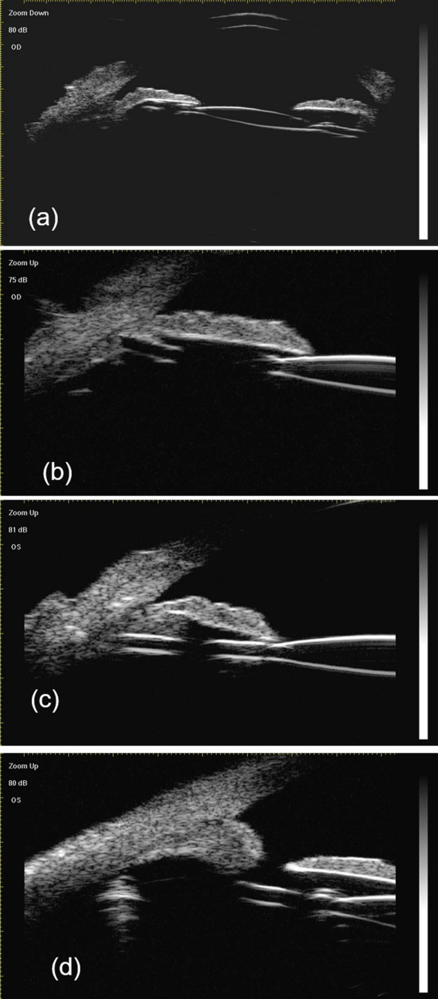
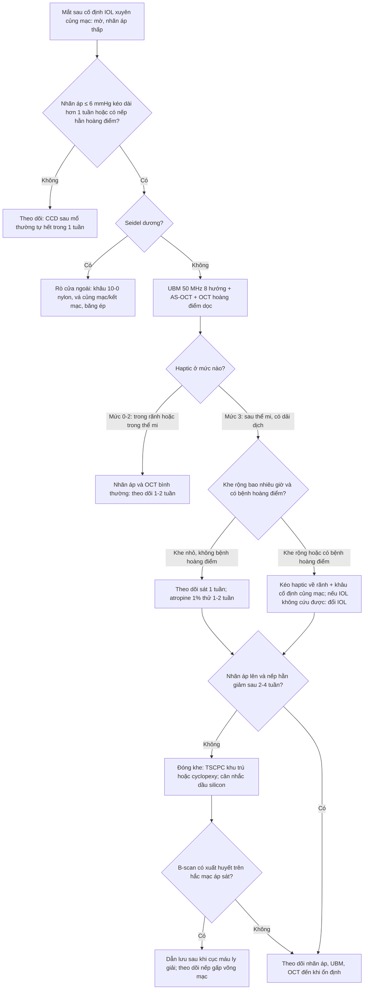
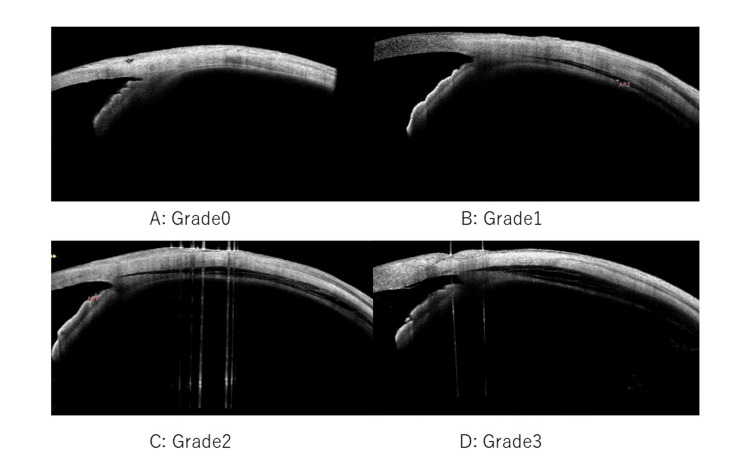
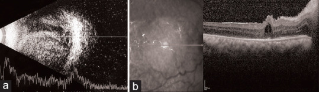

# 3299 — Haptic IOL trong khoang trên hắc mạc sau cố định xuyên củng mạc: vì sao haptic thành "nẹp" giữ khe thể mi, đọc UBM 50 MHz thế nào, khi nào kéo về rãnh – đổi IOL

**Tags:** `pattern:haptic-ngoai-cung-mac` `pattern:khe-the-mi` `pattern:ha-nhan-ap` `pattern:bong-the-mi` `pattern:xuat-huyet-tren-hac-mac` `pattern:iol-nghieng-lech` `pattern:haptic-gay` `pattern:mat-co-dinh-iol` `vung:mat` `vung:cung-mac` `vung:the-mi` `vung:hac-mac` `vung:vong-mac` `vung:tien-phong` `vung:the-thuy-tinh` `anatomy:khoang-tren-hac-mac` `protocol:UBM` `protocol:AS-OCT` `protocol:sieu-am-B` `protocol:OCT-hoang-diem` `protocol:sinh-hien-vi` `protocol:soi-goc` `protocol:do-nhan-ap` `protocol:IOL-co-dinh-cung-mac` `score:khong-co` `incidentaloma:khong`

**Mức chắc chắn (certainty):** tổng hợp y văn (literature synthesis) — ghép **nghiên cứu UBM 65 mắt** về vị trí haptic sau cố định củng mạc có chỉ (BMC Ophthalmol 2025, **PMC12752167**, DOI 10.1186/s12886-025-04504-y), **đoàn hệ 45 mắt** về bong thể mi–hắc mạc (CCD) sau Yamane (Cureus 2024, **PMC11316275**, DOI 10.7759/cureus.66562), **ca nguyên văn haptic trong khoang trên hắc mạc** (Am J Ophthalmol Case Rep 2022, **PMC8889342**, DOI 10.1016/j.ajoc.2022.101457), **loạt 3 ca xuất huyết trên hắc mạc sau cố định không chỉ** (Saudi J Ophthalmol 2023, **PMC10032286**, DOI 10.4103/sjopt.sjopt_23_20), tổng quan kỹ thuật (Indian J Ophthalmol 2025, **PMC12356440**, DOI 10.4103/ijo.ijo_2812_24; Eye Vis 2024, **PMC11684149**, DOI 10.1186/s40662-024-00414-0) và các phân tích gộp về hạ nhãn áp (**PMID 39672475**, DOI 10.1016/j.survophthal.2024.12.001) và kết cục nhi (**DOI 10.1136/bjo-2024-327028**). Chỗ suy luận từ người lớn sang trẻ hoặc từ hình ảnh sang quyết định mổ ghi **[suy luận]**. **Không ghi tên tác giả** — attribution = **tạp chí + năm + PMCID/DOI**.

> **Câu chốt:** sau cố định IOL xuyên củng mạc, **haptic đi ra ngoài củng mạc theo một đường hầm**; nếu đường hầm **quá sâu hoặc quá ra sau**, haptic có thể nằm **giữa củng mạc và hắc mạc** — tức **khoang trên hắc mạc**. Ở đó haptic **không chỉ là "dị vật vô hại"**: nó **chống thẳng thể mi ra khỏi củng mạc** như một **nẹp (stent)**, tạo **khe thể mi kiểu cyclodialysis** làm thủy dịch chảy liên tục vào khoang trên hắc mạc → **hạ nhãn áp kéo dài, bệnh hoàng điểm do hạ áp**. Vì vậy **Seidel âm, không bọng lọc và soi góc bình thường đều không loại trừ**; **UBM 50 MHz là khảo sát quyết định**, và **khâu cửa vào không giải quyết được** nếu haptic vẫn nằm ngoài củng mạc.

> **Ranh giới với bài đã có:** [3298](../3298-ha-nhan-ap-hoang-diem-sau-co-dinh-iol-tre/lesson.md) trả lời **hội chứng hạ nhãn áp** (cơ chế thành mắt lún vào, bộ ba UBM–OCT–B-scan, khâu – bơm khí – laser thể mi); [3296](../3296-bat-giu-dong-tu-sau-co-dinh-iol-cung-mac-tre/lesson.md) trả lời **bắt giữ đồng tử**; [3294](../3294-tre-aphakia-danh-gia-ho-tro-bao-ubm-as-oct/lesson.md) trả lời **chọn mặt phẳng đặt IOL trước mổ**; [1447](../1447-rach-the-mi-sau-migs-va-yamane/lesson.md) trả lời **khe thể mi sau MIGS/Yamane ở người lớn**. Bài này chỉ trả lời **vị trí của chính haptic**: **đọc UBM để phân độ haptic theo 4 mức, phân biệt haptic trong rãnh – trong thể mi – sau thể mi/khoang trên hắc mạc – dưới kết mạc – haptic gãy**, và **quyết định theo dõi, kéo haptic về rãnh, đóng khe hay đổi IOL**.

## 1. Tổng quan bệnh học – cơ chế hình ảnh (TẠI SAO)

### 1.1 Đường đi giải phẫu của haptic: ba lớp và một khoang "tiềm tàng"

- **Đường chuẩn của Yamane:** kim **30G** xuyên **củng mạc – kết mạc cách rìa giác mạc 2 mm**, đưa haptic ra ngoài, hơ nóng đầu haptic thành **"flange"** rồi rút vào **đường hầm trong củng mạc** (PMC11316275 mô tả kỹ thuật 2 mm sau rìa; PMC11684149 tổng quan các biến thể).
- **Ba lớp phải xuyên qua:** **củng mạc** → **thể mi/pars plana** → **khoang trên hắc mạc** (khoang tiềm tàng giữa củng mạc và hắc mạc, chứa **động mạch mi dài sau** và thần kinh mi dài). **Động mạch mi dài sau** đi vào củng mạc ở **3 và 9 giờ**, chạy **giữa củng mạc và hắc mạc** ra trước để tạo **vòng mạch mi lớn** ở chân mống mắt (PMC10032286).
- **Vì sao vị trí haptic quyết định bệnh:** haptic là **thanh cứng dài 6–13 mm** tùy IOL. Nếu nó nằm **trong đường hầm củng mạc**, mô sợi bao quanh sẽ **bít kín**. Nếu nó **nằm ngoài củng mạc**, nó **không có mô nào bít** và **ép thể mi/hắc mạc ra khỏi thành mắt** — đó là **khe thể mi do haptic (haptic-induced cyclodialysis-like cleft)** (PMC8889342).

### 1.2 TẠI SAO haptic gây hạ nhãn áp: "nẹp" giữ khe mở, không phải rò ra ngoài

- **Cơ chế một chiều:** thủy dịch từ **tiền phòng** đi qua **khe thể mi** vào **khoang trên hắc mạc**; vì khoang này **không thông ra ngoài**, **không có bọng lọc**, **nghiệm pháp Seidel âm**. Nhãn áp vẫn **1–6 mmHg** vì dịch **thoát khỏi tuần hoàn trong mắt** qua con đường **hấp thu trên hắc mạc** (uveoscleral outflow) và vì **thể mi bị tách** làm **giảm sản xuất thủy dịch** (PMC11316275, PMC8889342).
- **TẠI SAO atropine thất bại:** atropine làm **giãn cơ thể mi**, nhưng **không thể ép cơ thể mi trở lại củng mạc** khi **thanh haptic nằm giữa hai lớp**; ca 2 của PMC8889342 được **atropine nhưng nhãn áp vẫn 1–4 mmHg** và **bơm BSS vào tiền phòng không tạo bọng** — chứng tỏ **cửa là nội bộ, không phải rò ngoài**.
- **Định lượng "bình thường" của CCD sau Yamane:** **25 mắt Yamane** có **20 mắt (80%) CCD ngày 1**, so với **12/20 (60%)** ở nhóm chứng mổ dịch kính; nhãn áp ngày 1 **8,4 ± 4,3 so với 11,5 ± 5,0 mmHg** (p = 0,037); **nhãn áp ≤ 5 mmHg gặp 7/25 (28%) so với 1/20 (5%)**; nhưng **CCD chỉ còn 2/25 (8%) sau 1 tháng** và **nhãn áp về bình thường sau 1 tuần** (PMC11316275). **Hệ quả:** **CCD ngày 1 là chuyện thường**, không đồng nghĩa haptic lạc; **hạ nhãn áp kéo dài > 1 tuần + bệnh hoàng điểm** mới là dấu hiệu **cơ chế cơ học**.
- **Tần suất hạ nhãn áp "thật":** phân tích gộp **51 nghiên cứu** cố định xuyên củng mạc không chỉ báo **hạ nhãn áp 5,5%** với kỹ thuật đường hầm củng mạc (PMID 39672475); một số đoàn hệ nhỏ báo **11,11%** (5/45 mắt) với **intrascleral haptic fixation** (PMC12356440, bảng tổng hợp).

### 1.3 TẠI SAO phải dùng UBM: ba lớp nằm sau mống mắt, ngoài tầm AS-OCT

- **UBM 50–100 MHz** có **độ phân giải trục 20–50 µm** nhưng **độ xuyên chỉ 4–5 mm** — vừa đủ nhìn **củng mạc, thể mi, khoang trên hắc mạc, chân mống mắt** (Biomed Eng Online 2026, **PMC13689183**). Đây là **công cụ duy nhất** phân biệt **haptic trong rãnh** với **haptic sau thể mi** ở giường bệnh.
- **AS-OCT** nhìn tốt **giác mạc – tiền phòng – đường hầm củng mạc trước**, nhưng **bị mống mắt chắn** và **không xuống được sau thể mi**; **siêu âm B 10–20 MHz** nhìn được **hắc mạc – võng mạc** nhưng **không đủ phân giải** để tách **haptic** khỏi **thể mi**. Vì vậy **B-scan dùng để tìm xuất huyết/bong võng mạc**, **không dùng để định vị haptic** [suy luận từ vật lý sóng âm, phù hợp mô tả PMC8889342].
- **Soi góc (gonioscopy) chỉ thấy phần trước:** trong ca haptic lạc, soi góc có thể **bình thường** vì **khe nằm sau chân mống mắt** — tác giả PMC8889342 viết rõ **"gonioscopy can only be used to rule out an anterior cleft; anterior ultrasonography may assist in diagnosis"**.

### 1.4 Phân độ vị trí haptic trên UBM — 4 mức, và mức 3 là "vùng cửa ngõ" của khoang trên hắc mạc

- Nghiên cứu **65 mắt/64 bệnh nhân**, **130 haptic** sau cố định củng mạc có chỉ, chụp UBM **mặt cắt trung tâm + 8 hướng**, phân độ:
  - **0 = sau mống mắt** — **3/130 (2,31%)**;
  - **1 = trong rãnh thể mi** — **75/130 (57,69%)**;
  - **2 = trong thể mi (ciliary process)** — **26/130 (20,00%)**;
  - **3 = sau thể mi (posterior to the ciliary process / phía pars plana)** — **26/130 (20,00%)** (PMC12752167).
- **Hai haptic bất đối xứng ở 33/65 mắt (50,77%)**; **chênh lệch vị trí haptic liên quan nghiêng dọc IOL**: **β = 1,72 (95% CI 0,65–2,79; p = 0,002)**; **trục nhãn cầu dài liên quan lệch ngang**: **r = 0,37; p = 0,011** (PMC12752167).
- **Điểm cần nói chính xác:** **mức 3 không đồng nghĩa "haptic trong khoang trên hắc mạc"** — nghiên cứu này mô tả **vị trí sau thể mi**, còn **haptic thực sự nằm trong khoang dịch trên hắc mạc** là **phát hiện ở mức ca** (PMC8889342). Tuy vậy **mức 3 là nhóm nguy cơ cao nhất** vì đó là **con đường giải phẫu dẫn vào khoang trên hắc mạc**.

### 1.5 Hậu quả nặng: xuất huyết trên hắc mạc, bong võng mạc, gãy haptic

- **Xuất huyết trên hắc mạc (suprachoroidal hemorrhage, SCH):** **3/572 (0,52%)** ca cố định không chỉ tại một trung tâm; **tỉ lệ sau cố định có chỉ được báo tới 3%** (PMC10032286). Cơ chế: **rạch củng mạc quá sâu làm tổn thương vòng mạch mi** + **hạ nhãn áp ngay sau mổ** làm **chênh áp xuyên thành mạch mi** → mạch vỡ. Ca nặng: **SCH trung tâm áp sát (appositional)** → **dẫn lưu sau khi cục máu ly giải**, thị lực cuối **6/18** vì **nếp gấp võng mạc qua hoàng điểm**.
- **Bong võng mạc do rách (rhegmatogenous RD):** **22/1.311 mắt (1,7%)** sau **PPV + cố định IOL không chỉ**; **76,2% gắn võng mạc**, **66,7% chỉ cần một lần mổ** (Indian J Ophthalmol 2020, **PMC7574060**, DOI 10.4103/ijo.ijo_1974_19).
- **Gãy haptic–optic:** **5 ca** với IOL **CT Lucia 602**, **2 ca đứt hẳn optic** phải **đổi IOL**, **3 ca nứt vi thể**; tất cả ở **vị trí nối haptic trước** (J Ophthalmic Vis Res 2025, **PMC12415495**, DOI 10.18502/jovr.v20.16422). Đây là **chẩn đoán phân biệt với "haptic lạc"**: **mảnh haptic gãy** có thể **trôi vào dịch kính**, trông như **dị vật**.

## 2. Mẫu hình + chẩn đoán phân biệt theo vị trí (gamut)

**Mẫu hình trung tâm:** *mắt đã cố định IOL xuyên củng mạc (Yamane/Carlevale/khâu củng mạc), **1 tuần – 3 tháng** sau mổ, **nhìn mờ + nhãn áp thấp**, **Seidel âm**, **không bọng lọc**, **soi góc bình thường hoặc chỉ thấy haptic đi vào rãnh**; UBM cho thấy **haptic nằm sau thể mi / ngoài củng mạc**, kèm **khe thể mi**.*

Gamut theo **vị trí của haptic so với củng mạc và thể mi** (không theo mức nhãn áp):

| Vị trí haptic | Thực thể | Dấu chốt trên UBM/AS-OCT | Nhãn áp và bệnh cảnh điển hình |
|---|---|---|---|
| **Trong rãnh thể mi** | Vị trí đích (grade 1) | Haptic **hai đường song song tăng hồi âm** nằm **giữa mặt sau mống mắt và thể mi**; rãnh còn trống | **Bình thường**; có thể **nghiêng nhẹ** nếu hai bên không đối xứng |
| **Sau mống mắt** | Haptic chạm mặt sau mống mắt (grade 0) | Haptic **sát mặt sau mống mắt**, có thể **cong mống mắt ra sau** | **Viêm nhẹ, sắc tố tiền phòng, UGH**; nhãn áp **bình thường hoặc tăng** |
| **Trong thể mi** | Haptic cắm vào **ciliary process** (grade 2) | Haptic **trong nhu mô thể mi**, **mất khoảng trống rãnh**; thể mi **dày, có thể bong** | **Đau, viêm, CCD thoáng qua**; hạ áp **thường nhẹ và tự hết** |
| **Sau thể mi / khoang trên hắc mạc** | **Haptic lạc vào khoang trên hắc mạc** (grade 3 + khe dịch) | Haptic **ngoài củng mạc**, **trong dải dịch anechoic** giữa củng mạc và hắc mạc; **khe thể mi theo giờ**; **haptic không di động khi ấn** | **Hạ nhãn áp 1–6 mmHg kéo dài**, **bệnh hoàng điểm do hạ áp**, **Seidel âm**; nguy cơ **SCH** |
| **Trong dịch kính** | IOL/haptic trôi ra sau, **gãy haptic–optic** | Haptic **tự do trong dịch kính**, **không còn nối với optic/củng mạc**; **màng hyaloid/dịch kính quanh haptic** | **Thị lực giảm đột ngột**, **viêm**, **rách–bong võng mạc**; nhãn áp **bình thường hoặc thấp** |
| **Dưới kết mạc** | **Haptic lộ / ăn mòn (haptic exposure/erosion)** | Đầu haptic **lộ dưới kết mạc**, **không có dịch sau củng mạc**; UBM **haptic trong đường hầm nông** | **Cộm, chảy nước mắt, nguy cơ nhiễm**; nhãn áp **thường bình thường** |
| **Khe thể mi KHÔNG có haptic** | Sau chấn thương, MIGS, Yamane đơn thuần | **Khe thể mi** nhưng **haptic nằm trong rãnh/đường hầm**, **không nằm trong dải dịch** | **Hạ áp có thể đáp ứng atropine/laser**; **tiên lượng khác** |
| **Không có haptic lạc** | **CCD sinh lý sau mổ**, **suy thể mi do viêm**, **rò cửa ngoài**, **hạ áp do thuốc** | **CCD lan tỏa nhiều hướng**, **haptic đúng vị trí**; Seidel **dương** nếu rò ngoài | **CCD 80% ngày 1, tự hết 1 tuần**; rò ngoài **tiền phòng nông, bọng dịch** |

**Nguyên tắc đọc gamut:** trả lời **4 câu theo thứ tự** — (1) **nhãn áp thấp có tái lập** và **kéo dài > 1 tuần** không? (2) **Seidel** dương hay âm? (3) **UBM 8 hướng**: haptic ở **mức 0–3**, có **dải dịch giữa haptic và củng mạc** không? (4) **hai haptic có đối xứng** không? Chỉ khi **haptic nằm trong dải dịch sau thể mi** và **nhãn áp thấp kéo dài** mới gọi là **haptic lạc gây bệnh**.

## 3. Bảng so sánh phân biệt (ma trận đối chiếu)

| Thực thể (entity) | Hình ảnh điển hình | Chốt vào (rule-in) | Chốt loại (rule-out) | Gợi ý xác nhận |
|---|---|---|---|---|
| **Haptic trong khoang trên hắc mạc** | UBM: haptic **ngoài củng mạc**, **trong dải dịch**; khe thể mi **một vài giờ**; AS-OCT tiền đoạn **bình thường** | **Haptic nằm ngoài củng mạc trong dải dịch** + **nhãn áp ≤ 6 mmHg kéo dài** + **Seidel âm** | Haptic **trong rãnh/đường hầm**, **không có dải dịch**, UBM 8 hướng bình thường | **UBM 50 MHz 8 hướng + mặt cắt trung tâm**, so **hai haptic** |
| **Haptic trong thể mi (grade 2)** | Haptic **trong nhu mô thể mi**, **thể mi dày**, có thể **CCD thoáng qua** | **Haptic cắm trong ciliary process**, **rãnh trống**; nhãn áp **thường tự hết trong 1 tuần** | Haptic **trong rãnh**, **không chạm thể mi**; **không có dải dịch** | UBM; **theo dõi nhãn áp 1 tuần** trước khi can thiệp |
| **Haptic trong rãnh thể mi (grade 1)** | Haptic **giữa mống mắt và thể mi**, **rãnh còn khoảng trống** | **Haptic đối xứng hai bên**, **khoảng cách đến thể mi đều** | **Một haptic lệch**, **bất đối xứng > 1 mức**; nghiêng IOL **> 5°** [suy luận] | UBM 8 hướng; đo **góc nghiêng IOL** trên AS-OCT |
| **Haptic dưới kết mạc (exposure/erosion)** | Đầu haptic **lộ dưới kết mạc**, **cộm**, **không dịch sau củng mạc** | **Thấy đầu haptic qua kết mạc** + **không có khe thể mi** + nhãn áp **bình thường** | **Haptic nằm sâu sau thể mi**, **không thấy qua kết mạc**; **có khe/dịch** | Sinh hiển vi + UBM vùng đường hầm |
| **Gãy haptic–optic** | **Haptic rời optic**, **đầu haptic trong dịch kính**; optic **nghiêng/lệch** | **Mất liên tục haptic–optic** trên UBM/AS-OCT; **hai flange vẫn cố định ở củng mạc** | Haptic **liên tục**, **căng từ optic ra củng mạc** | UBM + **chụp AS-OCT tiền đoạn**; **B-scan** tìm mảnh trôi |
| **Khe thể mi không do haptic** | **Khe thể mi** nhưng **haptic trong rãnh/đường hầm**, **không trong dải dịch** | **Khe + haptic đúng vị trí**, **tiền sử chấn thương/MIGS**, **atropine có thể đáp ứng** | **Haptic nằm trong dải dịch** → do haptic | UBM 8 hướng; **so vị trí haptic với khe** |
| **CCD sinh lý sau mổ** | **Bong thể mi–hắc mạc lan tỏa**, **nhiều hướng**, **haptic đúng vị trí** | **CCD ngày 1–3**, **nhãn áp 8–11 mmHg**, **tự hết 1 tuần** | **CCD khu trú đúng đường haptic**, **nhãn áp ≤ 6 mmHg kéo dài**, **nếp hằn hoàng điểm** | AS-OCT/UBM ngày 1, 1 tuần, 1 tháng |
| **Rò cửa ngoài (wound leak)** | **Tiền phòng nông**, **bọng dịch dưới kết mạc** tại vết mổ | **Seidel dương** tại đúng vị trí; **nhãn áp thấp theo chớp mắt** | **Seidel âm**, **không bọng**, **haptic ngoài củng mạc** | Sinh hiển vi + fluorescein; **AS-OCT đường hầm** |
| **Xuất huyết trên hắc mạc** | **B-scan: vòm hắc mạc dày, echo dày**; **hình "kissing choroids"** nếu nặng | **Vòm hắc mạc dày > 2 mm**, **echo dày không đều**, **đau nhiều** | **Dải dịch anechoic** quanh haptic, **không echo dày** | **B-scan 10–20 MHz**; **theo dõi cục máu ly giải** trước khi dẫn lưu |
| **Nghiêng/lệch IOL đơn thuần** | IOL **nghiêng**, **haptic vẫn trong rãnh**, **nhãn áp bình thường** | **Hai haptic đối xứng**, **không khe**, **không hạ áp** | **Haptic ngoài củng mạc**, **có khe**, **hạ áp** | AS-OCT đo **góc nghiêng**; UBM xác nhận vị trí haptic |

*Phân độ vị trí haptic sau cố định củng mạc: **(a)** sau mống mắt; **(b)** trong rãnh thể mi; **(c)** trong thể mi; **(d)** **sau thể mi** — cửa ngõ của khoang trên hắc mạc. Trong 130 haptic: **2,31% / 57,69% / 20,00% / 20,00%**; **50,77% mắt bất đối xứng hai haptic**. Nguồn: BMC Ophthalmol 2025 (PMC12752167), CC BY-NC-ND 4.0 — nguyên bản.*

## 4. Protocol chụp + hệ phân độ/điểm chuẩn hóa

### 4.1 Trình tự khám một mắt sau cố định xuyên củng mạc nghi haptic lạc

1. **Nhãn áp:** Tonopen/Perkins, **đo 2 lần cách ≥ 5 phút**, cùng giờ, **cả hai mắt**; ghi **tư thế và mức hợp tác**. Ngưỡng hành động: **≤ 6 mmHg kéo dài > 1 tuần** hoặc **bất kỳ mức nào kèm nếp hằn hoàng điểm**.
2. **Nghiệm pháp Seidel:** fluorescein 2%, **ấn nhẹ qua mi** tại **từng vị trí đưa haptic** và vết mổ rìa. **Seidel dương** = cửa ngoài; **Seidel âm** không loại trừ khe nội.
3. **Sinh hiển vi:** độ sâu tiền phòng, **haptic thấy qua retroillumination**, **đầu haptic lộ dưới kết mạc**, bọng lọc, chỉ khâu.
4. **Soi góc:** loại trừ **khe thể mi phía trước**; xác nhận **haptic đi vào rãnh**; nhưng **không thấy được khe sau chân mống mắt**.
5. **UBM 50 MHz — bắt buộc:** **mặt cắt trung tâm + 8 hướng**, **hai mắt**; phân độ haptic **0–3**; đo **khe thể mi theo giờ**; ghi **khoảng cách haptic–củng mạc**, **dải dịch**, **độ dày thể mi**, **haptic có nằm trong dải dịch** không.
6. **AS-OCT tiền đoạn:** đường hầm củng mạc, độ sâu tiền phòng, **góc nghiêng/lệch IOL**; **bổ sung, không thay UBM** vì **bị mống mắt chắn**.
7. **Siêu âm B:** khi **không thấy đáy mắt** hoặc nghi **SCH/bong võng mạc**; đo **độ dày hắc mạc**, tìm **vòm hắc mạc**, **dịch dưới võng mạc**.
8. **OCT hoàng điểm:** **raster dọc** (nếp hằn ngang có thể ngoài mặt cắt ngang); đo **độ dày hắc mạc dưới hoàng điểm**, **mất liên tục photoreceptor**.
9. **Sinh trắc trục nhãn cầu:** so **%** với **baseline** hoặc **mắt bên**; **giảm ≥ 2%** là ngưỡng gợi ý mạnh cho bệnh hoàng điểm do hạ áp (PMC5786308, đã bàn ở bài 3298).

### 4.2 Hai hệ phân độ dùng trong bài (không có thang điểm riêng cho "haptic lạc")

| Hệ | Mức | Định nghĩa | Ý nghĩa thực hành |
|---|---|---|---|
| **Vị trí haptic trên UBM** (PMC12752167) | **0** | Sau mống mắt | Chạm mống mắt, nguy cơ **UGH/sắc tố** |
| | **1** | Trong rãnh thể mi | **Vị trí đích**, tiên lượng tốt nhất |
| | **2** | Trong thể mi (ciliary process) | **CCD/viêm thoáng qua**, thường tự hết |
| | **3** | Sau thể mi (phía pars plana) | **Nguy cơ cao nhất**; cần loại trừ **haptic trong khoang trên hắc mạc** |
| **CCD trên AS-OCT** (Miyako, qua PMC11316275) | **0** | Không bong | Bình thường |
| | **1** | Khe mảnh, **< 1/2 độ dày thể mi** | Theo dõi |
| | **2** | Dạng dải, **≥ 1/2 độ dày thể mi** | Theo dõi sát nhãn áp |
| | **3** | Rõ, **> độ dày thể mi** | Nguy cơ hạ áp kéo dài |

- **Lưu ý:** **không có thang điểm được validate cho "haptic trong khoang trên hắc mạc"**. Việc gọi **"haptic lạc"** dựa trên **tổ hợp**: **vị trí UBM + dải dịch + nhãn áp + OCT hoàng điểm**, không dựa vào một con số.

### 4.3 Sơ đồ xử lý

### 4.4 Ngưỡng và mốc thời gian cần nhớ

- **Nhãn áp:** **≤ 6 mmHg kéo dài > 1 tuần** → tìm nguyên nhân; **≤ 5 mmHg** gặp **28%** sau Yamane ngày 1 nhưng **thường tự hết** (PMC11316275).
- **CCD:** **80% ngày 1**, **8% còn ở 1 tháng** sau Yamane — **đừng can thiệp chỉ vì CCD** (PMC11316275).
- **Vị trí haptic:** **20% haptic nằm sau thể mi** trong cố định củng mạc có chỉ; **50,77% bất đối xứng** (PMC12752167).
- **Khe do haptic:** **atropine thất bại** khi haptic nằm trong khe (PMC8889342); **không chờ quá 2–4 tuần** nếu có **bệnh hoàng điểm** [suy luận từ diễn tiến ca].
- **SCH:** **0,52%** sau cố định không chỉ (3/572); **dẫn lưu** khi **áp sát trung tâm/kissing choroids**, **sau khi cục máu ly giải** (PMC10032286).
- **Bong võng mạc:** **1,7%** sau PPV + cố định không chỉ; **76,2%** gắn lại được (PMC7574060).

## 5. Biến thể bình thường và cạm bẫy

- **Biến thể bình thường 1 — CCD ngày 1:** **80%** mắt sau Yamane có **bong thể mi–hắc mạc** trên AS-OCT ngày 1, **không kèm triệu chứng**, **tự hết sau 1 tuần**; gọi là "biến chứng haptic" ở giai đoạn này là **overcall** (PMC11316275).
- **Biến thể bình thường 2 — haptic trong thể mi (grade 2):** **20%** haptic nằm trong **ciliary process** mà **nhiều mắt vẫn ổn định**; chỉ can thiệp khi **hạ áp kéo dài/viêm** (PMC12752167).
- **Cạm bẫy 1 — "Seidel âm nên không rò":** khe do haptic là **cửa nội**, Seidel **luôn âm**; ca 2 của PMC8889342 có **nhãn áp 1–4 mmHg**, **không bọng lọc**, **bơm BSS không tạo bọng**.
- **Cạm bẫy 2 — "soi góc bình thường nên không khe":** khe nằm **sau chân mống mắt**, soi góc **chỉ loại trừ khe phía trước**; phải **UBM**.
- **Cạm bẫy 3 — chỉ nhìn một haptic:** **50,77%** mắt có **hai haptic bất đối xứng**; **một haptic đúng vị trí không loại trừ haptic kia lạc**. Luôn **so hai bên** và **8 hướng**.
- **Cạm bẫy 4 — nhầm haptic với mảnh gãy:** **gãy haptic–optic** (5 ca CT Lucia 602) tạo **mảnh haptic trong dịch kính**; phải **truy vết toàn bộ chiều dài haptic** từ optic đến flange, không chỉ thấy "một thanh sáng".
- **Cạm bẫy 5 — nhầm SCH với dịch trên hắc mạc:** **dịch** = **anechoic**, **haptic thấy rõ**, **không đau nhiều**; **SCH** = **echo dày, không đều**, **đau**, **nhãn áp thấp đột ngột**; **dẫn lưu SCH** khác hoàn toàn **theo dõi dịch**.
- **Cạm bẫy 6 — "haptic lộ dưới kết mạc" không phải "haptic trong khoang trên hắc mạc":** hai mặt của cùng một đường hầm nhưng **ngược hướng**; **exposure** cần **che phủ/khâu lại**, **intrachoroidal** cần **đưa haptic vào trong** — **không đốt/rút haptic tại phòng khám**.
- **Cạm bẫy 7 — bỏ sót sau khi tìm thấy một bất thường:** đã thấy **khe thể mi** vẫn phải **tìm haptic trong dải dịch** và **đo OCT hoàng điểm**; **satisfaction of search** là lý do hay bỏ sót **haptic lạc + bệnh hoàng điểm**.

*CCD trên AS-OCT sau cố định xuyên củng mạc: **A** độ 0 (không bong); **B** độ 1 (khe mảnh, **< 1/2** độ dày thể mi); **C** độ 2 (dạng dải, **≥ 1/2**); **D** độ 3 (**> độ dày thể mi**). Trong 25 mắt Yamane: **80%** có CCD ngày 1, **28%** có nhãn áp **≤ 5 mmHg**, nhưng **chỉ 8%** còn CCD ở 1 tháng. Nguồn: Cureus 2024 (PMC11316275), CC BY 4.0.*

## 6. Tự lượng giá — Blind Quiz ngay trên trang tĩnh

**Ca 1 — sau cố định củng mạc có chỉ, nhìn mờ + nhãn áp thấp, UBM 4 mặt cắt**

- Gợi ý lâm sàng: bệnh nhân **65 tuổi**, **cố định IOL củng mạc có chỉ** vì **đục lệch thể thủy tinh**; **2 tuần sau mổ** nhìn mờ, **nhãn áp 5 mmHg**, **Seidel âm**, **không bọng lọc**; UBM **8 hướng**, ảnh chọn **4 mặt cắt đại diện**.
- Câu hỏi: (1) Xếp **4 panel (a)–(d)** theo **mức 0–3** của vị trí haptic. (2) Panel nào là **cửa ngõ của khoang trên hắc mạc**, và vì sao **Seidel âm**? (3) Nếu **OCT hoàng điểm có nếp hằn**, bước tiếp theo là gì?

<b>Bấm để hiện đáp án (findings + chẩn đoán)</b>

- **Dấu hiệu:** **(a)** haptic **sau mống mắt** — mức **0**; **(b)** haptic **trong rãnh thể mi** — mức **1**; **(c)** haptic **trong thể mi** — mức **2**; **(d)** haptic **sau thể mi** — mức **3**, nằm sâu nhất, sát củng mạc.
- **Chẩn đoán:** **haptic lạc ra sau thể mi (mức 3)** — nhóm nguy cơ cao nhất cho **khe thể mi do haptic** và **hạ nhãn áp**.
- **Vì sao Seidel âm:** khe là **cửa nội** (tiền phòng → khoang trên hắc mạc), **không thông ra kết mạc**; bơm BSS vào tiền phòng **không tạo bọng**.
- **Bước tiếp theo:** **OCT hoàng điểm raster dọc**; nếu có **nếp hằn/bệnh hoàng điểm** → **kéo haptic về rãnh + khâu cố định củng mạc**, không chờ atropine vì **haptic giữ khe mở**.
- **Nguồn ảnh:** BMC Ophthalmol 2025 (PMC12752167), CC BY-NC-ND 4.0 — nguyên bản.

**Ca 2 — sau cố định không chỉ, đau nhiều + nhãn áp 5 mmHg, không thấy đáy mắt**

- Gợi ý lâm sàng: nam **40 tuổi**, **đổi IOL** vì **đục IOL** sau **YAG bao sau**; trong mổ **mất bao** nên **cố định IOL không chỉ**; **ngày 1 sau mổ** đau nhiều, **nhãn áp 5 mmHg**, **không thấy rõ đáy mắt**.
- Câu hỏi: (1) Mô tả **B-scan (a)**. (2) Vì sao **nhãn áp thấp ngay sau mổ** làm **xuất huyết trên hắc mạc nặng hơn**? (3) Khi nào **dẫn lưu**, và **tiên lượng thị lực** ra sao?

<b>Bấm để hiện đáp án (findings + chẩn đoán)</b>

- **Dấu hiệu:** **(a)** B-scan: **vòm hắc mạc dày, echo dày**, **áp sát trung tâm** — **xuất huyết trên hắc mạc áp sát (appositional)**. **(b)** OCT hoàng điểm sau khi xuất huyết tiêu: **nếp gấp võng mạc qua hoàng điểm**.
- **Chẩn đoán:** **xuất huyết trên hắc mạc trung tâm sau cố định IOL không chỉ**; cơ chế **rạch củng mạc quá sâu làm tổn thương vòng mạch mi** + **hạ nhãn áp ngay sau mổ**.
- **Vì sao hạ áp làm nặng:** giảm áp lực trong mắt làm **chênh áp xuyên thành mạch mi tăng**, các mạch đã tổn thương **vỡ thêm**; vì vậy **tránh hạ nhãn áp ngay sau mổ**.
- **Xử trí:** **theo dõi** nếu xuất huyết khu trú; **dẫn lưu** khi **áp sát trung tâm/kissing choroids**, **sau khi cục máu ly giải**; ca này **6/18** vì **nếp gấp hoàng điểm**.
- **Nguồn ảnh:** Saudi J Ophthalmol 2023 (PMC10032286), CC BY-NC-SA 4.0.

## 7. Câu hỏi nghiên cứu & điểm chưa đồng thuận (tính đến 11/2026)

1. **[Tranh cãi] Ở mắt cố định IOL xuyên củng mạc có haptic nằm sau thể mi nhưng nhãn áp bình thường, có nên chủ động kéo haptic về rãnh hay theo dõi?**
   - **Đã biết:** **20% haptic** nằm sau thể mi trên UBM; **80%** mắt có CCD ngày 1 nhưng **chỉ 8%** còn CCD ở 1 tháng và **nhãn áp thường về bình thường sau 1 tuần**; hạ nhãn áp thật vào khoảng **5,5%** (phân tích gộp 51 nghiên cứu).
   - **Chưa rõ:** chưa có nghiên cứu so **theo dõi** với **kéo haptic dự phòng** ở nhóm **không hạ áp**, và chưa rõ **tỉ lệ haptic mức 3 tiến triển thành khe có triệu chứng**.
   - **Hướng nghiên cứu:** đoàn hệ tiến cứu ghi **vị trí UBM lúc 1 tuần**, **nhãn áp 1–3–6 tháng**, **OCT hoàng điểm**, so **can thiệp sớm** với **theo dõi**.
   - **Nguồn:** PMC12752167 (DOI 10.1186/s12886-025-04504-y); PMC11316275 (DOI 10.7759/cureus.66562); PMID 39672475 (DOI 10.1016/j.survophthal.2024.12.001).

2. **[Khoảng trống] Chưa có định nghĩa và ngưỡng hình ảnh cho "haptic trong khoang trên hắc mạc": khe rộng bao nhiêu giờ, khoảng cách haptic–củng mạc bao nhiêu mm thì phải can thiệp, và ngưỡng ở trẻ có khác người lớn không?**
   - **Đã biết:** ca nguyên văn mô tả **khe 12 → 2 giờ** và **haptic trong khoảng trên hắc mạc**; UBM phân độ **0–3** nhưng **mức 3 chỉ là "sau thể mi"**, không phải định nghĩa khoang trên hắc mạc; **không có giá trị tham chiếu theo tuổi**.
   - **Chưa rõ:** **ngưỡng khe/tuổi** chưa được chuẩn hóa; dữ liệu nhi về biến chứng haptic rất mỏng (gộp 1.531 mắt **không đưa hạ nhãn áp vào bộ kết cục**).
   - **Hướng nghiên cứu:** nghiên cứu chẩn đoán (diagnostic accuracy) với **UBM 8 hướng** làm chuẩn, xây **ngưỡng khe theo giờ** và **đường cong theo tuổi**; registry nhi.
   - **Nguồn:** PMC8889342 (DOI 10.1016/j.ajoc.2022.101457); PMC12752167 (DOI 10.1186/s12886-025-04504-y); DOI 10.1136/bjo-2024-327028.

3. **[Khác biệt thực hành] Khe thể mi do haptic: TSCPC khu trú, cyclopexy trực tiếp, hay kéo haptic/đổi IOL — thực hành khác nhau vì thiếu so sánh trực tiếp.**
   - **Đã biết:** **TSCPC khu trú** đóng khe ở **2 ca** (nhãn áp **5–6 → 20 mmHg**; **1–4 → 9–14 mmHg** trong **8 tháng**) nhưng có ca **tăng nhãn áp 50 mmHg ngày 9**; **cyclopexy** được dùng khi **CCD và bệnh hoàng điểm không cải thiện sau 3 tháng**; **atropine thất bại** khi haptic giữ khe.
   - **Chưa rõ:** **khe rộng bao nhiêu** thì TSCPC thất bại; **thời điểm** kéo haptic/đổi IOL tối ưu; **nguy cơ tăng nhãn áp** sau TSCPC.
   - **Hướng nghiên cứu:** registry đa trung tâm ghi **độ rộng khe, vị trí haptic, phương pháp, nhãn áp 1–3–6 tháng**; thử nghiệm so **TSCPC sớm** với **kéo haptic/cyclopexy**.
   - **Nguồn:** PMC8889342 (DOI 10.1016/j.ajoc.2022.101457); PMC11316275 (DOI 10.7759/cureus.66562); PMC12356440 (DOI 10.4103/ijo.ijo_2812_24).

## Bài liên quan chéo
- [3298 – Hạ nhãn áp & bệnh hoàng điểm do hạ nhãn áp sau cố định IOL xuyên củng mạc ở trẻ](../3298-ha-nhan-ap-hoang-diem-sau-co-dinh-iol-tre/lesson.md)
- [3296 – Bắt giữ đồng tử sau cố định IOL xuyên củng mạc ở trẻ](../3296-bat-giu-dong-tu-sau-co-dinh-iol-cung-mac-tre/lesson.md)
- [3294 – Trẻ aphakia: đánh giá hỗ trợ bao bằng UBM/AS-OCT](../3294-tre-aphakia-danh-gia-ho-tro-bao-ubm-as-oct/lesson.md)
- [1447 – Rách thể mi sau MIGS và Yamane](../1447-rach-the-mi-sau-migs-va-yamane/lesson.md)
- [1498 – Siêu âm B trước phaco ở mắt hậu đoạn](../1498-sieu-am-bscan-truoc-phaco-hau-doan/lesson.md)
- [1484 – Bong hắc mạc sau mổ mắt](../1484-bong-hac-mac-sau-mo-mat/lesson.md)
- [3289 – Theo dõi dài hạn sau viêm nội nhãn chấn thương ở trẻ](../3289-theo-doi-dai-han-sau-viem-noi-nhan-chan-thuong-tre/lesson.md)
- [400 – Tổng quan Mắt & thị giác](../400-tong-quan-mat-thi-giac/lesson.md)

## Ảnh
- `3299_haptic-iol_UBM_PMC12752167-Fig2.jpg` — UBM 4 vị trí haptic sau cố định củng mạc (CC BY-NC-ND 4.0, **nguyên bản**).
- `3299_haptic-iol_AS-OCT_PMC11316275-Fig1.jpg` — phân độ CCD 0–3 sau Yamane (CC BY 4.0).
- `3299_haptic-iol_Bscan_PMC10032286-Fig1.jpg` — B-scan xuất huyết trên hắc mạc áp sát + OCT nếp gấp hoàng điểm (CC BY-NC-SA 4.0).
- Nguồn, giấy phép và nội dung từng ảnh: `images/CREDITS.md`; link gốc: `sources.md`.

> Không dùng để chẩn đoán độc lập khi chưa có người hướng dẫn.
