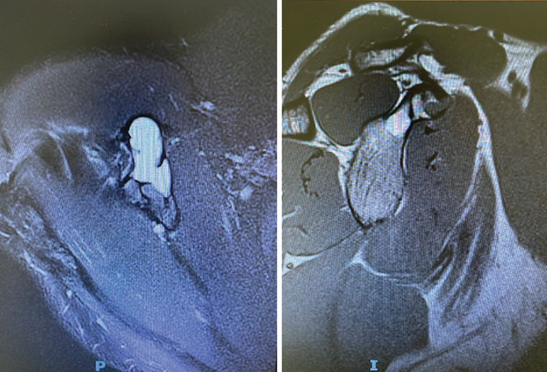
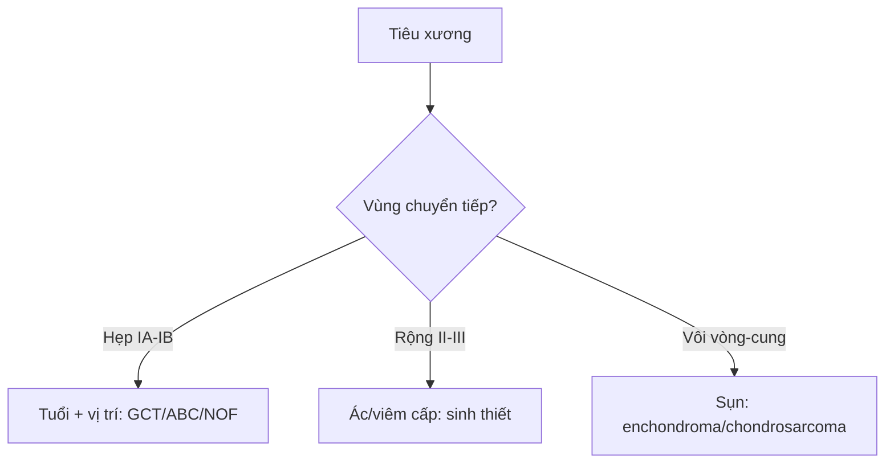

# 330 — U xương theo Lodwick, tuổi, vị trí & don't-touch / Bone tumors

**Tags:** `pattern:u-xuong` `vung:xuong` `score:Lodwick`
**Mức chắc chắn (certainty):** tổng hợp y văn (literature synthesis) — nhóm tự biên từ y văn mở, chưa gắn ca nguyên văn đơn lẻ.

## 1. Tổng quan — vùng chuyển tiếp là tốc độ, tuổi-vị trí là danh tính

- Mọi tiêu xương đánh giá bằng **vùng chuyển tiếp (zone of transition)** — TẠI SAO: ranh giới rõ (vẽ được bằng bút chì) = xương có thời gian phản ứng tạo viền đặc (lành, Lodwick IA có viền/IB không viền); ranh giới mờ gặm nhấm (moth-eaten II) / thấm (permeative III) = u phát triển nhanh hơn xương phản ứng (ác hoặc viêm cấp). Ngoại lệ > 40 tuổi: myeloma/di căn vẫn có thể vùng hẹp.
- Tuổi + vị trí dọc trục chốt danh tính: đầu xương (epiphysis) chưa khép sụn (< 20 tuổi) = chondroblastoma; khép sụn (20–40 tuổi) sát mặt khớp = GCT; thân xương trẻ 5–20 tuổi thấm + vỏ hành = Ewing.
- Ngưỡng: nidus u dạng xương **< 1,5–2 cm** + đau đêm đỡ aspirin; đảo xương đặc **> 885 HU** loại trừ di căn đặc; mũ sụn u xương sụn **> 1,5–2 cm** nghi hóa ác.

## 2. Gamut tiêu xương theo tuổi-vị trí (Gamut)

- **Đầu xương chưa khép + canxi chấm:** chondroblastoma — nạo + ghép.
- **Đầu xương khép sụn + sát khớp + không viền:** GCT 20–40 tuổi — nạo + xi măng (tái phát!).
- **Hành xương + mức dịch-dịch:** ABC — nạo + cầm máu (USP6).
- **Vỏ hành xương + thấm + hành:** NOF tự khỏi (don't touch); thân xương + vỏ hành + thấm = Ewing (mổ+hóa).
- **Đám mây ngà + Codman/tia mặt trời:** osteosarcoma — hóa trước mổ.

## 3. Bảng so sánh phân biệt (ma trận đối chiếu)

| Thực thể (entity) | Hình ảnh điển hình | Chốt vào (rule-in) | Chốt loại (rule-out) | Gợi ý xác nhận |
|---|---|---|---|---|
| GCT | **Đầu xương khép sụn + sát khớp + lệch tâm + không viền** | **20–40 tuổi + chạm xương dưới sụn** | Chưa khép sụn → chondroblastoma | Nạo + xi măng + theo dõi tái phát |
| ABC | **Phình + vách + mức dịch-dịch MRI + Lodwick IB-II** | **Fluid-fluid + trẻ + hành xương** | Viền đặc dày + tự cốt hóa → NOF | Nạo + nút mạch chọn lọc |
| Osteosarcoma | **Đám mây ngà + Codman + tia mặt trời + thấm** | **Cloud-like + màng xương ác tính** | Vôi hóa vòng-cung → sụn | Hóa tân bổ trợ + mổ rộng |
| Don't-touch (NOF/đảo/myositis) | **NOF đa cung vỏ + tự khỏi; đảo > 885 HU + chân rết; myositis vôi ngoài-trong** | **Vỏ kín + HU cao + vôi chu vi** | Vùng rộng + đau đêm → ác | CẤM sinh thiết, theo dõi |

*Trái: T2 nang sáng. Phải: vách + mức dịch-dịch điển hình, không lan phần mềm. Nguồn: Castanheira et al., Case Rep Orthop 2026 Fig. 2, CC BY 4.0.*

## 4. Protocol + Lodwick flowchart

- **X-quang 2 bình diện (vùng chuyển tiếp + matrix) → MRI (mức dịch, nidus, lan mềm) → CT (HU đảo xương, nidus) → sinh thiết có kế hoạch** (đường mổ nằm trong đường mổ triệt căn!).

## 5. Cạm bẫy

- **Sinh thiết don't-touch (NOF/đảo/myositis)** = sai lầm kinh điển — vỏ kín + HU > 885 + vôi chu vi là đủ.
- **Myositis ossificans tưởng osteosarcoma ngoài xương** — vôi ngoài-trong sau 2–6 tuần vs trung tâm-đặc ngoại vi.
- **Sinh thiết sai đường** làm nhiễm bẩn khoang — hội chẩn trung tâm sarcoma trước mọi sinh thiết nghi ác.

## 6. Tự lượng giá — Blind Quiz

**Ca 1 — Đau vai âm ỉ, nang mỏm quạ có vách. Đọc MRI.**

- Hỏi: mức gì trong nang? Lành hay ác? Xử trí?

<b>Bấm để hiện đáp án</b>

- Dấu hiệu (findings): nang phình có vách + **mức dịch-dịch (fluid-fluid)** + không lan phần mềm.
- Chẩn đoán (diagnosis): **nang xương phình mạch (ABC)** — nạo + ghép xương (tái phát 15–30% nếu nạo đơn thuần).
- Nguồn: Castanheira et al., Fig. 2, CC BY 4.0.

**Ca 2 — Đầu gối 25 tuổi + tiêu lệch tâm sát khớp không viền:** GCT hay chondroblastoma? *(Bảng mục 3.)*

<b>Bấm để hiện đáp án</b>

- **GCT:** khép sụn 20–40 tuổi + sát mặt khớp (chondroblastoma là chưa khép < 20 tuổi).

**Ca 3 — Nốt đặc đùi 1200 HU + chân rết + không đau:** di căn hay đảo xương? Sinh thiết không? *(Bảng mục 3.)*

<b>Bấm để hiện đáp án</b>

- **Đảo xương (enostosis):** > 885 HU + thorny radiation — **CẤM sinh thiết**, theo dõi.

## Bài liên quan chéo
- [300 – Tổng quan MSK](../300-tong-quan-he-co-xuong-khop/lesson.md)
- [310 – Xương phụ](../310-giai-phau-xuong-khop-va-bien-the/lesson.md) (vỏ kín)
- 331 – Myeloma/di căn (dự kiến viết sau)

> Không dùng để chẩn đoán độc lập khi chưa có người hướng dẫn.
