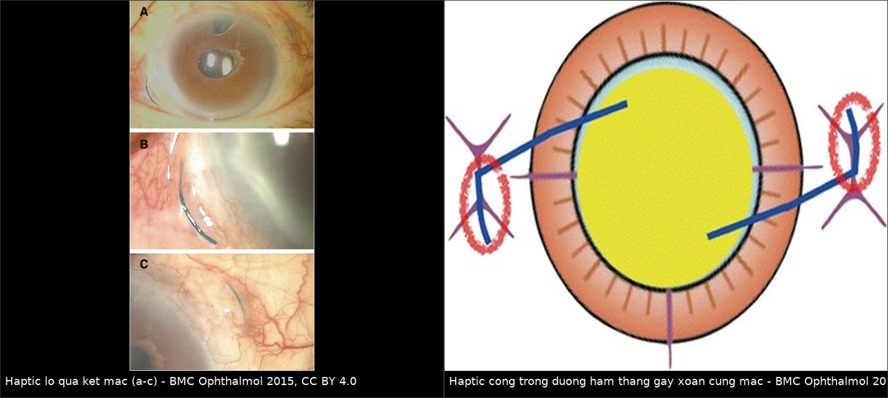
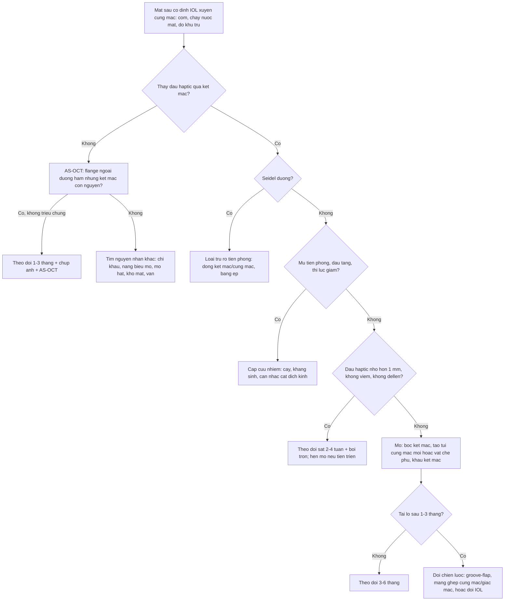
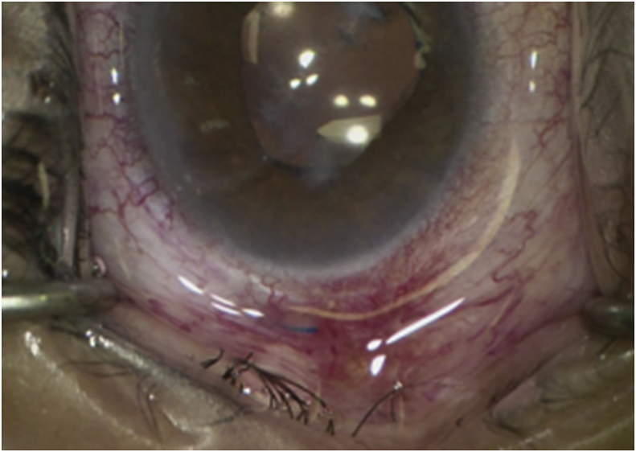
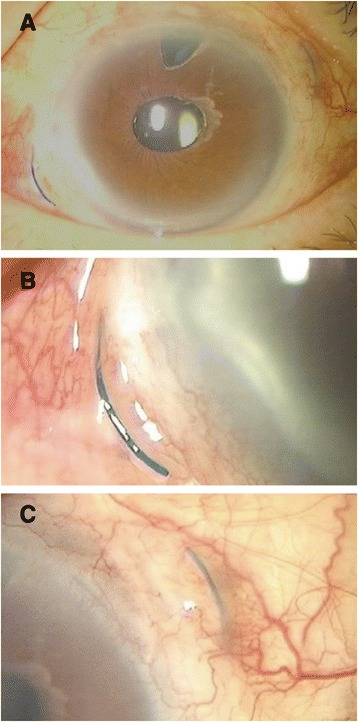

# 3300 — Đầu haptic lộ qua kết mạc sau cố định IOL xuyên củng mạc: vì sao flange "ăn" qua kết mạc, AS-OCT đọc gì, khi nào che phủ – cắt đầu haptic – đổi IOL

**Tags:** `pattern:haptic-lo` `pattern:an-mon-ket-mac` `pattern:dau-flange` `pattern:co-ket-mac` `pattern:di-vat-noi-nhan` `pattern:viem-ket-mac-khu-tru` `pattern:mat-co-dinh-iol` `vung:mat` `vung:ket-mac` `vung:cung-mac` `vung:the-thuy-tinh` `vung:tien-phong` `anatomy:duong-ham-cung-mac` `protocol:sinh-hien-vi` `protocol:AS-OCT` `protocol:UBM` `protocol:nhuom-fluorescein` `protocol:do-nhan-ap` `protocol:chup-anh-tien-doan` `score:khong-co` `incidentaloma:khong`

**Mức chắc chắn (certainty):** tổng hợp y văn (literature synthesis) — ghép **đoàn hệ AS-OCT 75 mắt/150 flange** theo dõi trung vị **3,3 năm** (Am J Ophthalmol 2026, **DOI 10.1016/j.ajo.2025.11.003**), **loạt 19 mắt ăn mòn haptic** đa trung tâm (Ophthalmol Retina 2023, **PMID 36441084**, DOI 10.1016/j.oret.2022.10.015), **553 mắt** so sánh kỹ thuật có/không flange (Retina 2024, **PMID 37769253**, DOI 10.1097/IAE.0000000000003950), **ca nguyên văn** haptic lộ sau Y-fixation có ảnh và sơ đồ cơ chế (BMC Ophthalmol 2015, **PMC4535536**, CC BY 4.0), **2 ca** sau glued IOL (Am J Ophthalmol Case Rep 2019, **PMC6461564**), cùng các báo cáo kỹ thuật che phủ (Int Med Case Rep J 2026, **PMC13615741**; Indian J Ophthalmol 2026, **PMC13056145**). Chỗ suy luận từ người lớn sang trẻ hoặc từ hình ảnh sang chỉ định mổ ghi **[suy luận]**. **Không ghi tên tác giả** — attribution = **tạp chí + năm + PMCID/DOI**.

> **Câu chốt:** sau cố định IOL xuyên củng mạc, **đầu haptic (flange) chỉ được phủ bởi kết mạc mỏng vài chục micromet**, không có lớp đệm; khi flange **nhô khỏi đường hầm, quá to, quá nông hoặc bề mặt gồ ghề**, chớp mắt tạo **ma sát lặp lại** → kết mạc **mỏng dần rồi rách** → **đầu haptic lộ ra**. Đây là **biến chứng muộn, trung bình 278 ngày**, gặp ở **2,1–3,3%** mắt có triệu chứng nhưng **14% flange "lộ" dưới kết mạc trên AS-OCT** — hai con số khác nhau vì **một bên là hình ảnh, một bên là bệnh lý có triệu chứng**. **Không được nhổ/cắt haptic ngay tại phòng khám**, và **không được chỉ khâu kết mạc đè lên** nếu flange vẫn nhô — phải **đưa flange vào mô củng mạc** hoặc **thay bằng vạt che phủ thật**.

> **Ranh giới với bài đã có:** [3299](../3299-haptic-iol-khoang-tren-hac-mac/lesson.md) trả lời **haptic lạc ra sau củng mạc** (khoang trên hắc mạc, hạ nhãn áp, UBM 0–3); [3298](../3298-ha-nhan-ap-hoang-diem-sau-co-dinh-iol-tre/lesson.md) trả lời **hội chứng hạ nhãn áp**; [3296](../3296-bat-giu-dong-tu-sau-co-dinh-iol-cung-mac-tre/lesson.md) trả lời **bắt giữ đồng tử**; [1484](../1484-bong-hac-mac-sau-mo-mat/lesson.md) trả lời **bong hắc mạc**. Bài này chỉ trả lời **mặt TRƯỚC của cùng đường hầm**: **đầu haptic đi ra qua kết mạc**, phân độ theo **mức lộ – viêm – nhiễm**, đọc **AS-OCT/UBM**, và chọn **theo dõi – đưa lại vào túi củng mạc – vạt củng mạc/mảnh ghép – đổi IOL**.

## 1. Tổng quan bệnh học – cơ chế hình ảnh (TẠI SAO)

### 1.1 "Cửa sổ" mỏng nhất của mắt: ba lớp chỉ dày vài trăm micromet

- **Đường chuẩn của Yamane:** kim **30G** xuyên **kết mạc – củng mạc cách rìa 2,0–2,5 mm**, đưa đầu haptic ra ngoài, **hơ nóng tạo flange đường kính ~0,3 mm**, rồi rút flange vào **đường hầm trong củng mạc** (PMC8375743; PMC13491161). Về lý thuyết flange nằm **dưới củng mạc**, nhưng trên thực tế nó thường chỉ nằm **dưới kết mạc** hoặc **ngay dưới biểu mô kết mạc**.
- **Ba lớp phủ trên flange:** **biểu mô kết mạc** (mỏng, tự tái tạo nhanh), **mô đệm kết mạc/Tenon** (ở vùng rìa thường rất mỏng sau mổ), và **củng mạc nông**. Không có **cân** hay **mỡ** đệm như các vùng khác của cơ thể — vì vậy **một đầu cứng nhô 0,2–0,3 mm đã đủ gây loét do chèn ép**.
- **Vị trí hay gặp:** **43% ở trên, 47% ở dưới, 10% ở thái dương** trong loạt 19 mắt; **90% đặt haptic ở trên và dưới** (PMID 36441084). Đây là nơi **mi trên chớp mạnh nhất** và **kết mạc bị mi chà xát nhiều nhất** — giải thích vì sao **ma sát động**, chứ không phải nhiễm trùng, là cơ chế chính.

### 1.2 TẠI SAO flange ăn qua kết mạc: bốn cơ chế cộng dồn

1. **Cơ học — flange nhô khỏi đường hầm:** nghiên cứu AS-OCT **75 mắt/150 flange** sau Yamane cải tiến cho thấy **14,0% (21/150) flange nằm ngoài đường hầm, dưới kết mạc**; **độ dày kết mạc tại các vị trí này mỏng hơn vùng kế cận có ý nghĩa (p < 0,05)**. **Đường kính flange là yếu tố nguy cơ (OR 1,012; p = 0,023)**, còn **đường kính giác mạc–giác mạc (white-to-white) là yếu tố bảo vệ (OR 0,082; p = 0,017)** — mắt nhỏ, flange to, đường hầm ngắn thì flange càng dễ nhô (DOI 10.1016/j.ajo.2025.11.003). Tác giả kết luận: **phải xác nhận flange nằm hoàn toàn trong đường hầm khi kết thúc mổ, cắt bớt haptic nếu cần**.
2. **Hình học — haptic cong trong đường hầm thẳng:** haptic của IOL **cong sẵn**; khi bị kéo vào **đường hầm thẳng**, nó **tạo lực xoắn lên củng mạc** tại điểm ra vào, làm củng mạc **mỏng và xoắn** theo thời gian (sơ đồ Fig. 2 của **PMC4535536**). Đây là lý do **haptic càng cứng (PMMA) càng dễ ăn mòn** hơn haptic mềm.
3. **Vật liệu — flange gồ ghề:** với **haptic PMMA**, nhiệt độ thấp tạo flange **không đều, bề mặt ráp**; ca 55 tuổi trong **PMC8375743** có **cả hai flange ráp** và **cả hai haptic lộ**. Vật liệu **PVDF** (polyvinylidene fluoride) tạo flange mềm, đều hơn; **PMMA** khó tạo flange đẹp — đây là lý do **cùng kỹ thuật, tỉ lệ lộ khác nhau theo model IOL**.
4. **Mô nền yếu:** **củng mạc mỏng** ở **cận thị nặng, Marfan, Ehlers–Danlos**, sau **chấn thương, viêm củng mạc, xạ trị, MMC**, hoặc **đã mổ kết mạc** (ghép củng mạc, đặt van, buckle). Trong loạt 19 mắt, **5 mắt (26%) có tiền sử mổ kết mạc** (buckle hoặc van) — tỉ lệ cao hơn quần thể chung (PMID 36441084).

### 1.3 Hai con số phải phân biệt: "flange lộ trên AS-OCT" ≠ "haptic lộ có triệu chứng"

| Định nghĩa | Tần suất | Nguồn | Ý nghĩa |
|---|---|---|---|
| **Flange nằm ngoài đường hầm, dưới kết mạc còn nguyên** (hình ảnh) | **14,0% (21/150 flange)** | AS-OCT 75 mắt, trung vị 3,3 năm (DOI 10.1016/j.ajo.2025.11.003) | **Không đồng nghĩa mổ**; là **ổ nguy cơ**, cần theo dõi |
| **Haptic lộ/ăn mòn qua kết mạc có triệu chứng** | **2,1% (kỹ thuật không flange) và 3,3% (có flange)** trong **553 mắt** | Retina 2024 (DOI 10.1097/IAE.0000000000003950) | Đây là **biến cố lâm sàng** cần xử trí |
| **Haptic extrusion/subconjunctival haptic sau glued IOL** | **1,9% và 1,4%** trong **208 mắt** | Am J Ophthalmol Case Rep 2019 dẫn lại (PMC6461564) | Kỹ thuật cũ, có vạt củng mạc + keo vẫn có thể lộ |

- **Bài học:** nếu chỉ đọc tỉ lệ **2–3%** sẽ **bỏ sót** nhóm **14%** đang có flange ngoài đường hầm; nếu chỉ đọc **14%** sẽ **mổ oan** những mắt **không triệu chứng**. Phải **kết hợp AS-OCT + triệu chứng + thời gian**.

### 1.4 TẠI SAO nguy hiểm: nhiễm, viêm mạn, loạn dưỡng mô xung quanh

- **Đường vào nội nhãn:** đầu haptic lộ tạo **cầu nối vật lý từ bề mặt kết mạc vào trong củng mạc**; vi khuẩn bám **biofilm trên polymer** có thể đi theo **đường hầm** vào tiền phòng/dịch kính. Các tổng quan ghi **endophthalmitis "vắng mặt đáng chú ý" trong các loạt lớn**, nhưng **vẫn xem lộ haptic là đường vào tiềm tàng và phải xử lý sớm** (PMC11034692; DOI 10.1016/j.oret.2022.10.015). **Loạt 19 mắt không có ca endophthalmitis nào** — nhưng đây là **dữ liệu quan sát, không phải bằng chứng an toàn**.
- **Viêm kết mạc khu trú tái diễn:** bệnh nhân **cộm, chảy nước mắt, đỏ một vùng** nhiều tháng; dễ bị chẩn đoán **dị ứng/khô mắt** và **nhỏ corticoid kéo dài** → **kết mạc mỏng thêm**, **haptic lộ nhanh hơn** (cơ chế [suy luận] từ sinh lý corticoid ức chế nguyên bào sợi và biểu mô).
- **Mô hạt (pyogenic granuloma):** phản ứng mô hạt quanh đầu haptic tạo **nốt đỏ dễ chảy máu**, dễ bị sinh thiết/cắt **mà không lấy haptic** → **tái phát**.
- **Biến dạng giác mạc:** gồ cục bộ vùng rìa gây **loạn thị không đều**, có thể **dellen/loét giác mạc** nếu đầu haptic chạm biểu mô giác mạc ở mắt nhỏ [suy luận].
- **Nghiêng/lệch IOL:** một haptic mất neo → **IOL nghiêng**, **lệch trục**, **mất thị lực chức năng**; ca **PMC4535536** có IOL nghiêng và phải **đổi IOL**.

### 1.5 TẠI SAO AS-OCT là công cụ chốt, và khi nào cần UBM

- **AS-OCT (quét tiền đoạn, bước sóng ~1310 nm)** phân giải **biểu mô – mô đệm kết mạc – củng mạc – flange** trong **một mặt cắt dọc đường hầm**; flange là **cấu trúc tăng hồi âm, có bóng lưng**, đo được **đường kính, độ sâu so với mặt củng mạc, độ dày kết mạc phủ**. Đây là **cùng phương pháp** đã dùng để phát hiện **14% flange lộ** và **kết mạc mỏng hơn** tại chỗ lộ (DOI 10.1016/j.ajo.2025.11.003).
- **AS-OCT cũng cho thấy "đường hầm không có túi"** — ca **PMC8375743** mô tả **scleral tunnel của haptic mà không có scleral pocket**, tức kỹ thuật trước **không tạo túi nhận** nên flange chỉ nằm dưới kết mạc.
- **UBM 50 MHz** (xuyên 4–5 mm, phân giải trục 20–50 µm) cần khi: **kết mạc dày/đục không đọc được AS-OCT**, nghi **haptic đi ra sau vào khoang trên hắc mạc** (bài 3299), nghi **dính thể mi**, hoặc cần đo **độ dày củng mạc thật** ở mắt đã mổ nhiều lần. **B-scan** chỉ dùng khi **không thấy đáy mắt** hoặc nghi **bong võng mạc/xuất huyết**.
- **Siêu âm sinh hiển vi không thay thế được ánh sáng sinh hiển vi:** **đầu haptic lộ** là **chẩn đoán lâm sàng**, hình ảnh chỉ để **đo độ sâu, loại trừ biến chứng sau, và lập kế hoạch mổ**.

## 2. Mẫu hình + chẩn đoán phân biệt theo vị trí (gamut)

**Mẫu hình trung tâm:** *mắt đã cố định IOL xuyên củng mạc **1 tuần – 3 năm** trước, **cộm + chảy nước mắt + đỏ khu trú một vùng kết mạc**; sinh hiển vi thấy **đầu haptic/flange nhô qua kết mạc**, thường **một đầu**, ở **trên hoặc dưới**; **Seidel âm**, **nhãn áp bình thường**, **tiền phòng yên**, **IOL có thể còn trung tâm**.*

Gamut theo **vị trí và tình trạng mô phủ** (không theo mức nhãn áp):

| Vị trí / tình trạng | Thực thể | Dấu chốt trên sinh hiển vi – AS-OCT | Bệnh cảnh điển hình |
|---|---|---|---|
| **Flange dưới kết mạc còn nguyên** | **Flange lộ dưới kết mạc (grade 0)** | **Thấy bóng flange qua kết mạc**, **kết mạc còn liên tục**, **không loét**, AS-OCT: flange **ngoài đường hầm**, kết mạc **mỏng nhưng còn** | **Không triệu chứng** hoặc **cộm nhẹ**; **14%** trên AS-OCT |
| **Đầu haptic xuyên qua kết mạc, không viêm** | **Haptic exposure (grade 1)** | **Đầu haptic nhô 0,2–2 mm**, **kết mạc quanh lành**, **không mủ**, **Seidel âm** | **Cộm + chảy nước mắt**; **2–3%**; thời gian **trung bình 278 ngày** |
| **Lộ + viêm kết mạc/mô hạt** | **Haptic erosion có viêm (grade 2)** | **Quầng đỏ, mô hạt, chảy máu khi chạm**, **kết mạc mỏng quanh**, **có thể dellen** | **Đau, sợ ánh sáng**, **nhỏ corticoid chỉ đỡ tạm** |
| **Lộ + mủ/tiền phòng** | **Nhiễm nội nhãn (grade 3)** | **Mủ tiền phòng, fibrin, đau tăng, thị lực giảm**, **Seidel có thể dương** | **Cấp cứu**; cấy + kháng sinh; xử lý haptic sau |
| **Chỉ khâu lộ** | **Suture erosion** (10-0 polypropylene/PTFE) | **Sợi chỉ xanh/trắng nhô**, **nút chỉ lộ**, **kết mạc quanh mỏng**, **không có flange** | Sau **cố định bằng chỉ** hoặc **IOL khâu củng mạc**; chỉ **10-0 polypropylene thoái hóa 27,9%** sau ~50 tháng |
| **Nang trong suốt ở vùng mổ** | **Nang biểu mô kết mạc (inclusion cyst)** | **Nang 2–5 mm, thành mỏng, dịch trong/ngà**, **không thấy haptic bên trong**, **Seidel âm** | **5 tháng sau cố định IOL**; **đau, đỏ**, dễ nhầm **bọng lọc rò** (PMC6258571) |
| **Nốt đỏ mềm, dễ chảy máu** | **U hạt sinh mủ (pyogenic granuloma)** | **Nốt mạch máu, cuống rộng**, **không có đầu haptic**, **mô hạt viêm** | Phản ứng với **chỉ khâu/dị vật**; cắt **không lấy nguyên nhân** → tái phát |
| **Dellen/loét giác mạc cục bộ** | **Tổn thương giác mạc do gồ** | **Mờ khu trú vùng rìa đối diện đầu haptic**, **mất biểu mô**, **nhuộm fluorescein dương** | Mắt nhỏ, **đầu haptic nhô cao**; **không phải loét nhiễm** |
| **Đỏ lan tỏa, đau sâu** | **Viêm củng mạc/hoại tử củng mạc** | **Củng mạc phù, tím đỏ, mỏng dần**, **có thể lộ màng bồ đào**, **không có haptic** | Sau **xạ/MMC/bệnh mô liên kết**; **khác hoàn toàn** ăn mòn cơ học |
| **Ống/van lộ ở góc** | **Ống dẫn lưu/van lộ (tube erosion)** | **Ống silicon nhìn thấy**, **kết mạc quanh mỏng**, **tiền phòng nông nếu rò** | Tiền sử **glôcôm đặt van**; **26%** loạt haptic có tiền sử mổ kết mạc |
| **Bọng dịch ở vùng rìa** | **Rò bọng lọc (bleb leak)** | **Seidel dương**, **tiền phòng nông**, **nhãn áp thấp**, **bọng khu trú** | Sau **mổ lọc**, không sau cố định IOL đơn thuần |
| **Haptic ra sau củng mạc** | **Haptic lạc vào khoang trên hắc mạc** | **Không thấy haptic dưới kết mạc**; **UBM: haptic ngoài củng mạc trong dải dịch**, **nhãn áp thấp** | **Hạ nhãn áp kéo dài**; xem bài 3299 |
| **Mảnh cứng trong dịch kính** | **Gãy haptic–optic/dị vật** | **Mất liên tục haptic–optic**, **mảnh trôi trong dịch kính**, **IOL nghiêng** | Sau **chấn thương/tháo IOL**; cần **B-scan/UBM** |

*Bên trái: **đầu haptic lộ qua kết mạc** sau cố định xuyên củng mạc — (a) toàn cảnh, (b) đầu haptic mũi, (c) haptic thái dương **còn dưới kết mạc**. Bên phải: **haptic cong bị kéo vào đường hầm thẳng** tạo **lực xoắn** lên củng mạc (vòng đỏ) — cơ chế **mỏng và ăn mòn củng mạc theo thời gian**. Nguồn: BMC Ophthalmol 2015 (**PMC4535536**), CC BY 4.0 — ảnh nguyên bản, ghép letterbox bằng `tools/make_composite.py`.*

## 3. Bảng so sánh phân biệt (ma trận đối chiếu)

| Thực thể (entity) | Hình ảnh điển hình | Chốt vào (rule-in) | Chốt loại (rule-out) | Gợi ý xác nhận |
|---|---|---|---|---|
| **Haptic lộ qua kết mạc** | **Đầu flange nhô**, **kết mạc rách quanh**, **Seidel âm**; AS-OCT: flange **ngoài đường hầm** | **Thấy trực tiếp đầu haptic** + **đúng vị trí đường hầm** + **không mủ** | **Không thấy haptic**, chỉ **đỏ/nang/mô hạt**; **Seidel dương** | **Sinh hiển vi + AS-OCT dọc đường hầm**; chụp ảnh có thước |
| **Flange dưới kết mạc (chưa lộ)** | **Bóng flange qua kết mạc**, **kết mạc liên tục**, **không loét** | **Kết mạc còn nguyên** + **flange ngoài đường hầm** trên AS-OCT + **không triệu chứng** | **Kết mạc đã rách**, **đầu haptic nhô**, **mô hạt** | AS-OCT; **đo độ dày kết mạc** so vùng kế cận |
| **Haptic lộ có viêm/mô hạt** | **Quầng đỏ, mô hạt, chảy máu**, **đầu haptic lẫn trong mô hạt** | **Mô hạt + thấy haptic**; **triệu chứng > 2 tuần** | **Chỉ có mô hạt không haptic**; **nang trong suốt** | **Cắt mô hạt + bộc lộ haptic**, không sinh thiết đơn thuần |
| **Nhiễm nội nhãn từ haptic** | **Mủ tiền phòng, fibrin, đau, thị lực giảm** | **Mủ tiền phòng** + **đầu haptic lộ** + **khởi phát cấp** | **Tiền phòng trong**, **chỉ viêm kết mạc**, **không đau** | **Cấy thủy dịch/dịch kính trước kháng sinh**; **không chọc qua đầu haptic** |
| **Suture erosion** | **Sợi chỉ/nút chỉ nhô**, **kết mạc mỏng quanh**, **không có flange** | **Thấy chỉ** + **tiền sử khâu củng mạc** + **không thấy haptic** | **Thấy flange**, **không có chỉ** | **Sinh hiển vi + AS-OCT**; **đếm sợi chỉ** so với mô tả mổ |
| **Nang biểu mô kết mạc** | **Nang 2–5 mm, thành mỏng, dịch trong**, **không tăng hồi âm bên trong** | **Nang khu trú** + **không thấy haptic** + **Seidel âm** | **Có đầu haptic trong/thành nang**; **nang đục, viêm** | **AS-OCT/UBM**: nang **trống**, **không có cấu trúc cứng**; **cắt + mô bệnh** |
| **U hạt sinh mủ** | **Nốt đỏ, mềm, cuống**, **dễ chảy máu** | **Nốt mạch máu** + **không thấy haptic** + **phản ứng với chỉ/dị vật** | **Thấy haptic**, **nốt cứng**, **không chảy máu** | **Cắt trọn + tìm nguyên nhân**; nếu tái phát **tìm haptic ẩn** |
| **Dellen/loét giác mạc do gồ** | **Mờ rìa khu trú**, **mất biểu mô**, **fluorescein dương** | **Ổ loét đối diện đầu haptic nhô** + **không mủ** + **nhuộm** | **Loét ở xa đường hầm**, **mủ**, **tiền phòng phản ứng** | **Sinh hiển vi + fluorescein**; **nâng đầu haptic** hoặc **bôi trơn** |
| **Viêm/hoại tử củng mạc** | **Phù tím đỏ lan**, **củng mạc mỏng**, **có thể lộ màng bồ đào** | **Đỏ tím sâu, đau nhiều** + **tiền sử xạ/MMC/bệnh mô liên kết** | **Đầu haptic nhô** + **kết mạc rách khu trú** | **AS-OCT/UBM đo độ dày củng mạc**; **không đốt/không cắt haptic khi đang viêm cấp** |
| **Ống dẫn lưu/van lộ** | **Ống silicon nhìn thấy**, **kết mạc quanh mỏng** | **Thấy ống/van** + **tiền sử glôcôm** | **Thấy flange haptic**, **không có ống** | **Sinh hiển vi + AS-OCT**; **đối chiếu phim mổ** |
| **Rò bọng lọc** | **Bọng dịch**, **Seidel dương**, **tiền phòng nông** | **Seidel dương** + **nhãn áp thấp** + **bọng** | **Seidel âm**, **không bọng**, **có haptic lộ** | **Fluorescein 2%**, **đo nhãn áp**, **AS-OCT bọng** |
| **Haptic lạc khoang trên hắc mạc** | **Không thấy haptic dưới kết mạc**, **nhãn áp thấp**, **UBM có dải dịch** | **Haptic ngoài củng mạc trong dải dịch** + **nhãn áp ≤ 6 mmHg kéo dài** | **Haptic dưới kết mạc**, **nhãn áp bình thường**, **không dải dịch** | **UBM 8 hướng** (bài 3299); **AS-OCT** không đủ |
| **Gãy haptic/dị vật** | **Mảnh cứng trôi**, **mất liên tục haptic–optic**, **IOL nghiêng** | **Thấy mảnh rời** + **flange vẫn cố định** + **IOL lệch** | **Haptic liên tục** từ optic đến củng mạc | **UBM + B-scan**; **chụp X-quang nếu cần** |

## 4. Protocol chụp + hệ phân độ/điểm chuẩn hóa

### 4.1 Trình tự khám một mắt sau cố định xuyên củng mạc nghi lộ haptic

1. **Hỏi bệnh có cấu trúc:** **ngày mổ**, **kỹ thuật** (Yamane, glued IOL, Carlevale, khâu củng mạc), **model IOL và vật liệu haptic** (PMMA/PVDF), **vị trí haptic theo giờ**, **tiền sử mổ kết mạc** (buckle, van, ghép), **xạ/MMC**, **bệnh mô liên kết**, **dùng kính tiếp xúc củng mạc**, **thói quen dụi mắt**.
2. **Sinh hiển vi có thước:** đo **chiều dài đầu haptic nhô (mm)**, **số giờ kết mạc tổn thương**, **khoảng cách tới rìa**, **số flange lộ**, **tình trạng kết mạc quanh** (mỏng, mô hạt, loét), **dellen/loét giác mạc**, **tình trạng tiền phòng**, **vị trí/nghiêng IOL**.
3. **Nghiệm pháp Seidel:** fluorescein 2%, **ấn nhẹ qua mi** tại **từng vị trí haptic** và vết mổ rìa. **Seidel dương** = có rò; **Seidel âm không loại trừ nhiễm trùng đường hầm**.
4. **Nhãn áp hai mắt**, **khúc xạ/loạn thị**, **thị lực có chỉnh kính**; ghi **loạn thị không đều** nếu đầu haptic gần rìa.
5. **AS-OCT tiền đoạn — bắt buộc:** mặt cắt **dọc qua từng đường hầm** (2 giờ và 8 giờ hoặc vị trí thực tế), đo **độ dày kết mạc phủ**, **độ sâu flange so với mặt củng mạc**, **đường kính flange**, **khoảng cách flange–rìa**, **đường hầm có túi nhận hay không**. So **vùng kế cận** để phát hiện **kết mạc mỏng hơn**.
6. **UBM 50 MHz** khi: **kết mạc đục/dày**, nghi **haptic ra sau**, **hạ nhãn áp**, **nghi dính thể mi**, hoặc **không đánh giá được độ sâu** bằng AS-OCT. **8 hướng + mặt cắt trung tâm** (bài 3299).
7. **B-scan 10–20 MHz** khi **không thấy đáy mắt**, nghi **bong võng mạc**, **xuất huyết trên hắc mạc**, hoặc **mảnh haptic trôi**.
8. **Chụp ảnh tiền đoạn có đèn khe + thước**, lưu **cùng góc, cùng độ phóng đại** mỗi lần khám — công cụ đơn giản nhất để phát hiện **tiến triển**.
9. **Nếu có mủ/discharge:** **ngoáy kết mạc + cấy**, **cấy thủy dịch/dịch kính** trước kháng sinh nếu nghi **nhiễm nội nhãn**; **không chọc xuyên qua đầu haptic**.

### 4.2 Phân độ thực hành (chưa có thang được validate — [suy luận])

| Mức | Định nghĩa | Thái độ |
|---|---|---|
| **0** | **Flange ngoài đường hầm nhưng kết mạc còn nguyên**, không triệu chứng | **Theo dõi 1–3 tháng**, chụp ảnh + AS-OCT; **không can thiệp** |
| **1** | **Đầu haptic xuyên qua kết mạc**, **kết mạc quanh lành**, **không mủ**, **Seidel âm** | **Mổ đưa flange vào túi củng mạc mới** hoặc **vạt che phủ**; không chờ quá **2–4 tuần** nếu nhô > 1 mm [suy luận] |
| **2** | **Lộ + viêm kết mạc/mô hạt/dellen**, **không mủ tiền phòng** | **Mổ sớm**: bóc mô hạt, **đưa flange vào củng mạc**, **khâu kết mạc**; **không chỉ cắt mô hạt** |
| **3** | **Lộ + mủ tiền phòng/đau tăng/thị lực giảm** | **Cấp cứu nhiễm nội nhãn**: cấy, kháng sinh nội nhãn, **cân nhắc cắt dịch kính**; xử lý haptic **sau khi kiểm soát nhiễm** |

- **Không có thang điểm hình ảnh được validate cho "haptic exposure"**; các bài tổng quan cũng chỉ mô tả **biến chứng muộn** mà không phân độ (PMC13491161). Vì vậy **phân độ trên là công cụ giao tiếp**, không phải tiêu chuẩn chẩn đoán.

### 4.3 Sơ đồ xử lý

### 4.4 Ngưỡng và mốc thời gian cần nhớ

- **Thời điểm lộ:** **trung bình 278 ± 437 ngày** sau mổ (19 mắt); có ca **4 tuần** (Carlevale, **DOI 10.1097/j.jcrs.0000000000000579**) — **dao động rất rộng**, không có "thời điểm an toàn".
- **Tần suất:** **14,0% flange lộ dưới kết mạc trên AS-OCT**; **2,1–3,3% lộ có triệu chứng**; **1,9%/1,4%** sau glued IOL.
- **Yếu tố nguy cơ định lượng:** **đường kính flange OR 1,012 (p = 0,023)**; **white-to-white OR 0,082 (p = 0,017)** (bảo vệ); **26% có tiền sử mổ kết mạc**.
- **Kết quả sửa chữa:** **18/19 mắt (95%) IOL ổn định**, **không tái lộ** sau sửa; **0 endophthalmitis** trong loạt đó — nhưng **theo dõi ngắn**, không được xem là "an toàn tuyệt đối".
- **Tái lộ sau vá củng mạc:** ca **PMC4535536** **tái lộ sau 1 tháng** dù đã **ghép củng mạc tự thân** → **vá đơn thuần không đủ** nếu **haptic vẫn nhô/còn xoắn**.
- **Cắt đầu haptic:** mỗi lần **hàn lại flange cần đốt ~1 mm haptic**; lặp lại nhiều lần **làm ngắn haptic** → **IOL bị kéo ra trước**, nguy cơ **pupillary block** (PMC8375743). Vì vậy **không cắt/hàn lặp tại phòng khám**.

## 5. Biến thể bình thường và cạm bẫy

- **Biến thể bình thường — flange nằm dưới kết mạc:** **14%** flange nằm ngoài đường hầm nhưng **kết mạc còn nguyên**, **không triệu chứng**; AS-OCT thấy **kết mạc mỏng hơn** nhưng **liên tục**. Đây là **ổ nguy cơ**, **không phải chỉ định mổ** (DOI 10.1016/j.ajo.2025.11.003).
- **Biến thể bình thường — cộm nhẹ sau mổ:** trong **1–2 tuần đầu**, **cộm + chảy nước mắt** do **phù kết mạc và chỉ khâu**; nếu **không thấy haptic**, **không có dellen**, chỉ **theo dõi + bôi trơn**.
- **Cạm bẫy 1 — "viêm kết mạc dị ứng":** bệnh nhân **đỏ một vùng + cộm** nhiều tháng, **nhỏ corticoid đỡ tạm**; corticoid làm **kết mạc mỏng thêm** và **che dấu** đầu haptic → **lộ nhanh hơn**. **Luôn lật mi, tìm đầu haptic** ở mắt đã cố định IOL.
- **Cạm bẫy 2 — "cắt mô hạt là xong":** **u hạt sinh mủ** quanh haptic mà **không lấy haptic** sẽ **tái phát**; phải **bộc lộ và xử lý flange**.
- **Cạm bẫy 3 — "khâu kết mạc đè lên":** nếu **flange vẫn nhô**, **khâu kết mạc** chỉ tạo **căng và hoại tử** rồi **lộ lại**; phải **đưa flange vào túi củng mạc** hoặc **dùng vạt/mảnh ghép**.
- **Cạm bẫy 4 — cắt/hàn haptic tại phòng khám:** **không vô khuẩn**, **không kiểm soát độ dài**, **nguy cơ nhiễm nội nhãn** và **làm ngắn haptic** → **IOL ra trước/pupillary block**. Chỉ xử lý **trong phòng mổ**.
- **Cạm bẫy 5 — bỏ sót haptic thứ hai:** **43% lộ ở trên, 47% ở dưới**, và **nhiều mắt có cả hai đầu bất thường** (ca **PMC8375743** lộ **cả hai**); **một đầu bình thường không loại trừ đầu kia**.
- **Cạm bẫy 6 — nhầm với haptic lạc ra sau:** **haptic lộ dưới kết mạc** và **haptic trong khoang trên hắc mạc** là **hai hướng của cùng đường hầm**; **nhãn áp thấp + Seidel âm** phải **UBM** (bài 3299), **không được kéo mù**.
- **Cạm bẫy 7 — kính tiếp xúc củng mạc:** đeo **scleral lens** trên mắt có **chỉ/haptic nổi** làm **ăn mòn chỉ PTFE** và **lộ haptic**; ca **40910839** phải **đặt lại chỉ + ghép giác mạc**, một ca **đổi IOL**. **Kiểm tra vị trí haptic trước khi fit kính**.
- **Cạm bẫy 8 — trẻ em:** trẻ **dụi mắt**, **củng mạc mỏng**, **IOL cố định sớm** → **nguy cơ lộ cao hơn** và **khó phát hiện**; khám **dưới gây mê** khi nghi, **không chờ triệu chứng** [suy luận từ cơ chế; dữ liệu nhi còn mỏng].

*Sau **glued IOL**, **đầu haptic thái dương lộ qua kết mạc** (mũi tên) — bề mặt flange **gồ ghề** do hàn PMMA. Ca này được **cắt ngắn đầu haptic, hàn lại, đưa vào đường hầm củng mạc và khâu kết mạc 8-0 Vicryl**; 1 tháng sau **haptic được phủ kín**. Nguồn: Am J Ophthalmol Case Rep 2019 (**PMC6461564**), CC BY-NC-ND 4.0 — **nguyên bản, không cắt/ghép**.*

## 6. Tự lượng giá — Blind Quiz ngay trên trang tĩnh

**Ca 1 — 75 tuổi, cộm + chảy nước mắt 1 tháng, tiền sử cố định IOL 4 tháng trước**

- Gợi ý lâm sàng: nam **75 tuổi**, **cắt thể thủy tinh 30 năm trước**, **IOL ngoài bao lâu năm**, **cố định lại IOL bằng Y-fixation 4 tháng trước**; nay **cộm, chảy nước mắt**; **đã được ghép củng mạc tự thân che haptic nhưng tái lộ sau 1 tháng**; **thị lực 0,5**, **IOL nghiêng**.
- Câu hỏi: (1) Mô tả **(a)–(c)**. (2) Vì sao **ghép củng mạc đơn thuần thất bại**? (3) Hai lựa chọn xử lý và **cái nào được chọn trong ca này**?

<b>Bấm để hiện đáp án (findings + chẩn đoán)</b>

- **Dấu hiệu:** **(a)** toàn cảnh tiền đoạn, **đầu haptic mũi lộ**; **(b)** **đầu haptic nhô qua kết mạc** rõ; **(c)** **haptic thái dương còn nằm dưới kết mạc** — tức **cả hai đầu bất thường**, một lộ, một "nguy cơ".
- **Chẩn đoán:** **haptic exposure sau cố định IOL không chỉ**, **tái lộ sau vá củng mạc**; **IOL nghiêng** do mất neo một đầu.
- **Vì sao vá đơn thuần thất bại:** **haptic vẫn cong và vẫn tạo lực xoắn** lên củng mạc; **mảnh vá không cố định được haptic**, chỉ che tạm — đúng với sơ đồ Fig. 2. Cần **đưa haptic vào mô củng mạc** hoặc **đổi cách cố định**.
- **Xử lý:** **đổi IOL + cố định bằng chỉ củng mạc** (đã chọn trong ca này), hoặc **đưa haptic vào túi củng mạc mới** nếu IOL còn tốt. Sau 6 tháng: **thị lực 1,0**, **IOL ổn định**.
- **Nguồn ảnh:** BMC Ophthalmol 2015 (**PMC4535536**), CC BY 4.0.

**Ca 2 — 67 tuổi, sau glued IOL 2 tháng, một đầu haptic nhô**

- Gợi ý lâm sàng: nam **67 tuổi**, **rách giác mạc do chấn thương**, **đục thể thủy tinh**; **cắt thể thủy tinh + glued IOL**; **2 tháng sau**, **đầu haptic thái dương lộ**, **cộm**; **không mủ**, **nhãn áp bình thường**.
- Câu hỏi: (1) Đây là **mức mấy** trong phân độ thực hành? (2) Vì sao **không nên chỉ khâu kết mạc**? (3) Mô tả **các bước mổ** đã dùng.

<b>Bấm để hiện đáp án (findings + chẩn đoán)</b>

- **Dấu hiệu:** **đầu haptic nhô qua kết mạc**, **flange gồ ghề**, **kết mạc quanh viêm nhẹ**, **không mủ** → **mức 2** (lộ có viêm nhẹ).
- **Chẩn đoán:** **haptic exposure sau glued IOL**, liên quan **flange PMMA gồ ghề + đường hầm nông**.
- **Vì sao không chỉ khâu kết mạc:** flange **vẫn nhô**, chỉ khâu tạo **căng, thiếu máu, hoại tử** → **lộ lại**; phải **thay đổi hình học** (cắt ngắn + hàn lại + đưa vào củng mạc).
- **Các bước:** **mở kết mạc khu trú** → **cắt ngắn đầu haptic** → **hàn tạo flange mới** → **đưa flange vào đường hầm củng mạc** → **khâu kết mạc 8-0 Vicryl**. 1 tháng sau: **haptic được phủ kín, IOL trung tâm**.
- **Nguồn ảnh:** Am J Ophthalmol Case Rep 2019 (**PMC6461564**), CC BY-NC-ND 4.0 — nguyên bản.

## 7. Câu hỏi nghiên cứu & điểm chưa đồng thuận (tính đến 11/2026)

1. **[Tranh cãi] Ở mắt có flange nằm ngoài đường hầm nhưng kết mạc còn nguyên và không triệu chứng, có nên can thiệp dự phòng hay theo dõi?**
   - **Đã biết:** **14,0% flange lộ dưới kết mạc** trên AS-OCT, nhưng **chỉ 2,1–3,3% lộ có triệu chứng**; kết mạc phủ **mỏng hơn có ý nghĩa** tại chỗ lộ.
   - **Chưa rõ:** **bao nhiêu phần trăm flange lộ hình ảnh tiến triển thành lộ thật**, và **can thiệp sớm có giảm nhiễm/đổi IOL** không.
   - **Hướng nghiên cứu:** đoàn hệ tiến cứu **AS-OCT định kỳ** (1–3–6–12 tháng), so **theo dõi** với **che phủ dự phòng**.
   - **Nguồn:** DOI 10.1016/j.ajo.2025.11.003; DOI 10.1097/IAE.0000000000003950; PMID 36441084.

2. **[Khoảng trống] Tỉ lệ viêm nội nhãn thực sự do đầu haptic lộ là bao nhiêu, và che phủ sớm có làm giảm tỉ lệ đó?**
   - **Đã biết:** **19 mắt** lộ haptic được sửa **không có endophthalmitis**; tổng quan ghi endophthalmitis **"vắng mặt"** trong các loạt lớn, nhưng **lộ haptic vẫn được xem là đường vào**.
   - **Chưa rõ:** **không có mẫu số** (bao nhiêu mắt lộ được theo dõi mà không mổ) và **không có phân tích theo thời gian lộ**.
   - **Hướng nghiên cứu:** registry đa trung tâm ghi **thời điểm lộ, thời gian chờ, can thiệp, nhiễm nội nhãn**; mô hình hồi quy theo **vật liệu haptic và vị trí**.
   - **Nguồn:** PMID 36441084; PMC11034692 (DOI 10.4103/tjo.TJO-D-23-00163).

3. **[Khác biệt thực hành] Che phủ flange ngay từ đầu bằng kết mạc, vạt củng mạc, hay túi/groove-flap?**
   - **Đã biết:** trong loạt 19 mắt lộ, **74% flange chỉ được phủ bằng kết mạc**, **26% có vạt củng mạc**; kỹ thuật **groove-flap 3 mắt** không lộ sau **12 tháng**; kỹ thuật **5F** che kín hoàn toàn đang được giới thiệu.
   - **Chưa rõ:** **không có so sánh trực tiếp** giữa các kiểu che phủ; **cỡ mẫu nhỏ**, **theo dõi ngắn**.
   - **Hướng nghiên cứu:** thử nghiệm/đoàn hệ so **kết mạc đơn thuần vs vạt củng mạc vs groove-flap**, kết cục **lộ haptic, nhiễm, thời gian mổ**.
   - **Nguồn:** PMID 36441084; PMC13615741 (DOI 10.2147/IMCRJ.S620459); PMC13056145 (DOI 10.4103/IJO.IJO_192_26).

## Bài liên quan chéo
- [3299 – Haptic IOL lạc vào khoang trên hắc mạc sau cố định xuyên củng mạc](../3299-haptic-iol-khoang-tren-hac-mac/lesson.md)
- [3298 – Hạ nhãn áp & bệnh hoàng điểm do hạ nhãn áp sau cố định IOL xuyên củng mạc ở trẻ](../3298-ha-nhan-ap-hoang-diem-sau-co-dinh-iol-tre/lesson.md)
- [3296 – Bắt giữ đồng tử sau cố định IOL xuyên củng mạc](../3296-bat-giu-dong-tu-sau-co-dinh-iol-cung-mac-tre/lesson.md)
- [3294 – Trẻ aphakia: đánh giá hỗ trợ bao bằng UBM/AS-OCT](../3294-tre-aphakia-danh-gia-ho-tro-bao-ubm-as-oct/lesson.md)
- [1484 – Bong hắc mạc sau mổ mắt](../1484-bong-hac-mac-sau-mo-mat/lesson.md)
- [1447 – Rách thể mi sau MIGS và Yamane](../1447-rach-the-mi-sau-migs-va-yamane/lesson.md)
- [3269 – Viêm bờ mi do Demodex](../3269-vien-bo-mi-demodex/lesson.md)
- [400 – Tổng quan Mắt & thị giác](../400-tong-quan-mat-thi-giac/lesson.md)

## Ảnh
- `3300_haptic-lo_Slitlamp_PMC4535536-Fig1.jpg` — đầu haptic lộ + haptic thái dương dưới kết mạc (CC BY 4.0).
- `3300_haptic-lo_SoDo_PMC4535536-Fig2.jpg` — sơ đồ lực xoắn của haptic cong trong đường hầm thẳng (CC BY 4.0).
- `composite_3300_haptic-lo_co-che.jpg` — ghép letterbox 2 ảnh trên (CC BY 4.0).
- `3300_haptic-lo_Slitlamp_PMC6461564-Fig4.jpg` — đầu haptic lộ sau glued IOL (CC BY-NC-ND 4.0, **nguyên bản**).
- `3300_haptic-lo_Slitlamp_PMC6461564-Fig7.jpg` — flange được đưa lại vào củng mạc, kết mạc phủ kín (CC BY-NC-ND 4.0, **nguyên bản**).
- Nguồn, giấy phép và nội dung từng ảnh: `images/CREDITS.md`; link gốc: `sources.md`.

> Không dùng để chẩn đoán độc lập khi chưa có người hướng dẫn.
