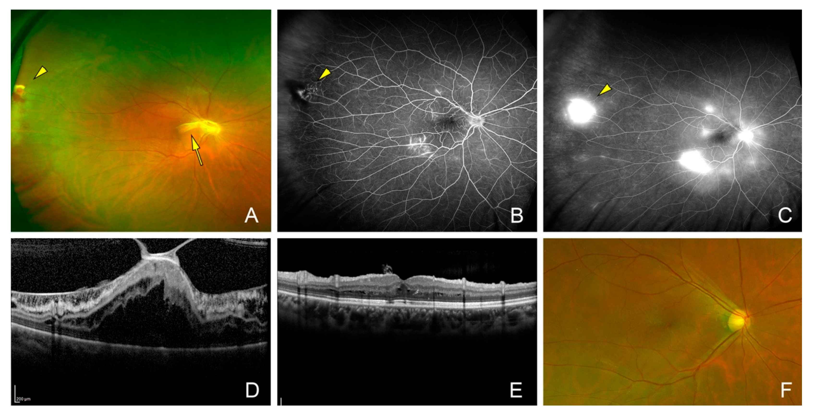
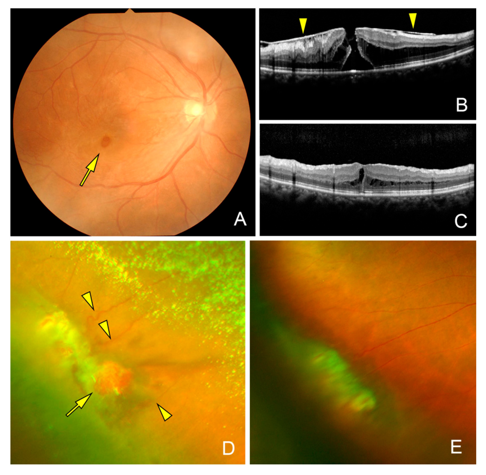
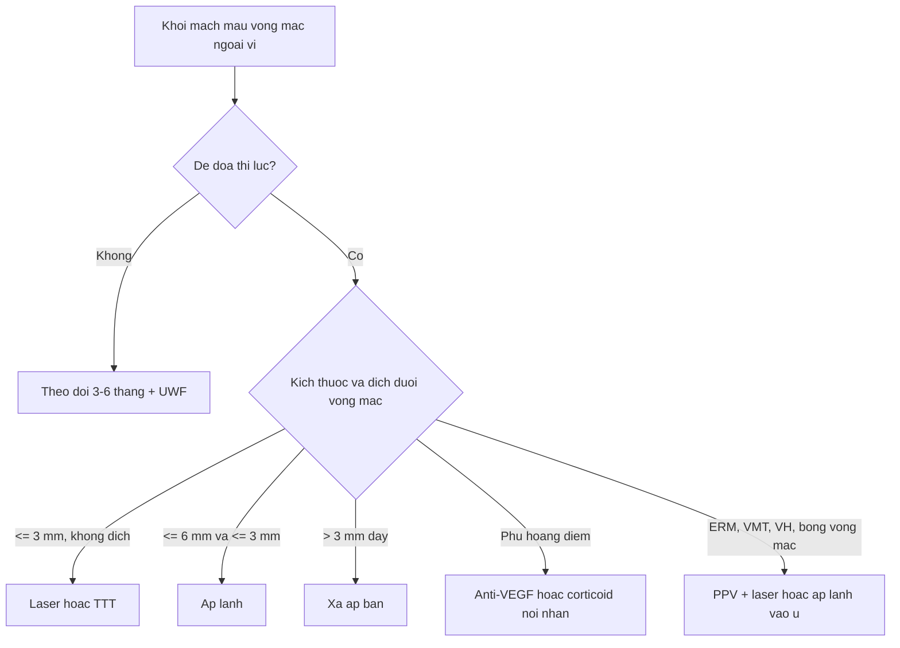

# 3301 — U tăng sinh mạch võng mạc ngoại vi / Retinal vasoproliferative tumor (VPT)

**Tags:** `pattern:khoi-mach-vong-mac` `pattern:xuat-tiet-lipid` `pattern:phu-hoang-diem` `pattern:mang-truoc-vong-mac` `pattern:mat-mot-ben` `vung:mat` `vung:vong-mac` `vung:hoang-diem` `protocol:UWF-chup-day-mat` `protocol:FA` `protocol:ICGA` `protocol:OCT-hoang-diem` `protocol:sieu-am-B-scan`
**Mức chắc chắn (certainty):** tổng hợp y văn (literature synthesis) — 1 loạt 22 u/19 mắt (Ấn Độ, 2018), 1 loạt 19 mắt (2025), 1 loạt 13 mắt được cắt dịch kính (Nhật, 2025), 1 so sánh 12 mắt (2024), 1 bài đề xuất phân độ (2018) và các ca nguyên văn có PMCID; số liệu lấy từ toàn văn khi có.

## 1. Tổng quan bệnh học – cơ chế hình ảnh

- **Định nghĩa:** u tăng sinh mạch võng mạc ngoại vi (retinal vasoproliferative tumor, VPT) là **khối mạch máu–đệm thần kinh mắc phải, lành tính, ở võng mạc ngoại vi**, thường **một bên, một ổ**, màu **vàng–hồng–đỏ**, kèm **xuất tiết lipid trong/dưới võng mạc** và các biến chứng ở **hoàng điểm** (phù, màng trước võng mạc, lỗ hoàng điểm) dù tổn thương nguyên phát nằm xa hậu cực.
- **Không phải u thật:** mô bệnh học cho thấy **tế bào thần kinh đệm (glia) xen với mạng mao mạch mảnh và mạch giãn, vách hyalin hóa, đại thực bào ăn lipid**; không có tế bào u thật. Vì vậy có tác giả gọi là **tăng sinh mạch–thần kinh đệm phản ứng (reactive retinal glioangiosis)** và xem VPT là **mô hạt phản ứng sau thiếu máu, viêm hoặc chấn thương võng mạc** — tên "u" chỉ giữ vì thói quen lâm sàng.
- **Dịch tễ – con số phải nhớ:**
  - Hiếm; thường gặp ở **tuổi 40–60**. Tuổi trung bình: **43,5** (loạt Ấn Độ, 15–68), **37,0 ± 16,95** (loạt 19 mắt, 2025), **51,2** (loạt cắt dịch kính Nhật, 22–72).
  - **Một bên 89–100%**, **một ổ 84–95%**; thể **thứ phát hay đa ổ và hai bên hơn** thể nguyên phát.
  - **Tỷ lệ nguyên phát/thứ phát thay đổi theo quần thể:** phương Tây khoảng **74% nguyên phát / 26% thứ phát** (103 bệnh nhân của Shields 1995); Ấn Độ **32% nguyên phát / 68% thứ phát** (22 u); một loạt 19 mắt năm 2025 chỉ **15% nguyên phát / 84% thứ phát**; loạt 120 ca Ấn Độ của Honavar: **40% / 60%**. Kết luận thực hành: **luôn tìm bệnh nền**, không mặc định "nguyên phát".
  - **Vị trí:** **45% ở góc phần tư dưới** (loạt Ấn Độ); **11/13 mắt (85%) ở thái dương–dưới** và **2/13 thái dương–trên** (loạt Nhật); **gần như tất cả ở trước xích đạo** (22/22 trừ 1 ca).
  - **Kích thước:** đường kính đáy trung bình **6,3 mm** (5,8–6,8), **cao 2,88 mm** (2,0–4,0) trên siêu âm; trên ảnh góc rộng u đo **1–6 đường kính đĩa (DD)**, vùng xuất tiết lan tới **8 DD**.
  - **Đến khám vì:** nhìn mờ **46%**, nhìn méo **46%**, mờ nhẹ **8%** (loạt cắt dịch kính); thị lực vào viện trung bình **+1,10 logMAR**, ra viện **+1,21 logMAR** (loạt Ấn Độ — nghĩa là **kiểm soát u không đồng nghĩa hồi phục thị lực**).
- **Cơ chế tại sao có hình ảnh này:**
  1. **Thiếu máu/viêm võng mạc ngoại vi** → tăng VEGF và yếu tố viêm → **mạch mới và mạch giãn** tập trung thành khối.
  2. Thành mạch non yếu, **mất hàng rào máu–võng mạc** → huyết tương và **lipid** thoát ra; đại thực bào ăn lipid tạo **xuất tiết cứng (hard exudate)** vàng.
  3. Dịch tích **trong võng mạc** rồi **dưới võng mạc** → **bong tiết dịch**; tổ chức xơ co kéo → **màng trước võng mạc (epiretinal membrane, ERM)**, **co kéo dịch kính–hoàng điểm (vitreomacular traction, VMT)** và có thể **lỗ hoàng điểm**.
  4. Khối mạch máu dễ **vỡ** → **xuất huyết dịch kính (vitreous hemorrhage)**; xơ hóa lâu ngày làm khối **ngả vàng–trắng** và giảm mạch.
- **TẠI SAO từng phương thức cho đúng hình ảnh đó (vật lý):**
  - **OCT (quang học, phân giải µm):** khối là **tổ chức võng mạc tăng phản xạ dày**, bờ không đều, **che bóng phía sau (posterior shadowing)** vì mật độ tế bào–mạch cao; **dịch** dưới võng mạc **giảm phản xạ**; **ERM** là **dải tăng phản xạ** trên bề mặt võng mạc, kèm **mất lõm hoàng điểm** và nang trong võng mạc. OCT hoàng điểm **bắt buộc** vì quyết định thị lực và thái độ điều trị.
  - **FA (fluorescein angiography, 490/520 nm):** mạng mao mạch trong u **đầy thuốc sớm**, rồi **rò rỉ muộn** do mất liên kết chặt giữa tế bào nội mô; mạch nuôi/dẫn giãn thấy rõ. **Rò rỉ trên FA có thể còn kéo dài dù u đã "nguội"** — nên FA không dùng một mình để quyết định ngừng theo dõi.
  - **ICGA (indocyanine green, 790/835 nm):** phân tử lớn gắn protein nên **ở lại trong lòng mạch**; u hoạt động có **mạch bất thường trong u**, còn **sẹo xơ thì giảm huỳnh quang (hypofluorescent)** vì không còn dòng chảy.
  - **Siêu âm B (10–20 MHz):** khối **đặc, hồi âm cao bên trong**, **không vôi hóa**, **không có nón bóng sau**; đo được đường kính/độ dày khi môi trường mờ (xuất huyết dịch kính). **Hồi âm cao** là do vô số mặt phân cách mô–mạch, khác **melanoma hắc mạc hồi âm thấp–trung bình**.
  - **CT/MRI:** hiếm khi cần; VPT **không vôi hóa, không có melanin** → **không tăng tín hiệu T1**, không có khối hắc mạc. Chỉ dùng khi nghi melanoma, medulloepithelioma hoặc tổn thương hốc mắt.

*(A) Đáy mắt mắt phải: khối VPT ở ngoại vi (mũi tên đầu — arrowhead) và màng trước võng mạc co kéo hoàng điểm (mũi tên). (B–C) FA thì sớm và muộn: rò rỉ từ VPT và rò rỉ do co kéo của ERM. (D) OCT: co kéo dịch kính–hoàng điểm, ERM, bong võng mạc trong và nang. (E–F) Một năm sau cắt dịch kính bóc màng ngược: hoàng điểm phẳng lại, thị lực 0,02 → 0,2. Nguồn: Shinozaki M và cs, J Clin Med 2025;14(17):6221 (PMC12429630), Fig. 1, CC BY 4.0.*

## 2. Mẫu hình + chẩn đoán phân biệt theo vị trí (Gamut)

- **Mẫu hình cửa vào:** bệnh nhân trung niên, **một mắt**, nhìn mờ hoặc nhìn méo; **hoàng điểm có xuất tiết cứng "xa lạ", ERM hoặc phù** nhưng **không thấy nguyên nhân ở hậu cực** → phải **soi 360° + ấn củng mạc** hoặc **chụp đáy mắt góc rộng (UWF)**: khối **vàng–hồng–đỏ** ở **thái dương–dưới, trước xích đạo**, có **mạch nuôi/dẫn giãn** và **xuất tiết lan tỏa**.
- **Ba câu hỏi định vị (theo thứ tự):**
  1. **Có khối đặc không?** — có → nghĩ VPT, hemangioblastoma, melanoma, u mạch hắc mạc, medulloepithelioma; **không có khối, chỉ telangiectasia + xuất tiết** → Coats.
  2. **Nguyên phát hay thứ phát?** — tìm **Coats, FEVR, bệnh võng mạc sắc tố (RP), viêm màng bồ đào trung gian, viêm mạch võng mạc, ROP, toxocara, tiền sử laser/áp lạnh/xạ, u nguyên bào võng mạc hay melanoma đã điều trị**. Thứ phát **hay đa ổ/hai bên** hơn.
  3. **Một bên hay hai bên?** — **hai bên** → nghĩ **VHL, FEVR, RP/Usher, bệnh hệ thống**; VPT nguyên phát gần như luôn một bên.
- **Gamut theo cơ chế:**
  1. **VPT nguyên phát (vô căn):** một bên, một ổ, không bệnh nền.
  2. **VPT thứ phát:** sau **Coats (6/19 mắt trong loạt 2025)**, viêm màng bồ đào trung gian, FEVR, RP, viêm mạch võng mạc, chấn thương, tắc mạch võng mạc, **u nguyên bào võng mạc/melanoma đã xạ**, laser/áp lạnh cũ.
  3. **Khối mạch máu ngoại vi khác:** **hemangioblastoma (VHL)**, **u mạch hắc mạc**, **melanoma hắc mạc**, **CHRPE**, **hamartoma tế bào hình sao**, **medulloepithelioma** (hiếm, ác tính, có thể giả VPT).
  4. **Không có khối:** **Coats**, **MacTel type 1**, bệnh mạch võng mạc do đái tháo đường/tắc tĩnh mạch — điều trị theo bệnh nền, **không đốt mù "u"**.

*(A) Đáy mắt hậu cực: lỗ hoàng điểm (mũi tên). (B) OCT: lỗ hoàng điểm toàn bộ chiều dày + ERM bám bờ lỗ. (C) OCT sau mổ: lỗ đóng. (D) Ảnh góc rộng trước điều trị: VPT (mũi tên) ở thái dương–dưới, **mạch nuôi/dẫn giãn** (mũi tên đầu) và **xuất tiết cứng lan rộng**. (E) Sau áp lạnh + laser: u thoái triển thành sẹo vàng–trắng. Nguồn: Shinozaki M và cs, J Clin Med 2025;14(17):6221 (PMC12429630), Fig. 2, CC BY 4.0.*

## 3. Bảng so sánh phân biệt (ma trận đối chiếu)

| Thực thể (entity) | Hình ảnh điển hình | Chốt vào (rule-in) | Chốt loại (rule-out) | Gợi ý xác nhận |
|---|---|---|---|---|
| VPT nguyên phát | Khối vàng–hồng–đỏ, **một ổ, một bên**, thái dương–dưới, trước xích đạo; mạch nuôi/dẫn giãn; xuất tiết cứng lan tới hậu cực | **Khối võng mạc ngoại vi + xuất tiết/ERM ở hoàng điểm + người trung niên, không bệnh nền** | Không vôi hóa, không sắc tố đậm, **không phải khối hắc mạc**; hai bên/đa ổ → tìm bệnh nền | UWF + FA + OCT; siêu âm đo độ dày |
| VPT thứ phát | Như trên nhưng **đa ổ/hai bên**, kèm dấu bệnh nền (Coats, FEVR, RP, viêm màng bồ đào, sẹo laser/xạ) | **Có bệnh võng mạc nền + khối mạch máu mới** | Không có bệnh nền và tổn thương đơn độc → nguyên phát | FA góc rộng tìm thiếu tưới máu ngoại vi; hỏi tiền sử |
| Hemangioblastoma (VHL) | Khối đỏ cam, **thường ở rìa đĩa thị hoặc ngoại vi**, mạch nuôi–dẫn rõ; **trẻ hơn, hai bên/đa ổ** | **Tuổi trẻ + đa ổ/hai bên + tiền sử gia đình VHL + u thận/tụy/trung ương thần kinh** | Người trung niên, một ổ, không VHL → nghĩ VPT | Sàng lọc VHL: MRI sọ–tủy, siêu âm thận, catecholamine |
| Coats | **Không có khối đặc**; telangiectasia + phình mạch ngoại vi, xuất tiết lipid khổng lồ, bong tiết dịch; trẻ trai nhiều | **Telangiectasia + xuất tiết không tương xứng, không khối trên B-scan** | Có khối đặc, bờ rõ → VPT/u | FA: giãn mao mạch, phình mạch, mất tưới máu ngoại vi |
| Melanoma hắc mạc | Khối **hắc mạc**, vòm, sắc tố nâu–đen, có dịch dưới võng mạc; **không có mạch nuôi từ võng mạc** | **Siêu âm hồi âm thấp–trung bình, MRI T1 cao–T2 thấp**, bờ hắc mạc | Khối võng mạc hồi âm cao, không melanin → không phải melanoma | Siêu âm A/B, MRI hốc mắt, sinh thiết nếu không chắc |
| U mạch hắc mạc | Vòm **đỏ cam ở hắc mạc**, thường hậu cực, không mạch nuôi rõ; có thể bong thanh dịch | **Vị trí hắc mạc + hồi âm cao + đáp ứng PDT** | Có mạch nuôi/dẫn võng mạc và xuất tiết cứng → VPT | OCT: khối dưới võng mạc, MRI, FA/ICGA |
| CHRPE / hamartoma tế bào hình sao | **Dẹt**, sắc tố đen có vùng tuyến (CHRPE) hoặc **vôi hóa** (hamartoma); không xuất tiết | **Dẹt + vôi hóa (hamartoma) hoặc lacunae (CHRPE)** | Khối lồi, không vôi hóa, có xuất tiết → không phải hai thực thể này | Chụp đáy mắt, CT nếu cần; theo dõi |
| Medulloepithelioma | Khối **thể mi/mống mắt**, dạng nang, có thể vôi hóa; trẻ em nhiều hơn | **Nang + vôi hóa + vị trí thể mi**, mô bệnh xác nhận | Không nang/vôi hóa, vị trí võng mạc ngoại vi điển hình | Siêu âm cao tần/UBM, MRI, **sinh thiết** khi nghi |

### Dấu hiệu hình ảnh cần đọc đúng

- **"Bệnh ở hoàng điểm, u ở ngoại vi":** xuất tiết cứng hình nan hoa, phù nang, ERM hoặc lỗ hoàng điểm mà **không có nguyên nhân hậu cực** là chìa khóa đi tìm VPT. Trong loạt cắt dịch kính 13 mắt, **ERM có ở 100%**, **không có bong dịch kính sau ở 77%** (co kéo dịch kính–võng mạc), **xuất huyết dịch kính 23%**, **lỗ hoàng điểm 15%**, **bong tiết dịch/co kéo 54%**.
- **Mạch nuôi/dẫn (feeder/draining vessels):** thấy ở phần lớn u hoạt động; giúp phân biệt với khối hắc mạc (vốn không có mạch võng mạc nuôi).
- **Màu u thay đổi theo hoạt tính:** đỏ hồng khi nhiều mạch; **vàng–trắng khi xơ hóa/sẹo**, không có nghĩa u "ác hóa".
- **Siêu âm:** khối **hồi âm cao**, **không vôi hóa**; độ dày **> 3 mm** là ngưỡng cân nhắc **xạ áp bản** thay vì áp lạnh.

## 4. Protocol chụp + ngưỡng điều trị

- **Chụp ảnh:** **đáy mắt màu góc rộng (UWF)** + **soi 360° có ấn củng mạc**; ghi vị trí theo **góc phần tư**, **trước/sau xích đạo**, khoảng cách tới **hoàng điểm và rìa đĩa thị** (mm).
- **FA:** thì sớm (mạng mạch trong u, mạch nuôi) và muộn (rò rỉ, phù hoàng điểm); **ICGA** khi cần phân biệt mạch trong u với sẹo hoặc khối hắc mạc.
- **OCT hoàng điểm:** **bắt buộc ở mọi ca** — đo **độ dày trung tâm hoàng điểm (CMT)**, tìm **dịch dưới võng mạc, nang, ERM, VMT, lỗ hoàng điểm**; đây là yếu tố quyết định thị lực và chỉ định can thiệp.
- **Siêu âm B:** khi **môi trường mờ** (xuất huyết dịch kính, đục thể thủy tinh) hoặc cần **đo độ dày** để chọn áp lạnh/xạ áp bản; đánh giá **hồi âm bên trong** và **vôi hóa**.
- **CT/MRI hốc mắt:** chỉ khi nghi **melanoma, medulloepithelioma, tổn thương hắc mạc** hoặc khối xâm lấn; VPT không có dấu hiệu đặc hiệu trên CT/MRI.
- **Ngưỡng điều trị (đề xuất của Honavar 2018, dựa trên 120 ca; chưa được validate tiến cứu):**
  - **Theo dõi:** u nhỏ, không xuất tiết hoàng điểm, không đe dọa thị lực — chụp lại **3–6 tháng**.
  - **Laser quang đông hoặc TTT (transpupillary thermotherapy):** u **≤ 3 mm** đường kính/độ dày, **không có dịch dưới võng mạc**.
  - **Áp lạnh (cryotherapy):** u **≤ 6 mm** đường kính và **≤ 3 mm** độ dày, có/không có dịch dưới võng mạc.
  - **Xạ áp bản (plaque brachytherapy):** u **> 3 mm** độ dày hoặc không kiểm soát được bằng áp lạnh/laser.
  - **Anti-VEGF hoặc corticoid nội nhãn:** **phù hoàng điểm/xuất tiết** chiếm ưu thế; anti-VEGF hợp hơn khi u nhiều mạch, corticoid hợp hơn khi viêm/xuất tiết.
  - **Cắt dịch kính (PPV):** **ERM/VMT, xuất huyết dịch kính không tan, bong co kéo, lỗ hoàng điểm**; kết hợp **laser/áp lạnh vào u trong mổ**.
- **Kết cục định lượng:**
  - Loạt Ấn Độ: **95% u thoái triển** sau điều trị, trung bình **21 tháng** (3–64); **tái phát 10%**; cần **điều trị lặp ở 60% u nguyên phát và 27% u thứ phát** ngay lần khám đầu; **bong võng mạc rách sau áp lạnh 2/22 u (~9%)**.
  - Loạt cắt dịch kính 13 mắt: thị lực **0,51 ± 0,66 → 0,05 ± 0,21 logMAR** (p = 0,002); **62% mổ thể thủy tinh kết hợp**.
  - So sánh 12 mắt: PPV **đơn thuần** vs **PPV + retinopexy vào u** — thị lực cuối **1,29 ± 0,94** vs **0,32 ± 0,19 logMAR**; đạt **≥ 20/80: 33% vs 100%**; biến chứng **67% vs 50%** (xuất huyết dịch kính tái phát 3 ca ở nhóm đơn thuần). Cỡ mẫu nhỏ, có thiên lệch chọn lựa.

## 5. Biến thể bình thường và cạm bẫy

- **Bỏ sót u vì chỉ nhìn hậu cực:** xuất tiết cứng/ERM ở hoàng điểm rất dễ bị gọi là "bệnh hoàng điểm vô căn"; **bắt buộc soi 360°** và chụp góc rộng trước khi kết luận.
- **Gọi VPT là "hemangioma" rồi bỏ qua VHL:** ở người **trẻ, hai bên, đa ổ**, phải **sàng lọc VHL** (MRI sọ–tủy, siêu âm thận, catecholamine); ngược lại, VPT ở người trung niên một ổ **không cần** sàng lọc VHL toàn thân.
- **Sai bản chất trên siêu âm:** VPT **hồi âm cao**, melanoma **hồi âm thấp–trung bình**; chỉ dựa vào "khối đặc" mà gọi melanoma sẽ dẫn tới **xạ/mổ oan**.
- **Coi u đã "hết" khi hết xuất tiết:** FA có thể **còn rò rỉ** dù u giảm mạch; theo dõi **OCT + FA** thay vì chỉ nhìn màu u.
- **Anti-VEGF đơn thuần:** có ca đáp ứng (aflibercept 2 mũi, faricimab sau thất bại aflibercept) nhưng **không có thử nghiệm lớn**; một ca faricimab xuất hiện **rách võng mạc ở đáy u** — cần theo dõi sát và **không thay thế** điều trị u đặc bằng anti-VEGF đơn thuần khi u dày.
- **Áp lạnh quá tay:** u **> 6 mm/> 3 mm**, hoặc áp lạnh lặp nhiều lần → **bong võng mạc rách, lỗ hoàng điểm, xuất huyết dịch kính**; với u dày, chọn **xạ áp bản** sớm hơn.
- **Bỏ sót medulloepithelioma:** khối thể mi **dạng nang, vôi hóa**, ở trẻ; người lớn cũng có ca giả VPT. **Sinh thiết** khi hình thái không điển hình hoặc tiến triển nhanh.

## 6. Tự lượng giá — Blind Quiz

**Ca 1 — Nữ 53 tuổi, nhìn mờ mắt phải, OCT hoàng điểm có lỗ và màng trước võng mạc. Trước khi đọc đáp án, hãy nhìn ảnh D và mô tả tổn thương ngoại vi.**

- Hỏi: khối ở đâu, có mạch gì đi kèm, vùng xuất tiết lan tới đâu? Vì sao có lỗ hoàng điểm? Kế hoạch điều trị?

<b>Bấm để hiện đáp án</b>

- **VPT thái dương–dưới**: khối đỏ–hồng (mũi tên), **mạch nuôi/dẫn giãn** (mũi tên đầu), **xuất tiết cứng lan rộng** ra ngoại vi và hướng hậu cực.
- Lỗ hoàng điểm hình thành do **ERM co kéo** (OCT B: màng bám bờ lỗ) chứ không phải do u trực tiếp.
- Điều trị: **PPV bóc ERM + bóc màng giới hạn trong, kết hợp áp lạnh/laser vào u**; sau mổ lỗ đóng (OCT C), thị lực 0,8 → 1,0 trong ca gốc.
- Nguồn: Shinozaki M và cs, J Clin Med 2025 (PMC12429630), Fig. 2, CC BY 4.0.

**Ca 2 — Nữ 35 tuổi, thị lực 0,02, nhìn méo; ảnh A có mũi tên đầu ở ngoại vi, ảnh D là OCT hoàng điểm. Chẩn đoán và vì sao thị lực rất kém?**

- Hỏi: tổn thương nào giải thích thị lực 0,02? FA cho thấy gì? Cần chụp/chỉ định gì trước mổ?

<b>Bấm để hiện đáp án</b>

- **VPT ngoại vi** (mũi tên đầu ở A) + **ERM/co kéo dịch kính–hoàng điểm** (mũi tên ở A, OCT D) gây **bong võng mạc trong và nang** — đây là lý do thị lực 0,02, không phải bản thân khối u.
- FA (B–C): **rò rỉ từ VPT thì muộn** và **rò rỉ do co kéo ERM**; ICGA có thể thấy mạch bất thường trong u, sẹo thì giảm huỳnh quang.
- Trước mổ: **OCT hoàng điểm + FA + siêu âm B đo độ dày u**; sàng lọc VHL nếu u hai bên/đa ổ hoặc bệnh nhân trẻ.
- Sau PPV + bóc màng ngược, hoàng điểm phẳng lại, thị lực 0,2 (E–F).
- Nguồn: Shinozaki M và cs, J Clin Med 2025 (PMC12429630), Fig. 1, CC BY 4.0.

## 7. Câu hỏi nghiên cứu & điểm chưa đồng thuận (tính đến 11/2026)

1. **[Tranh cãi] Ở VPT có phù hoàng điểm/xuất tiết, anti-VEGF có kiểm soát u bền vững hơn laser/áp lạnh không?**
   - **Đã biết:** ca aflibercept 2 mũi làm hết dịch dưới võng mạc và thoái triển u; ca faricimab sau thất bại aflibercept cũng thoái triển gần hoàn toàn nhưng xuất hiện rách võng mạc ở đáy u.
   - **Chưa rõ:** tác dụng lên **khối u** hay chỉ lên **phù/xuất tiết**, độ bền sau ngừng thuốc, và nguy cơ rách võng mạc.
   - **Hướng nghiên cứu:** đoàn hệ tiến cứu/RCT so anti-VEGF với áp lạnh–laser, outcome OCT + FA + kích thước u.
   - **Nguồn:** PMC10361429 (2023); PMC13182779 (2026).
2. **[Khoảng trống] Hệ phân độ VPT đề xuất năm 2018 chưa được validate và chưa gắn với chỉ định điều trị.**
   - **Đã biết:** đề xuất dựa trên 120 ca Ấn Độ; 95% u thoái triển nhưng 60% u nguyên phát vẫn cần điều trị lặp.
   - **Chưa rõ:** độ tin cậy giữa người đọc, giá trị tiên lượng của từng giai đoạn, ngưỡng chuyển từ theo dõi sang can thiệp.
   - **Hướng nghiên cứu:** validate đa trung tâm, Delphi đồng thuận định nghĩa "thoái triển" và "tái phát".
   - **Nguồn:** PMC5819090 (2018); PMC5819105 (2018).
3. **[Khác biệt thực hành] Khi cắt dịch kính vì ERM/VMT, có nên áp lạnh/laser vào u ngay trong mổ hay chỉ bóc màng?**
   - **Đã biết:** 12 mắt, PPV đơn thuần có thị lực cuối 1,29 logMAR và 67% biến chứng; PPV + retinopexy đạt 0,32 logMAR, 100% ≥ 20/80, 50% biến chứng.
   - **Chưa rõ:** đây là thiên lệch chọn lựa hay hiệu quả thật; chưa rõ có cần điều trị u ở mọi ca ERM không xuất tiết.
   - **Hướng nghiên cứu:** đoàn hệ lớn có propensity score hoặc RCT.
   - **Nguồn:** PMC13082562 (2024/2026); DOI 10.4103/sjopt.sjopt_68_24.

## Bài liên quan chéo

- [3232 – Bệnh Coats ở người lớn](../3232-coats-nguoi-lon/lesson.md) (không khối, telangiectasia + xuất tiết)
- [1486 – Khối hắc mạc trên siêu âm](../1486-khoi-hac-mac-sieu-am/lesson.md) (melanoma vs u mạch hắc mạc)
- [1441 – Bong võng mạc sau xạ trị u nội nhãn](../1441-bong-vong-mac-xa-sau-xa-tri-u-noi-nhan/lesson.md) (VPT thứ phát sau xạ)
- [156 – Hội chứng di truyền u thận (VHL)](../156-hoi-chung-di-truyen-u-than/lesson.md) (hemangioblastoma hai bên/đa ổ)
- [466 – Toxocariasis nội nhãn](../466-toxocariasis-noi-nhan/lesson.md) (u hạt ngoại vi ở trẻ)

> Không dùng để chẩn đoán độc lập khi chưa có người hướng dẫn.
