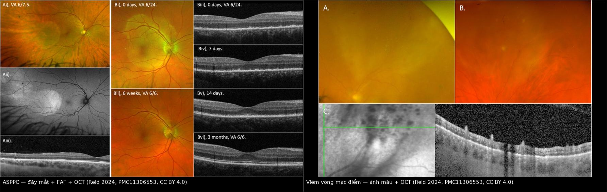
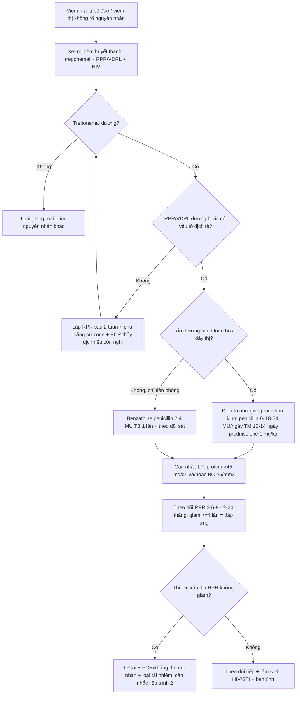
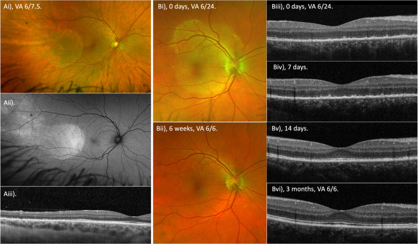
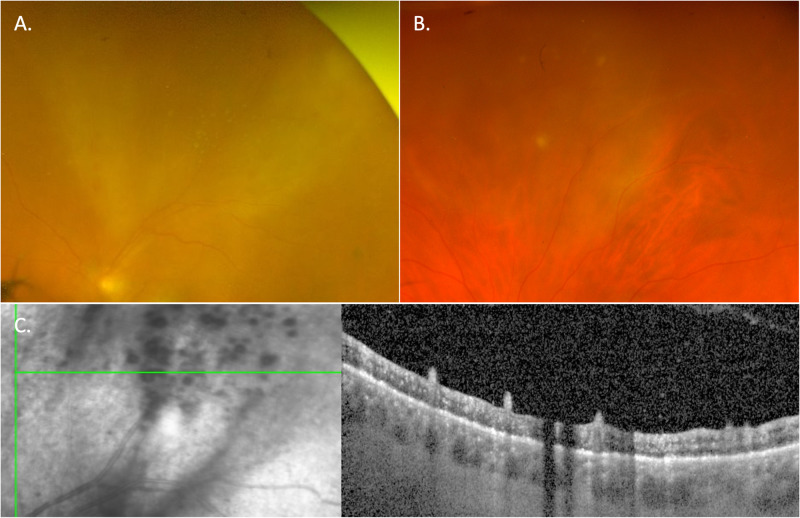
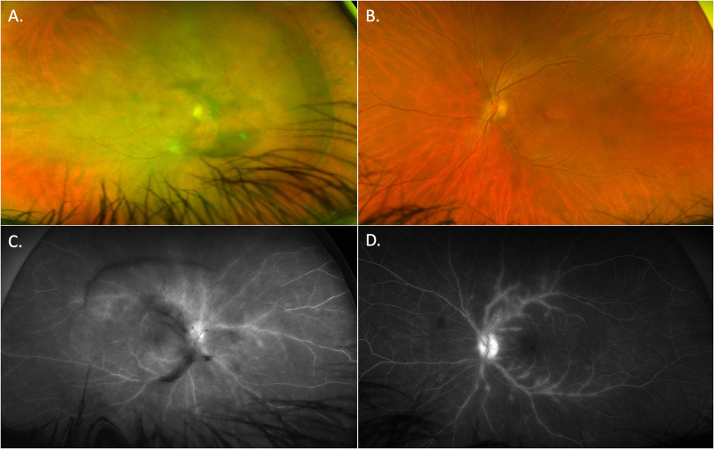

# 3302 — Viêm màng bồ đào do giang mai (ocular syphilis): "kẻ giả trang" chữa khỏi được / Ocular syphilis

**Tags:** `pattern:viem-mang-bao-dau` `pattern:placoid` `pattern:viem-mach-vong-mac` `pattern:viem-thi` `pattern:vitritis` `pattern:masquerade` `pattern:giam-thi-luc-mot-ben` `pattern:not-mong-mat` `vung:mat` `vung:tien-phong` `vung:dich-kinh` `vung:vong-mac` `vung:hac-mac` `vung:hoang-diem` `vung:gai-thi` `protocol:OCT` `protocol:FAF` `protocol:FA` `protocol:widefield` `protocol:AS-OCT` `protocol:MRI-hoc-mat` `protocol:choc-do-tuy-song` `score:RPR` `score:CSF`
**Mức chắc chắn (certainty):** tổng hợp y văn (literature synthesis) — số liệu lấy từ 1 sổ đăng ký đa trung tâm (IBERSOS, 39 bệnh nhân), 5 đoàn hệ đơn trung tâm (21–215 mắt), 2 tổng quan có hệ thống/ tổng quan ảnh học, 1 nghiên cứu dược lý–điều trị so sánh ceftriaxone–penicillin (205 bệnh nhân), 1 đoàn hệ tiến cứu về phản ứng Jarisch–Herxheimer (772 bệnh nhân) và 1 thử nghiệm quan sát nhỏ về doxycycline (32 bệnh nhân). **Không có RCT** cho liệu trình hay corticoid bổ trợ trong giang mai mắt; mọi ngưỡng dưới đây đều ghi rõ cỡ mẫu/nguồn.

> **Vì sao bài này quan trọng:** đây là nguyên nhân **chữa khỏi được** của viêm màng bồ đào — nhưng chỉ khi nghĩ tới. Trong sổ đăng ký IBERSOS, thời gian từ **khởi phát triệu chứng đến lúc điều trị là 6,2 ± 9,3 tuần**, và **8,0% mắt** vẫn còn thị lực **kém hơn 0,3 logMAR** lúc kết thúc theo dõi. Khác với hầu hết nguyên nhân viêm màng bồ đào (điều trị ức chế miễn dịch), giang mai mắt đòi **kháng sinh diệt xoắn khuẩn trước, corticoid sau** — nhỏ corticoid đơn thuần hoặc chờ "đáp ứng corticoid" là con đường dẫn tới mù không hồi phục.

> **Sửa tiền đề của backlog (trung thực nguồn):** backlog ghi "OCT/FA giúp định hướng nhưng **chốt bằng huyết thanh + dịch kính**". Y văn hiện hành **không** lấy dịch kính làm chuẩn: SUN/CDC chốt chẩn đoán bằng **huyết thanh** (treponemal + non-treponemal); **PCR dịch kính/tiền phòng** và **chỉ số kháng thể nội nhãn** chỉ là công cụ **bổ trợ** khi huyết thanh không kết luận (độ nhạy PCR > 85% ở pha hoạt động nhưng không phải tiêu chuẩn vàng). Bài này trình bày đúng thứ bậc đó, không thổi phồng giá trị dịch kính.

## 1. Tổng quan bệnh học – cơ chế hình ảnh – vì sao "giả trang" mà ảnh lại có mẫu hình

- **Tác nhân – dịch tễ định lượng:** *Treponema pallidum* là xoắn khuẩn Gram âm ký sinh nội bào bắt buộc. Năm 2022 có **> 8 triệu người 18–49 tuổi** được chẩn đoán giang mai toàn cầu; cùng năm Hoa Kỳ ghi **203.500 ca** — cao nhất từ 1950 (so với **6.100 ca** năm 2001). Tỉ lệ **giang mai mắt** ở người lớn: BOSS (Anh, giám sát toàn quốc 2 năm) **0,3 ca/triệu người lớn/năm**; IBERSOS (Tây Ban Nha – Bồ Đào Nha, 23 trung tâm, dân số nguồn 7.247.788) **0,57/100.000 người/năm**. Khoảng **2–3%** người nhiễm giang mai có biểu hiện mắt; ở người **đồng nhiễm HIV** con số này tới **~1/3**.
- **Ai bị:** **> 90%** là nam; IBERSOS: **94,9% nam**, **66,7% MSM**, **20,5% nhiễm HIV**. Nguy cơ giang mai tiên phát/thứ phát ở MSM cao tới **250 lần** so với nữ; HIV làm tăng nguy cơ nhiễm giang mai (**7,1 so với 4,8/100 người**), và ở Nam Phi **52,1%** trong 215 mắt giang mai mắt có đồng nhiễm HIV.
- **Giai đoạn:** giang mai mắt xuất hiện ở **mọi giai đoạn**, hay gặp ở **thứ phát và tiềm ẩn muộn**; **~28%** ca biểu hiện ở giai đoạn thứ phát. IBERSOS: tiên phát **7,7%**, thứ phát **25,6%**, tam phát/tứ phát **15,4%**, tiềm ẩn **51,3%**.
- **Sinh lý bệnh (vì sao mắt):** xoắn khuẩn lan theo đường máu, **vượt hàng rào máu–mắt và máu–võng mạc**; protein màng ngoài **Tp0751** giúp bám và xuyên tế bào nội mô, **biến đổi kháng nguyên TprK** giúp thoát miễn dịch. Đích thường gặp là **mao mạch hắc mạc và lớp biểu mô sắc tố (RPE)/võng mạc ngoài** — nơi hàng rào máu–võng mạc mỏng và giàu tế bào trình diện kháng nguyên. Mô bệnh: thâm nhiễm **bạch cầu đơn nhân/đại thực bào**, tăng **CCL2, CXCL8, IL-6, IL-12, TNF** trong thủy dịch và dịch não tủy; chính phản ứng viêm này (chứ không phải xoắn khuẩn tại chỗ) tạo ra phần lớn tổn thương.
- **TẠI SAO ảnh đáy mắt có "mảng placoid":** viêm mao mạch hắc mạc + RPE làm **RPE dày lên, mất cực tính và tích tụ vật liệu viêm** → trên ảnh màu là **mảng vàng–kem, bờ mờ, ở lớp sâu** (dưới võng mạc cảm giác), thường hoàng điểm/cạnh gai. Vì tổn thương **ở lớp RPE–mao mạch hắc mạc**, võng mạc phía trên có thể còn trong → bệnh nhân **nhìn mờ nhưng đáy mắt "không đỏ, không mủ"**, rất dễ bị gọi là "bình thường".
- **TẠI SAO OCT là chốt hình ảnh:** OCT phân giải **~5–7 µm** nên thấy **nốt tăng phản hồi dạng gò trên bề mặt RPE** (đám tế bào viêm/fibrin), **đứt đoạn dải ellipsoid (EZ)** và **mất lớp võng mạc ngoài**. Vì tổn thương **còn hồi phục** nếu ngắn, EZ và các nốt RPE **tái lập trong 7–14 ngày đến vài tuần** sau kháng sinh (Hình 3: OCT ngày 0 → 7 → 14 ngày → 3 tháng). Đây là lý do **chụp OCT sớm** quan trọng hơn chụp đẹp: ảnh muộn có thể "sạch" dù bệnh đã từng hoạt động.
- **TẠI SAO FAF tăng tự phát huỳnh quang:** FAF dùng ánh sáng **488 nm** kích thích **lipofuscin** trong RPE. RPE bị viêm → ứ đọng lipofuscin/fluorophore → **tăng tự phát huỳnh quang**, và vùng tăng thường **rộng hơn mảng nhìn thấy trên ảnh màu** (Hình 3Aii). Ngược lại, nơi RPE đã mất → **giảm tự phát huỳnh quang** (thường xuất hiện muộn, sau đợt viêm nặng).
- **TẠI SAO FA thấy "giảm ở thì sớm, thấm ở thì muộn":** mảng placoid gây **tắc/không tưới máu mao mạch hắc mạc** → vùng **giảm huỳnh quang sớm**; sau đó hàng rào RPE bị phá → **thuốc thấm và đọng ở thì muộn**. Viêm mạch võng mạc cho **thành mạch bắt thuốc + rò ở thì muộn** (Hình 6C–D).
- **Vì sao gọi là "giả trang":** biểu hiện **không đặc hiệu** (viêm tiền phòng, viêm dịch kính, viêm mạch, viêm thị) và **huyết thanh có thể âm giả**. Gộp các đoàn hệ: **~40%** giang mai mắt có **RPR không phản ứng hoặc hiệu giá thấp**; độ nhạy non-treponemal so với soi nền tối chỉ **48,7–76,1%** (VDRL **50,0–78,4%**). Vì vậy "RPR âm" **không loại trừ**.
- **Hậu quả của chậm trễ (định lượng):** IBERSOS: **6,2 ± 9,3 tuần** từ triệu chứng đến điều trị, **2,6 ± 6,0 tuần** từ lần khám đầu đến điều trị; nghiên cứu Pháp cho kết quả thị lực tốt nhất khi **triệu chứng → khám trong 15 ngày** (SD 19). Kết cục chung vẫn tốt nếu điều trị: IBERSOS **61,3%** giảm hiệu giá 4 lần, thị lực cuối **0,17 logMAR**, **56% mắt tăng ≥ 0,1 logMAR**; Ả Rập Xê Út **0,81 → 0,23 logMAR**; Bồ Đào Nha **0,38 → 0,16 logMAR** (p < 0,001). Nhưng **8,0% mắt** vẫn **> 0,3 logMAR** sau điều trị, chủ yếu do **viêm thị**.

## 2. Mẫu hình + chẩn đoán phân biệt theo vị trí (gamut)

Câu hỏi đầu tiên: **tổn thương ở khoang nào, một bên hay hai bên, và có "mảng placoid" ở lớp RPE không?** Giang mai mắt **có thể là bất kỳ thể viêm màng bồ đào nào**, nên SUN khuyến cáo **chẩn đoán dựa trên huyết thanh, không dựa trên hình thái** — nhưng hình thái quyết định **mức độ khẩn và cách điều trị**.

- **A. Đoạn trước (tiền phòng – mống mắt):** viêm màng bồ đào trước **tăng nhãn áp**, **nốt mống mắt (iris nodule)/hồng ban (roseola)**, KPs, **dính sau**; mủ tiền phòng thật hiếm. IBERSOS: **64,1%** có viêm đoạn trước; nhưng viêm màng bồ đào trước đơn thuần chỉ chiếm **0,8%** (2/241) ca viêm màng bồ đào trước cấp trong một loạt lớn — nghĩa là **không được chỉ dựa vào "đỏ mắt"**.
- **B. Trung gian (dịch kính):** **viêm dịch kính (vitritis)** — IBERSOS **53,8%**; Brazil **49,4% nam so với 28,8% nữ** (p = 0,019). Vitritis đơn thuần dễ bị chẩn đoán là "viêm màng bồ đào trung gian vô căn".
- **C. Hậu đoạn (võng mạc–hắc mạc):** IBERSOS **69,2%**; thể điển hình:
  - **ASPPC (acute syphilitic posterior placoid chorioretinitis)** — mảng vàng–kem hoàng điểm/cạnh gai, gần như **chỉ do giang mai**; Ả Rập Xê Út **51,5% mắt có placoid**, **54,5% mắt là ASPPC**.
  - **Viêm võng mạc điểm (punctate inner retinitis):** **chấm trắng trước võng mạc 50–500 µm**, thành đám, luôn kèm viêm võng mạc nền "kính mờ" (Hình 4).
  - **Viêm võng mạc hoại tử** (giả ARN), **viêm mạch võng mạc** (viêm tĩnh mạch/động mạch, tắc nhánh), **viêm mạch–võng mạc lan tỏa**.
  - **Bong võng mạc tiết dịch** (ASPPC nặng) hoặc **bong rách** (co kéo/hoại tử).
- **D. Thần kinh thị:** IBERSOS **59,0%** có tổn thương dây thị; Bồ Đào Nha **42,1%** viêm thị; thể **viêm gai thị (papillitis)**, **viêm quanh dây thị (peri-neuritis)**, **viêm thần kinh thị hậu nhãn cầu** (gai bình thường), **viêm màng não–thị**. Có thể **đứng riêng** hoặc kèm viêm màng bồ đào sau/toàn bộ.
- **E. Ngoài võng mạc (hiếm nhưng bỏ sót = mù):** **viêm củng mạc thể nốt** (58,1% viêm củng mạc giang mai; hoại tử chỉ **16,1%** — ngược với viêm củng mạc nhiễm khuẩn khác **> 90%**), **viêm giác mạc kẽ** (đặc trưng giang mai bẩm sinh, **> 50%**), viêm kết mạc, viêm mô hốc mắt, **săng giang mai ở mi** (dễ gọi là chắp).

**Gamut theo mẫu hình (pattern → location):**
- **Placoid hoàng điểm:** giang mai (ASPPC) · **APMPPE** · **MEWDS** · viêm hắc võng mạc dạng serpiginous · lao · sarcoid · u lympho · thuốc/ICI.
- **Chấm trắng trước võng mạc + viêm võng mạc nền:** giang mai · **ARN (HSV/VZV)** · CMV · toxoplasma · Behçet · nấm nội sinh.
- **Viêm mạch võng mạc:** Behçet · sarcoid · lao · MS · giang mai · u lympho · bệnh mạch máu.
- **Viêm thị +/hoặc viêm quanh dây thị:** viêm thị giảm myelin · **NMO/MOG** · AION · sarcoid · lao · u lympho · **giang mai** · IIH (nếu hai bên, đau đầu).
- **Viêm màng bồ đào trước hạt + tăng nhãn áp:** sarcoid · lao · herpes · **giang mai** · viêm do thể thủy tinh.
- **Giả u/viêm màng bồ đào dai dẳng không đáp ứng corticoid:** **u lympho nội nhãn (1435)** · giang mai · lao · nấm · sarcoid · VKH không điển hình.

## 3. Bảng so sánh phân biệt (ma trận đối chiếu)

| Thực thể (entity) | Hình ảnh điển hình | Chốt vào (rule-in) | Chốt loại (rule-out) | Gợi ý xác nhận |
|---|---|---|---|---|
| **Giang mai mắt – ASPPC** | Mảng vàng–kem **ở lớp RPE** hoàng điểm/cạnh gai; FAF **tăng tự phát huỳnh quang rộng hơn mảng**; OCT **nốt tăng phản hồi trên RPE + đứt EZ**; FA giảm sớm/thấm muộn | **Placoid + FAF tăng + OCT nốt RPE**; **huyết thanh treponemal dương**; đáp ứng nhanh sau penicillin | **Không có placoid, tổn thương chỉ ở võng mạc trong, không đụng RPE** → ít nghĩ ASPPC | RPR/VDRL + TPPA/EIA, HIV; theo dõi OCT **7–14 ngày** |
| **Giang mai mắt – viêm võng mạc điểm** | **Chấm trắng trước võng mạc 50–500 µm**, đám, nền võng mạc "kính mờ"; OCT: chấm tăng phản hồi **trên màng giới hạn trong** | **Chấm trước võng mạc + viêm võng mạc nền + huyết thanh dương** | **Chấm chỉ ở dịch kính, không có viêm võng mạc nền** → nghĩ bệnh khác | OCT qua vùng chấm; PCR/ huyết thanh; đáp ứng penicillin |
| **APMPPE/MEWDS** | Mảng trắng–xám **ở hoàng điểm**, nhiều ổ; **FA sớm giảm huỳnh quang, muộn tăng**; OCT **ít đụng RPE**, không nốt RPE rõ | **Bệnh nhân trẻ, tiền sử nhiễm virus, tự khỏi 4–6 tuần**, huyết thanh giang mai âm | **Placoid đơn ổ ở người > 50 tuổi + nốt RPE + huyết thanh dương** → loại APMPPE | Huyết thanh giang mai; theo dõi FAF/OCT 2–4 tuần |
| **Viêm hắc võng mạc dạng serpiginous** | Bờ **lan theo hình con rắn**, teo RPE–hắc mạc tiến triển, thường hai bên | **Bờ tiến triển + teo hắc mạc + huyết thanh giang mai âm** | **Placoid tự lành sau 1–2 tuần kháng sinh, không teo lan** → loại serpiginous | FAF/FA, OCT, huyết thanh; cân nhắc lao |
| **Lao nội nhãn** | Nốt lao hắc mạc, viêm mạch, dày hắc mạc, viêm màng bồ đào hạt | **IGRA dương + tổn thương lao nơi khác + đáp ứng thuốc lao** | **Placoid điển hình + RPR/TPPA dương + đáp ứng penicillin** → loại lao | IGRA, CT ngực, PCR lao |
| **Sarcoidosis mắt** | **Nốt Koeppe/Busacca**, **nang mống mắt**, viêm mạch "sáp nhỏ giọt", viêm màng bồ đào hạt | **Hạch/da/X-quang ngực + ACE tăng + sinh thiết** | **Placoid RPE + huyết thanh giang mai dương** → loại sarcoid | CT ngực, ACE, sinh thiết |
| **Behçet** | Viêm màng bồ đào sau/toàn bộ **tái phát**, **viêm mạch "dương xỉ"**, giả mủ tiền phòng, loét miệng–sinh dục | **Tam chứng ± HLA-B51 + đáp ứng ức chế miễn dịch** | **Đáp ứng penicillin, huyết thanh giang mai dương** → loại Behçet | Khám miệng/sinh dục, HLA-B51, huyết thanh |
| **ARN do HSV/VZV** | **Viêm võng mạc hoại tử ngoại vi**, viêm mạch, vitritis mạnh, **bong võng mạc** | **PCR dịch kính HSV/VZV dương**, tổn thương hoại tử lan nhanh | **Tổn thương placoid trung tâm + PCR herpes âm + huyết thanh giang mai dương** | PCR dịch kính, huyết thanh; **không chờ PCR nếu ARN điển hình** |
| **U lympho nội nhãn (masquerade)** | Tế bào dịch kính, **đốm dưới RPE**, không đau, **không đáp ứng corticoid**; IL-10/IL-6 > 1 | **Tế bào ác tính/ flow cytometry + IL-10/IL-6 > 1** | **Huyết thanh giang mai dương + placoid + đáp ứng penicillin** → loại u lympho | Cytology/flow, cytokine; xem **1435** |
| **VKH** | **Bong võng mạc thanh dịch hai bên + hắc mạc dày**, đĩa thị sung huyết, **BALAD/HDD** | **SFCT 900–940 µm + tổn thương đối xứng + không tiền sử chấn thương** | **Placoid một bên + huyết thanh giang mai dương** → loại VKH | OCT EDI, ICGA; xem **1436** |
| **Viêm nội nhãn/áp-xe tiền phòng** | **Mủ tiền phòng thật**, fibrin, đau nhiều; khởi phát **giờ–ngày** sau can thiệp | **Khởi phát cấp < 1 tuần sau mổ/tiêm + cấy dương** | **Không đau, tái diễn nhiều tuần, placoid sâu** → loại nhiễm nội nhãn | Cấy/PCR thủy dịch–dịch kính |

*Hai mẫu hình hậu đoạn của giang mai mắt: (trái) **ASPPC** — mảng placoid cạnh hoàng điểm, FAF tăng tự phát huỳnh quang, OCT nốt tăng phản hồi trên RPE rồi tái lập EZ sau 7–14 ngày; (phải) **viêm võng mạc điểm** — chấm trắng trước võng mạc 50–500 µm, OCT thấy chấm tăng phản hồi trên màng giới hạn trong. Nguồn: Reid GA et al., *Eye* 2024;38:2337–2349 (PMC11306553) Fig. 3 và Fig. 4, **CC BY 4.0**.*

## 4. Protocol chụp + hệ phân độ/điểm chuẩn hóa + phác đồ

### 4.1. Huyết thanh — chốt chẩn đoán (thứ tự đúng)

1. **Treponemal test** (EIA/CIA, TPPA, TPHA, FTA-ABS): độ nhạy cao, **dương suốt đời** sau nhiễm — không phân biệt **đang hoạt động hay đã điều trị**.
2. **Non-treponemal test** (RPR/VDRL): **hiệu giá** phản ánh hoạt động; **giảm ≥ 4 lần** (2 pha loãng) sau điều trị = đáp ứng; **tăng ≥ 4 lần** = tái nhiễm/tái hoạt.
3. **Âm giả/giả dương:** RPR âm giả ở **~40%** giang mai mắt (hiệu giá thấp/không phản ứng); độ nhạy NTT **48,7–76,1%**; **hiện tượng prozone** khi hiệu giá rất cao → **pha loãng huyết thanh**; giả dương gặp trong lao, Rickettsia, phong, viêm nội tâm mạc, thai kỳ.
4. **Nếu RPR âm mà vẫn nghi:** lặp lại sau **2 tuần**, làm **treponemal test**, **HIV**, và cân nhắc **PCR thủy dịch/dịch kính** (độ nhạy **> 85%** ở pha hoạt động) — nhưng **không thay thế huyết thanh**.
5. **HIV là xét nghiệm bắt buộc** ở mọi ca giang mai mắt (đồng nhiễm 20,5% trong IBERSOS; 52,1% ở Nam Phi).

### 4.2. Dịch não tủy (CSF) — khi nào và đọc thế nào

- **Không bắt buộc thường quy** nếu đã quyết định điều trị như giang mai thần kinh: **60–70%** ca giang mai mắt có bất thường CSF; nhiều trung tâm (kể cả nhóm tác giả Eye 2024) **điều trị mọi viêm màng bồ đào sau/toàn bộ + viêm thị như giang mai thần kinh** mà không cần LP.
- **Ngưỡng định lượng:** **protein > 45 mg/dL** và/hoặc **bạch cầu > 5 tế bào/mm³** = bất thường gợi ý giang mai thần kinh; **bạch cầu > 20/mm³** có **giá trị tiên đoán dương gần như tuyệt đối**.
- **Cạm bẫy HIV:** ở người nhiễm HIV, **protein CSF không đáng tin** (nhiễm HIV làm tăng protein nền); ngưỡng bạch cầu **> 10 hoặc > 20/mm³** chỉ "trung bình" cho sàng lọc. **CSF-VDRL** đặc hiệu cao nhưng **độ nhạy chỉ 50–78,4%** → **âm không loại trừ**; **CSF-FTA-ABS** nhạy nhưng kém đặc hiệu, **không dùng theo dõi**.
- **Khi nào LP rõ ràng cần:** triệu chứng thần kinh, **giảm thính lực/ù tai**, **HIV nặng**, **viêm thị hai bên**, thất bại điều trị, hoặc trước khi cân nhắc liệu trình ngắn.

### 4.3. Protocol hình ảnh (tối thiểu – đủ)

| Bước | Kỹ thuật | Mục đích / ngưỡng |
|---|---|---|
| 1 | **Ảnh màu góc rộng (widefield, 200°)** | Phát hiện mảng placoid ngoại vi, viêm mạch; chụp **trước điều trị** làm mốc |
| 2 | **FAF góc rộng** | Vùng tăng tự phát huỳnh quang **rộng hơn** mảng lâm sàng; theo dõi tổn thương RPE |
| 3 | **SD-OCT hoàng điểm, lát qua tổn thương** | **Nốt tăng phản hồi trên RPE**, đứt EZ, dịch dưới võng mạc; **EDI** đo hắc mạc nếu nghi VKH/u |
| 4 | **FA (nếu viêm mạch/tắc mạch/không rõ)** | Giảm tưới máu sớm + thấm muộn; rò thành mạch |
| 5 | **AS-OCT/UBM** | Nốt mống mắt, dính sau, tổn thương thể mi khi đoạn trước |
| 6 | **Thị trường 24-2** | Viêm thị/quanh dây thị; theo dõi khuyết thị trường |
| 7 | **MRI hốc mắt + não, T1 fat-sat sau tiêm** | Viêm quanh dây thị (dày/vỏ bao ngấm thuốc), tổn thương thần kinh trung ương, giả u |

### 4.4. Điều trị (theo CDC, có đối chiếu thực hành)

- **Viêm màng bồ đào sau/toàn bộ hoặc tổn thương dây thị = điều trị như giang mai thần kinh:**
  **penicillin G tinh thể nước 18–24 triệu UI/ngày** (3–4 triệu UI TM mỗi 4 giờ **hoặc** truyền liên tục) × **10–14 ngày**.
- **Corticoid toàn thân bổ trợ:** **prednisolone 1 mg/kg/ngày**, giảm liều trong **≥ 6–8 tuần**, **bắt đầu cùng lúc với kháng sinh** — để kiểm soát viêm và **giảm phản ứng Jarisch–Herxheimer**. Không dùng corticoid đơn thuần.
- **Viêm màng bồ đào trước đơn thuần + giang mai sớm:** CDC cho phép **benzathine penicillin 2,4 triệu UI tiêm bắp 1 lần**; nhưng nếu có **bất kỳ tổn thương sau/ dây thị**, liều này **không đủ** (xem cạm bẫy Hình 8).
- **Dị ứng penicillin:** **ceftriaxone 1–2 g/ngày × 14 ngày** (TM/TB) hoặc **doxycycline 100 mg × 2/ngày × 28 ngày** (bằng chứng yếu, **không tương đương penicillin**); nếu dị ứng nặng → **giải mẫn cảm**.
- **Theo dõi:** RPR/VDRL lúc **3, 6, 9, 12, 24 tháng**; mục tiêu **giảm ≥ 4 lần**; khám lại ngay nếu thị lực xấu đi; **tầm soát lại HIV và bệnh lây qua đường tình dục**; điều trị bạn tình.

## 5. Biến thể bình thường và cạm bẫy

- **"RPR âm = không giang mai" — SAI.** **~40%** giang mai mắt có RPR âm/hiệu giá thấp; 5/21 (23,8%) trong đoàn hệ Bồ Đào Nha có **VDRL âm dù treponemal dương**. Luôn làm **treponemal test**; lặp RPR sau **2 tuần**; nhớ **prozone**.
- **"CSF bình thường = không giang mai thần kinh" — SAI.** Trong đoàn hệ 14 ca có LP, **một nửa CSF bình thường**; CSF-VDRL **âm ở 21,6–50%** ca thần kinh. Chẩn đoán là **tổng hợp** huyết thanh + lâm sàng + CSF.
- **Treponemal dương suốt đời:** ở người **> 50 tuổi** hoặc dân số nguy cơ cao, treponemal dương có thể chỉ là **nhiễm cũ đã điều trị**. Cần **RPR hiệu giá**, bối cảnh lâm sàng và **loại trừ nguyên nhân khác** trước khi quy mọi viêm màng bồ đào cho giang mai.
- **Corticoid trước kháng sinh:** nhỏ/ uống corticoid khi chưa diệt xoắn khuẩn → **viêm bùng phát, hoại tử, thủng** (tương tự lao). Nếu bệnh nhân đã được chẩn đoán "viêm màng bồ đào vô căn" và đang corticoid, **không ngừng đột ngột** — bắt đầu kháng sinh và giảm corticoid có kiểm soát.
- **Một liều benzathine penicillin cho tổn thương sau:** ca Hình 8 (Eye 2024) **mờ đi sau 1 liều benzathine** do bác sĩ gia đình điều trị "giang mai huyết thanh" mà không khám mắt; tổn thương sau **không đáp ứng liều này**. Phải phân biệt **viêm màng bồ đào trước đơn thuần** với **bất kỳ tổn thương sau/dây thị**.
- **Jarisch–Herxheimer (JHR) giả "thất bại điều trị":** gặp **9,3%** (95% CI 7,3–11,4) ở 772 bệnh nhân giang mai thần kinh HIV âm; **nặng 4,1%**; khởi phát **~5 giờ**, đỉnh **8 giờ**, hết sau **18 giờ** (nặng: **26 giờ**). Biểu hiện: sốt, đau đầu, **viêm tăng lên thoáng qua**. Xử trí: **paracetamol + corticoid** (IBERSOS: 3 ca, 1 paracetamol, 2 corticoid), **không đổi kháng sinh**.
- **HIV làm đổi hình thái:** **viêm màng bồ đào sau/toàn bộ và viêm thị** nhiều hơn; **ASPPC điển hình ít hơn** khi CD4 thấp (< 100 tế bào/mm³) và **hay gặp ở CD4 > 400**; **viêm màng bồ đào do hồi phục miễn dịch (IRU)** có thể xuất hiện sau ART → **tái phát không đồng nghĩa thất bại**.
- **Corticoid nội nhãn/ sau Tenon ở mắt nghi giang mai:** có thể **tái hoạt CMV** hoặc làm bệnh nặng thêm; tránh khi chưa loại trừ nhiễm trùng.
- **Bỏ sót vì "đáy mắt bình thường":** placoid **ở lớp sâu**, võng mạc trên còn trong; **luôn chụp OCT/FAF** khi nghi, đặc biệt ở **viêm thị đơn độc** — OCT hoàng điểm có thể thấy **đứt EZ/placoid ẩn** mà không thấy trên ảnh màu.
- **Không phải mọi "chấm trắng" là giang mai:** kiểm chứng bằng huyết thanh; Hình 7A của bài gốc là **neuroretinitis do Bartonella** (đối chứng) — cùng "macular star" nhưng huyết thanh giang mai âm.

## 6. Tự lượng giá — Blind Quiz

**Ca 1 — nam 45 tuổi, nhìn mờ mắt phải 8 ngày, không đau, không đỏ mắt.**

- Gợi ý lâm sàng: thị lực 6/24, tiền phòng yên, có vài tế bào dịch kính; không sốt, không đau khớp.
- Câu hỏi: Mô tả tổn thương trên ảnh màu, FAF và OCT? Ba chẩn đoán phân biệt? Dấu hiệu nào chốt hướng điều trị?

<b>Bấm để hiện đáp án (findings + chẩn đoán)</b>

- **Dấu hiệu:** mảng vàng–kem **ở lớp RPE** cạnh hoàng điểm (Ai); FAF **tăng tự phát huỳnh quang** rộng hơn mảng (Aii); OCT **nốt tăng phản hồi trên bề mặt RPE + đứt EZ** (Aiii); sau điều trị **EZ tái lập dần ở 7–14 ngày và 3 tháng** (Biii–Bvi).
- **Chẩn đoán:** **ASPPC do giang mai** — mảng placoid + tổn thương RPE/EZ là mẫu hình gần như đặc trưng; huyết thanh treponemal + RPR xác nhận.
- **Vì sao:** xoắn khuẩn tấn công mao mạch hắc mạc/RPE → viêm lớp sâu, **không phải viêm võng mạc trong**; EZ hồi phục nếu điều trị sớm.
- **Nguồn ảnh:** Reid GA et al., *Eye* 2024 (PMC11306553) Fig. 3, **CC BY 4.0**.

**Ca 2 — nữ 29 tuổi, ruồi bay + nhìn mờ mắt trái 2 tuần, đang mang thai 12 tuần.**

- Gợi ý lâm sàng: không đau, có tế bào dịch kính; tiền sử sảy thai trước đó; không dùng thuốc.
- Câu hỏi: Chấm trắng nằm ở lớp nào? OCT xác nhận gì? Vì sao cần xét nghiệm giang mai và HIV ngay?

<b>Bấm để hiện đáp án (findings + chẩn đoán)</b>

- **Dấu hiệu:** nhiều **chấm trắng trước võng mạc 50–500 µm** thành đám (A, B); OCT thấy **chấm tăng phản hồi nằm trên màng giới hạn trong**, nền võng mạc "kính mờ" (C).
- **Chẩn đoán:** **viêm võng mạc điểm do giang mai**; cần huyết thanh treponemal/RPR + HIV; **thai kỳ không phải chống chỉ định penicillin** — đây là thuốc **bắt buộc** để dự phòng giang mai bẩm sinh.
- **Vì sao:** chấm trước võng mạc là **lắng đọng viêm** trên bề mặt võng mạc, không phải mảng RPE; **không điều trị → viêm võng mạc hoại tử/bong**.
- **Nguồn ảnh:** Reid GA et al., *Eye* 2024 (PMC11306553) Fig. 4, **CC BY 4.0**.

**Ca 3 — nam 38 tuổi, nhìn mờ hai mắt 3 tuần, đau nhẹ khi liếc; HIV dương tính, CD4 180.**

- Gợi ý lâm sàng: thị lực 6/18 và 6/12; tiền phòng có tế bào, dịch kính đục; không loét miệng.
- Câu hỏi: Mô tả bất thường mạch máu trên FA? Chẩn đoán phân biệt chính? Vì sao phải điều trị như giang mai thần kinh dù chưa có triệu chứng thần kinh?

<b>Bấm để hiện đáp án (findings + chẩn đoán)</b>

- **Dấu hiệu:** ảnh màu góc rộng **mờ do viêm dịch kính** (A, B); FAF/FA cho thấy **viêm tĩnh mạch võng mạc lan tỏa** — thành mạch bắt thuốc, rò ở thì muộn (C, D).
- **Chẩn đoán:** **viêm màng bồ đào toàn bộ + viêm mạch do giang mai** ở người HIV; phân biệt **ARN (HSV/VZV)**, **CMV**, **Behçet**, **lao**, **sarcoid**, **u lympho**.
- **Vì sao điều trị như giang mai thần kinh:** **60–70%** ca giang mai mắt có bất thường CSF; tổn thương sau/toàn bộ + HIV là nhóm **nguy cơ cao**; penicillin liều thần kinh **18–24 MU/ngày × 10–14 ngày** + corticoid kiểm soát viêm.
- **Nguồn ảnh:** Reid GA et al., *Eye* 2024 (PMC11306553) Fig. 6, **CC BY 4.0**.

## 7. Câu hỏi nghiên cứu & điểm chưa đồng thuận (tính đến 11/2026)

1. **[Tranh cãi] Ở bệnh nhân giang mai mắt không có triệu chứng thần kinh, có nên chọc dò tủy sống thường quy và điều trị như giang mai thần kinh cho tất cả, hay phân tầng nguy cơ để chọn người cần LP/liệu trình TM?**
   - **Đã biết:** **60–70%** ca giang mai mắt có bất thường CSF; nhiều trung tâm điều trị mọi viêm màng bồ đào sau/toàn bộ và viêm thị như giang mai thần kinh mà không cần LP, trong khi **một nửa** số ca có LP trong một đoàn hệ lại có CSF bình thường.
   - **Chưa rõ:** chưa có tiêu chí nào xác định ai **thực sự** cần LP; giá trị tiên đoán của CSF ở người nhiễm HIV còn kém (protein không đáng tin).
   - **Hướng nghiên cứu:** đoàn hệ tiến cứu phân tầng theo triệu chứng/HIV/CSF, so sánh kết cục thị lực và tái phát giữa "LP-guided" và "treat-all".
   - **Nguồn:** PMC11306553 (2024); PMC13638310 (2026); PMC13515132 (2026).

2. **[Khoảng trống] Corticoid bổ trợ trong giang mai mắt: liều, thời điểm bắt đầu và thời gian giảm liều nào tối ưu, và có làm tăng nguy cơ tái phát/nhiễm trùng cơ hội không?**
   - **Đã biết:** prednisolone **1 mg/kg** giảm liều **≥ 6–8 tuần** là thực hành phổ biến; corticoid giảm viêm và JHR, nhưng bằng chứng chỉ từ ca bệnh/ý kiến chuyên gia; một loạt nhỏ 18 mắt cho thấy corticoid uống tốt hơn nhỏ tại chỗ về thị lực cuối.
   - **Chưa rõ:** không có RCT; chưa rõ liều tối thiểu, thời điểm "càng sớm càng tốt" so với sau kháng sinh, và tác động lên tái phát ở người HIV.
   - **Hướng nghiên cứu:** RCT mù đôi so sánh prednisolone liều chuẩn so với giả dược/liều thấp, kết cục thị lực 6 tháng + tỉ lệ tái phát.
   - **Nguồn:** PMC12472546 (2025); PMC10401898 (2023).

3. **[Khác biệt thực hành] Penicillin TM 10–14 ngày có thực sự vượt trội so với ceftriaxone 14 ngày hoặc doxycycline uống 28 ngày trong giang mai mắt, và sự khác biệt giữa các hướng dẫn/ thực hành địa phương lớn đến đâu?**
   - **Đã biết:** IBERSOS: **65,8%** nhận penicillin TM, **28,9%** chỉ penicillin TB, **2,6%** ceftriaxone và **2,6%** doxycycline; một đoàn hệ 205 bệnh nhân không thấy khác biệt có ý nghĩa giữa ceftriaxone và penicillin (OR 0,672; 95% CI 0,316–1,428); một loạt 32 bệnh nhân gợi ý doxycycline uống có thể dùng ở nhóm chọn lọc.
   - **Chưa rõ:** không có RCT; doxycycline có **thấm CSF kém** và bằng chứng thấp hơn; chưa rõ nhóm bệnh nhân nào an toàn để dùng đường uống.
   - **Hướng nghiên cứu:** RCT/registry đa trung tâm so sánh penicillin TM, ceftriaxone và doxycycline với kết cục **thị lực + hiệu giá RPR + tái phát**.
   - **Nguồn:** PMC13638310 (2026); PMC11620497 (2024); PMC11624577 (2024).

## Bài liên quan chéo
- [1435 – Hội chứng masquerade: u lympho nội nhãn giả viêm màng bồ đào](../1435-hoi-chung-masquerade-u-lympho-noi-nhan/lesson.md)
- [455 – Viêm mạch võng mạc do Behçet và lupus](../455-behcet-lupus-mat/lesson.md)
- [1436 – Bệnh Vogt–Koyanagi–Harada](../1436-benh-vogt-koyanagi-harada/lesson.md)
- [6132 – Viêm giác mạc nhiễm khuẩn liên quan kính tiếp xúc](../6132-viem-giac-mac-kinh-tiep-xuc/lesson.md)
- [6127 – Giang mai bẩm sinh: tổn thương xương ở trẻ](../6127-giang-mai-bam-sinh-xuong/lesson.md)
- [400 – Tổng quan Mắt & thị giác](../400-tong-quan-mat-thi-giac/lesson.md)

## Ảnh
- `3302_giang-mai-mat_Day-mat-OCT-FAF_PMC11306553-Fig3-CCBY.jpg` — ASPPC: ảnh màu góc rộng + FAF + OCT theo thời gian.
- `3302_giang-mai-mat_Vong-mac-diem_PMC11306553-Fig4-CCBY.jpg` — viêm võng mạc điểm: ảnh màu + OCT.
- `3302_giang-mai-mat_FAF-mach-mau_PMC11306553-Fig6-CCBY.jpg` — viêm màng bồ đào toàn bộ + viêm tĩnh mạch võng mạc trên FAF/FA.
- `3302_giang-mai-mat_Tien-phong_PMC11306553-Fig2-CCBY.jpg` — nốt mống mắt + KPs ở thể đoạn trước.
- `composite_giang-mai-mat_ASPPC-vs-vong-mac-diem.jpg` — ảnh ghép đối chiếu hai mẫu hình hậu đoạn.
- Nguồn + giấy phép từng ảnh: `images/CREDITS.md`; nguồn bài: `sources.md`.

> Không dùng để chẩn đoán độc lập khi chưa có người hướng dẫn.
