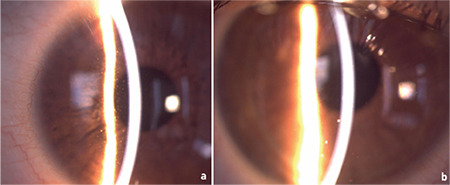
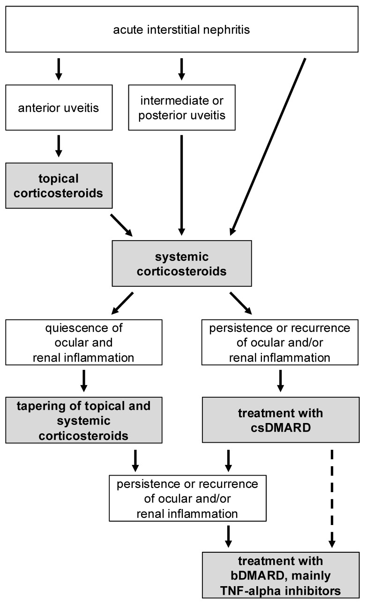
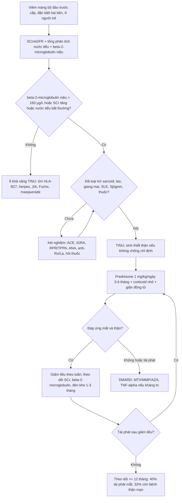
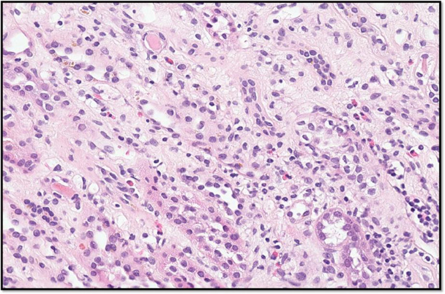

# 3305 — Hội chứng TINU (viêm ống thận mô kẽ + viêm màng bồ đào): mắt đỏ hai bên ở người trẻ, đừng quên creatinin / Tubulointerstitial nephritis and uveitis (TINU)

**Tags:** `pattern:viem-mang-bao-dau` `pattern:viem-mang-bao-dau-truoc` `pattern:hai-ben` `pattern:KP-khong-hat` `pattern:KP-hat` `pattern:suy-than-cap` `pattern:viem-ong-than-mo-ke` `pattern:tai-phat` `vung:mat` `vung:tien-phong` `vung:mong-mat` `vung:ong-than` `vung:mo-ke-than` `protocol:den-khe` `protocol:AS-OCT` `protocol:OCT` `protocol:FA` `protocol:FAF` `protocol:sieu-am-than` `protocol:sinh-thiet-than` `protocol:DW-MRI` `score:SUN` `score:Banff`
**Mức chắc chắn (certainty):** tổng hợp y văn (literature synthesis) — 1 tổng quan dịch tễ có hệ thống (498 bài sàng lọc), 1 tổng quan toàn diện 2025, 2 đoàn hệ lớn (41 người lớn Pháp có sinh thiết; 21 bệnh nhân Rô-ma 1990–2020), 1 đoàn hệ tiến cứu Trung Quốc (31 TINU trong 112 viêm ống thận mô kẽ), 3 loạt ca nhi (10–19 bệnh nhân), nghiên cứu tiêu chuẩn phân loại SUN (94 ca TINU/1.083 ca viêm màng bồ đào trước) và 1 nghiên cứu β2-microglobulin niệu. **Không có RCT**; mọi ngưỡng điều trị dưới đây ghi rõ cỡ mẫu/nguồn.

> **Vì sao bài này quan trọng:** TINU là nguyên nhân **chữa được nhưng hay bị bỏ** của viêm màng bồ đào trước hai bên ở trẻ và người trẻ. Trong một đoàn hệ tiến cứu Trung Quốc, **58% (18/31)** ca TINU được chẩn đoán ban đầu là **viêm ống thận mô kẽ do thuốc** vì uveitis xuất hiện **muộn hơn** thận; và **92%** vẫn còn bệnh thận mạn giai đoạn 3–4 và/hoặc rối loạn chức năng ống thận sau **12 tháng** (Li C và cs, *Clin J Am Soc Nephrol* 2014, PMC3878694). Ở chiều ngược lại, **40%** bệnh nhân người lớn tái phát viêm màng bồ đào trong năm đầu, còn **32%** còn bệnh thận mạn vừa–nặng sau 1 năm (Legendre M và cs, *Medicine* 2016, PMC4937908). Mắt đỏ là lý do đi khám; **creatinin và β2-microglobulin niệu mới là thứ quyết định tiên lượng**.

> **Sửa tiền đề của backlog (trung thực nguồn):** backlog ghi “β2-microglobulin niệu, ái toan niệu”. Y văn cho thấy **β2-microglobulin niệu** đúng là điểm tựa chính (tăng ở **~92–100%** ca có sinh thiết xác nhận; SUN 2021 dùng nó trong tiêu chuẩn phân loại), nhưng **ái toan niệu không đáng tin**: chỉ **29% (7/24)** sinh thiết thận có bạch cầu ái toan trong mô, và **3/41** bệnh nhân có tăng bạch cầu ái toan máu (Legendre 2016). Bài này không dùng “ái toan niệu” làm chốt.

## 1. Tổng quan bệnh học – cơ chế hình ảnh – vì sao mắt và thận cùng viêm

- **Định nghĩa:** TINU = **viêm ống thận mô kẽ cấp (acute interstitial nephritis, AIN)** + **viêm màng bồ đào (uveitis)** ở người **không có bệnh hệ thống nào khác** gây một trong hai tổn thương — nên đây là **chẩn đoán loại trừ**. Mô tả lần đầu năm **1975** (Dobrin); đến 2025 ước tính **~600 ca** đã công bố trên thế giới (Bograd A và cs, *Biomedicines* 2025, PMC11853424).
- **Tần suất (định lượng):** TINU chiếm **0,1–2%** ca khám tại trung tâm viêm màng bồ đào chuyên khoa, tới **2,3%** ở quần thể nhi (Okafor LO và cs, *Orphanet J Rare Dis* 2017, PMC5513333). Cụ thể: **33/1.985 (1,7%)** ở Oregon, **15/3.830 (0,4%)** ở Nhật, **7/3.000 (0,2%)** ở Manchester, **21/9.358 (0,22%)** ở Rô-ma. Quan trọng hơn: TINU chiếm **~10–20%** các ca **viêm màng bồ đào trước cấp hai bên đồng thời**, và **~32%** viêm màng bồ đào trước hai bên đột ngột ở người **< 20 tuổi** (Mackensen, dẫn qua Okafor 2017).
- **Tuổi – giới (có mâu thuẫn thật):** tuổi khởi phát trung vị **15 (9–74)**; đoàn hệ người lớn Pháp trung vị **46,8 tuổi** — nghĩa là TINU **không chỉ của trẻ**. Giới: Mandeville **74% nữ (98/133)**; Rô-ma **71,4% nữ (15/21)**; nhưng Mackensen lại **60% nam**, và một loạt ca 2025 báo **nam:nữ 4:1** (PMC12274152). Không có tỷ lệ giới ổn định giữa các quần thể.
- **Trình tự xuất hiện (rất dễ bỏ):** theo Mandeville, **15%** mắt và thận **đồng thời**, **21%** mắt **trước** thận (tới **2 tháng**), **65%** mắt **sau** thận (trung vị **3 tháng**, tối đa **14 tháng**). Ở người lớn Pháp: thận trước **20%** (trung vị 3 tháng), mắt trước **31%** (trung vị 2 tháng), đồng thời **49%**. Vì vậy **không có thứ tự nào loại trừ TINU**.
- **Ai phát hiện bệnh:** **98%** ca được nghi ngờ đầu tiên bởi **bác sĩ nhãn khoa** (Bograd 2025). Bác sĩ mắt là người duy nhất nhìn thấy dấu hiệu sớm — nhưng chỉ chẩn đoán được nếu **hỏi và xét nghiệm thận**.
- **Cơ chế miễn dịch (vì sao hai cơ quan cùng lúc):** kháng nguyên đích được đề xuất là **modified C-reactive protein (mCRP)** — dạng monomer của CRP xuất hiện ở **tế bào biểu mô ống thận, tế bào mô kẽ và nội mô hắc mạc**. Bệnh nhân có **IgG kháng mCRP**; phức hợp kháng nguyên–kháng thể gây viêm tại **cả** mô kẽ thận **và** màng bồ đào. Nền tảng di truyền là **HLA lớp II**: **HLA-DRB1*0102** gặp **13/18 (72%)** bệnh nhân so với **1,6%** dân số chứng (RR ban đầu 167,1; hiệu chỉnh còn **46,3**), kèm **DQA1*01** (RR 19,5) và **DQB1*05** (RR 16,3). Ở Phần Lan, các allele nguy cơ lại khác: **DQA1*04:01 (RR 4,0)**, **DQA1*01:04 (RR 6,1)**, **DRB1*08 (RR 3,0)**, **DRB1*14 (RR 8,2)** — **không có haplotype chung cho mọi quần thể**. Yếu tố khởi phát: **kháng sinh 29/122**, **NSAID 22/122** (Mandeville); Phần Lan **19/31** ca dùng kháng sinh/NSAID trong 2 tháng trước chẩn đoán; nhưng **PPI** — nguyên nhân AIN hàng đầu ở người già — **hầu như không gây TINU**, gợi ý cơ chế mắt và thận không hoàn toàn giống nhau.
- **TẠI SAO mắt đỏ mà hình ảnh lại là “hạt trên nội mô giác mạc”:** viêm mống mắt–thể mi làm **hàng rào máu–thủy dịch** rò rỉ protein, fibrin và tế bào vào tiền phòng. Các tế bào này **lắng đọng ở mặt sau giác mạc** thành **keratic precipitates (KP)**; KP **nhỏ, đều, phân bố rải rác** = không hạt (non-granulomatous); KP **lớn ≥ 1 mm, dạng “mỡ cừu” (mutton-fat), dính nhau** = hạt (granulomatous). Đèn khe thấy KP vì **tán xạ ánh sáng ở mặt phân cách**; **AS-OCT** thấy KP là **nốt tăng hồi âm (hyperreflective)** trên dải nội mô, đo được **đường kính và số lượng** — nhờ đó phát hiện KP **dưới lâm sàng** và theo dõi khách quan hơn ảnh chụp.
- **TẠI SAO thận “im lặng” trong khi mắt ầm ĩ:** AIN tổn thương **ống thận và mô kẽ**, không đụng cầu thận → **không có protein niệu lớn, không phù, không đái máu đại thể**. Creatinin chỉ tăng khi **≥ 50% khối lượng lọc** đã mất, nên **creatinin bình thường không loại trừ AIN**. Ngược lại, **β2-microglobulin** là protein nhỏ **lọc tự do qua cầu thận và được ống gần tái hấp thu 90%**; khi ống thận viêm, **lượng tái hấp thu giảm** → β2M niệu tăng **sớm và kéo dài 1–2 năm**, trong khi creatinin đã về bình thường sau vài tháng (Provencher LM và cs, *J Ophthalmic Inflamm Infect* 2018, PMC6311166). Đây là lý do β2M niệu **vào tiêu chuẩn SUN 2021**, còn creatinin chỉ là cửa sổ muộn.
- **TẠI SAO siêu âm thận chỉ là gợi ý:** phù mô kẽ + thâm nhiễm tế bào làm **thận to, vỏ tăng hồi âm** so với gan/lách; nhưng hình ảnh này gặp ở mọi AIN và nhiều bệnh thận khác — **không đặc hiệu, không thay sinh thiết**.
- **Hậu quả định lượng:** **40%** tái phát viêm màng bồ đào trong năm đầu; **32%** bệnh thận mạn vừa–nặng sau 1 năm (Pháp, n = 35); **92%** bệnh thận mạn giai đoạn 3–4 và/hoặc rối loạn chức năng ống thận sau 12 tháng (Trung Quốc, n = 31); **15%** rối loạn chức năng thận vĩnh viễn, **33%** viêm màng bồ đào mạn, **21%** biến chứng mắt (tổng quan Jahnukainen, dẫn qua Bograd 2025). Ở loạt nhi 10 bệnh nhân trong đại dịch, **80%** tái phát và **70%** phải dùng ức chế miễn dịch toàn thân (PMC10895161).

## 2. Mẫu hình + chẩn đoán phân biệt theo vị trí và tuổi (gamut)

Câu hỏi đầu tiên: **mắt đỏ một bên hay hai bên, có KP không hạt hay hạt, và creatinin/β2M niệu thế nào?** TINU **không buộc phải điển hình**: chỉ **42,8% (9/21)** ca Rô-ma là viêm màng bồ đào trước hai bên kinh điển; **4/21** là panuveitis, **3/21** viêm hậu đoạn, **2/21** viêm trung gian (PMC9457268). Tuy vậy **100%** ca SUN có **viêm tiền phòng** — tiền phòng là nơi **luôn** phải nhìn.

- **A. Đoạn trước (tiền phòng – mống mắt – thể mi):** thể phổ biến nhất, **> 80%**; **77%** hai bên ngay lúc khởi phát. KP **không hạt** (đa số) hoặc **hạt 20%**. Dấu khác: **dính sau (posterior synechiae)** — biến chứng hay gặp nhất; **nhãn áp thấp hoặc bình thường** lúc cấp (khác glôcôm cấp), nhưng có thể tăng vì corticoid; **thể mi sung huyết**.
- **B. Trung gian – hậu đoạn (5–10%):** viêm dịch kính, **phù hoàng điểm dạng nang (CME)**, **phù gai thị**, viêm mạch ngoại vi, **đốm hắc mạc nhỏ**; có thể **đi trước** viêm tiền phòng. Trong loạt nhi Nhật, **phù gai 40%** và **xuất tiết võng mạc 40%** (PMC5926485).
- **C. Thận (luôn tìm, kể cả không triệu chứng):** **suy thận cấp**; **protein niệu 78–86%**; **đái máu vi thể 42%**; **bạch cầu niệu vô khuẩn 55–70%**; **đường niệu không tăng đường huyết** (Fanconi); **β2M niệu tăng ~92–100%**. Creatinin tăng ở **~90%**, nhưng **10%** có creatinin bình thường tại thời điểm chẩn đoán — không được dùng một xét nghiệm để loại trừ.

**Gamut theo tuổi (khi thấy viêm màng bồ đào trước hai bên):**
- **< 16 tuổi:** **JIA (thể phổ biến nhất)** · **TINU** (thứ hai tại Nhật) · viêm màng bồ đào thể pars planitis · **herpes** · **toxocara** · bệnh mắt do **Kawasaki** · **masquerade** (u nguyên bào võng mạc hiếm gặp ở tuổi này nhưng phải loại trừ nếu leukocoria).
- **16–40 tuổi:** **HLA-B27 (viêm màng bồ đào trước cấp, thường một bên rồi hai bên)** · **TINU** · **Behçet** · **sarcoid** · **lao** · **giang mai** · **VKH** (nếu có bong thanh dịch hai bên).
- **> 40 tuổi:** **herpes zoster/simplex** · **Fuchs** · **masquerade (u lympho nội nhãn)** · **thuốc (bisphosphonate, rifabutin, cidofovir)** · **TINU người lớn** (trung vị 46,8 tuổi trong loạt Pháp — đừng loại trừ chỉ vì tuổi).

**Gamut theo “mắt + thận cùng lúc”:** TINU · **SLE** (ANA/anti-dsDNA, giảm bổ thể) · **Sjögren** (anti-Ro/La, khô mắt/miệng) · **sarcoid** (ACE tăng, hạch rốn phổi, tăng calci máu) · **lao** (IGRA, tổn thương phổi) · **giang mai** (RPR/TPPA) · **viêm mạch GPA/MPA** (ANCA, viêm mũi–xoang–phổi) · **AIN do thuốc** (PPI, NSAID, kháng sinh — **thường không có uveitis**) · **IgG4** (tăng IgG4, tổn thương tụy/tuyến nước bọt) · **nhiễm trùng** (leptospira, hantavirus, EBV, CMV).

**Mnemonic “SToNeD”** cho đồng thời mắt–thận: **S**arcoid, **T**uberculosis/**T**INU, **o**ther autoimmune (SLE, Sjögren), **Ne**phritis do thuốc (PPI/NSAID), **D**iabetes/khác.

## 3. Bảng so sánh phân biệt (ma trận đối chiếu)

| Thực thể (entity) | Hình ảnh điển hình | Chốt vào (rule-in) | Chốt loại (rule-out) | Gợi ý xác nhận |
|---|---|---|---|---|
| **TINU** | **KP không hạt nhỏ, hai bên**, tiền phòng có tế bào + flare; **creatinin tăng hoặc β2M niệu cao**; đáy mắt thường bình thường | **Viêm tiền phòng + bằng chứng AIN**: sinh thiết thận **hoặc** (SCr tăng/UA bất thường **và** β2M niệu tăng); **loại trừ bệnh hệ thống** | **Không có viêm tiền phòng** (chỉ viêm dịch kính) → không phải TINU theo SUN; **bệnh hệ thống chưa loại trừ** → chưa chốt | SCr/eGFR, tổng phân tích nước tiểu, **β2M niệu > 160 µg/L**, ANA/ANCA/ACE/IGRA/RPR, sinh thiết thận |
| **HLA-B27 AAU** | Viêm màng bồ đào trước **cấp, một bên rồi so le**, **dính sau nhanh**, **giả mủ tiền phòng**, không KP hạt | **HLA-B27 dương + đau lưng/viêm điểm bám + một bên**; **không có bệnh thận** | **SCr tăng + β2M niệu cao + hai bên đồng thời** → nghĩ TINU hơn | HLA-B27, X-quang/MRI khung chậu, hỏi đau lưng |
| **JIA – viêm màng bồ đào** | **Một hoặc hai bên, mạn, ít đau**, **dải đục giác mạc (band keratopathy)**, dính sau; trẻ < 7 tuổi, ANA + | **JIA đã chẩn đoán + viêm màng bồ đào mạn không đau**; thận bình thường | **Khởi phát cấp đau đỏ + β2M niệu cao** → TINU | Khám khớp, ANA, RF, soi đèn khe định kỳ |
| **Sarcoidosis** | **KP hạt “mỡ cừu”**, **nốt Koeppe/Busacca**, **viêm mạch “sáp nhỏ giọt”**, hạch rốn phổi | **Hạch rốn phổi + ACE tăng + sinh thiết u hạt không hoại tử**; tăng calci máu | **β2M niệu tăng đơn độc, ACE bình thường, không hạch** → nghĩ TINU | CT ngực, ACE, sinh thiết hạch/phế quản |
| **Lao nội nhãn** | KP hạt lớn, **nốt hắc mạc**, viêm mạch, dày hắc mạc; **IGRA +** | **IGRA dương + tổn thương lao nơi khác + đáp ứng thuốc lao** | **IGRA âm + β2M niệu cao + hồi phục sau corticoid** → loại lao | IGRA, CT ngực, PCR lao, sinh thiết |
| **Giang mai mắt (3302)** | Viêm màng bồ đào **bất kỳ thể**, **mảng placoid**, viêm mạch, viêm thị; **RPR âm ~40%** | **Treponemal test dương + RPR/hiệu giá**; đáp ứng penicillin | **Treponemal âm + β2M niệu cao** → loại giang mai | RPR/VDRL + TPPA/EIA, HIV; xem **3302** |
| **SLE** | Viêm màng bồ đào + **viêm thận lupus**, ban cánh bướm, đau khớp, giảm bổ thể | **ANA/anti-dsDNA dương + giảm C3/C4 + tiêu chuẩn EULAR/ACR** | **ANA âm, bổ thể bình thường, không tổn thương cơ quan khác** → nghĩ TINU | ANA, anti-dsDNA, C3/C4, sinh thiết thận |
| **AIN do thuốc (PPI/NSAID/kháng sinh)** | **Không uveitis**; creatinin tăng sau khởi thuốc 7–14 ngày; **bạch cầu ái toan máu** có thể tăng | **Thời gian hợp lý sau thuốc + hồi phục khi ngừng thuốc**; mắt bình thường | **Có viêm tiền phòng hai bên + β2M niệu kéo dài** → TINU, không phải AIN đơn thuần | Ngừng thuốc nghi ngờ, theo dõi SCr 1–2 tuần, sinh thiết nếu không hồi phục |
| **Masquerade – u lympho nội nhãn (1435)** | Tế bào dịch kính **không đau**, đốm dưới RPE, **không đáp ứng corticoid**, **IL-10/IL-6 > 1** | **Tế bào ác tính/flow cytometry + IL-10/IL-6 > 1** | **Đáp ứng corticoid + β2M niệu cao + hồi phục thận** → loại u lympho | Chọc dịch kính, cytokine, MRI não |
| **VKH (1436)** | **Bong thanh dịch hai bên + hắc mạc dày (SFCT 900–940 µm)**, đĩa thị sung huyết, **BALAD** | **Tổn thương đối xứng + SFCT tăng + không chấn thương**; thận bình thường | **Viêm tiền phòng đơn thuần + SCr tăng** → TINU, không phải VKH | OCT EDI, ICGA, siêu âm B |

*Hai bệnh nhi TINU: (a) **KP không hạt lan tỏa** — chấm nhỏ, đều trên nội mô; (b) **KP hạt cạnh trung tâm** — nốt lớn hơn, dày. Nguồn: Özdemir Yalçınsoy K và cs, *Turk J Ophthalmol* 2024 (PMC10895161) Fig. 1, **CC BY-NC-ND 4.0**, nguyên bản không cắt.*

### Đọc KP và tiền phòng đúng cách
- **Đèn khe:** đếm tế bào trong **chùm sáng 1 × 1 mm**, phân độ **SUN**: **0** < 1; **0,5+** 1–5; **1+** 6–15; **2+** 16–25; **3+** 26–50; **4+** > 50 tế bào. **Flare** đo độ đục của thủy dịch (0–4+).
- **AS-OCT:** KP là **nốt tăng hồi âm trên dải nội mô**, có thể đo **đường kính (µm)** và **mật độ**; hữu ích khi giác mạc phù hoặc KP nhỏ khó thấy, và để so sánh giữa các lần khám.
- **Cạm bẫy quang học:** KP nằm **sau giác mạc**, không phải trên mống mắt — khi quét đèn khe phải **hội tụ đúng mặt sau giác mạc**; nếu lệch sẽ thấy “hạt” giả trên mống mắt hoặc trong thể thủy tinh.

## 4. Protocol chụp – xét nghiệm – phân độ + phác đồ

### 4.1. Mắt (tối thiểu – đủ)

| Bước | Kỹ thuật | Mục đích / ngưỡng |
|---|---|---|
| 1 | **Thị lực có kính + nhãn áp** | Mốc theo dõi; nhãn áp **thấp/bình thường** lúc cấp, tăng khi dùng corticoid |
| 2 | **Đèn khe có đèn khe hẹp**, đếm tế bào/flare theo **SUN** | **Bắt buộc có viêm tiền phòng** để đủ tiêu chuẩn TINU; ghi **số tế bào/1 mm²** |
| 3 | **Soi đáy mắt giãn đồng tử** | CME, phù gai, viêm mạch, đốm hắc mạc |
| 4 | **AS-OCT tiền phòng** | KP (**kích thước, số lượng**), độ sâu tiền phòng, dính mống mắt |
| 5 | **OCT hoàng điểm (SD-OCT)** | **CME** (theo dõi CST; ngưỡng thực hành **> 300 µm** = dày bất thường), màng trước võng mạc |
| 6 | **FA/FAF** nếu viêm trung gian/hậu đoạn | Rò thành mạch, phù gai, tổn thương hắc mạc |
| 7 | **Siêu âm B-scan** nếu đục môi trường | Loại trừ bong võng mạc/u nội nhãn khi không soi được |

### 4.2. Thận (song song, không chờ mắt đỡ)

| Bước | Xét nghiệm | Ngưỡng / ghi chú |
|---|---|---|
| 1 | **Creatinin, eGFR, điện giải, bicarbonate** | SCr trung vị lúc khởi phát **207 µmol/L (100–1.687)**, eGFR **27 mL/phút/1,73 m² (2–73)** (Pháp, n = 41) |
| 2 | **Tổng phân tích nước tiểu + protein/24 giờ** | Protein niệu **78%**, trung vị **0,52 g/24 giờ**; **bạch cầu niệu vô khuẩn 70%**; **đường niệu** gợi ý Fanconi |
| 3 | **β2-microglobulin niệu** | **> 160 µg/L** = tăng (Iowa); loạt Nhật thấy **≥ 10 lần** giới hạn trên (< 230 µg/L) ở **100%**; theo dõi **kéo dài 1–2 năm** dù SCr đã bình thường |
| 4 | **NAG niệu** (nếu có) | Tăng **3/4** ca trong loạt Nhật; đánh dấu tổn thương ống thận |
| 5 | **Loại trừ hệ thống:** ANA, anti-dsDNA, ANCA, ACE, IGRA, RPR/TPPA, HIV, anti-Ro/La, IgG4 | Theo bảng DDx; **không bỏ qua giang mai/lao** vì điều trị khác hẳn |
| 6 | **Siêu âm thận** | Thận to, vỏ tăng hồi âm so với gan/lách; **không đặc hiệu**, không loại trừ |
| 7 | **DW-MRI thận** (nghiên cứu) | Có báo cáo hữu ích để phát hiện sớm; **chưa có ngưỡng ADC được xác nhận**, không dùng để chốt |
| 8 | **Sinh thiết thận** | **Chuẩn vàng**: phù mô kẽ + thâm nhiễm đơn nhân, **ống thận viêm (tubulitis)**; **Banff ti/ct**; **bạch cầu ái toan trong mô 29%**, **tương bào 57%**; **xơ hóa mô kẽ 49%** đã có ở lần sinh thiết đầu |

### 4.3. Tiêu chuẩn chẩn đoán — hai thế hệ

- **Mandeville 2001 (lâm sàng, 3 mức):** **chắc chắn (definite)** = **AIN có sinh thiết** + uveitis điển hình; **có khả năng (probable)** = uveitis điển hình + bằng chứng AIN **không sinh thiết**; **có thể (possible)** = uveitis **không điển hình** + bằng chứng AIN. Mọi mức đều **loại trừ bệnh hệ thống**.
- **SUN 2021 (phân loại, dùng cho nghiên cứu — đơn giản hơn):** **viêm tiền phòng** + bằng chứng **viêm ống thận mô kẽ**, gồm **(1) sinh thiết thận dương** **hoặc (2)** **SCr tăng và/hoặc tổng phân tích nước tiểu bất thường** **kèm β2M niệu tăng**. Bộ tiêu chuẩn này **bỏ khái niệm probable/possible** và **bỏ triệu chứng toàn thân không đặc hiệu**; tỷ lệ phân loại sai **1,2%** ở tập huấn luyện và **0%** ở tập kiểm định (94 ca TINU/1.083 ca viêm màng bồ đào trước; SUN Working Group, *Am J Ophthalmol* 2021, PMC8634781).

### 4.4. Điều trị và theo dõi

*Phác đồ của Bograd và cs 2025: viêm tiền phòng → corticoid nhỏ; viêm trung gian/hậu đoạn hoặc viêm thận → corticoid toàn thân; tái phát/kéo dài → csDMARD (MTX/MMF/AZA); kháng trị → bDMARD (chủ yếu TNF-α). Nguồn: Bograd A và cs, *Biomedicines* 2025 (PMC11853424) Fig. 4, **CC BY 4.0**.*

- **Corticoid nhỏ:** khởi đầu **mỗi giờ** khi viêm nặng, sau **6 lần/ngày**, giảm **1 giọt/tuần** theo đáp ứng (Bograd 2025); luôn kèm **giãn đồng tử** chống dính.
- **Corticoid toàn thân:** **prednisone 1 mg/kg/ngày trong 3–6 tháng**, giảm liều theo tuần; đoàn hệ Pháp dùng **trung vị 8 tháng (0,2–39)**. **~70%** đáp ứng thận với corticoid đơn thuần; corticoid **giảm tái phát mắt** (p = 0,02) nhưng **không cải thiện chức năng thận có ý nghĩa ở 1 năm** (p = 0,44) trong loạt 41 người lớn — đây là điểm còn tranh cãi, không phải “không dùng”.
- **Ức chế miễn dịch (steroid-sparing):** **MTX, MMF, azathioprine** khi tái phát thường xuyên/kéo dài hoặc phụ thuộc corticoid; **TNF-α (adalimumab/infliximab)** khi kháng trị — **chỉ có bằng chứng loạt ca**, không có RCT.
- **Theo dõi:** SCr/eGFR **mỗi 1–3 tháng** năm đầu; **β2M niệu mỗi 3–6 tháng**; đèn khe **mỗi 1–3 tháng** khi đang giảm liều; nhãn áp, soi thể thủy tinh (cataract do corticoid); **theo dõi ≥ 12 tháng** vì **40%** tái phát mắt trong năm đầu.

## 5. Biến thể bình thường và cạm bẫy

- **“Creatinin bình thường = không có viêm thận” — SAI.** Chỉ **~90%** ca có SCr tăng; **2/5** ca nhi Nhật chỉ tăng nhẹ **1,0 mg/dL**; nhiều ca được phát hiện nhờ **β2M niệu** hoặc **đường niệu** trước khi SCr đổi. Luôn làm **β2M niệu** khi nghi.
- **“Không đau, không đỏ = không viêm màng bồ đào” — SAI.** Trong **26 trẻ** viêm ống thận mô kẽ có sinh thiết, **12 (46%)** có uveitis và **58% (7/12)** **hoàn toàn không triệu chứng**; khi khám đèn khe **chủ động** ở **19 trẻ**, **84% (16/19)** có uveitis. Vì vậy: **khám mắt tại lúc chẩn đoán AIN, 3 tháng và 6 tháng** — kể cả trẻ không phàn nàn.
- **“Mắt đỏ trước thì không phải TINU” — SAI.** **21%** ca có mắt trước thận (tới 2 tháng), **31%** trong loạt người lớn Pháp (trung vị 2 tháng). Hỏi **đái nhiều, khát nước, sụt cân, đau hông lưng** ở **mọi** ca viêm màng bồ đào trước hai bên.
- **“Corticoid nhỏ đỡ mắt là đủ” — SAI và nguy hiểm.** Mắt có thể **đáp ứng corticoid trong khi thận vẫn tiến triển**; **92%** ca Trung Quốc còn bệnh thận mạn/rối loạn ống thận sau 12 tháng. Corticoid nhỏ **không điều trị được AIN**.
- **Corticoid toàn thân không “chữa khỏi” thận:** trong loạt 41 người lớn, **32%** còn bệnh thận mạn vừa–nặng sau 1 năm dù **85%** được corticoid; đừng hứa hồi phục hoàn toàn, và **đừng ngừng theo dõi** khi SCr về bình thường.
- **β2M niệu tăng kéo dài không có nghĩa là thất bại điều trị:** β2M còn cao **1–2 năm** sau khi SCr bình thường (Iowa); xu hướng giảm mới là dấu hiệu, không phải một con số tuyệt đối.
- **Uveitis không điển hình vẫn có thể là TINU:** chỉ **42,8%** ca Rô-ma là viêm trước hai bên; **panuveitis/viêm hậu đoạn** vẫn gặp. Nếu có **viêm tiền phòng** kèm bệnh thận, vẫn đủ hướng chẩn đoán.
- **Đừng nhầm sarcoid:** **ACE tăng** và **tăng calci máu** gợi sarcoid; nhưng ACE có thể tăng nhẹ trong TINU. Cần **CT ngực + sinh thiết** trước khi gọi sarcoid.
- **Thuốc vừa là nguyên nhân vừa là yếu tố gây nhiễu:** bệnh nhân đau mắt thường tự dùng **NSAID** — vừa có thể **gây AIN**, vừa **che triệu chứng**. Hỏi kỹ **thuốc 2 tháng trước khởi phát**, kể cả thuốc không kê đơn và thuốc nam.
- **Siêu âm thận bình thường không loại trừ:** AIN có thể không làm thận to; hình ảnh chỉ hỗ trợ, **sinh thiết** mới là chuẩn vàng.
- **Đừng chọc dịch kính/sinh thiết mắt trước khi loại trừ nhiễm trùng:** corticoid khi chưa loại trừ **lao/giang mai/herpes** có thể làm bệnh bùng phát; làm **huyết thanh và IGRA trước**.

## 6. Tự lượng giá — Blind Quiz

**Ca 1 — nữ 14 tuổi, đỏ–đau mắt hai bên 6 ngày, nhìn mờ nhẹ; 2 tuần nay mệt, sụt 2 kg, đái nhiều.**

- Gợi ý: thị lực 6/12 và 6/15; tiền phòng có tế bào **2+**, flare **1+**; đáy mắt bình thường; huyết áp bình thường.
- Câu hỏi: Mô tả KP ở (a) và (b)? Ba xét nghiệm cần làm **ngay** ngoài khám mắt? Vì sao không được chỉ kê corticoid nhỏ rồi hẹn 2 tuần?

<b>Bấm để hiện đáp án (findings + chẩn đoán)</b>

- **Dấu hiệu:** (a) **KP không hạt** nhỏ, rải rác; (b) **KP hạt** lớn hơn, dày, cạnh trung tâm. Cả hai đều là viêm tiền phòng — TINU có thể gặp **cả hai** kiểu, không hạt là phổ biến hơn (**20%** có KP hạt).
- **Xét nghiệm ngay:** **creatinin/eGFR**, **tổng phân tích nước tiểu** (protein, bạch cầu, đường), **β2-microglobulin niệu**; kèm **loại trừ lao/giang mai/SLE** (IGRA, RPR/TPPA, ANA) trước khi dùng corticoid dài.
- **Chẩn đoán:** **TINU** — viêm màng bồ đào trước hai bên + bằng chứng viêm ống thận mô kẽ; nếu SCr/UA bất thường **và** β2M niệu tăng thì đủ tiêu chuẩn SUN 2021, không nhất thiết phải sinh thiết ngay.
- **Vì sao không chỉ corticoid nhỏ:** mắt có thể đỡ nhưng **AIN vẫn tiến triển âm thầm**; **92%** ca Trung Quốc còn bệnh thận mạn sau 12 tháng. Corticoid toàn thân + theo dõi thận là phần **bắt buộc** của điều trị.
- **Nguồn ảnh:** Özdemir Yalçınsoy K và cs, *Turk J Ophthalmol* 2024 (PMC10895161) Fig. 1, **CC BY-NC-ND 4.0**.

**Ca 2 — nam 17 tuổi, viêm màng bồ đào trước hai bên 3 tuần; creatinin 1,8 mg/dL, protein niệu 0,6 g/24 giờ, β2M niệu 2.400 µg/L.**

- Gợi ý: không sốt, không đau hông lưng; ANA và ANCA âm; ACE bình thường; IGRA âm; RPR/TPPA âm.
- Câu hỏi: Mô tả tổn thương trên H&E? Cấu trúc nào **được bảo tồn**? Chẩn đoán và mức độ trên Banff?

<b>Bấm để hiện đáp án (findings + chẩn đoán)</b>

- **Dấu hiệu:** **thâm nhiễm tế bào đơn nhân dày đặc ở mô kẽ** (lympho, tương bào, đại thực bào), **ống thận bị tách/viêm**, **cầu thận còn nguyên** — đây là điểm khác với bệnh cầu thận.
- **Chẩn đoán:** **TINU** với **AIN** xác nhận bằng sinh thiết; đánh giá **Banff ti** (mức thâm nhiễm mô kẽ) và **ct** (xơ hóa/teo ống thận). Trong loạt Pháp: **ti độ III 78%**, **xơ hóa độ 0 51%**, **độ I 28%**, **độ II 21%**.
- **Vì sao quan trọng:** mức xơ hóa lúc sinh thiết dự báo **chức năng thận 1 năm**; sinh thiết không chỉ để chẩn đoán mà còn để **tiên lượng**.
- **Nguồn ảnh:** Farnan R và cs, *BMJ Case Rep* 2025 (PMC12712788) Fig. 2, **CC BY-NC 4.0** — H&E mô thận, độ phóng đại 200×, có bạch cầu ái toan trong thâm nhiễm.

**Ca 3 — nữ 28 tuổi, TINU đã điều trị prednisone 1 mg/kg 4 tháng; mắt yên, SCr 1,0 mg/dL. Sau khi giảm còn 10 mg/ngày, mắt đỏ lại và SCr tăng 1,4 mg/dL.**

- Câu hỏi: Đây là tái phát hay thất bại điều trị? Bước tiếp theo theo phác đồ? Khi nào cân nhắc DMARD và theo dõi gì?

<b>Bấm để hiện đáp án (findings + chẩn đoán)</b>

- **Đây là tái phát** (mắt + thận cùng lúc sau khi giảm liều), không phải “thất bại” của corticoid — **40%** bệnh nhân tái phát viêm màng bồ đào trong năm đầu.
- **Bước tiếp:** quay lại **liều corticoid kiểm soát** (prednisone **1 mg/kg/ngày**) + corticoid nhỏ; **kiểm tra lại β2M niệu** và tổng phân tích nước tiểu; tìm **yếu tố khởi phát mới** (NSAID, kháng sinh, nhiễm trùng).
- **DMARD khi:** tái phát **≥ 2 lần**, phụ thuộc corticoid, hoặc viêm kéo dài — **MTX/MMF/AZA**; **TNF-α** nếu kháng trị. Không có RCT; quyết định phối hợp **bác sĩ thận–mắt**.
- **Theo dõi:** SCr/eGFR mỗi 1–3 tháng, β2M niệu mỗi 3–6 tháng, đèn khe mỗi 1–3 tháng; **theo dõi ≥ 12 tháng** sau khi đạt lui bệnh.
- **Nguồn ảnh:** Bograd A và cs, *Biomedicines* 2025 (PMC11853424) Fig. 4, **CC BY 4.0**.

## 7. Câu hỏi nghiên cứu & điểm chưa đồng thuận (tính đến 11/2026)

1. **[Tranh cãi] Ở bệnh nhân TINU, corticoid toàn thân có cải thiện chức năng thận dài hạn hay chỉ giảm tái phát viêm màng bồ đào?**
   - **Đã biết:** đoàn hệ 41 người lớn Pháp: corticoid **không** cải thiện eGFR 1 năm (p = 0,44) nhưng **giảm tái phát mắt** (p = 0,02); **32%** vẫn còn bệnh thận mạn vừa–nặng. Loạt nhi Rô-ma (21 ca) báo **100% hồi phục** chức năng thận, còn đoàn hệ Trung Quốc (31 ca) báo **92%** còn bệnh thận mạn/rối loạn ống thận sau 12 tháng.
   - **Chưa rõ:** khác biệt có thể do **tuổi, mức xơ hóa lúc sinh thiết, định nghĩa hồi phục** và **thời điểm dùng corticoid**, không phải do thuốc; chưa có phân tích gộp nào hiệu chỉnh các yếu tố này.
   - **Hướng nghiên cứu:** RCT/đoàn hệ tiến cứu phân tầng theo **Banff ct** và **β2M niệu nền**, kết cục **eGFR 12 tháng + tái phát mắt**.
   - **Nguồn:** PMC4937908 (2016); PMC3878694 (2014); PMC9457268 (2022).

2. **[Khoảng trống] Ngưỡng β2-microglobulin niệu nào đủ để chẩn đoán và theo dõi TINU, và DW-MRI thận có thay được sinh thiết ở ca nhẹ?**
   - **Đã biết:** β2M niệu tăng ở **~92–100%** ca có sinh thiết; Iowa dùng ngưỡng **> 160 µg/L**, loạt Nhật thấy **≥ 10 lần** giới hạn trên; β2M tương quan với tế bào tiền phòng (**r = 0,69**) và flare (**r = 0,65**) nhưng **kéo dài 1–2 năm** sau khi SCr bình thường nên khó phân biệt hoạt động với di chứng.
   - **Chưa rõ:** chưa có ngưỡng chuẩn hóa theo tuổi/phòng xét nghiệm; **DW-MRI** mới chỉ được nêu là “có thể hữu ích”, **không có ngưỡng ADC** và không có nghiên cứu so sánh trực tiếp với sinh thiết.
   - **Hướng nghiên cứu:** nghiên cứu chẩn đoán tiến cứu so sánh β2M niệu, NAG, DW-MRI với sinh thiết; xác định ngưỡng theo percentile tuổi.
   - **Nguồn:** PMC6311166 (2018); PMC8634781 (2021); PMC11853424 (2025).

3. **[Khác biệt thực hành] Có nên khám đèn khe định kỳ cho mọi trẻ viêm ống thận mô kẽ, và tần suất nào, khi tỷ lệ uveitis không triệu chứng lên tới 58%?**
   - **Đã biết:** **12/26 (46%)** trẻ viêm ống thận mô kẽ có uveitis, **58%** trong số đó không triệu chứng; khám chủ động ở **19 trẻ** phát hiện **84%** có uveitis. Hướng dẫn hiện hành **không có khuyến cáo sàng lọc mắt thống nhất** cho AIN ở trẻ.
   - **Chưa rõ:** tần suất tối ưu (lúc chẩn đoán, 3 và 6 tháng hay dài hơn), chi phí–hiệu quả, và nguy cơ bỏ sót ở người lớn có AIN do thuốc.
   - **Hướng nghiên cứu:** đoàn hệ tiến cứu đa trung tâm với đèn khe theo lịch cố định; phân tích chi phí–hiệu quả của sàng lọc mắt ở trẻ AIN.
   - **Nguồn:** PMC5513333 (2017); PMC9457268 (2022); PMC10895161 (2024).

## Bài liên quan chéo
- [3302 – Viêm màng bồ đào do giang mai](../3302-viem-mang-bao-dau-giang-mai/lesson.md) (nguyên nhân nhiễm trùng của cùng mẫu hình; RPR âm ~40%)
- [1436 – Bệnh Vogt–Koyanagi–Harada](../1436-benh-vogt-koyanagi-harada/lesson.md) (hai bên + hắc mạc dày, thận bình thường)
- [1435 – Hội chứng masquerade: u lympho nội nhãn](../1435-hoi-chung-masquerade-u-lympho-noi-nhan/lesson.md) (giả viêm màng bồ đào không đáp ứng corticoid)
- [1437 – Viêm màng bồ đào do thuốc ức chế điểm kiểm miễn dịch](../1437-viem-mang-bo-dao-do-uc-che-diem-kiem-mien-dich/lesson.md) (thuốc là yếu tố khởi phát)
- [455 – Viêm mạch võng mạc do Behçet và lupus](../455-behcet-lupus-mat/lesson.md) (lupus có viêm thận + viêm mắt)
- [400 – Tổng quan Mắt & thị giác](../400-tong-quan-mat-thi-giac/lesson.md)

## Ảnh
- `3305_TINU_KP-tien-phong_PMC10895161-Fig1-CCBYNCND.jpg` — KP không hạt và KP hạt ở hai bệnh nhi TINU.
- `3305_TINU_Sinh-thiet-than_PMC12712788-Fig2-CCBYNC.jpg` — H&E thận: thâm nhiễm mô kẽ có bạch cầu ái toan.
- `3305_TINU_Phac-do-dieu-tri_PMC11853424-Fig4-CCBY.jpg` — phác đồ điều trị TINU.
- Nguồn + giấy phép từng ảnh: `images/CREDITS.md`; nguồn bài: `sources.md`.

> Không dùng để chẩn đoán độc lập khi chưa có người hướng dẫn.
