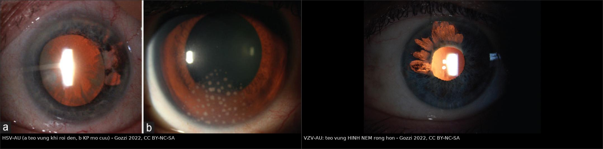
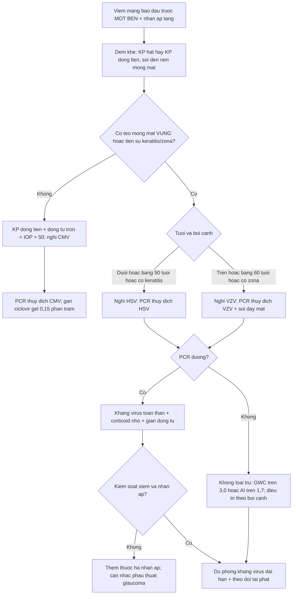
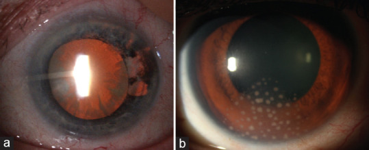
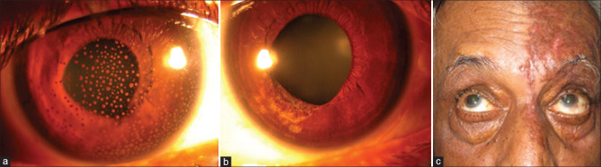
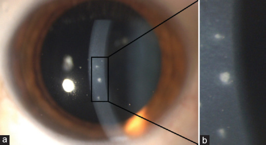

# 3306 — Viêm màng bồ đào trước do HSV/VZV (không hoại tử võng mạc): mắt đỏ MỘT BÊN tái phát, KP dính vùng + teo mống mắt — đừng nhỏ corticoid đơn thuần

**Tags:** `pattern:viem-mang-bao-dau` `pattern:viem-mang-bao-dau-truoc` `pattern:mot-ben` `pattern:tai-phat` `pattern:KP-hat` `pattern:KP-dinh-vung` `pattern:teo-mong-mat` `pattern:teo-mong-mat-vung` `pattern:tang-nhan-ap` `pattern:giam-cam-giac-giac-mac` `vung:mat` `vung:tien-phong` `vung:mong-mat` `vung:giac-mac` `protocol:den-khe` `protocol:roi-den` `protocol:AS-OCT` `protocol:soi-goc` `protocol:choc-tien-phong` `protocol:PCR-thuy-dich` `protocol:GWC` `protocol:OCT` `protocol:sieu-am-B` `score:SUN`
**Mức chắc chắn (certainty):** tổng hợp y văn (literature synthesis) — 2 bộ tiêu chuẩn phân loại **SUN 2021** dựa trên **1.083 ca viêm màng bồ đào trước** (101 ca HSV, 123 ca VZV) với tỷ lệ phân loại sai đã công bố; 1 đoàn hệ đa trung tâm Nhật **259 ca** (30 HSV, 50 VZV, 147 CMV, 32 HZO) chẩn đoán bằng PCR thủy dịch; 1 loạt **79 mắt** viêm màng bồ đào trước do herpes; 2 nghiên cứu so sánh trực tiếp HSV–VZV–CMV bằng PCR; 1 phân tích gộp **9 nghiên cứu** về kháng virus; 1 thử nghiệm ngẫu nhiên **703 bệnh nhân** (HEDS) về dự phòng acyclovir. **Không có RCT nào cho riêng viêm màng bồ đào trước do HSV** — mọi ngưỡng điều trị dưới đây ghi rõ nguồn.

> **Vì sao bài này quan trọng:** đây là nguyên nhân **hay bị điều trị sai nhất** của “mắt đỏ một bên tái phát”. Bệnh nhân thường được chẩn đoán “viêm màng bồ đào vô căn”, nhỏ corticoid, đỡ rồi tái phát — trong khi **thiếu kháng virus** làm tăng nguy cơ **teo mống mắt, dính sau, glôcôm thứ phát** (glôcôm gặp **18–54%** ở HSV-AU và **30–40%** ở VZV-AU; Babu K và cs, *Indian J Ophthalmol* 2020, PMC7690545). Nguy hiểm hơn, **corticoid đơn thuần khi chưa loại trừ herpes** có thể làm bùng phát cả **viêm giác mạc** lẫn **viêm võng mạc hoại tử** ở phía sau.

> **Sửa tiền đề của backlog (trung thực nguồn):** backlog ghi “KP dính thành VÙNG”. Đúng một phần: KP dính vùng (KP **dính nhau, xếp thành vùng/tam giác Arlt**) là hình thái của **KP hạt (mutton-fat, granulomatous)** — gặp ở **cả HSV và VZV**; điểm **phân biệt HSV với VZV trên lâm sàng là yếu** (đoàn hệ 259 ca: **không khác biệt có ý nghĩa** ở mọi dấu hiệu giữa HSV-AU và VZV-AU; Terada Y và cs, *Am J Ophthalmol* 2021;227:191–200, PMID 33773985). Vì vậy bài này **không dạy “nhìn KP đoán virus”**, mà dạy **nhận diện nhóm herpes** rồi **chốt bằng bối cảnh tuổi – tiền sử keratitis/zoster – PCR thủy dịch**.

## 1. Tổng quan bệnh học – cơ chế hình ảnh – vì sao mắt đỏ, đau, tăng nhãn áp

- **Tác nhân:** HSV-1 (chủ yếu) và HSV-2, VZV. Ở trung tâm chuyên khoa, **cả họ Herpesviridae gây 5–10% tổng số ca viêm màng bồ đào**; riêng **HSV-AU chiếm 15,6–23,5%** các ca viêm màng bồ đào trước do virus ở châu Âu (Gozzi F và cs, *Saudi J Ophthalmol* 2022, PMC9811927). **40–60%** bệnh nhân zona thần kinh mắt (herpes zoster ophthalmicus, HZO) phát triển viêm màng bồ đào trước.
- **Cơ chế bệnh sinh:** sau nhiễm tiên phát, virus **nằm latent trong hạch Gasser (HSV-1)** hoặc **hạch rễ sau (VZV)**; khi miễn dịch tại chỗ suy giảm, virus **tái hoạt, đi theo sợi trục** tới mắt. Tổn thương là **kết hợp hai cơ chế**: **hủy tế bào trực tiếp** (nội mô giác mạc, mống mắt, thần kinh giác mạc) và **viêm qua trung gian miễn dịch** (phản ứng với kháng nguyên virus tồn dư). Điều này giải thích vì sao **teo mống mắt và mất cảm giác giác mạc vẫn tiến triển sau khi virus đã hết hiện diện**.
- **TẠI SAO có KP (keratic precipitates) và vì sao dính thành vùng:** viêm mống mắt–thể mi phá **hàng rào máu–thủy dịch**, protein và tế bào tràn vào tiền phòng. Tế bào viêm **bám vào nội mô giác mắt** thành KP; khi đại thực bào tập hợp thành đám lớn, dày, trắng ngà = **KP hạt kiểu “mỡ cừu” (mutton-fat)**. Thủy dịch đi từ sau ra trước và **ấm hơn ở phía trên**, nên tế bào **lắng xuống nửa dưới** thành **tam giác Arlt (Arlt triangle)** — tam giác có đỉnh ở trung tâm, đáy ở rìa dưới. Đây là **dấu hiệu của vị trí và trọng lực**, không phải dấu hiệu của một virus cụ thể.
- **TẠI SAO teo mống mắt lại “vùng” (sectoral):** virus gây **hoại tử thiếu máu mô đệm mống mắt** và **viêm mạch máu mống mắt**; vùng do một nhánh mạch nuôi bị tổn thương sẽ teo **theo hình nan quạt**. Mất **biểu mô sắc tố mặt sau** làm vùng đó **phát sáng khi soi đèn nền (retroillumination)** — gọi là **khuyết xuyên sáng (transillumination defect)**. Hình thái khác nhau có giá trị gợi ý: **HSV** hay teo **dạng tròn/vá (round, patchy, “spiral”)**; **VZV** hay teo **hình nêm rộng, đáy ở chân mống mắt**, và **rộng/đậm hơn** (đoàn hệ PCR: teo mống mắt **50%** ở HSV so với **76%** ở VZV không có ban; Sakai JI và cs, *Int Ophthalmol* 2019;39:2785–2795, PMID 31134426). **Tải lượng VZV trong thủy dịch tương quan có ý nghĩa với mức teo mống mắt và biến dạng đồng tử**, nhưng **không** tương quan với mức tăng nhãn áp (Kido S và cs, *Br J Ophthalmol* 2008;92:505–508, PMID 18245272).
- **TẠI SAO nhãn áp tăng trong khi viêm “chỉ ở tiền phòng”:** virus và tế bào viêm gây **viêm lưới bè (trabeculitis)** và **lắng đọng mảnh vụn** làm giảm thoát thủy dịch qua góc; nhãn áp tăng **từng cơn**, có thể **38–90%** ở HSV-AU và **40–75%** ở VZV-AU; ở CMV-AU nhãn áp **thường vượt 50 mmHg** trong cơn cấp (PMC7690545).
- **TẠI SAO cảm giác giác mạc giảm:** virus **phá hủy trực tiếp các nhánh thần kinh giác mạc**; VZV gây **mất cảm giác lan rộng và sâu hơn** HSV. Vì vậy **so sánh cảm giác giác mạc hai mắt** (sợi chỉ, đầu bông, Cochet–Bonnet) là khám **bắt buộc** và có giá trị hơn nhiều xét nghiệm máu.
- **TẠI SAO PCR thủy dịch âm vẫn không loại trừ herpes:** thể tích thủy dịch lấy được rất ít (**~0,1 mL**), tải virus **thấp và thoáng qua**, và nồng độ virus **giảm nhanh** sau khi bắt đầu kháng virus. PCR dương **tốt nhất khi lấy đúng lúc nhãn áp tăng và trước điều trị**; khi lấy muộn, phải bù bằng **hệ số Goldmann–Witmer (GWC)** hoặc **chỉ số kháng thể đặc hiệu (antibody index, AI)**. Ví dụ rõ nhất là rubella trong Fuchs: **PCR chỉ dương 10–20%**, trong khi **IgG đặc hiệu trong thủy dịch dương 87–100%** (PMC9811927).
- **Hậu quả định lượng:** **glôcôm thứ phát** 18–54% (HSV), 30–40% (VZV); **cataract** 28–35% (HSV), 27–30% (VZV); **dính sau (posterior synechiae)** 38% (HSV), 40% (VZV); **viêm dịch kính** 43% (HSV) so với 83% (VZV) — tức **VZV viêm nặng hơn** (PMC7690545). Loạt **79 mắt** viêm màng bồ đào trước do herpes: tuổi trung bình **48,5 ± 14,8**, teo mống mắt **49,4%**, sẹo/viêm giác mạc **46,8%**, glôcôm thứ phát **17,7%**, thị lực cuối **≤ 0,1 ở 10,1%** (Nalcacioglu-Yüksekkaya P và cs, *Eur J Ophthalmol* 2014, PMID 23813111).

## 2. Mẫu hình + chẩn đoán phân biệt theo vị trí và tuổi (gamut)

Câu hỏi đầu tiên khi thấy **viêm màng bồ đào trước một bên + nhãn áp tăng + teo mống mắt**: **có herpes không, và đó là HSV hay VZV?** Tiêu chuẩn SUN 2021 trả lời bằng **3 nhánh** — PCR dương, **teo mống mắt vùng theo tuổi**, hoặc **bằng chứng herpes ngoài tiền phòng** (keratitis/zoster).

- **A. Nhóm HSV-AU:** một bên (hiếm hai bên, **18%** trong bảng tổng hợp), **cấp, tái phát cùng mắt**, đau đỏ nhiều, **KP hạt** ở tam giác Arlt, **teo mống mắt vùng/tròn**, **giãn đồng tử không đều (iridoparesis)**, **giác mạc: sẹo 33%**, có thể có **nhánh giác mạc (dendrite)** với **đầu tận cùng phình rõ**. Tuổi **40–50**.
- **B. Nhóm VZV-AU (kể cả zoster sine herpete):** tuổi **> 60** (hoặc suy giảm miễn dịch ở tuổi trẻ), **ban zona vùng V1**; viêm **nặng hơn** HSV, **KP hạt có sắc tố**, **đồng tử méo hình chữ D**, **teo mống mắt hình nêm rộng**; **giảm cảm giác giác mạc sâu**; **giả pseudodendrite** (không có đầu tận cùng phình); viêm màng bồ đào thường xuất hiện **2–4 tuần sau ban** nhưng có thể **nhiều năm sau**. **Chạm chóp mũi = dấu Hutchinson**, dự báo viêm nội nhãn.
- **C. Nhóm CMV-AU (kẻ bắt chước quan trọng nhất):** **KP đồng tiền (coin-shaped)**, **rất ít tế bào**, **đồng tử tròn, không dính sau**, **nhãn áp rất cao** (> 50 mmHg), **nội mô giảm**, hay gặp ở **nam 30–50 tuổi châu Á**; thể mạn ở người **50–80 tuổi** giống Fuchs. **KP đồng tiền có giá trị tiên đoán dương 90,9%** cho CMV (PMC9811927).
- **D. Nhóm không do herpes nhưng cùng mẫu hình “một bên + tăng nhãn áp”:** **Fuchs uveitis (rubella)** — KP **nhỏ, hình sao, rải đều**, **không dính sau**, **teo mống mắt lan tỏa**, **nhân xơ mống mắt lộ rõ**, **luôn có tế bào dịch kính**; **HLA-B27** — cấp, **giả mủ tiền phòng**, dính sau nhanh, đau lưng; **hội chứng masquerade (u lympho nội nhãn)** — **không đáp ứng corticoid**, tế bào dịch kính; **bệnh Behçet**, **sarcoid**, **giang mai**, **lao**.

**Gamut theo tuổi (khi thấy viêm màng bồ đào trước một bên + teo mống mắt):**
- **≤ 50 tuổi:** **HSV** (đủ tiêu chuẩn SUN nếu có teo mống mắt vùng) · **HLA-B27** · **Behçet** (nếu loét miệng/sinh dục) · **Fuchs** (thường 20–40 tuổi) · **TINU** (nhưng **hai bên**).
- **> 60 tuổi:** **VZV** (đủ tiêu chuẩn SUN nếu teo mống mắt vùng) · **CMV thể mạn** · **masquerade/u lympho** · **Fuchs** · **thiếu máu cục bộ mống mắt** do hẹp động mạch cảnh (không có KP).
- **Bất kỳ tuổi:** **giang mai** (RPR âm ~40% → luôn làm treponemal test), **lao**, **sarcoid**, **CMV** (châu Á), **thuốc** (bisphosphonate, rifabutin, cidofovir).

**Gamut theo “có tổn thương giác mạc kèm theo”:** **nhánh (dendrite) đầu tận cùng phình** → HSV; **giả nhánh bờ nham nhở, không đầu tận cùng** → VZV; **loét địa dư/khuyết biểu mô** → herpes; **loét hình vành, mủ tiền phòng** → vi khuẩn (kính tiếp xúc, xem 6132); **thâm nhiễm vành + đau tương xứng** → nấm/Acanthamoeba (1472); **bờ mờ, nhánh mảnh** → có thể herpes giả (dùng corticoid che dấu).

## 3. Bảng so sánh phân biệt (ma trận đối chiếu)

| Thực thể (entity) | Hình ảnh điển hình | Chốt vào (rule-in) | Chốt loại (rule-out) | Gợi ý xác nhận |
|---|---|---|---|---|
| **HSV-AU** | Một bên, KP hạt tam giác Arlt, **teo mống mắt vùng/tròn**, giãn đồng tử không đều, nhãn áp tăng từng cơn | **PCR thủy dịch HSV dương** hoặc **teo mống mắt vùng ở người ≤ 50 tuổi** hoặc **tiền sử/đang có keratitis HSV** | **Hai bên + không teo mống mắt + β2M niệu cao** → nghĩ TINU; **KP đồng tiền + đồng tử tròn** → nghĩ CMV | SUN 2021 (phân loại sai 8,3% tập huấn luyện, **17%** tập kiểm định); PCR thủy dịch, đèn khe, cảm giác giác mạc |
| **VZV-AU** | Một bên, KP hạt **có sắc tố**, **đồng tử chữ D**, **teo hình nêm rộng**, viêm nặng, nhãn áp tăng, có thể còn sẹo zona | **PCR thủy dịch VZV dương** hoặc **teo mống mắt vùng ở người ≥ 60 tuổi** hoặc **zona cùng bên/đang hoạt động** | **Không ban, không teo mống mắt, viêm nhẹ + KP đồng tiền** → nghĩ CMV; **teo lan tỏa không dính sau** → nghĩ Fuchs | SUN 2021 (phân loại sai **0,9%** và **0%**); PCR thủy dịch, khám da vùng V1, soi đáy mắt loại trừ hoại tử võng mạc |
| **CMV-AU** | **KP đồng tiền** thưa, viêm nhẹ **nhưng nhãn áp > 50 mmHg**, **đồng tử tròn**, **không dính sau**, nội mô giảm | **PCR thủy dịch CMV dương**; **KP đồng tiền** (giá trị tiên đoán dương **90,9%**) + nhãn áp rất cao + không dính sau | **Teo mống mắt vùng + dính sau + viêm nặng** → nghĩ HSV/VZV | PCR thủy dịch, đếm tế bào nội mô (specular), AS-OCT |
| **Fuchs uveitis (rubella)** | KP **nhỏ hình sao rải đều**, **không dính sau**, **teo lan tỏa**, mống mắt mất vân, **dị sắc (heterochromia)**, tế bào dịch kính | **Bệnh cảnh mạn, một bên, không dính sau + IgG rubella thủy dịch dương** | **Teo vùng + dính sau + đau cấp** → không phải Fuchs; **nhãn áp tăng cấp** → nghĩ CMV/HSV | GWC/AI rubella, AS-OCT độ dày mống mắt, soi đèn nền |
| **HLA-B27 AAU** | Cấp, **giả mủ tiền phòng**, dính sau nhanh, **không teo mống mắt vùng** | **HLA-B27 dương + đau lưng/viêm điểm bám**; đáp ứng corticoid nhanh | **Teo mống mắt vùng + tái phát cùng chỗ + nhãn áp cao** → nghĩ herpes | HLA-B27, X-quang/MRI khung chậu |
| **TINU (3305)** | **Hai bên**, KP không hạt, **creatinin/β2-microglobulin niệu tăng** | **Viêm tiền phòng + bằng chứng viêm ống thận mô kẽ** | **Một bên + teo mống mắt vùng** → không phải TINU | SCr, β2M niệu, sinh thiết thận |
| **Sarcoid / lao** | KP hạt lớn, **nốt Koeppe/Busacca**, viêm mạch “sáp nhỏ giọt”, hạch rốn phổi | **Sinh thiết u hạt không hoại tử** hoặc **IGRA dương + tổn thương lao nơi khác** | **Không tổn thương hệ thống + PCR herpes dương** → loại | CT ngực, ACE, IGRA, sinh thiết |
| **Giang mai mắt (3302)** | Bất kỳ thể, **mảng placoid**, viêm mạch, viêm thị; **RPR âm ~40%** | **Treponemal test dương** + đáp ứng penicillin | **Treponemal âm** → loại | RPR/VDRL + TPPA; HIV |
| **Masquerade – u lympho (1435)** | Tế bào dịch kính **không đau**, **không đáp ứng corticoid**, đốm dưới biểu mô sắc tố | **Tế bào ác tính/flow cytometry + IL-10/IL-6 > 1** | **Đáp ứng corticoid + PCR herpes dương** → loại | Chọc dịch kính, cytokine, MRI |

*Trái: **HSV-AU** — (a) soi đèn nền thấy **teo vùng** dạng múi; (b) **KP mỡ cừu** xếp thành tam giác Arlt. Phải: **VZV-AU** — teo **hình nêm rộng, đậm và rõ hơn**. Nguồn: Gozzi F và cs, *Saudi J Ophthalmol* 2022 (PMC9811927) Fig. 1–2, **CC BY-NC-SA 4.0**; ảnh ghép giữ nguyên tỷ lệ, cùng giấy phép.*

### Đọc teo mống mắt đúng cách
- **Soi đèn nền (retroillumination)** là thì **bắt buộc**: ánh sáng phản chiếu từ đáy mắt xuyên qua chỗ **mất biểu mô sắc tố** → vùng teo **sáng đỏ**. Ghi **vị trí theo giờ** và **số giờ bị ảnh hưởng** để so sánh giữa các lần khám.
- **AS-OCT tiền phòng** đo **độ dày mống mắt** và xác định vùng mỏng/teo khách quan hơn ảnh chụp; hữu ích khi mống mắt nâu đậm khó thấy teo bằng mắt thường.
- **Đừng nhầm với:** **teo do tuổi** (lan tỏa, đối xứng), **hội chứng mống mắt–nội mô (ICE)** (lỗ mống mắt, corectopia, **không có KP**), **thiếu máu cục bộ mống mắt** sau hẹp động mạch cảnh (teo + giãn đồng tử, **không viêm**), **hắc tố mống mắt** (không xuyên sáng).

## 4. Protocol chụp – xét nghiệm – phân độ + phác đồ

### 4.1. Khám mắt tối thiểu – đủ (thứ tự bắt buộc)

| Bước | Kỹ thuật | Mục đích / ngưỡng |
|---|---|---|
| 1 | **Thị lực + nhãn áp** | Nhãn áp **> 21 mmHg** là bất thường; cơn cấp thường **30–50 mmHg**, CMV có thể **> 50 mmHg** |
| 2 | **Đèn khe: tế bào/flare theo SUN** | Đếm tế bào trong chùm sáng **1 × 1 mm**: 0; 0,5+ (1–5); 1+ (6–15); 2+ (16–25); 3+ (26–50); 4+ (> 50) |
| 3 | **Mô tả KP: kích thước, màu, phân bố** | Hạt/mỡ cừu + tam giác Arlt → nhóm herpes; **đồng tiền** → CMV; **hình sao rải đều** → Fuchs |
| 4 | **Soi đèn nền mống mắt** | Ghi **số giờ teo**, hình thái **vùng/nêm** hay **lan tỏa** |
| 5 | **Cảm giác giác mạc hai mắt** | So sánh với mắt bên; **giảm rõ** gợi ý herpes, VZV giảm sâu hơn |
| 6 | **Soi góc (gonioscopy)** | Loại trừ **dính góc trước**, tìm **giả hạt/góc hẹp** trước khi dùng thuốc giãn đồng tử |
| 7 | **Soi đáy mắt giãn đồng tử** | **Bắt buộc**: loại trừ **viêm võng mạc hoại tử (ARN)** do VZV/HSV — đe dọa mù và cần kháng virus tĩnh mạch |
| 8 | **AS-OCT tiền phòng** | Đo KP, độ sâu tiền phòng, **độ dày mống mắt** |
| 9 | **Siêu âm B-scan** nếu đục môi trường | Loại trừ bong võng mạc/u nội nhãn |

### 4.2. Xét nghiệm sinh học

| Xét nghiệm | Ngưỡng / cách làm | Diễn giải |
|---|---|---|
| **PCR thủy dịch** (HSV, VZV, CMV) | Chọc tiền phòng **0,1–0,2 mL**, lấy **lúc nhãn áp tăng, trước kháng virus** | Dương = chốt; **âm không loại trừ** (tải thấp, lấy muộn, thể tích ít) |
| **GWC (Goldmann–Witmer)** | **GWC > 3,0** = tổng hợp kháng thể tại mắt | Hữu ích khi lấy mẫu **muộn/chronic**; rubella: PCR chỉ **10–20%** nhưng IgG **87–100%** |
| **AI (antibody index)** | **AI > 1,7** gợi ý tổng hợp nội nhãn | Nhạy hơn GWC nhưng cần thể tích mẫu lớn hơn (định lượng albumin) |
| **Huyết thanh** | IgG HSV/VZV/CMV, RPR/TPPA, HIV | IgG dương **rất phổ biến** ở người lớn → **giá trị loại trừ kém**, chỉ dùng để so cặp với thủy dịch |
| **Loại trừ bệnh hệ thống** | ANA, ANCA, ACE, IGRA, RPR/TPPA | Bắt buộc trước corticoid dài, đặc biệt ở ca hai bên/không điển hình |

### 4.3. Tiêu chuẩn phân loại SUN 2021 (dùng cho nghiên cứu và để chuẩn hóa chẩn đoán)

- **HSV-AU:** **viêm màng bồ đào trước MỘT BÊN** + **ít nhất 1 trong 3**: (1) **PCR thủy dịch HSV dương**; (2) **teo mống mắt vùng ở người ≤ 50 tuổi**; (3) **keratitis do HSV**. Huấn luyện trên **1.083 ca viêm màng bồ đào trước, trong đó 101 ca HSV-AU**; độ chính xác chung **97,5%/96,7%**; **phân loại sai 8,3% (huấn luyện) và 17% (kiểm định)** — đây là lý do **không được dùng tiêu chuẩn này như “chốt tuyệt đối”** ở ca không điển hình (SUN Working Group, *Am J Ophthalmol* 2021, DOI 10.1016/j.ajo.2021.03.053).
- **VZV-AU:** **một bên** + **ít nhất 1 trong 3**: (1) **PCR VZV dương**; (2) **teo mống mắt vùng ở người ≥ 60 tuổi**; (3) **zona cùng bên hoặc gần đây**. **123 ca VZV**; phân loại sai **0,9%** và **0%** (DOI 10.1016/j.ajo.2021.03.037).
- **Điểm mấu chốt về tuổi:** **cùng một dấu hiệu “teo mống mắt vùng”** nhưng **≤ 50 tuổi nghiêng HSV**, **≥ 60 tuổi nghiêng VZV** — vì **tần suất nền** của hai virus khác nhau theo tuổi, không phải vì hình thái khác nhau tuyệt đối.

### 4.4. Điều trị (ngưỡng và liều cụ thể)

| Tình huống | Kháng virus | Chống viêm / hỗ trợ | Thời gian |
|---|---|---|---|
| **HSV-AU cấp** | **Acyclovir uống 400 mg × 5 lần/ngày** (hoặc **valacyclovir 500 mg × 3 lần/ngày**) | Corticoid nhỏ **giảm liều chậm** + **giãn đồng tử** chống dính | **4 tuần**, giảm theo đáp ứng |
| **HSV-AU tái phát/dự phòng** | **Acyclovir 400 mg × 2 lần/ngày** hoặc **valacyclovir 500 mg/ngày** | Corticoid nhỏ liều thấp khi cần | **≥ 12 tháng**, nhiều nơi **2 năm** hoặc lâu hơn |
| **VZV-AU (HZO)** | **Acyclovir 800 mg × 5 lần/ngày** trong **72 giờ đầu** của ban, hoặc **valacyclovir 1 g × 3 lần/ngày** | Corticoid nhỏ + giãn đồng tử; khám đáy mắt tìm ARN | **10–14 ngày**, sau đó dự phòng **500 mg/ngày** **3–12 tháng** |
| **CMV-AU** | **Ganciclovir gel 0,15%** 5 lần/ngày, hoặc **valganciclovir 900 mg × 2 lần/ngày** | Corticoid nhỏ; hạ nhãn áp | Valganciclovir **3 tuần** tấn công → **450 mg × 2 lần/ngày** duy trì **≥ 4 tuần** |

- **Bằng chứng dự phòng mạnh nhất:** thử nghiệm **HEDS** (703 bệnh nhân có bệnh herpes mắt trong 12 tháng trước, **acyclovir 400 mg × 2 lần/ngày** so với giả dược): tái phát **19% so với 32%** (p < 0,001); ở nhóm có tiền sử **keratitis mô đệm**, tái phát **14% so với 28%** (p = 0,005); **không có hiện tượng bùng phát** sau khi ngừng thuốc (HEDS, *N Engl J Med* 1998, DOI 10.1056/NEJM199807303390503).
- **Bằng chứng yếu — và đây là điểm phải nói rõ với bệnh nhân:** phân tích gộp **9 nghiên cứu** cho thấy acyclovir uống **có hiệu quả ở VZV-AU** (**OR 0,26; 95% CI 0,11–0,59**) nhưng **không đạt ý nghĩa ở HSV-AU** (**OR 0,47; 95% CI 0,15–1,50**); acyclovir uống 7 ngày **tốt hơn** acyclovir nhỏ (OR 4,17; 1,28–13,52) (Testi I và cs, *Front Med* 2021;8:686427, PMC8284188). Kết luận trung thực: **chỉ định kháng virus trong HSV-AU dựa trên sinh lý bệnh và thực hành, chưa có RCT**.
- **Không bao giờ corticoid đơn thuần khi còn nghi herpes:** corticoid ức chế miễn dịch tại chỗ, **tăng sinh virus**, có thể biến viêm tiền phòng thành **viêm giác mạc địa dư/loét** hoặc **viêm võng mạc hoại tử**. Nếu chưa loại trừ được, dùng **kháng virus kèm** hoặc chuyển tuyến.

## 5. Biến thể bình thường và cạm bẫy

- **“Không có tiền sử keratitis thì không phải herpes” — SAI.** Trong loạt 7 bệnh nhân viêm màng bồ đào trước + teo mống mắt vùng, **5 người chưa từng có bệnh giác mạc**; **thể không có keratitis lại nặng hơn** thể có tiền sử keratitis (Santos C, *Bol Asoc Med P R* 2004, PMID 15580909). Keratitis vắng mặt **không loại trừ** và cũng **không đảm bảo** thể nhẹ.
- **Teo mống mắt có thể vắng ở lần khám đầu.** Teo hình thành **sau nhiều đợt** hoại tử thiếu máu; ca mới khởi phát chỉ có **giãn đồng tử không đều (iridoparesis)**. Vì vậy **không có teo ở lần đầu không loại trừ**, và **không chờ teo mới điều trị**.
- **Teo mống mắt không đồng nghĩa herpes.** **Fuchs** teo **lan tỏa** kèm **dị sắc**, **không dính sau**; **ICE** có **lỗ mống mắt/corectopia** nhưng **không KP**; **hẹp động mạch cảnh** gây teo + giãn đồng tử **không viêm**. Chỉ **teo vùng + KP hạt + dính sau + tăng nhãn áp từng cơn** mới đủ gợi ý.
- **“PCR âm là loại herpes” — SAI.** PCR có thể âm vì **tải virus thấp, lấy mẫu muộn, thể tích ít, có chất ức chế**; PCR cũng có thể **dương giả** do DNA virus latent trong bạch cầu khi viêm. Luôn **kết hợp lâm sàng + GWC/AI**.
- **Nhãn áp về bình thường không có nghĩa là hết bệnh.** Corticoid làm giảm viêm lưới bè **tạm thời**, nhưng **dính sau và teo mống mắt vẫn tiến triển**, và **glôcôm thứ phát** có thể xuất hiện **nhiều năm sau** (18–54% ở HSV).
- **Bỏ sót viêm võng mạc hoại tử là sai lầm nặng nhất.** **VZV/HSV** có thể gây **ARN** (hoại tử vùng ngoại vi, viêm mạch, viêm dịch kính) — **soi đáy mắt giãn đồng tử ở mọi ca**, kể cả khi tiền phòng chỉ viêm nhẹ.
- **Nhầm CMV với “Posner–Schlossman vô căn”.** Nhãn áp **> 50 mmHg** với **rất ít viêm**, **KP đồng tiền**, **đồng tử tròn** là CMV cho tới khi chứng minh khác; **không dùng corticoid kéo dài** mà không có kháng virus kháng CMV.
- **Cạm bẫy dùng thuốc giãn đồng tử khi chưa soi góc:** ở mắt **góc hẹp** hoặc có **dính góc trước**, giãn đồng tử có thể gây **cơn glôcôm cấp** — soi góc trước.
- **Cạm bẫy “đáp ứng corticoid nhanh = không phải herpes”:** herpes **cũng đáp ứng corticoid** (phần viêm miễn dịch), nên đáp ứng không loại trừ; điều phân biệt là **tái phát đúng mắt, đúng vị trí** và **teo mống mắt tiến triển**.

## 6. Tự lượng giá — Blind Quiz

**Ca 1 — nam 45 tuổi, đỏ–đau mắt phải 5 ngày, nhìn mờ, nhãn áp 42 mmHg; không có ban da, không có loét giác mạc.**

- Gợi ý: tiền phòng có tế bào **2+**, flare **1+**; KP trắng ngà, dính nhau, xếp thành **tam giác ở nửa dưới giác mạc**; cảm giác giác mạc **giảm so với mắt trái**.
- Câu hỏi: Mô tả hai dấu hiệu trong (a) và (b)? Ba chẩn đoán phân biệt hàng đầu? Dấu hiệu nào chốt hướng **herpes** và bước tiếp theo?

<b>Bấm để hiện đáp án (findings + chẩn đoán)</b>

- **Dấu hiệu:** (a) soi đèn nền thấy **teo mống mắt vùng** — vùng mất biểu mô sắc tố phát sáng đỏ; (b) **KP hạt kiểu mỡ cừu** dính nhau, xếp thành **tam giác Arlt** ở nửa dưới nội mô.
- **Chẩn đoán:** **HSV-AU** — một bên, KP hạt, teo mống mắt vùng, tăng nhãn áp do viêm lưới bè, cảm giác giác mạc giảm. Theo SUN 2021, **teo mống mắt vùng ở người ≤ 50 tuổi** đã đủ tiêu chuẩn phân loại HSV.
- **Phân biệt:** **VZV-AU** (cần ≥ 60 tuổi hoặc có zona; teo rộng hơn), **CMV-AU** (KP đồng tiền, đồng tử tròn, nhãn áp > 50), **Fuchs** (KP hình sao rải đều, không dính sau, teo lan tỏa).
- **Bước tiếp:** chọc tiền phòng **PCR HSV/VZV/CMV** (trước khi dùng kháng virus), soi góc, soi đáy mắt loại trừ ARN; khởi **acyclovir 400 mg × 5 lần/ngày × 4 tuần** + corticoid nhỏ + giãn đồng tử.
- **Nguồn ảnh:** Gozzi F và cs, *Saudi J Ophthalmol* 2022 (PMC9811927) Fig. 1, **CC BY-NC-SA 4.0**.

**Ca 2 — nữ 68 tuổi, 12 ngày sau mụn nước vùng trán–chóp mũi bên trái; đau nhiều, nhìn mờ; nhãn áp 36 mmHg.**

- Gợi ý: KP **có sắc tố**, đồng tử **méo hình chữ D**; (c) là ảnh mặt cùng bệnh nhân; khám đáy mắt chưa thấy hoại tử võng mạc.
- Câu hỏi: Ba dấu hiệu trên gợi ý tác nhân nào? “Dấu Hutchinson” là gì và vì sao quan trọng? Cần khám gì ở phía sau mắt và vì sao?

<b>Bấm để hiện đáp án (findings + chẩn đoán)</b>

- **Dấu hiệu:** (a) **KP hạt có sắc tố + đồng tử chữ D** lúc khởi phát; (b) **teo mống mắt hình nêm** phát triển sau **6 tháng**; (c) **sẹo zona** vùng trán–mũi trái.
- **Tác nhân:** **VZV** — ban zona V1, tổn thương **chóp mũi** là **dấu Hutchinson** (nhánh mũi–mi của thần kinh mắt), dự báo **viêm nội nhãn**; viêm màng bồ đào thường xuất hiện **2–4 tuần sau ban**.
- **Phía sau mắt:** **soi đáy mắt giãn đồng tử bắt buộc** để loại trừ **viêm võng mạc hoại tử (ARN)** — hoại tử vùng ngoại vi + viêm mạch + viêm dịch kính; ARN cần **kháng virus tĩnh mạch**, không điều trị ngoại trú.
- **Điều trị:** **acyclovir 800 mg × 5 lần/ngày** (hoặc **valacyclovir 1 g × 3 lần/ngày**) **10–14 ngày**, corticoid nhỏ + giãn đồng tử, hạ nhãn áp; sau đó **dự phòng 500 mg/ngày 3–12 tháng** tùy nhu cầu corticoid.
- **Nguồn ảnh:** Babu K và cs, *Indian J Ophthalmol* 2020;68:1764 (PMC7690545) Fig. 2, **CC BY-NC-SA 4.0**.

**Ca 3 — nam 34 tuổi, tái phát 3 đợt/năm “mờ mắt + quầng sáng”, nhãn áp 54 mmHg, tiền phòng gần như yên.**

- Gợi ý: **vài KP đồng tiền** ở giữa nội mô, **đồng tử tròn**, **không dính sau**, không đau nhiều.
- Câu hỏi: Vì sao nhãn áp rất cao mà viêm lại nhẹ? Chẩn đoán khác với HSV/VZV ở điểm nào? Điều trị khác ra sao?

<b>Bấm để hiện đáp án (findings + chẩn đoán)</b>

- **Dấu hiệu:** (a) **KP đồng tiền** thưa ở nội mô; (b) phóng đại cho thấy KP tròn, bờ rõ, **không dính thành vùng**.
- **Chẩn đoán:** **CMV-AU thể cấp tái phát kiểu Posner–Schlossman** — virus/viêm **tấn công lưới bè** mạnh nhưng **phản ứng tiền phòng rất ít**, nên **nhãn áp cao không tương xứng với mức viêm**; **đồng tử tròn, không dính sau** là điểm khác HSV/VZV.
- **Vì sao khác:** **KP đồng tiền có giá trị tiên đoán dương 90,9%** cho CMV; CMV cũng làm **giảm tế bào nội mô** (đếm bằng specular microscopy) — không gặp ở HSV/VZV.
- **Điều trị:** **ganciclovir gel 0,15%** 5 lần/ngày (hoặc **valganciclovir 900 mg × 2 lần/ngày** 3 tuần → **450 mg × 2 lần/ngày**), corticoid nhỏ, hạ nhãn áp; **không dùng corticoid đơn thuần kéo dài**.
- **Nguồn ảnh:** Gozzi F và cs, *Saudi J Ophthalmol* 2022 (PMC9811927) Fig. 3, **CC BY-NC-SA 4.0**.

## 7. Câu hỏi nghiên cứu & điểm chưa đồng thuận (tính đến 11/2026)

1. **[Khoảng trống] Ở bệnh nhân HSV-AU, kháng virus toàn thân có giảm tái phát và biến chứng so với corticoid đơn thuần không?**
   - **Đã biết:** phân tích gộp 9 nghiên cứu: acyclovir uống **có hiệu quả ở VZV-AU** (OR 0,26; 95% CI 0,11–0,59) nhưng **không đạt ý nghĩa ở HSV-AU** (OR 0,47; 0,15–1,50); thử nghiệm HEDS chỉ chứng minh dự phòng ở **bệnh herpes mắt nói chung** (19% so với 32%), không riêng viêm màng bồ đào trước.
   - **Chưa rõ:** chưa có RCT nào lấy **tái phát viêm tiền phòng** làm kết cục chính ở HSV-AU; cỡ mẫu cần thiết và định nghĩa tái phát chưa thống nhất.
   - **Hướng nghiên cứu:** RCT đa trung tâm so **acyclovir/valacyclovir toàn thân + corticoid** với **corticoid đơn thuần**, kết cục **số đợt tái phát/năm, nhãn áp, teo mống mắt, thị lực**.
   - **Nguồn:** PMC8284188 (2021); DOI 10.1056/NEJM199807303390503 (1998).

2. **[Tranh cãi] Dự phòng kháng virus sau đợt HSV/VZV-AU nên kéo dài bao lâu và liều nào — 12 tháng, 2 năm hay suốt đời?**
   - **Đã biết:** HEDS cho thấy **12 tháng acyclovir 400 mg × 2 lần/ngày** giảm tái phát và **không bùng phát sau khi ngừng**; thực hành ở một số trung tâm giữ **valacyclovir 500–1.000 mg/ngày ≥ 2 năm**, có xu hướng **suốt đời**; liều dự phòng VZV dao động **500 mg/ngày đến 500 mg × 3 lần/tuần** trong **3–12 tháng**.
   - **Chưa rõ:** không có so sánh trực tiếp **12 tháng so với ≥ 2 năm**, **acyclovir so với valacyclovir**, và **ngưỡng ngừng** ở bệnh nhân tái phát nhiều lần; nguy cơ độc thận và đề kháng khi dùng rất dài chưa được định lượng ở nhóm viêm màng bồ đào.
   - **Hướng nghiên cứu:** registry tiến cứu ghi **số đợt/năm, liều, thời gian, chức năng thận**, kèm phân tích **sống còn tái phát** để xác định thời điểm ngừng tối ưu.
   - **Nguồn:** PMC9811927 (2022); PMC7690545 (2020); DOI 10.1056/NEJM199807303390503 (1998).

3. **[Khác biệt thực hành] Khi nghi HSV/VZV-AU nhưng PCR thủy dịch âm, có nên chẩn đoán và điều trị theo GWC/AI hay theo lâm sàng?**
   - **Đã biết:** PCR dương phụ thuộc **thời điểm lấy mẫu và tải virus**; GWC **> 3,0** và AI **> 1,7** bổ sung độ nhạy, đặc biệt khi lấy muộn (rubella: PCR **10–20%** so với IgG **87–100%**); SUN 2021 vẫn cho phép chẩn đoán **thuần lâm sàng** (teo mống mắt vùng theo tuổi) và **chấp nhận phân loại sai tới 17%** ở HSV.
   - **Chưa rõ:** GWC/AI **không phổ cập**, chưa có ngưỡng chuẩn hóa giữa các phòng xét nghiệm; chưa rõ chiến lược nào (**điều trị thử kháng virus** so với **chọc lại thủy dịch**) cho kết cục tốt hơn.
   - **Hướng nghiên cứu:** nghiên cứu chẩn đoán tiến cứu so sánh **PCR + GWC + AI** với **chẩn đoán lâm sàng của hội đồng**, kết cục là **độ chính xác và thời gian tới lui bệnh**.
   - **Nguồn:** PMC9811927 (2022); PMC7690545 (2020); DOI 10.1016/j.ajo.2021.03.053 (2021).

## Bài liên quan chéo
- [3305 – Hội chứng TINU](../3305-hoi-chung-tinu/lesson.md) (viêm màng bồ đào trước **hai bên** ở người trẻ; đừng quên thận)
- [3302 – Viêm màng bồ đào do giang mai](../3302-viem-mang-bao-dau-giang-mai/lesson.md) (nguyên nhân nhiễm trùng “bắt chước mọi thứ”; RPR âm ~40%)
- [1435 – Hội chứng masquerade: u lympho nội nhãn](../1435-hoi-chung-masquerade-u-lympho-noi-nhan/lesson.md) (viêm màng bồ đào giả, không đáp ứng corticoid)
- [1436 – Bệnh Vogt–Koyanagi–Harada](../1436-benh-vogt-koyanagi-harada/lesson.md) (hai bên, bong thanh dịch, hắc mạc dày)
- [1437 – Viêm màng bồ đào do thuốc ức chế điểm kiểm miễn dịch](../1437-viem-mang-bo-dao-do-uc-che-diem-kiem-mien-dich/lesson.md) (thuốc là yếu tố khởi phát)
- [455 – Viêm mạch võng mạc do Behçet và lupus](../455-behcet-lupus-mat/lesson.md) (viêm màng bồ đào + viêm mạch)
- [1472 – Viêm giác mạc do Acanthamoeba](../1472-viem-giac-mac-acanthamoeba/lesson.md) (loét giác mạc đau nhiều, có KP — phân biệt với herpes có keratitis)
- [400 – Tổng quan Mắt & thị giác](../400-tong-quan-mat-thi-giac/lesson.md)

## Ảnh
- `3306_HSV-AU_Retroillumination_PMC9811927-Fig1.jpg` — HSV-AU: teo mống mắt vùng khi soi đèn nền + KP mỡ cừu tam giác Arlt.
- `3306_VZV-AU_Retroillumination_PMC9811927-Fig2.jpg` — VZV-AU: teo mống mắt hình nêm rộng.
- `3306_VZV-AU_Slit-lamp_PMC7690545-Fig2.jpg` — VZV-AU: KP sắc tố, đồng tử chữ D, teo vùng sau 6 tháng, sẹo zona.
- `3306_HSV-AU_Slit-lamp_PMC7690545-Fig1.jpg` — HSV-AU: KP hạt cạnh giác mạc viêm, iridoparesis, teo mống mắt lan tỏa.
- `3306_CMV-AU_Coin-KP_PMC9811927-Fig3.jpg` — CMV-AU: KP đồng tiền (dùng trong quiz và ma trận phân biệt).
- `composite_HSV-vs-VZV_teo-mong-mat.jpg` — ảnh ghép đối chiếu HSV so với VZV (mục 3).
- Nguồn + giấy phép từng ảnh: `images/CREDITS.md`; nguồn bài: `sources.md`.

> Không dùng để chẩn đoán độc lập khi chưa có người hướng dẫn.
