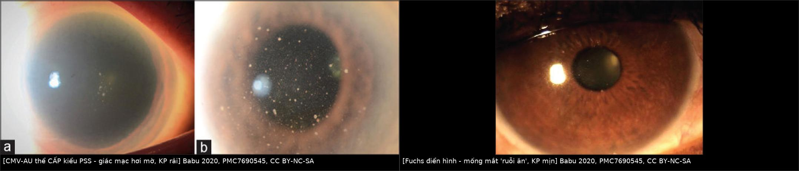
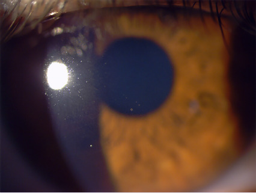
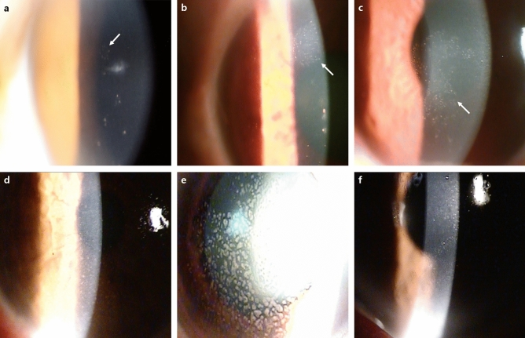
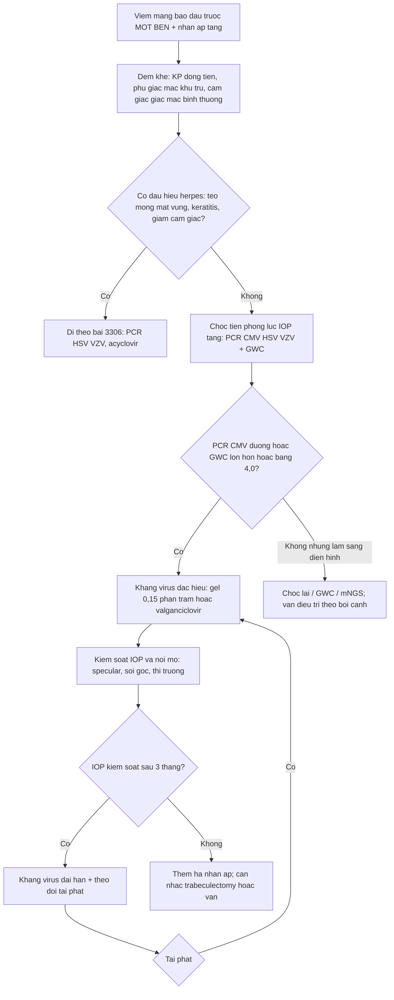
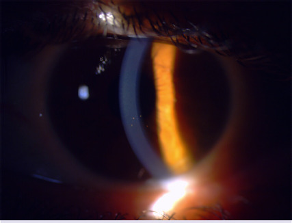
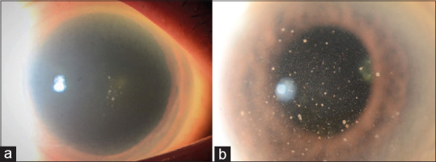
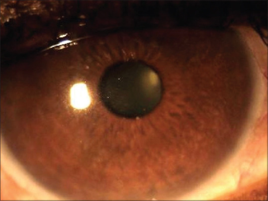

# 3307 — Viêm màng bồ đào trước do CMV: "Posner–Schlossman" và thể giống Fuchs — KP đồng tiền, endothelitis, nhãn áp 32–35 mmHg

**Tags:** `pattern:viem-mang-bao-dau-truoc` `pattern:mot-ben` `pattern:tai-phat` `pattern:tang-nhan-ap` `pattern:KP-dong-tien` `pattern:endothelitis` `pattern:teo-mong-mat` `pattern:khong-dinh-sau` `vung:mat` `vung:giac-mac` `vung:tien-phong` `vung:mong-mat` `protocol:den-khe` `protocol:soi-goc` `protocol:AS-OCT` `protocol:dem-te-bao-noi-mo` `protocol:choc-tien-phong` `protocol:PCR-thuy-dich` `protocol:GWC` `score:SUN`
**Mức chắc chắn (certainty):** tổng hợp y văn (literature synthesis) — 1 đoàn hệ 53 mắt/52 bệnh nhân (Thổ Nhĩ Kỳ) về endothelitis và mùa tái phát; 1 đoàn hệ **149 mắt PCR dương** (Hàn Quốc) về phẫu thuật glôcôm; 1 đoàn hệ **44 bệnh nhân** so sánh kháng virus tại chỗ với toàn thân; 1 loạt **88 mắt** viêm màng bồ đào trước tăng nhãn áp làm PCR đa mồi; 2 bài tổng quan; các ca nguyên văn dùng cho ảnh. **Không có thử nghiệm ngẫu nhiên có đối chứng nào cho CMV-AU** — mọi ngưỡng điều trị dưới đây ghi rõ nguồn và mức bằng chứng.

> **Vì sao bài này quan trọng:** đây là nguyên nhân **hay bị dán nhãn "Posner–Schlossman vô căn"** rồi chỉ nhỏ corticoid. Bệnh nhân đỡ trong vài ngày, rồi tái phát, và **nhãn áp cao lặp lại ăn mòn dần dây thị**. Trong đoàn hệ **53 mắt** CMV-AU, **glôcôm thứ phát 56,6%** và **13,2% phải mổ glôcôm** (Oklar M và cs, *North Clin Istanb* 2025;12:558–568, PMC12821118). Trong đoàn hệ **149 mắt PCR dương**, **16,1% phải mổ glôcôm**, thời gian trung vị từ khởi phát tới mổ là **73,0 ± 11,6 tháng** (Jeon SJ và cs, *Sci Rep* 2026;16, PMC13357539). CMV còn gây **endothelitis** — tổn thương nội mô **không hồi phục**, có ca phải ghép nội mô (DMEK).
>
> **Bài 3306** (HSV/VZV) đã dạy **nhận diện nhóm herpes**; bài này đi sâu **một tác nhân** vì CMV khác hẳn về **điều trị** (ganciclovir, không phải acyclovir) và về **diễn tiến** (nhãn áp, nội mô).

## 1. Tổng quan bệnh học – cơ chế hình ảnh – vì sao KP "đồng tiền" và nhãn áp lại cao

- **Tác nhân và sinh lý bệnh:** CMV (cytomegalovirus) thuộc họ Herpesviridae, **nằm latent trong tế bào gốc dòng tủy**; ở người **miễn dịch bình thường**, tái hoạt đưa virus theo máu tới **mống mắt – thể mi – nội mô giác mạc – lưới bè**. Bệnh cảnh là **viêm màng bồ đào trước một bên, tái phát, kèm nhãn áp tăng** — chiếm phần lớn các ca trước đây gọi là **hội chứng Posner–Schlossman (PSS)** hoặc **viêm mống mắt thể mi dị sắc Fuchs (Fuchs uveitis syndrome, FUS)**.
- **TẠI SAO nhãn áp tăng:** ba cơ chế cộng lại. (1) **Viêm lưới bè (trabeculitis)** — virus và tế bào viêm làm giảm thoát thủy dịch; đây là lý do nhãn áp tăng **dù tiền phòng gần như yên**. (2) **Dính góc trước (peripheral anterior synechiae, PAS)** sau nhiều đợt viêm — mất thoát thủy dịch **vĩnh viễn**. (3) **Đáp ứng corticoid** ở người nhạy cảm. Vì vậy nhãn áp **không tương xứng với mức viêm** — trung bình **32,3 ± 13,4 mmHg** trong cơn (PMC12821118) và **35,21 ± 12,9 mmHg** lúc chọc thủy dịch, kèm **2,12 ± 0,81 thuốc hạ nhãn áp** (PMC13357539).
- **TẠI SAO KP "đồng tiền" (coin-shaped / nummular):** KP là **đám đại thực bào và tế bào lympho lắng trên nội mô**. Trong CMV, tổn thương **khu trú từng ổ** trên nội mô tạo đám **tròn, bờ rõ, đường kính ~0,3–0,5 mm**, trắng xám, **rải rác hoặc thành dãy** — khác KP hạt "mỡ cừu" dính nhau của lao/sarcoid và khác KP mịn hình sao rải đều của rubella. Trong loạt 53 mắt: **KP đồng tiền 32,1%**, KP đơn độc 58,5%, KP dạng dãy 9,4% (PMC12821118).
- **TẠI SAO KP chuyển màu theo thời gian:** KP **trắng/xám ở 3 ngày đầu**, rồi **ngấm sắc tố** khi đại thực bào ăn mảnh vụn sắc tố mống mắt; trong loạt trên, KP sắc tố xuất hiện ở bệnh nhân có triệu chứng trung bình **9,56 ± 2,60 ngày** (PMC12821118). **Đây là đồng hồ của bệnh, không phải dấu hiệu của bệnh cũ đã lành.**
- **TẠI SAO có endothelitis:** CMV **nhiễm trực tiếp tế bào nội mô giác mạc**, gây **phù giác mạc khu trú ngay trên vùng KP** ("giác mạc hơi mờ/steamy cornea"), rồi **mất tế bào nội mô**. Trong đoàn hệ 149 mắt, mật độ tế bào nội mô (endothelial cell density, ECD) trung bình **2.088 ± 695 tế bào/mm²**, chỉ còn **79,7%** so với mắt bên; **8,2%** có ECD **< 1.000 tế bào/mm²**. Endothelitis là **yếu tố tiên đoán độc lập của glôcôm thứ phát**: **OR 6,20 (95% CI 1,04–36,86)** (PMC12821118), và nhóm phải mổ glôcôm có ECD thấp hơn (**1.801 ± 630** so với **2.132 ± 697 tế bào/mm²**, p = 0,039) (PMC13357539).
- **TẠI SAO mống mắt teo mà không dính sau:** virus gây **viêm mô đệm mống mắt lan tỏa hoặc từng vùng** → mống mắt **mất vân, "ruỗi ăn" (moth-eaten)**, nhưng **không tạo dính sau** vì phản ứng tiền phòng nhẹ. Trong loạt 53 mắt: teo mống mắt **28,3%** (từng vùng 6 mắt, lan tỏa 9 mắt), **không có dính sau, không có viêm dịch kính, không có dị sắc tố**; khuyết xuyên sáng chỉ gặp **1 mắt** (sau mổ GATT). Đây là điểm **rất dễ đọc sai thành FUS do rubella**.
- **TẠI SAO PCR âm vẫn không loại trừ:** tải virus **thấp và thoáng qua** (trung bình **2.650 copies/mL** trong loạt 53 mắt, chỉ 10 bệnh nhân được chọc), thể tích thủy dịch lấy được **~100 µL**, và nồng độ virus **giảm nhanh sau khi bắt đầu kháng virus**. Tỉ lệ phát hiện **DNA 37,5–52,2%** thấp hơn rõ so với **IgG đặc hiệu 64–80%** (Ye Z và cs, *Front Public Health* 2023;11:1117412, PMC10014866). Vì vậy phải chọc **đúng lúc nhãn áp tăng, trước điều trị**, và bù bằng **hệ số Goldmann–Witmer (GWC)**.

## 2. Mẫu hình + chẩn đoán phân biệt theo kiểu hình (gamut)

CMV-AU có **3 kiểu hình** (loạt 53 mắt, PMC12821118): **giống PSS 63,5%**, **viêm mạn không đặc hiệu 34,6%**, **giống FUS 1,9%**; loạt Thái Lan 44 bệnh nhân lại có **93,2% giống PSS** (PMC11219762). Kiểu hình **thay đổi theo thời điểm khám**, không phải ba bệnh khác nhau.

- **A. Thể cấp tăng nhãn áp (PSS-like):** đau nhẹ, nhìn mờ, **quầng sáng**, nhãn áp **30–50 mmHg**, tiền phòng **0,5–1+**, **KP đồng tiền hoặc hạt ở trung tâm**, **giác mạc hơi mờ**, **đồng tử tròn, không dính sau**, cảm giác giác mạc **bình thường**. Tái phát **cùng một mắt**, nhiều đợt/năm.
- **B. Thể mạn giống Fuchs (FUS-like):** mắt **ít đỏ, gần như yên**, **teo mống mắt lan tỏa**, **KP mịn rải rác**, **không dính sau**, **không viêm dịch kính** — nhưng **nhãn áp vẫn cao** và **đáp ứng kém với corticoid đơn thuần**. Không có dị sắc tố **không loại trừ**.
- **C. Thể endothelitis:** **phù giác mạc khu trú** đúng trên vùng KP, KP **hình đồng tiền/bờ tuyến tính**, có thể **giảm thị lực do phù**, **nhãn áp tăng**. Đây là thể **nặng nhất cho nội mô** và là **yếu tố tiên đoán glôcôm**.
- **Gamut theo KP:** **đồng tiền/nummular** → CMV (và HSV, rubella, thuốc); **hạt mỡ cừu dính vùng** → HSV/VZV/lao/sarcoid; **mịn hình sao rải đều** → rubella (FUS thật) hoặc CMV thể Fuchs; **sắc tố** → KP đã cũ (≥ 1 tuần) của bất kỳ nguyên nhân nào.
- **Gamut theo bối cảnh:** **nam 30–50 tuổi châu Á, tái phát nhiều đợt** → CMV; **> 60 tuổi + ban zona** → VZV; **≤ 50 tuổi + teo mống mắt vùng + keratitis** → HSV; **mắt đã mổ/phaco, dị sắc, dịch kính có tế bào** → FUS do rubella; **không đáp ứng corticoid, tế bào dịch kính, tuổi > 60** → u lympho (masquerade).

*Trái (a–b): **CMV-AU thể cấp** — giác mạc hơi mờ do endothelitis, KP rải rác, nhãn áp tăng. Phải: **Fuchs điển hình** — mống mắt mất vân kiểu "ruỗi ăn", KP mịn, không dính sau. Nguồn: Babu K và cs, *Indian J Ophthalmol* 2020;68:1764 (PMC7690545) Fig. 3 và Fig. 4, **CC BY-NC-SA 4.0**; ảnh ghép giữ nguyên tỷ lệ, cùng giấy phép.*

*KP hạt nhỏ – trung bình ở trung tâm/trung tâm – cạnh trung tâm, trên nền giác mạc hơi mờ: mẫu hình của **endothelitis do CMV**. Nguồn: Oklar M và cs, *North Clin Istanb* 2025 (PMC12821118) Fig. 3, **CC BY-NC 4.0**.*

## 3. Bảng so sánh phân biệt (ma trận đối chiếu)

| Thực thể (entity) | Hình ảnh điển hình | Chốt vào (rule-in) | Chốt loại (rule-out) | Gợi ý xác nhận |
|---|---|---|---|---|
| **CMV-AU thể cấp (PSS-like)** | Một bên, tái phát, **IOP 30–50 mmHg** dù viêm nhẹ, **KP đồng tiền** trung tâm, **giác mạc hơi mờ**, **không dính sau** | **PCR CMV thủy dịch dương**; hoặc **KP đồng tiền + IOP tăng + không dính sau ở người 30–50 tuổi châu Á** (KP đồng tiền: **OR 6,01** cho PCR dương) | **Teo mống mắt vùng + keratitis + ≤ 50 tuổi** → HSV; **ban zona + > 60 tuổi** → VZV; **dị sắc + dịch kính có tế bào** → FUS rubella | PCR thủy dịch (chọc lúc IOP tăng), GWC, đếm tế bào, soi góc |
| **CMV-AU thể mạn (Fuchs-like)** | Mắt gần yên, **teo mống mắt lan tỏa "ruỗi ăn"**, KP mịn, **không dính sau**, **không viêm dịch kính** | **PCR CMV (hoặc GWC) dương** + **nhãn áp cao/tái phát** trên nền mống mắt teo lan tỏa | **Dị sắc tố rõ + tiền sử mắt đã phẫu thuật + tế bào dịch kính** → rubella (FUS thật); **KP hạt + dính sau** → lao/sarcoid | PCR + GWC; AS-OCT đo độ dày mống mắt; theo dõi IOP nhiều lần |
| **CMV endothelitis** | **Phù giác mạc khu trú** trên vùng KP, KP đồng tiền/tuyến tính, **giảm ECD** | **Phù khu trú + KP cùng vị trí + PCR CMV dương**; **ECD giảm so với mắt bên** (trung bình **79,7%**) | **Phù lan tỏa limbus-to-limbus sau mổ** → TASS; **loét biểu mô + mủ** → nhiễm khuẩn/nấm | Specular microscopy, AS-OCT giác mạc, PCR |
| **HSV-AU** | Một bên, đau đỏ nhiều, **KP hạt tam giác Arlt**, **teo mống mắt vùng**, **giảm cảm giác giác mạc**, nhãn áp tăng từng cơn | PCR HSV dương, **hoặc teo mống mắt vùng ở ≤ 50 tuổi**, **hoặc keratitis HSV** | **KP đồng tiền + cảm giác giác mạc bình thường + không teo vùng** → CMV | SUN 2021; PCR; cảm giác giác mạc |
| **VZV-AU** | > 60 tuổi, **ban zona V1**, KP **sắc tố**, **đồng tử chữ D**, teo **hình nêm rộng**, viêm nặng | PCR VZV dương, **hoặc teo vùng ở ≥ 60 tuổi**, **hoặc zona cùng bên** | **Không ban, không teo, viêm nhẹ + KP đồng tiền** → CMV | SUN 2021; khám da V1; soi đáy mắt loại trừ ARN |
| **FUS do rubella** | Một bên, **dị sắc tố**, mống mắt mất vân lan tỏa, **KP mịn hình sao rải đều**, **luôn có tế bào dịch kính**, hay sau phaco | **IgG rubella thủy dịch dương (GWC/AI)**; **dị sắc + tế bào dịch kính** | **Không dị sắc, không tế bào dịch kính, KP đồng tiền** → CMV | GWC/AI rubella; AS-OCT; soi đèn nền |
| **PSS vô căn** | Cơn **tăng nhãn áp đơn thuần**, tiền phòng **rất ít tế bào**, KP **nhỏ, thưa**, tự khỏi; **không teo mống mắt tiến triển** | **PCR âm + GWC < 2,0** và nhiều đợt không để lại di chứng | **KP đồng tiền + ECD giảm + tái phát dày** → nghi CMV, chọc lại | PCR lặp lại; theo dõi ECD và thị trường |
| **Masquerade – u lympho nội nhãn** | **Không đau**, tế bào dịch kính, **không đáp ứng corticoid**, đốm dưới biểu mô sắc tố, tuổi > 60 | **Tế bào ác tính/flow cytometry**; **IL-10:IL-6 > 1** | **Đáp ứng corticoid + PCR CMV dương** | Chọc dịch kính, cytokine, MRI |
| **Viêm tiền phòng do thuốc** | Tiền sử **bisphosphonate, rifabutin, cidofovir, topiramate**; hai bên hoặc một bên | **Ngừng thuốc → lui bệnh** | **KP đồng tiền một bên tái phát nhiều đợt** → không phải thuốc | Bảng thuốc, diễn tiến sau ngừng |

*Các panel a–c: **KP đồng tiền (mũi tên trắng)** — đám tròn, bờ rõ, rải trên nội mô; d: KP lan tỏa; e: **endothelitis** với nội mô mất đều; f: KP mịn trên nền phù. Nguồn: Yoo WS và cs, *Sci Rep* 2021;11:8814 (PMC8065052) Fig. 1, **CC BY 4.0**.*

### Đọc "KP đồng tiền" cho đúng
- **Đồng tiền = tròn, bờ rõ, riêng rẽ**, không dính thành mảng; đường kính thường **0,3–0,5 mm**. Chụp **đèn khe chếch sáng (sclerotic scatter)** và **soi đèn nền** để thấy rõ.
- **Vị trí có giá trị:** trung tâm/trung tâm–cạnh trung tâm **50,9%**, tam giác Arlt **28,3%**, ngoại vi/rải rác **18,9%** (PMC12821118). **KP trung tâm là mẫu hình hay gặp của CMV**, khác KP hạt dồn nửa dưới của lao/sarcoid.
- **Đếm và ghi số:** **< 5 KP 66,0%**, **> 5 KP 34,0%**; KP nhiều gắn với dạng đồng tiền và dạng dãy (p < 0,001).
- **Đừng nhầm** với **nếp gấp Descemet**, **giọt mỡ (guttata)**, **di vật nội mô**, **bong màng Descemet sau phaco** (đường DM tách, không có đám tế bào).

## 4. Protocol chụp – xét nghiệm – phân độ + phác đồ

### 4.1. Khám mắt tối thiểu (thứ tự bắt buộc)

| Bước | Kỹ thuật | Mục đích / ngưỡng |
|---|---|---|
| 1 | **Thị lực + nhãn áp** | Ghi **IOP từng đợt**; cơn điển hình **30–40 mmHg**, có ca **> 50 mmHg** |
| 2 | **Đèn khe: tế bào/flare theo SUN** | 0; 0,5+ (1–5); 1+ (6–15); 2+ (16–25); 3+ (26–50); 4+ (> 50) tế bào/1 × 1 mm |
| 3 | **Mô tả KP: hình, kích thước, số, vị trí** | **Đồng tiền/nummular** → nghĩ CMV; ghi **trung tâm / Arlt / rải rác** |
| 4 | **Nội mô: phù khu trú, giác mạc hơi mờ** | Phù **đúng trên vùng KP** = endothelitis; ghi vùng theo giờ |
| 5 | **Đếm tế bào nội mô (specular)** | So với mắt bên; **< 1.000 tế bào/mm²** = nguy cơ cao, cân nhắc ghép nội mô |
| 6 | **Cảm giác giác mạc hai mắt** | **Bình thường** ở CMV; **giảm** gợi ý HSV/VZV |
| 7 | **Soi góc (gonioscopy)** | Tìm **PAS**, sắc tố góc, loại trừ góc hẹp trước khi giãn đồng tử |
| 8 | **Soi đáy mắt giãn đồng tử** | Ở người **suy giảm miễn dịch** phải loại trừ **viêm võng mạc do CMV** (bài 452/454/459) — bệnh cảnh khác, điều trị khác |
| 9 | **AS-OCT tiền phòng + giác mạc** | Đo độ dày mống mắt, vị trí KP, phù nội mô |
| 10 | **Thị trường/OCT RNFL** nếu bệnh > 1 năm | Phát hiện tổn thương glôcôm **âm thầm** (45,5% có glôcôm trung bình trong loạt 88 mắt) |

### 4.2. Xét nghiệm sinh học

| Xét nghiệm | Cách làm / ngưỡng | Diễn giải |
|---|---|---|
| **PCR thủy dịch (CMV, HSV-1/2, VZV)** | Chọc tiền phòng **~100 µL**, kim 30G, **lúc IOP tăng, trước kháng virus** | Dương = chốt; **âm không loại trừ** (tải thấp, lấy muộn) — có thể **chọc lại** |
| **GWC (Goldmann–Witmer)** | (IgG CMV thủy dịch/IgG tổng thủy dịch) ÷ (IgG CMV máu/IgG tổng máu) | **< 2,0** = không tổng hợp tại mắt; **≥ 4,0** = tổng hợp mạnh tại mắt; **2,0–4,0** vùng xám |
| **IgG huyết thanh** | CMV IgG | **Tới 87%** người trưởng thành dương → **giá trị loại trừ rất kém**, chỉ dùng để tính GWC |
| **mNGS** | Thủy dịch | Khi PCR thường âm mà vẫn nghi, hoặc nghi nhiều tác nhân |
| **Loại trừ bệnh khác** | RPR/TPPA, HIV, IGRA, ACE, ANA/ANCA | Bắt buộc trước corticoid dài, nhất là ca hai bên/không điển hình |

### 4.3. Tiêu chuẩn "CMV-AU được cho là" (dùng trong thực hành, không phải tiêu chuẩn vàng)

- **Bắt buộc:** **viêm màng bồ đào trước MỘT BÊN tái phát** ở người **miễn dịch bình thường** + **IOP > 22 mmHg trong cơn** + **phản ứng tiền phòng nhẹ** + **KP hạt nhỏ/trung bình hoặc đồng tiền** + **cảm giác giác mạc bình thường**.
- **Hỗ trợ:** endothelitis, teo mô đệm mống mắt lan tỏa, **đồng tử tròn không dính sau**.
- **Loại trừ herpes:** có tổn thương biểu mô herpes (dendrite, keratitis đĩa), **tiền sử zona mắt**, hoặc ≥ 3/5 dấu: tái phát một bên, IOP > 22 mmHg, **KP hạt không giới hạn ở Arlt**, **teo mống mắt vùng/khuếch tán có khuyết xuyên sáng**, **đồng tử méo/xoắn** (PMC12821118).
- **Loại trừ FUS:** không có **KP hình sao rải đều**, **nốt Koeppe**, **teo mống mắt lan tỏa + dị sắc**, **viêm dịch kính**, **dính sau**, **phù hoàng điểm** (trừ sau mổ).

### 4.4. Điều trị — ngưỡng và liều cụ thể

| Tình huống | Kháng virus | Chống viêm / hạ nhãn áp | Thời gian |
|---|---|---|---|
| **Thể cấp nhẹ – vừa** | **Ganciclovir gel 0,15%** 5 lần/ngày, hoặc **GCV 2% nhỏ mắt** 8 lần/ngày | **Prednisolone acetat 1%** giảm liều theo tế bào; thuốc hạ nhãn áp | **≥ 3 tháng**, nhiều ca **kéo dài** (trung bình **43,9 ± 25,4 tháng** trong loạt Thái Lan) |
| **Thể nặng / endothelitis / tái phát dày** | **Valganciclovir uống 900 mg × 2 lần/ngày** (hoặc **450–900 mg × 2**) | Corticoid nhỏ + hạ nhãn áp; theo dõi **CBC, creatinin mỗi 4 tuần** | **Tấn công 3–4 tuần → duy trì 450 mg × 2 lần/ngày**; tổng **2–4 tháng** (trung bình **4,3 ± 1,6 tháng**) |
| **Không đáp ứng / phụ nữ có thai** | Cân nhắc **GCV tiêm nội nhãn** (đáp ứng **57%**, tái phát **100%**) hoặc **cấy ghép GCV** (đáp ứng **100%**, tái phát **100%**) | Như trên | Theo dõi sát; **không dùng valganciclovir trong thai** |
| **Glôcôm không kiểm soát** | Tiếp tục kháng virus | **Trabeculectomy / van Ahmed / GATT** khi thuốc thất bại; **kiểm soát viêm trước mổ** | Trung vị tới mổ **73,0 ± 11,6 tháng** |
| **Mất nội mô nặng** | Tiếp tục kháng virus | **Ghép nội mô (DMEK)** khi phù không hồi phục | Sau khi kiểm soát viêm ≥ 3–6 tháng |

- **Bằng chứng so sánh tại chỗ với toàn thân (44 bệnh nhân, PMC11219762):** đáp ứng **87,1%** (nhỏ/gel) so với **100%** (uống), p = 0,30; **tái phát 37,0% so với 69,2%** (p = 0,056); **thời gian đáp ứng trung vị 63 ngày so với 28 ngày**; **tăng nhãn áp thứ phát 67,7% so với 76,9%**. Đọc trung thực: **toàn thân đáp ứng nhanh hơn nhưng tái phát nhiều hơn** khi ngừng — đây là lý do nhiều trung tâm giữ **kháng virus tại chỗ dài hạn**.
- **Tỉ lệ tái phát chung rất cao:** trong tổng quan, **tiêm nội nhãn tái phát 100%**, **cấy ghép 100%**, **toàn thân 82%** (PMC10014866) — **không được hứa "khỏi hẳn"** với bệnh nhân.
- **Tác dụng phụ:** **giảm bạch cầu trung tính 8,7%** (2/23 dùng valganciclovir, nhẹ, không phải ngừng thuốc) (PMC12821118); độc thận và ức chế tủy là lý do **theo dõi công thức máu/creatinin mỗi 4 tuần**.

## 5. Biến thể bình thường và cạm bẫy

- **"PSS là bệnh lành tính" — SAI.** Nghiên cứu dài hạn: PSS **> 10 năm** có nguy cơ glôcôm **cao 2,8 lần**, **17%** phải mổ lọc (dẫn qua PMC13357539). Trong CMV-AU, glôcôm **56,6%** và mổ **13,2–16,1%**.
- **Corticoid đơn thuần là cạm bẫy kép:** giảm viêm tạm thời nhưng **tăng nhãn áp do đáp ứng corticoid**, **ức chế miễn dịch tại chỗ** và **không diệt virus** → bệnh âm ỉ, nội mô mất dần. Nếu chưa loại trừ được tác nhân, **không dùng corticoid đơn thuần kéo dài**.
- **"Nhãn áp bình thường = đã khỏi" — SAI.** Nhãn áp có thể bình thường **nhờ thuốc hạ nhãn áp** (67,7% bệnh nhân có tăng nhãn áp thứ phát); tổn thương thị trường vẫn tiến triển. Phải **đo IOP nhiều thời điểm + thị trường/OCT RNFL**.
- **"KP sắc tố = bệnh cũ đã lành" — SAI.** KP sắc tố xuất hiện chỉ sau **~9,6 ngày** triệu chứng (PMC12821118); sắc tố là **dấu hiệu thời gian**, không phải dấu hiệu lành.
- **"Không dị sắc tố thì không phải Fuchs-like" — SAI.** Trong 53 mắt CMV-AU, **không ca nào có dị sắc tố**, teo mống mắt chỉ **28,3%**, khuyết xuyên sáng gần như không có. Thể Fuchs-like do CMV **thiếu đủ bộ ba kinh điển**.
- **"PCR âm là loại CMV" — SAI.** Tải virus thấp (**2.650 copies/mL**), lấy mẫu muộn, thể tích ít (**~100 µL**). **PCR dương 80% (8/10) trong loạt chọc có chọn lọc** nhưng chỉ **31,8%** trong loạt 88 mắt chọc đại trà (PMC8065052).
- **KP đồng tiền không phải "chữ ký" độc quyền của CMV:** gặp ở HSV, rubella, viêm nội mô do thuốc. Giá trị thật nằm ở **tổ hợp** (một bên + IOP tăng + không dính sau + cảm giác giác mạc bình thường + endothelitis).
- **Cạm bẫy giác mạc:** phù khu trú dễ bị đọc là **loạn dưỡng nội mô**, **bong Descemet sau phaco** (bài 3264), **tăng nhãn áp cấp** — nhưng **phù đúng trên vùng KP + tế bào tiền phòng** chỉ điểm viêm nội mô.
- **Cạm bẫy ống kính/thiết bị:** ảnh đèn khe ở **độ phóng đại thấp** làm KP đồng tiền trông như "bụi"; luôn chụp **phóng đại cao + chếch sáng** và đối chiếu **hai lần khám**.
- **Đừng bỏ sót bệnh phía sau:** ở người **suy giảm miễn dịch** (ghép tạng, HIV, dùng ức chế miễn dịch), **viêm võng mạc do CMV** là bệnh cảnh khác — **soi đáy mắt giãn đồng tử** trước khi kết luận "chỉ viêm tiền phòng".

*KP đã **ngấm sắc tố** sau điều trị — dấu hiệu của **thời gian bệnh**, không phải tổn thương mới; đừng nhầm với sắc tố mống mắt. Nguồn: Oklar M và cs, *North Clin Istanb* 2025 (PMC12821118) Fig. 5, **CC BY-NC 4.0**.*

## 6. Tự lượng giá — Blind Quiz

**Ca 1 — nam 38 tuổi, 3 năm nay mỗi năm 3–4 đợt "mờ mắt + quầng sáng" ở mắt trái, đợt này nhãn áp 44 mmHg, tiền phòng chỉ 1+ tế bào, không dính sau.**

- Gợi ý: (a) đèn khe thấy **giác mạc hơi mờ**, vài **KP** ở trung tâm; (b) soi đèn nền thấy **KP rải rác** trên nội mô. Cảm giác giác mạc **bình thường**, không có ban da.
- Câu hỏi: Ba dấu hiệu chính? Vì sao nhãn áp cao **không tương xứng** với mức viêm? Ba chẩn đoán phân biệt và xét nghiệm nào chốt?

<b>Bấm để hiện đáp án (findings + chẩn đoán)</b>

- **Dấu hiệu:** **KP rải rác/đồng tiền** ở trung tâm, **giác mạc hơi mờ do endothelitis**, **nhãn áp 44 mmHg** với phản ứng tiền phòng **chỉ 1+**, **đồng tử tròn không dính sau**, **cảm giác giác mạc bình thường**.
- **Vì sao IOP cao mà viêm nhẹ:** **viêm lưới bè (trabeculitis)** do CMV làm giảm thoát thủy dịch, cộng **PAS** sau nhiều đợt; mức tế bào tiền phòng không phản ánh mức tổn thương lưới bè.
- **Chẩn đoán:** **CMV-AU thể cấp kiểu PSS**. Chốt bằng **PCR CMV thủy dịch** chọc **lúc IOP tăng, trước kháng virus**; nếu âm → **GWC ≥ 4,0** hoặc chọc lại.
- **Phân biệt:** **PSS vô căn** (KP thưa, không teo mống mắt tiến triển, PCR/GWC âm), **HSV-AU** (teo mống mắt vùng, giảm cảm giác giác mạc), **VZV-AU** (tuổi cao, ban zona).
- **Điều trị:** **ganciclovir gel 0,15%** hoặc **GCV 2%** tại chỗ + **valganciclovir** nếu nặng; corticoid nhỏ **giảm liều chậm**; hạ nhãn áp; **theo dõi ECD, soi góc, thị trường**.
- **Nguồn ảnh:** Babu K và cs, *Indian J Ophthalmol* 2020;68:1764 (PMC7690545) Fig. 3, **CC BY-NC-SA 4.0**.

**Ca 2 — nữ 56 tuổi, mắt phải "hơi đỏ từ nhiều năm", không đau; nhãn áp 30 mmHg; mống mắt mất vân, không dị sắc tố, không dính sau, không tế bào dịch kính.**

- Gợi ý: ảnh chụp **mống mắt mất vân từng vùng** ("ruỗi ăn") kèm **KP mịn** trên nội mô; tiền sử **không mổ mắt**, **không chấn thương**.
- Câu hỏi: Mẫu hình này gợi ý gì? Vì sao **không thể phân biệt CMV với rubella bằng mắt thường**? Cần làm gì để chốt và điều trị khác nhau ra sao?

<b>Bấm để hiện đáp án (findings + chẩn đoán)</b>

- **Dấu hiệu:** **teo mô đệm mống mắt lan tỏa** (mất vân, "ruỗi ăn"), **KP mịn**, **không dính sau**, **không viêm dịch kính**, **không dị sắc tố**, nhãn áp **30 mmHg**.
- **Chẩn đoán phân biệt:** **CMV-AU thể Fuchs-like** so với **FUS do rubella** — hai bệnh **trùng hình thái**; trong loạt 53 mắt CMV-AU, thể Fuchs-like chỉ **1,9%**, **không ca nào có dị sắc tố**.
- **Vì sao không phân biệt bằng mắt:** dị sắc tố, teo lan tỏa, KP mịn đều **không đặc hiệu**; **CMV có thể "bắt chước" FUS hoàn hảo**.
- **Chốt:** **PCR CMV + GWC thủy dịch** (rubella: IgG thủy dịch/GWC dương dù PCR thường âm). Nếu CMV → **kháng virus đặc hiệu**; nếu rubella → **không có kháng virus, điều trị theo biến chứng** (glôcôm, đục thể thủy tinh).
- **Điểm thực hành:** đừng gọi "FUS" khi chưa loại CMV, vì **chẩn đoán sai dẫn tới bỏ sót kháng virus** và **mổ glôcôm trên mắt còn viêm hoạt động**.
- **Nguồn ảnh:** Babu K và cs, *Indian J Ophthalmol* 2020;68:1764 (PMC7690545) Fig. 4, **CC BY-NC-SA 4.0** (ảnh ca FUS kinh điển dùng để **đối chiếu hình thái** — không phải ca CMV).

**Ca 3 — nam 45 tuổi, mắt trái mờ 5 ngày, nhãn áp 38 mmHg; đèn khe thấy vài đám tròn bờ rõ trên nội mô, giác mạc phù nhẹ đúng vùng đó.**

- Gợi ý: panel a–c là các **đám tròn, bờ rõ, riêng rẽ** (mũi tên trắng); panel e cho thấy **nội mô mất đều** dưới vùng phù.
- Câu hỏi: Gọi tên dấu hiệu và mô tả vị trí. Dấu hiệu này có **đặc hiệu** cho CMV không? Nó làm tăng khả năng PCR dương lên bao nhiêu?

<b>Bấm để hiện đáp án (findings + chẩn đoán)</b>

- **Dấu hiệu:** **KP đồng tiền (coin-shaped/nummular KP)** — đám tròn **0,3–0,5 mm**, bờ rõ, rải trên nội mô, thường **trung tâm/trung tâm–cạnh trung tâm**; kèm **phù giác mạc khu trú** (endothelitis) và **giảm mật độ tế bào nội mô**.
- **Không đặc hiệu tuyệt đối:** gặp cả ở HSV, rubella, viêm nội mô do thuốc. Nhưng trong **viêm màng bồ đào trước tăng nhãn áp**, KP đồng tiền là **yếu tố duy nhất độc lập** gắn với PCR dương: **OR 6,01** (p = 0,044) (PMC8065052).
- **Chẩn đoán:** **CMV-AU có endothelitis** — cần **kháng virus đặc hiệu sớm**, vì endothelitis là **yếu tố tiên đoán độc lập của glôcôm thứ phát** (OR 6,20) và có thể dẫn tới **mất nội mô không hồi phục**.
- **Bước tiếp:** chọc tiền phòng **PCR + GWC**, **đếm tế bào nội mô**, soi góc tìm PAS, thị trường nền; khởi **kháng virus** + corticoid nhỏ giảm liều.
- **Nguồn ảnh:** Yoo WS và cs, *Sci Rep* 2021;11:8814 (PMC8065052) Fig. 1, **CC BY 4.0**.

## 7. Câu hỏi nghiên cứu & điểm chưa đồng thuận (tính đến 11/2026)

1. **[Tranh cãi] Ở bệnh nhân CMV-AU, kháng virus tại chỗ dài hạn có giảm tái phát và bảo vệ nội mô tốt hơn kháng virus toàn thân ngắn hạn không?**
   - **Đã biết:** đoàn hệ 44 bệnh nhân: đáp ứng **87,1%** (tại chỗ) so với **100%** (toàn thân), nhưng **tái phát 37,0% so với 69,2%** và thời gian đáp ứng trung vị **63 so với 28 ngày**; tổng quan ghi nhận tái phát **82%** với toàn thân, **100%** với tiêm nội nhãn/cấy ghép.
   - **Chưa rõ:** chưa có RCT so sánh trực tiếp; **thời gian tối ưu** của kháng virus tại chỗ (trung bình **43,9 tháng** trong một loạt) và **ngưỡng ngừng** chưa được chuẩn hóa; tác động lên **ECD dài hạn** chưa được đo lường nhất quán.
   - **Hướng nghiên cứu:** RCT đa trung tâm so **gel/GCV 2% dài hạn** với **valganciclovir ngắn hạn**, kết cục **số đợt tái phát/năm, ECD, IOP, tỉ lệ mổ glôcôm**.
   - **Nguồn:** PMC11219762 (2024); PMC10014866 (2023); PMC12821118 (2025).

2. **[Khoảng trống] Ngưỡng nào đủ để chẩn đoán CMV-AU khi PCR thủy dịch âm — GWC, chọc lặp lại, hay chẩn đoán thuần lâm sàng?**
   - **Đã biết:** PCR phát hiện DNA **37,5–52,2%**, thấp hơn IgG đặc hiệu **64–80%**; **GWC < 2,0** = không tổng hợp tại mắt, **≥ 4,0** = tổng hợp mạnh; PCR âm vẫn có thể dương khi **chọc lại**; nhiều ca được chẩn đoán **thuần lâm sàng** rồi điều trị thử.
   - **Chưa rõ:** **ngưỡng GWC** dùng trong CMV-AU chưa thống nhất (2,0 so với 3,0 so với 4,0 giữa các phòng xét nghiệm); chưa rõ **số lần chọc** tối ưu và **giá trị của tải lượng virus** trong theo dõi.
   - **Hướng nghiên cứu:** nghiên cứu chẩn đoán tiến cứu so **PCR + GWC + mNGS** với **chẩn đoán của hội đồng chuyên gia**, kết cục là **độ chính xác và thời gian tới kiểm soát viêm**.
   - **Nguồn:** PMC10014866 (2023); PMC8065052 (2021); PMC13357539 (2026).

3. **[Khác biệt thực hành] Ở nơi không có ganciclovir gel 0,15%, dùng GCV 2% pha chế hay valganciclovir uống làm chuẩn, và khi nào mổ glôcôm trên mắt CMV-AU?**
   - **Đã biết:** gel **0,15%** và dung dịch **2%** đều được dùng (2% nhỏ **8 lần/ngày**); valganciclovir **450–900 mg × 2/ngày**; **ECD < 1.000 tế bào/mm²** và **endothelitis** là yếu tố tiên đoán phải mổ glôcôm; trung vị tới mổ **73,0 tháng**; nhóm mổ có ECD thấp hơn (**1.801 so với 2.132 tế bào/mm²**).
   - **Chưa rõ:** **gel 0,15% không có ở nhiều nước** (Mỹ, châu Âu) nên phải pha 2% hoặc dùng toàn thân — **hiệu quả so sánh chưa có**; **thời điểm mổ glôcôm** (khi nào viêm đủ yên) chưa có ngưỡng đồng thuận, và **đặt van** so với **trabeculectomy** ở mắt đã viêm chưa được so sánh ngẫu nhiên.
   - **Hướng nghiên cứu:** registry đa quốc gia ghi **công thức pha, liều, ECD, IOP, loại phẫu thuật glôcôm** để so sánh hiệu quả thực hành giữa các khu vực.
   - **Nguồn:** PMC13357539 (2026); PMC11219762 (2024); PMC12821118 (2025).

## Bài liên quan chéo
- [3306 – Viêm màng bồ đào trước do HSV/VZV](../3306-viem-mang-bao-dau-truoc-hsv-vzv/lesson.md) (nhóm herpes cùng mẫu hình "một bên + tăng nhãn áp + teo mống mắt"; acyclovir, không phải ganciclovir)
- [3305 – Hội chứng TINU](../3305-hoi-chung-tinu/lesson.md) (viêm màng bồ đào trước **hai bên**; đừng quên thận)
- [3302 – Viêm màng bồ đào do giang mai](../3302-viem-mang-bao-dau-giang-mai/lesson.md) (nguyên nhân "bắt chước mọi thứ"; RPR âm ~40%)
- [1435 – Hội chứng masquerade: u lympho nội nhãn](../1435-hoi-chung-masquerade-u-lympho-noi-nhan/lesson.md) (viêm giả, không đáp ứng corticoid)
- [1436 – Bệnh Vogt–Koyanagi–Harada](../1436-benh-vogt-koyanagi-harada/lesson.md) (hai bên, bong thanh dịch, hắc mạc dày)
- [452 – Viêm hoại tử võng mạc ARN/CMV](../452-hoai-tu-vong-mac-ARN-CMV/lesson.md) (bệnh cảnh phía sau ở người suy giảm miễn dịch — **khác** CMV-AU)
- [454 – Viêm võng mạc ở người suy giảm miễn dịch không HIV](../454-viem-vong-mac-suy-giam-mien-dich/lesson.md)
- [459 – Theo dõi dài hạn CMV retinitis](../459-theo-doi-dai-han-cmv-retinitis/lesson.md) (tái hoạt, ngưỡng ngừng kháng virus)
- [400 – Tổng quan Mắt & thị giác](../400-tong-quan-mat-thi-giac/lesson.md)

## Ảnh
- `3307_CMV-AU_Acute-IOP_PMC7690545-Fig3.jpg` — thể cấp kiểu PSS: giác mạc hơi mờ, KP rải rác, tăng nhãn áp.
- `3307_CMV-AU_Coin-KP_PMC8065052-Fig1.jpg` — KP đồng tiền (a–c), KP lan tỏa (d), endothelitis (e), KP mịn (f).
- `3307_CMV-AU_Microgranulomatous-KP_PMC12821118-Fig3.jpg` — KP hạt nhỏ trung tâm trên nền giác mạc phù nhẹ.
- `3307_CMV-AU_Pigmented-KP_PMC12821118-Fig5.jpg` — KP ngấm sắc tố sau đợt viêm (dấu hiệu thời gian).
- `3307_Fuchs-like_Endothelium-Iris_PMC7690545-Fig4.jpg` — FUS kinh điển để đối chiếu hình thái với thể Fuchs-like.
- `composite_PSS-vs-Fuchs.jpg` — ảnh ghép đối chiếu thể cấp và thể mạn (mục 2).
- Nguồn + giấy phép từng ảnh: `images/CREDITS.md`; nguồn bài: `sources.md`.

> Không dùng để chẩn đoán độc lập khi chưa có người hướng dẫn.
