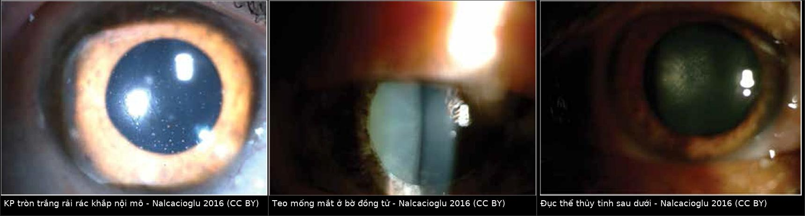
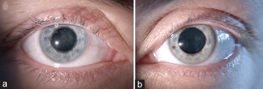
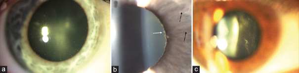
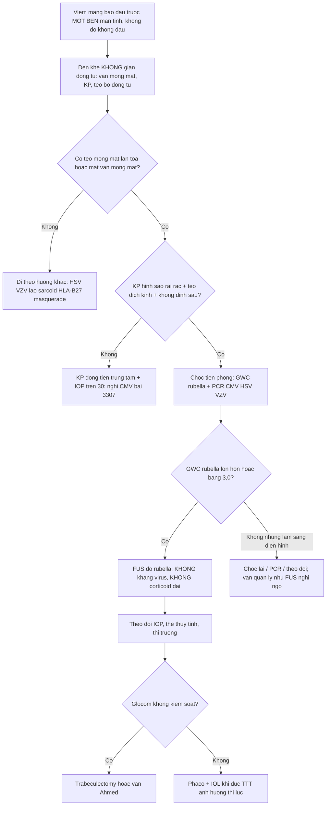
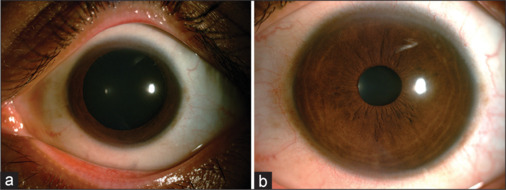
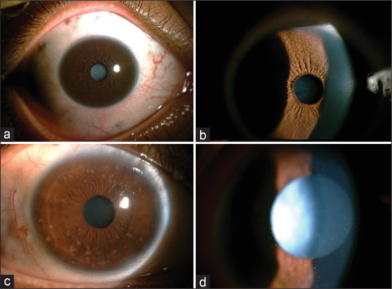

# 3308 — Viêm mống mắt thể mi dị sắc Fuchs do RUBELLA: KP hình sao rải rác, teo mống mắt "ruỗi ăn", tế bào dịch kính — và không có kháng virus đặc hiệu

**Tags:** `pattern:viem-mang-bao-dau-truoc` `pattern:mot-ben` `pattern:man-tinh` `pattern:KP-hinh-sao` `pattern:KP-rai-rac` `pattern:teo-mong-mat-ruoi-an` `pattern:di-sac-to` `pattern:teo-xuyen-sang` `pattern:teo-dich-kinh` `pattern:duc-the-thuy-tinh` `pattern:khong-dinh-sau` `vung:mat` `vung:mong-mat` `vung:tien-phong` `vung:dich-kinh` `vung:the-thuy-tinh` `protocol:den-khe` `protocol:roi-den` `protocol:AS-OCT` `protocol:soi-goc` `protocol:UBM` `protocol:choc-tien-phong` `protocol:GWC` `protocol:IgG-rubella` `protocol:PCR-thuy-dich` `protocol:FA` `score:SUN`
**Mức chắc chắn (certainty):** tổng hợp y văn (literature synthesis) — 3 đoàn hệ lớn (**161 bệnh nhân/171 mắt** Thổ Nhĩ Kỳ; **339 bệnh nhân/346 mắt** Ấn Độ; **466 bệnh nhân/507 mắt** Iran), 1 đoàn hệ **100 bệnh nhân/107 mắt** phân biệt rubella với CMV bằng hệ số Goldmann–Witmer, 1 nghiên cứu xây dựng tiêu chuẩn chẩn đoán Trung Quốc (**593 FUS + 625 không FUS**, kiểm định **377 + 503**), 2 đoàn hệ phẫu thuật glôcôm và 1 đoàn hệ phẫu thuật đục thể thủy tinh; 1 bài tổng quan. **Không có thử nghiệm ngẫu nhiên có đối chứng nào** cho FUS — mọi ngưỡng điều trị dưới đây ghi rõ nguồn và mức bằng chứng.

> **Vì sao bài này quan trọng:** đây là chẩn đoán **bị bỏ sót nhiều nhất** trong viêm màng bồ đào trước. Bệnh nhân **không đau, không đỏ**, chỉ "mờ dần một mắt", nên thường được khám muộn khi đã có **đục thể thủy tinh** hoặc **glôcôm**. Trong đoàn hệ 339 bệnh nhân Ấn Độ, **25% đã bị chẩn đoán sai** trước đó; ở đoàn hệ 466 bệnh nhân Iran, chẩn đoán sai hay gặp nhất là **viêm pars planitis** (Kianersi F và cs, *Sci Rep* 2024;14:8621, PMC11016535; Desai S và cs, *Indian J Ophthalmol* 2025;73:1666–1669, PMC12659839). Sai lầm hay gặp thứ hai là **cho corticoid kéo dài** — vừa không cần thiết, vừa **đẩy nhanh đục thể thủy tinh và glôcôm**, và làm mất dấu hiệu chẩn đoán.
>
> **Bài 3307** (CMV-AU) dạy nhận diện **thể "giống Fuchs" do CMV** — nguyên nhân **chữa được bằng kháng virus**. Bài này đi vào **FUS do rubella**: nguyên nhân **phổ biến nhất** của cùng mẫu hình ở phương Tây, **không có thuốc diệt virus**, và **phân bố KP + tế bào dịch kính** là hai điểm khác biệt cốt lõi.

## 1. Tổng quan bệnh học – cơ chế hình ảnh – vì sao "mắt yên" mà vẫn teo mống mắt

- **Tác nhân và sinh lý bệnh:** rubella virus (RV, họ *Matonaviridae*, ARN sợi đơn) gây nhiễm **mống mắt – thể mi** rồi tồn tại dai dẳng; bệnh là **phản ứng miễn dịch mạn mức thấp** với **tổng hợp kháng thể tại chỗ** nhiều hơn là **sao chép virus đang hoạt động**. Đây là lý do **IgG rubella trong thủy dịch dương 87–100%** trong khi **PCR RV chỉ dương 10–20%** (Gozzi F và cs, *Saudi J Ophthalmol* 2022;36:356–364, PMC9811927). Nghiên cứu Slovenia: **11/12 (92%)** mắt FUS có **GWC rubella dương**, **0/12** mắt viêm màng bồ đào trước một bên không điển hình (Stunf S và cs, *Mol Vis* 2012;18:2909–2914, PMC3519374).
- **Dịch tễ – vì sao vẫn còn bệnh dù có vắc-xin:** FUS chiếm **0,5–16,8%** tổng số viêm màng bồ đào; **1,8–22,7%** ở nước phát triển nhưng chỉ **0–5,6%** ở nước đang phát triển. Tuổi chẩn đoán trung bình **thập niên 3–5**, **10% hai bên**, thường phát hiện **cùng lúc** chứ không xuất hiện thêm trong theo dõi. Tỉ lệ FUS ở người sinh **1919–1958** (chưa tiêm chủng), **1958–1969** (tiêm chủng một phần) và **sau 1969** (tiêm chủng toàn dân ở Mỹ) lần lượt **4,58% – 2,97% – 1,18%** — bằng chứng gián tiếp rất mạnh cho vai trò rubella (PMC9811927).
- **TẠI SAO KP "hình sao" và rải RẢI RÁC khắp nội mô:** KP (keratic precipitate) là **đám đại thực bào – lympho lắng trên nội mô**. Ở FUS, viêm **mức thấp nhưng lan tỏa toàn tiền phòng**, không có fibrin đủ để kết dính thành mảng; vì vậy KP **nhỏ – trung bình, hình sao (stellate), phân bố đều khắp vùng nội mô** thay vì dồn xuống nửa dưới theo trọng lực như KP "mỡ cừu" của lao/sarcoid hay tam giác Arlt của HSV. Tỉ lệ gặp: **69,3%** (Ấn Độ), **74,8%** (Thổ Nhĩ Kỳ), **91,9%** trong nhóm GWC rubella dương (PMC12659839; PMC5082249; PMC11182156).
- **TẠI SAO mống mắt teo và đổi màu:** virus tồn tại trong **mô đệm mống mắt**, gây **teo mô đệm và mất hắc tố** → mất vân mống mắt ("moth-eaten"/"ruỗi ăn"). Trên mắt sáng màu, mắt bệnh **nhạt màu hơn (hypochromic)**; trên mắt sẫm màu, teo lớp đệm làm **lộ biểu mô sắc tố** phía sau → mắt bệnh **sẫm hơn (inverse heterochromia)**. Vì thế **dị sắc tố KHÔNG đáng tin ở người châu Á**: chỉ **6,4%** (Ấn Độ), **27,4%** (Thổ Nhĩ Kỳ), **39,5%** (Áo) — trong khi **mất vân mống mắt chi tiết là 100%** khi khám kỹ (PMC12659839; PMC5082249; PMC11182156). **Teo rõ nhất ở bờ đồng tử** → khuyết xuyên sáng (transillumination) hình vòng.
- **TẠI SAO KHÔNG có dính sau (posterior synechiae):** phản ứng tiền phòng **rất ít fibrin**, nên mống mắt không dính vào thể thủy tinh. **Vắng dính sau là tiêu chuẩn thiết yếu** của cả SUN 2021 và tiêu chuẩn Trung Quốc 2022 (PMC9685691). Nếu có dính sau, phải nghĩ **HSV/VZV, lao, sarcoid, HLA-B27** trước.
- **TẠI SAO luôn có tế bào dịch kính:** viêm lan ra **dịch kính trước** ở hầu hết bệnh nhân; tỉ lệ **59,7%** (nhóm rubella), **71,3%** (Thổ Nhĩ Kỳ), **44,2% có màng dịch kính** (Ấn Độ). Đây là **yếu tố chẩn đoán chính** và là điểm **phân biệt với CMV thể Fuchs-like** — CMV thường **không có tế bào dịch kính** (25,0% so với 66,7%, p = 0,038; Kang H và cs, *Front Med* 2020;7:610341, PMC7775528).
- **TẠI SAO nhãn áp tăng:** ban đầu **từng cơn**, sau đó **mạn tính** do (1) **mạch bất thường ở góc** và xơ hóa lưới bè, (2) **dính góc trước (PAS)** sau nhiều năm, (3) **đáp ứng corticoid** — chính là hệ quả của việc điều trị sai. Glôcôm thứ phát được báo cáo **6,5–59%**; ở đoàn hệ Thổ Nhĩ Kỳ **18,1%** tăng nhãn áp trong theo dõi (PMC9811927; PMC5082249).
- **TẠI SAO đục thể thủy tinh là biến chứng số 1:** viêm mạn + corticoid tại chỗ gây đục **sau dưới (posterior subcapsular)**. Tỉ lệ **52,0%** (Thổ Nhĩ Kỳ), **84,3%** (Ấn Độ), **80,2%** trong nhóm rubella (PMC5082249; PMC12659839; PMC11182156). Quy tắc thực hành: **mọi bệnh nhân trẻ đục thể thủy tinh MỘT BÊN không có chấn thương, không dùng corticoid phải loại trừ FUS**.
- **TẠI SAO "mắt yên" lại có mạch lạ và dấu Amsler:** teo mống mắt làm **mạch nan hoa bình thường lộ rõ**, và ở góc xuất hiện **mạch bắc cầu giống tân mạch**. Chọc tiền phòng ở mắt FUS có thể gây **chảy máu tiền phòng (Amsler sign)** — dấu hiệu kinh điển nhưng **không đặc hiệu**. Đây là lý do phải **soi góc trước khi mổ** và **không chọc tiền phòng khi không cần**.
- **TẠI SAO chẩn đoán bằng mắt là đủ trong đa số ca nhưng vẫn hay sai:** FUS **không đau, không đỏ**, thị lực giảm từ từ do **đục thể thủy tinh/dịch kính**, nên bệnh nhân đến muộn; đồng thời **dị sắc tố thường tinh tế** và **KP có thể thưa**. Tiêu chuẩn SUN 2021 đòi **dị sắc tố hoặc teo mống mắt lan tỏa + KP hình sao**; áp dụng đủ bộ tiêu chuẩn này, **chỉ 8,4%** trong 107 mắt có GWC rubella dương là **thỏa mãn** (PMC11182156) — nghĩa là **tiêu chuẩn hiện hành bỏ sót phần lớn ca thực tế ở người da sẫm màu**.

## 2. Mẫu hình + chẩn đoán phân biệt theo kiểu hình (gamut)

FUS là bệnh **mạn, một bên, "yên lặng"**; kiểu hình thay đổi theo **màu mống mắt, thời gian bệnh và mức teo**:

- **A. Thể kinh điển (heterochromic):** mắt bệnh **nhạt màu hơn**, **KP hình sao rải rác**, **teo mống mắt lan tỏa**, **tế bào dịch kính**, **không dính sau**, nhãn áp bình thường hoặc tăng nhẹ. Hay gặp ở **mắt sáng màu** (châu Âu).
- **B. Thể "mống mắt sẫm" (dark-iris / không dị sắc):** **không thấy dị sắc tố**, nhưng **mất vân mống mắt**, **teo bờ đồng tử**, **mạch nan hoa lộ rõ**, **KP hình sao + tế bào dịch kính**. Đây là thể **phổ biến ở Việt Nam/châu Á** và là nơi chẩn đoán hay bị bỏ qua.
- **C. Thể đục thể thủy tinh đơn độc:** bệnh nhân đến vì **mờ mắt do đục TTT một bên**; khám kỹ mới thấy **KP thưa, teo mống mắt, tế bào dịch kính**.
- **D. Thể có hạt mống mắt (nodular):** **nốt Koeppe** ở bờ đồng tử hoặc **nốt Busacca** trên mặt mống mắt, gặp **9,2–29%**; dễ bị gọi nhầm là **lao/sarcoid** — nhưng **không dính sau, không KP mỡ cừu**.
- **E. Thể glôcôm:** nhãn áp tăng **âm thầm**, thị trường mất dần; thường **đã có teo mống mắt rõ** và **đục TTT**.
- **Gamut theo KP:** **hình sao rải rác toàn nội mô** → FUS (rubella) hoặc CMV thể Fuchs-like; **đồng tiền (coin-shaped) trung tâm** → CMV (bài 3307); **mỡ cừu dính vùng/tam giác Arlt** → HSV/VZV/lao/sarcoid; **KP sắc tố** → KP cũ của bất kỳ nguyên nhân.
- **Gamut theo bối cảnh:** **mắt sáng màu + nhạt màu + tế bào dịch kính** → rubella; **châu Á + nhãn áp > 30 mmHg + KP trung tâm + không teo** → CMV; **ban zona + > 60 tuổi** → VZV; **teo vùng + giác mạc giảm cảm giác** → HSV; **hai bên, đau, tái phát** → HLA-B27/TINU/sarcoid.

*Ba dấu hiệu thường gặp trên cùng một bệnh: (a) **KP tròn trắng rải rác khắp nội mô**; (b) **teo mống mắt rõ ở bờ đồng tử**; (c) **đục thể thủy tinh sau dưới**. Ảnh letterbox giữ nguyên tỷ lệ. Nguồn: Nalçacıoğlu P và cs, *Turk J Ophthalmol* 2016;46:52–57 (PMC5082249) Fig. 1, 2, 4, **CC BY 4.0**.*

*(a) Mắt bệnh **nhạt màu (hypochromic)**, (b) mắt lành. Dị sắc tố chỉ có ở **< 40%** bệnh nhân và **gần như không thấy ở mống mắt sẫm màu** — đừng dùng nó làm tiêu chuẩn duy nhất. Nguồn: Gozzi F và cs, *Saudi J Ophthalmol* 2022;36:356–364 (PMC9811927) Fig. 5, **CC BY-NC-SA 4.0**.*

*(a) **KP hình sao rải khắp vùng nội mô** (không dồn nửa dưới); (b) **nốt Koeppe** ở bờ đồng tử (mũi tên trắng) và **mạch nan hoa** lộ rõ do teo mống mắt (mũi tên đen); (c) **tế bào dịch kính trước**. Nguồn: Gozzi F và cs, *Saudi J Ophthalmol* 2022 (PMC9811927) Fig. 4, **CC BY-NC-SA 4.0**.*

## 3. Bảng so sánh phân biệt (ma trận đối chiếu)

| Thực thể (entity) | Hình ảnh điển hình | Chốt vào (rule-in) | Chốt loại (rule-out) | Gợi ý xác nhận |
|---|---|---|---|---|
| **FUS do rubella (RV-FUS)** | Một bên, **không đỏ/không đau**, **KP hình sao rải rác**, **teo mống mắt lan tỏa/mất vân**, **tế bào dịch kính**, **không dính sau**, hay kèm **đục TTT sau dưới** | **GWC rubella ≥ 3,0** (hoặc IgG thủy dịch dương) + **KP hình sao + teo mống mắt + tế bào dịch kính**; **mất vân mống mắt 100%** khi khám kỹ | **KP đồng tiền trung tâm + nhãn áp > 30 mmHg + không teo mống mắt + không tế bào dịch kính** → CMV; **dính sau + KP mỡ cừu** → lao/sarcoid | GWC rubella + tổng IgG; **PCR RV chỉ dương 10–20%**; AS-OCT mống mắt |
| **FUS do CMV (CMV-FUS)** | Một bên, **nhãn áp tăng rõ (> 30 mmHg ở 66,7%)**, **KP trung tâm (63,6%)**, **KHÔNG teo mống mắt (100%)**, **không dính sau (90,5%)**, **thể thủy tinh còn trong (55%)** | **PCR CMV thủy dịch dương** hoặc **GWC CMV ≥ 3,0**; **KP đồng tiền + IOP cao** | **Teo mống mắt lan tỏa + tế bào dịch kính + dị sắc tố** → rubella; **teo vùng + keratitis** → HSV | PCR + GWC CMV; đếm tế bào nội mô; soi góc (bài 3307) |
| **HSV-AU** | Một bên, **đau đỏ**, **KP hạt tam giác Arlt**, **teo mống mắt VÙNG**, **giảm cảm giác giác mạc**, nhãn áp tăng từng cơn | PCR HSV dương; **teo vùng ≤ 50 tuổi**; có **keratitis** | **KP hình sao rải rác + không teo vùng + cảm giác giác mạc bình thường** → FUS | SUN 2021; PCR; cảm giác giác mạc (bài 3306) |
| **VZV-AU** | > 60 tuổi, **ban zona V1**, KP sắc tố, **đồng tử chữ D**, teo **hình nêm rộng**, viêm nặng hơn | PCR VZV; **teo vùng ≥ 60 tuổi**; zona cùng bên | **Không ban, không teo vùng, viêm rất nhẹ** → FUS | Khám da V1; PCR; soi đáy mắt loại trừ ARN |
| **PSS vô căn (Posner–Schlossman)** | Cơn **tăng nhãn áp đơn thuần**, tiền phòng **rất ít tế bào**, **KP nhỏ thưa**, tự khỏi; **không teo mống mắt tiến triển**, **không tế bào dịch kính** | **PCR/GWC âm** + nhiều đợt không để lại di chứng | **Teo mống mắt tiến triển + tế bào dịch kính** → FUS | Theo dõi nhiều đợt; chọc thủy dịch khi nghi |
| **Lao/sarcoid (AU u hạt)** | **KP mỡ cừu dính vùng**, **nốt Koeppe/Busacca lớn**, **dính sau**, có thể **hai bên** | IGRA/ACE; **sinh thiết**; hình ảnh lồng ngực | **KP hình sao rải rác + không dính sau + một bên mạn tính** → FUS | IGRA, ACE, X-quang/CT ngực |
| **HLA-B27 AU** | **Đau đỏ dữ dội**, **hai bên/tái phát**, **dính sau**, **fibrin/mủ tiền phòng**, kèm **viêm cột sống/viêm ruột** | HLA-B27; bệnh hệ thống | **Không đau, không đỏ, mạn tính, không dính sau** → FUS | HLA-B27; hỏi đau lưng/tiêu chảy |
| **Masquerade – u lympho nội nhãn** | **Không đau**, tế bào dịch kính, **không đáp ứng corticoid**, đốm dưới biểu mô sắc tố, tuổi > 60 | **Tế bào ác tính/flow cytometry**; **IL-10:IL-6 > 1** | **Tế bào dịch kính + teo mống mắt + GWC rubella dương** → FUS | Chọc dịch kính, cytokine, MRI (bài 1435) |
| **Loạn dưỡng nội mô Fuchs (Fuchs endothelial dystrophy)** | **Hai bên**, **giọt mỡ (guttata)**, phù giác mạc, **KHÔNG viêm tiền phòng**, không KP thật | Soi nội mô: guttata; **không tế bào tiền phòng** | **Có KP + tế bào dịch kính + một bên** → FUS (khác bệnh, chỉ trùng tên "Fuchs") | Specular microscopy; bệnh sử gia đình |

### Đọc "KP hình sao" cho đúng
- **Hình sao = bờ tua tua, nhỏ–trung bình (~0,2–0,5 mm), rải đều toàn bộ vùng nội mô**, không dồn nửa dưới. Chụp **phóng đại cao + chếch sáng** và **soi đèn nền** để thấy phân bố.
- **Đếm và ghi vị trí:** FUS thường **KP thưa** (không thành mảng); nếu **KP dày, dính, có mủ tiền phòng** thì không phải FUS.
- **Đừng nhầm** với **giọt mỡ nội mô**, **di vật nội mô**, **bong màng Descemet sau phaco** (đường DM tách, không có đám tế bào), **tinh thể trên mống mắt** (Russell bodies — hiếm).

## 4. Protocol khám – xét nghiệm – phân độ + phác đồ

### 4.1. Khám mắt tối thiểu (đúng thứ tự)

| Bước | Kỹ thuật | Mục đích / ngưỡng |
|---|---|---|
| 1 | **Thị lực + nhãn áp hai mắt** | Ghi **IOP từng lần**; FUS thường **bình thường hoặc tăng nhẹ**, glôcôm **6,5–59%** |
| 2 | **Đèn khe KHÔNG giãn đồng tử trước** | **Mất vân mống mắt quanh vòng collarette** dễ thấy nhất khi **đồng tử co**; giãn đồng tử làm mất dấu hiệu |
| 3 | **Tế bào/flare theo SUN** | Thường **0,5–1+**, kéo dài; **không có fibrin** |
| 4 | **Mô tả KP: hình, số, phân bố** | **Hình sao + rải rác toàn nội mô** → FUS; **đồng tiền trung tâm** → CMV |
| 5 | **Soi mống mắt: vân, teo, mạch nan hoa, nốt** | **Mất vân 100%**, teo bờ đồng tử, **nốt Koeppe/Busacca 9,2–29%**; **không dính sau** |
| 6 | **Soi đèn nền/retroillumination** | **Khuyết xuyên sáng ở bờ đồng tử**; so **hai mắt cùng cường độ sáng** để đánh giá dị sắc tố |
| 7 | **Soi góc (gonioscopy)** | **Mạch bắc cầu**, **PAS**, sắc tố góc — trước khi giãn đồng tử và trước mổ |
| 8 | **Đáy mắt giãn đồng tử** | Loại trừ **viêm võng mạc/pars planitis/u lympho**; FUS có thể **tăng huỳnh quang gai thị**, viêm mạch ngoại vi **13,6%**, **không phù hoàng điểm** |
| 9 | **AS-OCT / UBM** | **Độ dày mống mắt giảm**, teo mô đệm; UBM đánh giá góc và mạch bất thường |
| 10 | **EDI-OCT** | **Mỏng hắc mạc toàn bộ chiều dày** (gợi ý viêm toàn màng mạch) |
| 11 | **Theo dõi dài hạn** | **IOP mỗi 6–12 tháng**, **đáy mắt/thị trường khi có glôcôm**, theo dõi **đục TTT** |

### 4.2. Xét nghiệm sinh học — chốt nguyên nhân

| Xét nghiệm | Cách làm / ngưỡng | Diễn giải |
|---|---|---|
| **GWC rubella (Goldmann–Witmer)** | (IgG RV thủy dịch/IgG tổng thủy dịch) ÷ (IgG RV máu/IgG tổng máu) | **≥ 3,0** = tổng hợp kháng thể tại mắt (một số lab dùng **≥ 2,0**); **92%** FUS dương (PMC3519374) |
| **IgG rubella huyết thanh** | Bắt buộc phải có cùng ngày với mẫu thủy dịch | Chỉ để **tính GWC**; dương đơn thuần **không chẩn đoán** (nhiều người đã tiêm chủng/nhiễm cũ) |
| **PCR RV (ARN) thủy dịch** | Chọc tiền phòng ~100 µL | **Chỉ dương 10–20%** — **âm không loại trừ**, **dương không chứng minh vai trò** (có thể trùng hợp) |
| **PCR/GWC CMV, HSV, VZV, Toxoplasma** | Cùng mẫu, chạy song song | **Loại trừ CMV là bắt buộc** vì CMV **chữa được** và có thể giống FUS |
| **Công thức máu, ACE, IGRA, RPR** | Khi có yếu tố nguy cơ hoặc hình thái không điển hình | Loại trừ lao, sarcoid, giang mai trước khi kết luận "FUS vô căn" |
| **Chọc dịch kính + flow cytometry/cytokine** | Khi nghi masquerade | **IL-10:IL-6 > 1** hướng u lympho |

### 4.3. Tiêu chuẩn chẩn đoán

- **SUN 2021 (dùng phổ biến):** **viêm màng bồ đào trước MỘT BÊN** + **dị sắc tố HOẶC teo mống mắt lan tỏa** + **KP hình sao** + **không viêm nội mô/KP đồng tiền** + không tiêu chuẩn loại trừ.
- **Hạn chế đã được chứng minh:** áp dụng đủ bộ, **chỉ 8,4%** mắt có GWC rubella dương thỏa mãn; **dị sắc tố chỉ 39,5%**, **teo mống mắt 12,9%** (PMC11182156).
- **Tiêu chuẩn Trung Quốc 2022 (nhạy 96,55%, đặc hiệu 97,42%):** **3 dấu hiệu thiết yếu** — **mất hắc tố mống mắt lan tỏa**, **không dính sau**, **viêm tiền phòng nhẹ**; **5 dấu hiệu hỗ trợ** — **một bên**, **đục thể thủy tinh**, **đục dịch kính**, **không triệu chứng cấp**, **nốt mống mắt** (PMC9685691). Tiêu chuẩn này **phù hợp mắt sẫm màu** hơn SUN.
- **Chẩn đoán thực hành của ta:** hình thái điển hình + **GWC rubella ≥ 3,0** (hoặc IgG thủy dịch dương) + **loại trừ CMV/HSV/VZV** + loại trừ masquerade. Nếu **không chọc thủy dịch được**, chẩn đoán **thuần lâm sàng** và **theo dõi biến chứng** — nhưng phải ghi rõ là "FUS nghi ngờ".

### 4.4. Điều trị — nguyên tắc và ngưỡng

| Tình huống | Xử trí | Ghi chú / bằng chứng |
|---|---|---|
| **FUS không biến chứng** | **Không corticoid, không kháng virus**; giải thích bệnh mạn lành tính | Corticoid tại chỗ **không cải thiện** và **đẩy nhanh đục TTT/glôcôm** (PMC9811927) |
| **Nhãn áp tăng nhẹ – vừa** | Thuốc hạ nhãn áp; **tránh prostaglandin nếu viêm hoạt động** (cân nhắc) | Theo dõi IOP **6–12 tháng/lần** |
| **Đục thể thủy tinh ảnh hưởng thị lực** | **Phaco + IOL**; kiểm soát viêm trước mổ; **corticoid chu phẫu ngắn** theo kinh nghiệm | **56 mắt**: **PCO 59,1–70,8%**, **lắng tế bào khổng lồ trên IOL ~29–30%**; thị lực cải thiện, biến chứng nặng hiếm (PMC9925659) |
| **Glôcôm không kiểm soát** | **Trabeculectomy + MMC** hoặc **van Ahmed (AGV)** | Hai đoàn hệ **cho kết quả ngược nhau** — xem mục 7; cần cá thể hóa |
| **Nghi CMV thể Fuchs-like** | **Không điều trị FUS**; chuyển phác đồ kháng virus (bài 3307) | CMV **16–42%** FUS ở châu Á |

## 5. Biến thể bình thường và cạm bẫy

- **"Không dị sắc tố thì không phải FUS" — SAI.** Dị sắc tố chỉ **6,4%** (Ấn Độ), **27,4%** (Thổ Nhĩ Kỳ), **39,5%** (Áo); ở mống mắt sẫm màu nó **gần như không thấy**. Dấu hiệu **nhạy hơn** là **mất vân mống mắt** và **teo bờ đồng tử**.
- **"Hai bên thì loại FUS" — SAI.** **10%** FUS **hai bên**, thường phát hiện **ngay lần khám đầu**, không xuất hiện thêm trong theo dõi (PMC9811927).
- **"Có tế bào dịch kính là viêm pars planitis" — SAI.** Đây chính là **chẩn đoán sai hay gặp nhất** (13 bệnh nhân trong đoàn hệ 466). FUS có **tế bào dịch kính nhưng KHÔNG có phù hoàng điểm/viêm mạch ngoại vi nặng**; pars planitis có **"snowbank"** và phù hoàng điểm.
- **"KP hình sao là đặc hiệu rubella" — SAI.** CMV thể Fuchs-like cũng có KP hình sao; **thiếu tế bào dịch kính + nhãn áp rất cao** mới nghiêng CMV. Luôn chạy **PCR/GWC CMV song song**.
- **"Điều trị corticoid cho khỏi viêm" — SAI và nguy hiểm.** Corticoid **không có chỉ định** trong FUS; chúng **tăng đục thể thủy tinh và glôcôm**, đồng thời **xóa dấu hiệu** (KP, tế bào) khiến chẩn đoán muộn hơn.
- **"Nhãn áp bình thường = không glôcôm" — SAI.** Glôcôm **âm thầm**, có thể **6,5–59%**; phải theo dõi **IOP nhiều lần + thị trường/RNFL** khi bệnh kéo dài.
- **Cạm bẫy chọc tiền phòng:** mạch bất thường ở góc gây **Amsler sign (chảy máu tiền phòng)**; **soi góc trước**, tránh chọc khi không cần, và **không hoảng** nếu có máu nhẹ sau chọc.
- **Cạm bẫy phẫu thuật:** mống mắt teo dễ **chảy máu**, **dính thể thủy tinh yếu**, **PCO rất cao (59–71%)**; bệnh nhân cần được tư vấn **mổ đục TTT là để nhìn, không chữa khỏi bệnh**, và **vẫn phải theo dõi glôcôm** sau mổ.
- **Cạm bẫy tên gọi:** **"Fuchs"** ở đây là **Fuchs uveitis syndrome (viêm mống mắt thể mi dị sắc)** — **không phải** **loạn dưỡng nội mô Fuchs** (bệnh giác mạc hai bên, có guttata) và **không phải** **sẹo Fuchs** ở hoàng điểm (bệnh cận thị). Ghi rõ tên tiếng Anh để tránh nhầm trong hồ sơ.
- **Cạm bẫy ảnh:** chụp **đồng tử giãn** làm mất vân mống mắt; luôn chụp **trước giãn**, cùng **cường độ sáng hai mắt** khi đánh giá dị sắc tố.

*(a) Đồng tử **giãn**: chi tiết mống mắt bị che, dễ bỏ sót chẩn đoán; (b) **không giãn**: mất vân mống mắt quanh vòng collarette — dấu hiệu quan trọng, đặc biệt ở **mống mắt sẫm màu**. Nguồn: Desai S và cs, *Indian J Ophthalmol* 2025;73:1666–1669 (PMC12659839) Fig. 3, **CC BY-NC-SA 4.0**.*

## 6. Tự lượng giá — Blind Quiz

**Ca 1 — nam 34 tuổi, mắt trái "mờ dần 2 năm", không đau, không đỏ; nhãn áp 18 mmHg; đèn khe thấy vài chấm trắng rải rác trên nội mô, mống mắt mất vân, có tế bào dịch kính, không dính sau.**

- Gợi ý: so **hai mắt cùng cường độ sáng**; mắt bệnh **nhạt màu hơn**; **không đỏ, không đau**, bệnh sử **nhiều năm**.
- Câu hỏi: Dấu hiệu chính? Vì sao bệnh nhân **không đau** mà mống mắt vẫn teo? Hai chẩn đoán phân biệt và xét nghiệm nào chốt?

<b>Bấm để hiện đáp án (findings + chẩn đoán)</b>

- **Dấu hiệu:** **dị sắc tố (mắt bệnh nhạt màu)**, **KP hình sao rải rác**, **mất vân mống mắt**, **tế bào dịch kính**, **không dính sau**, nhãn áp **18 mmHg**.
- **Vì sao không đau mà vẫn teo:** viêm **mức thấp mạn tính** không kích thích đủ đầu mút thần kinh giác mạc; tổn thương mống mắt do **virus tồn tại trong mô đệm + thiếu máu cục bộ nhẹ**, tiến triển **nhiều năm**.
- **Chẩn đoán:** **FUS do rubella** — chốt bằng **GWC rubella ≥ 3,0** (IgG thủy dịch/máu cùng ngày); **PCR RV chỉ dương 10–20%** nên **không dùng PCR âm để loại trừ**.
- **Phân biệt:** **CMV thể Fuchs-like** (thường **không tế bào dịch kính**, nhãn áp **rất cao**, KP trung tâm/đồng tiền) và **viêm pars planitis** (có **snowbank**, **phù hoàng điểm**, thường trẻ hơn).
- **Điều trị:** **không kháng virus, không corticoid dài**; theo dõi **nhãn áp, thể thủy tinh, thị trường**.
- **Nguồn ảnh:** Gozzi F và cs, *Saudi J Ophthalmol* 2022 (PMC9811927) Fig. 5, **CC BY-NC-SA 4.0**.

**Ca 2 — nữ 45 tuổi, mắt phải mờ 1 năm, không đau; nhãn áp 16 mmHg; đồng tử giãn thấy mống mắt "bình thường", nhưng khi nhỏ lại thấy mất vân quanh collarette và vài KP hình sao; dịch kính có tế bào.**

- Gợi ý: hai ảnh **cùng một mắt**, khác trạng thái đồng tử; (a) giãn, (b) không giãn.
- Câu hỏi: Vì sao **giãn đồng tử làm mất chẩn đoán**? Dấu hiệu nào còn lại giúp chốt? Có nên chọc thủy dịch ngay không?

<b>Bấm để hiện đáp án (findings + chẩn đoán)</b>

- **Dấu hiệu:** **(b) mất vân mống mắt quanh vòng collarette** khi đồng tử co; **(a) đồng tử giãn che mất chi tiết này**. Kèm **KP hình sao** và **tế bào dịch kính**.
- **Vì sao giãn đồng tử làm mất dấu hiệu:** vân mống mắt và teo bờ đồng tử chỉ nhìn rõ khi **mống mắt căng ra**; giãn đồng tử làm **mờ vân và che vùng bờ**.
- **Chẩn đoán:** **FUS (nghi rubella)** — hình thái đủ để chẩn đoán lâm sàng; **chọc thủy dịch** để **loại trừ CMV** và **tính GWC rubella** nếu cần chắc chắn trước khi mổ hoặc khi bệnh không điển hình.
- **Điểm thực hành:** **luôn khám và chụp ảnh trước khi giãn đồng tử**; ghi mô tả mống mắt vào hồ sơ.
- **Nguồn ảnh:** Desai S và cs, *Indian J Ophthalmol* 2025 (PMC12659839) Fig. 3, **CC BY-NC-SA 4.0**.

**Ca 3 — nam 52 tuổi, mắt trái nhìn mờ, không đỏ; đèn khe: nốt nhỏ ở bờ đồng tử, mống mắt teo kiểu "ruỗi ăn", KP hình sao, không dính sau; nhãn áp 22 mmHg.**

- Gợi ý: (a–b) **nốt ở bờ đồng tử**, (c) **teo mống mắt "ruỗi ăn"**, (d) **KP hình sao**.
- Câu hỏi: Nốt mống mắt gợi ý bệnh u hạt — vì sao vẫn nghĩ FUS? Dấu hiệu nào **loại** lao/sarcoid? Cần làm gì thêm?

<b>Bấm để hiện đáp án (findings + chẩn đoán)</b>

- **Dấu hiệu:** **nốt Koeppe/Busacca** (9,2–29%), **teo mống mắt lan tỏa "ruỗi ăn"**, **KP hình sao rải rác**, **không dính sau**, **không fibrin**.
- **Vì sao vẫn nghĩ FUS:** nốt mống mắt **không đặc hiệu**; ở FUS chúng **nhỏ, rải rác**, không kèm **KP mỡ cừu dính vùng** hay **dính sau**.
- **Dấu hiệu loại lao/sarcoid:** **KP hình sao rải rác** thay vì **mỡ cừu dính**, **không dính sau**, **một bên mạn tính**, **không viêm màng bồ đào trung gian**; vẫn nên làm **IGRA/ACE/X-quang ngực** nếu có yếu tố nguy cơ.
- **Bước tiếp:** **GWC rubella + PCR CMV/HSV/VZV**, soi góc, AS-OCT mống mắt; theo dõi **nhãn áp và thể thủy tinh**.
- **Nguồn ảnh:** Desai S và cs, *Indian J Ophthalmol* 2025 (PMC12659839) Fig. 4, **CC BY-NC-SA 4.0**.

## 7. Câu hỏi nghiên cứu & điểm chưa đồng thuận (tính đến 11/2026)

1. **[Tranh cãi] Ở bệnh nhân FUS có glôcôm không kiểm soát, trabeculectomy + MMC hay van Ahmed cho tỉ lệ thành công cao hơn?**
   - **Đã biết:** đoàn hệ **28 mắt** (16 trabeculectomy/12 AGV) báo thành công tích lũy **76% so với 9%** ở 36 tháng (tiêu chí IOP ≤ 21 mmHg), nghiêng hẳn về **trabeculectomy**; đoàn hệ **26 mắt** khác lại báo **41,7% so với 85,7%**, nghiêng hẳn về **AGV**.
   - **Chưa rõ:** khác biệt do **cỡ mẫu nhỏ, tiêu chí thành công khác nhau, thời gian theo dõi và mức viêm trước mổ**; chưa có RCT, chưa có phân tầng theo **PAS, mạch góc, số thuốc trước mổ**.
   - **Hướng nghiên cứu:** RCT đa trung tâm hoặc registry tiến cứu có **tiêu chí thành công thống nhất** (IOP ≤ 21 và ≤ 16 mmHg, giảm ≥ 20%, số thuốc), phân tầng theo mức viêm và tình trạng góc.
   - **Nguồn:** PMC6407154 (2019); PMC6198260 (2018).

2. **[Khoảng trống] Tiêu chuẩn nào chẩn đoán FUS đủ nhạy ở mống mắt sẫm màu khi dị sắc tố thường vắng — SUN 2021, tiêu chuẩn Trung Quốc 2022, hay GWC rubella?**
   - **Đã biết:** SUN 2021 chỉ **8,4%** mắt có GWC rubella dương thỏa mãn đủ bộ; **dị sắc tố 39,5%**, **teo mống mắt 12,9%**; tiêu chuẩn Trung Quốc (3 thiết yếu + 5 hỗ trợ) đạt **nhạy 96,55%/đặc hiệu 97,42%** nhưng **chưa kiểm định bên ngoài**; **GWC rubella dương 87–100%**, **PCR chỉ 10–20%**.
   - **Chưa rõ:** **ngưỡng GWC** (2,0 so với 3,0) chưa thống nhất giữa các phòng xét nghiệm; chưa rõ **giá trị của AS-OCT độ dày mống mắt** trong chẩn đoán; chưa có tiêu chuẩn cho **quần thể Đông Nam Á**.
   - **Hướng nghiên cứu:** nghiên cứu chẩn đoán tiến cứu đa quốc gia, so **tiêu chuẩn lâm sàng + GWC + AS-OCT** với **chẩn đoán của hội đồng chuyên gia**, báo cáo **độ nhạy/độ đặc hiệu theo màu mống mắt**.
   - **Nguồn:** PMC11182156 (2022); PMC9685691 (2022); PMC3519374 (2012).

3. **[Khác biệt thực hành] Trước phaco ở mắt FUS, có nên chọc thủy dịch để loại CMV và dùng corticoid chu phẫu thế nào, chọn IOL nào khi PCO tới 59–71%?**
   - **Đã biết:** **56 mắt** phaco + IOL: **PCO 70% (hydrophilic), 70,8% (hydrophobic SN60AT), 59,1% (AAB00)**, không khác biệt có ý nghĩa; **lắng tế bào khổng lồ trên IOL ~29–30%**; một số trung tâm **không dùng corticoid chu phẫu**, số khác dùng ngắn ngày.
   - **Chưa rõ:** **lợi ích của corticoid chu phẫu** chưa được chứng minh bằng RCT; **vật liệu IOL tối ưu** chưa rõ; **thời điểm mổ** (khi thị lực giảm bao nhiêu) và **vai trò chọc thủy dịch trước mổ** chưa thống nhất.
   - **Hướng nghiên cứu:** RCT so **có/không corticoid chu phẫu** và **hydrophilic so với hydrophobic** với kết cục **PCO, tế bào khổng lồ, thị lực 12 tháng, glôcôm sau mổ**.
   - **Nguồn:** PMC9925659 (2023); PMC9811927 (2022); PMC11016535 (2024).

## Bài liên quan chéo
- [3307 – Viêm màng bồ đào trước do CMV: thể PSS và thể giống Fuchs](../3307-viem-mang-bao-dau-truoc-cmv/lesson.md) (nguyên nhân **chữa được** của cùng mẫu hình; KP đồng tiền, không tế bào dịch kính)
- [3306 – Viêm màng bồ đào trước do HSV/VZV](../3306-viem-mang-bao-dau-truoc-hsv-vzv/lesson.md) (teo mống mắt **vùng**, KP dính, giảm cảm giác giác mạc)
- [3302 – Viêm màng bồ đào do giang mai](../3302-viem-mang-bao-dau-giang-mai/lesson.md) (kẻ bắt chước; RPR âm ~40%)
- [1435 – Hội chứng masquerade: u lympho nội nhãn](../1435-hoi-chung-masquerade-u-lympho-noi-nhan/lesson.md) (không đáp ứng corticoid, tế bào dịch kính)
- [1436 – Bệnh Vogt–Koyanagi–Harada](../1436-benh-vogt-koyanagi-harada/lesson.md) (hai bên, bong thanh dịch)
- [400 – Tổng quan Mắt & thị giác](../400-tong-quan-mat-thi-giac/lesson.md)

## Ảnh
- `3308_FUS_Heterochromia_PMC9811927-Fig5.jpg` — dị sắc tố: mắt bệnh nhạt màu hơn (a) so với mắt lành (b).
- `3308_FUS_Stellate-KP-Vitreous_PMC9811927-Fig4.jpg` — KP hình sao rải rác (a), nốt Koeppe + mạch nan hoa (b), tế bào dịch kính (c).
- `3308_FUS_Iris-Atrophy-Nodules-KP_PMC12659839-Fig4.jpg` — nốt mống mắt (a–b), teo "ruỗi ăn" (c), KP hình sao (d).
- `3308_FUS_Undilated-vs-Dilated_PMC12659839-Fig3.jpg` — giãn đồng tử che mất mất vân mống mắt (a) so với không giãn (b).
- `3308_FUS_Diffuse-KP_PMC5082249-Fig1.jpg` — KP tròn trắng rải rác khắp nội mô.
- `3308_FUS_Iris-Atrophy-Pupillary-Margin_PMC5082249-Fig2.jpg` — teo mống mắt rõ ở bờ đồng tử.
- `3308_FUS_Cataract-PSC_PMC5082249-Fig4.jpg` — đục thể thủy tinh sau dưới.
- `composite_FUS-signs.jpg` — ảnh ghép 3 dấu hiệu (KP, teo bờ đồng tử, đục TTT).
- Nguồn + giấy phép từng ảnh: `images/CREDITS.md`; nguồn bài: `sources.md`.

> Không dùng để chẩn đoán độc lập khi chưa có người hướng dẫn.
