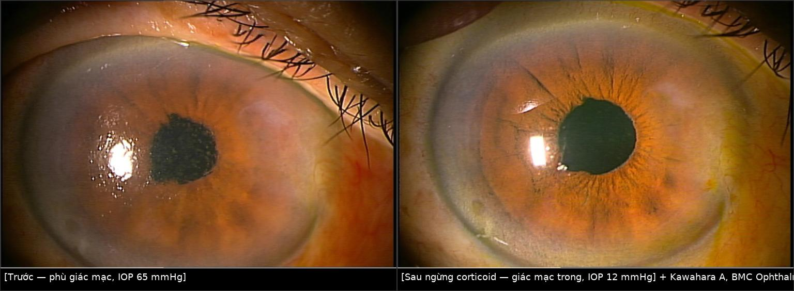
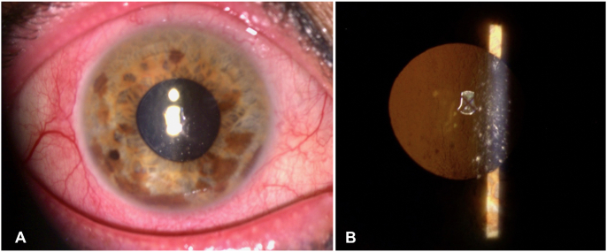
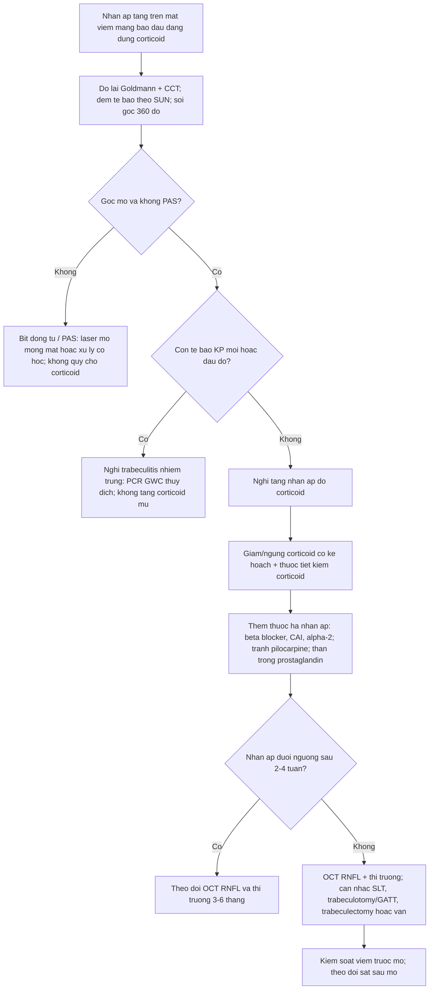
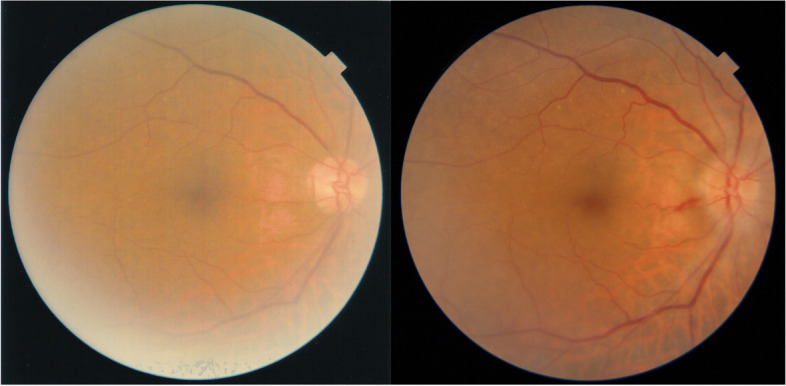
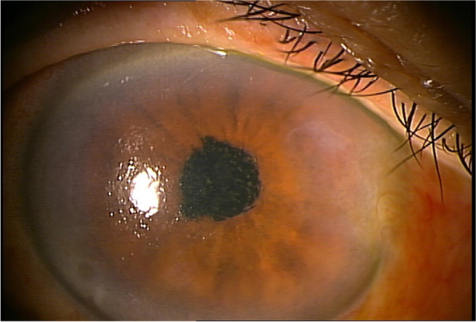
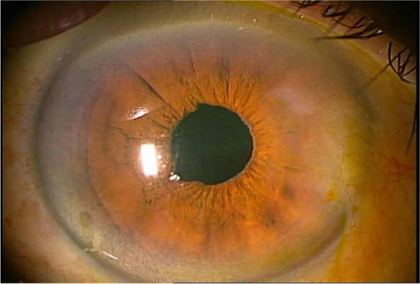
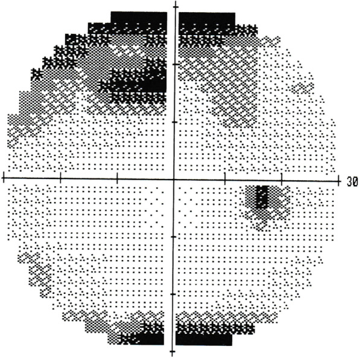

# 3309 — Tăng nhãn áp do corticoid trên mắt viêm màng bồ đào: "viêm hay thuốc?" — 14,8–29,2% là người đáp ứng corticoid

**Tags:** `pattern:tang-nhan-ap` `pattern:steroid-responder` `pattern:mot-ben` `pattern:hai-ben` `pattern:phu-giac-mac` `pattern:KP` `pattern:dinh-goc` `pattern:teo-dia-thi` `pattern:khuyet-thi-truong` `vung:mat` `vung:tien-phong` `vung:luoi-be` `vung:goc-tien-phong` `vung:dia-thi` `protocol:do-nhan-ap` `protocol:soi-goc` `protocol:AS-OCT` `protocol:OCT-RNFL` `protocol:thi-truong` `protocol:den-khe` `protocol:PCR-thuy-dich` `score:SUN`

**Mức chắc chắn (certainty):** tổng hợp y văn (literature synthesis) — ghép các đoàn hệ viêm màng bồ đào (**594 mắt**, PMC12372549; **257 mắt**, PMC13786867; **641 mắt**, PMC12666025), đoàn hệ tiêm corticoid nội nhãn (**382 mắt**, PMC13002021), nghiên cứu AS-OCT chiều cao lưới bè (**102 mắt**, PMC10241928), tổng quan cơ chế – di truyền (PMC10605158, PMC7401422, PMC13355179), ca nguyên văn có ảnh (PMC10224573, PMC8113719) và các loạt phẫu thuật/ laser (PMC13311963, PMC10272257, PMC9940537, PMC13487927). **Không có thử nghiệm ngẫu nhiên có đối chứng nào riêng cho việc phân biệt tăng nhãn áp do viêm với do corticoid trong viêm màng bồ đào** — mọi ngưỡng dưới đây ghi rõ nguồn và mức bằng chứng.

> **Vì sao bài này quan trọng:** trên mắt viêm màng bồ đào, **nhãn áp tăng không đồng nghĩa viêm nặng**. Cùng một bệnh nhân, cùng một ngày, nhãn áp có thể tăng vì **viêm lưới bè (trabeculitis)**, vì **dính góc (peripheral anterior synechiae, PAS)**, vì **bít đồng tử (pupillary block)** — hoặc vì **chính corticoid đang dùng để chữa viêm**. Trong đoàn hệ **594 mắt** viêm màng bồ đào, **14,8%** là "người đáp ứng corticoid" (steroid responder: nhãn áp tăng ≥ 10 mmHg sau khi bắt đầu corticoid), nhãn áp trung bình **35,6 ± 10,9 mmHg**, **19,0%** phải mổ/laser glôcôm (PMC12372549); đoàn hệ Malaysia ghi **29,2%** mắt dùng corticoid có đáp ứng corticoid và **36,8%** phải mổ glôcôm (PMC13786867).
>
> **Bài 1411** đã phủ **dược động học của implant corticoid nội nhãn**; **bài 3307/3308** đã phủ **viêm màng bồ đào do CMV và rubella**. Bài này chỉ giải quyết **một câu hỏi thực hành**: khi nhãn áp tăng trên mắt viêm màng bồ đào đang dùng corticoid, **làm sao biết phần nào do viêm, phần nào do thuốc — và xử trí ra sao mà không làm bùng viêm**.

## 1. Tổng quan bệnh học – cơ chế hình ảnh – vì sao corticoid làm tăng nhãn áp

- **Công thức quyết định nhãn áp:** $IOP = F/C + P_{ev}$ (F = lưu lượng thủy dịch thể mi tiết; C = khả năng thoát qua lưới bè – ống Schlemm; P_ev = áp lực tĩnh mạch thượng củng mạc). Corticoid **không làm tăng F** mà **giảm C** — nên hình ảnh là **góc mở, tiền phòng yên, nhãn áp tăng dần**, không có mủ, không có dính mới.
- **TẠI SAO lưới bè bị "bít" mà không viêm:** glucocorticoid vào thủy dịch, gắn **thụ thể glucocorticoid alpha (GRα)** trên tế bào lưới bè → tăng phiên mã các gen đích, dẫn tới **tăng tổng hợp chất nền ngoại bào (extracellular matrix, ECM)** — fibronectin, collagen, proteoglycan — và **giảm hoạt enzym phân hủy (MMP)**. Ma trận dày lên ở **vùng cribriform** và **thành trong ống Schlemm** làm hẹp đường thoát. Phân tích đa omics trên tế bào lưới bè người cho thấy các nhóm **collagen, ECM, bám dính, WNT, viêm** thay đổi sau dexamethasone; nhóm **chu kỳ tế bào và lão hóa (senescence)** chỉ thay đổi ở **người đáp ứng** so với người không đáp ứng (PMC7401422). Đây là lý do "responder" là **kiểu hình sinh học**, không phải lỗi đo nhãn áp.
- **TẠI SAO có người đáp ứng rất mạnh:** thụ thể **GRβ** là isoform ức chế trội; tế bào lưới bè của mắt **glôcôm góc mở nguyên phát (primary open-angle glaucoma, POAG)** có **GRβ thấp hơn** mắt cùng tuổi, nên đáp ứng bệnh lý mạnh hơn. Tổng quan này ghi nhận **tỉ lệ đáp ứng corticoid ở dân số chung khoảng 40%**, trong khi **gần như mọi bệnh nhân POAG** đều phát triển tăng nhãn áp khi dùng corticoid (PMC10605158). GWAS trên **439 người** sau ghép giác mạc dùng prednisolone acetat 1% tìm **46 SNP ở 29 locus** và **441 gen đích**; **38% locus** trùng với các kiểu hình tăng nhãn áp khác (PMC13355179) — nên **tiền sử đáp ứng ở mắt bên kia/đợt trước** vẫn là yếu tố tiên đoán mạnh nhất trong thực hành.
- **TẠI SAO thời gian tăng nhãn áp khác nhau theo đường dùng:** hiệu ứng phiên mã cần **vài tuần** để ma trận dày đủ. Với **nhỏ mắt**, nhãn áp thường tăng **sau 2–6 tuần**; với **implant giải phóng chậm**, tăng áp xuất hiện **theo đợt giải phóng** và có thể kéo dài **hàng tháng**. Ca nguyên văn dưới đây là **ngoại lệ có thật**: nhãn áp **65 mmHg ngay sáng hôm sau** khi bắt đầu nhỏ betamethasone (PMC10224573) — nghĩa là **"tăng ngay ngày 1" không loại trừ đáp ứng corticoid**.
- **TẠI SAO viêm màng bồ đào làm câu hỏi khó hơn:** nhãn áp trên mắt viêm có **ít nhất 5 cơ chế cùng lúc** — (1) **viêm lưới bè** làm giảm thoát; (2) **tế bào viêm và mảnh vụn** bít lưới bè; (3) **PAS** sau nhiều đợt viêm, mất thoát vĩnh viễn; (4) **dính sau – bít đồng tử** gây góc hẹp cấp; (5) **corticoid**. Vì vậy **một con số nhãn áp không bao giờ đủ để quy nguyên nhân**; phải đọc **cả góc, cả tế bào tiền phòng, cả thời điểm so với liều corticoid**.
- **TẠI SAO nhãn áp tăng "dù viêm đỡ" vẫn có thể là corticoid:** khi viêm giảm, bác sĩ thường **giữ hoặc tăng corticoid** để chống dính; lúc đó **tế bào tiền phòng giảm nhưng nhãn áp vẫn tăng** — đúng kiểu **đáp ứng corticoid**, không phải thất bại điều trị viêm. Tiêu chuẩn **SUN 2021** nhấn mạnh phân loại viêm màng bồ đào phải dựa vào **bối cảnh lâm sàng và thời điểm**, không dựa vào một dấu hiệu đơn lẻ (dẫn qua bài 3306).
- **TẠI SAO tổn thương thị thần kinh có thể xảy ra dù tăng áp ngắn:** tổn thương phụ thuộc **tích áp lực × thời gian** và **áp lực tưới máu**. Ca nguyên văn có **xuất huyết đĩa thị và khuyết thị trường một tuần sau** cơn tăng áp 65 → 53 → 37 mmHg, dù nhãn áp đã về 12–14 mmHg (PMC10224573). Vì vậy **"nhãn áp về bình thường" không đồng nghĩa "đã an toàn"**; phải chụp **OCT lớp sợi thần kinh (RNFL)** và **thị trường** nền, rồi theo dõi.
- **TẠI SAO trẻ em là nhóm riêng:** **38,5%** trẻ dùng corticoid toàn thân là người đáp ứng; nhãn áp trung vị tháng đầu **24,0 mmHg** (khoảng tứ phân vị 23,0–28,3) so với **15,0 mmHg** ở trẻ không đáp ứng; ngưỡng nguy cơ **tuổi < 11**, **liều corticoid > 40,7 mg/kg/tháng**, **bạch cầu tăng > 3,40 × 10²/µL** (PMC11953184). Trẻ càng nhỏ càng dễ đáp ứng — và **đo nhãn áp ở trẻ khó**, nên không được bỏ qua vì "bé không hợp tác".
- **TẠI SAO chiều cao lưới bè đo được lại có giá trị:** trên **102 mắt** tiêm dexamethasone nội dịch kính, chiều cao lưới bè ở nhóm tăng nhãn áp **716,13 ± 80,55 µm** thấp hơn nhóm không tăng **784,27 ± 82,33 µm** (p < 0,001); ngưỡng **< 646,75 µm** có **độ nhạy 94,7%**, ngưỡng **≥ 802,13 µm** có **độ đặc hiệu 96,2%** cho tăng nhãn áp (PMC10241928). Đây là ví dụ sạch của nguyên lý **mô bệnh → thông số đo → nguy cơ**, nhưng **chưa đủ để thay tiền sử đáp ứng**.

## 2. Mẫu hình + chẩn đoán phân biệt theo kiểu hình (gamut)

Cùng một triệu chứng "nhãn áp tăng trên mắt viêm màng bồ đào", có **4 kiểu hình** cần phân biệt trước khi đổi thuốc:

- **A. Đáp ứng corticoid "kinh điển":** mắt **yên, không đau**, **góc mở**, **không tế bào/KP mới**, nhãn áp tăng **sau 2–6 tuần** dùng nhỏ mắt hoặc **sau 1–3 tháng** dùng implant; **giảm khi giảm/ngừng corticoid** và **tăng lại khi dùng lại**. Đây là kiểu hình **chứng minh được bằng thử thách ngừng thuốc** (dechallenge–rechallenge).
- **B. Đáp ứng corticoid "ẩn" trong viêm đang điều trị:** bệnh nhân vẫn còn **vài tế bào tiền phòng**, **KP cũ**, nhưng nhãn áp **tăng dần** trong khi viêm **không nặng hơn**; **corticoid vẫn là ẩn số lớn nhất**. Kiểu này hay bị quy cho "viêm dai dẳng" rồi **tăng liều corticoid** — sai hướng.
- **C. Tăng nhãn áp do viêm (uveitic hypertensive inflammation):** **trabeculitis** (CMV, rubella/FUS, HSV/VZV, Posner–Schlossman), **tế bào/KP rõ**, **đau đỏ**, **nhãn áp tăng không tương xứng với mức viêm**, **không đáp ứng corticoid đơn thuần** (nhất là CMV). Đây là **bệnh đang hoạt động**, xử trí là **kháng tác nhân + chống viêm đúng**, không phải ngừng corticoid mù.
- **D. Tăng nhãn áp do cơ chế cơ học:** **PAS** (dính góc), **dính sau – bít đồng tử**, **thể thủy tinh phồng**, **implant lạc vào tiền phòng**, **thể keo còn lại**. Góc hẹp/dính là chốt; **không thể chẩn đoán bằng nhãn áp**.

**Gamut theo mốc thời gian so với corticoid:**

- **< 24 giờ:** thể keo, phản ứng viêm cấp, bong hắc mạc, (hiếm) **đáp ứng corticoid rất sớm** — ca PMC10224573.
- **1–7 ngày:** **viêm lưới bè**, viêm nội nhãn, **implant di lệch**, **bít đồng tử cấp**; đáp ứng corticoid sớm **không phổ biến** nhưng có thật.
- **2–8 tuần:** **cửa sổ điển hình của đáp ứng corticoid nhỏ mắt**; đồng thời là lúc **PAS hình thành** sau đợt viêm nặng.
- **1–6 tháng:** **đáp ứng corticoid do implant/tiêm**; **glôcôm do viêm mạn**; **đục thể thủy tinh do corticoid**.

**Gamut theo một mắt hay hai mắt:**

- **Một bên:** nhỏ corticoid một bên, tiêm một bên, **trabeculitis nhiễm trùng**, **PAS một bên**, **PSS/CMV**.
- **Hai bên:** corticoid toàn thân, nhỏ hai bên, bệnh viêm hệ thống (VKH, sarcoid, TINU), **sau mổ hai mắt**. Hai bên **không loại trừ** corticoid — ngược lại càng gợi ý thuốc/toàn thân.

**Mnemonic STEROID — 7 câu hỏi trước khi kết luận:**

- **S** — **S**ite/route: nhỏ mắt, tiêm cạnh nhãn cầu, nội nhãn, uống, hít, bôi da?
- **T** — **T**ime: nhãn áp tăng sau bao lâu so với lần đầu dùng/ tăng liều?
- **E** — **E**xam: góc mở hay dính? có tế bào/KP mới? có implant trong tiền phòng?
- **R** — **R**esponse: giảm/ngừng corticoid thì nhãn áp có giảm? dùng lại có tăng?
- **O** — **O**ptic nerve: đĩa thị, RNFL, thị trường đã tổn thương chưa?
- **I** — **I**nflammation: viêm đang hoạt động hay đã yên (SUN)?
- **D** — **D**ose/potency: dexamethasone > prednisolone > fluorometholone/loteprednol; liều càng cao, dùng càng lâu, nguy cơ càng lớn.

*Trái: phù giác mạc lan tỏa, nhãn áp **65 mmHg** sáng hôm sau khi bắt đầu nhỏ betamethasone. Phải: giác mạc trong, nhãn áp **12 mmHg** sau khi ngừng corticoid. Đây là bằng chứng **dechallenge** kinh điển — nhưng bệnh nhân đã có **xuất huyết đĩa thị và khuyết thị trường** trước khi nhãn áp về bình thường. Nguồn: Kawahara A, *BMC Ophthalmol* 2023;23:237 (PMC10224573) Fig. 1–2, **CC BY 4.0**; ảnh ghép giữ nguyên tỷ lệ.*

## 3. Bảng so sánh phân biệt (ma trận đối chiếu)

| Thực thể (entity) | Hình ảnh điển hình | Chốt vào (rule-in) | Chốt loại (rule-out) | Gợi ý xác nhận |
|---|---|---|---|---|
| **Tăng nhãn áp do corticoid (steroid-induced OHT)** | Mắt **yên**, **góc mở**, **không KP/tế bào mới**, nhãn áp tăng **sau 2–6 tuần** (nhỏ mắt) hoặc **1–3 tháng** (implant); hai mắt nếu dùng toàn thân/hai bên | **Nhãn áp giảm ≥ 4 mmHg sau ngừng/giảm corticoid** (18,6% sau trabeculectomy, PMC9784245) và **tăng lại khi dùng lại**; **tiền sử đáp ứng ở mắt bên kia** | **Tế bào/KP mới + đau đỏ + góc dính** → không phải đơn thuần corticoid; **nhãn áp không đổi dù ngừng corticoid 2–4 tuần** → tìm nguyên nhân khác | Ngừng/giảm corticoid có kiểm soát; đo nhãn áp 1–2 tuần; so mắt bên; AS-OCT chiều cao lưới bè |
| **Glôcôm do corticoid (đã có tổn thương thị)** | Như trên + **teo vành thần kinh, lõm đĩa thị, khuyết RNFL/thị trường** | **Tổn thương đĩa thị/RNFL/thị trường điển hình glôcôm** + tiền sử corticoid + loại trừ nguyên nhân khác | **Đĩa thị bình thường, RNFL bình thường** → mới là tăng nhãn áp, chưa phải glôcôm | OCT RNFL/đĩa thị, thị trường 24-2, ảnh đĩa thị nền |
| **Viêm lưới bè do CMV/FUS/HSV (trabeculitis)** | **Một bên tái phát**, **KP đồng tiền/hạt**, **phù giác mạc khu trú**, **nhãn áp 30–50 mmHg** dù viêm nhẹ; **không dính sau** | **PCR thủy dịch dương** hoặc **GWC ≥ 4,0**; **KP đồng tiền + nhãn áp tăng** (OR 6,01 cho PCR dương, PMC8065052) | **Giảm nhãn áp rõ khi chỉ giảm corticoid**, **không tái phát**, **PCR/GWC âm** → nghiêng corticoid | Chọc tiền phòng **lúc nhãn áp tăng, trước kháng virus**; PCR/GWC; soi góc |
| **Glôcôm do PAS sau viêm màng bồ đào** | **Dính góc trước**, **góc hẹp khu trú**, **nhãn áp tăng không hồi phục**, thường **một bên**, kèm **dính sau/teo mống mắt** | **Soi góc thấy PAS**; **nhãn áp không giảm dù viêm yên và corticoid đã giảm** | **Góc mở hoàn toàn**, **nhãn áp giảm khi giảm corticoid** → không phải PAS | Soi góc 360°, UBM/AS-OCT góc, chụp góc nền |
| **Bít đồng tử (pupillary block) do dính sau** | **Tiền phòng nông**, **mống mắt phồng (iris bombé)**, **đau dữ dội**, **nhãn áp 40–60 mmHg**, **đồng tử dính hình cúc áo** | **Tiền phòng nông + mống mắt phồng + dính sau 360°**; **giảm nhãn áp sau laser mở mống mắt/ phá dính** | **Tiền phòng sâu, góc mở** → không phải bít đồng tử | Đèn khe, soi góc, AS-OCT/UBM; laser iridotomy |
| **Tăng nhãn áp do thuốc khác/ thể keo** | Nhãn áp tăng **ngay sau tiêm**, **6–24 giờ**, tự hết; thể keo thấy **ánh trong tiền phòng** | **Thời điểm ngay sau tiêm + tự hết trong 24–72 giờ**, không có dấu viêm | **Nhãn áp tăng kéo dài > 1 tuần** → không phải thể keo đơn thuần | Bệnh sử thủ thuật, đèn khe, đo lại sau 24–72 giờ |
| **PXF/POAG nền được "lộ ra"** | **Sắc tố góc/bờ đồng tử**, **PXF trên bao thể thủy tinh**, **đĩa thị đã có tổn thương**; nhãn áp tăng khi dùng corticoid | **PXF/POAG đã biết** + **đáp ứng corticoid** (nhãn áp tăng sớm, giảm khi ngừng) | **Không có PXF, đĩa thị bình thường** → ít khả năng hơn, nhưng **PXF không loại trừ corticoid** | Đèn khe sau giãn đồng tử, soi góc, OCT RNFL/thị trường nền |

*Hai mắt của bệnh nhân viêm màng bồ đào hạt mạn tính: (A) cương tụ kết mạc và **KP (keratic precipitates)**; (B) đèn khe thấy **KP** trên nội mô. Nhãn áp **29 mmHg (OD)** và **22 mmHg (OS)**, soi góc có **PAS hai mắt**. Ảnh này là **đối chứng**: mắt **còn viêm hoạt động** thì không được quy nhãn áp cho corticoid trước khi loại trừ viêm/PAS. Nguồn: Roldan-Vasquez A và cs, *Am J Ophthalmol Case Rep* 2021 (PMC8113719) Fig. 3, **CC BY-NC-ND 4.0** (nguyên bản, không cắt ghép).*

### Bốn câu hỏi trước khi quy nhãn áp cho corticoid

1. **Nhãn áp tăng có tương xứng với mức viêm không?** Nếu **tế bào/KP giảm mà nhãn áp vẫn tăng**, nghĩ **corticoid**. Nếu **nhãn áp tăng vọt dù viêm nhẹ**, nghĩ **trabeculitis nhiễm trùng** (CMV/FUS/HSV) — đừng tăng corticoid.
2. **Góc có mở không?** Góc mở **loại trừ bít đồng tử/PAS là nguyên nhân chính**, nhưng **không loại trừ PAS khu trú** — phải soi 360°.
3. **Thời gian so với liều corticoid?** **2–6 tuần** sau bắt đầu/tăng liều nhỏ mắt, **1–3 tháng** sau implant: phù hợp corticoid. **Ngay ngày 1** vẫn có thể (ca PMC10224573), nhưng phải loại trừ thể keo, bong hắc mạc, viêm nội nhãn.
4. **Giảm corticoid có làm nhãn áp giảm?** Đây là **"thử thách ngừng thuốc" (dechallenge)** — nhưng **không được ngừng đột ngột** trên mắt đang viêm; phải **giảm liều có kế hoạch + thay bằng thuốc chống viêm không corticoid/ức chế miễn dịch** nếu cần.

> **Con số đáng nhớ:** sau trabeculectomy, **18,6%** mắt giảm nhãn áp ≥ 4 mmHg khi ngừng dexamethasone nhỏ — tức **gần 1/5 "thất bại phẫu thuật" thực ra là do corticoid** (PMC9784245). Trên mắt viêm màng bồ đào, tỉ lệ này có thể còn cao hơn vì **thời gian dùng corticoid dài hơn**.

## 4. Protocol khám – xét nghiệm – phân độ + phác đồ

### 4.1. Lịch đo nhãn áp tối thiểu

| Bối cảnh | Mốc đo | Ghi chú |
|---|---|---|
| **Bắt đầu/tăng corticoid nhỏ mắt** | Nền, **1–2 tuần**, rồi **mỗi 4–6 tuần** | Người có tiền sử đáp ứng/POAG/PXF: đo **1 tuần** |
| **Sau tiêm/implant dexamethasone** | **1 tuần, 1, 2, 3, 6, 12 tháng** | Đúng lịch đã dùng trong nghiên cứu AS-OCT (PMC10241928); với implant dexamethasone, cửa sổ tăng áp thường quanh **tháng 2–3** (bài 1411) |
| **Sau tiêm triamcinolone nội dịch kính** | **1 tháng, 3 tháng**, sau đó theo đáp ứng | Tinh thể tồn tại **1–3 tháng** (bài 1411) |
| **Viêm màng bồ đào hoạt động** | **Mỗi lần khám** | Nhãn áp có thể tăng **nhiều năm** sau chẩn đoán; không bỏ đo vì "mắt đã yên" (PMC12372549) |
| **Trẻ em dùng corticoid toàn thân** | **Trước điều trị, 1 tháng**, rồi theo liều | Nguy cơ cao nếu **< 11 tuổi**, **> 40,7 mg/kg/tháng** (PMC11953184) |

### 4.2. Khám và xét nghiệm

| Bước | Kỹ thuật | Mục đích / ngưỡng |
|---|---|---|
| 1 | **Nhãn áp Goldmann 2 mắt**, ghi giờ | Tránh đo trên giác mạc phù; ghi **CCT** vì giác mạc dày làm nhãn áp đo cao giả, mỏng làm thấp giả |
| 2 | **Đèn khe: tế bào/flare theo SUN** | Xác định viêm đang hoạt động hay đã yên (bảng 4.3) |
| 3 | **Mô tả KP: hình, số, vị trí** | **KP đồng tiền** → CMV; **KP hạt dính vùng** → HSV/VZV; **KP hình sao rải rác** → rubella/FUS |
| 4 | **Soi góc 360°** | **PAS**, sắc tố, góc hẹp; **không bỏ sót PAS khu trú** |
| 5 | **Đĩa thị + OCT RNFL** | Phát hiện tổn thương **âm thầm**; làm nền trước khi theo dõi dài |
| 6 | **Thị trường 24-2** | Khi nhãn áp tăng kéo dài hoặc đĩa thị nghi ngờ; ca PMC10224573 đã có khuyết **một tuần** sau cơn tăng áp |
| 7 | **AS-OCT tiền phòng** | Đo **chiều cao lưới bè**: **< 646,75 µm** = nguy cơ cao; **≥ 802,13 µm** = nguy cơ thấp (PMC10241928); đo độ dày mống mắt/góc |
| 8 | **PCR/GWC thủy dịch** khi nghi nhiễm trùng | Chọc **lúc nhãn áp tăng, trước kháng virus**; PCR âm **không loại trừ** (bài 3307) |
| 9 | **Xét nghiệm loại trừ** | RPR/TPPA, HIV, IGRA, ACE, ANA/ANCA trước corticoid dài, nhất là ca hai bên/không điển hình |

### 4.3. Phân độ viêm tiền phòng theo SUN (dùng để tách "viêm" khỏi "thuốc")

| Tế bào tiền phòng (trong 1 × 1 mm) | Độ | Diễn giải trên mắt đang dùng corticoid |
|---|---|---|
| **0** | 0 | Mắt yên: nhãn áp tăng **rất gợi ý corticoid** |
| **1–5** | 0,5+ | Viêm nhẹ; vẫn có thể corticoid nếu nhãn áp tăng không tương xứng |
| **6–15** | 1+ | Viêm hoạt động; **không được tăng corticoid mù** khi chưa loại trừ nhiễm trùng |
| **16–25** | 2+ | Viêm rõ; ưu tiên chẩn đoán nguyên nhân + chống viêm đúng |
| **26–50** | 3+ | Viêm nặng; nguy cơ PAS/dính sau cao |
| **> 50** | 4+ | Viêm rất nặng; cân nhắc nhập viện, loại trừ nội nhãn |

### 4.4. Ngưỡng hành động

| Nhãn áp | Cách xử trí |
|---|---|
| **22–29 mmHg**, không tổn thương thị | Giảm/ngừng corticoid nếu có thể; theo dõi **1–2 tuần**; thêm **1 thuốc hạ nhãn áp** nếu kéo dài |
| **30–39 mmHg** | Giảm corticoid có kế hoạch + **2 thuốc**; khám lại **2–7 ngày**; soi góc lại |
| **≥ 40 mmHg** hoặc **phù giác mạc/đau** | **Cấp cứu**: hạ nhãn áp tích cực (thuốc uống/tĩnh mạch nếu cần), **chọc tiền phòng giải áp** khi có triệu chứng thiếu máu/giác mạc phù; tìm **bít đồng tử/implant lạc** |
| **Có tổn thương đĩa thị/RNFL/thị trường** | Điều trị như **glôcôm**: hạ nhãn áp đến mục tiêu, cân nhắc **mổ** nếu thuốc không đủ; kiểm soát viêm **trước** mổ |

> Phân tầng trên là **ngưỡng thực hành** (dựa trên ngưỡng tăng nhãn áp ≥ 25 mmHg hoặc +10 mmHg của PMC10241928 và mức độ triệu chứng), **không phải một thang điểm đã được đồng thuận**. Mọi ngưỡng phải điều chỉnh theo **nhãn áp mục tiêu, mức tổn thương thị và tốc độ tiến triển**.

### 4.5. Điều trị nội khoa — nguyên tắc và con số

- **Bước 1 — xử lý corticoid, không phải tăng corticoid:** giảm **nồng độ/số lần** đến liều thấp nhất kiểm soát viêm; đổi sang corticoid **ít gây tăng nhãn áp hơn** (fluorometholone, loteprednol) khi viêm nhẹ; **không ngừng đột ngột** trên mắt đang viêm.
- **Bước 2 — thay thế tiết kiệm corticoid (steroid-sparing):** thêm **thuốc chống viêm không steroid (NSAID) tại chỗ**, **ức chế miễn dịch** (methotrexate, mycophenolate, azathioprine) hoặc **sinh học** khi viêm mạn/tái phát; mục tiêu là **giảm liều corticoid toàn thân và tại chỗ**.
- **Bước 3 — thuốc hạ nhãn áp:** hiệu quả giảm nhãn áp trung bình của các nhóm (PMC13696860):

| Nhóm | Cơ chế | Giảm nhãn áp | Lưu ý trên mắt viêm |
|---|---|---|---|
| **Prostaglandin** (latanoprost, travoprost, bimatoprost) | Tăng thoát bàng bè | **25–33%** | **Thận trọng trong viêm màng bồ đào** — có thể làm nặng viêm; chỉ dùng khi viêm đã kiểm soát |
| **Beta-blocker** (timolol) | Giảm tiết thủy dịch | **20–25%** | Tránh ở hen/block tim; dùng không bảo quản nếu giác mạc mỏng |
| **Ức chế carbonic anhydrase** (dorzolamide, brinzolamide) | Giảm tiết | **20–25%** | Tốt trong viêm; có thể dùng toàn thân (acetazolamide) khi cấp |
| **Alpha-2 agonist** (brimonidine) | Giảm tiết + tăng thoát bàng bè | **20–25%** | Dị ứng mi mắt; tránh ở trẻ nhỏ |
| **Pilocarpine** | Tăng thoát qua lưới bè | **15–25%** | **Chống chỉ định trong viêm màng bồ đào** — gây dính sau, bít đồng tử |

- **Bước 4 — can thiệp khi thuốc thất bại:** xem bảng 4.6. **Luôn kiểm soát viêm trước mổ**; mổ trên mắt còn viêm làm tăng thất bại và bùng viêm.

### 4.6. Can thiệp — chỉ định và kết quả định lượng

| Can thiệp | Chỉ định | Kết quả chính |
|---|---|---|
| **Trabeculotomy 360° / GATT** | Glôcôm do corticoid **thời gian ngắn**, góc mở, không PAS nhiều | **46 mắt**: nhãn áp **30,8 ± 8,3 → 11,2 ± 2,6 mmHg** sau 1–2 năm; **85 ± 6%** đạt < 18 mmHg ở 2 năm; **56 ± 7%** không cần thuốc (PMC10272257) |
| **Trabeculotomy ở trẻ** | Tăng nhãn áp/glôcôm do corticoid ở trẻ, thuốc thất bại | **13 mắt/8 trẻ**: **29,7 → 15,1 mmHg** ở 24 tháng; **100%** thành công hoàn toàn (không thuốc), không biến chứng (PMC13311963) |
| **Trabeculectomy + MMC** | Glôcôm do corticoid/viêm màng bồ đào, góc mở | Trẻ: sống 5 năm **49% (viêm màng bồ đào) so với 68% (không viêm)** (p = 0,22) (PMC9940537) |
| **Van dẫn lưu (Ahmed/Baerveldt)** | Viêm màng bồ đào mạn, mổ lọc thất bại, giác mạc/kết mạc kém | Chọn khi **viêm không kiểm soát hoàn toàn** hoặc **đã có nhiều mổ**; theo dõi pha tăng áp sớm |
| **SLT** | Tăng nhãn áp do corticoid sau implant, chưa muốn mổ | **15 mắt** sau fluocinolone: nhãn áp giảm **14,2 mmHg**, **không mắt nào cần mổ lọc** (PMC13487927) |
| **Ripasudil (ROCK inhibitor)** | Tăng nhãn áp thứ phát, thêm vào thuốc khác | Giảm trung bình **−5,86 mmHg** ở tháng 1; hiệu quả ở **glôcôm do corticoid/viêm màng bồ đào** lớn hơn glôcôm PXF (PMC7316751) |

### 4.7. Sơ đồ quyết định

## 5. Biến thể bình thường và cạm bẫy

- **"Nhãn áp tăng là phải tăng corticoid" — SAI.** Đây là lỗi chết người kinh điển: corticoid **giảm viêm tại chỗ** nhưng **tăng nhãn áp**; tăng liều sẽ đẩy nhanh **glôcôm do corticoid**. Nếu viêm **không nặng thêm** mà nhãn áp tăng, hãy **giảm corticoid** và tìm nguyên nhân.
- **"Ngừng corticoid là viêm bùng" — chỉ đúng một phần.** Ngừng **đột ngột** trên mắt đang viêm có thể gây bùng viêm, dính sau, PAS. Đúng là **giảm liều có kế hoạch** + **thuốc tiết kiệm corticoid**, không phải "cắt ngay".
- **"Implant không gây tăng nhãn áp vì tác dụng tại chỗ" — SAI.** Dexamethasone nội dịch kính gây tăng nhãn áp **20,8%** ở 6 tháng trong đoàn hệ 382 mắt; triamcinolone **46,3%** (PMC13002021); trong nghiên cứu MEAD, **28,5%** mắt tiêm dexamethasone có tăng nhãn áp (dẫn qua PMC10241928); fluocinolone implant làm tăng ≥ 10 mmHg ở **65%** so với **24%** với corticoid toàn thân (dẫn qua PMC12372549).
- **"Nhãn áp về bình thường là hết nguy cơ" — SAI.** Ca PMC10224573 có **xuất huyết đĩa thị và khuyết thị trường một tuần sau** cơn tăng áp, dù nhãn áp đã về 12–14 mmHg. Tổn thương thị thần kinh có thể xảy ra **trước khi** nhãn áp được kiểm soát; cần **OCT RNFL và thị trường nền**.
- **"Đo nhãn áp bằng máy không tiếp xúc trên giác mạc phù là đủ" — SAI.** Giác mạc phù làm **mờ/ sai lệch** số đo; phải dùng **Goldmann**, ghi **CCT**, và nếu giác mạc quá phù thì **đo bằng phương pháp khác/ đánh giá lâm sàng** (đau, phù, tiền phòng nông).
- **"PXF/glôcôm nền không liên quan" — SAI.** Ca PMC10224573 có **PXF** và nhãn áp tăng **ngay ngày 1**, ban đầu bị quy cho PXF/thể keo; chính **thử thách dùng lại corticoid** (37 mmHg) và **mắt bên không dùng corticoid** (không tăng) đã chứng minh **đáp ứng corticoid**. PXF làm mắt **nhạy hơn** với corticoid, không loại trừ.
- **"Trẻ em không bị glôcôm do corticoid" — SAI.** **38,5%** trẻ dùng corticoid toàn thân là responder; nhãn áp trung vị **24 mmHg** ở tháng đầu (PMC11953184); ca loạt trẻ **29,7 mmHg** trước mổ (PMC13311963). Trẻ càng nhỏ, liều càng cao, nguy cơ càng lớn.
- **"Corticoid nhỏ mắt an toàn vì ít vào máu" — SAI.** Tác dụng **tại chỗ** chính là tác dụng **gây tăng nhãn áp**; nhỏ mắt **2–6 tuần** đủ gây tăng áp, và **ngấm qua giác mạc** không cần vào máu.
- **Cạm bẫy "một con số":** nhãn áp **35 mmHg** ở mắt viêm có thể do **viêm lưới bè**, **PAS**, **corticoid**, hoặc **cả ba**. Không có **một ngưỡng nào** tách được; phải dùng **thời gian + góc + tế bào + đáp ứng ngừng thuốc**.
- **Cạm bẫy "implant đã tan":** implant dexamethasone **tan sau ~6 tháng**, nhưng tăng nhãn áp có thể **kéo dài** do **thay đổi lưới bè không hồi phục**; fluocinolone **không tan** và tác dụng **18–36 tháng** (bài 1411). Đừng ngừng theo dõi khi "không còn thấy implant".

*Trái: đáy mắt trước mổ. Phải: một tuần sau mổ — **xuất huyết đĩa thị** (mũi tên đỏ) xuất hiện dù nhãn áp đã về bình thường. Đây là lý do phải chụp **OCT RNFL và thị trường** sau mọi cơn tăng nhãn áp nặng. Nguồn: Kawahara A, *BMC Ophthalmol* 2023;23:237 (PMC10224573) Fig. 3, **CC BY 4.0**.*

## 6. Tự lượng giá — Blind Quiz

**Ca 1 — nam 80 tuổi, PXF hai mắt, phaco mắt phải; sáng hôm sau nhỏ betamethasone, mắt đau, nhìn mờ, nhãn áp 65 mmHg, giác mạc đục.**

- Gợi ý: mắt **đỏ, phù giác mạc lan tỏa**, tiền phòng khó quan sát; **nhãn áp 65 mmHg** ngay sáng hôm sau; mắt trái chưa mổ, chưa dùng corticoid.
- Câu hỏi: Ba chẩn đoán phân biệt? Vì sao **không thể quy ngay cho PXF/thể keo**? Làm gì trước mắt và sau đó?

<b>Bấm để hiện đáp án (findings + chẩn đoán)</b>

- **Dấu hiệu:** **phù giác mạc lan tỏa** làm mờ chi tiết tiền phòng, **nhãn áp 65 mmHg**, đau, nhìn mờ; mắt bên **không dùng corticoid**.
- **Phân biệt:** (1) **đáp ứng corticoid rất sớm**; (2) **thể keo còn lại** sau phaco; (3) **bít đồng tử/ viêm nội nhãn sớm**; (4) **PXF** làm nhạy cảm.
- **Vì sao không quy ngay cho PXF/thể keo:** thể keo thường tăng **6–24 giờ** và tự hết; PXF đơn thuần **không giải thích** việc nhãn áp tăng lại sau khi đã hạ bằng chọc tiền phòng. Trong ca này, **ngừng corticoid → 12 mmHg**, **dùng lại nhầm → 37 mmHg**, **mắt bên không dùng corticoid → không tăng**: đủ bằng chứng **dechallenge–rechallenge**.
- **Xử trí:** hạ nhãn áp (thuốc + **chọc tiền phòng** khi giác mạc phù/đau nhiều), **ngừng corticoid**, theo dõi sát; sau đó **OCT RNFL + thị trường** vì đã có tổn thương.
- **Ảnh đối chiếu sau ngừng corticoid 24 giờ:** giác mạc **trong**, nhãn áp **12 mmHg** — phù do **tăng nhãn áp**, không phải loạn dưỡng nội mô.

- **Nguồn ảnh:** Kawahara A, *BMC Ophthalmol* 2023;23:237 (PMC10224573) Fig. 1–2, **CC BY 4.0**.

**Ca 2 — cùng bệnh nhân, một tuần sau mổ, nhãn áp 12–14 mmHg, nhưng đáy mắt và thị trường bất thường.**

- Gợi ý: so sánh **trước mổ** (trái) và **một tuần sau** (phải); chú ý **bờ đĩa thị**.
- Câu hỏi: Dấu hiệu mới là gì? Vì sao tổn thương xuất hiện dù nhãn áp đã bình thường? Điều này thay đổi theo dõi thế nào?

<b>Bấm để hiện đáp án (findings + chẩn đoán)</b>

- **Dấu hiệu:** **xuất huyết đĩa thị** (mũi tên đỏ) và **khuyết thị trường** mới; nhãn áp lúc này **12–14 mmHg**.
- **Cơ chế:** tổn thương do **tích áp lực × thời gian** và **giảm áp lực tưới máu** trong cơn tăng áp; tế bào hạch/ sợi trục có thể chết **trước khi** nhãn áp được hạ. Đây là "di chứng của cơn bão", không phải "bệnh đang tiến triển vì nhãn áp hiện tại".
- **Theo dõi:** **OCT RNFL/đĩa thị** và **thị trường 24-2** nền, lặp **3–6 tháng**; nếu khuyết tiến triển → điều trị như **glôcôm** dù nhãn áp "bình thường".

- **Nguồn ảnh:** Kawahara A, *BMC Ophthalmol* 2023;23:237 (PMC10224573) Fig. 3–4, **CC BY 4.0**.

**Ca 3 — nữ 62 tuổi, viêm màng bồ đào trước hạt hai mắt 2 năm, nhãn áp 29 mmHg (OD) và 22 mmHg (OS), soi góc thấy PAS, đang dùng corticoid nhỏ mắt.**

- Gợi ý: (A) cương tụ kết mạc và **KP**; (B) đèn khe thấy **KP** trên nội mô; góc **mở nhưng có PAS**.
- Câu hỏi: Nhãn áp tăng do corticoid, do viêm, hay do PAS? Cần làm gì để tách nguyên nhân? Điều trị khác nhau ra sao?

<b>Bấm để hiện đáp án (findings + chẩn đoán)</b>

- **Dấu hiệu:** **viêm màng bồ đào hạt hoạt động** (KP, cương tụ), **PAS** trên soi góc, nhãn áp **29/22 mmHg**, đang dùng corticoid.
- **Không thể chọn một nguyên nhân:** có **ít nhất 3 cơ chế** cùng lúc — **viêm lưới bè**, **PAS**, **corticoid**. PAS giải thích **tăng áp không hồi phục**; viêm đang hoạt động giải thích **đợt cấp**; corticoid là **ẩn số**.
- **Cách tách:** điều trị **viêm đúng** (loại trừ nhiễm trùng, cân nhắc ức chế miễn dịch) + **soi góc 360°** + **thử giảm corticoid có kiểm soát** + **đo nhãn áp nhiều thời điểm**; nếu nhãn áp vẫn cao khi viêm yên và corticoid đã giảm → **PAS/glôcôm cơ học**, cần can thiệp góc/mổ.
- **Điều trị:** kiểm soát viêm trước; thuốc hạ nhãn áp (tránh pilocarpine; thận trọng prostaglandin); **laser/mổ góc** nếu PAS tiến triển; **không tăng corticoid** chỉ vì nhãn áp cao.
- **Nguồn ảnh:** Roldan-Vasquez A và cs, *Am J Ophthalmol Case Rep* 2021 (PMC8113719) Fig. 3, **CC BY-NC-ND 4.0** (nguyên bản).

## 7. Câu hỏi nghiên cứu & điểm chưa đồng thuận (tính đến 11/2026)

1. **[Tranh cãi] Ở bệnh nhân viêm màng bồ đào trước cần corticoid, thay corticoid bằng NSAID tại chỗ có giảm tăng nhãn áp mà không làm bùng viêm so với tiếp tục corticoid liều thấp không?**
   - **Đã biết:** sau trabeculectomy, **18,6%** mắt giảm nhãn áp ≥ 4 mmHg khi ngừng dexamethasone (PMC9784245); ca nguyên văn cho thấy **ngừng corticoid → nhãn áp 12 mmHg**, **dùng lại → 37 mmHg** (PMC10224573); nhưng **chưa có RCT** ở viêm màng bồ đào.
   - **Chưa rõ:** tỉ lệ bùng viêm khi thay bằng NSAID; liều corticoid "thấp nhất hiệu quả" chưa chuẩn hóa; khác biệt giữa viêm màng bồ đào nhiễm trùng và không nhiễm trùng.
   - **Hướng nghiên cứu:** RCT mở nhãn ở viêm màng bồ đào trước đang dùng corticoid, so **NSAID ± ức chế miễn dịch** với **corticoid liều thấp**, kết cục **nhãn áp, số đợt bùng viêm, PAS, thị trường**.
   - **Nguồn:** PMC9784245 (2022); PMC10224573 (2023); PMC12372549 (2025).

2. **[Khoảng trống] Tiêu chuẩn nào phân biệt tăng nhãn áp do corticoid với tăng nhãn áp do viêm lưới bè khi cả hai cùng tồn tại?**
   - **Đã biết:** định nghĩa "responder" không thống nhất — **+10 mmHg** (PMC12372549), **+6 mmHg** (PMC13355179), **≥ 25 mmHg hoặc +10 mmHg** (PMC10241928); AS-OCT chiều cao lưới bè **< 646,75 µm** có độ nhạy **94,7%** nhưng **chưa được kiểm chứng tiến cứu**; PCR thủy dịch âm **không loại trừ** nhiễm trùng (PMC8065052).
   - **Chưa rõ:** không có **"thử thách corticoid" chuẩn hóa** (liều, thời gian, ngưỡng); chưa rõ giá trị của **GWAS/điểm nguy cơ di truyền** trong quyết định lâm sàng; chưa có mô hình kết hợp **tế bào tiền phòng + góc + AS-OCT + đáp ứng ngừng thuốc**.
   - **Hướng nghiên cứu:** nghiên cứu chẩn đoán tiến cứu so **thuật toán đa thông số** với **đánh giá của hội đồng chuyên gia**, kết cục là **thời gian tới kiểm soát nhãn áp và tỉ lệ mổ**.
   - **Nguồn:** PMC10241928 (2023); PMC13355179 (2026); PMC13786867 (2026).

3. **[Khác biệt thực hành] Ở glôcôm do corticoid trên nền viêm màng bồ đào, chọn trabeculotomy/GATT, trabeculectomy + MMC hay van dẫn lưu — và khi nào SLT?**
   - **Đã biết:** trabeculotomy 360° ở người lớn: **85 ± 6%** đạt nhãn áp < 18 mmHg ở 2 năm, **56 ± 7%** không cần thuốc (PMC10272257); ở trẻ: **100%** thành công 24 tháng trong loạt 13 mắt (PMC13311963); trabeculectomy ở trẻ viêm màng bồ đào sống 5 năm **49% so với 68%** (PMC9940537); SLT sau fluocinolone giảm **14,2 mmHg**, không cần mổ lọc (PMC13487927).
   - **Chưa rõ:** chưa có RCT so trực tiếp các phẫu thuật ở **người lớn viêm màng bồ đào**; tiêu chuẩn "viêm đủ yên để mổ" chưa thống nhất; vai trò của **MIGS/ góc** ở mắt có PAS chưa rõ.
   - **Hướng nghiên cứu:** registry đa trung tâm ghi **loại phẫu thuật, mức viêm trước mổ, PAS, nhãn áp mục tiêu, số thuốc, thất bại** để so sánh hiệu quả thực hành.
   - **Nguồn:** PMC10272257 (2023); PMC13311963 (2026); PMC9940537 (2022); PMC13487927 (2026).

## Bài liên quan chéo

- [3307 – Viêm màng bồ đào trước do CMV](../3307-viem-mang-bao-dau-truoc-cmv/lesson.md) (trabeculitis + nhãn áp tăng; **không tăng corticoid mù**)
- [3308 – Viêm mống mắt thể mi dị sắc Fuchs do rubella](../3308-viem-mong-mat-the-mi-di-sac-fuchs-rubella/lesson.md) (cùng mẫu hình "một bên + nhãn áp tăng"; không kháng virus đặc hiệu)
- [3306 – Viêm màng bồ đào trước do HSV/VZV](../3306-viem-mang-bao-dau-truoc-hsv-vzv/lesson.md) (teo mống mắt vùng, KP dính vùng; acyclovir)
- [1411 – Tăng nhãn áp do corticoid nội nhãn & implant](../1411-tang-nhan-ap-do-corticoid-noi-nhan/lesson.md) (dược động implant, di lệch implant, theo dõi tháng 2–3)
- [1465 – Tăng nhãn áp cấp sau tiêm nội nhãn](../1465-tang-nhan-ap-sau-tiem-noi-nhan/lesson.md) (đỉnh 30 giây, về trong 30 phút; phân biệt với tăng áp kéo dài)
- [1442 – Mảnh thể thủy tinh còn sót trong tiền phòng](../1442-manh-the-thuy-tinh-con-sot/lesson.md) (phù giác mạc khu trú + viêm tiền phòng kéo dài, không đáp ứng corticoid)
- [3305 – Hội chứng TINU](../3305-hoi-chung-tinu/lesson.md) (viêm màng bồ đào trước hai bên ở người trẻ; đừng quên thận)
- [400 – Tổng quan Mắt & thị giác](../400-tong-quan-mat-thi-giac/lesson.md)

## Ảnh

- `3309_tang-nhan-ap-corticoid_AS-OCT-TM_PMC10241928-Fig1.jpg` — AS-OCT đo chiều cao lưới bè và các thông số góc tiền phòng.
- `3309_tang-nhan-ap-corticoid_Slitlamp-phu-giac-mac_PMC10224573-Fig1.jpg` — phù giác mạc khi nhãn áp 65 mmHg.
- `3309_tang-nhan-ap-corticoid_Slitlamp-het-phu_PMC10224573-Fig2.jpg` — giác mạc trong sau ngừng corticoid.
- `3309_tang-nhan-ap-corticoid_Fundus-xuat-huyet-dia-thi_PMC10224573-Fig3.jpg` — xuất huyết đĩa thị sau cơn tăng nhãn áp.
- `3309_tang-nhan-ap-corticoid_Thi-truong-khuyet_PMC10224573-Fig4.jpg` — khuyết thị trường mới.
- `3309_tang-nhan-ap-corticoid_Slitlamp-KP_PMC8113719-Fig3.jpg` — viêm màng bồ đào hoạt động với KP.
- `composite_corticoid-truoc-sau.jpg` — ảnh ghép trước/sau ngừng corticoid (mục 2).
- Nguồn + giấy phép từng ảnh: `images/CREDITS.md`; nguồn bài: `sources.md`.

> Không dùng để chẩn đoán độc lập khi chưa có người hướng dẫn.
