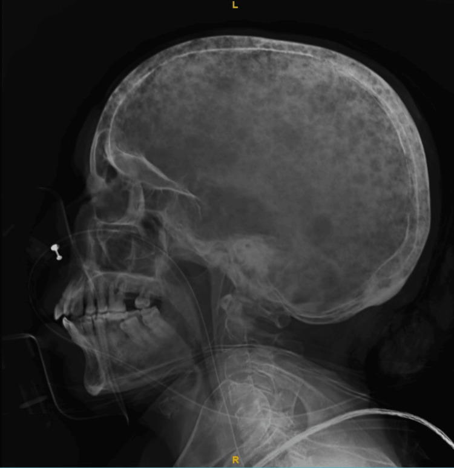
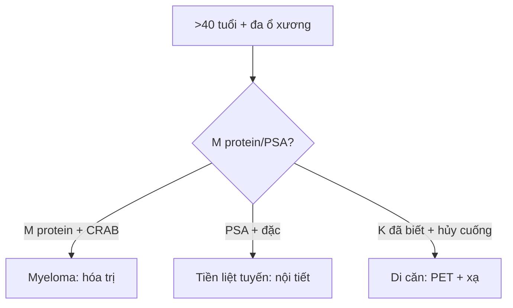

# 331 — Di căn, myeloma & lymphoma xương người lớn / Adult bone malignancy

**Tags:** `pattern:u-ac-nguoi-lon` `vung:tuy-xuong`
**Mức chắc chắn (certainty):** tổng hợp y văn (literature synthesis) — nhóm tự biên từ y văn mở, chưa gắn ca nguyên văn đơn lẻ.

## 1. Tổng quan — > 40 tuổi đa ổ là ác đến khi chứng minh ngược lại + CRAB

- Di căn xương (phổi/vú/tiền liệt tuyến/thận/giáp) + đa u tủy (myeloma) chiếm đa số u ác người lớn — TẠI SAO tủy đỏ trục (cột sống, chậu, sọ, xương dài gần) là đích: tủy tạo máu + mạch xoang chậm, tế bào K dễ bám.
- Myeloma CRAB (tăng canxi, suy thận, thiếu máu, tổn thương xương) + M protein — TẠI SAO sọ giọt mưa (raindrop) không viền đặc: u tương bào ăn xương thuần túy, không kích thích tạo xương.
- Ngưỡng: plasma tủy ≥ 10% + M protein + CRAB = myeloma; PSA + đặc xương = tiền liệt tuyến; hủy cuống (mất mắt cú) + chừa đĩa = di căn (khác Pott phá đĩa).

## 2. Gamut đa ổ người lớn (Gamut)

- **Sọ giọt mưa + CRAB + M protein:** myeloma — lenalidomide/bortezomib + ghép tủy.
- **Đặc xương + PSA cao:** di căn tiền liệt tuyến — nội tiết + xạ.
- **Hủy cuống + chừa đĩa + K đã biết:** di căn cột sống — xạ/mổ vững.
- **Ngà voi (ivory vertebra) đơn đốt:** Paget/lymphoma — sinh thiết phân biệt.

## 3. Bảng so sánh phân biệt (ma trận đối chiếu)

| Thực thể (entity) | Hình ảnh điển hình | Chốt vào (rule-in) | Chốt loại (rule-out) | Gợi ý xác nhận |
|---|---|---|---|---|
| Myeloma | **Giọt mưa sọ + đa ổ + không viền + CRAB + M protein** | **> 40 tuổi + M protein + tủy ≥ 10%** | Đặc xương + PSA → tiền liệt tuyến | Điện di + tủy đồ + hóa trị |
| Di căn hủy xương | **Hủy cuống + chừa đĩa + khối mềm + K đã biết** | **Mắt cú + K nguyên phát** | Phá đĩa sớm → Pott/vi khuẩn | PET + sinh thiết + xạ |
| Di căn đặc xương | **Đặc + PSA + tiền liệt tuyến** | **Đặc lan tỏa + PSA cao** | Giọt mưa + M protein → myeloma | Nội tiết + bisphosphonate |
| Lymphoma xương | **Thấm + phù lan + khối mềm lớn + LDH cao** | **Thấm + mềm lớn + toàn thân** | Viền đặc + tự khỏi → NOF | Hóa trị (nhạy xạ-hóa) |

*Đa ổ đục lỗ không viền đặc toàn sọ. Nguồn: Karnan et al., Cureus 2024 Fig. 5, CC BY 4.0.*

## 4. Protocol

- **X-quang toàn xương + MRI tủy (T1 < cơ) + PET + điện di protein + tủy đồ** khi > 40 tuổi đa ổ; PSA khi nam đặc xương.

## 5. Cạm bẫy

- **Myeloma gọi nhầm di căn** xạ vô ích — M protein + tủy đồ trước xạ.
- **Tăng canxi + suy thận** tưởng tuổi già — CRAB là cấp cứu (truyền + bisphosphonate).
- **Lymphoma tưởng viêm** kháng sinh kéo dài — thấm + mềm lớn + LDH là sinh thiết.

## 6. Tự lượng giá — Blind Quiz

**Ca 1 — Nữ 60 tuổi khó thở + canxi 14 + tủy tương bào. Đọc sọ.**

- Hỏi: tên dấu? Chẩn đoán + 4 chữ CRAB?

<b>Bấm để hiện đáp án</b>

- Dấu hiệu (findings): đa ổ đục lỗ không viền = **sọ giọt mưa (raindrop skull)**.
- Chẩn đoán (diagnosis): **đa u tủy xương** — CRAB (canxi + thận + máu + xương) + M protein + tủy ≥ 10%.
- Nguồn: Karnan et al., Fig. 5, CC BY 4.0.

**Ca 2 — Nam 70 tuổi PSA 200 + đặc xương lan tỏa:** myeloma hay tiền liệt tuyến? *(Bảng mục 3.)*

<b>Bấm để hiện đáp án</b>

- **Di căn tiền liệt tuyến:** đặc + PSA — nội tiết + bisphosphonate (myeloma là hủy + M protein).

## Bài liên quan chéo
- [300 – Tổng quan MSK](../300-tong-quan-he-co-xuong-khop/lesson.md)
- [330 – U xương](../330-tiep-can-u-xuong-va-dont-touch/lesson.md) (Lodwick + don't-touch)
- [222 – Viêm đốt sống](../222-viem-dot-song/lesson.md) (hủy cuống vs phá đĩa)

> Không dùng để chẩn đoán độc lập khi chưa có người hướng dẫn.
