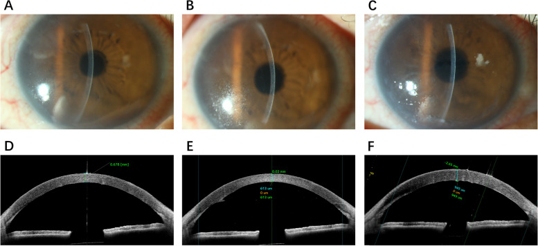
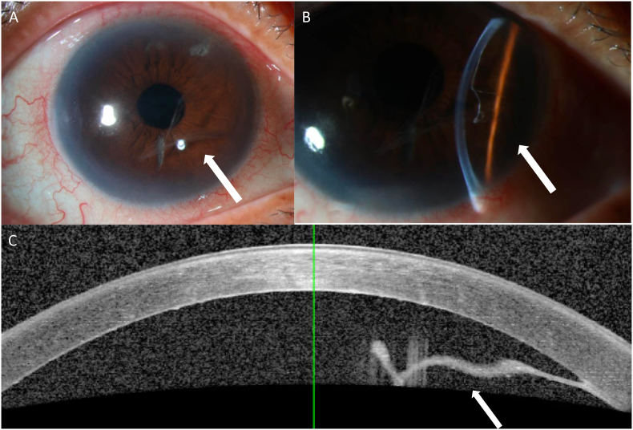
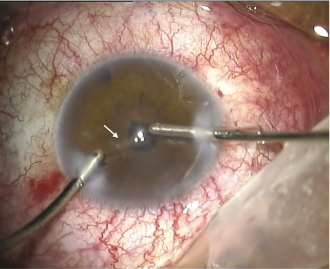
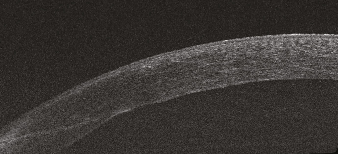
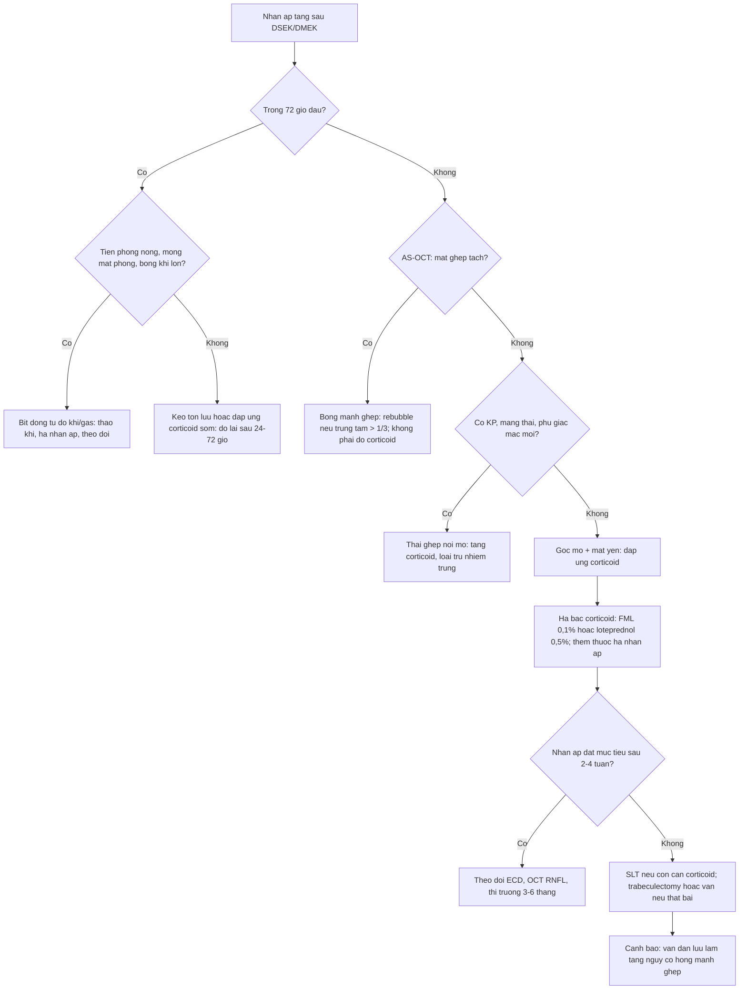

# 3310 — Tăng nhãn áp do corticoid sau ghép nội mô giác mạc (DSEK/DMEK): giảm prednisolone 1% đến đâu mà không bong mảnh ghép — nguy cơ tích lũy **29% → 49%** sau 10 năm

**Tags:** `pattern:tang-nhan-ap` `pattern:steroid-responder` `pattern:phu-giac-mac` `pattern:bong-manh-ghep` `pattern:mot-ben` `pattern:hai-ben` `vung:mat` `vung:giac-mac` `vung:tien-phong` `protocol:do-nhan-ap` `protocol:AS-OCT` `protocol:den-khe` `protocol:soi-goc` `protocol:OCT-RNFL` `score:OHT`

**Mức chắc chắn (certainty):** tổng hợp y văn (literature synthesis) — ghép các đoàn hệ lớn: **211 mắt DSEK** theo dõi trung vị **7 năm** (PMC10836783), **81 mắt DSAEK** (PMC8164721), **463 mắt DMEK** (DOI 10.1097/ICO.0000000000002363), **250 mắt DMEK** chuyển sang fluorometholone 0,1% (DOI 10.1097/ICO.0000000000003846), **415 mắt DMEK** (DOI 10.1097/ICO.0000000000003889), **400 mắt DMEK** ngừng corticoid sau 1 năm (DOI 10.1016/j.ophtha.2016.02.001), **170 mắt uDSEK** ngừng corticoid sau trung bình 431 ngày (DOI 10.1080/02713683.2020.1862236), **310 mắt DSEK/DSAEK** (DOI 10.1097/ICO.0000000000000617), **1.298 mắt DMEK** có/không rebubble (DOI 10.1097/ICO.0000000000003118), **450 mắt DMEK** (DOI 10.1097/ICO.0000000000003531) và ca nguyên văn có ảnh (PMC12304695, PMC11492462, PMC12917340). **Không có thử nghiệm ngẫu nhiên có đối chứng nào so tốc độ giảm corticoid sau ghép nội mô** — mọi ngưỡng dưới đây ghi rõ nguồn và mức bằng chứng.

> **Vì sao bài này quan trọng:** sau ghép nội mô giác mạc (endothelial keratoplasty, EK), bệnh nhân buộc phải dùng **corticoid nhỏ mắt mạnh và lâu** để mảnh ghép không bị thải — nhưng chính corticoid làm **giảm khả năng thoát thủy dịch qua lưới bè**. Sau **211 mắt DSEK** không có glôcôm trước mổ, nguy cơ tích lũy tăng nhãn áp do corticoid là **29% sau 1 năm, 41% sau 5 năm, 49% sau 10 năm**; **25%** phải điều trị glôcôm và **20%** trong số được điều trị phải mổ lọc (PMC10836783). Câu hỏi thực hành không phải "có nên giảm corticoid không" mà là **giảm đến mức nào, bằng loại nào, trong bao lâu — mà không đánh đổi bằng một cơn thải ghép**.
>
> **Bài 3309** đã phủ **cơ chế và cách phân biệt tăng nhãn áp do corticoid với viêm lưới bè** trên mắt viêm màng bồ đào; **bài 3284** phủ **ghép nội mô trên mắt có ống dẫn lưu**; **bài 3287** phủ **phaco sau ghép nội mô**. Bài này chỉ giải quyết **một câu hỏi**: sau DSEK/DMEK, **nhãn áp tăng thì do thuốc, do mảnh ghép, hay do khí/keo — và giảm prednisolone 1% đến đâu là an toàn**.

## 1. Tổng quan bệnh học – cơ chế hình ảnh – vì sao mắt ghép nội mô là "bẫy corticoid"

- **Sinh lý mảnh ghép:** nội mô giác mạc là **bơm Na⁺/K⁺-ATPase** hút nước ra khỏi giác mạc; khi nội mô hỏng, giác mạc phù. EK thay **màng Descemet + nội mô** của người cho, dán vào mặt sau giác mạc nhờ **bơm của tế bào cho + bóng khí/gas trong tiền phòng**. Mảnh ghép **dính trong vài ngày**, nhưng **sống miễn dịch** thì phụ thuộc corticoid: tế bào T của người nhận nhận diện **kháng nguyên HLA của nội mô cho** ngay trong tiền phòng.
- **TẠI SAO corticoid vừa cứu vừa hại:** $IOP = F/C + P_{ev}$ (F = thủy dịch thể mi tiết; C = khả năng thoát qua lưới bè – ống Schlemm; P_ev = áp lực tĩnh mạch thượng củng mạc). Glucocorticoid gắn **thụ thể GRα** trên tế bào lưới bè → **tăng chất nền ngoại bào** (fibronectin, collagen, proteoglycan) và **giảm MMP** → vùng cribriform dày lên, **C giảm**, nhãn áp tăng. Hiệu ứng phiên mã cần **2–6 tuần** với thuốc nhỏ, nên **"nhãn áp tăng ngay ngày 1" không phải đáp ứng corticoid điển hình**.
- **TẠI SAO EK nhạy cảm hơn giác mạc nguyên vẹn:** mảnh ghép nội mô **phơi trực tiếp ra tiền phòng**, không có hàng rào biểu mô–stroma che chắn; corticoid nhỏ mắt **ngấm qua giác mạc mỏng/đã bóc Descemet** và đạt nồng độ cao tại lưới bè. Thêm vào đó, **DSEK/DSAEK mang nhiều mô cho hơn DMEK** (có thêm stroma) → **nguy cơ thải cao hơn** → bác sĩ buộc phải dùng **corticoid mạnh lâu hơn** → nguy cơ tăng nhãn áp cao hơn. Đây chính là lý do Price kết luận nên **chọn DMEK khi có thể để giảm liều corticoid sớm** (PMC10836783).
- **Con số nền — DSEK/DSAEK:**
  - **211 mắt DSEK**, phác đồ **prednisolone acetat 1% 4 lần/ngày × 4 tháng rồi giảm dần**: tăng nhãn áp (định nghĩa **≥ 24 mmHg hoặc tăng ≥ 10 mmHg**) **29% / 41% / 49%** ở **1 / 5 / 10 năm**; cần điều trị glôcôm **11% / 17% / 25%**; trong **35 mắt** được điều trị, **28 (80%)** chỉ dùng thuốc, **7 (20%)** phải mổ lọc (PMC10836783).
  - **81 mắt DSAEK**: tăng nhãn áp **51,9%**, glôcôm **13,6%**, riêng **do corticoid 38,3%**; **nhãn áp trước mổ > 16 mmHg** làm tăng nguy cơ **5,27 lần**; **giả thể thủy tinh** cũng là yếu tố nguy cơ (p = 0,024) (PMC8164721).
- **Con số nền — DMEK (ít mô cho hơn, nguy cơ thải thấp hơn):**
  - **463 mắt DMEK**: tăng nhãn áp **15,9%** ở 12 tháng và **18,8%** ở 36 tháng; glôcôm sau DMEK **3,9% / 6,6%**; nguyên nhân **do corticoid 11,7% / 12,9%**; **bít đồng tử do khí 7,5%**; glôcôm có sẵn làm tăng nguy cơ **HR 3,33** (DOI 10.1097/ICO.0000000000002363).
  - **415 mắt DMEK**: **13%** tăng nhãn áp mới; khi **đổi dexamethasone sang loteprednol etabonat 0,5%**, **42,5%** kiểm soát được nhãn áp **mà không cần thuốc hạ nhãn áp**; **dính góc trước (PAS)** làm tăng nguy cơ phải dùng thuốc (**OR 3,84**) và phải mổ (**OR 6,2**) (DOI 10.1097/ICO.0000000000003889).
  - **250 mắt DMEK** dùng **prednisolone 1% × 2 tháng rồi chuyển fluorometholone 0,1% kéo dài**: tăng nhãn áp chỉ **2% / 5% / 7%** ở **1 / 5 / 8 năm**; glôcôm **2% / 4% / 4%**; **thải ghép 1% / 1% / 2%** — tất cả glôcôm đều kiểm soát bằng thuốc (DOI 10.1097/ICO.0000000000003846). Đây là **bằng chứng mạnh nhất cho chiến lược "hạ bậc corticoid sớm"** ở mắt DMEK nguy cơ thấp.
- **TẠI SAO không được ngừng corticoid đột ngột:** **400 mắt DMEK** ngừng corticoid sau 1 năm có **6% thải ghép** so với **0%** ở nhóm tiếp tục **1 lần/ngày** (p = 0,013); **13/14** ca thải đáp ứng khi dùng lại corticoid, **1 mảnh ghép hỏng (0,4%)** (DOI 10.1016/j.ophtha.2016.02.001). Với **uDSEK**, sau trung bình **431 ngày** corticoid, tỉ lệ thải sau khi ngừng là **2,94%**; nguy cơ tích lũy **0,67% ở 12 tháng** và **2,20% ở 18 tháng** sau ngừng (DOI 10.1080/02713683.2020.1862236). **Thời điểm ngừng corticoid là một quyết định miễn dịch, không phải quyết định nhãn áp.**
- **TẠI SAO bong mảnh ghép hiếm khi do "giảm corticoid quá nhanh":** bong mảnh ghép là **biến cố cơ học sớm** — trung vị thời gian rebubble **16 ± 9,4 ngày** (176 mắt DMEK; 3,4% rebubble vì bong > 1/3 diện tích, 22,7% bong một phần tự dính) (PMC10397279); **450 mắt DMEK** có **85,3%** ít nhất một điểm bong nhỏ, **27,1%** cần rebubble, hay gặp **góc dưới–thái dương (46%)** và **bong vùng trung tâm** mới đáng can thiệp (94,0% so với 35,7%) (DOI 10.1097/ICO.0000000000003531). Nghiên cứu **94 mắt DMEK** còn cho thấy **cách xử trí nhãn áp sau mổ không liên quan đến tỉ lệ rebubble** (PMC5722014) — tức **giảm corticoid để hạ nhãn áp không phải nguyên nhân bong mảnh ghép**; bong là do **kỹ thuật, khí, vị trí, kích thước và tình trạng mảnh ghép**.
- **TẠI SAO nhãn áp cao lại làm hỏng mảnh ghép:** **47 mắt DMEK** không có glôcôm trước mổ: nhóm **tăng nhãn áp trung hạn** (IOP > 21 mmHg hoặc tăng > 10 mmHg **sau 14 ngày**) có **mật độ tế bào nội mô thấp hơn ở 3 tháng** (p = 0,032) và **4 mắt hỏng mảnh ghép** (p = 0,001), trong khi **tăng vọt sớm trong 3 ngày đầu không ảnh hưởng kết cục** (PMC11492462). Nói cách khác: **cơn tăng áp thoáng qua thì mảnh ghép chịu được; tăng áp kéo dài mới giết nội mô**.
- **TẠI SAO đo nhãn áp ở mắt ghép lại khó:** mảnh ghép DSEK **dày thêm 100–200 µm** ở trung tâm; giác mạc dày làm **Goldmann đo cao giả**, giác mạc phù/loạn dưỡng làm **mờ vòng thử**; bóng khí trong tiền phòng cản trở đèn khe. Vì vậy phải **ghi CCT, dùng cùng một phương pháp và cùng một thời điểm** giữa các lần đo, và **đo lại khi giác mạc đã trong**.

*Sáu ô: (A–C) ảnh đèn khe trước mổ, 1 tuần và 3 tháng sau DMEK; (D–F) AS-OCT tương ứng. Nhãn áp tăng được phát hiện ở **tháng thứ 3**; đến lúc đó giác mạc đã phù và mảnh ghép mất dần nội mô. Đây là mặt **trung hạn** của tăng nhãn áp sau ghép — khác với cơn tăng vọt sớm do khí. Nguồn: *BMC Ophthalmol* 2024;24:460 (PMC11492462) Fig. 2, **CC BY-NC-ND 4.0** (nguyên bản, không cắt ghép).*

## 2. Mẫu hình + chẩn đoán phân biệt theo thời điểm và kiểu hình (gamut)

Cùng một dấu hiệu "nhãn áp tăng sau ghép nội mô", **thời điểm** là trục phân biệt mạnh nhất:

| Mốc | Cơ chế thường gặp | Dấu hiệu chốt |
|---|---|---|
| **0–72 giờ** | **Khí/gas đầy tiền phòng**, **bít đồng tử do khí**, **keo tồn lưu (retained viscoelastic)**, bong mảnh ghép sớm | Tiền phòng nông, mống mắt phồng, đau; bóng khí lớn; nhãn áp **30–60 mmHg**; **không có tế bào/KP** |
| **1–4 tuần** | **Đáp ứng corticoid khởi phát**, **bong mảnh ghép** (trung vị 16 ngày), bít đồng tử muộn do synechiae | Mắt yên + góc mở = corticoid; **AS-OCT thấy mặt ghép tách** = bong; tiền phòng nông + dính = bít đồng tử |
| **1–6 tháng** | **Đáp ứng corticoid rõ** (đỉnh 2–6 tuần với thuốc nhỏ), **thải ghép nội mô** nếu corticoid quá thấp, **PAS hình thành** | Nhãn áp tăng dần + mắt yên = corticoid; **KP/màng thải + phù giác mạc** = thải; **soi góc thấy PAS** = cơ học |
| **> 6 tháng – 10 năm** | **Glôcôm do corticoid mạn**, **PAS**, **hỏng mảnh ghép muộn**, **glôcôm có sẵn bị lộ** | Nguy cơ tích lũy **49% ở 10 năm** (DSEK); phải có **OCT RNFL + thị trường nền** |

**Gamut theo kiểu hình "mắt yên hay mắt đỏ":**

- **Mắt yên, không đau, mảnh ghép trong, góc mở** → **đáp ứng corticoid** (nhãn áp tăng sau 2–6 tuần dùng thuốc nhỏ; giảm khi hạ bậc corticoid).
- **Mắt đỏ, đau, tiền phòng nông, bóng khí lớn** → **bít đồng tử do khí** — cấp cứu, **không phải do corticoid**.
- **Mắt yên nhưng mảnh ghép mờ dần, AS-OCT thấy mặt ghép tách** → **bong mảnh ghép** (có thể **không đau, nhãn áp bình thường**).
- **Mắt đỏ, KP, màng thải ở mặt sau mảnh ghép, phù giác mạc** → **thải ghép nội mô** — cần **tăng corticoid**, không phải giảm.
- **Nhãn áp cao + góc dính (PAS) + mảnh ghép trong** → **glôcôm góc dính thứ phát**, corticoid chỉ là phần nhỏ.
- **Nhãn áp cao + mảnh ghép mờ + không đau + không KP** → **hỏng mảnh ghép tiên phát/muộn**, không phải nguyên nhân nhãn áp.

**Năm câu hỏi trước khi quy nhãn áp cho corticoid (mnemonic GRAFT):**

- **G — Gauge:** nhãn áp đo bằng gì, cùng máy/cùng giờ với lần trước chưa? CCT bao nhiêu?
- **R — Rim/air:** còn **khí/gas** trong tiền phòng không? Tiền phòng nông? Mống mắt phồng?
- **A — Adhesion:** **AS-OCT** mặt ghép có dính 360° không? Có bong trung tâm không?
- **F — Flare/cells:** có **tế bào, KP, màng thải** không? (nếu có → thải ghép, không phải corticoid)
- **T — Timeline/topical:** corticoid **loại gì, liều bao nhiêu, bắt đầu từ khi nào**, và **nhãn áp nền trước ghép**?

## 3. Bảng so sánh phân biệt (ma trận đối chiếu)

| Thực thể (entity) | Hình ảnh điển hình | Chốt vào (rule-in) | Chốt loại (rule-out) | Gợi ý xác nhận |
|---|---|---|---|---|
| **Tăng nhãn áp do corticoid** | Mắt **yên**, **góc mở**, mảnh ghép **trong**, nhãn áp tăng **2–6 tuần** sau bắt đầu/tăng liều prednisolone 1% | **Giảm ≥ 4 mmHg sau khi hạ bậc/ngừng corticoid** và **tăng lại khi dùng lại**; **tiền sử đáp ứng ở mắt bên kia**; loại trừ khí/PAS/thải | **Có KP/màng thải, đau, tiền phòng nông** → không phải đơn thuần corticoid; **nhãn áp không đổi dù đã hạ bậc 2–4 tuần** → tìm nguyên nhân khác | Đo nhãn áp 1–2 tuần sau mỗi bậc giảm; AS-OCT mặt ghép; so mắt bên |
| **Bít đồng tử do khí/gas** | **Tiền phòng nông**, **mống mắt phồng**, bóng khí lớn, đau, nhãn áp **30–60 mmHg** trong **72 giờ đầu** | **Nhãn áp giảm ngay sau khi tháo bớt khí/mở mống mắt**; tiền phòng sâu lại | **Tiền phòng sâu, không khí, góc mở** → loại; xuất hiện **sau 1 tuần** → ít khả năng do khí | Đèn khe; đo lại sau tháo khí; soi góc |
| **Keo tồn lưu** | Nhãn áp tăng **6–24 giờ** sau mổ, **tự hết trong 24–72 giờ**, tiền phòng có ánh nhầy | **Thời điểm ngay sau mổ + tự hết**, không viêm | **Kéo dài > 1 tuần** → không phải keo đơn thuần | Bệnh sử mổ; đo lại 24–72 giờ |
| **Bong mảnh ghép** | **AS-OCT: mặt ghép tách khỏi stroma**, có thể **phù giác mạc vùng bong**, **nhãn áp bình thường hoặc cao**; mắt có thể **không đau** | **AS-OCT thấy khoảng tách**; **bong trung tâm > 1/3 diện tích** hoặc đe dọa trục thị giác → rebubble | **Mặt ghép dính 360°, không khoảng tách** → loại; **bong ngoại vi nhỏ tự dính** không cần can thiệp | AS-OCT tiền phòng; đèn khe; theo dõi 1–2 tuần |
| **Thải ghép nội mô** | **KP**, **màng thải (rejection line)** mặt sau mảnh ghép, **phù giác mạc**, mắt đỏ; nhãn áp có thể tăng | **KP/màng thải mới + phù giác mạc**; **đáp ứng với tăng corticoid** | **Không KP, không màng thải, mắt yên** → loại | Đèn khe; so ảnh nền; tăng corticoid có kiểm soát |
| **PAS/glôcôm góc dính** | **Soi góc: dính góc trước**, góc hẹp khu trú; nhãn áp tăng **không hồi phục** dù corticoid đã giảm | **PAS trên soi góc 360°**; nhãn áp cao khi mảnh ghép trong và viêm đã yên | **Góc mở hoàn toàn**, nhãn áp giảm khi hạ corticoid → loại | Soi góc; AS-OCT/UBM góc |
| **Glôcôm/PXF có sẵn bị lộ** | **Sắc tố góc**, **PXF trên bao thể thủy tinh**, đĩa thị đã có tổn thương; nhãn áp tăng khi dùng corticoid | **Tiền sử glôcôm/PXF** + **nhãn áp nền cao** + đáp ứng corticoid | **Không PXF, đĩa thị bình thường** → ít khả năng hơn, nhưng **PXF không loại trừ corticoid** | Đèn khe sau giãn; soi góc; OCT RNFL/thị trường nền |
| **Hỏng mảnh ghép (graft failure)** | Giác mạc **phù lan tỏa** không hồi phục, **mất tế bào nội mô**, **không KP**, nhãn áp **bình thường hoặc thấp** | **Phù kéo dài + ECD giảm nặng**, không đáp ứng corticoid | **Phù hồi phục sau hạ nhãn áp** → do nhãn áp, chưa hỏng | Soi đèn khe; đếm tế bào nội mô; AS-OCT độ dày |

*(A) Ảnh ngoài: vùng bong lớn, chỉ còn một phần dính ở phía mũi (mũi tên trắng). (B) Đèn khe: mặt ghép tách khỏi mặt sau giác mạc. (C) AS-OCT: **khoảng tách của mảnh ghép cho** (mũi tên trắng). Bệnh nhân **không đau**, giác mạc còn trong một thời gian — đây là cạm bẫy: **bong mảnh ghép không đồng nghĩa nhãn áp tăng, và giác mạc trong không loại trừ bong**. Nguồn: Rizvi Z và cs, *Am J Ophthalmol Case Rep* 2025;39:102385 (PMC12304695) Fig. 2, **CC BY-NC-ND 4.0** (nguyên bản, không cắt ghép).*

### Ba câu hỏi quyết định "giảm corticoid hay không"

1. **Mảnh ghép có đang bị thải không?** Có **KP/màng thải/phù mới** → **không được giảm corticoid**; phải tăng và loại trừ nhiễm.
2. **Nhãn áp tăng có tương xứng với liều corticoid và thời gian không?** **2–6 tuần** sau tăng liều, mắt yên, góc mở → **corticoid**. Tăng ngay **72 giờ đầu** → nghĩ **khí/keo** trước.
3. **Mảnh ghép có dính không?** **AS-OCT** là chốt. Bong trung tâm > 1/3 → **rebubble**, không phải "giảm corticoid".

## 4. Protocol theo dõi – chiến lược corticoid – ngưỡng hành động

### 4.1. Lịch đo nhãn áp tối thiểu sau EK

| Bối cảnh | Mốc đo | Ghi chú |
|---|---|---|
| **DSEK/DSAEK, prednisolone 1%** | Nền, **ngày 1**, **tuần 1**, **tháng 1**, rồi **mỗi 1–2 tháng** khi còn corticoid mạnh | Phác đồ đã dùng trong đoàn hệ 211 mắt: **4 lần/ngày × 4 tháng** rồi giảm dần (PMC10836783) |
| **DMEK, prednisolone 1%** | Nền, **ngày 1**, **tuần 1**, **tháng 1**, **tháng 3**, rồi mỗi 3 tháng | Đỉnh tăng nhãn áp do corticoid thường **2–6 tuần**; tăng áp trung hạn **sau 14 ngày** mới ảnh hưởng nội mô (PMC11492462) |
| **Đã chuyển corticoid yếu (FML/loteprednol)** | **Mỗi 3–6 tháng** | Vẫn có thể tăng nhãn áp; **7%** ở 8 năm với FML (DOI 10.1097/ICO.0000000000003846) |
| **Có glôcôm/PXF trước mổ** | **1 tuần, 1 tháng, 3 tháng**, sau đó theo glôcôm | Nguy cơ tăng nhãn áp **HR 3,33**; glôcôm sau DMEK **36,3%** ở 36 tháng nếu có glôcôm trước (DOI 10.1097/ICO.0000000000002363; PMC9836965) |
| **Trẻ em/không hợp tác** | Ưu tiên **Tonopen/iCare**, ghi rõ phương pháp | Nhãn áp mắt ghép phụ thuộc CCT; so sánh cùng phương pháp |

### 4.2. Khám và xét nghiệm

| Bước | Kỹ thuật | Mục đích / ngưỡng |
|---|---|---|
| 1 | **Goldmann 2 mắt + CCT** | Ghi CCT vì mảnh ghép DSEK dày thêm; tránh đo trên giác mạc phù |
| 2 | **Đèn khe: khí/gas, tiền phòng nông, mống mắt phồng** | Loại **bít đồng tử** trước khi quy cho corticoid |
| 3 | **Đèn khe: tế bào, KP, màng thải, phù giác mạc** | **KP/màng thải** = thải ghép → **không giảm corticoid** |
| 4 | **AS-OCT tiền phòng** | **Khoảng tách mặt ghép**, độ dày mảnh ghép, bong trung tâm; chốt bong/thất bại |
| 5 | **Soi góc 360°** | **PAS**, sắc tố, góc hẹp; PAS làm tăng nguy cơ phải mổ (OR 6,2) |
| 6 | **Đếm tế bào nội mô (specular/ECD)** | Nền + theo dõi; ECD giảm nhanh gợi ý tăng nhãn áp trung hạn hoặc thải |
| 7 | **OCT RNFL + thị trường 24-2** | Khi nhãn áp tăng kéo dài hoặc có glôcôm; làm **nền** trước khi theo dõi dài |
| 8 | **Xét nghiệm loại trừ** | Đái tháo đường, tăng huyết áp, thuốc toàn thân (corticoid uống/hít) nếu tăng nhãn áp hai bên |

### 4.3. Chiến lược corticoid — "giảm đến đâu" theo bằng chứng hiện có

| Bối cảnh | Phác đồ có bằng chứng | Điểm dừng thực hành |
|---|---|---|
| **DSEK/DSAEK nguy cơ thấp** | **Prednisolone acetat 1% 4 lần/ngày × 4 tháng**, sau đó **giảm dần** (PMC10836783) | **Không ngừng trước 4–6 tháng**; duy trì **liều thấp nhất kiểm soát mảnh ghép**; cân nhắc **giảm nồng độ/số lần** trước khi đổi loại |
| **DMEK nguy cơ thấp** | **Prednisolone 1% 4 lần/ngày × 1–2 tháng** → giảm dần → **fluorometholone 0,1% kéo dài** (DOI 10.1097/ICO.0000000000003846) | Có thể **hạ bậc sớm** vì nguy cơ thải thấp; **FML 1 lần/ngày** là lựa chọn "corticoid mềm" có số liệu |
| **Đã có tăng nhãn áp nhẹ** | **Đổi dexamethasone → loteprednol 0,5%**: **42,5%** kiểm soát nhãn áp không cần thuốc hạ áp (DOI 10.1097/ICO.0000000000003889) | **Giảm thế (potency) trước, giảm tần suất sau**; không ngừng đột ngột |
| **Tăng nhãn áp nặng/glôcôm** | Vẫn cần corticoid để giữ mảnh ghép; thêm **thuốc hạ nhãn áp**, **SLT**, hoặc **mổ glôcôm** | **Không đánh đổi mảnh ghép lấy nhãn áp**; kiểm soát viêm trước mổ |
| **Ngừng corticoid hoàn toàn** | Sau **1 năm**: ngừng → **6% thải** so với **0%** nếu tiếp tục 1 lần/ngày (DOI 10.1016/j.ophtha.2016.02.001); uDSEK sau **431 ngày**: thải **2,94%** (DOI 10.1080/02713683.2020.1862236) | Chỉ ngừng khi **nguy cơ thải thấp + đã giải thích + tái khám được**; nếu nguy cơ cao, **duy trì corticoid yếu 1 lần/ngày** |

> **Trả lời trực tiếp câu hỏi "giảm prednisolone 1% đến đâu":** không có một con số mmHg hay một mốc ngày duy nhất. Trong thực hành có bằng chứng, **prednisolone 1% được giữ 1–4 tháng đầu** (DMEK 1–2 tháng; DSEK 4 tháng), sau đó **giảm dần**; khi nhãn áp tăng, **đổi sang corticoid yếu hơn (FML 0,1% hoặc loteprednol 0,5%) trước khi nghĩ đến ngừng hẳn**. **Bong mảnh ghép không phải lý do để giữ prednisolone 1% kéo dài** — bong là biến cố cơ học sớm; **thải ghép mới là lý do để không ngừng corticoid**.

### 4.4. Ngưỡng hành động

| Nhãn áp | Cách xử trí |
|---|---|
| **22–29 mmHg**, mảnh ghép trong, không tổn thương thị | **Hạ bậc corticoid** (đổi FML/loteprednol) + theo dõi **1–2 tuần**; thêm 1 thuốc hạ nhãn áp nếu kéo dài |
| **30–39 mmHg** | Hạ bậc corticoid có kế hoạch + **2 thuốc**; khám lại **2–7 ngày**; AS-OCT mảnh ghép + soi góc |
| **≥ 40 mmHg** hoặc **phù giác mạc/đau** | **Cấp cứu**: hạ nhãn áp tích cực (thuốc uống/tĩnh mạch), **chọc tiền phòng giải áp** nếu giác mạc phù nặng; loại trừ **bít đồng tử do khí** |
| **Tăng nhãn áp + KP/màng thải** | **Không giảm corticoid**; tăng corticoid, loại trừ nhiễm trùng, theo dõi sát mảnh ghép |
| **Tăng nhãn áp kéo dài > 3 tháng** | **OCT RNFL + thị trường**; cân nhắc **SLT** hoặc **mổ glôcôm**; theo dõi ECD vì tăng áp trung hạn làm hỏng mảnh ghép |

### 4.5. Thuốc hạ nhãn áp — chọn theo mắt đã ghép

| Nhóm | Cơ chế | Giảm nhãn áp | Lưu ý trên mắt ghép nội mô |
|---|---|---|---|
| **Beta-blocker** (timolol) | Giảm tiết thủy dịch | **20–25%** | Tránh ở hen/block tim; dùng loại không bảo quản nếu giác mạc mỏng |
| **Ức chế carbonic anhydrase** (dorzolamide/brinzolamide) | Giảm tiết | **20–25%** | Tốt khi có viêm; acetazolamide toàn thân khi cấp |
| **Alpha-2 agonist** (brimonidine) | Giảm tiết + tăng thoát | **20–25%** | Dị ứng mi mắt; tránh ở trẻ nhỏ |
| **Prostaglandin** (latanoprost) | Tăng thoát bàng bè | **25–33%** | Có thể dùng sau EK nhưng **thận trọng nếu còn viêm**; theo dõi mảnh ghép |
| **Pilocarpine** | Tăng thoát qua lưới bè | **15–25%** | **Tránh** trên mắt còn viêm/dính; có thể làm tăng nguy cơ bong và bít đồng tử |

### 4.6. Can thiệp khi thuốc thất bại

| Can thiệp | Chỉ định | Kết quả / cảnh báo |
|---|---|---|
| **SLT** | Tăng nhãn áp do corticoid sau EK, còn cần corticoid | **12 mắt**: giảm trung bình **8,8 ± 4,9 mmHg**; chỉ **1 bệnh nhân** còn cần thuốc hạ áp; không biến cố (DOI 10.1080/02713683.2022.2088800) |
| **Trabeculectomy** | Glôcôm không kiểm soát, góc mở, kết mạc còn tốt | Hiệu quả nhưng nguy cơ thất bại cao hơn ở mắt có glôcôm trước mổ; kiểm soát viêm trước mổ |
| **Van dẫn lưu (GDD)** | Glôcôm phức tạp, mổ lọc thất bại | **Nguy cơ hỏng mảnh ghép HR 6,273** so với không mổ/không van (PMC9836965); đầu ống có thể chạm nội mô (bài 3284) |
| **MIGS/GATT** | Glôcôm nhẹ–trung bình, muốn tránh mổ lọc | **Có thể làm bong mảnh ghép trong mổ** — ca PMC12917340: bong một phần trong GATT, AS-OCT xác nhận dính lại; phải theo dõi AS-OCT sau can thiệp |

*Trong thì GATT, một phần mảnh ghép DMEK bong ra và cuộn lại (mũi tên trắng) khi dụng cụ đi qua góc tiền phòng. Can thiệp góc trên mắt đã ghép nội mô là **thủ thuật có nguy cơ cơ học trực tiếp lên mảnh ghép** — không phải biến chứng của corticoid. Nguồn: Dönmez Gün R và cs, *Turk J Ophthalmol* 2026;56:61–64 (PMC12917340) Fig. 2, **CC BY-NC-ND 4.0** (nguyên bản, không cắt ghép).*

*Cùng bệnh nhân: AS-OCT sau can thiệp cho thấy **mảnh ghép dính lại** ở vùng đã bong trong mổ — lý do phải chụp AS-OCT sau mọi can thiệp góc trên mắt đã ghép, thay vì suy đoán từ độ trong của giác mạc. Nguồn: Dönmez Gün R và cs, *Turk J Ophthalmol* 2026;56:61–64 (PMC12917340) Fig. 3, **CC BY-NC-ND 4.0**.*

### 4.7. Sơ đồ quyết định

## 5. Biến thể bình thường và cạm bẫy

- **"Nhãn áp tăng sớm sau ghép là do corticoid" — SAI.** Trong **72 giờ đầu**, nguyên nhân hàng đầu là **khí/gas đầy tiền phòng, bít đồng tử, keo tồn lưu**; bít đồng tử do khí gặp **7,5%** sau DMEK (DOI 10.1097/ICO.0000000000002363). Điều trị là **tháo khí/giải áp**, không phải giảm corticoid.
- **"Giảm corticoid nhanh sẽ làm bong mảnh ghép" — phần lớn SAI.** Bong mảnh ghép là biến cố **cơ học sớm** (trung vị **16 ngày**), liên quan **kỹ thuật, khí, vị trí, kích thước**; xử trí nhãn áp sau mổ **không liên quan tỉ lệ rebubble** (PMC5722014). Giảm corticoid nhanh làm tăng **thải ghép**, không phải bong.
- **"Mảnh ghép bong là phải tăng corticoid" — SAI.** Bong **không phải** thải; điều trị là **rebubble** khi bong trung tâm > 1/3 hoặc đe dọa trục thị giác. Tăng corticoid không dán mảnh ghép.
- **"Giác mạc còn trong nghĩa là mảnh ghép còn dính" — SAI.** Ca PMC12304695: mảnh ghép bong gần toàn bộ nhưng **giác mạc vẫn trong một thời gian** và bệnh nhân **không đau**; chỉ **AS-OCT** mới xác nhận. Đừng đợi giác mạc phù mới làm AS-OCT.
- **"Cứ ngừng corticoid sau 1 năm là an toàn" — SAI.** Ngừng sau 1 năm ở DMEK làm **thải ghép 6%** so với **0%** khi tiếp tục 1 lần/ngày; **13/14** ca thải phải dùng lại corticoid (DOI 10.1016/j.ophtha.2016.02.001). Với mắt nguy cơ cao, **corticoid yếu kéo dài** an toàn hơn "cắt hẳn".
- **"Đổi sang FML là hết nguy cơ" — SAI.** Vẫn có **7% tăng nhãn áp** và **2% thải ghép ở 8 năm** với FML 0,1% (DOI 10.1097/ICO.0000000000003846); phải theo dõi như mọi corticoid.
- **"Tăng nhãn áp thoáng qua không ảnh hưởng mảnh ghép" — chỉ đúng với cơn ngắn.** Tăng vọt **trong 3 ngày** không ảnh hưởng ECD ở 6 tháng (176 mắt; DOI 10.1097/ICO.0000000000002778), nhưng tăng áp **trung hạn sau 14 ngày** làm giảm ECD và gây hỏng mảnh ghép (47 mắt; PMC11492462). **Thời gian phơi nhiễm** mới là biến quyết định.
- **"Đo nhãn áp trên mắt DSEK giống mắt thường" — SAI.** Mảnh ghép DSEK **dày thêm 100–200 µm**, làm Goldmann **đo cao giả**; giác mạc phù làm mờ vòng thử. Phải **ghi CCT** và so sánh cùng phương pháp.
- **"Mắt đã ghép thì không được mổ glôcôm" — SAI.** Có thể mổ, nhưng **van dẫn lưu làm tăng nguy cơ hỏng mảnh ghép (HR 6,27)**; **GATT/MIGS có thể làm bong mảnh ghép tại chỗ** (ca PMC12917340). Phải cân nhắc và theo dõi AS-OCT sau can thiệp.
- **Cạm bẫy "một con số":** nhãn áp **32 mmHg** ở mắt ghép có thể do **corticoid**, **khí**, **PAS**, **thải ghép**, hoặc **cả bốn**. Không có một ngưỡng nào tách được — phải dùng **thời gian + AS-OCT + tế bào/KP + soi góc + đáp ứng hạ bậc**.

## 6. Tự lượng giá — Blind Quiz

**Ca 1 — nam 68 tuổi, DMEK + phaco 2 tuần trước, mắt không đau, nhìn mờ nhẹ; nhãn áp 18 mmHg, giác mạc còn trong nhưng AS-OCT bất thường.**

- Gợi ý: mắt **không đau**, không KP; nhãn áp **bình thường**; đèn khe thấy **mép mảnh ghép cuộn** ở tiền phòng.
- Câu hỏi: Ba chẩn đoán phân biệt? Vì sao **giác mạc trong và nhãn áp bình thường không loại trừ bong**? Cần làm gì tiếp?

<b>Bấm để hiện đáp án (findings + chẩn đoán)</b>

- **Dấu hiệu:** (A) vùng bong lớn, chỉ còn phần dính phía mũi; (B) đèn khe thấy mặt ghép tách; (C) **AS-OCT: khoảng tách của mảnh ghép cho**.
- **Phân biệt:** (1) **bong mảnh ghép**; (2) **phù giác mạc do tăng nhãn áp**; (3) **thải ghép nội mô**; (4) **mảnh ghép cuộn do kỹ thuật**.
- **Vì sao không loại trừ:** nội mô còn lại của mảnh ghép **vẫn bơm** một phần, và **giác mạc có thể trong nhiều tuần** dù bong; **nhãn áp bình thường** không nói gì về dính mảnh ghép.
- **Xử trí:** **AS-OCT** xác nhận; nếu bong **trung tâm > 1/3** hoặc đe dọa trục thị giác → **rebubble**; theo dõi ECD và độ dày giác mạc; **không tăng corticoid** vì đây không phải thải.
- **Nguồn ảnh:** Rizvi Z và cs, *Am J Ophthalmol Case Rep* 2025;39:102385 (PMC12304695) Fig. 2, **CC BY-NC-ND 4.0**.

**Ca 2 — nữ 74 tuổi, DMEK 3 tháng trước, đang prednisolone 1%; nhãn áp 34 mmHg, giác mạc phù nhẹ, ECD giảm so với tháng 1.**

- Gợi ý: so sánh **trước mổ – 1 tuần – 3 tháng** (A–C) và AS-OCT (D–F); nhãn áp tăng được phát hiện ở **tháng 3**.
- Câu hỏi: Tăng nhãn áp này do corticoid hay do mảnh ghép? Vì sao **tăng áp sớm 3 ngày** lại ít nguy hiểm hơn **tăng áp ở tháng 3**? Xử trí?

<b>Bấm để hiện đáp án (findings + chẩn đoán)</b>

- **Dấu hiệu:** (A→C) giác mạc mờ dần, phù; (D→F) AS-OCT cho thấy mảnh ghép dày, mất độ trong; **nhãn áp tăng ở tháng 3**.
- **Cơ chế:** đây là **tăng nhãn áp trung hạn** — đúng cửa sổ đáp ứng corticoid; nhãn áp cao kéo dài làm **giảm ECD** và dẫn tới **hỏng mảnh ghép** (4/16 mắt trong nhóm tăng áp trung hạn, p = 0,001).
- **Vì sao sớm ít nguy hiểm:** cơn tăng vọt **trong 3 ngày** thường do khí/keo và **tự hết**, không đủ thời gian gây chết nội mô; **tăng áp sau 14 ngày** phơi nhiễm lâu hơn, đúng lúc mảnh ghép đang cần tưới máu.
- **Xử trí:** **hạ bậc corticoid** (FML/loteprednol) + **thuốc hạ nhãn áp**; theo dõi ECD và AS-OCT; nếu mảnh ghép đã hỏng → cân nhắc ghép lại sau khi kiểm soát nhãn áp.
- **Nguồn ảnh:** *BMC Ophthalmol* 2024;24:460 (PMC11492462) Fig. 2, **CC BY-NC-ND 4.0**.

**Ca 3 — nam 70 tuổi, DMEK 8 tháng trước, glôcôm không kiểm soát; được GATT. Trong mổ thấy một phần mảnh ghép bong.**

- Gợi ý: dụng cụ đi qua **góc tiền phòng**; mảnh ghép cuộn ở vùng góc; sau mổ kiểm tra bằng AS-OCT.
- Câu hỏi: Biến chứng gì? Có phải do corticoid không? Xử trí và theo dõi ra sao?

<b>Bấm để hiện đáp án (findings + chẩn đoán)</b>

- **Dấu hiệu:** **bong một phần mảnh ghép** (mũi tên trắng) khi dụng cụ GATT đi qua góc; AS-OCT sau đó xác nhận **mảnh ghép dính lại** ở vùng bong.
- **Không phải do corticoid:** đây là **biến cố cơ học** do can thiệp góc trên mắt đã ghép — cùng nhóm với bong sớm sau mổ, không phải thải ghép.
- **Xử trí:** ngừng thao tác, đánh giá diện bong; nếu bong trung tâm lớn → **rebubble**; theo dõi AS-OCT 1–2 tuần; tiếp tục corticoid theo phác đồ chống thải.
- **Bài học:** ở mắt đã ghép nội mô, **can thiệp góc (GATT/MIGS) phải được coi là thủ thuật có nguy cơ lên mảnh ghép**, cần tư vấn trước và theo dõi AS-OCT sau.
- **Nguồn ảnh:** Dönmez Gün R và cs, *Turk J Ophthalmol* 2026;56:61–64 (PMC12917340) Fig. 2, **CC BY-NC-ND 4.0**.

## 7. Câu hỏi nghiên cứu & điểm chưa đồng thuận (tính đến 11/2026)

1. **[Tranh cãi] Sau DMEK/DSEK, nên duy trì corticoid yếu suốt đời hay ngừng sau 1 năm ở bệnh nhân nguy cơ thải thấp?**
   - **Đã biết:** ngừng corticoid sau 1 năm ở DMEK làm **6% thải ghép** so với **0%** khi tiếp tục 1 lần/ngày (DOI 10.1016/j.ophtha.2016.02.001); nhưng **FML 0,1% kéo dài** chỉ có **2% thải ở 8 năm** và **7% tăng nhãn áp** (DOI 10.1097/ICO.0000000000003846); **uDSEK** sau 431 ngày có **2,94% thải** (DOI 10.1080/02713683.2020.1862236).
   - **Chưa rõ:** chưa có RCT so **ngừng hẳn** với **corticoid yếu kéo dài** ở DMEK nguy cơ thấp; định nghĩa "nguy cơ thấp" và thời điểm ngừng chưa thống nhất; chưa rõ ảnh hưởng của **tuân thủ** và **tái khám**.
   - **Hướng nghiên cứu:** RCT mở nhãn hoặc registry tiến cứu, so **ngừng sau 1 năm** với **FML 1 lần/ngày kéo dài**, kết cục **thải ghép, nhãn áp, ECD, chi phí**.
   - **Nguồn:** DOI 10.1016/j.ophtha.2016.02.001 (2016); DOI 10.1097/ICO.0000000000003846 (2026); DOI 10.1080/02713683.2020.1862236 (2021).

2. **[Khoảng trống] Có thể tiên đoán "người đáp ứng corticoid" trước ghép nội mô để chọn phác đồ giảm liều ngay từ đầu không?**
   - **Đã biết:** nguy cơ tích lũy tăng nhãn áp ở DSEK là **49% sau 10 năm** và phụ thuộc **thời gian và thế corticoid** (PMC10836783); GWAS trên **439 người sau ghép giác mạc** dùng prednisolone 1% tìm **46 SNP ở 29 locus** và **441 gen đích**, **38% locus** trùng kiểu hình tăng nhãn áp khác (PMC13355179); **tiền sử đáp ứng ở mắt bên kia** vẫn là yếu tố tiên đoán mạnh nhất trong thực hành.
   - **Chưa rõ:** chưa có **điểm nguy cơ di truyền** được kiểm chứng tiến cứu; chưa rõ giá trị của **AS-OCT chiều cao lưới bè** sau ghép; chưa có mô hình kết hợp **tuổi, CCT, PXF, tiền sử đáp ứng, liều corticoid**.
   - **Hướng nghiên cứu:** nghiên cứu chẩn đoán tiến cứu, so **điểm nguy cơ đa thông số** với **đáp ứng thực tế khi dùng prednisolone 1%**, kết cục **thời gian tới tăng nhãn áp và tỉ lệ mổ**.
   - **Nguồn:** PMC10836783 (2024); PMC13355179 (2026).

3. **[Khác biệt thực hành] Ở tăng nhãn áp do corticoid sau EK còn cần corticoid, chọn SLT, thuốc hạ nhãn áp hay mổ glôcôm — và thứ tự nào?**
   - **Đã biết:** **SLT** ở **12 mắt** sau EK giảm **8,8 ± 4,9 mmHg**, chỉ **1 bệnh nhân** còn cần thuốc (DOI 10.1080/02713683.2022.2088800); **van dẫn lưu** làm tăng nguy cơ hỏng mảnh ghép **HR 6,273** (PMC9836965); **20%** mắt DSEK được điều trị glôcôm phải mổ lọc (PMC10836783).
   - **Chưa rõ:** chưa có RCT so **SLT với thuốc** ở nhóm này; chưa rõ thời điểm mổ glôcôm tối ưu và loại van nào ít ảnh hưởng nội mô nhất; **GATT/MIGS** có thể làm bong mảnh ghép (PMC12917340) nhưng tỉ lệ chưa được lượng hóa.
   - **Hướng nghiên cứu:** RCT đa trung tâm so **SLT sớm** với **thuốc tăng cường** ở tăng nhãn áp do corticoid sau EK, kết cục **nhãn áp, số thuốc, thải ghép, ECD, tỉ lệ mổ**.
   - **Nguồn:** DOI 10.1080/02713683.2022.2088800 (2022); PMC9836965 (2022); PMC12917340 (2026).

## Bài liên quan chéo

- [3309 – Tăng nhãn áp do corticoid trên mắt viêm màng bồ đào: viêm hay thuốc?](../3309-tang-nhan-ap-corticoid-vien-mang-bao-dau/lesson.md) (cơ chế, ngưỡng, dechallenge–rechallenge)
- [3284 – Ghép nội mô trên mắt có ống dẫn lưu glôcôm](../3284-ghep-noi-mo-giac-mac-ong-dan-luu/lesson.md) (đầu ống chạm nội mô, bong quanh ống)
- [3287 – Phaco trên mắt đã ghép nội mô](../3287-phaco-sau-ghep-noi-mo-giac-mac/lesson.md) (thêm một lần chạm nội mô, bong mảnh ghép)
- [1411 – Tăng nhãn áp do corticoid nội nhãn & implant](../1411-tang-nhan-ap-do-corticoid-noi-nhan/lesson.md) (dược động implant, theo dõi tháng 2–3)
- [1465 – Tăng nhãn áp cấp sau tiêm nội nhãn](../1465-tang-nhan-ap-sau-tiem-noi-nhan/lesson.md) (đỉnh 30 giây, về trong 30 phút)
- [400 – Tổng quan Mắt & thị giác](../400-tong-quan-mat-thi-giac/lesson.md)

## Ảnh

- `3310_PMC11492462-Fig2-IOP-graft-failure.jpg` — diễn tiến đèn khe + AS-OCT trước mổ, 1 tuần, 3 tháng sau DMEK có tăng nhãn áp trung hạn.
- `3310_PMC12304695-gr2.jpg` — mảnh ghép DMEK bong gần toàn bộ: ảnh ngoài, đèn khe, AS-OCT.
- `3310_PMC12917340-Fig2-bong-manh-ghep-GATT.jpg` — bong một phần mảnh ghép trong GATT.
- `3310_PMC12917340-Fig3-AS-OCT-dinh-lai.jpg` — AS-OCT xác nhận mảnh ghép dính lại sau bong.
- Nguồn + giấy phép từng ảnh: `images/CREDITS.md`; nguồn bài: `sources.md`.

> Không dùng để chẩn đoán độc lập khi chưa có người hướng dẫn.
