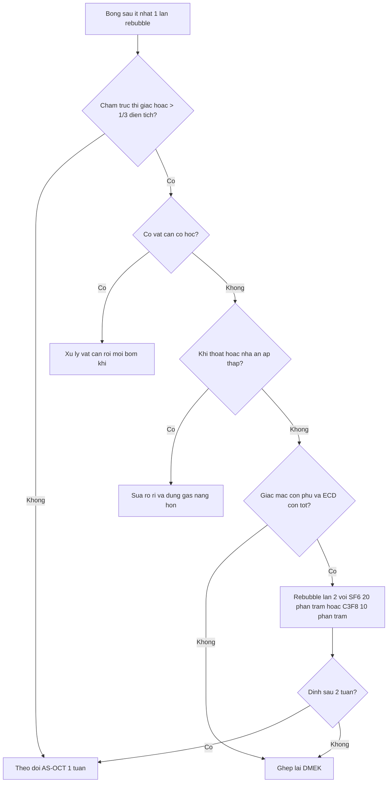
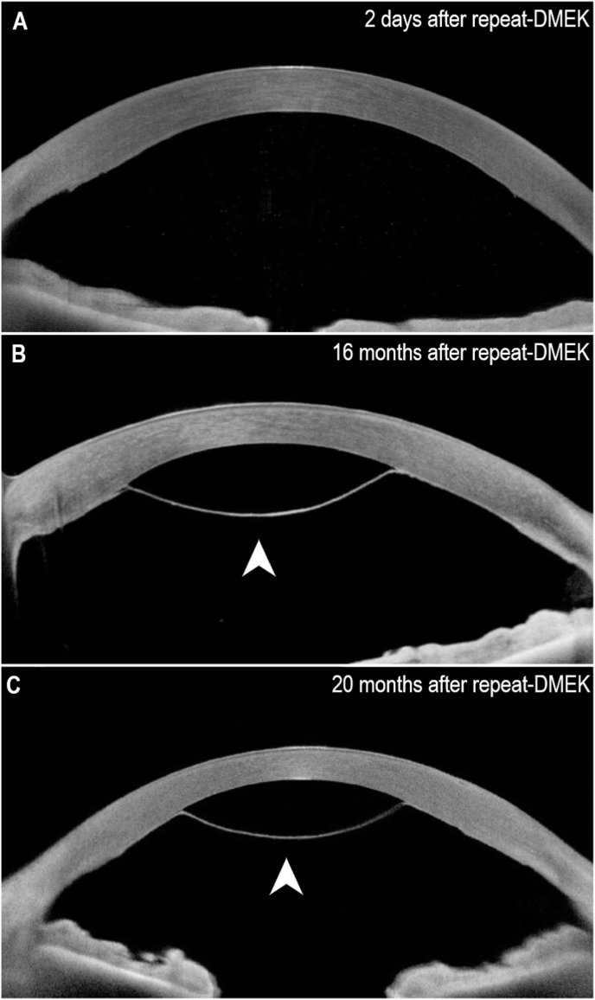
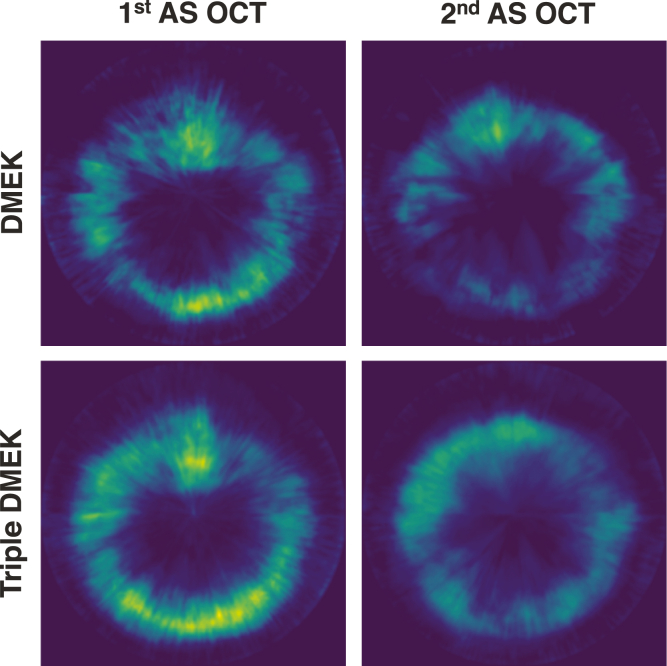
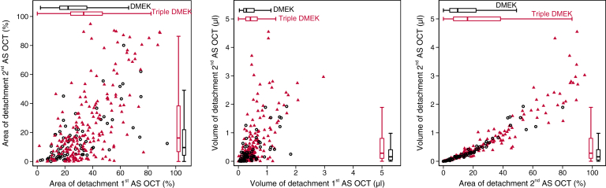

# 3311 — Bong mảnh ghép nội mô TÁI PHÁT sau rebubble: khi nào dừng bơm khí để ghép lại / Recurrent graft detachment after rebubbling

**Tags:** `pattern:bong-manh-ghep` `pattern:bong-tai-phat` `pattern:phu-giac-mac` `pattern:mo-ghep-giac-mac` `vung:mat` `vung:giac-mac` `vung:tien-phong` `protocol:AS-OCT` `protocol:rebubble` `score:detachment-area`
**Mức chắc chắn (certainty):** tổng hợp y văn (literature synthesis) — 1 đoàn hệ **3200 mắt** DMEK đa trung tâm (DOI 10.1111/aos.15257), 1 đoàn hệ **463 mắt** về số lần rebubble (DOI 10.1080/02713683.2020.1842459), 1 sổ đăng ký **752 mắt** (PMC9763158), 2 đoàn hệ **270 mắt** và **5 mắt** dùng AS-OCT/gas nặng (PMC9754956, DOI 10.1097/ICO.0000000000002000), 1 ca bong muộn sau repeat-DMEK (PMC10359705), 2 đoàn hệ ghép nối tiếp sau PK (PMC10775423, PMC9418298) và 1 ca biến chứng rebubble lần 3 (DOI 10.1097/ICO.0000000000002838).

> **Vì sao bài này quan trọng:** rebubble (bơm khí vào tiền phòng để ép mảnh ghép dính lại) là thủ thuật **phổ biến** — **19%** trong sổ đăng ký Hà Lan (PMC9763158), **25%** trong 3200 mắt Đức (10.1111/aos.15257) — nhưng **thất bại ngay lần đầu ở 30%** ca, và mỗi lần lặp lại **lấy đi thêm nội mô**: so với mắt không rebubble, mắt bơm **1 lần** mất thêm **157 tế bào/mm²**, mắt bơm **> 1 lần** mất thêm **504 tế bào/mm²** ở tháng đầu (10.1080/02713683.2020.1842459). Câu hỏi của bài không phải "có bong không" (đã có ở [1445](../1445-bong-manh-ghep-dsaek-dmek-rebubble/lesson.md)) mà là **"đã bơm một lần mà vẫn bong — bơm nữa hay thay mảnh ghép?"**.

## 1. Tổng quan bệnh học – cơ chế hình ảnh

### 1.1. Vì sao mảnh ghép dính — và vì sao dính LẠI thất bại

- Mảnh ghép nội mô **không có chỉ khâu**, dính nhờ **ba lực**: (1) **bơm nội mô** (Na⁺/K⁺-ATPase) hút dịch khỏi mặt phân cách; (2) **sức căng bề mặt của bóng khí** ép mảnh ghép vào nhu mô; (3) **áp lực thủy tĩnh** của tiền phòng. Rebubble chỉ **lặp lại lực (2) và (3)** — không sửa được lực (1).
- Vì vậy **bong tái phát = còn vật cản cơ học** giữa mảnh ghép và nhu mô nền, hoặc **bơm nội mô đã mất** ở vùng đó. Bóng khí chỉ dính được phần mảnh ghép **ngoài vật cản**; khi khí tan, vùng có vật cản bong lại **đúng vị trí cũ**.
- **Vật cản thường gặp:** dịch–máu–fibrin đọng ở mặt phân cách (không có đường dẫn lưu); **màng Descemet người nhận còn sót**; **bước nhu mô sau (posterior stromal step) ở rìa mảnh ghép xuyên** (đặc biệt sau ghép xuyên — PK); **mực in gentian violet** dùng đánh dấu mảnh ghép; **mống mắt–PAS chạm mặt sau mảnh ghép**; **khí thoát ra dịch kính** hoặc **hạ nhãn áp** làm mất lực (3).
- **Cơ chế đặc biệt của bong muộn sau repeat-DMEK:** nội mô của **mảnh ghép thứ nhất đã di chuyển ra ngoài** vẫn hút nước cho trung tâm giác mạc, tạo **lớp nội mô kép**; dịch tích giữa lớp nội mô di chuyển và mảnh ghép thứ hai → bong trung tâm **nhiều tháng sau** mà **giác mạc vẫn trong** (PMC10359705).

### 1.2. TẠI SAO AS-OCT là công cụ quyết định (chứ không phải đèn khe)

- **AS-OCT (anterior segment OCT)** dùng ánh sáng **~1310 nm**, phân giải trục **5–10 µm**: đủ tách **mảnh ghép** (dải tăng phản xạ do collagen/Descemet) khỏi **nhu mô nền**. **Dịch ở mặt phân cách tối** vì trong suốt, không tán xạ — "đường đen" giữa hai dải sáng chính là dịch, không phải mô.
- Phải đo **ba đại lượng**, không chỉ nhìn: **diện tích bong (% diện tích mảnh ghép)**, **chiều cao bong tối đa (µm)**, và **có chạm trục thị giác không**. Trong 270 mắt được AI phân đoạn, bong tập trung ở **rìa mảnh ghép trong khi trung tâm vẫn dính** — giải thích vì sao thị lực nhiều ca vẫn tốt (PMC9754956).
- **Bong tái phát phải được so trên cùng mặt cắt:** bong **cùng vị trí** gợi ý **vật cản tại chỗ**; bong **vị trí mới** gợi ý nguyên nhân mới (khí thoát, hạ áp, chấn thương, dụi mắt).

### 1.3. Số liệu định lượng cốt lõi

- **Tần suất và số lần:** **752 mắt** — rebubble **19%**, thành công **70%** (PMC9763158); **463 mắt** — rebubble **35,2%**, trong đó **119 mắt 1 lần** và **44 mắt > 1 lần** (10.1080/02713683.2020.1842459); **3200 mắt** — **25%** cần ít nhất 1 lần, trung bình **0,4 ± 0,7 lần/mắt** (10.1111/aos.15257).
- **Giá nội mô:** so với không rebubble, ECD tháng 1 thấp hơn **157 tế bào/mm²** (95% CI 2–310; p = 0,047) sau **1 lần** và **504 tế bào/mm²** (95% CI 267–741; p < 0,001) sau **> 1 lần**; khác biệt **duy trì** suốt theo dõi (10.1080/02713683.2020.1842459). Trong 3200 mắt, ECD giảm từ **2465 ± 259** xuống **1587 ± 433 tế bào/mm²** ở 12 tháng; **càng nhiều rebubble càng thấp ECD, kém BCVA, dày giác mạc hơn và nhiều thất bại/thải ghép**, nhưng **một lần rebubble không ảnh hưởng BCVA** (p = 0,785) (10.1111/aos.15257).
- **Hệ quả xấu nhất:** trong sổ Hà Lan, thất bại mảnh ghép sau rebubble **30% vs 9%** (OR 4,28; 95% CI 2,72–6,73) (PMC9763158); trong đoàn hệ 463 mắt, **không** thấy khác biệt nguy cơ thất bại giữa các nhóm rebubble (10.1080/02713683.2020.1842459) — xem mục 7.
- **Diễn tiến tự nhiên của bong rìa:** **147 mắt** bong < 1/3 diện tích ngày 3 → **139 mắt (95%)** vẫn < 1/3 ở tuần 2; diện tích trung bình giảm từ **28% → 16%** (DMEK đơn thuần) và **38% → 25%** (triple DMEK); rebubble **9%** (DMEK) vs **20%** (triple), aRR **3,1** (95% CI 1,3–7,1) (PMC9754956).

## 2. Mẫu hình + chẩn đoán phân biệt (Gamut)

### 2.1. Năm mẫu hình quyết định thái độ

1. **Bong rìa tồn tại (persistent peripheral)** — bờ mảnh ghép bong, **trung tâm dính**; thường gặp nhất; phần lớn **tự giảm** (95% vẫn < 1/3 ở tuần 2) (PMC9754956).
2. **Bong trục thị giác tái phát sớm** — trong **vài ngày đến 2 tuần** sau rebubble, **cùng vị trí**, thị lực không cải thiện, CCT tăng; đây là nhóm **cần đổi chiến lược**, không bơm lặp vô hạn.
3. **Bong trung tâm muộn sau repeat-DMEK** — **16 tháng** sau ghép lại, trung tâm, **giác mạc vẫn trong**, ECD trung tâm **842 tế bào/mm²**, theo dõi **20 tháng** không can thiệp (PMC10359705).
4. **Bong toàn bộ / mảnh cuộn (scroll)** — mất lực hoàn toàn, mảnh ghép gấp cuộn; **không rebubble lặp**, cần **ghép lại**.
5. **Bong do vật cản khu trú** — bong đúng một điểm, không lan: **mực in**, **Descemet sót**, **bước nhu mô sau ở rìa PK**, **chỉ khâu/fibrin**.

### 2.2. Gamut theo nguyên nhân (vì sao dính lại thất bại)

- **Rìa ghép xuyên (PK) có bước nhu mô sau:** AS-OCT phải quét **vòng 360°** tìm bước nhu mô ở rìa miệng ghép (PMC10775423). Hệ quả kỹ thuật rất lớn: DMEK **mảnh nhỏ hơn** miệng PK → rebubble **44,4%** (8/18 mắt), sống mảnh ghép 12 tháng **66,7%** (PMC10775423); DMEK **mảnh lớn hơn + descemetorhexis ra ngoài rìa PK** (vào mô chủ) → rebubble chỉ **18,2%** (2/11 mắt) (PMC9418298).
- **Nền giác mạc xấu:** **xơ dưới biểu mô** OR **3,55** (95% CI 2,02–6,32); **PK trước đó** OR **5,89** (95% CI 2,00–21,86); **CCT tăng 20% ngày 1** làm nguy cơ rebubble **4,5 lần** (10.1007/s10792-022-02547-4).
- **Mất lực thủy tĩnh:** khí thoát ra **dịch kính**, rò vết mổ, **hạ nhãn áp** sau mổ, mắt **aphakia/cắt dịch kính** (buồng trước sâu, mảnh ghép dễ trôi).
- **Lớp nội mô kép sau repeat-DMEK:** nội mô mảnh cũ di chuyển → hút nước cho trung tâm → **giác mạc trong dù bong** (PMC10359705).
- **Vật cản tại chỗ:** mực in **gentian violet** có nồng độ **isopropyl alcohol** cao gây bong khu trú **1 ngày, 1 tuần, 1 tháng** (2 ca, DOI 10.1097/ICO.0000000000003388); **Descemet người nhận còn sót**; **máu/fibrin** không tan.

## 3. Bảng so sánh phân biệt (ma trận đối chiếu)

| Thực thể (entity) | Hình ảnh điển hình (AS-OCT / đèn khe) | Chốt vào (rule-in) | Chốt loại (rule-out) | Gợi ý xác nhận |
|---|---|---|---|---|
| Bong rìa tồn tại | Dải dịch **ở bờ mảnh ghép**, trung tâm áp sát nhu mô; CCT giảm dần | **Bong < 1/3 diện tích + ngoài trục thị giác + trung tâm dính** | Bong lan vào trung tâm hoặc chiều cao tăng giữa 2 lần chụp | AS-OCT tuần 1–2; theo dõi nếu < 1/3 |
| Bong trục thị giác tái phát sớm sau rebubble | Dải dịch **cùng vị trí cũ**, che trục thị giác; CCT tăng lại sau khi giảm | **Bong lại ≤ 2 tuần sau rebubble + đúng vị trí cũ** | Bong ở vùng khác, kèm khí trong dịch kính → nguyên nhân mới | So mặt cắt cũ; tìm vật cản tại chỗ |
| Bong trung tâm muộn sau repeat-DMEK | Bong trung tâm **nhưng giác mạc trong**, không nếp nhu mô; ECD trung tâm thấp | **Bong trung tâm + BCVA tốt + CCT bình thường + nhiều tháng sau ghép lại** | Phù lan tỏa + CCT tăng + ECD giảm nhanh → thất bại mảnh ghép | Đo ECD trung tâm, theo dõi 3–6 tháng |
| Bong toàn bộ / mảnh cuộn | Khoang dịch lớn dưới toàn mảnh ghép, mảnh gấp cuộn | **Mảnh ghép tách hoàn toàn khỏi nhu mô** | Còn vùng dính > 50% → còn cửa sổ rebubble | AS-OCT + đèn khe; chuẩn bị ghép lại |
| Bong do vật cản khu trú | Bong **một điểm**, bờ tròn, không lan; có thể thấy **dải tăng phản xạ** dưới mảnh ghép | **Bong khu trú đúng vị trí mực in/DM sót/bước nhu mô** | Bong lan theo trọng lực → dịch tự do | AS-OCT lát mỏng qua điểm bong; đối chiếu thao tác mổ |
| Thất bại mảnh ghép (graft failure) | **Phù lan tỏa**, nếp nhu mô sau, mảnh ghép dày; ECD rất thấp | **Phù + CCT tăng + ECD giảm nhanh + không cải thiện sau rebubble** | Giác mạc trong + chỉ bong khu trú → chưa thất bại | Đo CCT/ECD chuỗi; cân nhắc ghép lại |
| Nếp gấp mảnh ghép (graft fold) | Đường **tăng phản xạ gấp khúc trong mảnh ghép**, **không có khoảng dịch** | **Không có dải tối dưới mảnh ghép** | Có khoảng dịch → bong thật | AS-OCT; không rebubble vì nếp gấp |
| Interface fluid (dịch mặt phân cách cũ) | Khoảng dịch ở **mặt phân cách của ghép trước** (LASIK/DSAEK), CCT tăng, IOP cao | **Vị trí mặt phân cách cũ + nhãn áp cao** | Dịch ngay dưới mảnh ghép hiện tại → bong mảnh ghép | So bản đồ giác mạc cũ; đo IOP |

## 4. Protocol chụp + phân độ + quyết định rebubble lần 2

### 4.1. Protocol AS-OCT sau ghép nội mô

- **Lịch:** ngày **1**, ngày **3–5**, **tuần 2**, **tháng 1**, sau đó **3–6–12 tháng**; mỗi lần **cùng mặt cắt qua trục thị giác** + **quét vòng rìa** (bong hay ở bờ mảnh ghép) (PMC9754956).
- **Ghi bắt buộc:** diện tích bong (%), chiều cao tối đa (µm), **vị trí so trục thị giác**, CCT, độ dày mảnh ghép, **có khí trong dịch kính không**. Đo **ECD** trước và sau mỗi lần rebubble để biết "giá" đã trả.
- **Ngưỡng "đáng can thiệp" dùng trong y văn:** bong **≥ 30% diện tích** hoặc **chạm trục thị giác** được coi là có ý nghĩa lâm sàng (106 mắt, 23 mắt = 22%) (DOI 10.1097/ICO.0000000000003000); nhiều nhóm dùng mốc **1/3 diện tích** (10.1080/02713683.2020.1842459; PMC9754956).

### 4.2. Thang quyết định khi đã rebubble ≥ 1 lần mà vẫn bong

| Bước | Câu hỏi | Nếu CÓ | Nếu KHÔNG |
|---|---|---|---|
| 1 | Có **vật cản cơ học** trên AS-OCT (DM sót, bước nhu mô, mực in, PAS, fibrin)? | **Xử lý vật cản** (bóc DM sót, sửa bờ nhu mô, gỡ dính mống mắt) rồi mới bơm khí | Sang bước 2 |
| 2 | **Khí có thoát** (dịch kính, rò vết mổ) hoặc **nhãn áp thấp**? | Sửa nguyên nhân; xét **gas nặng hơn** (SF6 20% hoặc C3F8 10%) | Sang bước 3 |
| 3 | Bong **chạm trục thị giác** và **giác mạc còn phù**? | **Rebubble lần 2** với gas nặng hơn; đánh giá lại sau 1–2 tuần | Sang bước 4 |
| 4 | Bong **trung tâm nhưng giác mạc trong**, BCVA tốt, ECD còn dùng được? | **Theo dõi** — không can thiệp (ca 16 tháng theo dõi 20 tháng) (PMC10359705) | Sang bước 5 |
| 5 | **Thất bại mảnh ghép** hoặc bong toàn bộ | **Ghép lại (re-DMEK)**, không rebubble lần 3 | — |

- **Gas nặng hơn có cơ sở:** 5 mắt bong một phần **1–2 tuần** sau DMEK, đã rebubble **SF6 20%** thất bại, được bơm **C3F8 10%** lần hai **10–70 ngày** sau mổ — **cả 5 dính hoàn toàn, giác mạc trong**; mất nội mô sớm **44% ± 26%** (20–74%); 1 ca có **trabeculectomy + hạ nhãn áp mạn** thất bại ở 6 tháng (DOI 10.1097/ICO.0000000000002000).
- **Ghép lại thay vì bơm mãi:** 590 DMEK có **40 mắt (6,7%)** phải re-DMEK; **30%** re-DMEK thất bại; **55%** có **buồng trước phức tạp** (mổ glôcôm, PK, DSAEK cũ, PAS, cắt dịch kính, aphakia) — nhóm này thất bại **50%**, **OR 17,0** (95% CI 1,92–150,85) (DOI 10.1016/j.ajo.2021.01.004).
- **An toàn thủ thuật:** không tăng nhãn áp quá mức khi bơm — đã có ca **vỡ vết mổ PK ~180°** ở **lần rebubble thứ ba**, phải khâu lại và lấy mảnh ghép (DOI 10.1097/ICO.0000000000002838).

## 5. Biến thể bình thường và cạm bẫy

- **Cạm bẫy số 1 — "giác mạc trong nên không sao":** bong trung tâm muộn sau repeat-DMEK có thể **hoàn toàn không gây phù** vì lớp nội mô cũ đã di chuyển vẫn hút nước; **đo ECD** (ca điển hình **842 tế bào/mm²**) và theo dõi, **không bơm khí theo hình ảnh** (PMC10359705).
- **Cạm bẫy số 2 — "bong một chút là bơm":** **95%** mắt bong < 1/3 ở ngày 3 vẫn < 1/3 ở tuần 2 và tự giảm; bơm thêm chỉ **mất nội mô** (PMC9754956; 10.1080/02713683.2020.1842459).
- **Cạm bẫy số 3 — "triple DMEK thất bại":** ghép nội mô **kèm phaco** có diện tích bong lớn hơn (**38% vs 28%** ngày 3) và rebubble **20% vs 9%** (aRR 3,1) — đây là **khác biệt kỹ thuật**, không phải mảnh ghép kém (PMC9754956).
- **Cạm bẫy số 4 — số liệu không so sánh được:** định nghĩa **"bong"** và **"rebubble"** giữa các nghiên cứu **không thống nhất**, nên tỷ lệ dao động **19%–44%** phản ánh cả **tiêu chuẩn báo cáo** lẫn bệnh nhân (DOI 10.1016/j.survophthal.2017.07.003). Không dùng con số của trung tâm khác để đặt ngưỡng cho mình.
- **Cạm bẫy số 5 — bỏ sót vật cản sau lần bơm đầu:** khi khí tan, **bong lại đúng chỗ** là dấu hiệu của **vật cản**, không phải "khí chưa đủ"; bơm lần 2 mà không xử lý vật cản gần như chắc chắn thất bại.
- **Biến thể bình thường:** **bong rìa mỏng, không vào trục thị giác, CCT giảm dần** — theo dõi là đủ; **nếp gấp mảnh ghép** không phải bong.

## 6. Tự lượng giá — Blind Quiz

**Ca 1 — 71 tuổi, Fuchs, DMEK mắt trái; bong gần toàn bộ ở tháng 11 nên được ghép lại. Bốn tháng sau ghép lại mảnh ghép dính tốt; nay 16 tháng sau ghép lại, bệnh nhân không phàn nàn gì. Nhìn AS-OCT, mô tả trước.**

- Gợi ý lâm sàng: BCVA 20/25, giác mạc trong, không phù.
- Câu hỏi: (1) Ở 16 tháng có bất thường gì? (2) Vì sao giác mạc vẫn trong? (3) Bơm khí hay theo dõi?

<b>Bấm để hiện đáp án (findings + chẩn đoán)</b>

- Dấu hiệu: (A) 2 ngày sau ghép lại — mảnh ghép **áp sát nhu mô**; (B) 16 tháng — **khoảng tách trung tâm** (mũi tên); (C) 20 tháng — khoảng tách **giữ nguyên, không nặng thêm**.
- Chẩn đoán: **bong trung tâm muộn sau repeat-DMEK do lớp nội mô kép** — nội mô mảnh ghép thứ nhất di chuyển ra ngoài vẫn hút nước cho trung tâm, nên **không phù**. ECD trung tâm **842 tế bào/mm²**; theo dõi tới **20 tháng**, không can thiệp.
- Bài học: **hình ảnh bong không đồng nghĩa cần bơm khí**; phải có phù/giảm thị lực/giảm ECD.
- Nguồn ảnh: Friedrich M và cộng sự, *Am J Ophthalmol Case Rep* 2023 (PMC10359705), CC BY 4.0.

**Ca 2 — Cùng bệnh cảnh bong sau DMEK, nhưng câu hỏi là "bong ở đâu". Nhìn bản đồ 3 chiều, mô tả trước.**

- Gợi ý lâm sàng: 270 mắt DMEK, chụp AS-OCT ngày 3 và tuần 2; hàng trên DMEK đơn thuần, hàng dưới triple DMEK.
- Câu hỏi: (1) Vùng nào bong nhiều nhất? (2) Vì sao thị lực trung tâm thường còn tốt? (3) Điều này thay đổi cách bơm khí thế nào?

<b>Bấm để hiện đáp án</b>

- Dấu hiệu: màu sáng/vàng tập trung ở **rìa mảnh ghép** (trên và dưới), **trung tâm tối = dính**; lần 2 nhạt hơn lần 1 = bong **giảm dần**.
- Chẩn đoán: **bong rìa** là hình thái chủ yếu; trung tâm dính nên **trục thị giác không bị che** → nhiều ca BCVA vẫn tốt.
- Bài học: bơm khí phải nhắm **vào vùng rìa bong**; đừng đánh giá "nặng/nhẹ" chỉ bằng thị lực, và đừng bơm chỉ vì thấy màu vàng ở rìa.
- Nguồn ảnh: Kladny AS và cộng sự, *Ophthalmol Sci* 2022 (PMC9754956), CC BY-NC-ND 4.0 (nguyên bản).

**Ca 3 — Cùng đoàn hệ trên: diện tích và thể tích bong đo tự động. Nhìn biểu đồ, trả lời trước.**

- Câu hỏi: (1) Hai trục của biểu đồ thể hiện gì? (2) Điểm nằm dưới đường chéo nói lên điều gì? (3) Ứng dụng cho lịch chụp?

<b>Bấm để hiện đáp án</b>

- Dấu hiệu: trục hoành = **diện tích/thể tích bong lần 1** (ngày 3), trục tung = **lần 2** (tuần 2); phần lớn điểm **dưới đường chéo** và tập trung ở góc thấp.
- Chẩn đoán: bong **giảm** giữa 2 lần chụp; mắt có bong **ít ngày 3** gần như chắc chắn **ít ở tuần 2** (95%), mắt bong nhiều có thể còn nhiều.
- Bài học: **diện tích bong ngày 3 dự báo diện tích tuần 2** → chụp sớm để phân tầng theo dõi, tránh bơm khí hàng loạt.
- Nguồn ảnh: Kladny AS và cộng sự, *Ophthalmol Sci* 2022 (PMC9754956), CC BY-NC-ND 4.0 (nguyên bản).

## 7. Câu hỏi nghiên cứu & điểm chưa đồng thuận (tính đến 11/2026)

1. **[Tranh cãi] Ở mắt DMEK bong, rebubble có làm tăng nguy cơ thất bại mảnh ghép hay chỉ là dấu hiệu của mắt nặng hơn?**
   - **Đã biết:** sổ đăng ký 752 mắt ghi nhận thất bại **30% vs 9%** (OR 4,28) sau rebubble (PMC9763158); đoàn hệ 463 mắt **không** thấy khác biệt nguy cơ thất bại giữa các nhóm (DOI 10.1080/02713683.2020.1842459).
   - **Chưa rõ:** nhiễu do chỉ định — mắt bong nhiều, buồng trước phức tạp vừa dễ bong vừa dễ thất bại; chưa có phân tích theo **số lần** rebubble và **diện tích bong ban đầu**.
   - **Hướng nghiên cứu:** đoàn hệ tiến cứu phân tầng theo số lần rebubble + diện tích AS-OCT, outcome ECD 12 tháng và sống mảnh ghép.
   - **Nguồn:** PMC9763158 (2023); DOI 10.1080/02713683.2020.1842459 (2021); DOI 10.1111/aos.15257 (2023).

2. **[Khoảng trống] Ngưỡng nào (diện tích, chiều cao, số lần) để dừng rebubble và chuyển sang ghép lại?**
   - **Đã biết:** các mốc **≥ 30%** hoặc **chạm trục thị giác** và **1/3 diện tích** được dùng rải rác (DOI 10.1097/ICO.0000000000003000; PMC9754956); gas nặng hơn cứu được 5/5 mắt sau thất bại SF6 (DOI 10.1097/ICO.0000000000002000).
   - **Chưa rõ:** chưa có RCT hay nghiên cứu tiến cứu so **rebubble lần 2 vs re-DMEK** theo cùng ngưỡng; cỡ mẫu của ca C3F8 chỉ **5 mắt**.
   - **Hướng nghiên cứu:** thử nghiệm ngưỡng (adaptive trial) với outcome **ECD 12 tháng**, số mổ lại, BCVA.
   - **Nguồn:** DOI 10.1097/ICO.0000000000002000 (2019); DOI 10.1097/ICO.0000000000003000 (2023); PMC9754956 (2022).

3. **[Khác biệt thực hành] Cùng mắt sau PK: kỹ thuật ghép quyết định tỷ lệ bong lại, không phải bản thân bệnh nhân.**
   - **Đã biết:** DMEK **mảnh nhỏ hơn** miệng PK → rebubble **44,4%**, sống 12 tháng **66,7%** (PMC10775423); DMEK **mảnh lớn hơn + descemetorhexis ra ngoài rìa** → rebubble **18,2%** (PMC9418298).
   - **Chưa rõ:** chưa có so sánh trực tiếp hai kỹ thuật trong cùng trung tâm; các đoàn hệ nhỏ (**18** và **11 mắt**).
   - **Hướng nghiên cứu:** so sánh tiến cứu hoặc đăng ký quốc gia phân tầng theo **đường kính mảnh ghép so miệng PK**.
   - **Nguồn:** PMC10775423 (2024); PMC9418298 (2022).

## Bài liên quan chéo
- [1445 – Bong mảnh ghép nội mô sau DSAEK/DMEK: theo dõi hay rebubble](../1445-bong-manh-ghep-dsaek-dmek-rebubble/lesson.md) (lần bong đầu tiên, kỹ thuật rebubble)
- [3310 – Tăng nhãn áp do corticoid sau ghép nội mô giác mạc](../3310-tang-nhan-ap-corticoid-sau-ghep-noi-mo-giac-mac/lesson.md) (bong là biến cố cơ học sớm; corticoid và ECD)
- [3287 – Phaco sau ghép nội mô giác mạc](../3287-phaco-sau-ghep-noi-mo-giac-mac/lesson.md) (triple DMEK, aRR 3,1)
- [3284 – Ghép nội mô giác mạc ở mắt có ống dẫn lưu](../3284-ghep-noi-mo-giac-mac-ong-dan-luu/lesson.md) (buồng trước phức tạp)
- [3291 – Đổi IOL sau ghép giác mạc](../3291-doi-iol-sau-ghep-giac-mac/lesson.md)
- [3294 – Trẻ aphakia: đánh giá hỗ trợ bao bằng UBM/AS-OCT](../3294-tre-aphakia-danh-gia-ho-tro-bao-ubm-as-oct/lesson.md)

## Ảnh
- `3311_bong-tai-phat_AS-OCT_PMC10359705-F2.jpg` — AS-OCT dọc trục 2 ngày / 16 tháng / 20 tháng sau repeat-DMEK.
- `3311_ban-do-vi-tri_SO-DO_PMC9754956-F3.jpg` — bản đồ 3 chiều chồng lớp vị trí bong (DMEK vs triple DMEK).
- `3311_dien-tich-the-tich_AS-OCT_PMC9754956-F2.jpg` — diện tích/thể tích bong ở lần AS-OCT 1 và 2.
- Nguồn, tác giả và giấy phép từng ảnh: `images/CREDITS.md`.

> Không dùng để chẩn đoán độc lập khi chưa có người hướng dẫn.
