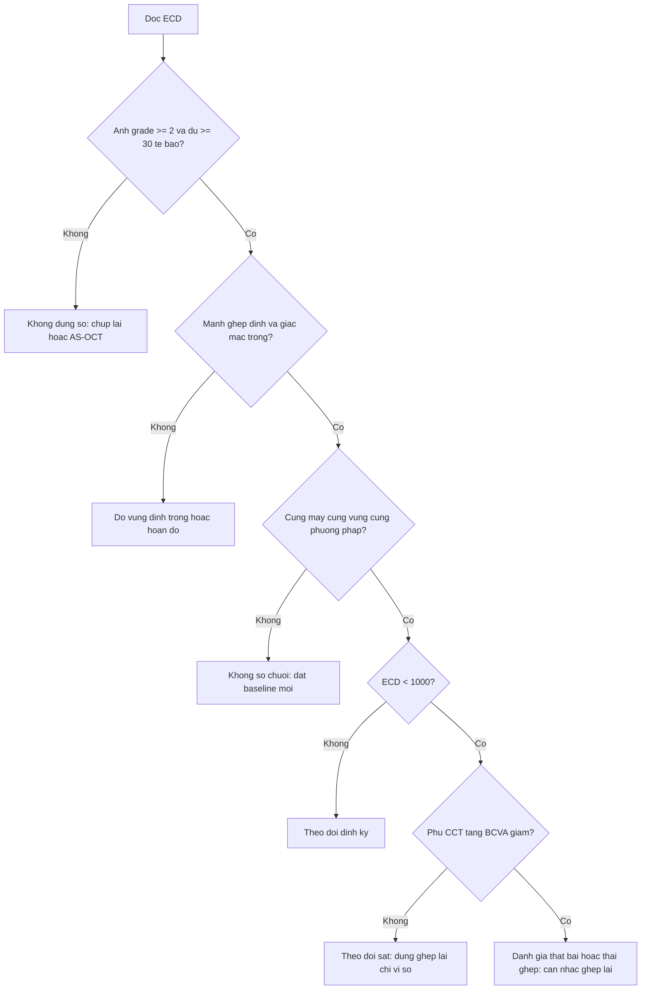
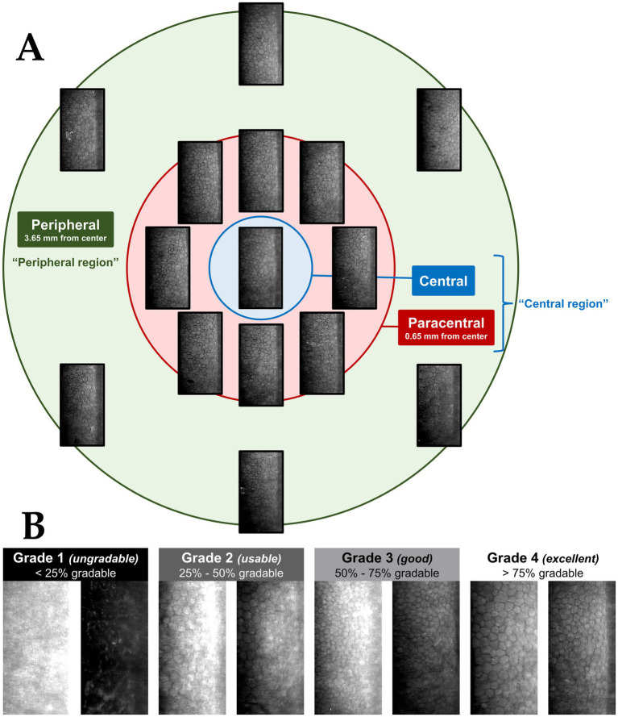
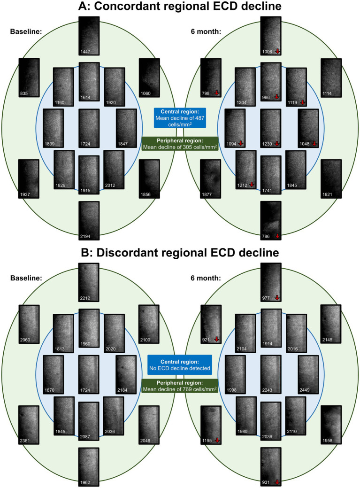
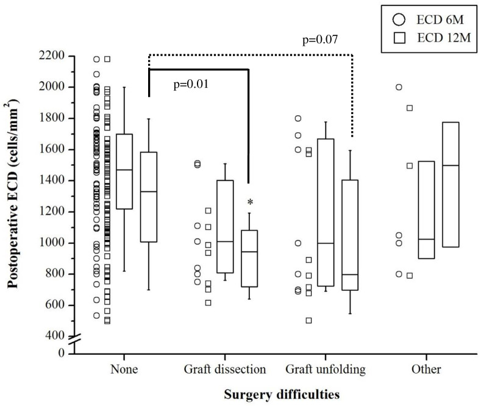

# 3312 — Đếm tế bào nội mô giác mạc (ECD) sau ghép và sau rebubble: con số nào đáng tin / Corneal endothelial cell density measurement after grafting and rebubbling

**Tags:** `pattern:giam-ecd` `pattern:phu-giac-mac` `pattern:bong-manh-ghep` `pattern:do-luong-sai` `vung:mat` `vung:giac-mac` `vung:tien-phong` `protocol:specular-microscopy` `protocol:widefield-specular` `protocol:AS-OCT` `score:ECD-threshold`
**Mức chắc chắn (certainty):** tổng hợp y văn (literature synthesis) — 1 đoàn hệ **53 mắt** DMEK chụp siêu soi trường rộng 15 vị trí (PMC12669210), 1 đoàn hệ **103 mắt** DMEK với ECD 6/12 tháng (PMC8870504), 4 nghiên cứu tái lập/so sánh thiết bị (**278 mắt** khỏe mạnh, **54 giác mạc hiến**, **40 mắt**, **30 mắt**, **100 mắt hiến**), 1 so sánh **4 máy** trên **69 mắt** (DOI 10.1097/ICO.0000000000000385), 1 đoàn hệ **3.052 giác mạc** ngân hàng mắt (DOI 10.1097/ICO.0000000000000124) và 1 đoàn hệ **83 mắt** đặt IOL tiền phòng để lấy ngưỡng mất bù (DOI 10.1016/s0886-3350(99)00398-3).

> **Vì sao bài này quan trọng:** ECD là con số dùng để quyết định **theo dõi hay ghép lại**, nhưng nó là **ước lượng từ một vùng nhỏ**, không phải phép đếm toàn bộ nội mô. Vùng đo thường chỉ **0,55 × 0,25 mm** (0,1375 mm²) — tác giả PMC12669210 tính nó chỉ đại diện **khoảng một phần nghìn** diện tích nội mô. Chênh lệch sinh lý giữa hai mắt có thể tới **±180 tế bào/mm²** (PMID 34543164), còn giữa hai thiết bị tới **−435…+339 tế bào/mm²** (PMID 20175056) — **lớn hơn khoảng cách giữa 950 và 1.050**, trong khi **1.000 tế bào/mm²** lại là ngưỡng nguy cơ được dùng phổ biến. Bài này trả lời: **đo thế nào, vùng nào, máy nào, và khi nào con số không đáng tin** — để không ghép lại oan vì một số nhiễu, và không bỏ sót mất nội mô thật.

## 1. Tổng quan bệnh học – cơ chế hình ảnh

### 1.1. ECD là gì và vì sao ảnh siêu soi (specular microscopy) nhìn được tế bào

- Nội mô giác mạc là **một lớp tế bào lục giác**, bơm Na⁺/K⁺-ATPase hút dịch từ nhu mô ra tiền phòng. Mỗi tế bào **không tái sinh** ở người lớn; khi mất, tế bào cạnh **giãn ra** lấp chỗ → ECD giảm nhưng **diện tích tế bào tăng**, và **hệ số biến thiên diện tích (CV)** tăng.
- Siêu soi tận dụng **phản xạ gương (specular reflex)** tại mặt phân cách **nội mô–thủy dịch**: ánh sáng tới và phản xạ đối xứng; vùng **viền tế bào dốc** tán xạ kém → hiện **đường tối**, thân tế bào sáng. Vì vậy ảnh là **mosaic viền tối** trên nền sáng, không phải ảnh nhuộm.
- Máy đặt một **khung đo đã hiệu chuẩn**, đếm tế bào trong khung rồi chia cho diện tích: **ECD = số tế bào / diện tích (mm²)**. Đây là **mật độ ước lượng**, không phải tổng số tế bào.
- Khung đo thương mại thường **0,55 × 0,25 mm**; phương pháp **center** đếm **≥ 30 tế bào liền nhau** quanh tâm, phương pháp **flex-center** khoanh một vùng rồi đếm tế bào trong vùng (PMID 37951743). Ngân hàng mắt có thể đếm **> 300 tế bào trên 3 vùng của 8 mm trung tâm** (PMID 24809309).
- Vì sao **phù/nếp/mảnh ghép bong** làm hỏng phép đo: nhu mô phù và nếp gấp **tán xạ ánh sáng trước khi tới nội mô**, phá phản xạ gương; vùng bong có **khoảng dịch** giữa mảnh ghép và nhu mô, mặt phản xạ không còn phẳng. Máy hoặc **không bắt được ảnh**, hoặc **tự động nối viền sai**, hoặc chỉ đếm được vài tế bào rồi **ngoại suy** — cả ba đều cho số **không phải sinh học**.

### 1.2. Vì sao "1.000 tế bào/mm²" nằm trong vùng nhiễu của phép đo

- **Cùng một mắt, cùng một máy:** 278 mắt khỏe mạnh, 3 lần đo/mắt — **ICC 0,95** (95% CI 0,94–0,96), **CV 2,4% ± 3,9%**, **độ lệch chuẩn test–retest 17,7 ± 7,7 tế bào/mm²**; nghĩa là phép đo lặp lại **khá ổn định** (PMID 34543164). Ngược lại, **chênh hai mắt** ở người khỏe có giới hạn 2,5–97,5% là **−177,4…+182,0 tế bào/mm²** — đây là **bất đối xứng sinh lý**, không phải sai số máy.
- **Hai máy khác nhau:** 40 mắt đo bằng 2 siêu soi — **95% giới hạn đồng thuận −435…+339 tế bào/mm²**; chế độ **tự động 2.483 ± 159** so với **bán tự động 2.635 ± 190** (p < 0,001), ICC 0,50 so với 0,80 (PMID 20175056).
- **Bốn máy trên cùng nhóm mắt:** khác biệt ECD **có ý nghĩa thống kê** (p < 0,01) giữa 4 thiết bị; tỷ lệ **đo thành công** là **100%** ở mắt khỏe, **64,5–93,5%** ở mắt đã ghép giác mạc và **0–18,8%** ở mắt có **cornea guttata** (DOI 10.1097/ICO.0000000000000385).
- **Siêu soi so với confocal:** trên 100 mắt hiến, siêu soi cho ECD **cao nhất**, confocal cho **thấp nhất**; tác giả khuyến nghị lấy **trung bình 3 lần đo** (DOI 10.17116/oftalma2017133676-82). Trên mắt khỏe, máy siêu soi và confocal hiện đại có thể đồng thuận: chênh **52,1 ± 97,9 tế bào/mm²** (p = 0,46) (PMC4222699) — nhưng **không được suy ra** rằng mọi cặp máy đều thay thế được nhau.
- **Hệ quả thực hành:** cùng một máy, thay đổi vài chục tế bào/mm² nằm trong **dao động đo** (CV 2,4%); nhưng một mắt đo bằng máy A **1.100** và máy B **700** có thể **không khác biệt sinh học** vì giới hạn đồng thuận giữa thiết bị tới hàng trăm tế bào. Muốn dùng ngưỡng **1.000**, phải cố định **máy, phần mềm, vùng đo, phương pháp đếm** và đọc **xu hướng** ít nhất 2–3 lần.

### 1.3. Vùng trung tâm không đại diện cho toàn bộ nội mô

- Trong 53 mắt DMEK ổn định, chụp **15 vị trí**: 1 trung tâm, 8 cạnh trung tâm (**0,65–0,80 mm** từ tâm), 6 ngoại vi (**3,65–4,00 mm**); vùng "trung tâm" gộp 1 + 8 ảnh trong **đường kính 1,3 mm**, vùng ngoại vi là **vành 7,3 mm** (PMC12669210).
- Ở lần chụp nền (trung bình **23 tháng** sau DMEK): ECD **trung tâm 1.709** so với **ngoại vi 1.498 tế bào/mm²**; sau 6 tháng, trung tâm **1.555** và ngoại vi **1.347** (p < 0,001 và p = 0,016). Tốc độ mất trung tâm ước tính **5,81%/năm** (95% CI 3,54–8,08) (PMC12669210).
- **Không phải mọi mắt giảm đồng đều:** một mắt có **trung tâm không giảm** nhưng **ngoại vi giảm trung bình 769 tế bào/mm²** trong 6 tháng (Hình 3B của PMC12669210). Nếu chỉ đo trung tâm, mất nội mô ngoại vi **hoàn toàn bị bỏ qua**.
- Vì vậy "ECD trung tâm bình thường" **không đồng nghĩa** dự trữ nội mô còn tốt, đặc biệt sau DMEK — nơi tế bào có thể **di chuyển và tái phân bố** ra ngoại vi.

### 1.4. Sau ghép và sau rebubble: quỹ đạo ECD và "giá" của thủ thuật

- 103 mắt DMEK (Fuchs): ECD mảnh ghép **2.557** trước mổ → **1.403** ở 6 tháng (**mất 45%**) → **1.244** ở 12 tháng (**mất 51%**); **10%** mảnh ghép thất bại phải ghép lại trong 12 tháng (PMC8870504).
- Tổng quan trong cùng bài: DMEK mất **30–40%** tế bào trong **12 tháng đầu**, sau đó **~7%/năm** ở giai đoạn ổn định (PMC8870504).
- **Rebubble không miễn phí:** so với mắt không bơm khí, ECD tháng 1 thấp hơn **157 tế bào/mm²** sau **1 lần** và **504 tế bào/mm²** sau **> 1 lần** (DOI 10.1080/02713683.2020.1842459). Vì vậy ECD tụt **150–500** ngay sau rebubble có thể là **giá của thủ thuật**, không phải thất bại mảnh ghép.
- Trong đoàn hệ 103 mắt, rebubble được làm ở **34%**: **25%** một lần, **9%** > 1 lần; nếu cần **lần thứ tư** thì được coi là **thất bại** và chuyển ghép lại (PMC8870504).
- **Điểm cần nhớ:** sau rebubble, **khí còn trong tiền phòng** và **nếp mảnh ghép** làm ảnh siêu soi không đáng tin. Phải đợi khí tan và giác mạc trong, rồi mới lấy ECD làm mốc mới.

## 2. Mẫu hình + chẩn đoán phân biệt (Gamut)

### 2.1. Sáu mẫu hình "con số ECD" gặp trên lâm sàng

1. **ECD thấp thật (true low)** — phù lan tỏa, CCT tăng, BCVA giảm, ECD < 1.000 và tiếp tục giảm; mảnh ghép có thể còn dính nhưng nội mô đã mất bù.
2. **ECD giả thấp do vùng đo (measurement artifact)** — đo trên **vùng bong, vùng phù, nếp gấp, bọng khí**: ảnh grade 1 (< 25% diện tích đọc được) hoặc phần mềm ngoại suy; AS-OCT cho thấy mảnh ghép tách nhưng "ECD" lại rất thấp.
3. **ECD giả cao do chọn vùng (sampling bias)** — chỉ đo **trung tâm còn tốt** hoặc **vùng cạnh trung tâm được bảo tồn**, trong khi ngoại vi đã mất (Hình 3B, PMC12669210); hoặc đo **nhu mô chủ** thay vì mảnh ghép.
4. **ECD "không đổi" giả tạo** — cùng một ảnh được phần mềm **tự động điền viền**, hoặc đổi máy/phần mềm giữa các lần; số liệu đẹp nhưng không phản ánh mô.
5. **ECD thấp nhưng giác mạc trong (compensated low ECD)** — mảnh ghép còn đủ chức năng hoặc có **lớp nội mô kép**; ví dụ ca bong trung tâm muộn sau repeat-DMEK với ECD **842 tế bào/mm²** vẫn trong và theo dõi 20 tháng (bài [3311](../3311-bong-manh-ghep-tai-phat-sau-rebubble/lesson.md)).
6. **ECD "bình thường" nhưng giác mạc phù** — nguyên nhân không do mật độ: **thải ghép, tăng nhãn áp, bệnh nội mô tiến triển, mặt phân cách xấu**; ECD chỉ là một trục, không phải chẩn đoán.

### 2.2. Gamut theo vị trí đo (location)

- **Trung tâm (central, đường kính 1,3 mm):** vùng chuẩn để so chuỗi; nhưng chỉ ~1/1.000 diện tích nội mô và có thể **bỏ sót mất ngoại vi**.
- **Cạnh trung tâm (paracentral, 0,65–0,80 mm):** nơi tế bào có thể **còn tốt hơn ngoại vi**; dùng để phát hiện **giảm không đồng đều**.
- **Ngoại vi (peripheral, 3,65–4,00 mm):** ECD nền **thấp hơn trung tâm** (1.498 so với 1.709); có thể **giảm trước** hoặc **độc lập** với trung tâm.
- **Mảnh ghép so với nhu mô chủ (graft vs host):** sau DMEK, mảnh ghép mỏng nằm trong; đo nhầm vùng nhu mô chủ còn Descemet sẽ cho **số khác hoàn toàn**.
- **Vùng dính so với vùng bong (attached vs detached):** chỉ vùng **dính và trong** mới đo được; vùng bong phải đánh giá bằng **AS-OCT**, không phải bằng ECD.

## 3. Bảng so sánh phân biệt (ma trận đối chiếu)

| Thực thể (entity) | Hình ảnh điển hình (siêu soi / AS-OCT) | Chốt vào (rule-in) | Chốt loại (rule-out) | Gợi ý xác nhận |
|---|---|---|---|---|
| ECD thấp thật do mất bù nội mô | Mosaic thưa, tế bào to, đa dạng; CCT tăng, nhu mô phù | **ECD < 1.000 + phù lan tỏa + BCVA giảm + xu hướng giảm** | Ảnh grade 1 hoặc số chỉ từ một vùng bong | Đo lại 2–4 tuần; AS-OCT; CCT; loại trừ thải ghép/tăng nhãn áp |
| ECD giả thấp do đo trên vùng bong | Ảnh tối/nhòe, viền tế bào không rõ; AS-OCT có khoảng dịch dưới mảnh ghép | **ECD rất thấp + AS-OCT bong + vùng đo trùng vùng bong** | Đo vùng dính/trong cho ECD gần mức trước đó | Chuyển vùng đo; hoãn đo tới khi dính |
| ECD giả thấp do phù/nếp | Grade 1 (< 25% đọc được), nếp gấp cắt ngang mosaic | **Không đếm được ≥ 30 tế bào liên tục** | Ảnh grade 3–4 với viền rõ | Chụp lại sau khi bớt phù; ghi grade vào hồ sơ |
| ECD giả cao do chọn vùng tốt | Trung tâm dày tế bào nhưng ngoại vi thưa; Hình 3B | **Trung tâm không giảm, ngoại vi giảm > 500 tế bào/mm²** | Giảm đồng đều cả hai vùng | Siêu soi trường rộng 15 vị trí nếu có |
| Khác biệt giữa hai thiết bị | Cùng mắt, hai máy cho số lệch hàng trăm | **Chênh > 95% giới hạn đồng thuận của cặp máy** | Chênh nhỏ, cùng máy/phần mềm | Ghi rõ máy + phần mềm; không trộn chuỗi |
| ECD thấp nhưng giác mạc trong | Mosaic thưa nhưng nhu mô trong, không nếp | **ECD thấp + CCT bình thường + BCVA tốt + ổn định** | Phù tiến triển, CCT tăng, BCVA giảm | Theo dõi 3–6 tháng; đừng ghép lại chỉ vì số |
| Giác mạc phù nhưng ECD "bình thường" | Mosaic còn tế bào nhưng nhu mô phù | **Phù + ECD ≥ 1.000 + tìm nguyên nhân khác** | ECD thấp thật kèm mất bù | AS-OCT, nhãn áp, tìm thải ghép/mặt phân cách |
| Đo nhầm nhu mô chủ | Mosaic khác thường ở rìa mảnh ghép; vị trí ngoài vùng ghép | **Vị trí đo nằm ngoài mảnh ghép trên AS-OCT** | Vị trí nằm trong vùng mảnh ghép | Đối chiếu AS-OCT và ảnh chụp |

## 4. Protocol chụp + phân độ + ngưỡng diễn giải

### 4.1. Checklist một lần đo ECD đáng tin

- **Cùng thiết bị, cùng phần mềm, cùng vùng:** ghi **tên máy, phiên bản phần mềm, khung đo (mm), phương pháp center/flex-center** vào hồ sơ; không so số của máy này với máy khác (PMID 20175056; DOI 10.1097/ICO.0000000000000385).
- **Đủ tế bào:** tối thiểu **30 tế bào liền nhau** theo center method (PMID 37951743); ngân hàng mắt đếm **> 300 tế bào/3 vùng 8 mm** (PMID 24809309). Nếu không đủ, ghi **"không đếm được"**, không lấy số ngoại suy.
- **Ba lần đo, lấy trung bình:** khuyến nghị khi đánh giá giác mạc hiến (DOI 10.17116/oftalma2017133676-82); trên mắt ghép cũng nên chụp 3 ảnh và lưu ảnh gốc.
- **Ghi chất lượng ảnh theo grade 1–4:** grade 1 **< 25%** diện tích đọc được (không dùng), grade 2 **25–50%** (dùng được), grade 3 **50–75%**, grade 4 **> 75%** (PMC12669210).
- **Thời điểm:** sau ghép/rebubble, đợi **khí tan** và **giác mạc trong**; không đo qua bọng khí, qua nếp gấp hoặc trong 24–48 giờ đầu sau bơm khí.
- **Kèm AS-OCT:** xác nhận mảnh ghép **dính**, đo **CCT**, tìm **bong/nếp/mặt phân cách** trước khi diễn giải ECD.
- **Đo vùng ngoại vi khi có siêu soi trường rộng:** 15 vị trí (1 trung tâm, 8 cạnh trung tâm, 6 ngoại vi) — đặc biệt ở mắt sau DMEK hoặc có giảm ECD không giải thích (PMC12669210).

### 4.2. Ngưỡng diễn giải (chỉ dùng số có nguồn)

| ECD | Ý nghĩa | Hành động gợi ý |
|---|---|---|
| **≥ 1.500**, ổn định | Dự trữ tốt | Theo dõi định kỳ 6–12 tháng; vẫn so xu hướng |
| **1.000–1.500** | Vùng chuyển tiếp | Đo lại 1–3 tháng cùng máy; kiểm CCT, BCVA, nhãn áp, AS-OCT; tìm nguyên nhân hồi phục được |
| **< 1.000** | **Ngưỡng nguy cơ mất bù** được các hội nhãn khoa và nghiên cứu DMEK dùng (PMC8870504; PMC12669210) | **Không ghép lại chỉ vì con số**; đánh giá mảnh ghép dính, CCT, BCVA, thải ghép, nhãn áp; theo dõi 4–8 tuần |
| **≤ 500** | Nguy cơ mất bù rất cao: trong đoàn hệ IOL tiền phòng cũ, **57,1%** mất bù so với **1,5%** khi ECD > 1.000 (DOI 10.1016/s0886-3350(99)00398-3) | Chuẩn bị **ghép lại**; theo dõi sát |
| Mất **> 7%/năm** sau năm đầu | Mức tham chiếu ổn định của DMEK là **~7%/năm** (PMC8870504); vượt rõ rệt = tín hiệu bất thường | Tìm thải ghép, tăng nhãn áp, bong, bệnh nội mô tiến triển |

- **Đừng dùng ngưỡng 1.000 như một "công tắc":** sai số giữa hai thiết bị có thể **±400 tế bào/mm²**; một mắt 950 đo bằng máy A có thể là 1.350 bằng máy B. Quyết định phải dựa trên **xu hướng + hình ảnh + chức năng**.
- **Sau rebubble:** ECD giảm **157** (1 lần) hoặc **504** (> 1 lần) tế bào/mm² là **giá đã biết**; đừng quy toàn bộ mức giảm đó cho thất bại mảnh ghép (DOI 10.1080/02713683.2020.1842459).

## 5. Biến thể bình thường và cạm bẫy

- **Biến thể bình thường 1 — ngoại vi thấp hơn trung tâm:** ở mắt DMEK ổn định, ECD trung tâm **1.709** so với ngoại vi **1.498** (PMC12669210). Đừng gọi ngoại vi thấp là "bệnh" nếu không có mốc trước đó.
- **Biến thể bình thường 2 — bất đối xứng hai mắt:** chênh sinh lý có thể tới **−177…+182 tế bào/mm²** (95% khoảng 2,5–97,5%) (PMID 34543164); chênh nhỏ hơn mức này **không** chứng minh bệnh một bên.
- **Cạm bẫy 1 — so số của hai máy:** 95% giới hạn đồng thuận **−435…+339 tế bào/mm²** giữa hai siêu soi (PMID 20175056); 4 máy khác nhau cho ECD khác có ý nghĩa (DOI 10.1097/ICO.0000000000000385). **Không trộn chuỗi**.
- **Cạm bẫy 2 — tự động so với bán tự động:** 2.483 so với 2.635 tế bào/mm² trên cùng 40 mắt (PMID 20175056); flex-center cho số **cao hơn** center, đặc biệt khi ECD < 2.700 (PMID 37951743). Phải ghi phương pháp.
- **Cạm bẫy 3 — đo trên vùng bong/phù:** ảnh grade 1 (< 25% đọc được) **không được dùng**; 18,9% ảnh trong đoàn hệ trường rộng là **không đọc được** (PMC12669210). Số từ vùng bong thường **giả thấp** và không đại diện mảnh ghép.
- **Cạm bẫy 4 — bỏ sót ngoại vi:** trung tâm có thể **không giảm** trong khi ngoại vi giảm **769 tế bào/mm²** (PMC12669210); đo trung tâm đơn thuần có thể bỏ qua mất bù sớm.
- **Cạm bẫy 5 — "ECD thấp = ghép lại":** ca **842 tế bào/mm²** với giác mạc trong, BCVA tốt, theo dõi 20 tháng không can thiệp (bài [3311](../3311-bong-manh-ghep-tai-phat-sau-rebubble/lesson.md)). Quyết định cần **CCT + BCVA + AS-OCT + xu hướng**.
- **Cạm bẫy 6 — nhầm "CV":** **CV** trong siêu soi thường là **hệ số biến thiên diện tích tế bào** (polymegethism), không phải **độ biến thiên của phép đo**; đừng dùng CV tế bào để nói "máy đo không ổn định".
- **Cạm bẫy 7 — mắt guttata:** tỷ lệ đo thành công chỉ **0–18,8%** (DOI 10.1097/ICO.0000000000000385); "không đo được" **không phải** "ECD bằng 0" — phải ghi rõ và dùng phương pháp khác.

## 6. Tự lượng giá — Blind Quiz

**Ca 1 — Bốn ảnh nội mô cùng một máy, cùng độ phóng đại. Nhìn trước, chọn ảnh nào dùng được để đếm.**

- Gợi ý lâm sàng: bệnh nhân sau DMEK, giác mạc còn hơi phù; kỹ thuật viên chụp 4 lần.
- Câu hỏi: (1) Ảnh nào **không** dùng được? (2) Ngưỡng % diện tích đọc được của từng grade? (3) Nếu chỉ có ảnh grade 2, nên làm gì?

<b>Bấm để hiện đáp án (findings + chẩn đoán)</b>

- Dấu hiệu: panel B xếp **grade 1** (< 25% đọc được, gần như chỉ thấy vân mờ) → **grade 2** (25–50%) → **grade 3** (50–75%) → **grade 4** (> 75%, mosaic lục giác rõ).
- Chẩn đoán: chỉ **grade ≥ 2** mới dùng được; grade 3–4 là ưu tiên. Grade 1 **không** cho số ECD.
- Bài học: ghi **grade** vào hồ sơ; nếu chỉ có grade 2, có thể dùng nhưng phải ghi rõ và **đo lại** khi giác mạc trong hơn, không dùng để so với lần grade 4.
- Nguồn ảnh: Cheong EZK và cộng sự, *Front Med (Lausanne)* 2025 (PMC12669210), Fig. 1, CC BY 4.0.

**Ca 2 — Hai mắt DMEK, chụp 15 vị trí lúc nền và sau 6 tháng. Nhìn bản đồ, mô tả trước.**

- Gợi ý lâm sàng: cả hai mắt giác mạc trong, BCVA ổn; chỉ có ECD thay đổi.
- Câu hỏi: (1) Mắt nào giảm **đồng đều**, mắt nào **không đồng đều**? (2) Vì sao đo trung tâm đơn thuần có thể bỏ sót? (3) Con số nào chốt?

<b>Bấm để hiện đáp án</b>

- Dấu hiệu: **A** — trung tâm giảm trung bình **487**, ngoại vi **305 tế bào/mm²** (giảm cả hai); **B** — trung tâm **không phát hiện giảm**, ngoại vi **giảm 769 tế bào/mm²**; mũi tên đỏ đánh dấu vùng giảm > 10%.
- Chẩn đoán: **giảm ECD không đồng đều** sau DMEK; mắt B là kiểu "trung tâm bình thường nhưng ngoại vi mất".
- Bài học: nếu chỉ đo trung tâm ở mắt B, sẽ kết luận sai là "ECD ổn định"; cần **siêu soi trường rộng** hoặc ít nhất đo thêm vùng ngoại vi khi nghi ngờ.
- Nguồn ảnh: Cheong EZK và cộng sự, *Front Med (Lausanne)* 2025 (PMC12669210), Fig. 3, CC BY 4.0.

**Ca 3 — 103 mắt DMEK: ECD 6 và 12 tháng theo độ khó mổ. Nhìn biểu đồ, trả lời trước.**

- Gợi ý lâm sàng: cùng một phẫu thuật viên, cùng máy CEM-530; nhóm "graft dissection" là mảnh ghép khó bóc.
- Câu hỏi: (1) Nhóm nào có trung vị ECD 12 tháng thấp nhất? (2) So với nhóm mổ không khó, chênh bao nhiêu? (3) Có nên đổi ngưỡng ghép lại cho nhóm này?

<b>Bấm để hiện đáp án</b>

- Dấu hiệu: trung vị ECD 12 tháng **945** ở nhóm **graft dissection** so với **1.331** ở nhóm không khó (p = 0,01); nhóm **graft unfolding 800** so với 1.331 (p = 0,07).
- Chẩn đoán: **độ khó mổ** — đặc biệt bóc mảnh ghép — dự báo ECD 12 tháng thấp; rebubble **không** liên quan ECD trong đoàn hệ này.
- Bài học: một mắt sau mổ khó có ECD quanh **1.000** không nhất thiết là "đang thất bại", nhưng cần **theo dõi sát** và **không lấy 1.000 làm ngưỡng ghép lại tuyệt đối**.
- Nguồn ảnh: Chaussard D và cộng sự, *PLoS One* 2022 (PMC8870504), Fig. 2, CC BY 4.0.

## 7. Câu hỏi nghiên cứu & điểm chưa đồng thuận (tính đến 11/2026)

1. **[Tranh cãi] Ở mắt sau DMEK, ECD trung tâm có đủ đại diện cho dự trữ nội mô toàn giác mạc để quyết định ghép lại không?**
   - **Đã biết:** vùng đo chuẩn chỉ **0,55 × 0,25 mm**, khoảng **1/1.000** diện tích; 53 mắt DMEK có ECD trung tâm **1.709** so với ngoại vi **1.498**, và một mắt giảm ngoại vi **769 tế bào/mm²** trong khi trung tâm không đổi (PMC12669210).
   - **Chưa rõ:** chưa có nghiên cứu tiến cứu cho thấy **đo trường rộng làm thay đổi** tỷ lệ ghép lại hoặc sống mảnh ghép so với chỉ đo trung tâm.
   - **Hướng nghiên cứu:** đoàn hệ tiến cứu phân tầng theo vùng (trung tâm/ngoại vi) với outcome **sống mảnh ghép 2–5 năm** và **số lần ghép lại**.
   - **Nguồn:** PMC12669210 (2025).

2. **[Khoảng trống] Ngưỡng ECD nào — kèm CCT/BCVA/AS-OCT — đủ để chỉ định ghép lại sau DMEK?**
   - **Đã biết:** **< 1.000 tế bào/mm²** là ngưỡng nguy cơ được dùng (PMC8870504; PMC12669210); **≤ 500** có **57,1%** mất bù trong đoàn hệ IOL tiền phòng cũ (DOI 10.1016/s0886-3350(99)00398-3); đoàn hệ 103 mắt coi **rebubble lần thứ tư** là thất bại (PMC8870504).
   - **Chưa rõ:** chưa có RCT so **ghép lại theo ngưỡng ECD** với **ghép lại theo CCT/BCVA/AS-OCT**; chưa rõ ngưỡng cho mắt đã rebubble nhiều lần.
   - **Hướng nghiên cứu:** thử nghiệm tiến cứu với tiêu chí phối hợp (ECD + CCT + BCVA + AS-OCT), outcome **thời gian sống mảnh ghép** và **biến chứng mổ lại**.
   - **Nguồn:** PMC8870504 (2022); DOI 10.1016/s0886-3350(99)00398-3 (2000).

3. **[Khác biệt thực hành] Các trung tâm dùng máy và phương pháp đếm khác nhau — mức khác biệt có thể lớn hơn ngưỡng lâm sàng.**
   - **Đã biết:** 95% giới hạn đồng thuận giữa hai siêu soi **−435…+339 tế bào/mm²**; tự động so với bán tự động **2.483 so với 2.635** (PMID 20175056); tỷ lệ đo thành công ở mắt ghép **64,5–93,5%**, ở guttata **0–18,8%** (DOI 10.1097/ICO.0000000000000385).
   - **Chưa rõ:** chưa có chuẩn hóa quốc tế về **vùng đo, số tế bào tối thiểu và cách báo cáo** cho mắt sau ghép; mỗi trung tâm tự đặt ngưỡng.
   - **Hướng nghiên cứu:** đồng thuận Delphi + nghiên cứu đa trung tâm dùng **cùng máy, cùng protocol** để tách khác biệt thiết bị khỏi khác biệt bệnh nhân.
   - **Nguồn:** DOI 10.1097/ICO.0000000000000385 (2015); DOI 10.1177/112067211002000503 (2010); DOI 10.1016/j.jfo.2023.09.017 (2024).

## Bài liên quan chéo
- [3311 – Bong mảnh ghép nội mô TÁI PHÁT sau rebubble: bơm khí nữa hay ghép lại](../3311-bong-manh-ghep-tai-phat-sau-rebubble/lesson.md) (giá ECD của rebubble; ca ECD 842 vẫn trong)
- [1445 – Bong mảnh ghép nội mô sau DSAEK/DMEK: theo dõi hay rebubble](../1445-bong-manh-ghep-dsaek-dmek-rebubble/lesson.md) (bong lần đầu; CCT 1 tuần)
- [3310 – Tăng nhãn áp do corticoid sau ghép nội mô giác mạc](../3310-tang-nhan-ap-corticoid-sau-ghep-noi-mo-giac-mac/lesson.md) (tăng nhãn áp làm giảm ECD)
- [3287 – Phaco sau ghép nội mô giác mạc](../3287-phaco-sau-ghep-noi-mo-giac-mac/lesson.md) (mất thêm nội mô sau phaco)
- [3284 – Ghép nội mô giác mạc ở mắt có ống dẫn lưu](../3284-ghep-noi-mo-giac-mac-ong-dan-luu/lesson.md) (buồng trước phức tạp)
- [3291 – Đổi IOL sau ghép giác mạc](../3291-doi-iol-sau-ghep-giac-mac/lesson.md)

## Ảnh
- `3312_vi-tri-chup_SO-DO_PMC12669210-F1.jpg` — sơ đồ 15 vị trí chụp trường rộng và 4 grade chất lượng ảnh.
- `3312_ecd-vung_SPECULAR_PMC12669210-F3.jpg` — ECD 15 vùng ở nền và 6 tháng: giảm đồng đều (A) và không đồng đều (B).
- `3312_ecd-theo-mo-kho_BIEU-DO_PMC8870504-F2.jpg` — box-whisker ECD 6/12 tháng theo nhóm khó mổ.
- Nguồn, tác giả và giấy phép từng ảnh: `images/CREDITS.md`.

> Không dùng để chẩn đoán độc lập khi chưa có người hướng dẫn.
