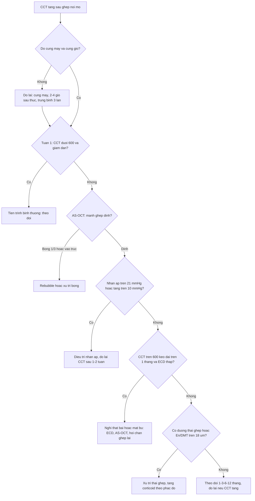
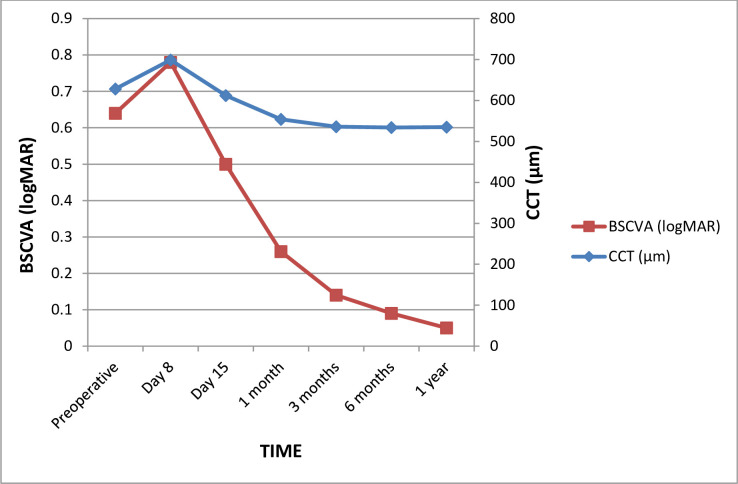
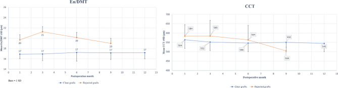
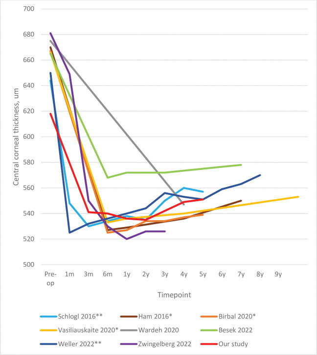

# 3313 — Độ dày giác mạc trung tâm (CCT) sau ghép nội mô: ngưỡng nào báo thất bại mảnh ghép — và vì sao CCT có thể bình thường dù ECD thấp / Central corneal thickness after endothelial keratoplasty

**Tags:** `pattern:phu-giac-mac` `pattern:do-day-giac-mac` `pattern:mat-ghep-that-bai` `pattern:bong-manh-ghep` `pattern:thai-ghep` `pattern:mat-mot-ben` `vung:mat` `vung:giac-mac` `vung:tien-phong` `protocol:do-day-giac-mac` `protocol:AS-OCT` `protocol:sieu-am` `score:CCT-threshold`
**Mức chắc chắn (certainty):** tổng hợp y văn (literature synthesis) — 1 đoàn hệ **124 mắt** DMEK với CCT trước và sau mổ đến 12 tháng (PMC9983850), 1 đoàn hệ **107 mắt** DMEK theo dõi 5 năm (PMC10735023), 1 đoàn hệ **45 mắt** DMEK với AS-OCT ngày 1–tuần 1–tháng 1 (PMC11377527), 1 nghiên cứu **60 mắt** ghép nguy cơ cao đo độ dày phức hợp nội mô/Descemet (PMC8282599), 1 phân tích **887 mắt** của Cornea Donor Study về CCT sau ghép xuyên (PMC3840498), 1 đoàn hệ **125 mắt** DSAEK (PMID 24133026), 1 đoàn hệ **100 mắt** so sánh siêu âm với AS-OCT (PMC11117033), 1 nghiên cứu **44 mắt Fuchs + 11 mắt khỏe** về dao động ngày đêm (PMID 31415734) và 1 đoàn hệ **50 mắt** Fuchs mổ phaco (PMC13672904). Các ngưỡng CCT cho **ghép nội mô** phần lớn là **ngoại suy từ ghép xuyên và từ đoàn hệ quan sát**, chưa có thử nghiệm ngẫu nhiên — chỗ nào ngoại suy đều ghi rõ **[suy luận]**.

> **Vì sao bài này quan trọng:** CCT là con số được đo ở **mọi lần tái khám** sau ghép nội mô, nhưng nó **không phải phép đo chức năng nội mô**: CCT là **tổng độ dày của ba lớp**, phụ thuộc **nhãn áp, biểu mô, độ dày mảnh ghép, thời điểm trong ngày và máy đo**. Sau DMEK, CCT điển hình giảm từ **626 µm trước mổ xuống 538 µm ở 12 tháng** (PMC9983850) và **551 µm ở 5 năm** (PMC10735023); nhưng ở cùng thời điểm 5 năm, **ECD chỉ còn 900 tế bào/mm²** — nghĩa là **CCT bình thường không chứng minh nội mô còn tốt**. Ngược lại, **tuần đầu CCT tăng là bình thường**: **90%** mắt không bong có CCT **< 600 µm** ở tuần 1, so với chỉ **36,4%** mắt bong ≥ 1/3 (PMC11377527). Bài này trả lời bốn câu: **đo thế nào cho đúng, CCT bao nhiêu là bất thường, CCT tăng vì mảnh ghép hay vì thứ khác, và khi nào CCT đủ để quyết định ghép lại**.

## 1. Tổng quan bệnh học – cơ chế hình ảnh

### 1.1. CCT là gì và vì sao nội mô quyết định độ trong của giác mạc

- Giác mạc gồm **biểu mô (≈ 50 µm)**, **Bowman**, **nhu mô (stroma, ≈ 90% độ dày)**, **Descemet** và **nội mô một lớp**. Nhu mô là **collagen type I** xếp song song, khoảng cách sợi **< bước sóng ánh sáng** nên ánh sáng đi qua mà **không tán xạ** — đây là cơ sở vật lý của **giác mạc trong**.
- Nhu mô giữ **~78% nước** nhờ **proteoglycan (keratan sulfate, chondroitin sulfate)** mang điện âm, tạo **áp lực trương (swelling pressure)** hút nước vào. **Nội mô** là **bơm Na⁺/K⁺-ATPase + trao đổi bicarbonate** đẩy nước ra tiền phòng; **biểu mô** là hàng rào chống nước mắt thấm vào.
- Khi **mật độ/ chức năng nội mô giảm**, bơm không thắng được áp lực trương → **nhu mô ngấm nước** → **khoảng cách sợi collagen tăng** → ánh sáng bị tán xạ → **giác mạc mờ**, đồng thời **CCT tăng**. Vì vậy CCT là **dấu hiệu gián tiếp của mất bù nội mô**, không phải thước đo trực tiếp số tế bào.
- **CCT là tổng của nhiều thành phần**, không chỉ nhu mô: **biểu mô dày lên khi phù** (nhất là khi nhãn áp cao), **mảnh ghép DSAEK dày 100–200 µm** cộng vào CCT, **màng xơ dưới biểu mô** làm CCT tăng mà không phải phù. Vì vậy **một CCT không nói nguyên nhân** — phải đọc **AS-OCT** để tách lớp.
- **Vì sao CCT chậm hơn triệu chứng:** nhu mô cần **hàng giờ đến hàng ngày** để ngấm nước; sau khi nội mô hồi phục, nhu mô cần **tuần đến tháng** để thải nước và tái sắp xếp collagen. Trong đoàn hệ DMEK, CCT **giảm dần đến 12 tháng** chứ không về bình thường ngay sau mổ (PMC9983850).

### 1.2. Vì sao "CCT bình thường" không loại trừ nội mô kém

- **ECD và CCT đo hai thứ khác nhau:** ECD đếm **số tế bào còn lại**, CCT đo **hệ quả thủy lực**. Tế bào nội mô còn lại có thể **to ra và bơm mạnh hơn** để bù, nên **ECD thấp mà CCT vẫn bình thường** trong nhiều năm.
- Bằng chứng trực tiếp: đoàn hệ **107 mắt DMEK** sau **5 năm** có **ECD 900 tế bào/mm²** (giảm **65%** từ 2.550) nhưng **CCT 551 µm** và **88% mảnh ghép còn sống** (PMC10735023). Nếu chỉ nhìn CCT, mắt này "bình thường"; nếu chỉ nhìn ECD, mắt này "gần thất bại" — **quyết định phải dựa trên cả hai + thị lực + AS-OCT**.
- **Ngược lại, CCT cao không đồng nghĩa nội mô hỏng:** trong **60 mắt ghép nguy cơ cao**, CCT **không** phân biệt được mắt thải ghép với mắt không thải (**p = 0,7**), trong khi **độ dày phức hợp nội mô/Descemet (En/DMT) ≥ 18 µm** dự báo thải ghép **HR 6,89** (95% CI 2,03–23,4) và tăng **5,3 tháng** trước khi có dấu hiệu lâm sàng (PMC8282599). CCT bình thường vì **phù chưa lan ra toàn nhu mô**, hoặc vì **thải ghép khu trú**.
- **Trước mổ, CCT còn bị méo bởi chính phù:** trong 124 mắt DMEK, **CCT trước mổ không tương quan với thị lực sau mổ** ở bất kỳ thời điểm nào, và nhóm **CCT ≥ 625 µm** không có kết quả thị lực xấu hơn nhóm **< 625 µm** (PMC9983850). Lý do: phù làm **mặt sau giác mạc mất đều**, đo CCT bằng siêu âm/OCT trên bề mặt không phẳng cho **sai số lớn**; sau mổ, khi phù hết, **CCT sau mổ mới tương quan với thị lực** (r = 0,29–0,49; p = 0,020–0,001).
- **Hệ quả:** đừng dùng **một CCT trước mổ** để quyết định "đã đến lúc ghép"; đừng dùng **một CCT sau mổ** để quyết định "ghép lại". CCT có giá trị khi **cùng máy, cùng giờ, cùng xu hướng**, và khi đặt cạnh **ECD + AS-OCT + nhãn áp + thị lực**.

### 1.3. Số liệu định lượng cốt lõi — CCT bình thường và quỹ đạo sau ghép

- **Người khỏe, ngay khi thức dậy:** CCT **557 µm** (IQR 527–601; n = 11) (PMID 31415734). **Fuchs tiến triển:** **663 µm** (IQR 625–707; n = 44) lúc thức dậy; trong **4 giờ đầu sau thức**, CCT giảm **31–58 µm** (khoảng dự báo 95%), sau đó gần như không đổi (PMID 31415734).
- **Phù ban đêm chủ yếu ở nhu mô:** ở bệnh nhân Fuchs, nhu mô dày thêm **21,0 µm** (IQR 13,0) qua đêm, biểu mô chỉ **2,0 µm** (IQR 4,75) (PMID 41199516) — giải thích vì sao **đo CCT buổi sáng sớm** cho số cao hơn buổi chiều.
- **Sau DMEK (124 mắt):** **626 ± 59 µm** trước mổ (530–798) → **538 µm** ở 12 tháng (PMC9983850). Trong **năm đầu**, CCT **đỉnh vào khoảng ngày 8** rồi giảm (Hình 2 của bài gốc); **CCT ngày 8 không tương quan với thị lực 12 tháng** (r = 0,04), còn **CCT tháng 1–12 thì có** (r = 0,29–0,49) — **đỉnh sớm là sinh lý, CCT muộn mới có ý nghĩa tiên lượng**.
- **Sau DMEK (107 mắt, 5 năm):** CCT **618 → 551 µm** (p < 0,0001); **ECD 2.550 → 900 tế bào/mm²** (mất **65%**); **12% mảnh ghép thất bại trong ≤ 15 tháng**; sống mảnh ghép 5 năm **88%**; rebubble **18%** (PMC10735023).
- **Sau DSAEK (125 mắt):** CCT **482 ± 27 µm** ở 6 tháng và **505 ± 23 µm** ở 3 năm; CCT tăng dần trong khi **độ dày mảnh ghép không đổi**, và **CCT tương quan với độ tán xạ và thị lực** (PMID 24133026). Vì DSAEK cộng thêm một lớp nhu mô hiến, **CCT "bình thường" của DSAEK cao hơn DMEK khoảng 20–40 µm**.
- **Sau ghép xuyên (PK) — mốc so sánh:** CCT **647 ± 90 µm** ngày 1 → **605 ± 75** tháng 1 → **565 ± 66** tháng 3 → **537 ± 64 µm** tháng 6 (PMC5121704). Ở tháng 6, CCT tương quan với **nhãn áp** (r = 0,66) — nhắc rằng **CCT cao có thể chỉ là nhãn áp cao**.
- **Trước mổ, ngưỡng dự báo mất bù sau phaco:** mỗi **1 µm** CCT trước mổ làm tăng **2%** nguy cơ phải ghép nội mô (HR 1,02; 95% CI 1,00–1,04); **CCT ≥ 620 µm** cho **AUC 0,91** (PMC13672904). Đây là ngưỡng **trước phaco**, không phải ngưỡng sau ghép.

### 1.4. Vì sao cùng một mắt, hai máy cho hai con số khác nhau

- **Siêu âm đo bằng thời gian sóng phản hồi**, giả định **vận tốc âm trong giác mạc**; **AS-OCT đo bằng quang trình**, chia cho **chiết suất nhóm**. Hai giả định khác nhau → **sai lệch hệ thống**.
- Trên **100 mắt**, siêu âm cho CCT **537,36 ± 33,26 µm**, AS-OCT cho **510,94 ± 33,13 µm**: chênh **26,42 ± 9,53 µm** (p < 0,001) dù tương quan rất cao (**r = 0,997**) (PMC11117033). Nghĩa là **hai máy xếp hạng mắt giống nhau nhưng cho mức tuyệt đối khác nhau** — **không được đổi máy giữa các lần theo dõi**.
- **AS-OCT có độ lặp lại tốt** khi làm đúng protocol: ICC **> 0,86** cho độ dày giác mạc trung tâm ở 259 mắt keratoconus (PMC8213071); **20–30 B-scan trung bình** cho độ lặp lại tốt nhất, và **trung bình > 3 line scan không cải thiện thêm** (PMID 31864901).
- **Vì vậy "CCT tăng 30 µm" có thể là bệnh, cũng có thể là đổi máy hoặc đo lúc 8 giờ sáng thay vì 3 giờ chiều.** Trước khi gọi thất bại, phải loại **bốn nguồn nhiễu**: máy, giờ đo, vùng đo, và việc đo trên **mảnh ghép hay nhu mô chủ**.

## 2. Mẫu hình + chẩn đoán phân biệt (Gamut)

### 2.1. Sáu mẫu hình CCT sau ghép nội mô

1. **CCT tăng sớm rồi giảm (tiến trình bình thường)** — đỉnh ngày 1–8, giảm dần từ tuần 1; AS-OCT mảnh ghép dính, không có dải dịch; thị lực cải thiện dù chậm. Đây là **phù sau mổ**, không phải thất bại.
2. **CCT không giảm hoặc tăng lại ở tuần 1–4 + mảnh ghép bong** — CCT **> 600 µm** ở tuần 1 gặp ở **63,6%** mắt bong ≥ 1/3 so với **10%** mắt không bong; CCT **tăng so với trước mổ** gặp ở **25,0%** mắt bong một phần và **22,2%** mắt bong ≥ 1/3, **0%** mắt không bong (PMC11377527). Chốt bằng **AS-OCT**.
3. **CCT tăng muộn (tháng 3–24) + mắt đỏ/giảm thị lực** — nghi **thải ghép nội mô**: có thể kèm **đường Khodadoust**, **KP**, **phù nhu mô khu trú**; **En/DMT ≥ 18 µm** là dấu sớm (PMC8282599).
4. **CCT cao nhưng mảnh ghép dính và ECD không thấp** — nghĩ **nguyên nhân ngoài nội mô**: **nhãn áp cao/steroid response**, **dịch mặt phân cách**, **mảnh ghép DSAEK dày**, **mảnh thể thủy tinh sót**, **phù biểu mô do bệnh mặt trước**.
5. **CCT bình thường nhưng giác mạc mờ dần + ECD thấp** — **mất bù còn bù trừ** (compensated low ECD): ECD có thể **< 1.000** mà CCT vẫn 520–560 µm; đây là giai đoạn **theo dõi sát**, chưa mổ lại.
6. **CCT thấp giả (thin)** — đo trên **vùng mỏng nhất**, trên **mảnh ghép lệch tâm**, hoặc máy **không nhận đúng mặt sau**; đối chiếu **AS-OCT** và **bản đồ độ dày**, không lấy một điểm.

### 2.2. Gamut theo vị trí và theo lớp

- **Trung tâm (0–2 mm):** nơi CCT được báo cáo; tổn thương trung tâm ảnh hưởng thị lực sớm nhất. **Bong trung tâm** và **thải ghép trung tâm** đều cho CCT tăng rõ.
- **Cạnh trung tâm/rìa:** bong rìa có thể **không làm CCT trung tâm tăng nhiều** — **CCT bình thường không loại trừ bong rìa**; phải xem **AS-OCT toàn mảnh ghép**.
- **Dưới mảnh ghép (interface):** **dịch mặt phân cách** làm CCT tăng nhưng mảnh ghép vẫn dính; đây là nguyên nhân **CCT cao + AS-OCT có dải tối mỏng dưới mảnh ghép**.
- **Toàn bộ giác mạc:** phù lan tỏa gặp trong **mất bù nội mô**, **nhãn áp rất cao**, **thải ghép toàn bộ**; CCT thường **> 650 µm** và giác mạc mờ đều.

## 3. Bảng so sánh phân biệt (ma trận đối chiếu)

| Thực thể (entity) | Hình ảnh điển hình (AS-OCT / siêu âm / lâm sàng) | Chốt vào (rule-in) | Chốt loại (rule-out) | Gợi ý xác nhận |
|---|---|---|---|---|
| **Tiến trình bình thường sau ghép** | CCT đỉnh ngày 1–8 rồi giảm; mảnh ghép dính; không có dải dịch; thị lực cải thiện dần | **CCT giảm theo thời gian** + mảnh ghép dính trên AS-OCT + thị lực không xấu đi | **CCT tăng lại sau tuần 2** hoặc **mảnh ghép bong mới** | Đo lại cùng máy sau 1–2 tuần; so với CCT trước mổ |
| **Bong mảnh ghép (detachment)** | Dải tối/hyporeflective giữa mảnh ghép và nhu mô; bong ≥ 1/3 diện tích hoặc vào trục; CCT tuần 1 **> 600 µm** | **AS-OCT thấy khoảng tách** + CCT **không giảm/tăng** so với trước mổ | **AS-OCT mảnh ghép áp sát toàn bộ** (kể cả rìa) | AS-OCT toàn mảnh ghép; đo diện tích bong; xem bài 1445/3311 |
| **Thất bại tiên phát (primary graft failure)** | Mảnh ghép dính nhưng giác mạc **không trong** sau **1 tháng**; CCT cao kéo dài; ECD rất thấp/không đo được | **Phù không cải thiện ≥ 1 tháng** dù mảnh ghép dính + **ECD rất thấp** | **Giác mạc trong dần** và CCT giảm trong 4–6 tuần | ECD, AS-OCT, loại trừ nhãn áp và bong; hội chẩn ghép lại |
| **Thải ghép nội mô (rejection)** | CCT tăng + **En/DMT ≥ 18 µm**; có thể **đường Khodadoust**, KP, phù khu trú; CCT có thể **bình thường** | **En/DMT tăng ≥ 18 µm** hoặc **đường thải ghép** | **CCT bình thường một mình KHÔNG loại trừ** (p = 0,7 trong PMC8282599) | AS-OCT độ phân giải cao đo En/DMT; khám đèn khe; tăng corticoid theo phác đồ |
| **Tăng nhãn áp / steroid response** | CCT cao + **IOP > 21 mmHg** hoặc tăng **> 10 mmHg** so với nền; có thể phù biểu mô; AS-OCT mảnh ghép dính | **IOP cao + CCT cao**, CCT giảm khi hạ IOP | **IOP bình thường nhiều lần** và AS-OCT có bong/dịch interface | Đo IOP trước khi kết luận; xem bài 3310 |
| **Mất bù nội mô muộn (low ECD)** | CCT tăng dần trong nhiều tháng–năm; ECD **< 1.000**; mảnh ghép dính; không có đường thải ghép | **Xu hướng CCT tăng + ECD giảm** trên ≥ 2 lần đo | **ECD ổn định và CCT ổn định** qua 6–12 tháng | ECD cùng máy; AS-OCT; đánh giá thị lực và triệu chứng |
| **Dịch mặt phân cách / mảnh ghép DSAEK dày** | Dải dịch mỏng dưới mảnh ghép nhưng mảnh ghép vẫn dính; DSAEK có CCT nền cao hơn; **độ dày lenticle** đo riêng | **Dải dịch interface** trên AS-OCT + CCT cao hơn CCT nền của chính mắt đó | **Không có dải dịch** và **độ dày lenticle bình thường** | Đo riêng độ dày mảnh ghép; so CCT với mốc 1 tháng của chính mắt |
| **Nguyên nhân ngoài mảnh ghép (biểu mô, mảnh thể thủy tinh, màng xơ)** | CCT tăng nhưng nhu mô sau sạch; biểu mô dày/bóng nước; có thể thấy mảnh tăng âm trong tiền phòng | **Bất thường biểu mô/mặt trước** hoặc **dị vật tiền phòng** + mảnh ghép dính | **AS-OCT nhu mô sau bình thường**, không dị vật | Khám đèn khe, AS-OCT tiền phòng, soi góc khi nghi mảnh sót |

- **Ảnh ghép đối chiếu:** không dùng ảnh ghép cho bài này; ba hình gốc được đặt trong mục (6) để tự lượng giá, giữ nguyên tỉ lệ và ghi nguồn trong `images/CREDITS.md`.

## 4. Protocol đo + ngưỡng diễn giải

### 4.1. Đo CCT đúng cách (protocol tối thiểu)

- **Cùng một máy** cho toàn bộ quá trình theo dõi; nếu buộc đổi máy, ghi rõ và **không so trực tiếp** số tuyệt đối (chênh siêu âm–AS-OCT **26,42 ± 9,53 µm**; PMC11117033).
- **Cùng thời điểm trong ngày:** đo **2–4 giờ sau khi thức**, tránh đo ngay sau ngủ (CCT có thể cao hơn **31–58 µm** ở Fuchs; PMID 31415734). Ghi giờ đo vào hồ sơ.
- **Lấy trung bình ≥ 3 lần** tại **trung tâm 0–2 mm**; với AS-OCT, dùng **20–30 B-scan** và **3 line scan** là đủ (PMID 31864901).
- **Đo cả bề dày mảnh ghép và bề dày nhu mô chủ** khi có thể: CCT là tổng, không cho biết lớp nào dày.
- **Luôn đo kèm:** **nhãn áp**, **AS-OCT mảnh ghép**, **ECD** (cùng máy siêu soi), **thị lực** và **triệu chứng**. CCT một mình không đủ để quyết định.
- **Lịch theo dõi gợi ý:** trước mổ; ngày 1; tuần 1; tháng 1; tháng 3; tháng 6; tháng 12, sau đó mỗi 6–12 tháng. Thời điểm **tuần 1** quan trọng vì phân biệt được **bong cần can thiệp** với **phù sinh lý**.

### 4.2. Ngưỡng định lượng và phiên bản

- **Tuần 1 sau DMEK (đoàn hệ 45 mắt, PMC11377527):**
  - CCT **< 600 µm**: **90,0%** mắt không bong, **50,0%** mắt bong < 1/3, **36,4%** mắt bong ≥ 1/3.
  - CCT **tăng so với trước mổ**: **0%** mắt không bong, **25,0%** mắt bong < 1/3, **22,2%** mắt bong ≥ 1/3.
  - **CCT trước mổ** cao hơn ở nhóm phải rebubble: **746,8 ± 95,8** so với **665,0 ± 74,4 µm** (p = 0,041); **CCT tuần 1**: **666,8 ± 119,5** so với **556,5 ± 56,8 µm** (p = 0,001).
  - **Đến tháng 1, CCT ba nhóm bằng nhau** — nghĩa là **CCT tháng 1 không còn phân biệt bong**, phải dựa AS-OCT.
- **Sau ghép xuyên (887 mắt, Cornea Donor Study, PMC3840498):** ở người **không thất bại trong năm đầu**, tỷ lệ thất bại tích lũy 5 năm là **5%** nếu CCT năm 1 **≤ 500 µm**, **5%** nếu **501–550**, **7%** nếu **551–600**, và **20%** nếu **> 600 µm**. CCT và ECD là **hai yếu tố tiên lượng độc lập** — CCT **không thay thế** ECD.
- **Trước phaco ở Fuchs (50 mắt, PMC13672904):** **CCT ≥ 620 µm** có **AUC 0,91** cho việc phải ghép nội mô không dự kiến; mỗi **1 µm** tăng thêm **2%** nguy cơ (HR 1,02). Đây là ngưỡng **quyết định thời điểm mổ**, không phải ngưỡng sau ghép.
- **Sau DMEK, ngưỡng "thất bại" không có định nghĩa thống nhất:** thực hành thường dùng **phù không cải thiện + CCT cao kéo dài + ECD rất thấp**; trong đoàn hệ 107 mắt, **12% thất bại trong ≤ 15 tháng** và được ghép lại (PMC10735023). **Không có RCT** xác định CCT nào đủ để ghép lại — đây là **khoảng trống** (mục 7).
- **Ngoại suy có kiểm soát [suy luận]:** dùng **CCT > 600 µm kéo dài > 1 tháng** làm **cờ đỏ** để làm AS-OCT + ECD + IOP, **không** dùng một mình để chỉ định ghép lại; dùng **CCT tăng > 30–50 µm so với mốc của chính mắt** (vượt dao động ngày đêm và sai số máy) làm **cờ vàng** để đo lại.

### 4.3. Lưu đồ xử trí CCT tăng sau ghép nội mô

> Lưu đồ là **tổng hợp thực hành** từ các đoàn hệ trên, **không phải guideline chính thức**; mọi ngưỡng đều phải đọc cùng **bối cảnh lâm sàng và AS-OCT**.

## 5. Biến thể bình thường và cạm bẫy

- **Đỉnh CCT ngày 8 là bình thường:** trong đoàn hệ 124 mắt, CCT **tăng lên đỉnh khoảng ngày 8** rồi giảm; **CCT ngày 8 không tương quan với thị lực 12 tháng** (r = 0,04) (PMC9983850). Gọi "thất bại tiên phát" vào ngày 8 là **quá sớm**.
- **Dao động ngày đêm:** ở Fuchs, CCT giảm **31–58 µm** trong 4 giờ đầu sau thức (PMID 31415734). Đo lúc 7 giờ và 14 giờ có thể khác nhau **hơn ngưỡng 30 µm** — luôn ghi giờ.
- **Đổi máy:** siêu âm và AS-OCT chênh **26,42 ± 9,53 µm** trên cùng 100 mắt (PMC11117033). Một "CCT tăng 30 µm" sau khi đổi máy có thể **không phải bệnh**.
- **CCT bình thường không loại trừ thải ghép:** trong 60 mắt nguy cơ cao, CCT **không** phân biệt thải ghép (p = 0,7), còn **En/DMT ≥ 18 µm** có **HR 6,89** (PMC8282599). Nếu chỉ theo CCT, bỏ sót thải ghép khu trú.
- **CCT bình thường không loại trừ nội mô kém:** 5 năm sau DMEK, ECD **900** nhưng CCT **551 µm** (PMC10735023); ECD **842** vẫn có giác mạc trong ở bài 3311. **Không ghép lại chỉ vì ECD thấp** nếu CCT/thị lực/AS-OCT ổn định.
- **CCT cao không đồng nghĩa mảnh ghép hỏng:** DSAEK cộng thêm **100–200 µm** nhu mô hiến; **độ dày lenticle** ở ngày 1 là **314 ± 128 µm** ở mắt thành công so với **532 ± 259 µm** ở mắt thất bại (PMID 19232563) — phải đo **riêng mảnh ghép** trước khi quy cho phù.
- **Nhãn áp là biến gây nhiễu mạnh:** sau PK, CCT tháng 6 tương quan với IOP **r = 0,66** (PMC5121704); trong Cornea Donor Study, **IOP > 25 mmHg trong tháng đầu** liên quan CCT cao hơn (p = 0,003) (PMC3840498). **Đo IOP trước khi kết luận CCT cao do mảnh ghép.**
- **Sai số vùng đo:** đo trên **vùng mỏng nhất** hoặc **mảnh ghép lệch tâm** cho CCT thấp giả; đo trên **vùng phù khu trú** cho CCT cao giả. Luôn dùng **bản đồ độ dày** và **trung tâm 0–2 mm**, không lấy một điểm.
- **Bẫy "satisfaction of search":** thấy CCT cao rồi dừng ở "phù giác mạc", bỏ qua **bong rìa**, **dịch interface**, **mảnh thể thủy tinh**, **nhãn áp cao**. CCT là **dấu hiệu mở đường**, không phải chẩn đoán.

## 6. Tự lượng giá — Blind Quiz

**Ca 1 — Bệnh nhân Fuchs sau DMEK, CCT tăng ở ngày 8 và thị lực giảm**

- Gợi ý lâm sàng: nữ 68 tuổi, Fuchs, DMEK không biến chứng; ngày 8 CCT tăng so với trước mổ, bệnh nhân thấy mờ hơn; AS-OCT mảnh ghép dính toàn bộ.
- Câu hỏi: Đây có phải **thất bại tiên phát** không? Vì sao **CCT ngày 8** không dùng để tiên lượng? Dấu hiệu nào ở tháng 1–12 mới có giá trị?

<b>Bấm để hiện đáp án (findings + chẩn đoán)</b>

- Dấu hiệu: đồ thị cho thấy CCT **tăng lên đỉnh ở ngày 8** rồi **giảm dần**; BSCVA **xấu đi ở ngày 8** rồi cải thiện từ tháng 1; CCT **626 µm trước mổ → 538 µm ở 12 tháng**.
- Chẩn đoán: **phù sau mổ sinh lý**, không phải thất bại tiên phát — mảnh ghép dính, CCT giảm theo thời gian. CCT ngày 8 **không tương quan** với thị lực 12 tháng (r = 0,04); CCT tháng 1–12 mới tương quan (r = 0,29–0,49).
- Nguồn ảnh: Moskwa R và cộng sự. *PLoS One.* 2023;18(3):e0282594. PMCID: PMC9983850. Fig. 2. Giấy phép **CC BY 4.0**.

**Ca 2 — Ghép giác mạc nguy cơ cao: CCT ổn định nhưng mắt đỏ và mờ dần**

- Gợi ý lâm sàng: nam 55 tuổi, ghép xuyên nguy cơ cao (đã thải ghép một lần, có mạch máu nhu mô 2 phần tư); tháng 6–9 mắt đỏ nhẹ, thị lực giảm; CCT trên máy đo **không tăng rõ**.
- Câu hỏi: Vì sao **CCT bình thường** vẫn có thể là **thải ghép**? Đại lượng nào trên AS-OCT phát hiện sớm hơn, và ngưỡng nào có ý nghĩa tiên lượng?

<b>Bấm để hiện đáp án (findings + chẩn đoán)</b>

- Dấu hiệu: đồ thị trái — **En/DMT tăng rõ ở nhóm thải ghép** (cam) trong khi nhóm không thải (xanh) ổn định; đồ thị phải — **CCT gần như không đổi** giữa hai nhóm.
- Chẩn đoán: **thải ghép nội mô**. **En/DMT ≥ 18 µm** có **HR 6,89** (95% CI 2,03–23,4; p = 0,002); **≥ 19 µm** HR **9,91**; En/DMT tăng **5,3 tháng** (95% CI 2–11) trước chẩn đoán lâm sàng. CCT **không** phân biệt được (p = 0,7) — **CCT bình thường không loại trừ thải ghép**.
- Nguồn ảnh: Eleiwa T và cộng sự. *Sci Rep.* 2021;11. DOI: 10.1038/s41598-021-93892-4. PMCID: PMC8282599. Fig. 1. Giấy phép **CC BY 4.0**.

**Ca 3 — Năm năm sau DMEK: ECD 900 tế bào/mm², CCT 551 µm, giác mạc trong**

- Gợi ý lâm sàng: bệnh nhân Fuchs, DMEK 5 năm trước, thị lực 20/25, giác mạc trong, không đỏ; siêu soi ECD **900 tế bào/mm²**; CCT **551 µm**. Bệnh nhân hỏi "có phải sắp hỏng mảnh ghép không?".
- Câu hỏi: ECD **900** có đủ để chỉ định **ghép lại**? CCT **551 µm** nói gì? Theo dõi tiếp thế nào?

<b>Bấm để hiện đáp án (findings + chẩn đoán)</b>

- Dấu hiệu: đường CCT của nhóm "Our study" (đỏ) giảm từ **618 µm trước mổ** xuống khoảng **540–550 µm** và **ổn định đến 5 năm**; đoàn hệ có **ECD 2.550 → 900** (mất **65%**) nhưng **88% mảnh ghép sống** ở 5 năm.
- Chẩn đoán: **mất bù nội mô còn bù trừ** — ECD thấp nhưng CCT và thị lực ổn định; **không ghép lại** chỉ vì ECD 900. Theo dõi **CCT cùng máy mỗi 6–12 tháng**, ECD, AS-OCT và triệu chứng; ghép lại khi có **phù không hồi phục + CCT tăng dần + thị lực giảm**, không dựa vào một ngưỡng ECD đơn thuần.
- Nguồn ảnh: Bichet P và cộng sự. *PLoS One.* 2023;18(12):e0295434. PMCID: PMC10735023. Fig. 8. Giấy phép **CC BY 4.0**.

## 7. Câu hỏi nghiên cứu & điểm chưa đồng thuận (tính đến 11/2026)

1. **[Tranh cãi] Ở mắt DMEK có mảnh ghép DÍNH, CCT > 600 µm ở tuần 1 có đủ để chỉ định rebubble không?**
   - **Đã biết:** CCT tuần 1 **< 600 µm** gặp ở **90,0%** mắt không bong so với **36,4%** mắt bong ≥ 1/3; CCT **tăng so với trước mổ** gặp ở **25,0%** mắt bong một phần và **22,2%** mắt bong ≥ 1/3, **0%** mắt không bong (PMC11377527). Rebubble không miễn phí: mất thêm **157 tế bào/mm²** sau 1 lần và **504** sau > 1 lần, nguy cơ thất bại **OR 4,28** (PMC9763158).
   - **Chưa rõ:** chưa có thử nghiệm so **rebubble theo CCT** với **rebubble theo AS-OCT** ở mắt mảnh ghép dính; chưa rõ CCT bao nhiêu thì lợi ích vượt nguy cơ.
   - **Hướng nghiên cứu:** RCT phân tầng theo **CCT tuần 1** và **diện tích bong trên AS-OCT**, outcome **thị lực 12 tháng, ECD, số lần rebubble, thất bại mảnh ghép**.
   - **Nguồn:** PMC11377527 (2024); PMC9763158 (2022).

2. **[Khoảng trống] Chưa có ngưỡng CCT được thẩm định cho thất bại mảnh ghép sau ghép NỘI MÔ (DMEK/DSAEK).**
   - **Đã biết:** ngưỡng **> 600 µm ở năm 1** làm tăng thất bại 5 năm lên **20%** so với **5%** khi **≤ 500 µm** — nhưng đây là dữ liệu **ghép xuyên** (887 mắt, PMC3840498). Sau DMEK, CCT điển hình về **538 µm** (12 tháng) và **551 µm** (5 năm) (PMC9983850; PMC10735023), nên ngưỡng 600 có thể **quá cao** cho DMEK.
   - **Chưa rõ:** CCT nào, kéo dài bao lâu, kết hợp ECD/AS-OCT ra sao thì gọi là thất bại; chưa có định nghĩa thống nhất cho **DSAEK** và **DMEK**.
   - **Hướng nghiên cứu:** đoàn hệ tiến cứu đa trung tâm, thu CCT cùng máy + ECD + AS-OCT + thị lực, phân tích **ROC/thời gian sống** để tìm ngưỡng riêng cho từng kỹ thuật.
   - **Nguồn:** PMC3840498 (2013); PMC10735023 (2023); PMC9983850 (2023).

3. **[Khác biệt thực hành] Các trung tâm đo CCT bằng máy và thời điểm khác nhau — khác biệt có thể lớn hơn ngưỡng lâm sàng.**
   - **Đã biết:** siêu âm và AS-OCT chênh **26,42 ± 9,53 µm** trên cùng 100 mắt (PMC11117033); ở Fuchs, CCT giảm **31–58 µm** trong 4 giờ đầu sau thức (PMID 31415734); AS-OCT có ICC **> 0,86** khi làm đúng protocol (PMC8213071).
   - **Chưa rõ:** chưa có chuẩn quốc tế về **máy, giờ đo, số lần lấy trung bình** cho mắt sau ghép nội mô; mỗi trung tâm tự chọn mốc.
   - **Hướng nghiên cứu:** đồng thuận Delphi + nghiên cứu đa trung tâm dùng **cùng máy, cùng giờ, cùng protocol** để tách khác biệt thiết bị khỏi khác biệt bệnh nhân.
   - **Nguồn:** PMC11117033 (2022); DOI 10.1016/j.ajo.2019.08.002 (2019); PMC8213071 (2021).

## Bài liên quan chéo
- [3312 – Đếm tế bào nội mô (ECD) sau ghép: con số nào đáng tin](../3312-dem-te-bao-noi-mo-giac-mac-sau-ghep/lesson.md) (CCT bình thường với ECD thấp; sai số đo)
- [3311 – Bong mảnh ghép nội mô tái phát sau rebubble](../3311-bong-manh-ghep-tai-phat-sau-rebubble/lesson.md) (CCT tuần 1; giá ECD của rebubble)
- [3310 – Tăng nhãn áp do corticoid sau ghép nội mô](../3310-tang-nhan-ap-corticoid-sau-ghep-noi-mo-giac-mac/lesson.md) (CCT cao do IOP, không phải mảnh ghép)
- [1445 – Bong mảnh ghép nội mô sau DSAEK/DMEK: theo dõi hay rebubble](../1445-bong-manh-ghep-dsaek-dmek-rebubble/lesson.md) (AS-OCT và ngưỡng bong)
- [3287 – Phaco sau ghép nội mô giác mạc](../3287-phaco-sau-ghep-noi-mo-giac-mac/lesson.md) (CCT sau phaco trên mắt đã ghép)
- [3201 – Sẹo giác mạc sau loét: chọn kiểu ghép theo độ sâu](../3201-seo-giac-mac-ghep/lesson.md) (CCT/AS-OCT trong quyết định ghép)

## Ảnh
- `3313_cct-va-thi-luc-sau-dmek_BIEU-DO_PMC9983850-F2.jpg` — CCT và thị lực theo thời gian sau DMEK; đỉnh CCT ngày 8.
- `3313_en-dm-truoc-thai-ghep_BIEU-DO_PMC8282599-F1.jpg` — En/DMT tăng trước thải ghép trong khi CCT gần như không đổi.
- `3313_do-day-theo-5-nam_BIEU-DO_PMC10735023-F8.jpg` — CCT 5 năm sau DMEK, so sánh với y văn.
- Nguồn, tác giả và giấy phép từng ảnh: `images/CREDITS.md`.

> Không dùng để chẩn đoán độc lập khi chưa có người hướng dẫn.
