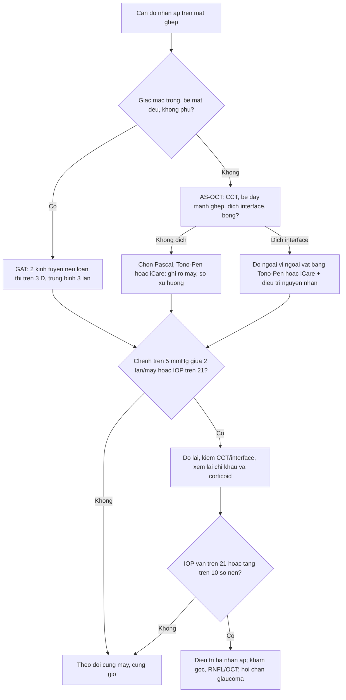
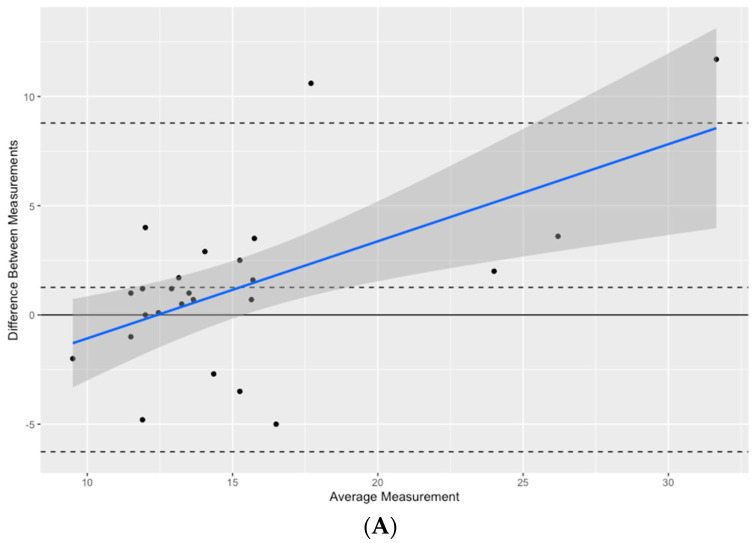
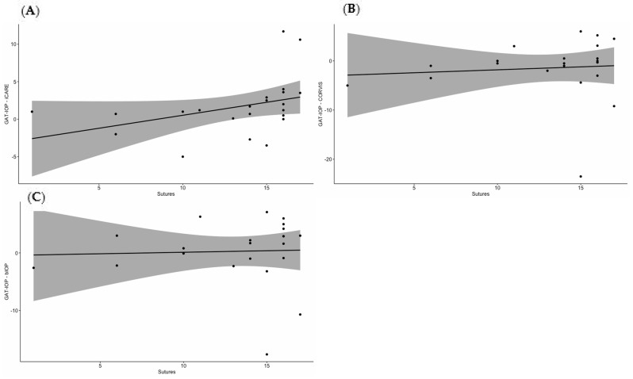
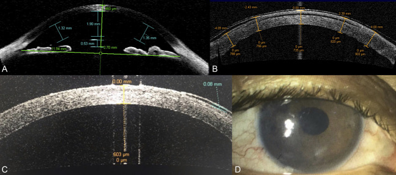

# 3314 — Đo nhãn áp trên mắt đã ghép giác mạc: máy nào đáng tin, và có nên hiệu chỉnh theo độ dày giác mạc? / Intraocular pressure measurement after corneal transplantation

**Tags:** `pattern:nhan-ap-khong-dang-tin` `pattern:ghep-giac-mac` `pattern:phu-giac-mac` `pattern:mat-ghep` `pattern:dich-interface` `vung:mat` `vung:giac-mac` `vung:tien-phong` `protocol:do-nhan-ap` `protocol:AS-OCT` `protocol:den-khe` `score:IOP-threshold` `score:LoA`
**Mức chắc chắn (certainty):** tổng hợp y văn (literature synthesis) — 1 tổng quan **55 bài** về đo nhãn áp sau ghép xuyên (PMC8870783), 1 nghiên cứu tiến cứu **25 mắt** so sánh GAT–iCare–Corvis sau PK (PMC11642321), 1 loạt **6 ca** IFS sau DMEK có AS-OCT (PMC10538602), 1 nghiên cứu **34 mắt** DMEK so sánh GAT–Tono-Pen–Pascal (PMID 35939831), 1 nghiên cứu **20 mắt** DSAEK so sánh GAT–iCare–Pascal (PMID 27871779), 1 nghiên cứu **46 mắt** DMEK theo dõi 3 tháng (PMID 27906816), 1 nghiên cứu **32 mắt PK phù** (PMC12966132), 2 nghiên cứu **manometry trên mắt hiến** sau PK (PMC504903; PMC504344), 1 phân tích gộp **750 mắt PK + 218 mắt DALK** về giác mạc (PMID 28002108) và các đoàn hệ DMEK **117–463 mắt** (PMID 25099676; PMID 32558736). Phần lớn là **nghiên cứu quan sát nhỏ**, không có thử nghiệm ngẫu nhiên; chỗ ngoại suy đều ghi **[suy luận]**.

> **Vì sao bài này quan trọng:** sau ghép giác mạc, mỗi milimét thủy ngân có thể là khác biệt giữa giữ được mảnh ghép và mất mảnh ghép — tăng nhãn áp làm **giảm tế bào nội mô, hỏng mảnh ghép và mất thị lực không hồi phục**; glôcôm sau PK gặp **8,7–53%**, sau DMEK tăng nhãn áp **15,9%** và glôcôm **3,9%** ở 12 tháng, **18,8%/6,6%** ở 36 tháng (PMC8870783; PMID 32558736). Nhưng chính con số dùng để phát hiện biến chứng ấy lại **được đo qua một giác mạc đã bị đổi cấu trúc**: Goldmann hiệu chuẩn cho **CCT ~520 µm**, trong khi CCT sau PK trong y văn là **482–593 µm**, loạn thị **4,73–5,88 D**, độ cứng giác mạc giảm, có **vòng ghép–chủ, chỉ khâu và mặt phân cách**. Bài trả lời bốn câu: **máy nào tin được ở loại ghép nào, khi nào phải đổi máy, có nên "hiệu chỉnh theo CCT" không, và AS-OCT giúp gì trước khi tin con số**.

## 1. Tổng quan bệnh học – cơ chế hình ảnh

### 1.1. Nhãn áp là phép đo "mượn" giác mạc — vật lý của sai số

- Nhãn áp (intraocular pressure, IOP) là **lực trên một đơn vị diện tích**; không máy nào đo trực tiếp áp lực trong tiền phòng. Máy đo **biến dạng bề mặt giác mạc** rồi suy ra áp lực bên trong.
- **Nhãn áp kế Goldmann (Goldmann applanation tonometry, GAT)** dựa trên **nguyên lý Imbert–Fick**: lực cần để làm phẳng một **diện tích tròn đường kính 3,06 mm** tỉ lệ với IOP. Nguyên lý này chỉ đúng cho **màng mỏng, hình cầu, đàn hồi, khô** — tức là bỏ qua **độ dày, độ cứng, độ cong và màng nước mắt** của giác mạc thật. GAT được hiệu chuẩn ở **CCT khoảng 520 µm** (PMC8870783).
- **Vì sao giác mạc dày/cứng cho số cao:** lực ấn phải thắng cả **áp lực nội nhãn** lẫn **độ cứng chịu uốn của nhu mô** (với một tấm, độ cứng tăng theo **lũy thừa bậc ba của bề dày**). Giác mạc dày hơn → cần nhiều lực hơn → GAT **đọc cao hơn** IOP thật.
- **Vì sao giác mạc phù cho số thấp:** nhu mô ngấm nước làm **mô mềm và nhão hơn**, đồng thời **màng nước mắt dày** tạo lực mao dẫn; hai hiệu ứng này có thể **bù trừ một phần** độ dày. Kết quả là **sai số không tuyến tính** — không thể lấy một hệ số nhân cố định.
- **Độ cong:** giác mạc **dốc hơn** làm tăng lực cần thiết, đẩy số đo lên; sau PK độ cong trung bình **45,4–45,9 D**, cao hơn giác mạc bình thường (PMC8870783).
- **Độ trễ giác mạc (corneal hysteresis, CH) và hệ số cản (corneal resistance factor, CRF)** phản ánh **tính nhớt–đàn hồi**. Sau PK, phân tích gộp **750 mắt** cho thấy CH giảm **−1,16** (95% CI −1,73 đến −0,60) và CRF giảm **−1,00** (−1,61 đến −0,40); sau DALK (ghép bán phần trước) mức giảm nhỏ hơn nhiều (**−0,27** và **−0,15**) (PMID 28002108). Nghĩa là **cùng là "ghép giác mạc" nhưng sinh cơ học khác nhau rõ rệt giữa ghép xuyên và ghép bán phần**.

### 1.2. Sau ghép, những gì thay đổi và thay đổi theo kiểu nào

- **PK (penetrating keratoplasty — ghép xuyên):** thay **toàn bộ bề dày** bằng mảnh ghép tròn, có **vòng ghép–chủ** và **chỉ khâu**. Đây là mô hình đổi cả **hình dạng, độ dày, độ cứng và độ cong**; CCT trong các nghiên cứu **482,3–593 µm**, loạn thị **4,73–5,88 D** (PMC8870783).
- **DALK (deep anterior lamellar keratoplasty — ghép nhu mô sâu):** giữ **màng Descemet và nội mô của chủ**, nên **sinh cơ học gần bình thường hơn**; CH/CRF không khác biệt đáng kể so với mắt không ghép (PMID 28002108).
- **DSAEK (Descemet stripping automated endothelial keratoplasty):** chỉ thay **lớp sau**, nhưng **cộng thêm 100–200 µm nhu mô hiến** vào bề dày trung tâm — đây là lý do CCT "bình thường" của DSAEK **cao hơn DMEK 20–40 µm** (xem bài 3313).
- **DMEK (Descemet membrane endothelial keratoplasty):** mảnh ghép chỉ gồm **màng Descemet và một lớp nội mô**, rất mỏng, nên **không làm dày giác mạc nhiều**; nhưng có **mặt phân cách**, bọm khí và **thay đổi sinh cơ học nhẹ**. Trong **46 mắt DMEK**, GAT gần như **đứng yên** (12,7 → 12,9 mmHg ở 3 tháng) trong khi **Pascal tăng 16,0 → 17,7 mmHg**, iCare và máy không tiếp xúc **tăng theo CCT** (PMID 27906816).
- **Mặt phân cách (interface):** ở mắt **đã LASIK từ trước** rồi ghép nội mô, **dịch có thể tích tụ dưới vạt LASIK** — gọi là **hội chứng dịch mặt phân cách (interface fluid syndrome, IFS)**. Trong **6 ca** sau DMEK, IFS xuất hiện **2,33 ± 1,03 ngày**, CCT **572–1.006 µm**, lớp dịch **66–170 µm**, trong khi **IOP đo trung tâm 14–18 mmHg** (PMC10538602). Đây là cạm bẫy số một: **một khoang dịch dưới vạt làm "xẹp" giác mạc trung tâm và GAT đọc thấp giả**, dù IOP thật có thể cao.
- **Chỉ khâu:** trong **25 mắt PK**, chênh lệch **iCare − GAT** là **1,26 ± 3,8 mmHg** và **độ tán xạ tăng theo số chỉ khâu còn lại** (p = 0,0079) (PMC11642321). Vòng ghép–chủ **cứng hơn** ở nơi có chỉ, làm **biến dạng không đối xứng** khi đầu dò đập vào.

### 1.3. Vì sao sai số này có hậu quả thật — và số liệu nền

- **Glôcôm là nguyên nhân mất thị lực không hồi phục quan trọng nhất sau PK**; tần suất **8,7–53%**, phần lớn chẩn đoán trong **năm đầu**. Yếu tố nguy cơ mạnh nhất là **glôcôm có từ trước**, ngoài ra **chỉ khâu chặt, dính góc, viêm, keo tồn lưu và corticoid kéo dài** (PMC8870783).
- Sau DMEK, **117 mắt**: tăng IOP **12,1%**, glôcôm sau DMEK **2,7%**, do corticoid **8,0%** ở 12 tháng (PMID 25099676). Ở **463 mắt** theo dõi dài hơn: tăng IOP **15,9%** và glôcôm **3,9%** ở 12 tháng; **18,8%** và **6,6%** ở 36 tháng; **do corticoid 11,7% → 12,9%**; **bít đồng tử do khí 7,5%** (PMID 32558736).
- **Sai số đo không chỉ là chuyện học thuật:** nếu GAT đọc thấp giả trong IFS hoặc trong phù giác mạc, bác sĩ có thể **tiếp tục corticoid** (làm tăng IOP và hỏng mảnh ghép) hoặc **bỏ qua glôcôm** cho đến khi **tổn thương thị trường không hồi phục**.
- **Ngưỡng thực hành:** IOP bình thường **10–21 mmHg**; trong các đoàn hệ DMEK, "tăng nhãn áp" được định nghĩa là **IOP ≥ 22 mmHg** hoặc **tăng ≥ 10 mmHg so với nền trước mổ** (PMID 25099676; PMID 32558736). Sau PK không có ngưỡng riêng được thẩm định — dùng **> 21 mmHg** và **xu hướng tăng** [suy luận].

### 1.4. Vì sao AS-OCT là phần không thể thiếu của câu chuyện

- **AS-OCT (anterior segment optical coherence tomography)** đo **quang trình** của ánh sáng phản xạ, rồi chia cho **chiết suất nhóm** để ra bề dày; siêu âm đo **thời gian sóng phản hồi** và giả định **vận tốc âm**. Hai giả định khác nhau: trên **100 mắt**, siêu âm cho CCT **537,36 ± 33,26 µm**, AS-OCT cho **510,94 ± 33,13 µm**, chênh **26,42 ± 9,53 µm** dù tương quan **r = 0,997** (PMC11117033, dẫn qua bài 3313). Vì vậy **CCT dùng để "hiệu chỉnh" cũng có sai số hệ thống của chính nó**.
- AS-OCT trả lời được những câu mà tonometry không trả lời: **bề dày nhu mô và mảnh ghép riêng biệt**, **mặt phân cách có dịch hay không**, **mảnh ghép có bong**, **vòng ghép–chủ có bậc**, **độ dày vạt LASIK**. Trong loạt 6 ca IFS, chính AS-OCT phát hiện **khoang dịch dưới vạt** mà đèn khe chỉ thấy "phù giác mạc" (PMC10538602).
- **Giới hạn:** AS-OCT **không đo được độ cứng** và **không thay thế tonometry**; nó chỉ giúp **giải thích vì sao con số IOP lệch** và **chọn vị trí/máy đo** hợp lý.

## 2. Mẫu hình + chẩn đoán phân biệt (Gamut)

### 2.1. Bảy mẫu hình "nhãn áp không đáng tin" sau ghép

1. **Mảnh ghép trong, bề mặt đều, không phù — GAT đáng tin.** Manometry trên mắt hiến sau PK cho thấy GAT thu nhỏ có **độ dốc 0,985–0,944**, **intercept 1,64–2,55 mmHg**, **r = 0,99** so với áp lực thật (PMC504903). Đây là mẫu hình **không được "chữa" bằng cách trừ hao**.
2. **Loạn thị cao sau PK (> 3 D) — GAT một kinh tuyến sai.** Loạn thị **4,73–5,88 D** là quy ước; đo **hai kinh tuyến** (lăng kính dọc và ngang) rồi lấy trung bình (PMC8870783).
3. **Phù giác mạc hoặc sẹo — GAT lệch, các máy khác cũng lệch theo hướng khác.** Trong **32 mắt PK phù** (CCT **698 ± 268 µm**, độ cong **52,1 ± 1,9 D**): GAT **14,30 ± 7,40**, iCare **13,16 ± 8,45** (không khác), Tono-Pen **18,69 ± 9,01** (p = 0,002), không tiếp xúc **16,69 ± 9,45** (p = 0,008) (PMC12966132).
4. **DSAEK — iCare đọc thấp hơn GAT.** **20 mắt**: iCare thấp hơn GAT **1,68 ± 2,0 mmHg** (p = 0,002); GAT và Pascal tương quan **r = 0,94**; CCT, ECD, trục nhãn cầu và loạn thị **không** ảnh hưởng trong mẫu nhỏ này (PMID 27871779).
5. **DMEK — Pascal đọc cao hơn GAT.** **34 mắt**: GAT **14,9 ± 5,8**, Tono-Pen **16,2 ± 5,5**, Pascal **19,2 ± 5,0 mmHg**; Pascal cao hơn GAT **4,3 mmHg** (PMID 35939831). Trong **46 mắt** khác, GAT **12,7 → 12,9** trong khi Pascal **16,0 → 17,7 mmHg** ở 3 tháng (PMID 27906816).
6. **Dịch mặt phân cách (IFS) — GAT trung tâm đọc thấp/normal giả.** AS-OCT thấy **khoang giảm hồi âm dưới vạt**, CCT **572–1.006 µm**, IOP trung tâm **14–18 mmHg**; đo **ngoại vi ngoài vạt** bằng Tono-Pen/iCare mới đáng tin hơn (PMC10538602).
7. **Nhiều chỉ khâu — iCare dao động, Corvis bIOP ổn định hơn.** Chênh **iCare − GAT** tăng theo số chỉ (p = 0,0079), trong khi chênh **Corvis bIOP − GAT** không đổi (PMC11642321).

### 2.2. Gamut theo loại ghép và theo thời điểm

- **PK ≤ 1 năm:** nhiều chỉ khâu → ưu tiên **GAT hai kinh tuyến**, tránh tin một lần đo; **iCare** chỉ dùng để sàng lọc vì dao động theo chỉ.
- **PK > 1 năm, giác mạc trong:** GAT là **chuẩn tham chiếu**; nếu GAT không đo được (bề mặt gồ ghề, loét, sợ đau), chuyển **Pascal/Tono-Pen** và ghi rõ máy.
- **DALK:** sinh cơ học gần bình thường → **GAT tin được hơn** so với PK; vẫn kiểm tra bề mặt và độ cong.
- **DSAEK:** nhớ **iCare có xu hướng thấp hơn**; dùng **cùng một máy** để theo dõi xu hướng.
- **DMEK:** nhớ **Pascal có xu hướng cao hơn**; đừng lấy 4 mmHg chênh làm "tăng nhãn áp" nếu mắt ổn định và GAT không đổi.
- **Mắt có ống dẫn lưu glôcôm (glaucoma drainage device, GDD):** tránh đè lên bọng/ống, đo ở vùng củng mạc lành; IOP sau ghép nội mô trên mắt có GDD dễ **bong mảnh ghép** và **tăng áp** (xem bài 3284).

## 3. Bảng so sánh phân biệt (ma trận đối chiếu)

| Thực thể (máy/phương thức) | Nguyên lý và kết quả định lượng sau ghép | Chốt vào (rule-in) | Chốt loại (rule-out) | Gợi ý xác nhận |
|---|---|---|---|---|
| **Goldmann (GAT)** | Imbert–Fick, **đường kính vùng áp phẳng 3,06 mm**, hiệu chuẩn **CCT ~520 µm**; manometry sau PK: dốc **0,985/0,944**, intercept **1,64/2,55**, r = **0,99** | Giác mạc **trong, đều, không phù**, không dịch interface; đo **2 kinh tuyến**, trung bình **3 lần** | **Phù, sẹo, loét, bề mặt gồ ghề, loạn thị > 3 D** hoặc **IFS** → GAT một điểm không đáng tin | So với lần đo trước cùng máy; AS-OCT CCT/mặt phân cách; đo lại 2 kinh tuyến |
| **Pascal / DCT** | Đầu dò **contour-matched**, ít phụ thuộc CCT; sau PK cao hơn GAT **+1,5 đến +3,1 mmHg**; sau DMEK **+4,3 mmHg** (19,2 vs 14,9) | GAT không đo được hoặc bề mặt không đều; cần **xu hướng ổn định** hơn là trị tuyệt đối | **Không dùng để loại trừ tăng áp** vì có thể cao giả; không trừ cố định 3–4 mmHg | Ghi rõ máy; so cùng máy qua các lần; đối chiếu GAT khi đo được |
| **Tono-Pen XL** | Đầu **1,0 mm**, ít phụ thuộc bề mặt; sau PK **57%** ca lệch ≥ 3 mmHg so với GAT; trong PK phù **18,69 vs 14,30** (+4,4) | Giác mạc **không đều, sẹo, phù**, cần đo nhanh tại giường | **IOP thấp** (< 9 mmHg) vì **intercept +4 đến +5 mmHg**; không dùng để chẩn đoán hạ nhãn áp | Đo **≥ 3 lần**, lấy trung bình; so với GAT và AS-OCT |
| **iCare (rebound)** | Đầu dò nảy; sau DSAEK **thấp hơn GAT 1,68 ± 2,0**; sau PK **thấp hơn 1,26 ± 3,8** và **dao động tăng theo số chỉ** (p = 0,0079); trong PK phù **13,16 vs 14,30** (không khác) | Sàng lọc nhanh, theo dõi **xu hướng** ở mắt ghép; dùng ở mắt phù khi GAT khó | Không dùng **một lần đo** để loại trừ tăng áp; không đổi máy giữa các lần | Đo **6 lần**, chỉ nhận **error bar "null"**; ghi số chỉ khâu |
| **Máy không tiếp xúc (NCT/air-puff)** | Thổi khí làm phẳng **vùng rộng**; phụ thuộc CCT **0,4–0,63 mmHg/10 µm**; trong PK phù **16,69 vs 14,30** (+2,4) | Theo dõi nhanh, không chạm mắt, mắt vừa mổ | **Không dùng để chẩn đoán** trên giác mạc ghép; sai số lớn khi CCT cao | Chỉ dùng như **sàng lọc**, xác nhận bằng GAT/Pascal |
| **Corvis ST — bIOP** | IOP **hiệu chỉnh sinh cơ học**; sau PK GAT **15,9 ± 6,3**, bIOP **15,7 ± 7,2**; **LoA hẹp nhất 7,5 mmHg**; bIOP tương quan nghịch với CCT (tau **−0,39**, p = 0,0067) | Cần ước lượng **ít phụ thuộc CCT** khi GAT và bIOP cùng hướng | Chưa có dữ liệu kết cục (mất thị trường, hỏng ghép) để thay GAT | So bIOP với GAT; không dùng bIOP đơn độc để bắt đầu hạ áp |
| **ORA — IOPcc** | IOP **bù sinh cơ học**, thường cao hơn GAT; CH/CRF giảm sau PK | Nghiên cứu/khó đo bằng GAT; cần đánh giá **CH/CRF** | Không có ngưỡng điều trị được thẩm định sau ghép | Ghi nhận như **biến bổ sung**, không phải chuẩn |

- **Ảnh đối chiếu:** không tạo composite; ba hình gốc được đặt trong mục (6) để tự lượng giá, giữ nguyên tỉ lệ và ghi nguồn trong `images/CREDITS.md`.

## 4. Protocol đo + ngưỡng diễn giải

### 4.1. Trước khi đo: 7 thông tin bắt buộc

1. **Loại ghép:** PK / DALK / DSAEK / DMEK / ghép kết mạc–giác mạc; **thời gian từ mổ**.
2. **Số chỉ khâu còn lại** và **vị trí** (vòng ghép–chủ).
3. **Loạn thị và độ cong** (keratometry/topography) — đặc biệt nếu **> 3 D**.
4. **CCT và bề dày mảnh ghép** trên **AS-OCT**, cùng máy đã dùng các lần trước.
5. **Mặt phân cách:** có **dịch, bong, bậc vòng ghép–chủ** không.
6. **Tiền sử LASIK/phakic IOL** — tìm **IFS** nếu mắt mờ sau DMEK.
7. **Thuốc hạ áp, corticoid, khí/dầu nội nhãn** và **thời điểm đo** (sáng/chiều).

### 4.2. Protocol đo tối thiểu

- **Cùng một máy** cho toàn bộ quá trình theo dõi; nếu buộc đổi máy, **ghi rõ** và **không so trực tiếp** số tuyệt đối (LoA giữa các máy tới **7,5 mmHg**; PMC11642321).
- **GAT:** hiệu chuẩn hằng ngày; **gây tê + fluorescein** vừa đủ; tránh mi chạm đầu dò; đo **hai kinh tuyến** nếu loạn thị > 3 D; **3 lần**, lấy trung bình; ghi **giờ đo**.
- **Mắt phù/gồ ghề:** **không cố GAT**; dùng **Tono-Pen** hoặc **iCare** để sàng lọc, **Pascal** nếu có; luôn ghi loại máy.
- **Nghi IFS:** đo **trung tâm** và **ngoại vi ngoài vạt** bằng **Tono-Pen/iCare**; làm **AS-OCT** để xác nhận khoang dịch; **không chọc/dẫn lưu** chỉ vì "IOP thấp".
- **Sau mổ nội nhãn (DMEK/DSAEK):** tránh đo ngay sau bơm khí khi tiền phòng còn căng; đo khi bệnh nhân ngồi, mắt nhìn thẳng, không nín thở.
- **Theo dõi:** ngày 1, tuần 1, tháng 1, 3, 6, 12, sau đó **mỗi 6–12 tháng**; đo **cùng giờ** nếu nghi dao động.

### 4.3. Ngưỡng định lượng và cách diễn giải

- **Bình thường:** **10–21 mmHg**. **Tăng nhãn áp sau DMEK:** **≥ 22 mmHg** hoặc **tăng ≥ 10 mmHg** so với nền (PMID 25099676; PMID 32558736).
- **Chênh giữa hai máy:** 95% LoA GAT–bIOP **7,5 mmHg**; iCare **thấp hơn GAT 1,26 ± 3,8 mmHg**. **Chênh ≥ 5 mmHg** giữa hai lần/máy là **cờ vàng** để đo lại, kiểm CCT/interface, không phải chẩn đoán [suy luận].
- **CCT:** GAT hiệu chuẩn ở **520 µm**; **10% thay đổi CCT** tương ứng **3,4 ± 0,9 mmHg** trong phân tích gộp của Doughty (PMC8870783). Nhưng **phần lớn nghiên cứu sau PK không thấy CCT ảnh hưởng có ý nghĩa** — vì thế **không dùng công thức hiệu chỉnh CCT thường quy** trên mắt ghép.
- **Khi nào "hiệu chỉnh" có thể dùng:** chỉ như **phân tích độ nhạy** ở mắt có CCT **rất lệch** (> 620 µm hoặc < 480 µm), và **không bao giờ** để biến một IOP **> 21 mmHg** thành "bình thường".
- **Loại ghép ảnh hưởng cách đọc:** DSAEK **cộng 100–200 µm** vào CCT; DMEK thì không. Vì vậy **so CCT của DSAEK với CCT của DMEK là so sai** — phải so với **mốc của chính mắt đó**.

### 4.4. Lưu đồ chọn máy và xử lý số lệch

> Lưu đồ là **tổng hợp thực hành** từ các nghiên cứu trên, **không phải guideline chính thức**; ngưỡng phải đọc cùng **loại ghép, thời gian sau mổ, AS-OCT và khám lâm sàng**.

## 5. Biến thể bình thường và cạm bẫy

- **"GAT luôn sai sau ghép" là sai:** manometry trên mắt hiến sau PK cho GAT **r = 0,99**, dốc gần 1 — ở **giác mạc trong, không phù**, GAT vẫn là chuẩn tham chiếu (PMC504903). Đừng "trừ hao" máy móc.
- **Hiệu chỉnh CCT có thể che giấu tăng áp thật:** nếu lấy IOP đo được **trừ 3–4 mmHg** vì "giác mạc dày", một mắt đang **25 mmHg** có thể bị đọc thành **21 mmHg** và **không được điều trị** — trong khi nghiên cứu sau PK **không chứng minh** công thức hiệu chỉnh cải thiện kết cục (PMC8870783).
- **Pascal/DCT cao sau DMEK không đồng nghĩa tăng áp:** **+4,3 mmHg** so với GAT ở 34 mắt; nếu mắt ổn định, GAT không đổi và AS-OCT bình thường, **không tăng thuốc chỉ vì Pascal cao** (PMID 35939831).
- **iCare thấp sau DSAEK nhưng cao ở mắt bình thường:** hướng sai **phụ thuộc bối cảnh**; đừng áp một hệ số cho mọi mắt (PMID 27871779; PMC12966132).
- **Tono-Pen cao giả ở IOP thấp:** intercept **+4 đến +5 mmHg**; dùng Tono-Pen để chẩn đoán **hạ nhãn áp** sau mổ là bẫy (PMC504903).
- **Số chỉ khâu làm iCare dao động:** chênh tăng theo số chỉ (p = 0,0079); ở mắt còn **16 chỉ**, một lần đo iCare có thể lệch **hơn 5 mmHg** (PMC11642321).
- **IFS: IOP trung tâm "bình thường" không loại trừ tăng áp:** 6 ca sau DMEK có IOP **14–18 mmHg** nhưng vẫn được điều trị hạ áp vì **đo trung tâm không đáng tin**; AS-OCT là chốt (PMC10538602).
- **Đổi máy giữa các lần:** siêu âm–AS-OCT chênh **26,42 ± 9,53 µm** về CCT; hai máy đo IOP có thể chênh tới **7,5 mmHg**. Một "tăng 4 mmHg" sau khi đổi máy có thể **không phải bệnh** (PMC11117033; PMC11642321).
- **Bẫy "satisfaction of search":** thấy mảnh ghép dính và giác mạc trong rồi kết luận "IOP bình thường", bỏ qua **chỉ khâu chặt, dính góc, corticoid, bít đồng tử do khí** — những nguyên nhân tăng áp **không nhìn thấy trên tonometry**.

## 6. Tự lượng giá — Blind Quiz

**Ca 1 — 25 mắt sau PK: hai máy đo cùng một mắt, chênh bao nhiêu là thật?**

- Gợi ý lâm sàng: 25 mắt sau PK (14,4 ± 13,5 tháng), 15 nữ/10 nam; đang theo dõi glôcôm; đo GAT và iCare cùng buổi.
- Câu hỏi: Đường trung bình và hai đường giới hạn nói gì? **iCare đọc cao hay thấp hơn GAT**? Có thể lấy **một hệ số bù cố định** cho iCare không? Khi nào chênh lệch này trở nên **có ý nghĩa lâm sàng**?

<b>Bấm để hiện đáp án (findings + chẩn đoán)</b>

- Dấu hiệu: biểu đồ Bland–Altman (panel A) — trục y là **chênh GAT − iCare**, trục x là **trung bình hai máy**; đường trung bình khoảng **+1,3 mmHg** (GAT cao hơn iCare), giới hạn trên khoảng **+8,8** và dưới khoảng **−6,0 mmHg**; các điểm phân tán rộng, có ca lệch tới **~11 mmHg**.
- Chẩn đoán/ý nghĩa: **iCare thấp hơn GAT 1,26 ± 3,8 mmHg**, **LoA 95% rộng**; độ tán xạ tăng theo **số chỉ khâu** (p = 0,0079). Vì vậy **không có hệ số bù cố định**; dùng **cùng máy** để theo dõi xu hướng, và **đo lại bằng GAT** khi chênh **≥ 5 mmHg** hoặc khi kết quả đổi hướng điều trị.
- Nguồn ảnh: Tziola T, Tzamalis A, Koronis S, Garitsis P, Tsinopoulos I, Ziakas N. *J Clin Med.* 2024;13(23):7046. PMCID: PMC11642321. Fig. 1A. Giấy phép **CC BY 4.0**.

**Ca 2 — Càng nhiều chỉ khâu, máy nào càng lệch?**

- Gợi ý lâm sàng: cùng 25 mắt PK; một số mắt còn **16–17 chỉ**, một số đã cắt chỉ; đo GAT, iCare và Corvis ST trong cùng buổi.
- Câu hỏi: Panel nào cho thấy **chênh lệch tăng theo số chỉ**? Vì sao **iCare** nhạy với chỉ khâu hơn **Corvis bIOP**? Điều này đổi cách bạn chọn máy ở **tuần 1–tháng 3** thế nào?

<b>Bấm để hiện đáp án (findings + chẩn đoán)</b>

- Dấu hiệu: panel **A (GAT − iCare)** có **độ dốc đi lên** theo số chỉ; panel **B (GAT − Corvis)** và **C (GAT − bIOP)** gần như **nằm ngang**.
- Chẩn đoán/ý nghĩa: **iCare dùng đầu dò nảy va vào bề mặt**, nên **vòng ghép–chủ có chỉ** làm biến dạng cục bộ và **tăng phương sai**; **Corvis bIOP** hiệu chỉnh bằng **mô hình sinh cơ học** nên ít bị ảnh hưởng bởi chỉ hơn. Ở mắt còn nhiều chỉ, **ưu tiên GAT hai kinh tuyến** hoặc **bIOP**, và **không dùng iCare một lần** để quyết định.
- Nguồn ảnh: Tziola T và cộng sự. *J Clin Med.* 2024;13(23):7046. PMCID: PMC11642321. Fig. 2. Giấy phép **CC BY 4.0**.

**Ca 3 — Sau DMEK mắt mờ, IOP 16 mmHg: đã an toàn chưa?**

- Gợi ý lâm sàng: bệnh nhân nữ (tuổi trung bình loạt ca **48,8**), LASIK 10 năm trước, DMEK vì phù giác mạc; ngày 2–3 sau mổ mờ nhiều, đau nhẹ; GAT trung tâm **16 mmHg**, giác mạc phù.
- Câu hỏi: Ảnh B cho thấy gì mà đèn khe không thấy rõ? **IOP 16 mmHg có loại trừ tăng nhãn áp** không? Nên đo ở đâu và bằng máy nào? AS-OCT đổi xử trí ra sao?

<b>Bấm để hiện đáp án (findings + chẩn đoán)</b>

- Dấu hiệu: **A** trước DMEK — giác mạc dày, **không có khoang dịch dưới vạt**; **B** sau DMEK — **khoang giảm hồi âm dưới vạt LASIK** (dịch mặt phân cách), CCT tăng; **C** sau khi **nâng vạt và dẫn lưu**, khoang dịch mất; **D** giác mạc trong trở lại.
- Chẩn đoán: **hội chứng dịch mặt phân cách (IFS) sau DMEK trên mắt đã LASIK**. IOP trung tâm **14–18 mmHg** trong loạt 6 ca **không loại trừ** tăng áp vì **khoang dịch làm giác mạc trung tâm "xẹp"**; phải đo **ngoại vi ngoài vạt** bằng **Tono-Pen/iCare**, làm **AS-OCT**, và điều trị theo nguyên nhân (nâng vạt/dẫn lưu nếu cần). Trong loạt này, **5/6** phải nâng vạt; IFS hết sau **4–30 ngày**.
- Nguồn ảnh: Izquierdo L, Ben-Shaul O, Larco P, Pereira N. *Cornea.* 2023;42(11):1391–1394. PMCID: PMC10538602. Fig. 1. Giấy phép **CC BY-NC-ND 4.0** (nguyên bản, không chỉnh sửa).

## 7. Câu hỏi nghiên cứu & điểm chưa đồng thuận (tính đến 11/2026)

1. **[Tranh cãi] Ở mắt đã ghép giác mạc, có nên dùng IOP đã hiệu chỉnh theo CCT để quyết định điều trị glôcôm không?**
   - **Đã biết:** GAT hiệu chuẩn ở **520 µm**; **10% thay đổi CCT** tương ứng **3,4 ± 0,9 mmHg** (PMC8870783). Nhưng phần lớn nghiên cứu sau PK **không** thấy CCT ảnh hưởng có ý nghĩa; ở **32 mắt PK phù**, GAT tương quan với CCT **r = 0,380** (p = 0,012) và với độ cong **r = 0,451** (p = 0,005) (PMC12966132); ở **46 mắt DMEK**, đến 3 tháng **NCT/iCare** mới tương quan với CCT (p = 0,003/0,041) (PMID 27906816).
   - **Chưa rõ:** chưa có nghiên cứu cho thấy hiệu chỉnh CCT **cải thiện phát hiện glôcôm** hay **kết cục mảnh ghép**; công thức hiệu chỉnh được xây trên giác mạc bình thường, chưa thẩm định trên mảnh ghép.
   - **Hướng nghiên cứu:** đoàn hệ tiến cứu so **IOP thô vs IOP hiệu chỉnh** với **tổn thương RNFL/thị trường** và **sống mảnh ghép**; phân tích theo **loại ghép** và **có/không phù**.
   - **Nguồn:** PMC8870783 (2022); PMC12966132 (2021); PMID 27906816 (2017).

2. **[Khoảng trống] Chưa có chuẩn tham chiếu (manometry) được thẩm định cho DMEK/DSAEK, nên "máy nào đúng" vẫn dựa vào so sánh chéo với GAT.**
   - **Đã biết:** sau **DMEK 34 mắt**, Pascal cao hơn GAT **4,3 mmHg** (19,2 vs 14,9) (PMID 35939831); sau **DSAEK 20 mắt**, iCare thấp hơn GAT **1,68 ± 2,0 mmHg** (PMID 27871779); sau **PK 25 mắt**, **bIOP** có LoA hẹp nhất **7,5 mmHg** (PMC11642321). Các mẫu đều **nhỏ**, không có kết cục dài hạn.
   - **Chưa rõ:** không biết **sai số nào là "chấp nhận được"** để không bỏ sót glôcôm; chưa có nghiên cứu **manometry trên mắt người sau DMEK/DSAEK**.
   - **Hướng nghiên cứu:** nghiên cứu **độ chính xác chẩn đoán** với **manometry trong mắt hiến** hoặc **cảm biến áp lực tiền phòng**; sau đó là **RCT/đoàn hệ** so chiến lược chọn máy với **tổn thương thị trường**.
   - **Nguồn:** PMID 35939831 (2022); PMID 27871779 (2016); PMC11642321 (2024).

3. **[Khác biệt thực hành] Các trung tâm dùng máy, số lần đo và vị trí đo khác nhau — khác biệt này có thể lớn hơn ngưỡng điều trị.**
   - **Đã biết:** GAT **một kinh tuyến** vs **hai kinh tuyến** cho kết quả khác nhau khi loạn thị **4,73–5,88 D** (PMC8870783); iCare dao động theo **số chỉ khâu** (p = 0,0079) (PMC11642321); trong IFS, đo **trung tâm** cho **14–18 mmHg** trong khi khuyến nghị là đo **ngoại vi ngoài vạt** (PMC10538602).
   - **Chưa rõ:** chưa có đồng thuận quốc tế về **máy ưu tiên, số lần lấy trung bình, vị trí đo và thời điểm đo** cho từng loại ghép.
   - **Hướng nghiên cứu:** đồng thuận **Delphi** + nghiên cứu đa trung tâm dùng **cùng protocol** để tách **khác biệt thiết bị** khỏi **khác biệt bệnh nhân**.
   - **Nguồn:** PMC8870783 (2022); PMC11642321 (2024); PMC10538602 (2023).

## Bài liên quan chéo
- [3313 – Độ dày giác mạc trung tâm (CCT) sau ghép nội mô: ngưỡng nào báo thất bại](../3313-do-day-giac-mac-trung-tam-sau-ghep-noi-mo/lesson.md) (CCT, AS-OCT, vì sao CCT bình thường không loại trừ bệnh)
- [3310 – Tăng nhãn áp do corticoid sau ghép nội mô giác mạc](../3310-tang-nhan-ap-corticoid-sau-ghep-noi-mo-giac-mac/lesson.md) (nguyên nhân tăng IOP phổ biến nhất sau DSEK/DMEK)
- [3312 – Đếm tế bào nội mô (ECD) sau ghép: con số nào đáng tin](../3312-dem-te-bao-noi-mo-giac-mac-sau-ghep/lesson.md) (sai số đo và giá trị tiên lượng)
- [3284 – Ghép nội mô ở mắt có ống dẫn lưu glôcôm](../3284-ghep-noi-mo-giac-mac-ong-dan-luu/lesson.md) (đo IOP và bong mảnh ghép trên mắt có GDD)
- [1445 – Bong mảnh ghép nội mô sau DSAEK/DMEK: theo dõi hay rebubble](../1445-bong-manh-ghep-dsaek-dmek-rebubble/lesson.md) (AS-OCT mặt phân cách và chỉ định can thiệp)
- [3287 – Phaco sau ghép nội mô giác mạc](../3287-phaco-sau-ghep-noi-mo-giac-mac/lesson.md) (đo IOP và CCT sau phaco trên mắt đã ghép)

## Ảnh
- `3314_do-nhan-ap_PK-GAT-iCare-Corvis_BIEU-DO_PMC11642321-F1.jpg` — Bland–Altman panel A: iCare so với GAT sau PK; bias và LoA rộng.
- `3314_do-nhan-ap_PK-so-chi-khau-iCare_BIEU-DO_PMC11642321-F2.jpg` — chênh IOP theo số chỉ khâu: iCare dốc lên, Corvis/bIOP gần như phẳng.
- `3314_do-nhan-ap_AS-OCT-dich-interface-sau-DMEK_PMC10538602-F1.jpg` — AS-OCT trước/sau DMEK và sau nâng vạt: khoang dịch dưới vạt LASIK.
- Nguồn, tác giả và giấy phép từng ảnh: `images/CREDITS.md`.

> Không dùng để chẩn đoán độc lập khi chưa có người hướng dẫn.
