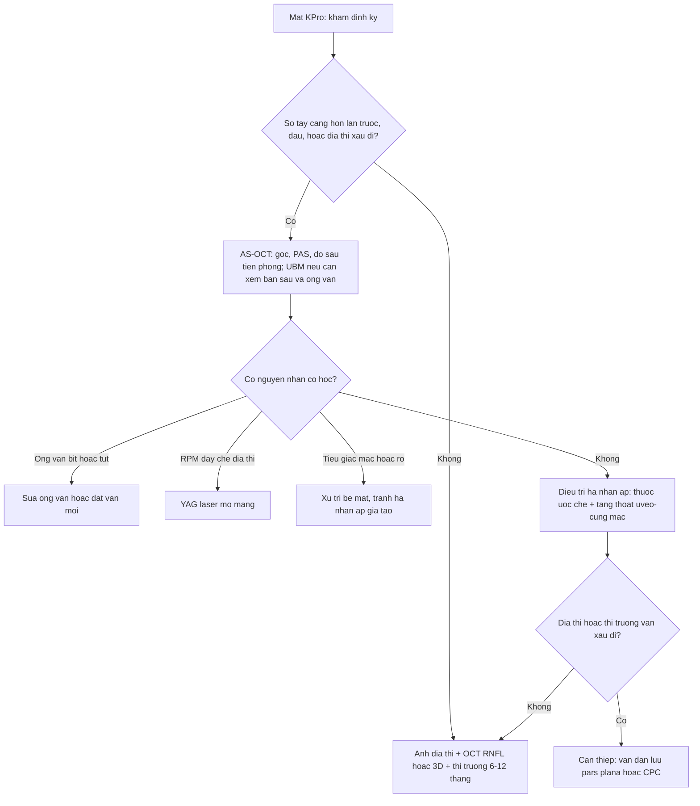
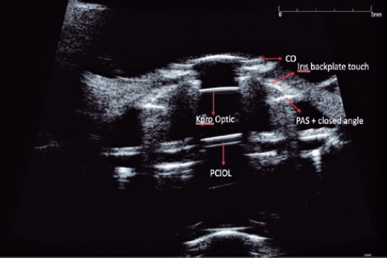
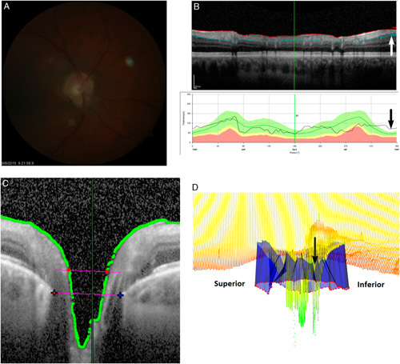
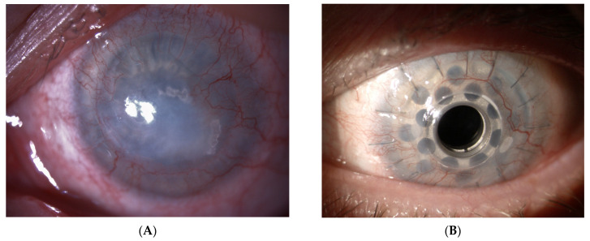

# 3315 — Đo nhãn áp và theo dõi glôcôm trên mắt có giác mạc nhân tạo Boston KPro type 1: vì sao Goldmann "vô hiệu" và theo dõi bằng gì / Intraocular pressure and glaucoma monitoring in the Boston type 1 keratoprosthesis eye

**Tags:** `pattern:nhan-ap-khong-dang-tin` `pattern:giac-mac-nhan-tao` `pattern:glocom` `pattern:mat-ghep` `pattern:dinh-goc` `pattern:teo-dia-thi` `pattern:rpm` `pattern:mat-ghep-that-bai` `vung:mat` `vung:giac-mac` `vung:cung-mac` `vung:tien-phong` `vung:dia-thi` `protocol:do-nhan-ap` `protocol:so-tay` `protocol:UBM` `protocol:AS-OCT` `protocol:OCT-RNFL` `protocol:thi-truong` `protocol:sieu-am-B` `protocol:den-khe` `score:IOP-threshold` `score:PAS`

**Mức chắc chắn (certainty):** tổng hợp y văn (literature synthesis) — 2 bài tổng quan về glôcôm sau KPro (PMC8846611, **2022**; PMC7196770, **2020**), 1 đoàn hệ **118 mắt** (PMC10889181), 1 đoàn hệ **17 mắt** (PMC11892478), 1 đoàn hệ **19 mắt** so sánh mổ glôcôm sớm–muộn (PMC5544178), 1 loạt **20 mắt** chụp UBM hậu phẫu (PMC12585069), 1 loạt **4 mắt** OCT 3D đĩa thị (PMC6727947), 1 thử nghiệm tiến cứu **12 mắt** cấy cảm biến Eyemate-IO (PMID 30849343) và 1 báo cáo **2 ca** đổi KPro type I sang type II (PMC13273980). **Không có thử nghiệm ngẫu nhiên**; phần lớn là hồi cứu, cỡ mẫu nhỏ; mọi chỗ ngoại suy đều đánh dấu **[suy luận]**.

> **Vì sao bài này quan trọng:** glôcôm là **nguyên nhân mất thị lực không hồi phục hàng đầu** sau khi đặt giác mạc nhân tạo Boston type 1 (PMC12585069). Trong **118 mắt** Ba Lan, glôcôm chiếm **66,1%** biến chứng (78/118), hơn cả tiêu giác mạc **18,6%** và màng sau mảnh ghép **17,0%** (PMC10889181). Nhưng chính phép đo dùng để phát hiện glôcôm lại **không thực hiện được**: trung tâm giác mạc đã được thay bằng **PMMA cứng**, nên nhãn áp kế Goldmann (Goldmann applanation tonometry, GAT) không còn đo nhãn áp mà đo **độ cứng của thiết bị**. Bài trả lời bốn câu: **(1)** vì sao GAT vô hiệu và các máy khác sai theo hướng nào; **(2)** theo dõi glôcôm bằng bộ ba **sờ tay – ảnh cấu trúc – thị trường** ra sao; **(3)** ngưỡng nào đủ để can thiệp; **(4)** khi nào tháo/đổi KPro.

## 1. Tổng quan bệnh học – cơ chế hình ảnh

### 1.1. Thiết bị là gì — và vì sao nó phá vỡ phép đo nhãn áp

- **Boston KPro type 1** có thiết kế "khuy cài" (collar button) gồm: **bản trước PMMA** (polymethylmethacrylate) mang **trụ quang học**, **mảnh giác mạc hiến** (carrier corneal graft) kẹp giữa, **bản sau titanium** và **vòng khóa titanium** (PMC7196770; PMC10889181).
- **Đường kính quang học:** nguồn mô tả **3,5–3,7 mm** ở trung tâm và **5 mm** kể cả bản trước (PMC12585069; PMC7196770), trong khi bài OCT 3D lại ghi **optic 3,0 mm** của KPro (PMC6727947) — khác nhau theo **thế hệ/loại thiết bị**. Con số này quan trọng vì nó quyết định **đầu đo GAT có nằm trọn trên PMMA hay không**.
- **Vật lý của sai số:** GAT dựa trên **nguyên lý Imbert–Fick** — lực làm phẳng một **vòng tròn đường kính 3,06 mm** tỉ lệ với áp lực bên trong, với giả định giác mạc là **màng mỏng, đàn hồi, hình cầu, thấm nước**. PMMA là **nhựa cứng**: mô đun đàn hồi khoảng **3 GPa**, lớn hơn nhu mô giác mạc (khoảng **0,1–1 MPa**) ba đến bốn bậc **[vật lý]**. Đầu đo 3,06 mm **nằm gọn trong optic 3,0–3,7 mm**, nên lực ấn **không truyền vào dịch tiền phòng** mà truyền qua bản trước → bản sau → vòng mảnh ghép.
- **Ba hệ quả trực tiếp:** (a) số đọc phản ánh **độ cứng của thiết bị**, không phải nhãn áp; (b) **không thể hiệu chuẩn** bằng CCT vì không còn nhu mô giác mạc trung tâm; (c) ấn lặp lại có thể **di lệch mảnh ghép mỏng manh** hoặc làm tổn thương optic — vì vậy GAT **không được dùng** trên mắt KPro (PMC5544178; PMC6727947).
- **Củng mạc cũng không "bình thường":** phẫu thuật KPro thay đổi **sinh cơ học thành củng mạc**, làm mọi phép đo gián tiếp qua củng mạc bị lệch (PMC8846611). Đây là lý do phải chọn **một phương pháp và một người đo** rồi theo dõi **xu hướng**, không so số tuyệt đối.

### 1.2. Vì sao glôcôm lại phổ biến đến vậy sau KPro

- **Dính góc tiến triển (peripheral anterior synechia, PAS) và góc đóng:** trên **AS-OCT** (anterior segment OCT) chuỗi, **độ sâu tiền phòng giảm 1,6 mm** ở thời điểm trung bình **13 tháng**, **73%** mắt có PAS hoặc **tiếp xúc mống mắt–bản sau khoảng 7 giờ đồng hồ**; ở **52 mắt**, **86,5%** có PAS (Kang và cộng sự, dẫn qua PMC8846611). Cơ chế: bản sau **chiếm chỗ** trong tiền phòng, mống mắt bị đẩy ra trước và dính vào góc.
- **Viêm mạn:** dịch màng nước mắt của mắt KPro có glôcôm tăng **TNF-α, IL-1β, FGF-basic và IFN-γ** so với mắt KPro không glôcôm (PMC8846611) — viêm là **động lực thứ hai**, không chỉ là hậu quả của mổ.
- **Corticoid suốt đời:** mắt KPro phải nhỏ corticoid lâu dài để bảo vệ bề mặt và mảnh ghép, nên **đáp ứng corticoid** là yếu tố nhiễu không thể loại bỏ.
- **Glôcôm có sẵn rất thường gặp:** **61–72,9%** mắt trước khi đặt KPro đã có glôcôm, và **8–50%** phát triển glôcôm mới (de novo) sau mổ trong tổng quan của AlHilali (PMC8846611); tổng quan khác ghi **36–76%** và **2–28%** (PMC6727947). Sự khác biệt lớn giữa các đoàn hệ phản ánh **khác định nghĩa và khác chỉ định** — không phải mâu thuẫn sinh học.
- **Yếu tố nguy cơ:** bệnh **tự miễn/dính bề mặt** (Stevens–Johnson, pemphigoid) làm glôcôm tiến triển nhanh hơn; bệnh **nhu mô/nội mô đơn thuần** có tiên lượng tốt hơn (Geoffrion và Harissi-Dagher, dẫn qua PMC8846611).

### 1.3. Hậu quả định lượng — vì sao không được "chờ xem"

- Sau **118 mắt** KPro, thị lực **≥ 0,1** chỉ đạt **37,29%** sau 1 năm, **49,35%** sau 2 năm, **46,81%** sau 3 năm; glôcôm là biến chứng phổ biến nhất (PMC10889181).
- Trong phân tích gộp, **glôcôm tiến triển 30%** ở 3 năm sau KPro (so với **25%** sau ghép xuyên lặp lại), trong khi **tỉ lệ giữ thiết bị 75%** ở 5 năm (PMC7196770).
- Ở **17 mắt** Thổ Nhĩ Kỳ, **52,9%** có glôcôm; **3/11 mắt (27,3%)** không có glôcôm trước mổ vẫn tăng nhãn áp và có **thay đổi đĩa thị** sau mổ, dù kiểm soát được bằng thuốc (PMC11892478).
- **Mổ glôcôm sớm giữ thị lực tốt hơn:** **19 mắt** (12 mổ glôcôm trước/đồng thời, 7 mổ muộn hoặc không mổ) — mất thị lực ở 12 tháng là **−0,03 ± 0,02 LogMAR** so với **−0,69 ± 0,36 LogMAR** (p = 0,027); **4/6** mắt ở nhóm mổ muộn xấu đi trong năm đầu (PMC5544178).

### 1.4. Các phương pháp đo còn lại thực sự đo cái gì

| Phương pháp | Nguyên lý | Đo qua mô nào | Sai số đã biết trên mắt KPro |
|---|---|---|---|
| Sờ tay (digital palpation) | Cảm nhận độ căng của nhãn cầu qua mi/củng mạc | Củng mạc – mi | **Không tái lập giữa người khám**; chỉ chia được 4 mức thô (PMC8846611; PMID 30849343) |
| Schiotz | Ấn lõm (indentation) bằng quả cân | Củng mạc thái dương | Sai số tuyệt đối trung vị **5,4 mmHg** ở củng mạc thái dương, **4,9 mmHg** ở rìa giác mạc–củng mạc (5 mắt hiến, bơm 10/20/30/40 mmHg) |
| Tono-Pen | Đầu đo 1,0 mm ấn nhẹ, lấy trung bình nhiều lần | Củng mạc/rìa | Sai số tuyệt đối trung vị **39 mmHg** ở củng mạc thái dương và **15 mmHg** ở rìa — tệ hơn Schiotz rõ rệt (cùng nghiên cứu, dẫn qua PMC8846611) |
| Nhãn áp kế khí qua củng mạc (trans-scleral pneumotonometry) | Luồng khí làm phẳng củng mạc | Củng mạc | Đọc **cao hơn 13 mmHg** so với đo qua giác mạc; **góc thái dương dưới** là vị trí chính xác nhất (6 mắt hiến) |
| Diaton (qua mi) | Ấn qua mi trên | Mi – củng mạc | Tương đương **sờ tay**, không tốt hơn (23 mắt, dẫn qua PMC8846611) |
| Cảm biến áp lực nội nhãn Eyemate-IO | Vòng cảm biến từ tính đặt ở rãnh thể mi, đọc từ xa | Trực tiếp trong mắt | **12 mắt**: nhãn áp đo từ xa **13,4 ± 6,2** trước mổ, đỉnh **23,1 ± 16,5** ngày 1, **16,0 ± 5,2** ngày 5, **20,95 ± 6,5 mmHg** ở 6–12 tháng (PMID 30849343) |

> **Đọc bảng này đúng:** không phương pháp nào trong 5 phương pháp đầu được thẩm định để **chẩn đoán** glôcôm ở mắt KPro; chúng chỉ dùng để **theo dõi xu hướng** với **cùng một người đo, cùng một vị trí, cùng một máy**. Eyemate-IO là phương pháp duy nhất đo **trực tiếp**, nhưng mới có **12 mắt** và chưa thay thế được khám lâm sàng.

## 2. Mẫu hình + chẩn đoán phân biệt (Gamut)

### 2.1. Năm mẫu hình gặp trên mắt KPro

1. **Mắt "yên", giác mạc trong, không đau — nhưng đĩa thị đang lõm dần.** Đây là mẫu hình **nguy hiểm nhất** vì mọi dấu hiệu bên ngoài đều bình thường; chỉ ảnh đĩa thị/thị trường mới phát hiện.
2. **Mắt đỏ, phù, nhãn áp "thấp"** — nghĩ **tiêu giác mạc (melt) / rò / hạ nhãn áp**, không phải "glôcôm đã kiểm soát". Hạ nhãn áp ở mắt KPro có thể là **dấu hiệu thiết bị hỏng**, không phải thành công.
3. **Thị lực giảm từ từ, đĩa thị khó nhìn vì optic nhỏ + màng sau mảnh ghép (retroprosthetic membrane, RPM).** RPM gặp **25–65%** và là nguyên nhân **che đĩa thị** phổ biến; YAG laser thường đủ (PMC12585069).
4. **Đau + nhãn áp cao + tiền phòng nông** — nghĩ **góc đóng do bản sau**, **van dẫn lưu bị bít/tụt**, hoặc **khối máu tụ/dịch** đẩy mống mắt ra trước.
5. **Mắt có van dẫn lưu (glaucoma drainage device, GDD) mà nhãn áp vẫn cao** — nghĩ **bít ống bởi dịch kính/mống mắt/silicone oil**, **tụt ống**, **bao xơ quanh bản van**, hoặc **lộ ống**.

### 2.2. Gamut "nhãn áp cao hoặc đĩa thị tiến triển" sau KPro

- **Glôcôm thật do PAS/góc đóng** (phổ biến nhất; AS-OCT là chốt).
- **Đáp ứng corticoid** (thuốc bắt buộc suốt đời).
- **Glôcôm có sẵn tiến triển** (không phải bệnh mới).
- **Thất bại GDD:** bít ống, tụt ống, bao xơ, lộ ống/bản van.
- **RPM dày** làm thay đổi thủy động học và che đĩa thị.
- **Viêm màng bồ đào/viêm nội nhãn** (nhãn áp cao do viêm, không do glôcôm).
- **Bệnh lý hậu đoạn không do glôcôm:** phù hoàng điểm dạng nang (CME, **20%** trong loạt 20 mắt), bong võng mạc, bệnh thần kinh thị không do glôcôm (PMC12585069).

### 2.3. Gamut "số đo nhãn áp không khớp với mắt"

- **Đọc cao giả:** khí qua củng mạc (**+13 mmHg**), Tono-Pen đặt sai vị trí (sai số tới **39 mmHg**), củng mạc dày/sẹo sau mổ, ấn lên ống van.
- **Đọc thấp giả:** sờ tay trên mắt có thành củng mạc mỏng, mắt đang hạ nhãn áp do rò, mắt vừa mổ có tiền phòng mềm.
- **Không đọc được:** mắt có bề mặt không đều, tiêu giác mạc, hoặc đang đeo kính tiếp xúc băng (bandage contact lens, BCL) — BCL còn che mất **lộ ống van**.

## 3. Bảng so sánh phân biệt (ma trận đối chiếu)

| Thực thể (phương pháp / tình huống) | Hình ảnh – kết quả định lượng | Chốt vào (rule-in) | Chốt loại (rule-out) | Gợi ý xác nhận |
|---|---|---|---|---|
| **GAT trên optic PMMA** | Đầu đo **3,06 mm** nằm trọn trong optic **3,0–3,7 mm**; lực truyền qua thiết bị | Không có chỉ định nào trên mắt KPro | **Không dùng số GAT để loại trừ tăng nhãn áp**; dùng là sai nguyên lý | Chỉ dùng trước mổ (trên giác mạc gốc) để lấy mốc nền |
| **Sờ tay (2 người khám)** | 4 mức: mềm/nghi ngờ/bình thường/căng; Eyemate: mức "bình thường" tương ứng **18,2 ± 6,1 mmHg**, "căng" **34,3 ± 11,0** | Mắt căng rõ + đau + đĩa thị lõm tiến triển | **Mức "bình thường" KHÔNG loại trừ** nhãn áp 24–25 mmHg (dao động rộng trong cùng mức) | Cùng người khám, ghi rõ mức; đối chiếu ảnh đĩa thị và thị trường |
| **Schiotz trên củng mạc** | Sai số tuyệt đối trung vị **5,4 mmHg** (củng mạc thái dương), **4,9 mmHg** (rìa) | Cần con số tương đối để theo dõi xu hướng; có cân chuẩn | **Không dùng một lần đo để quyết định mổ**; không dùng trên củng mạc có sẹo/đai | Cùng vị trí, cùng bảng hiệu chuẩn, 3 lần lấy trung vị |
| **Tono-Pen trên củng mạc** | Sai số tuyệt đối trung vị **39 mmHg** (củng mạc thái dương), **15 mmHg** (rìa) | Chỉ khi không có Schiotz và phải ghi rõ phương pháp | **Không dùng để chẩn đoán hạ nhãn áp** hay tăng nhãn áp; sai số quá lớn | Đo 4–6 lần, lấy trung bình, tránh rìa và ống van |
| **Khí qua củng mạc** | Đọc **cao hơn 13 mmHg** so với qua giác mạc; góc thái dương dưới chính xác nhất | Theo dõi xu hướng khi các máy khác không có | **Không dùng để loại trừ** vì xu hướng đọc cao | Ghi vị trí đo; so cùng máy qua các lần |
| **Eyemate-IO (cảm biến tiền phòng)** | **12 mắt**: **13,4 → 23,1 (ngày 1) → 16,0 (ngày 5) → 20,95 mmHg (6–12 tháng)** | Phát hiện **đỉnh nhãn áp ban đêm/dao động ngày** mà sờ tay bỏ sót | Chưa có dữ liệu kết cục dài hạn; **không thay** khám đĩa thị | Đọc theo lịch, đối chiếu sờ tay của 2 chuyên gia |
| **AS-OCT tiền phòng** | Thấy **mặt phân cách mảnh ghép, bề dày mảnh ghép, góc, PAS**, nhưng **không xuyên qua optic PMMA** | **Góc đóng/PAS mới** hoặc tiền phòng nông dần | Không dùng để đo nhãn áp; không thấy hậu đoạn | Chụp cùng máy, cùng trục, so chuỗi |
| **UBM (siêu âm tần số cao)** | Xuyên qua **bản titanium** để thấy mặt sau bản, ống van, RPM (loạt 20 mắt) | **Hẹp góc 57,1%** ở mắt không có van so với **23%** ở mắt có van (kèm dính mống mắt–giác mạc); thấy **đầu ống van 30%** | Không thấy đĩa thị; không đo được nhãn áp | Khi AS-OCT bị chặn bởi bản sau hoặc cần xem ống van |
| **OCT đĩa thị 2D (RNFL)** | Ở **3/4** mắt KPro, lát cắt RNFL 2D bị **lỗi phân đoạn** → RNFL **dày giả** | Dùng được khi chất lượng ảnh tốt và **cùng máy** | **Không loại trừ** teo thần kinh thị khi phân đoạn sai | Chụp lại, xem ảnh B-scan gốc, không chỉ nhìn số |
| **OCT 3D thể tích (BMO-MRW, MDB)** | **4 mắt**: C/D ước lượng lâm sàng **0,2** nhưng OCT trục dọc tính **0,6**; 3D cho số đo khách quan khi 2D lỗi | Nghi ngờ lõm đĩa thị mà 2D RNFL không tin được | Chưa có ngưỡng tiến triển được thẩm định cho KPro | Dùng phần mềm 3D khi có; so chuỗi cùng thuật toán |
| **Thị trường (Humphrey 10-2 / Goldmann)** | Thị trường **không đáng tin ở hơn một nửa** bệnh nhân KPro; Goldmann V4e đánh giá được khi hợp tác tốt | **Khuyết đúng một vùng, tái lập ở 2 lần đo** | Một lần đo bất thường không đủ chẩn đoán | Lặp lại; ưu tiên 10-2; ghi rõ thị trường chuẩn |

## 4. Protocol theo dõi + ngưỡng xử trí

### 4.1. Trước mổ: 6 việc phải làm để sau này còn theo dõi được

1. **Ghi mốc nền:** nhãn áp GAT (trên giác mạc gốc), số thuốc hạ áp, thị trường, ảnh đĩa thị, OCT RNFL nếu nhìn được.
2. **Phân tầng nguy cơ:** glôcôm có sẵn, bệnh tự miễn/dính bề mặt, tiền sử đáp ứng corticoid, đã có van hay chưa.
3. **Quyết định van dẫn lưu:** đặt **trước hoặc đồng thời** với KPro ở mắt có glôcôm; ống đặt ở **pars plana sau cắt dịch kính**, không đặt tiền phòng vì góc đã chật và dễ bít ống (PMC8846611).
4. **Chọn loại KPro:** type I cho bề mặt còn tạm ổn; type II khi bề mặt quá kém (mi không đóng được, SJS nặng).
5. **Dặn bệnh nhân:** "nhãn áp không đo được bằng máy thường" — mọi lần khám phải khám **đĩa thị + thị trường**, không chỉ "đo mắt".
6. **Ghi rõ phương pháp đo sẽ dùng** trong hồ sơ (sờ tay mấy người, Schiotz hay Tono-Pen) để các lần sau so được.

### 4.2. Sau mổ: lịch và cách đo

- **Ngày 1, tuần 1, tháng 1, tháng 3, tháng 6, 12**, sau đó **mỗi 6–12 tháng** (theo PMC8846611 và PMC7196770; chưa có lịch được thẩm định riêng cho KPro **[suy luận]**).
- **Nhãn áp:** sờ tay do **cùng một bác sĩ giàu kinh nghiệm**, so với mắt bên và với lần trước; nếu có Schiotz/Tono-Pen thì đo ở **củng mạc thái dương, cách rìa 3–4 mm**, tránh ống van và BCL; **ghi rõ phương pháp**.
- **AS-OCT/UBM:** lúc **1, 3, 6, 12 tháng** và khi nghi ngờ; xem **góc, PAS, độ sâu tiền phòng, bề dày mảnh ghép, RPM**, mặt sau bản titanium (UBM) và **đầu ống van**.
- **Đĩa thị:** ảnh màu ở mỗi lần khám; **OCT RNFL 2D** nếu chất lượng tốt; **OCT 3D** (BMO-MRW, thể tích) khi 2D lỗi phân đoạn.
- **Thị trường:** Humphrey **10-2** hoặc Goldmann **V4e** mỗi **6–12 tháng**, lặp lại khi bất thường.
- **Tiền phòng/mống mắt:** soi góc, tìm PAS; siêu âm B khi không thấy hậu đoạn.

### 4.3. Ngưỡng diễn giải

- Nhãn áp "bình thường" **10–21 mmHg** chỉ áp dụng khi **đo được đáng tin**; trên mắt KPro, **một mức sờ tay "bình thường" không loại trừ** nhãn áp cao — Eyemate cho thấy mức "bình thường" trải từ **18,2 ± 6,1 mmHg** (PMID 30849343).
- **Ngưỡng hành động [suy luận]:** bất kỳ **hai lần liên tiếp** sờ tay "căng" hơn lần trước, hoặc **đĩa thị lõm thêm/thị trường xấu thêm**, đủ để điều trị hoặc chuyển glôcôm mà **không cần chờ một con số**.
- **Khi có van:** nhãn áp cao kèm **tiền phòng nông, ống thấy được nhưng không chảy, hoặc đau** → nghi tắc ống/tụt ống; UBM và AS-OCT giúp xác định.
- **Sau YAG RPM:** nhãn áp có thể tăng thoáng qua; đo lại sau **1–2 giờ** nếu thị lực giảm.

### 4.4. Lưu đồ: mắt KPro nghi glôcôm

> Lưu đồ là **tổng hợp thực hành** từ các nguồn trên, **không phải guideline chính thức**; mọi ngưỡng phải đọc cùng **phương pháp đo, ảnh cấu trúc và bệnh nền**.

### 4.5. Khi nào tháo/đổi KPro

- **Chỉ định đổi thiết bị:** tiêu giác mạc quanh KPro, **lộ bản sau**, RPM dày không mở được bằng YAG, viêm nội nhãn tái diễn, thiết bị lỏng/di lệch (PMC13273980; PMC12585069).
- **Đổi type I → type II:** báo cáo **2 ca** (SJS và bỏng hóa chất) có tiêu giác mạc + lộ bản sau, được thay type II kèm cắt dịch kính; thị lực cải thiện, thiết bị ổn định (PMC13273980).
- **Glôcôm đơn thuần KHÔNG phải chỉ định tháo KPro** — điều trị bằng thuốc, van hoặc CPC; tháo thiết bị chỉ khi **không còn khả năng bảo tồn** hoặc mắt đau mất chức năng **[suy luận]**.
- **Tỉ lệ giữ thiết bị:** **80–87,8%** ở lần theo dõi cuối, **75%** ở 5 năm (PMC7196770) — nghĩa là phần lớn mắt vẫn còn KPro và vẫn cần theo dõi glôcôm **suốt đời**.

## 5. Biến thể bình thường và cạm bẫy

- **"Đo được bằng GAT nghĩa là đo được nhãn áp"** — sai: đầu đo 3,06 mm nằm trọn trên PMMA; số đọc là **độ cứng thiết bị**, và lực ấn có thể **di lệch mảnh ghép** (PMC5544178).
- **Sờ tay "bình thường" không loại trừ tăng nhãn áp:** mức "bình thường" trong nghiên cứu Eyemate tương ứng **18,2 ± 6,1 mmHg**, mức "căng" **34,3 ± 11,0 mmHg** — hai mức này **chồng lấn** (PMID 30849343).
- **Tono-Pen ở củng mạc có thể sai tới 39 mmHg:** đừng dùng một lần đo Tono-Pen để nói "nhãn áp ổn"; Schiotz cùng điều kiện chỉ sai **5,4 mmHg** (dẫn qua PMC8846611).
- **Khí qua củng mạc đọc cao giả +13 mmHg:** một mắt "23 mmHg" có thể thật là **10 mmHg**, hoặc ngược lại — không dùng để chẩn đoán.
- **Optic nhỏ làm đánh giá đĩa thị thấp hơn thực tế:** ca trong PMC6727947 ước lượng **C/D 0,2** bằng soi đáy mắt, nhưng OCT trục dọc tính **0,6** — "đĩa thị bình thường" trên KPro là một trong những câu dễ sai nhất.
- **RNFL dày giả do lỗi phân đoạn:** phần mềm vẽ bờ sau RNFL sai → giá trị **dày hơn bình thường** dù thần kinh đang teo; phải xem **B-scan gốc**, không chỉ đọc số (PMC6727947).
- **Thị trường không đáng tin ở hơn một nửa** bệnh nhân KPro (PMC6727947) — một thị trường "bình thường" không loại trừ glôcôm.
- **RPM bị nhầm là "đục thể thủy tinh" hoặc "glôcôm tiến triển":** RPM gặp **25–65%**, thường đáp ứng YAG; nếu không mở được mới tính can thiệp (PMC12585069).
- **Hạ nhãn áp "tốt" có thể là rò/tiêu giác mạc:** mắt KPro tụt nhãn áp + tiền phòng nông + bề mặt mờ là **cấp cứu thiết bị**, không phải thành công điều trị.
- **Bỏ sót ống van dưới BCL:** kính tiếp xúc băng che ống/bản van; phải **nhấc BCL** khi khám, nhất là khi có đau hoặc chảy mủ.
- **"Satisfaction of search":** thấy mảnh ghép trong, hết phù, rồi kết luận "mắt ổn" — bỏ qua **PAS tiến triển, corticoid, RPM, van bít** là những thứ **không nhìn thấy trên tonometry**.

## 6. Tự lượng giá — Blind Quiz

**Ca 1 — Mắt KPro, UBM dọc trục: nhãn áp đo bằng gì, và góc đang ra sao?**

- Gợi ý lâm sàng: mắt có KPro type 1 sau bỏng hóa chất; đang theo dõi glôcôm; UBM được chụp ở tư thế nằm.
- Câu hỏi: Ba cấu trúc được chú thích là gì? **Vì sao không thể áp phẳng optic bằng GAT?** Hình ảnh này giải thích **cơ chế glôcôm** nào? Nếu muốn đánh giá **đầu ống van**, UBM hay AS-OCT tốt hơn?

<b>Bấm để hiện đáp án (findings + chẩn đoán)</b>

- Dấu hiệu: UBM cắt dọc cho thấy **trụ quang học KPro** ở trung tâm, **thể thủy tinh nhân tạo (PCIOL)** phía sau, **bản sau** của thiết bị, và phía góc có **mống mắt tiếp xúc bản sau (iris–backplate touch)** cùng **PAS + góc đóng (PAS + closed angle)**.
- Chẩn đoán/ý nghĩa: **glôcôm do góc đóng/dính góc** trên mắt KPro. GAT không dùng được vì **đầu đo 3,06 mm ấn lên PMMA cứng** — lực không truyền vào dịch; phải theo dõi bằng **sờ tay + ảnh cấu trúc**. UBM nhìn được **sau bản titanium** và **đầu ống van** (thấy ở **30%** mắt có van trong loạt 20 mắt), trong khi AS-OCT bị chặn bởi bản kim loại; hẹp góc gặp **57,1%** ở mắt không có van so với **23%** ở mắt có van.
- Nguồn ảnh: Tas AY, Abay B, Muftuoglu O. *Arq Bras Oftalmol.* 2024;88(1):e2023-0160. PMCID: PMC12585069. Fig. 2. Giấy phép **CC BY 4.0**.

**Ca 2 — Đĩa thị "0,2" trên lâm sàng nhưng OCT nói 0,6: tin ai?**

- Gợi ý lâm sàng: nam 41 tuổi, KPro type 1 vì bỏng kiềm nặng; đang theo dõi glôcôm; ảnh màu đĩa thị "khó đọc" vì optic nhỏ.
- Câu hỏi: Panel **A** gợi ý C/D bao nhiêu? Panel **B** cho thấy lỗi gì, và lỗi đó làm RNFL **dày lên hay mỏng đi**? Panel **C–D** thêm được thông tin gì? Kết luận nào đúng về mức độ glôcôm?

<b>Bấm để hiện đáp án (findings + chẩn đoán)</b>

- Dấu hiệu: **A** — ảnh màu đĩa thị, lâm sàng ước lượng **C/D 0,2**; **B** — RNFL theo vòng quanh đĩa bị **phân đoạn sai bờ sau** (mũi tên trắng), dẫn tới **RNFL dày giả** (mũi tên đen); **C** — lát cắt dọc qua đĩa thị tính **C/D 0,6** ở mốc **150 µm trên RPE**; **D** — quét thể tích **20° × 20°** cho **dải khoảng cách tối thiểu 3D (MDB)**.
- Chẩn đoán/ý nghĩa: **glôcôm có lõm đĩa thị thật** bị **đánh giá thấp** khi chỉ soi đáy mắt qua optic nhỏ, và bị **che lấp** bởi lỗi phân đoạn RNFL. Bài học: ở mắt KPro, **C/D trên lâm sàng và RNFL 2D đều có thể sai cùng chiều "trông bình thường"**; phải dùng **OCT trục dọc/thể tích 3D** và **so chuỗi**, không dựa vào một con số.
- Nguồn ảnh: Khoueir Z, Jassim F, Braaf B, Poon LY, Tsikata E, Chodosh J, Dohlman CH, Vakoc BJ, Bouma BE, de Boer JF, Chen TC. *J Glaucoma.* 2019;28(8):718–726. PMCID: PMC6727947. Fig. 4. Giấy phép **CC BY-NC-ND 4.0** (nguyên bản, không chỉnh sửa).

**Ca 3 — Trước và sau KPro: mắt nào cần theo dõi glôcôm, và dấu hiệu nào báo thiết bị hỏng?**

- Gợi ý lâm sàng: nữ 37 tuổi, bỏng hóa chất bề mặt, đã ghép giác mạc và ghép tế bào gốc rìa toàn bộ 360°; thị lực đếm ngón tay (CF) trước mổ.
- Câu hỏi: **A** là mắt trước hay sau KPro? **B** cho thấy thiết bị đã được đặt đúng chưa? Vì sao mắt này **bắt buộc phải theo dõi glôcôm suốt đời** dù thị lực sau mổ tốt? Dấu hiệu nào trên ảnh sẽ khiến bạn nghĩ **thiết bị hỏng** thay vì **glôcôm**?

<b>Bấm để hiện đáp án (findings + chẩn đoán)</b>

- Dấu hiệu: **A** — giác mạc đục, tân mạch từ rìa, không thấy rõ mống mắt, thị lực **CF**; **B** — 18 tháng sau KPro, thiết bị **nằm đúng trục**, phần giác mạc quanh thiết bị còn tân mạch nhẹ, thị lực **0,8** với **−1,0 D**.
- Chẩn đoán/ý nghĩa: **KPro type 1 hoạt động tốt** nhưng mắt vẫn **có nguy cơ glôcôm cao** (glôcôm có sẵn hoặc de novo); trong đoàn hệ **118 mắt**, glôcôm là biến chứng phổ biến nhất (**66,1%**). Thị lực tốt **không** loại trừ glôcôm. Dấu hiệu **thiết bị hỏng** cần tìm: **tiêu giác mạc quanh chân thiết bị, lộ bản sau, RPM dày, chảy mủ, tiền phòng nông** — khác với glôcôm (đĩa thị lõm, thị trường mất dần, mắt thường "yên").
- Nguồn ảnh: Wróblewska-Czajka E, Dobrowolski D, Wylęgała A, Jurkunas UV, Wylęgała E. *J Clin Med.* 2024;13(4):975. PMCID: PMC10889181. Fig. 3. Giấy phép **CC BY 4.0**.

## 7. Câu hỏi nghiên cứu & điểm chưa đồng thuận (tính đến 11/2026)

1. **[Tranh cãi] Ở mắt KPro, phương pháp nào (sờ tay, Schiotz, Tono-Pen hay cảm biến cấy) đủ chính xác để quyết định điều trị hạ nhãn áp?**
   - **Đã biết:** trên **5 mắt hiến** bơm 10/20/30/40 mmHg, Schiotz sai **5,4 mmHg** ở củng mạc thái dương trong khi Tono-Pen sai **39 mmHg** (dẫn qua PMC8846611); khí qua củng mạc đọc cao **+13 mmHg** ở **6 mắt hiến**; cảm biến Eyemate-IO ở **12 mắt** cho thấy sờ tay chỉ chia được 4 mức chồng lấn (mức "bình thường" **18,2 ± 6,1 mmHg**) (PMID 30849343).
   - **Chưa rõ:** chưa có nghiên cứu **trên người sống** so sánh từng phương pháp với **manometry chuẩn** ở mắt KPro; chưa biết ngưỡng sai số nào là "an toàn" để không bỏ sót glôcôm.
   - **Hướng nghiên cứu:** nghiên cứu **độ chính xác chẩn đoán** với manometry trong mắt hiến có KPro, sau đó là đoàn hệ tiến cứu so **chiến lược đo** với **tổn thương RNFL/thị trường** và **sống mảnh ghép**.
   - **Nguồn:** PMC8846611 (2022); PMID 30849343 (2019); DOI 10.1167/iovs.13-13153 (2014).

2. **[Khoảng trống] Chưa có định nghĩa "tiến triển glôcôm" được thẩm định cho mắt KPro, vì cả OCT RNFL 2D và thị trường đều không đáng tin ở phần lớn bệnh nhân.**
   - **Đã biết:** **3/4** mắt trong loạt OCT 3D có **lỗi phân đoạn RNFL 2D** dẫn tới RNFL dày giả; thị trường **không đáng tin ở hơn một nửa** bệnh nhân (PMC6727947); OCT 3D chỉ được báo trên **4 mắt**, chưa có ngưỡng tiến triển.
   - **Chưa rõ:** tiêu chí nào (thay đổi **BMO-MRW**, **MDB**, **C/D thể tích**, hay tổ hợp với thị trường 10-2) phát hiện tiến triển sớm mà không dương tính giả do **RPM, optic nhỏ, lỗi phân đoạn**.
   - **Hướng nghiên cứu:** đoàn hệ tiến cứu nhiều trung tâm, chụp **cùng máy, cùng thuật toán**, so các tiêu chí với **kết cục thị lực 2–5 năm**; xây dựng **định nghĩa đồng thuận** kiểu Delphi.
   - **Nguồn:** PMC6727947 (2019); PMC8846611 (2022).

3. **[Khác biệt thực hành] Thời điểm đặt van dẫn lưu quanh KPro khác nhau rất lớn giữa các trung tâm — và có thể ảnh hưởng trực tiếp tới biến chứng hậu đoạn.**
   - **Đã biết:** mổ glôcôm **trước/đồng thời** giữ thị lực tốt hơn ở 12 tháng (**−0,03** so với **−0,69 LogMAR**, p = 0,027; PMC5544178); nhưng ở **17 mắt** Thổ Nhĩ Kỳ, van đặt **≤ 6 tháng trước** hoặc **cùng lúc** với KPro + cắt dịch kính bán phần gặp **3/3** biến chứng hậu đoạn (2 bong võng mạc, 1 viêm nội nhãn), trong khi van đặt **nhiều năm trước** có **0/3** (PMC11892478).
   - **Chưa rõ:** khoảng cách tối ưu giữa đặt van và KPro; có nên **luôn đặt đồng thời** hay **trì hoãn 6–12 tháng**; vai trò của **CPC/ECP** thay van ở mắt bề mặt kém (PMC8846611 nêu dữ liệu CPC mâu thuẫn: 2 ca biến chứng trong 18 mắt so với 7/18 tiến triển ở loạt khác).
   - **Hướng nghiên cứu:** RCT hoặc đoàn hệ đa trung tâm theo **cùng mốc thời gian**, phân tầng theo **loại KPro (có/không cắt dịch kính)**, với kết cục **thị lực, bong võng mạc, viêm nội nhãn, tiến triển glôcôm**.
   - **Nguồn:** PMC5544178 (2017); PMC11892478 (2023); PMC8846611 (2022).

## Bài liên quan chéo
- [3314 – Đo nhãn áp trên mắt đã ghép giác mạc: máy nào đáng tin, có nên hiệu chỉnh theo CCT](../3314-do-nhan-ap-tren-mat-ghep-giac-mac/lesson.md) (nền tảng vật lý tonometry và sai số theo loại ghép)
- [3313 – Độ dày giác mạc trung tâm (CCT) sau ghép nội mô](../3313-do-day-giac-mac-trung-tam-sau-ghep-noi-mo/lesson.md) (vì sao CCT bình thường không loại trừ thất bại)
- [3310 – Tăng nhãn áp do corticoid sau ghép nội mô giác mạc](../3310-tang-nhan-ap-corticoid-sau-ghep-noi-mo-giac-mac/lesson.md) (nguyên nhân tăng nhãn áp phổ biến nhất sau ghép nội mô)
- [3284 – Ghép nội mô ở mắt có ống dẫn lưu glôcôm](../3284-ghep-noi-mo-giac-mac-ong-dan-luu/lesson.md) (đo nhãn áp và bong mảnh ghép trên mắt có van)
- [3224 – Lộ ống/bản van dẫn lưu glôcôm muộn](../3224-lo-ong-van-dan-luu-glaucoma/lesson.md) (khi ống van lộ qua kết mạc — cạm bẫy dưới BCL)
- [3309 – Tăng nhãn áp do corticoid trên mắt viêm màng bồ đào](../3309-tang-nhan-ap-corticoid-vien-mang-bao-dau/lesson.md) (phân biệt viêm và thuốc)
- [1445 – Bong mảnh ghép nội mô sau DSAEK/DMEK: theo dõi hay rebubble](../1445-bong-manh-ghep-dsaek-dmek-rebubble/lesson.md) (AS-OCT mặt phân cách)

## Ảnh
- `3315_kpro_UBM-xuyen-mat_PMC12585069-F2.jpg` — UBM cắt dọc: trụ quang học, PCIOL, bản sau, mống mắt chạm bản sau, PAS + góc đóng.
- `3315_kpro_OCT-dia-thi-RNFL_PMC6727947-F4.jpg` — ảnh màu đĩa thị, RNFL phân đoạn sai, OCT trục dọc C/D 0,6 và dải MDB 3D.
- `3315_kpro_den-khe-truoc-sau_PMC10889181-F3.jpg` — đèn khe trước và 18 tháng sau KPro type 1.
- Nguồn, tác giả và giấy phép từng ảnh: `images/CREDITS.md`.

> Không dùng để chẩn đoán độc lập khi chưa có người hướng dẫn.
