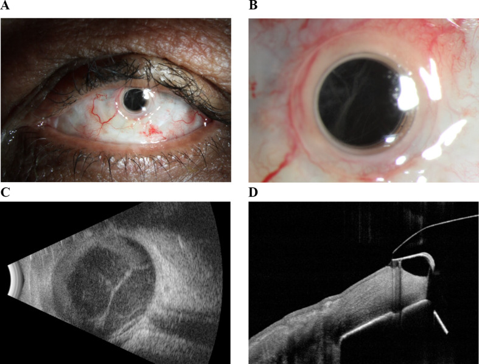
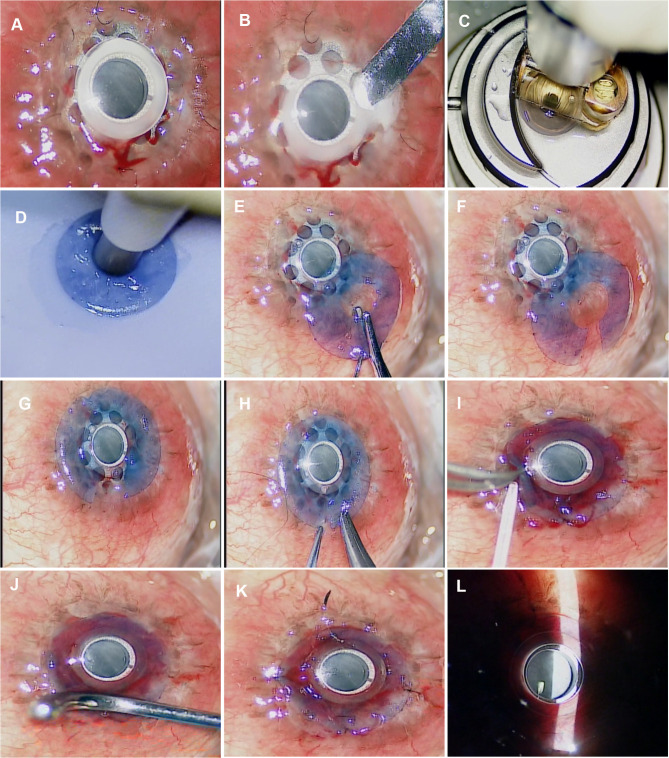
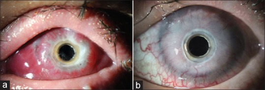
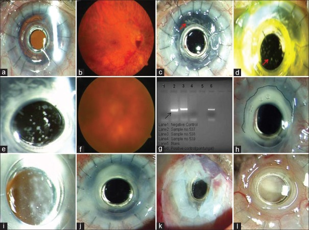
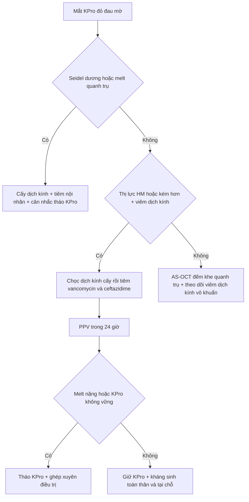

# 3316 — Viêm nội nhãn trên mắt có giác mạc nhân tạo Boston KPro: vì sao thiết bị tạo một cửa vào vĩnh viễn, và khi nào phải tháo KPro / Endophthalmitis in the Boston keratoprosthesis eye

**Tags:** `pattern:viem-noi-nhan` `pattern:mu-tien-phong` `pattern:viem-dich-kinh` `pattern:giac-mac-nhan-tao` `pattern:mat-ghep` `pattern:ro-di-dich` `pattern:viem-dich-kinh-vo-khuan` `pattern:tiêu-giac-mac` `vung:mat` `vung:giac-mac` `vung:tien-phong` `vung:dich-kinh` `protocol:den-khe` `protocol:AS-OCT` `protocol:sieu-am-B` `protocol:cay-dich-kinh` `protocol:PPV` `protocol:khang-sinh-du-phong`

**Mức chắc chắn (certainty):** tổng hợp y văn (literature synthesis) — 1 loạt **9 mắt** cấy dương tính tại Bascom Palmer 2013–2025 (PMC13369110), 1 nghiên cứu so sánh **29 mắt** KPro đơn thuần vs KPro + cắt dịch kính + dầu silicone (PMC6701324), 1 loạt **45 mắt** KPro aphakic snap-on theo dõi trung bình **51 tháng** (PMC5818861), 2 bài về **viêm dịch kính vô khuẩn** (PMID 25526075; PMID 26226472), 1 bài kỹ thuật vá tiêu giác mạc (PMC8495233), 2 báo cáo ca (PMC5141631; PMC5848353) và 1 tổng quan TASS (PMC10841787). **Không có thử nghiệm ngẫu nhiên**; mọi so sánh điều trị đều là hồi cứu, cỡ mẫu nhỏ — các chỗ ngoại suy được đánh dấu **[suy luận]**.

> **Vì sao bài này quan trọng:** trên mắt có giác mạc nhân tạo (keratoprosthesis, KPro), **không có biểu mô giác mạc trung tâm** che chắn: bề mặt nhãn cầu nối liền với tiền phòng qua khe giữa **mảnh giác mạc mang** (carrier graft) và **trụ PMMA**. Khe đó là một **cửa vào vĩnh viễn** cho vi khuẩn — và cũng là nơi **không đau, không mủ** vẫn có thể là nhiễm trùng. Loạt 9 mắt mới nhất: **8/9 mắt (89%) đến với thị lực bàn tay (hand motion, HM) hoặc kém hơn**, dù **100% đang nhỏ kháng sinh dự phòng liên tục**; sau điều trị chỉ **2/9 mắt (22%) đạt ≥ 20/200**, **2/9 mắt phải múc nội nhãn/khoét** (PMC13369110). Bài trả lời bốn câu: **(1)** vì sao KPro tạo cửa vào và vì sao "đang dùng kháng sinh" không loại trừ; **(2)** hình ảnh nào chốt nhiễm — và hình ảnh nào là **viêm dịch kính vô khuẩn** bắt chước; **(3)** chọc dịch kính – tiêm nội nhãn – cắt dịch kính theo ngưỡng nào; **(4)** khi nào **tháo KPro** thay vì cố giữ.

## 1. Tổng quan bệnh học – cơ chế hình ảnh

### 1.1. Thiết bị tạo ra "cửa sau" như thế nào

- **Boston KPro type 1** là thiết bị khuy cài: **bản trước PMMA** mang trụ quang học, **mảnh giác mạc hiến** kẹp giữa, **bản sau titanium** và vòng khóa (PMC13369110; xem thêm bài 3315). Thiết bị **không tích hợp sinh học** với mô: nó bắc cầu giữa **bề mặt nhãn cầu không vô khuẩn** và **tiền phòng vô khuẩn** (PMC6701324).
- **Ba con đường nhiễm:** (a) **khe quanh trụ** (periprosthetic gap) — hở cơ học giữa mảnh ghép và trụ, đủ để dịch màng nước mắt và vi khuẩn đi qua; (b) **tiêu giác mạc quanh thiết bị** (corneal melt) tạo **rò thật** với **nghiệm pháp Seidel dương**; (c) **loét/viêm giác mạc mảnh ghép** không rò nhưng là ổ nhiễm sát tiền phòng (PMC13369110; PMC8495233).
- **Kính tiếp xúc băng** (bandage contact lens, BCL) che bề mặt nhưng **không vô khuẩn**: nó là **giá thể biofilm**, và chính là nơi vi khuẩn cư trú giữa các lần thay kính (PMC13369110; PMC6140746). Bài tổng quan về dự phòng KPro nêu thẳng mâu thuẫn: kháng sinh nhỏ liên tục là **chuẩn chăm sóc nhưng chưa từng được thử nghiệm có đối chứng**, đồng thời **chọn lọc vi khuẩn kháng thuốc và mở đường cho nấm** (PMC6140746).

### 1.2. Vì sao "đang nhỏ kháng sinh" vẫn nhiễm — số liệu, không phải cảm giác

- Loạt **341 ca** KPro tại một trung tâm: **9 ca viêm nội nhãn cấy dương = 2,6%**; thời gian từ đặt KPro đến nhiễm **trung bình 339 ± 191 ngày** (khoảng **21 ngày – 4 năm**); **30%** khởi phát trong **6 tuần đầu** sau mổ (PMC13369110).
- **4/9 (44%)** chủng phân lập **đề kháng đúng nhóm kháng sinh dự phòng** của bệnh nhân (PMC13369110). Đây là lý do **"đang dùng thuốc" không được dùng để loại trừ** nhiễm.
- Bối cảnh lịch sử: **12%** ở thập niên đầu dùng KPro; **3–5%** khi áp dụng kháng sinh dự phòng liên tục; một số loạt dài hạn ghi **tích lũy 7 năm tới 15,5%**; tổng quan cũ ghi khoảng **3,2–17%** tùy thời gian theo dõi (PMC13369110; PMC6701324; PMC4604170).
- **Yếu tố nguy cơ quan sát được:** **không dùng kháng sinh dự phòng**, **không đeo BCL**, **rò mạn từ van dẫn lưu glôcôm hoặc từ KPro** (6/45 mắt có viêm nội nhãn hoặc viêm dịch kính vô khuẩn; trong đó 2 không dùng kháng sinh, 3 rò mạn, 1 không đeo BCL) (PMC5818861). **Đái tháo đường 44%** và **bệnh tự miễn 33%** trong loạt 9 ca (PMC13369110).

### 1.3. Vì sao hình ảnh trông như vậy — vật lý của ba phương tiện

- **Mủ tiền phòng (hypopyon) trên sinh hiển vi:** dịch tiền phòng bình thường trong; khi có **bạch cầu trung tính + fibrin + protein** thì tán xạ ánh sáng mạnh, tạo **lớp trắng lắng ở đáy tiền phòng** (trọng lực) và **màng fibrin** quanh trụ (Hình 1B của loạt 9 ca). Đây là dấu **đặc hiệu thấp** — TASS và viêm màng bồ đào cũng có — nhưng **mức độ đậm đặc + viêm dịch kính** mới hướng nhiễm.
- **Siêu âm B (B-scan):** dịch kính bình thường **không hồi âm**. Tế bào, protein và màng xơ làm **hồi âm thấp–trung bình**, có khi thành **màng di động**; **bong hắc mạc** là đường **dày, vòm, hồi âm cao**; **bong võng mạc** là màng **hồi âm rất cao**, dính đĩa thị. Trong loạt 9 ca, **5/9 (56%)** có viêm dịch kính thấy rõ, **1 mắt có bong hắc mạc**, và B-scan là phương tiện xác nhận **màng dịch kính dày** ở mắt không nhìn được hậu đoạn (PMC13369110).
- **Vì sao phải quét lệch trục thị giác:** PMMA có **trở kháng âm ≈ 3,2 MRayl** so với nước **≈ 1,5 MRayl** — chênh lớn nên mặt trước optic **phản xạ gần như toàn bộ** và tạo **bóng âm (acoustic shadowing)** phía sau. Muốn thấy dịch kính, đầu dò phải đặt **qua củng mạc, lệch khỏi trục optic**, quét nhiều kinh tuyến **[vật lý + suy luận]**.
- **AS-OCT đoạn trước:** ánh sáng 840–1.300 nm cho **phân giải 5–10 µm**, đủ thấy **khe quanh trụ**. Trong nghiên cứu **13 mắt viêm dịch kính vô khuẩn vs 34 mắt chứng**, **11/13 (86%)** có khe so với **11/34 (33,3%)** (p < 0,001); số khe **2,6 ± 1,6 vs 0,5 ± 0,8** (p < 0,001), diện tích khe **0,056 ± 0,049 vs 0,039 ± 0,025 mm²** (p = 0,22 — **không** khác biệt) (PMID 26226472). Nghĩa là **số khe** quan trọng hơn **diện tích một khe**.
- **Vì sao cấy có thể âm:** mẫu ít (0,1–0,2 mL), **kháng sinh đã dùng trước đó**, vi khuẩn **mọc chậm** (Mycobacterium, Corynebacterium) và **biofilm bám thiết bị** (PMC13369110). Do đó **cấy âm không loại trừ nhiễm**, và ngược lại **cấy dương không đồng nghĩa mắt sẽ mất** — trong 45 mắt, **2 mắt cấy dương** (Serratia, tụ cầu vàng nhạy methicillin) đều kết thúc **ST/không ST**, còn **3 mắt cấy âm giữ nguyên thị lực** (PMC5818861).

### 1.4. Hậu quả định lượng — vì sao không được "chờ xem"

- **Trước nhiễm:** thị lực trung bình **0,8 ± 0,2 logMAR** (~20/125), **6/9 (67%)** ≥ 20/200. **Lúc chẩn đoán:** **2,4 ± 0,2 logMAR** (~HM). **Sau điều trị:** **1,9 ± 0,4 logMAR** (~20/1600) — **mất 11 dòng thị lực**; chỉ **2/9 (22%)** đạt ≥ 20/200 (PMC13369110).
- **Mất nhãn cầu:** **2/9 (22%)** phải **múc nội nhãn/khoét** (ngày 21 và 38 sau chẩn đoán); loạt khác ghi **17%** (PMC13369110 dẫn).
- **Tái phát:** trong loạt này **0%** khi **38% mắt được tháo KPro**; một loạt trước **cắt dịch kính sớm nhưng giữ KPro** ghi **tái phát 70%** sau trung bình 4 tháng (PMC13369110). Đây là **so sánh gián tiếp**, không phải thử nghiệm — nhưng là dữ liệu tốt nhất hiện có cho câu hỏi "giữ hay tháo".

## 2. Mẫu hình + chẩn đoán phân biệt (Gamut)

### 2.1. Năm mẫu hình trên mắt KPro

1. **Nhiễm sớm sau mổ (< 6 tuần):** đau, đỏ, phù mi, **mủ tiền phòng**, thị lực tụt nhanh; **3 ca (30%)** trong loạt 9 ca. Tiên lượng **tốt hơn** các thể khác: 2/9 mắt hồi phục 20/25 và 20/200 đều thuộc nhóm này (PMC13369110).
2. **Tiêu giác mạc quanh trụ + rò (melt with Seidel-positive leak):** thấy **mô giác mạc mỏng/mất quanh trụ**, **Seidel dương** sau nhuộm fluorescein, tiền phòng nông; **3 ca (30%)**. Đây là **nhiễm qua lỗ rò thật**, không chỉ qua khe.
3. **Loét/viêm giác mạc mảnh ghép không rò:** **thâm nhiễm trắng đục trong mảnh ghép**, có thể **cấy mảnh ghép âm** nhưng dịch kính dương; **3 ca (30%)** (PMC13369110). Ca *Streptococcus agalactiae*: viêm giác mạc quanh KPro + mủ, **cạo giác mạc không phát hiện**, đến ngày 3 B-scan mới thấy **mảnh vụn dịch kính tăng** (PMC5141631).
4. **Viêm dịch kính "vô khuẩn" (sterile/idiopathic vitritis):** **23/346 (6,6%)** mắt; **chỉ 4/23** đúng kiểu "mất thị lực đột ngột không đau, không dấu viêm ngoài"; **6/23 lại giống hệt viêm nội nhãn nhiễm** (đau + dấu viêm); **43 đợt** tái phát, **10/43 đợt không hồi phục thị lực nền**, hồi phục trung vị **8,9 tuần** (PMID 25526075). **17/23 mắt** sau đó có biến chứng khác.
5. **Nhiễm mạn/indolent:** thời gian từ mổ **rất dài** (ca Mycobacterium: **890 ngày**, vào với 20/200), viêm nhẹ kéo dài, **cấy mọc chậm** — dễ bị chẩn đoán "viêm màng bồ đào" và điều trị corticoid (PMC13369110).

### 2.2. Gamut theo vị trí tổn thương

- **Bề mặt/mảnh ghép mang:** tiêu giác mạc, loét nhiễm khuẩn, **viêm giác mạc do nấm** (cặn mủ trên **trụ optic** là dấu gợi ý), viêm do BCL bẩn (PMC5848353).
- **Khe quanh trụ (interface):** **khe rộng/nhiều khe** trên AS-OCT, **dịch kính viêm** tái phát mà cấy âm; đây là cơ chế của cả **nhiễm** và **viêm vô khuẩn** (PMID 26226472).
- **Tiền phòng:** fibrin/mủ, **TASS** (phản ứng độc, không có viêm dịch kính), viêm màng bồ đào do corticoid/van.
- **Dịch kính:** viêm nội nhãn nhiễm, viêm dịch kính vô khuẩn, **xuất huyết dịch kính**, **bong võng mạc**.
- **Hậu đoạn:** bong hắc mạc, bong võng mạc co kéo sau viêm — đều làm thị lực kém đi **sau khi** nhiễm đã kiểm soát.

*Hình 1 — Bốn phương tiện của cùng một bệnh: sinh hiển vi (A, B), siêu âm B (C), AS-OCT (D). Nguồn: PMC13369110, CC BY 4.0.*

### 2.3. Gamut "đục dịch kính trên mắt KPro"

- **Nhiễm:** vi khuẩn Gram dương (chiếm đa số), nấm, Mycobacterium.
- **Vô khuẩn/viêm:** viêm dịch kính vô khuẩn (idiopathic vitritis), phản ứng với **mảnh vụn qua khe**, viêm màng bồ đào nền.
- **Máu:** xuất huyết dịch kính (đái tháo đường, sau can thiệp).
- **Cơ học:** bong võng mạc/co kéo, bong hắc mạc — **không** gây mủ tiền phòng nhưng gây mất thị lực.

## 3. Bảng so sánh phân biệt (ma trận đối chiếu)

| Thực thể (entity) | Hình ảnh điển hình | Chốt vào (rule-in) | Chốt loại (rule-out) | Gợi ý xác nhận |
|---|---|---|---|---|
| **Viêm nội nhãn vi khuẩn trên KPro** | Mủ/fibrin tiền phòng + viêm dịch kính; B-scan có hồi âm dịch kính/màng; có thể kèm melt hoặc loét | **Đau + tụt thị lực nhanh (giờ–ngày) + mủ tiền phòng + viêm dịch kính**; **cấy dịch kính dương** (Gram dương 7/9) | **Không loại trừ** bằng cấy âm, bằng "đang nhỏ kháng sinh", hay bằng AS-OCT không thấy khe | Chọc dịch kính cấy **trước** tiêm; Gram + nhuộm; PCR 16S nếu cấy âm (PMC13369110) |
| **Viêm giác mạc do nấm sau KPro** | Thâm nhiễm mảnh ghép **bờ mờ, nhiều ổ**, **cặn mủ trên trụ optic**, sau đó viêm dịch kính | **Cặn mủ bám trụ + thâm nhiễm sâu mảnh ghép + không đáp ứng kháng sinh**; PCR nấm dương | **Cạo giác mạc Gram/KOH âm không loại trừ** (ca PCR dương dù cạo âm) | PCR panfungal dịch kính; kháng nấm tại chỗ + nội nhãn + toàn thân (PMC5848353) |
| **Nhiễm Mycobacterium/Corynebacterium (mạn)** | Viêm nhẹ kéo dài **hàng tháng–hàng năm** sau KPro, thâm nhiễm mảnh ghép, viêm dịch kính mức độ vừa | **Thời gian dài (890 ngày), đáp ứng corticoid thoáng qua rồi tái phát, cấy mọc chậm** | **Đáp ứng corticoid không loại trừ**; nuôi cấy thường quy 48 giờ có thể âm | Cấy môi trường đặc biệt (Löwenstein–Jensen), thời gian dài; cân nhắc tháo thiết bị (PMC13369110) |
| **Viêm dịch kính vô khuẩn (idiopathic vitritis)** | Viêm dịch kính **không mủ đặc**, **cấy âm**, hay tái phát; AS-OCT **nhiều khe quanh trụ** | **Đau ít/không đau + cấy âm + đáp ứng corticoid chu vi**; **≥ 2 khe AS-OCT** (86% vs 33%) | **Không loại trừ nhiễm** — 6/23 ca giống hệt nhiễm; **phải cấy trước** | AS-OCT đếm khe; theo dõi 8,9 tuần; corticoid chu vi **chỉ sau khi đã cấy** (PMID 25526075; PMID 26226472) |
| **TASS (phản ứng độc tiền phòng)** | Phù giác mạc **limbus-to-limbus**, tế bào/flare tiền phòng, fibrin; **KHÔNG viêm dịch kính** | **Khởi phát 12–48 giờ** sau can thiệp, **không sốt, không đau dữ dội**, đáp ứng corticoid mạnh | **Có viêm dịch kính = không phải TASS**; trên mắt KPro **không đánh giá được limbus-to-limbus** vì giác mạc trung tâm là PMMA **[suy luận]** | Loại trừ nhiễm trước; xem lại dung dịch/thuốc dùng trong mổ (PMC10841787) |
| **Viêm màng bồ đào do RPM/viêm mạn** | **Màng sau mảnh ghép (retroprosthetic membrane)** dày, che đĩa thị; có thể kèm tế bào tiền phòng | **Màng sau trụ trên AS-OCT/sinh hiển vi**, thị lực giảm từ từ, **không mủ** | **Màng đơn thuần không gây mủ tiền phòng**; nếu có mủ phải coi là nhiễm | AS-OCT đo độ dày màng; YAG hoặc cắt màng (bài 3315) |
| **Tiêu giác mạc có rò** | Mô quanh trụ mỏng/mất, **Seidel dương**, tiền phòng nông, có thể mủ | **Seidel dương + melt thấy được** = đường vào thật, nguy cơ nhiễm cao | **Seidel âm không loại trừ khe** — AS-OCT có thể thấy khe dù không rò | Nhuộm fluorescein + AS-OCT; vá bằng ghép mảnh **keyhole** nếu chưa thủng (PMC8495233) |
| **Viêm nội nhãn nội sinh** | Viêm dịch kính **hai bên** hoặc một bên, **ổ viêm hắc–võng mạc**, không có ổ nhiễm bề mặt | **Nhiễm khuẩn huyết/ổ nhiễm xa + tổn thương hắc–võng mạc**; cấy máu | **Có ổ melt/loét quanh KPro = nguồn tại mắt**, không quy nội sinh | Cấy máu, siêu âm tim, tìm ổ nhiễm (bài 463) |

*Hình 2 — Melt quanh trụ (A) là đường vào của nhiễm; (B–L) kỹ thuật ghép mảnh nhu mô hình "chìa khóa" để giữ KPro. Nguồn: PMC8495233, CC BY-NC 3.0.*

*Hình 3 — (a) Hóa mủ, phù kết mạc, tiết dịch quanh KPro; (b) mắt "yên" sau chọc dịch kính + tiêm vancomycin/ceftazidime. Nguồn: PMC5141631, CC BY-NC-SA.*

*Hình 4 — Chuỗi ảnh của một ca nấm: (c) thâm nhiễm mặt sau mảnh ghép, (d) cặn mủ trên trụ, (f) viêm dịch kính, (g) PCR dịch kính dương. Nguồn: PMC5848353, CC BY-NC-SA.*

> **Đọc ma trận này đúng:** hai hàng dễ nhầm nhất là **viêm nội nhãn vi khuẩn** và **viêm dịch kính vô khuẩn** — chúng **không phân biệt được bằng triệu chứng** (6/23 ca vô khuẩn giống hệt nhiễm). Vì hậu quả của bỏ sót nhiễm là **mất mắt**, nguyên tắc thực hành là: **coi mọi viêm dịch kính mới trên mắt KPro là nhiễm cho đến khi cấy âm và đã loại trừ melt/khe rộng**, tức là **chọc dịch kính + tiêm nội nhãn trước**, rồi mới cân nhắc corticoid.

## 4. Protocol chụp/khám + ngưỡng xử trí

### 4.1. Trình tự khám 10 phút khi mắt KPro "đỏ – đau – mờ"

1. **Thị lực + đau + thời gian:** ghi rõ mốc (giờ/ngày) — nhiễm thường **giờ–ngày**, vô khuẩn có thể **tuần**.
2. **Sinh hiển vi:** mi/kết mạc (hóa mủ, tiết dịch), **BCL** (bẩn, mất), **mảnh ghép quanh trụ** (mỏng, thâm nhiễm, cặn trên trụ), **tiền phòng** (tế bào, fibrin, mủ), **Seidel** sau fluorescein.
3. **Siêu âm B 10 MHz, đầu dò vector, gel:** đặt **qua củng mạc lệch trục optic**, quét **ít nhất 4 kinh tuyến**, gain vừa; tìm **hồi âm dịch kính, màng, bong hắc mạc, bong võng mạc**. Không ấn lên trụ thiết bị. **[suy luận thực hành]**
4. **AS-OCT đoạn trước:** đếm **khe quanh trụ**, đo độ dày màng sau mảnh ghép (RPM), đánh giá mô mỏng quanh trụ. Đây là phương tiện **phát hiện đường vào không rò** (PMID 26226472).
5. **Chọc dịch kính (vitreous tap) 0,1–0,2 mL** qua pars plana **trước** khi tiêm; gửi **nhuộm Gram, cấy máu/chocolate/thoglycollate, Sabouraud, Löwenstein–Jensen**, PCR 16S/panfungal nếu nghi (PMC13369110).

### 4.2. Ngưỡng và hành động

| Tình huống | Ngưỡng | Hành động |
|---|---|---|
| Nghi nhiễm (đau + tụt thị lực nhanh + mủ tiền phòng) | **Bất kỳ mức thị lực**, kèm viêm dịch kính hoặc không | **Chọc dịch kính cấy + tiêm nội nhãn ngay**: vancomycin **1 mg/0,1 mL** + ceftazidime **2,25 mg/0,1 mL**; thêm **voriconazole** nếu nghi nấm (bài không ghi liều) (PMC13369110) |
| Thị lực **≤ HM** hoặc **LP** + viêm dịch kính | **≤ HM** | **Cắt dịch kính (PPV) trong 24 giờ** — 56% ca trong loạt được PPV < 24 giờ, 89% được PPV trong tuần đầu (PMC13369110) |
| Melt + **Seidel dương** hoặc KPro **không vững** | Melt **quanh trụ**, lộ bản sau, tiền phòng nông | **Tháo KPro + ghép xuyên điều trị (TPK)** cùng lúc với PPV — 3/8 (38%) mắt được tháo trong loạt, **0% tái phát** (PMC13369110) |
| Cấy **âm** nhưng vẫn viêm dịch kính, **nhiều khe AS-OCT** | **≥ 2 khe** (86% vs 33% ở chứng) | Điều trị như nhiễm trước; nếu ổn định và cấy âm → **corticoid chu vi**, theo dõi **8,9 tuần** (PMID 25526075; PMID 26226472) |
| Viêm nhẹ kéo dài **> 1 tháng**, cấy mọc chậm | Nghi **Mycobacterium/Corynebacterium** | Nuôi cấy dài, phối hợp kháng sinh theo kháng sinh đồ; **cân nhắc tháo thiết bị** nếu không sạch (PMC13369110) |
| Chưa nhiễm, đang dự phòng | **BCL + kháng sinh nhỏ 1–4 lần/ngày** (moxifloxacin hoặc polymyxin B/trimethoprim; thêm vancomycin **25 mg/mL** ở một số trung tâm) | Duy trì **suốt đời**; thay BCL định kỳ, rửa cùng đồ **povidone-iodine 5%** mỗi lần khám (PMC5818861; PMC13369110; PMC6140746) |

> **Kháng sinh dự phòng — con dao hai lưỡi:** loạt 9 ca cho thấy **44% chủng đề kháng đúng thuốc đang nhỏ**, và **không ca nấm nào** xuất hiện — ngược với các trung tâm báo **nấm gia tăng** khi dùng vancomycin kéo dài. Bài tổng quan đề xuất **chuyển sang chất sát khuẩn (povidone-iodine) thay vì chỉ kháng sinh** (PMC6140746; PMC13369110). Chưa có thử nghiệm so sánh — xem mục 7.

### 4.3. Sơ đồ xử trí

### 4.4. Theo dõi sau điều trị

- **Đáp ứng:** đau giảm trong **24–48 giờ**, tiền phòng sạch dần, **B-scan lặp** (ca *S. agalactiae* chụp lại ngày 3 thấy mảnh vụn giảm) (PMC5141631).
- **Thất bại:** thị lực không cải thiện sau **48–72 giờ**, viêm dịch kính tăng, hoặc cấy ra **Mycobacterium/nấm** → **PPV lặp** hoặc **tháo thiết bị** (PMC13369110).
- **Di chứng cần chủ động tìm:** **bong võng mạc co kéo** (2/7 mắt phải PPV lặp trong loạt 9 ca), **bong hắc mạc**, **RPM**, **glôcôm** — đều có thể làm mất phần thị lực còn lại.

## 5. Biến thể bình thường và cạm bẫy

- **Fibrin sau mổ sớm không phải mủ:** trong **6 tuần đầu**, fibrin quanh trụ có thể là phản ứng lành — nhưng **không được mặc định lành** nếu kèm đau/tụt thị lực; phải cấy.
- **"Đang nhỏ kháng sinh = đã được bảo vệ" — sai:** **44%** chủng trong loạt 9 ca đề kháng đúng thuốc dự phòng (PMC13369110).
- **"Cấy âm = không nhiễm" — sai:** 6/23 ca viêm dịch kính vô khuẩn giống hệt nhiễm; cấy âm có thể do **mẫu ít, đã dùng kháng sinh, vi khuẩn chậm, biofilm** (PMID 25526075).
- **"Seidel âm = không rò" — sai:** khe quanh trụ có thể **hở mà không chảy dịch ra ngoài**; AS-OCT thấy **86%** ở nhóm viêm dịch kính vô khuẩn (PMID 26226472).
- **Siêu âm qua optic PMMA:** mặt trước optic phản xạ mạnh, tạo **bóng âm** — đừng đọc "không thấy dịch kính" là "dịch kính trong"; phải quét lệch trục.
- **TASS không có viêm dịch kính:** nếu B-scan có viêm dịch kính, **TASS bị loại**; ngược lại, trên mắt KPro **không đánh giá được phù limbus-to-limbus** vì trung tâm là PMMA — đừng dùng tiêu chuẩn đó để "chốt TASS" **[suy luận]**.
- **Sai lầm chết người:** thấy mủ + cấy âm → cho corticoid mạnh và **không cắt dịch kính**; hoặc thấy "mắt yên" sau 2 ngày kháng sinh → xuất viện mà **không B-scan lặp**.
- **Sai lầm ngược lại:** tháo KPro ngay khi chưa cấy, ở mắt **chưa chắc nhiễm** — mất thiết bị và mất cơ hội thị lực; trong loạt 9 ca, **2 mắt hồi phục tốt nhất đều thuộc nhóm nhiễm sớm** và **giữ được mắt** (PMC13369110) **[suy luận]**.

## 6. Tự lượng giá — Blind Quiz

**Ca 1 — Mắt KPro đỏ, đau, mờ 2 ngày**

- Gợi ý lâm sàng: bệnh nhân **76 tuổi**, KPro type 1 đặt **4 năm trước** vì ghép giác mạc thất bại nhiều lần; đang nhỏ **moxifloxacin 4 lần/ngày**; nay **đau + thị lực bàn tay**.
- Câu hỏi: (1) Mô tả dấu hiệu ở **B** và **C**. (2) Ba chẩn đoán phân biệt? (3) Dấu hiệu nào trên **D** giải thích đường vào?

<b>Bấm để hiện đáp án (findings + chẩn đoán)</b>

- **Dấu hiệu:** (A) mắt đỏ, trụ KPro, không thấy chi tiết hậu đoạn; (B) **fibrin đặc lấp tiền phòng** quanh trụ; (C) **B-scan: hồi âm dày trong dịch kính + màng** (viêm dịch kính); (D) **AS-OCT: khe giữa mảnh ghép và trụ** — đường vào của vi khuẩn.
- **Chẩn đoán:** **viêm nội nhãn trên mắt KPro** (cấy dịch kính ra *Staphylococcus warneri* trong ca gốc).
- **Vì sao:** fibrin + màng dịch kính = phản ứng với **nhiễm qua khe quanh trụ**; khe thấy trên AS-OCT dù **Seidel âm**.
- **Nguồn ảnh:** PMC13369110, Fig. 1, CC BY 4.0 (Zhang và cộng sự, *J Ophthalmic Inflamm Infect* 2026).

**Ca 2 — Cặn mủ bám trụ optic ở mắt KPro 6 tuần sau mổ**

- Gợi ý lâm sàng: **70 tuổi**, KPro type 1 đặt 6 tuần; đau nhẹ, thị lực giảm; **cạo giác mạc Gram và KOH âm**.
- Câu hỏi: (1) Dấu hiệu nào **không điển hình** cho vi khuẩn? (2) Vì sao cạo âm vẫn phải làm PCR dịch kính? (3) Điều trị gồm những tầng nào?

<b>Bấm để hiện đáp án (findings + chẩn đoán)</b>

- **Dấu hiệu:** **thâm nhiễm sâu trong mảnh ghép** (c) + **cặn mủ bám trên trụ** (d) + **viêm dịch kính** (f); tiến triển **chậm** so với vi khuẩn.
- **Chẩn đoán:** **viêm giác mạc – nội nhãn do nấm** sau KPro; **PCR panfungal dịch kính dương** dù cạo giác mạc âm.
- **Vì sao:** nấm mọc chậm, **bám thiết bị**; cạo bề mặt không lấy được ổ sâu. Điều trị phải **phối hợp tại chỗ + nội nhãn + toàn thân + trong nhu mô**, và **vẫn có thể bong võng mạc** về sau.
- **Nguồn ảnh:** PMC5848353, Fig. 1, CC BY-NC-SA (Malhotra và cộng sự, *Oman J Ophthalmol* 2018).

**Ca 3 — Melt quanh trụ: giữ hay thay thiết bị?**

- Gợi ý lâm sàng: mắt KPro có **mô giác mạc mỏng gần 360° quanh trụ**, lộ bản sau, chưa thủng; thị lực còn **20/200**.
- Câu hỏi: (1) Vì sao melt là **đường vào** của viêm nội nhãn? (2) Kỹ thuật trong ảnh làm gì? (3) Khi nào **không** dùng kỹ thuật này?

<b>Bấm để hiện đáp án (findings + chẩn đoán)</b>

- **Dấu hiệu:** (A) **melt gần 360°**, thấy **bản sau**; (B–D) lấy mảnh ghép nhu mô và tạo **lỗ trung tâm + đường rạch nan hoa**; (E–K) "mặc" mảnh ghép quanh trụ, khâu đường rạch, cố định bằng fibrin + chỉ; (L) mảnh ghép nằm yên.
- **Chẩn đoán:** **tiêu giác mạc quanh KPro** — điều trị bằng **ghép nhu mô hình chìa khóa** (keyhole anterior lamellar keratoplasty), giữ KPro.
- **Vì sao:** melt làm mất hàng rào mô quanh trụ → vi khuẩn từ bề mặt vào tiền phòng. Kỹ thuật này **giữ thiết bị** và đạt **≥ 20/200 ở 2 năm**; **không dùng** khi đã thủng/không còn mô nền hoặc thiết bị không vững — lúc đó phải **tháo KPro + ghép xuyên**.
- **Nguồn ảnh:** PMC8495233, Fig. 1, CC BY-NC 3.0 (John và cộng sự, *Clin Ophthalmol* 2021).

**Ca 4 — "Mắt yên" 3 tuần sau tiêm kháng sinh**

- Gợi ý lâm sàng: bệnh nhân KPro được chọc dịch kính + tiêm vancomycin/ceftazidime vì mủ tiền phòng; nay **hết đau, hết mủ**, nhưng thị lực **không cải thiện**; cấy dịch kính **âm**.
- Câu hỏi: (1) Hai khả năng chính? (2) Cần làm gì trước khi kết luận "đã khỏi"? (3) Ngưỡng nào bắt buộc can thiệp lại?

<b>Bấm để hiện đáp án (findings + chẩn đoán)</b>

- **Hai khả năng:** **viêm dịch kính vô khuẩn** (cấy âm, đáp ứng corticoid) **hoặc nhiễm còn ẩn** (biofilm trên thiết bị, cấy âm giả).
- **Cần làm:** **B-scan lặp** tìm màng/bong võng mạc; **AS-OCT đếm khe**; nếu khe nhiều + viêm tái phát → coi là **đường vào chưa đóng**, cân nhắc **vá/tháo thiết bị**; không cho corticoid liều cao khi chưa loại trừ nhiễm.
- **Ngưỡng can thiệp lại:** viêm dịch kính **tăng** hoặc thị lực **≤ HM** kéo dài, hoặc **bong võng mạc** trên B-scan → **PPV lặp**; melt/không vững → **tháo KPro** (PMC13369110; PMID 25526075).
- **Nguồn:** số liệu từ PMC13369110, PMC5818861, PMID 25526075.

## 7. Câu hỏi nghiên cứu & điểm chưa đồng thuận (tính đến 11/2026)

1. **[Tranh cãi] Ở mắt Boston KPro, phác đồ dự phòng nào giảm viêm nội nhãn mà không chọn lọc vi khuẩn kháng thuốc/nấm: kháng sinh nhỏ liên tục, vancomycin, hay chất sát khuẩn như povidone-iodine?**
   - **Đã biết:** kháng sinh nhỏ liên tục là chuẩn chăm sóc nhưng **chưa từng được thử nghiệm có đối chứng**; **44%** chủng trong loạt 9 ca đề kháng đúng thuốc dự phòng; các trung tâm dùng vancomycin kéo dài báo **nấm gia tăng**, trong khi loạt 9 ca ở Nam Florida **không có ca nấm** (PMC13369110; PMC6140746).
   - **Chưa rõ:** tỉ lệ nhiễm **theo từng phác đồ** (fluoroquinolone đơn thuần vs polymyxin B/trimethoprim vs có vancomycin) và tác động lên **hệ vi sinh bề mặt**; chưa có ngưỡng "đủ" cho povidone-iodine.
   - **Hướng nghiên cứu:** đoàn hệ đa trung tâm ghi **phác đồ + thời gian + chủng + kháng sinh đồ**, so sánh tỉ lệ nhiễm/nấm theo phác đồ; thử nghiệm ngẫu nhiên cụm cho **povidone-iodine** ở nơi nấm phổ biến.
   - **Nguồn:** PMC13369110 (2026); PMC6140746 (2018).

2. **[Khoảng trống] Khi nào nên tháo KPro ngay trong viêm nội nhãn, thay vì cắt dịch kính và giữ thiết bị?**
   - **Đã biết:** loạt 9 ca **tháo KPro ở 3/8 mắt** có PPV, **0% tái phát**; một loạt trước **giữ KPro** ghi **tái phát 70%** sau ~4 tháng; loạt 45 mắt cho thấy **rò mạn từ KPro/van** là yếu tố nguy cơ (PMC13369110; PMC5818861).
   - **Chưa rõ:** **chỉ định tháo** dựa trên dấu hiệu nào (melt độ mấy, khe AS-OCT bao nhiêu, chủng nào) và **thời điểm** tháo so với PPV; chưa có so sánh trực tiếp giữ vs tháo.
   - **Hướng nghiên cứu:** nghiên cứu đoàn hệ tiến cứu ghi **melt/khe/chủng** rồi so **tỉ lệ tái phát, giữ nhãn cầu, thị lực cuối** giữa hai chiến lược; mô hình quyết định dựa trên **số khe AS-OCT**.
   - **Nguồn:** PMC13369110 (2026); PMC6701324 (2019).

3. **[Khác biệt thực hành] Có nên đặt dầu silicone khi cấy KPro ở mắt nguy cơ cao, và có nên dùng corticoid nội nhãn trong viêm nội nhãn KPro?**
   - **Đã biết:** trong 29 mắt, nhóm **KPro + PPV + dầu silicone** có **0 ca viêm nội nhãn** vs **5/16** ở KPro đơn thuần; **tích lũy 2 năm 31,2% ± 11,6 vs 0%** (p = 0,030) — nhưng cỡ mẫu nhỏ, chỉ 13 mắt nhóm can thiệp (PMC6701324). Loạt 9 ca dùng **dexamethasone nội nhãn** ở nhiều mắt mà **không tái phát** (PMC13369110).
   - **Chưa rõ:** dầu silicone có tác dụng **kháng khuẩn thật** hay chỉ tạo **màng sau cơ học**; corticoid nội nhãn có làm **tăng nguy cơ nấm** hoặc che dấu nhiễm hay không; chưa có thử nghiệm.
   - **Hướng nghiên cứu:** thử nghiệm tiến cứu phân tầng theo **nguy cơ rò/khe**, so **viêm nội nhãn, RPM, thị lực**; nghiên cứu cơ chế **màng sau mảnh ghép như hàng rào** trên mô học/AS-OCT.
   - **Nguồn:** PMC6701324 (2019); PMC13369110 (2026).

## Bài liên quan chéo

- [3315 – Nhãn áp & glôcôm trên mắt KPro: vì sao Goldmann vô hiệu và theo dõi bằng gì](../3315-do-nhan-ap-glocom-mat-giac-mac-nhan-tao-kpro/lesson.md)
- [3224 – Lộ ống/bản van dẫn lưu glôcôm qua kết mạc: nhiễm hay không nhiễm](../3224-lo-ong-van-dan-luu-glaucoma/lesson.md)
- [1425 – Viêm nội nhãn sau tiêm nội nhãn: tần suất, thời điểm, tap-and-inject vs cắt dịch kính](../1425-viem-noi-nhan-sau-tiem-noi-nhan/lesson.md)
- [1991 – Rò bọng lọc muộn và viêm nội nhãn liên quan bọng](../1991-ro-bong-loc-muon-viem-noi-nhan/lesson.md)
- [463 – Viêm nội nhãn nội sinh: ổ viêm hắc–võng mạc, cấy máu](../463-viem-noi-nhan-noi-sinh-nam/lesson.md)
- [3286 – Viêm nội nhãn sau chấn thương xuyên nhãn cầu](../3286-viem-noi-nhan-sau-chan-thuong-mat-ho/lesson.md)
- [3216 – Viêm giác mạc do nấm sợi](../3216-viem-giac-mac-nam-soi/lesson.md)

## Ảnh

- `3316_kpro-endophthalmitis_Anh-mat-PMC13369110-Fig1.jpg` — sinh hiển vi + B-scan + AS-OCT của viêm nội nhãn KPro; PMC13369110, **CC BY 4.0**.
- `3316_kpro-endophthalmitis_Anh-mat-PMC5141631-Fig2.jpg` — *S. agalactiae* trên KPro (SJS), trước/sau điều trị; PMC5141631, **CC BY-NC-SA**.
- `3316_kpro-endophthalmitis_Anh-mat-PMC5848353-Fig1.jpg` — nấm: thâm nhiễm mảnh ghép, cặn trên trụ, viêm dịch kính; PMC5848353, **CC BY-NC-SA**.
- `3316_kpro-melt_Mo-PMC8495233-Fig1.jpg` — melt quanh trụ và ghép hình chìa khóa; PMC8495233, **CC BY-NC 3.0**.

> Không dùng để chẩn đoán độc lập khi chưa có người hướng dẫn.
