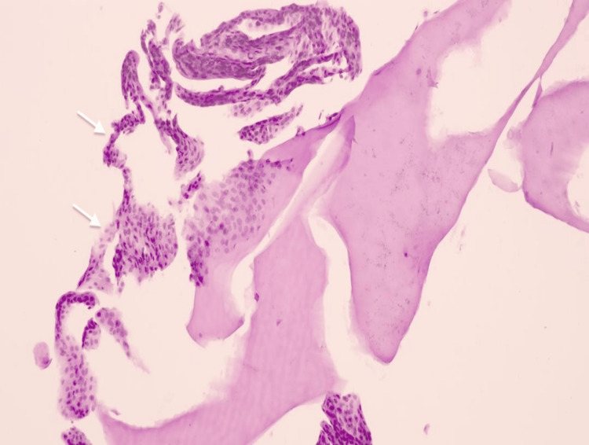
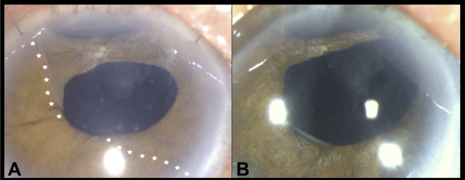
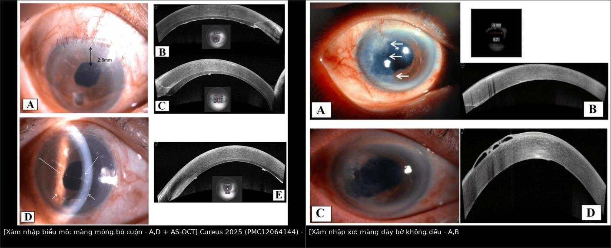
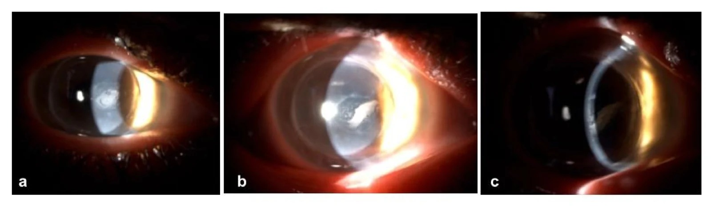
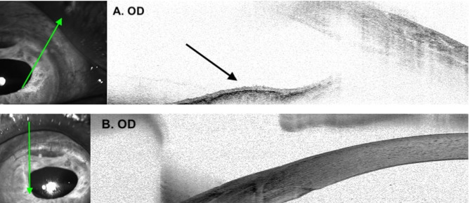
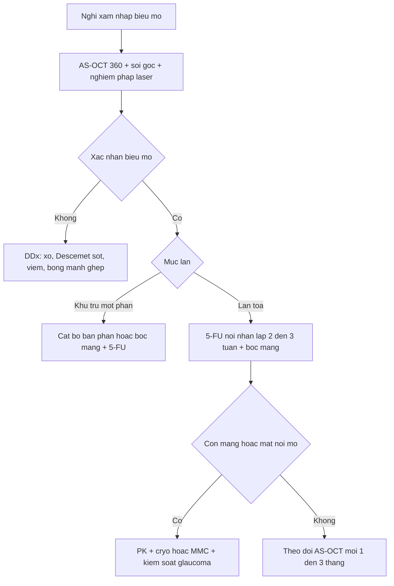
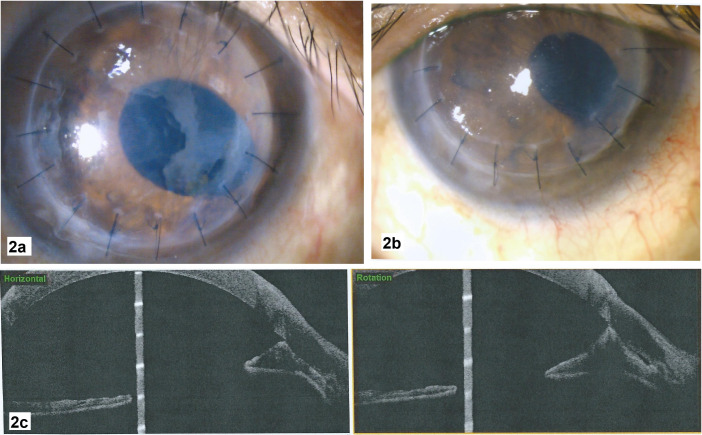
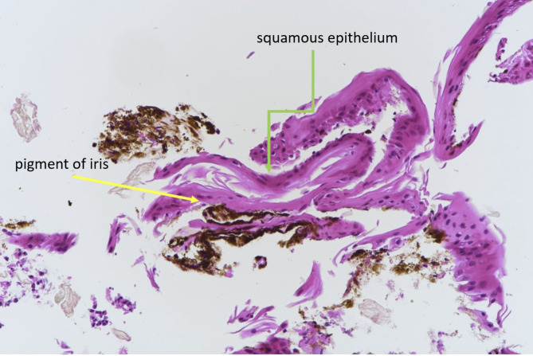

# 3317 — Xâm nhập biểu mô vào tiền phòng (epithelial downgrowth): màng sau giác mạc bờ cuộn, mắt "yên" mà nhãn áp tăng

**Tags:** `pattern:retrocorneal-membrane` `pattern:manh-mong-trong` `pattern:mo-giac-mac` `pattern:viem-tien-phong` `pattern:tang-nhan-ap` `pattern:mat-ghep` `pattern:downgrowth` `vung:mat` `vung:giac-mac` `vung:tien-phong` `vung:mong-mat` `protocol:AS-OCT` `protocol:UBM` `protocol:soi-goc` `protocol:confocal` `protocol:sieu-am-B` `protocol:laser-argon` `protocol:5-FU`

**Mức chắc chắn (certainty):** tổng hợp y văn (literature synthesis) — 1 loạt **124 bệnh nhân** trong **30 năm** (PMID 2920156), 1 loạt 3 ca có mô bệnh (PMC12064144), 2 ca điều trị bằng **5-fluorouracil (5-FU) nội nhãn** có theo dõi tế bào nội mô (PMC13103524; PMC11476867), 1 ca **thể trước màng Descemet** (PMC13778635), 1 ca sau **DSAEK** (PMC8800354), 1 loạt **3 mắt cắt bỏ khu trú** (PMID 27261941) và các bài kỹ thuật hình ảnh (PMID 23928949; PMID 19034128). **Không có thử nghiệm ngẫu nhiên**; mọi so sánh điều trị đều là ca – loạt nhỏ, các chỗ ngoại suy được đánh dấu **[suy luận]**.

> **Vì sao bài này quan trọng:** đây là nguyên nhân **"đục giác mạc + tăng nhãn áp"** mà **không có mủ, không đau nhiều**, và **không đáp ứng corticoid** — vì thứ nằm trong tiền phòng **không phải viêm mà là biểu mô**. Màng biểu mô **phá nội mô** (gây phù giác mạc) và **bịt lưới bè** (gây glôcôm khó trị): trong loạt 124 ca, **43% có glôcôm** lúc chẩn đoán, **45% có màng sau giác mạc**, và **87% mắt phải múc bỏ** có góc đóng một phần hoặc toàn bộ (PMID 2920156). Chẩn đoán muộn = **mù không hồi phục**; chẩn đoán sớm bằng **AS-OCT + nghiệm pháp laser** cho phép điều trị ít xâm lấn hơn.

## 1. Tổng quan bệnh học – cơ chế hình ảnh

### 1.1. Tế bào biểu mô đi vào bằng đường nào

- **Bình thường**, mặt trong nhãn cầu **không có biểu mô lát tầng** (stratified squamous epithelium); biểu mô chỉ nằm ở **mặt trước giác mạc/kết mạc**. Xâm nhập biểu mô (epithelial downgrowth, EDG) là khi biểu mô **giác mạc hoặc kết mạc** đi qua một **khiếm khuyết xuyên thành** rồi **bám và lan trên nội mô, mống mắt, góc tiền phòng** (PMID 32644422).
- **Đường vào** trong thực hành (PMC12064144): **vết mổ hở/gaping wound**, **chỉ khâu xuyên thành** (full-thickness suture tract), **kẹt mống mắt/dịch kính vào vết mổ**, **hạ nhãn áp kéo dài**, **nhiều lần mổ nội nhãn**, **tổn thương nội mô/Descemet**. Với **DSAEK**, còn có 3 cơ chế riêng: qua **đường rạch xuyên thành**, qua **mảnh ghép bị trephine lấy cả bề dày**, và **tế bào biểu mô bị đưa vào tiền phòng trong lúc mổ** (PMC12064144 dẫn Semeraro).
- **Tần suất** (PMC13778635 tổng hợp): **0,08–0,12%** sau đục thể thủy tinh; **0,25%** sau **ghép giác mạc xuyên (penetrating keratoplasty, PK)**; **0–20%** sau **LASIK** (thể ở diện cắt — epithelial ingrowth); các loạt cũ ghi **0,076–0,12%**. Đây là bệnh **hiếm nhưng không biến mất**, và **tăng theo số lần mổ**.
- **Thời điểm:** **82%** bệnh nhân sau mổ đến khám **trong vòng 1 năm** (PMID 2920156); đa số trong **6–12 tháng**, nhưng y văn ghi **từ 4 ngày đến 38 năm** sau can thiệp (PMC12064144). Vì vậy **"mổ 20 năm trước" không loại trừ** — ca trong PMC13778635 xuất hiện **20 năm sau PK**.

### 1.2. Vì sao màng biểu mô phá mắt — hai cơ chế song song

1. **Mất nội mô:** biểu mô lan thành **màng liên tục trên mặt sau giác mạc**, **che và phá lớp nội mô**; nội mô không tái sinh → **phù giác mạc** không hồi phục. Trong loạt 124 ca, **phù giác mạc 21%** lúc chẩn đoán (PMID 2920156).
2. **Bịt góc:** màng lan qua góc, **dính vào lưới bè** và tạo **dính trước mống mắt (peripheral anterior synechiae, PAS)** → **glôcôm thứ phát**; **43%** có glôcôm, và **87%** mắt múc bỏ có góc đóng (PMID 2920156). Glôcôm này **thường kháng thuốc** và hay cần **van dẫn lưu**.

- **Thể bệnh:** **ngọc (pearls) – nang (cysts) – màng (sheets)**. **Thể màng lan tỏa** là thể **thường gặp và hung hãn nhất**; **thể nang** lành hơn — nhưng **chọc/hút nang có thể làm vỡ nang và biến thành thể màng** (PMID 32644422; PMC13103524). Đây là lý do **không chọc nang "để xem"**.

### 1.3. Vì sao hình ảnh trông như vậy — vật lý của màng trong

- **Sinh hiển vi:** màng biểu mô **mỏng, trong, không sắc tố** → chỉ thấy khi **ánh sáng khe (optic section)** cắt ngang, hoặc khi màng **dày lên + phù nội mô** phía sau. **Bờ màng cuộn (rolled edge)** là dấu kinh điển: mép biểu mô **dày hơn thân màng** nên khúc xạ mạnh, thấy như **đường trắng gấp**. Trong ca Cureus, màng **2,8 mm**, bờ cuộn rõ, lan **360°** khi tái phát (PMC12064144).
- **AS-OCT (anterior segment OCT):** bước sóng **840–1.310 nm**, **tốc độ 40.000 A-scan/giây**, **phân giải trục 3,9–7 µm** (PMC12064144). Màng biểu mô **tăng hồi âm** vì tế bào **dày đặc, nhiều nhân và keratin trung gian**, tán xạ mạnh hơn **thủy dịch trong** và hơn **màng Descemet** (acellular, ít tán xạ). Nhờ vậy AS-OCT thấy **màng mỏng tăng hồi âm sát mặt sau giác mạc** dù sinh hiển vi chỉ thấy "giác mạc hơi đục" (PMC12064144; PMC11476867).
- **Xâm nhập xơ (fibrous downgrowth)** khác hẳn: **nguyên bào sợi** tạo màng **dày, không đều, có thể có mạch**, trên AS-OCT là **lớp dày, hỗn hợp, bờ không rõ** — không phải **lớp mỏng đều** như EDG (PMC12064144).
- **Nghiệm pháp laser (laser test):** chiếu **argon/diode** lên màng trên mống mắt, mô biểu mô **trắng bợt như bông (fluffy white blanching)** — **dấu chốt**; mống mắt không có biểu mô **không đổi màu**. Cơ chế: biểu mô **giàu nước và protein**, hấp thụ năng lượng → **đông vón protein + hơi nước** tại chỗ. Đây là nghiệm pháp **tại giường/trong mổ**, không phải xét nghiệm mù (PMC12064144; PMC11476867; PMID 39385769).
- **Siêu âm B (B-scan):** chỉ cần khi **giác mạc đục không nhìn hậu đoạn**; màng biểu mô **không tạo tín hiệu đặc hiệu** trên B-scan — giá trị là **loại trừ bong võng mạc/bong hắc mạc/khối** trước can thiệp (PMC12064144).

### 1.4. Mô bệnh — tiêu chuẩn vàng

- **Mô bệnh học (histopathology)** là **chuẩn vàng**: **biểu mô lát tầng không sừng hóa** (nonkeratinized stratified squamous epithelium) phủ trên **mống mắt/nội mô**; **có tế bào hình đài (goblet cells) = nguồn kết mạc**, không có = nguồn giác mạc (PMC12064144). Trong ca BMC, mảnh bóc cho thấy **biểu mô lát tầng nằm trên sắc tố mống mắt** (PMC11476867).
- **Vì sao "trong" mà vẫn là biểu mô:** màng **không sắc tố, không mạch, rất mỏng** → **trong suốt** trên lâm sàng; chỉ khi **dày lên hoặc gây phù** mới thành **mảng trắng**. Vì thế **"màng trong" không loại trừ** EDG, và **"màng trắng" không đồng nghĩa** với xơ.

*Hình 1 — Mô bệnh của EDG thể màng: **biểu mô lát tầng không sừng hóa** (mũi tên trắng) — không có tế bào hình đài → nguồn **giác mạc**. Nguồn: PMC12064144, CC BY 4.0.*

## 2. Mẫu hình + chẩn đoán phân biệt theo vị trí (gamut)

### 2.1. Bốn mẫu hình cần nhận ra

1. **Màng lan tỏa trên nội mô (diffuse sheet):** màng trong, **bờ cuộn**, lan từ **vết mổ/rìa mảnh ghép** vào trung tâm; kèm **phù giác mạc khu trú rồi lan rộng**; **tăng nhãn áp** do bịt góc. Đây là thể **hung hãn nhất** (PMC12064144).
2. **Màng trên mặt trước mống mắt:** màng **trong như sương** phủ mống mắt, **co kéo đồng tử (corectopia)**, **ectropion uveae**; trên AS-OCT là **lớp tăng hồi âm trên mống mắt, không dính mặt sau giác mạc** (PMC11476867).

*Hình 2 — Màng **trong, không sắc tố** phủ mống mắt là lý do dễ bị gọi nhầm là "viêm màng bồ đào nhẹ"; **rách mống mắt + khâu xuyên thành** là đường vào. Nguồn: PMC11476867, CC BY 4.0.*
3. **Nang/ngọc trong tiền phòng:** **nang trong**, bờ rõ, có thể **nổi trên mặt nước**; **lành hơn** thể màng, nhưng **nguy cơ vỡ → thể màng** (PMID 32644422).
4. **Màng sau mảnh ghép (sau PK/DSAEK):** **màng mờ sau mảnh ghép**, **bong/gấp mảnh ghép DSAEK**, hoặc **màng trước Descemet** (pre-Descemet) — thể **hiếm** nhưng đã được mô tả: biểu mô kẹt **giữa nhu mô sau và Descemet** sau **phaco + rạch chỉnh loạn thị** trên mắt PK cũ (PMC13778635).

*Hình 3 — Bên trái: EDG **màng mỏng bờ cuộn** (A, D) với **lớp tăng hồi âm sát mặt sau giác mạc** (B, C, E). Bên phải: **xâm nhập xơ** — màng **dày, bờ không đều** (A, B); C, D là sau bóc màng. Nguồn: PMC12064144, CC BY 4.0 (ảnh ghép giữ nguyên nội dung, thêm dải ghi nguồn).*

### 2.2. Gamut theo vị trí — "màng trong tiền phòng nằm ở đâu?"

- **Sau giác mạc (retrocorneal):** EDG thể màng · **xâm nhập xơ** · **màng Descemet sót lại** (retained host Descemet) · **màng viêm/fibrin** · **bong mảnh ghép nội mô** · **màng sau ghép (retrocorneal membrane)** sau PK.
- **Trên mống mắt:** EDG thể màng · **nang biểu mô mống mắt** · **hội chứng ICE** (iridocorneal endothelial syndrome — một bên, "beaten metal") · **u/nang mống mắt** · **màng viêm**.
- **Góc tiền phòng:** **PAS do EDG** · **ICE** · **góc rẽ (angle recession)** sau chấn thương · **tân mạch góc** · **PXF**.
- **Diện cắt/mặt ghép:** **epithelial ingrowth sau LASIK** · **dịch/mảnh biểu mô ở interface DSAEK** → **bong, gấp mảnh ghép** (PMC8800354).

*Hình 4 — (a) màng dạng tấm **1 tháng sau mổ**; (b) **lan rộng thêm 1 tháng**; (c) màng **nằm sâu trong nhu mô** (thể trước Descemet). Nguồn: PMC13778635, CC BY 4.0.*

### 2.3. Vì sao khó — ba "mặt nạ" thường gặp

- **"Thải ghép mảnh ghép" sau PK:** màng EDG **không đáp ứng corticoid**, không có **đường KP (keratic precipitates)** điển hình, và **lan theo bờ mảnh ghép** — nhỏ corticoid chỉ **che dấu** (PMC12064144).
- **"Viêm màng bồ đào trước"** khi màng trên mống mắt gây **tế bào tiền phòng nhẹ + dính góc**: màng **không mất** sau corticoid, **không có KP**, và **laser test dương** (PMC11476867; PMID 39385769).
- **"Glôcôm nguyên phát"** khi màng **khu trú ở góc, sau mống mắt**, không thấy trên soi góc thường: **phải soi góc 360°, ấn sclera nhẹ, và chụp AS-OCT/UBM vùng góc** (PMID 2920156).

## 3. Bảng so sánh phân biệt (ma trận đối chiếu)

| Thực thể (entity) | Hình ảnh điển hình | Chốt vào (rule-in) | Chốt loại (rule-out) | Gợi ý xác nhận |
|---|---|---|---|---|
| **EDG thể màng** | Màng **trong, mỏng, bờ cuộn** trên nội mô/qua góc; AS-OCT **lớp tăng hồi âm mỏng sát mặt sau giác mạc**; phù giác mạc **khu trú rồi lan** | **Bờ cuộn + lan từ vết mổ/rìa ghép + laser test trắng bợt + mô bệnh biểu mô lát tầng** | **Không có màng dày/mạch** (loại xơ); **không đáp ứng corticoid** (loại viêm) | AS-OCT 360°, soi góc, laser test, sinh thiết khi bóc |
| **EDG thể nang/ngọc** | Nang **trong, bờ rõ**, nổi trong tiền phòng, ± bám mống mắt | **Nang trong + bờ biểu mô + mô bệnh** | **Không có màng lan tỏa**; **không phải nang mống mắt bẩm sinh** (không có biểu mô) | Sinh hiển vi + UBM/AS-OCT; **không chọc hút** |
| **Xâm nhập xơ (fibrous downgrowth)** | Màng **dày, trắng, bờ không đều**, có thể **có mạch**; AS-OCT **lớp dày hỗn hợp** | **Màng dày + co kéo + mô bệnh xơ–sợi, không biểu mô** | **Laser test âm** (không trắng bợt); **không có bờ cuộn mỏng** | Mô bệnh sau bóc; theo dõi dài |
| **Màng Descemet sót lại (retained DM)** | **Đường mảnh, sắc nét**, thường ở **trung tâm/rìa mảnh ghép**, không lan; AS-OCT **đường tăng hồi âm mảnh, không dày thêm** | **Đường DM mảnh + bất động qua nhiều lần chụp + không lan** | **Không lan 360°, không bờ cuộn** | AS-OCT lặp 1–3 tháng; mô bệnh nếu cắt |
| **Màng viêm/fibrin (uveitis, TASS)** | Màng **trắng, dày, có fibrin**, kèm **tế bào/flare, KP**, phản ứng **limbus-to-limbus** nếu TASS | **Khởi phát 12–48 giờ sau mổ + đáp ứng corticoid + cấy âm** | **Không lan thành màng mỏng bờ cuộn**; **hết sau corticoid** | Đáp ứng corticoid 24–72 giờ; AS-OCT không thấy màng cố định |
| **Bong mảnh ghép nội mô (DSAEK/DMEK)** | **Khoảng tách (interface fluid)**, mảnh ghép **gấp/nhăn**, phù giác mạc; **không có màng trên mống mắt** | **Khoảng tách trên AS-OCT + mảnh ghép di động** | **Không có màng bờ cuộn lan qua góc** | AS-OCT; rebubble nếu bong; **nếu có màng → tìm biểu mô** |
| **Hội chứng ICE** | **Một bên**, nội mô **"beaten metal"**, **PAS kéo cao**, mống mắt **teo**, glôcôm | **Một bên + thay đổi nội mô đặc trưng + không có màng biểu mô** | **Không có bờ cuộn/lan theo vết mổ**; laser test âm | Soi góc + AS-OCT + theo dõi; sinh thiết hiếm khi cần |

*Hình 5 — (A) **màng tăng hồi âm** (mũi tên) trên mặt trước mống mắt, **không xâm lấn mặt sau giác mạc**; (B) mặt sau giác mạc bình thường. Đây là mẫu hình **màng trên mống mắt**, dễ bị gọi nhầm là "viêm màng bồ đào". Nguồn: PMC11476867, CC BY 4.0.*

> **Đọc ma trận này đúng:** câu hỏi quyết định **không phải "màng dày hay mỏng"** mà là **"màng có bờ cuộn và lan theo đường vào không, và có đáp ứng corticoid không"**. EDG **không đáp ứng corticoid**; xơ và viêm thì **có thể**. Nếu đã nhỏ corticoid **≥ 2 tuần** mà màng **vẫn lan**, hãy **tìm biểu mô**.

## 4. Protocol chụp/khám + ngưỡng xử trí

### 4.1. Trình tự khám khi nghi EDG

1. **Thị lực, nhãn áp, tiền sử mổ/chấn thương** (ghi rõ **tháng–năm**, kể cả **> 10 năm**).
2. **Sinh hiển vi ánh sáng khe:** tìm **màng trong + bờ cuộn**, **phù giác mạc khu trú**, **PAS**, **corectopia/ectropion uveae**, **Seidel** sau fluorescein (dương **23%** trong loạt 124 ca — PMID 2920156).
3. **Soi góc 360°** (gonioscopy) + **ấn sclera nhẹ**: tìm **màng phủ lưới bè**, **PAS**, **màng sau mống mắt**. Không soi góc = bỏ sót **thể khu trú**.
4. **AS-OCT đoạn trước:** quét **16 kinh tuyến**, gồm **giác mạc + góc + mặt trước mống mắt**; đo **độ dày màng**, **số giờ lan**, **khoảng cách tới trục thị giác**; lặp lại để chứng minh **lan thật** (không phải **màng Descemet sót** bất động).
5. **UBM 35–50 MHz** khi **giác mạc đục** hoặc màng **sau mống mắt** — AS-OCT không xuyên qua được sẹo dày.
6. **Confocal (in vivo confocal microscopy, IVCM):** thấy **nhân tế bào tròn tăng phản xạ ở mức nội mô**, **nhiều lớp biểu mô**; hữu ích để **theo dõi đáp ứng 5-FU** và phát hiện **tồn dư** (PMID 19034128; PMC12064144).
7. **Nghiệm pháp laser** (argon/diode, công suất thấp, điểm nhỏ) lên mống mắt/màng: **trắng bợt = biểu mô**; **không đổi = mống mắt bình thường** (PMC12064144; PMC11476867).
8. **Siêu âm B** nếu không thấy hậu đoạn (giác mạc đục, mủ) — loại trừ **bong võng mạc/hắc mạc** trước mổ.
9. **Mô bệnh** (mảnh bóc/cắt bỏ) — **chuẩn vàng**; ghi rõ **có/không tế bào hình đài** để xác định nguồn **giác mạc vs kết mạc**.

### 4.2. Ngưỡng và hành động đã có bằng chứng

| Tình huống | Ngưỡng / liều | Hành động |
|---|---|---|
| EDG **lan tỏa**, còn thị lực | **5-FU nội nhãn 0,04–1 mg mỗi mũi, thường pha 1 mg/0,1 mL**, lặp **cách 2–3 tuần** | **5-FU ± bóc màng**; theo dõi **AS-OCT + nhãn áp** mỗi **2–4 tuần** trong giai đoạn hoạt động (PMC11476867; PMC13103524) |
| EDG **khu trú**, một phần góc/mống mắt | **Cắt bỏ bán phần (partial lamellar sclerokeratouvectomy)** | 3 mắt: **không tái phát** sau trung bình **51 tháng** (31–86); **3/3 phù giác mạc khu trú**, **1/3 phải ghép** (PMID 27261941) |
| **Màng dày, tái phát, mất nội mô** | **Phẫu thuật bóc + áp lạnh (cryotherapy) −80°C, 2 chu kỳ đông–tan, chừa rìa** | Kết hợp **5-FU**; nếu vẫn tái phát → **ghép xuyên (PK)** (PMC12064144) |
| **Ghép xuyên lại** ở mắt đã có EDG | **Mitomycin C 0,2 mg/mL, 3 phút** tại vùng PAS nghi ngờ | Ca GMS: **không tái phát sau 12 tháng**, thị lực **0,4** (PMC13103524) |
| **Bảo vệ nội mô khi bơm 5-FU** | **Viscoelastic phân tán (dispersive) trước, cohesive sau** | Ca BMC: **16 mg + 10 mg 5-FU**, **ECD 1.072 tế bào/mm²**, thị lực **20/50** sau 1 năm (PMC11476867) |
| **Glôcôm do EDG** | Nhãn áp **không kiểm soát bằng thuốc tối đa** | **Van dẫn lưu (glaucoma drainage device)** hoặc **trabeculectomy + MMC** sau khi kiểm soát màng (PMC13103524; PMID 2920156) |

- **Độc tính nội mô của 5-FU:** động vật cho thấy **ngưỡng 0,1–1 mg/0,1 mL** (PMC11476867), trong khi tổng quan khác ghi **1–10 mg/mL khi tiếp xúc 4 giờ** (PMC12064144) — **chưa thống nhất**. Vì vậy **dùng liều thấp nhất hiệu quả**, **bảo vệ nội mô bằng viscoelastic**, và **đếm ECD trước–sau**.
- **Hiệu quả 5-FU:** **đơn trị 58%** (7/12 ca trong tổng quan), **phối hợp bóc màng 5/5 ca** không tiến triển (PMC11476867). Đây là **so sánh gián tiếp**, không phải thử nghiệm.

### 4.3. Sơ đồ xử trí

### 4.4. Theo dõi sau điều trị

- **Đáp ứng:** màng **co lại/ngừng lan** trên AS-OCT, **nhãn áp hạ**, **giác mạc bớt phù**. Trong ca GMS, màng **lan tới 70% mảnh ghép** trước mũi 5-FU thứ hai rồi **thoái triển** (PMC13103524).
- **Thất bại/tái phát:** màng **lan lại theo bờ cũ** hoặc **xuất hiện ở góc khác**; ca Cureus **tái phát 3 lần** dù đã bóc + 5-FU + cryo + ECP, cuối cùng **thị lực bàn tay** (PMC12064144).
- **Di chứng cần chủ động tìm:** **phù giác mạc mất bù** (cần PK), **glôcôm khó trị** (cần van), **màng sau ghép**, **bong mảnh ghép** ở mắt DSAEK.

## 5. Biến thể bình thường và cạm bẫy

- **Thể trước Descemet (pre-Descemet EDG)** — biến thể **dễ bỏ sót**: biểu mô kẹt **giữa nhu mô sau và Descemet**, **DM còn nguyên**; trên sinh hiển vi là **màng sâu trong nhu mô**, không phải "màng trên nội mô". Ca PMC13778635 xảy ra sau **phaco + rạch chỉnh loạn thị** trên mắt **PK 20 năm trước**; mô bệnh thấy **nang biểu mô trong tấm trước DM**.
- **"Seidel âm = không có đường vào" — sai:** **77%** mắt EDG **không có Seidel dương** (PMID 2920156); vết mổ có thể **bịt bề mặt** hoặc **đậy bằng kính tiếp xúc băng**.
- **"Màng Descemet sót lại" bị gọi là EDG:** đường DM sót **mảnh, sắc, bất động** qua nhiều lần chụp; **không lan**, **không bờ cuộn**. Chụp AS-OCT lặp **1–3 tháng** là cách phân biệt rẻ nhất.
- **"Corticoid thất bại thì tăng liều" — sai:** EDG **không đáp ứng corticoid**; tăng liều chỉ **che dấu viêm**, **làm mỏng giác mạc** và **tăng nhãn áp**.
- **Chọc/hút nang biểu mô "để chẩn đoán":** có thể **làm vỡ nang**, **gieo tế bào** vào tiền phòng và **chuyển thể lành sang thể màng** (PMC13103524).
- **Bỏ sót màng sau mống mắt:** soi góc **không đủ 360°** hoặc **không ấn sclera** → thấy "góc mở" trong khi màng **nằm sau mống mắt**. Ở mắt đã **ghép giác mạc**, phải soi **cả rìa mảnh ghép**.
- **Nhầm xơ với biểu mô:** xơ **dày, bờ không đều, có mạch**, **laser test âm**; cắt bỏ/cryo không cần thiết và có thể **làm nặng thêm** (PMC12064144).
- **AS-OCT bị nhiễu do ấn đầu dò:** ấn mạnh làm **biến dạng giác mạc/góc**, tạo **màng giả**. Dùng **gel**, để đầu dò **không chạm**, và đối chiếu **nhiều kinh tuyến**.
- **Sau DSAEK, tế bào biểu mô ở interface** có thể chỉ biểu hiện **mảnh ghép gấp/bong** — **không thấy màng trên mống mắt**; ca PMC8800354 chẩn đoán bằng **AS-OCT + confocal**, điều trị **bóc + cố định tạm**, giác mạc trong **20/25 sau 1 năm**.

## 6. Tự lượng giá — Blind Quiz

**Ca 1 — Màng trong tiền phòng: biểu mô hay xơ?**

- Gợi ý lâm sàng: hai mắt **đã mổ nội nhãn nhiều lần**; mắt trái **mờ dần + nhãn áp tăng**, mắt phải **mờ nhẹ, nhãn áp bình thường**; **không đau, không mủ**.
- Câu hỏi: (1) Màng nào **bờ cuộn, mỏng**? (2) Dấu hiệu AS-OCT nào phân biệt? (3) Màng nào **không cần cryotherapy**?

<b>Bấm để hiện đáp án (findings + chẩn đoán)</b>

- **Dấu hiệu:** bên trái (A, D) màng **mỏng, trong, bờ cuộn**, AS-OCT (B, C, E) **lớp tăng hồi âm mỏng sát mặt sau giác mạc** — **EDG**. Bên phải (A) màng **dày, bờ không đều**, AS-OCT (B) **lớp dày hỗn hợp** — **xâm nhập xơ**.
- **Chẩn đoán:** trái = **EDG** (cần kiểm soát lan + glôcôm); phải = **xâm nhập xơ** (theo dõi, xử lý biến chứng).
- **Vì sao:** biểu mô tạo **màng mỏng, lan, bờ cuộn**; xơ tạo **màng dày, co kéo**. **Laser test** trắng bợt ở EDG, âm ở xơ.
- **Nguồn ảnh:** PMC12064144, Fig. 1 + Fig. 3, CC BY 4.0 (ảnh ghép, giữ nguyên nội dung).

**Ca 2 — Màng trên mống mắt, "viêm màng bồ đào" không đáp ứng corticoid**

- Gợi ý lâm sàng: **74 tuổi**, **4 tháng sau đục thể thủy tinh ngoài bao** có **rách mống mắt + khâu xuyên thành**; nay **đau nhẹ, tiền phòng ít tế bào**, màng **trong trên mống mắt từ 10 đến 5 giờ**; đã nhỏ **prednisolone 1%** 2 tuần **không đỡ**.
- Câu hỏi: (1) Màng nằm ở đâu trên AS-OCT? (2) Vì sao corticoid thất bại? (3) Làm gì để **xác nhận** trước khi mổ?

<b>Bấm để hiện đáp án (findings + chẩn đoán)</b>

- **Dấu hiệu:** (A) **màng tăng hồi âm trên mặt trước mống mắt** (mũi tên), **không có màng mặt sau giác mạc**; (B) mặt sau giác mạc bình thường. **Laser diode** làm màng **trắng bợt đúng vùng nghi ngờ**.
- **Chẩn đoán:** **EDG thể màng trên mống mắt** sau **khâu xuyên thành + rách mống mắt** (đường vào kinh điển).
- **Vì sao:** màng là **biểu mô**, không phải **viêm** → corticoid **không hiệu quả**. Điều trị: **5-FU nội nhãn + bóc màng**; ca gốc **hết màng, thị lực 20/50, ECD 1.072 tế bào/mm² sau 1 năm**.
- **Nguồn ảnh:** PMC11476867, Fig. 2, CC BY 4.0.

**Ca 3 — Màng lan 70% mảnh ghép sau PK: bơm gì, khi nào ghép lại?**

- Gợi ý lâm sàng: **69 tuổi**, **PK vì phù giác mạc giả thể thủy tinh**; **6 tháng sau** xuất hiện **màng nội mô từ rìa mũi**, **nhãn áp tăng**; đã bơm **5-FU 1 mg/0,1 mL** một lần, màng vẫn **lan tới 70% mảnh ghép**, **corectopia + ectropion uveae**.
- Câu hỏi: (1) Vì sao một mũi 5-FU **không đủ**? (2) Bước tiếp theo? (3) Làm sao **tránh tái hoạt** khi ghép lại?

<b>Bấm để hiện đáp án (findings + chẩn đoán)</b>

- **Dấu hiệu:** (a) màng **lan 70%**, bờ cuộn, **PAS mũi**; (b) sau mũi 5-FU thứ hai **màng thoái triển**, còn **phù nhẹ + PAS**; (c) AS-OCT **PAS mũi tồn tại** dù màng đã thoái triển.
- **Chẩn đoán:** **EDG lan tỏa sau PK** — kiểm soát bằng **5-FU lặp** (cách **1 tháng** trong ca này), sau đó **PK lại + MMC 0,2 mg/mL 3 phút** tại vùng PAS.
- **Vì sao:** 5-FU chỉ diệt **tế bào đang phân chia**; tế bào **pha nghỉ** sống sót → **cần lặp 2–3 tuần**. Kết quả: **không tái phát sau 12 tháng**, thị lực **0,4**.
- **Nguồn ảnh:** PMC13103524, Fig. 2, CC BY 4.0.

**Ca 4 — Mô bệnh: "màng trên mống mắt" là gì?**

- Gợi ý lâm sàng: mảnh màng bóc từ tiền phòng của mắt trong Ca 2; nhuộm **H&E**, **×200**.
- Câu hỏi: (1) Hai cấu trúc được chú thích? (2) Có **tế bào hình đài** không, và ý nghĩa? (3) Vì sao mô bệnh vẫn cần dù AS-OCT đã gợi ý?

<b>Bấm để hiện đáp án (findings + chẩn đoán)</b>

- **Dấu hiệu:** **biểu mô lát tầng** (mũi tên xanh) nằm **trên sắc tố mống mắt** (mũi tên vàng); không thấy **tế bào hình đài**.
- **Chẩn đoán:** **EDG nguồn giác mạc** (không có goblet cells); nếu có goblet cells → **nguồn kết mạc**.
- **Vì sao:** mô bệnh **phân biệt EDG với xơ** và **xác định nguồn**, ảnh hưởng **chiến lược cắt bỏ** (kết mạc → cần xử lý rìa/limbal).
- **Nguồn ảnh:** PMC11476867, Fig. 4, CC BY 4.0.

## 7. Câu hỏi nghiên cứu & điểm chưa đồng thuận (tính đến 11/2026)

1. **[Tranh cãi] Ở mắt EDG, 5-FU nội nhãn đơn thuần có kiểm soát bệnh tương đương 5-FU phối hợp bóc màng không?**
   - **Đã biết:** tổng quan 12 ca **5-FU đơn trị** đạt **58%** kiểm soát, trong khi **5 ca phối hợp bóc màng** đều **không tiến triển** (PMC11476867); tuy nhiên loạt 3 ca phối hợp vẫn ghi **tái phát 3 lần** ở một mắt (PMC12064144).
   - **Chưa rõ:** khác biệt do **mức lan ban đầu**, **thời điểm can thiệp**, **số mũi 5-FU**, hay **bản chất màng** — chưa có nhóm chứng.
   - **Hướng nghiên cứu:** đoàn hệ tiến cứu phân tầng theo **số giờ lan trên AS-OCT**, so **tái phát/thị lực/ECD** giữa hai chiến lược.
   - **Nguồn:** PMC11476867 (2024); PMC12064144 (2025); PMC4464587 (2015).

2. **[Khoảng trống] Chưa có phân độ định lượng mức lan EDG trên AS-OCT để chọn can thiệp và dự báo tái phát.**
   - **Đã biết:** AS-OCT **phân giải trục 3,9–7 µm** thấy **lớp tăng hồi âm mỏng** và **bờ cuộn**; nhưng các nghiên cứu chỉ **mô tả định tính** (PMC12064144; PMID 23928949).
   - **Chưa rõ:** ngưỡng **số giờ góc/diện tích/độ dày màng** để chọn **5-FU đơn thuần vs bóc vs cắt bỏ**, và **tần suất chụp lại** tối ưu.
   - **Hướng nghiên cứu:** xây **bản đồ AS-OCT chuẩn hóa 360°** (số giờ × độ dày) và đối chiếu **mô bệnh/tái phát**; đánh giá **độ tin cậy giữa người đọc**.
   - **Nguồn:** PMC12064144 (2025); PMID 23928949 (2013); PMC11476867 (2024).

3. **[Khác biệt thực hành] Thể khu trú nên cắt bỏ bán phần ngay hay thử 5-FU trước?**
   - **Đã biết:** **3 mắt cắt bỏ bán phần** không tái phát sau **51 tháng** nhưng **3/3 phù giác mạc khu trú**, **1/3 phải ghép** (PMID 27261941); trong khi **5-FU + bóc màng** giữ được giác mạc trong ở một số ca (PMC11476867; PMC13103524).
   - **Chưa rõ:** tiêu chí chọn **cắt bỏ ngay** (độ dày, vị trí góc, mất nội mô) so với **điều trị bảo tồn trước**; chưa có so sánh trực tiếp.
   - **Hướng nghiên cứu:** registry đa trung tâm ghi **vị trí/kích thước/mức phù** và **chiến lược** → so **giữ nhãn cầu, thị lực, tái phát, nhu cầu PK**.
   - **Nguồn:** PMID 27261941 (2016); PMC11476867 (2024); PMC13103524 (2026).

## Bài liên quan chéo

- [3316 – Viêm nội nhãn trên mắt có giác mạc nhân tạo Boston KPro: cửa vào vĩnh viễn quanh trụ](../3316-viem-noi-nhan-sau-giac-mac-nhan-tao-kpro/lesson.md)
- [3315 – Nhãn áp & glôcôm trên mắt có giác mạc nhân tạo KPro](../3315-do-nhan-ap-glocom-mat-giac-mac-nhan-tao-kpro/lesson.md)
- [3311 – Bong mảnh ghép nội mô tái phát sau rebubble](../3311-bong-manh-ghep-tai-phat-sau-rebubble/lesson.md)
- [3312 – Đếm tế bào nội mô sau ghép/rebubble](../3312-dem-te-bao-noi-mo-giac-mac-sau-ghep/lesson.md)
- [3313 – Độ dày giác mạc trung tâm sau ghép nội mô](../3313-do-day-giac-mac-trung-tam-sau-ghep-noi-mo/lesson.md)
- [3310 – Tăng nhãn áp do corticoid sau ghép nội mô giác mạc](../3310-tang-nhan-ap-corticoid-sau-ghep-noi-mo-giac-mac/lesson.md)
- [3306 – Viêm màng bồ đào trước do HSV/VZV (masquerade viêm)](../3306-viem-mang-bao-dau-truoc-hsv-vzv/lesson.md)
- [3307 – Viêm màng bồ đào trước do CMV](../3307-viem-mang-bao-dau-truoc-cmv/lesson.md)

## Ảnh

- `3317_epithelial-downgrowth_Histo-PMC12064144-Fig2.jpg` — mô bệnh EDG: biểu mô lát tầng không sừng hóa; PMC12064144, **CC BY 4.0**.
- `3317_epithelial-downgrowth_Anh-mat-PMC12064144-Fig1.jpg` — EDG: màng 2,8 mm + AS-OCT; PMC12064144, **CC BY 4.0**.
- `3317_fibrous-downgrowth_Anh-mat-PMC12064144-Fig3.jpg` — xâm nhập xơ: màng dày bờ không đều + AS-OCT; PMC12064144, **CC BY 4.0**.
- `composite_edg-vs-fibrous-downgrowth.jpg` — ảnh ghép đối chiếu EDG vs xơ (giữ nguyên nội dung, thêm dải ghi nguồn); PMC12064144, **CC BY 4.0**.
- `3317_epithelial-downgrowth_Anh-mat-PMC13778635-Fig2.jpg` — màng dạng tấm sau phaco + rạch chỉnh loạn thị, thể trước Descemet; PMC13778635, **CC BY 4.0**.
- `3317_epithelial-downgrowth_AS-OCT-PMC11476867-Fig2.jpg` — AS-OCT màng trên mống mắt; PMC11476867, **CC BY 4.0**.
- `3317_epithelial-downgrowth_Histo-PMC11476867-Fig4.jpg` — mô bệnh: biểu mô lát tầng trên sắc tố mống mắt; PMC11476867, **CC BY 4.0**.
- `3317_epithelial-downgrowth_Anh-mat-PMC13103524-Fig2.jpg` — màng lan 70% mảnh ghép trước/sau 5-FU + AS-OCT PAS; PMC13103524, **CC BY 4.0**.

> Không dùng để chẩn đoán độc lập khi chưa có người hướng dẫn.
