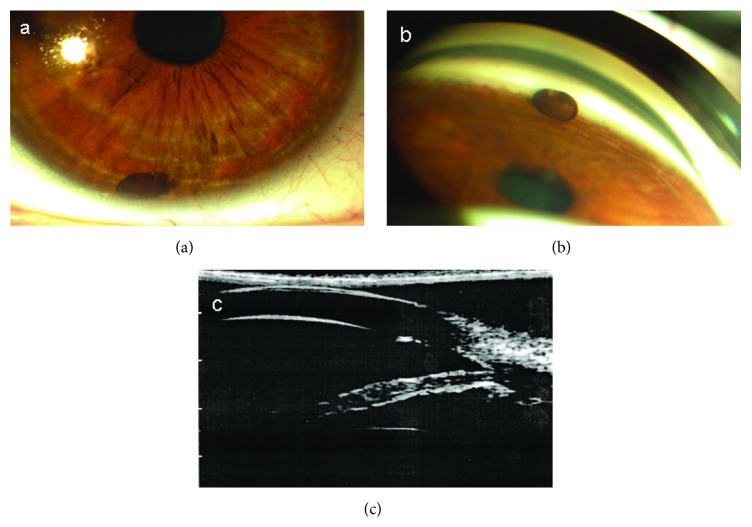
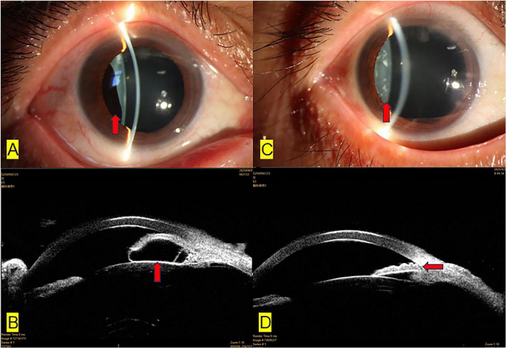
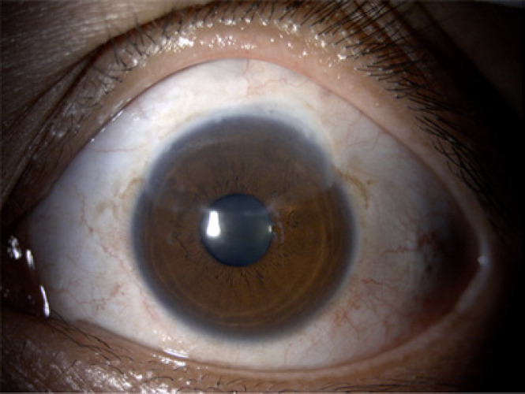
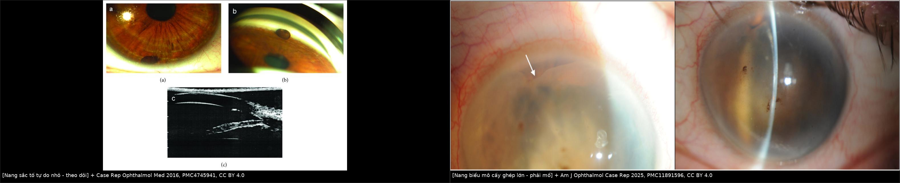
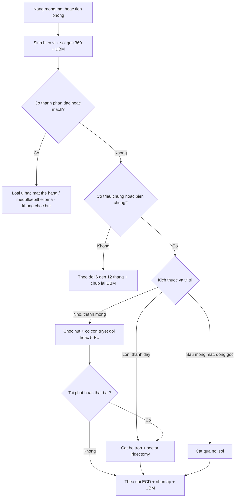
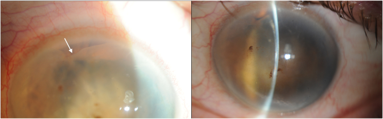
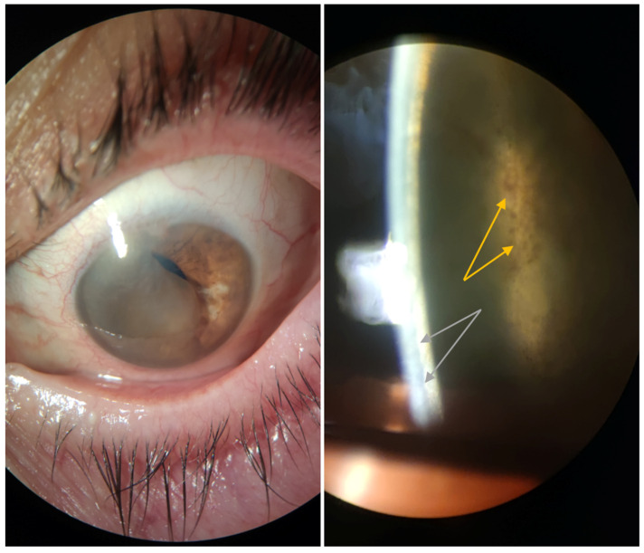
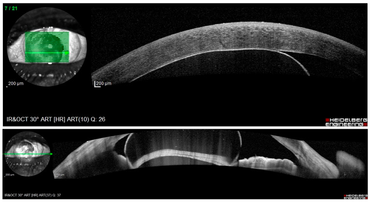
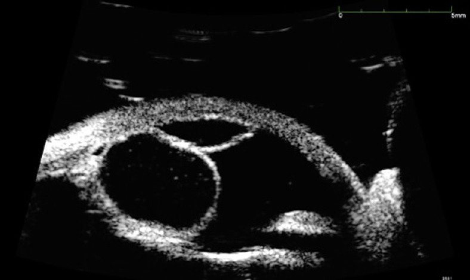
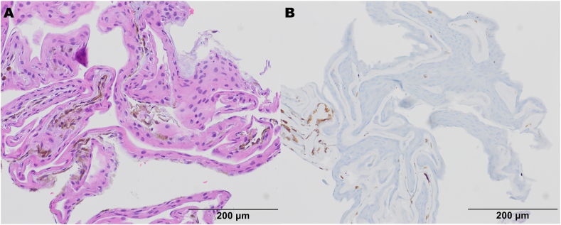

# 3318 — Nang biểu mô mống mắt và tiền phòng (iris/AC epithelial cyst): nang lành hay "quả bom" biểu mô

**Tags:** `pattern:nang` `pattern:nang-tien-phong` `pattern:nang-mong-mat` `pattern:che-truc-thi-giac` `pattern:tang-nhan-ap` `pattern:dinh-goc` `pattern:mat-sau-mo` `vung:mat` `vung:mong-mat` `vung:tien-phong` `vung:goc-tien-phong` `protocol:UBM` `protocol:AS-OCT` `protocol:sinh-hien-vi` `protocol:soi-goc` `protocol:sieu-am-B` `protocol:FNA` `protocol:alcohol` `protocol:5-FU` `protocol:cat-bo`

**Mức chắc chắn (certainty):** tổng hợp y văn (literature synthesis) — 1 tổng quan **118 mắt** nang đoạn trước trên UBM (PMID 10571349), 1 loạt **102 mắt** nang biểu mô mống mắt điều trị bằng cồn tuyệt đối (PMID 12917180), 1 loạt **16 bệnh nhân** nang mống mắt (PMID 24723076), 1 loạt phẫu thuật **27 mắt** (PMID 30348643), 1 loạt **29 mắt** "open iridectomy" (PMC8368187), các ca lâm sàng có ảnh (PMC4745941; PMC13171844; PMC11891596; PMC13030350; PMC9710453; PMC13713870; PMC8789578) và tổng quan (PMID 28882598). **Không có thử nghiệm ngẫu nhiên**; mọi so sánh điều trị là ca – loạt nhỏ, chỗ ngoại suy được đánh dấu **[suy luận]**.

> **Vì sao bài này quan trọng:** phần lớn nang mống mắt **lành, đứng yên, chỉ cần theo dõi** — nhưng có ba cách xử lý sai đều biến một nang lành thành bệnh nặng: (1) **chọc hút "để chẩn đoán"** → vỡ nang, gieo biểu mô thành **màng lan tỏa**; (2) **Nd:YAG phá nang** → tái phát và có thể làm nang lớn nhanh hơn; (3) **gọi nang là u hắc mắt** → múc nhãn cầu oan. Trong **118 mắt** nang đoạn trước, **92,6%** là nang thần kinh–biểu mô, **6,5%** là nang cấy ghép (implantation), **0,9%** là u thể mi có hang giả nang (PMID 10571349). Nang cấy ghép **thành dày hơn, có thể chứa chất hồi âm**, và **lớn dần** — khác hẳn nang sắc tố nguyên phát thường đứng yên.

## 1. Tổng quan bệnh học – cơ chế hình ảnh

### 1.1. Phân loại: cùng là "nang" nhưng ba bệnh sinh khác nhau

- **Nang biểu mô sắc tố mống mắt nguyên phát (primary iris pigment epithelial cyst, IPE cyst):** nang nằm **giữa hai lớp biểu mô sắc tố**, chia theo vị trí **bờ đồng tử (central) – giữa mống mắt (midzonal) – rãnh thể mi (peripheral)**. Đa số **đứng yên**, không triệu chứng (PMID 28882598).
- **Nang mô đệm mống mắt nguyên phát (primary iris stromal cyst):** nang **trong mô đệm mống mắt**, không thông với biểu mô sắc tố sau; sinh ra từ **biểu mô bề mặt lạc chỗ** trong quá trình phôi thai. Thể **bẩm sinh** và **mắc phải**; thể bẩm sinh/trẻ nhỏ **có xu hướng lớn dần** (PMID 24723076; PMC8789578).
- **Nang cấy ghép thứ phát (secondary implantation cyst):** biểu mô **giác mạc/kết mạc** vào tiền phòng qua **vết mổ hoặc chấn thương xuyên**, rồi **tăng sinh trong mô đệm mống mắt** — nơi có mạch máu và môi trường thuận lợi. Đây là thể **lớn dần và gây biến chứng**.
- **Nang do thuốc, do viêm, do ký sinh trùng, do u:** nhóm ít gặp nhưng phải loại trừ trước khi gọi "nang lành" (PMID 28882598).

### 1.2. Vì sao nang cấy ghép lớn dần — cơ chế tế bào

- **Biểu mô bề mặt bị đưa vào tiền phòng** trong mổ/ chấn thương; dịch tiền phòng bình thường **ức chế** sự phát triển, nhưng **mô đệm mống mắt có mạch máu** lại là "đất tốt" cho biểu mô tăng sinh (PMC9710453).
- Tế bào tạo **vách nang bằng biểu mô lát tầng không sừng hóa**, tiết dịch vào lòng nang; lòng nang chứa **dịch + tế bào biểu mô thoái hóa**. Vì vậy nang **to dần theo kiểu "bơm dịch"**, không phải khối tế bào đặc.
- **Thời gian xuất hiện rất biến thiên:** **3 tháng – 20 năm** sau can thiệp; ca lớn trong bài xuất hiện **9 năm** sau đục thể thủy tinh (PMC11891596); có ca **20 năm** sau ghép xuyên (PMC11891596 dẫn Kim 2005). Vì thế **"mổ từ lâu rồi" không loại trừ nang cấy ghép**.
- **Nguồn gốc theo loại can thiệp** (102 nang, PMID 12917180 dẫn qua PMC11891596): **chấn thương xuyên 49,1%**, **ICCE có mất dịch kính 29,9%**, **ICCE 10,8%**, **ECCE 4,9%**, **đặt IOL sau bao 2,9%**. Tức **phẫu thuật đục thể thủy tinh cũ** là nguồn rất lớn.

### 1.3. Vì sao hình ảnh trông như vậy — vật lý UBM/AS-OCT

- **UBM (ultrasound biomicroscopy, 35–50 MHz):** đầu dò tần số cao, **phân giải trục ~50 µm**, **xuyên sâu 4–5 mm** — đủ thấy mống mắt, thể mi trước và góc. **Dịch trong nang không có mặt phân cách âm học** → **không hồi âm (anechoic)**; **vách biểu mô nhiều lớp + keratin** → **hồi âm dày**. Nang cấy ghép có **vách dày hơn** và **2/7 mắt có chất hồi âm trong lòng** (máu/dịch đục/tế bào thoái hóa) (PMID 10571349). **Sắc tố melanin phản xạ mạnh** nên nang sắc tố vẫn có thể **hồi âm ở vách**, dù lòng nang trống.
- **AS-OCT (anterior segment OCT, bước sóng ~1.310 nm):** **phân giải 5–10 µm**, thấy rõ **vách nang, dịch trong, và điểm tiếp xúc với nội mô giác mạc**; nhưng **bị chặn bởi sắc tố mống mắt** nên **không thấy nang sau mống mắt**. Ca PMC13030350 cho thấy AS-OCT xác định nang **chạm mặt sau giác mạc** và **không vượt quá mặt phẳng mống mắt**.
- **Siêu âm B (10 MHz):** dùng khi **giác mạc đục** hoặc cần loại trừ tổn thương hắc–võng mạc; nang hiện là **ổ trống âm, vách mảnh**, nhưng **không đánh giá được góc**.
- **Mô bệnh:** **biểu mô lát tầng không sừng hóa** lót vách nang; **hắc tố nâu trong bào tương**; **S100 và SOX-10 âm** ở lớp lót — đây là điểm **loại u hắc mắt** (PMC11891596). Nang sắc tố nguyên phát lót bằng **biểu mô sắc tố**, khác biệt về mô học.

*Hình 1 — (a) Nang sắc tố **tự do** ở 6 giờ, nổi trong tiền phòng; (b) soi góc thấy **góc mở**; (c) UBM: nang **vách rất mỏng, không hồi âm bên trong, không dính**. Nguồn: PMC4745941, CC BY 4.0.*

### 1.4. Biến chứng — khi nào nang "lành" trở thành bệnh

- **Che trục thị giác:** nang **3–6 mm** đã đủ gây che trục ở một số ca; ca lớn chiếm **gần toàn bộ tiền phòng** gây **mờ hoàn toàn** (PMC11891596).
- **Đóng góc – glôcôm thứ phát:** nang vùng **rãnh thể mi/bờ đồng tử** đẩy **rễ mống mắt ra trước**, làm **hẹp/đóng góc**; ca PMC13171844 đóng góc **7–10 giờ** và **nhãn áp tăng**.
- **Chạm nội mô – mất bù giác mạc:** nang tiếp xúc mặt sau giác mạc lâu ngày gây **phù, tăng sinh nội mô, mất bù**; AS-OCT là cách xác định **điểm chạm** (PMC13030350). Trong loạt **29 mắt** mổ nang biểu mô, **8 mắt có phù giác mạc trước mổ**, **6 mắt** phải ghép giác mạc/màng ối vì **mất bù sau mổ** (PMC8368187; PMC11891596).
- **Viêm màng bồ đào:** nang vỡ hoặc rò dịch gây **phản ứng tiền phòng**; cồn tuyệt đối rò ra tiền phòng gây **viêm 2/102 ca có rò + 9/102 không rõ rò** (PMID 12917180).
- **Chuyển thể màng:** nếu nang **vỡ/hút** và biểu mô **lan ra mặt trước mống mắt/góc**, bệnh chuyển thành **epithelial downgrowth thể màng** — tiên lượng xấu hơn nhiều (PMC9710453; xem bài 3317).

*Hình 2 — (A, C) Nang **sau mống mắt** thấy qua đồng tử giãn; (B) UBM: **khoang trống âm** sau mống mắt, đẩy mống mắt ra trước; (D) UBM vùng góc: **rễ mống mắt phồng**, góc hẹp. Nguồn: PMC13171844, CC BY 4.0.*

*Hình 3 — Nang cấy ghép **lộ qua đồng tử**, làm **bờ đồng tử méo**; đây là dấu hiệu dễ thấy trên sinh hiển vi nhưng dễ bị bỏ qua vì "chỉ là mống mắt không đều". Nguồn: PMC9710453, CC BY-NC 4.0 (nguyên bản, không chỉnh sửa).*

## 2. Mẫu hình + chẩn đoán phân biệt theo vị trí (gamut)

### 2.1. Sáu mẫu hình cần nhận ra

1. **Nang nhỏ, trong, không sắc tố ở bờ đồng tử:** thường là **nang IPE trung tâm**, đứng yên; chỉ theo dõi (PMID 28882598).
2. **Nang sắc tố tự do "nổi trên mặt nước":** **nang IPE bong ra**, di chuyển theo tư thế; bệnh nhân than **"bóng đen" khi cúi/nằm sấp**; UBM **vách mỏng, không dính** (PMC4745941). Chiếm **< 1%** nang IPE nguyên phát.
3. **Nang thành dày, đục, sau mổ/chấn thương, lớn dần:** **nang cấy ghép**; UBM vách dày, có thể có **chất hồi âm**; đây là thể **phải can thiệp khi có biến chứng** (PMID 10571349; PMC9710453).
4. **Nang lớn chiếm tiền phòng, đẩy mống mắt ra sau, che đồng tử:** nang cấy ghép/stroma **thể lớn**; AS-OCT thấy **chạm nội mô**, UBM thấy **không vượt mặt phẳng mống mắt** (PMC11891596; PMC13030350).
5. **Nang sau mống mắt đẩy rễ mống mắt ra trước:** **nang IPE ngoại vi/rãnh thể mi**; mặt trước mống mắt có thể **bình thường**, nên **soi góc + UBM** mới thấy; dễ bị gọi "glôcôm góc đóng nguyên phát" (PMC13171844).
6. **Nang thành dày, có thành phần đặc/bắt màu, kèm mạch:** phải **loại u hắc mắt thể hang (cavitary melanoma)** hoặc **u nguyên bào tủy biểu mô (medulloepithelioma)** — không được chọc hút (PMC13030350).

### 2.2. Gamut theo vị trí

- **Bờ đồng tử:** nang IPE trung tâm · nang mô đệm bẩm sinh · **u hắc mắt thể hang** · u biểu mô sắc tố mống mắt.
- **Giữa mống mắt:** nang IPE midzonal · nang cấy ghép · **u hắc mắt** · u hạt viêm.
- **Rãnh thể mi / thể mi trước:** nang IPE ngoại vi · nang thể mi · **u thể mi có hang** · **medulloepithelioma** (trẻ).
- **Tiền phòng tự do:** nang IPE bong · nang cấy ghép trôi · **mảnh thể thủy tinh** (đục, không phải nang) · **bong màng Descemet**.
- **Mặt sau giác mạc:** nang cấy ghép dính nội mô · **màng xâm nhập biểu mô** (3317) · màng viêm/fibrin.

### 2.3. Vì sao khó — ba "mặt nạ" thường gặp

- **"U hắc mắt"**: nang sắc tố **đen, tròn, một bên** trông rất giống melanoma; nhưng **trong, bờ rõ, không có mạch máu**, UBM **không hồi âm bên trong**, và **không lớn nhanh**. Melanoma **đặc, hồi âm thấp đều**, có **mạch nuôi/sentinel vessel**, **ectropion uveae**, **gửi tia sắc tố**. Vị trí **không giúp**: cả nang và melanoma đều ưu thế **góc dưới** (> 80%) (PMC13030350).
- **"Glôcôm góc đóng nguyên phát"**: nang **sau mống mắt** không thấy trên sinh hiển vi thường; phải **soi góc 360° + UBM** (PMC13171844).
- **"Nang lành, không cần theo dõi"**: nang cấy ghép **lớn dần**, có thể **che trục/chạm nội mô** sau nhiều năm; ca lớn nhất xuất hiện **9 năm** sau mổ (PMC11891596).

## 3. Bảng so sánh phân biệt (ma trận đối chiếu)

| Thực thể (entity) | Hình ảnh điển hình | Chốt vào (rule-in) | Chốt loại (rule-out) | Gợi ý xác nhận |
|---|---|---|---|---|
| **Nang IPE nguyên phát** | Nang **trong, thành mỏng**, ở bờ đồng tử/giữa mống mắt/rãnh thể mi; UBM **không hồi âm**, vách mỏng | **Nang trong + vách mỏng + không hồi âm + đứng yên qua nhiều lần chụp** | **Không có thành phần đặc, không mạch, không lớn nhanh** | UBM 360° + chụp lại 6–12 tháng |
| **Nang IPE tự do** | Nang sắc tố **trôi trong tiền phòng**, đổi vị trí theo tư thế; **bóng đen khi nằm sấp** | **Di chuyển theo tư thế + UBM vách mỏng, không dính** | **Không dính vào mống mắt/góc; không có mạch** | Sinh hiển vi + UBM; theo dõi |
| **Nang mô đệm nguyên phát** | Nang **trong mô đệm**, có thể **bẩm sinh**, lớn dần ở trẻ; UBM vách dày hơn | **Nang trong mô đệm + trẻ nhỏ + lớn dần** | **Không thông với biểu mô sắc tố sau** | UBM; theo dõi sát, can thiệp khi biến chứng |
| **Nang cấy ghép thứ phát** | **Thành dày**, có thể **đục/hồi âm trong lòng**, sau mổ/chấn thương, **lớn dần**; AS-OCT thấy **chạm nội mô** | **Tiền sử mổ/chấn thương xuyên + vách dày + lớn dần + hồi âm trong lòng** | **Không phải nang IPE đơn thuần** (vị trí và vách khác) | UBM + AS-OCT; mô bệnh nếu cắt |
| **U hắc mắt mống mắt** | Khối **đặc**, hồi âm thấp đều, **mạch nuôi**, **sentinel vessel**, **ectropion uveae**, sắc tố lan | **Khối đặc + mạch + lớn nhanh + di căn/hạch** | **Không có lòng dịch không hồi âm; không xẹp khi chọc** | UBM/AS-OCT; **không chọc hút**; sinh thiết khi cắt |
| **U hắc mắt thể hang** | Khối **có nang trong** nhưng **thành dày, có phần đặc**, mạch | **Thành phần đặc + mạch + sắc tố + tuổi lớn** | **Nang thuần túy không có phần đặc** | UBM + AS-OCT + mô bệnh |
| **U biểu mô sắc tố mống mắt** | Khối **sắc tố đặc**, chậm lớn, không lòng dịch | **Đặc, không hồi âm lòng nang, không xẹp** | **Không có lòng dịch** | Mô bệnh |
| **Medulloepithelioma** | Trẻ nhỏ, **khối thể mi dạng nang–đặc**, có thể **glôcôm tân mạch** | **Trẻ + khối thể mi + thành phần nang/đặc** | **Không phải nang đơn thuần** | MRI/UBM; mô bệnh |
| **Nang thể mi/iridociliary** | Nang **không hồi âm**, thường nhiều ổ, ở rãnh thể mi | **Nhiều nang + không hồi âm + không triệu chứng** | **Không có phần đặc** | UBM 360°; theo dõi |

*Hình 4 — Trái: nang sắc tố **tự do nhỏ**, thành mỏng, không triệu chứng → **theo dõi**. Phải: nang cấy ghép **chiếm gần toàn bộ tiền phòng**, che trục thị giác → **phải mổ**. Nguồn: PMC4745941 và PMC11891596, CC BY 4.0 (ảnh ghép giữ nguyên nội dung, thêm dải ghi nguồn).*

> **Đọc ma trận này đúng:** câu hỏi quyết định **không phải "nang to hay nhỏ"** mà là **"có thành phần đặc/mạch không, có lớn lên không, và có chạm nội mô/đóng góc không"**. Nang **trong, vách mỏng, không hồi âm, đứng yên** → theo dõi. Nang **vách dày, có hồi âm trong lòng, lớn dần, chạm nội mô** → can thiệp.

## 4. Protocol chụp/khám + ngưỡng xử trí

### 4.1. Trình tự khám khi thấy "nang trong mống mắt/tiền phòng"

1. **Sinh hiển vi ánh sáng khe:** xác định **trong/đục**, **sắc tố/không**, **vách mỏng/dày**, **vị trí**, **di động theo tư thế**, **chạm nội mô**, **mạch máu**.
2. **Soi góc 360°:** tìm **nang sau mống mắt**, **hẹp/đóng góc**, **dính góc**, **sắc tố ở góc**.
3. **UBM 360° (35–50 MHz):** đo **đường kính lớn nhất**, **độ dày vách**, **hồi âm trong lòng**, **khoảng cách tới góc/nội mô**, **liên quan thể mi**. Đây là **chuẩn vàng** (PMID 28882598; PMC13171844).
4. **AS-OCT:** khi nang ở **phần trước** hoặc nghi **chạm nội mô**; xác định **điểm tiếp xúc** và **độ dày vách** (PMC13030350).
5. **Siêu âm B:** khi **giác mạc đục** hoặc nghi tổn thương **hắc–võng mạc**; không dùng để đánh giá góc.
6. **Ảnh màu + chụp lại:** lưu **ảnh sinh hiển vi** và **UBM** để so **kích thước** qua thời gian — đây là bằng chứng "lớn dần" khách quan.
7. **Mô bệnh:** chỉ khi **cắt bỏ**; ghi rõ **biểu mô lát tầng không sừng hóa**, **hắc tố**, **S100/SOX-10** để loại melanoma (PMC11891596).

### 4.2. Ngưỡng và hành động đã có bằng chứng

| Tình huống | Ngưỡng / dữ liệu | Hành động |
|---|---|---|
| **Nang nhỏ, không triệu chứng, đứng yên** | Bất kỳ kích thước; UBM không hồi âm, vách mỏng | **Theo dõi 6–12 tháng/lần**; ca nang tự do được theo dõi **hàng năm** (PMC4745941) |
| **Nang lớn dần hoặc có triệu chứng** | **Che trục thị giác**, **tăng nhãn áp**, **đóng góc**, **chạm nội mô**, **viêm** | **Can thiệp** — không chờ thêm (PMID 28882598) |
| **Nang cấy ghép có triệu chứng, còn thị lực** | Nang **4 × 5 mm** trong ca PMC9710453 | **Chọc hút + 5-FU nội nang**; ca gốc **không tái phát sau 5 tháng** |
| **Nang mô đệm/cấy ghép lớn, thành dày** | **16 bệnh nhân**, đường kính nền trung vị **12 mm**, dày **4 mm**, chiếm **≥ 50%** tiền phòng/phòng sau | **Chọc hút theo dõi bằng kính hiển vi + rửa cồn tuyệt đối** đến khi vách **xám**; **14/15 (93%)** thoái triển (PMID 24723076) |
| **Nang thể màng/ thất bại cồn** | Tái phát hoặc không thoái triển | **Cắt bỏ trọn + sector iridectomy**; tái phát **3/27 (11%)**, thấp hơn có ý nghĩa khi **kèm sector iridectomy** (p = 0,03) (PMID 30348643) |
| **Nang biểu mô thứ phát phức tạp** | **29 mắt**, tuổi **2–61** | **"Open iridectomy"**: thành công **96% / 87% / 65%** ở **1 / 5 / 10 năm** (PMC8368187) |
| **Nang sau mống mắt có đóng góc** | Đóng góc **7–10 giờ**, nhãn áp tăng | **Cắt nang qua nội soi** (endoscopy-assisted), giữ mô mống mắt trước; ca gốc **thị lực và nhãn áp ổn sau 3 tháng** (PMC13171844) |
| **Nang ở trẻ nhỏ** | **78% ≤ 18 tuổi**, trung vị **5 tuổi**; **63%** do chấn thương xuyên | **Can thiệp sớm**, vì nang **lớn nhanh** và **kết cục mổ kém hơn** ở trẻ (PMID 30348643; PMID 17822446) |

- **Không có ngưỡng mm tuyệt đối** để mổ: nang **3–6 mm** đã gây che trục ở một số ca, trong khi nang **12 mm** vẫn có thể điều trị bảo tồn bằng cồn (PMC11891596; PMID 24723076). **Triệu chứng + biến chứng + tốc độ lớn** quyết định, không phải con số đơn thuần.
- **Cồn tuyệt đối:** hiệu quả **93–94%** nhưng có **phù giác mạc thoáng qua 4/15**, **viêm tiền phòng 1/15**; theo dõi **ECD** vì cồn rò làm **giảm mật độ nội mô, tăng CV, giảm hexagonality** (PMID 24723076; PMC13713870).
- **5-FU nội nang:** dùng trong ca **4 × 5 mm**, **không tái phát 5 tháng**; là lựa chọn **ít xâm lấn** nhưng **chưa có loạt lớn** (PMC9710453).
- **Laser Nd:YAG:** **không phải first-line** cho nang cấy ghép; **5/8 ca chấn thương tái phát** sau Nd:YAG, và tạo lỗ có thể **chuyển thành màng lan tỏa** (PMC11891596; PMC9710453). Ca lớn đã **2 lần YAG** rồi **tái phát** (PMC11891596).
- **Cryotherapy:** **bị bỏ** vì **mất bù giác mạc** (PMC13171844).

### 4.3. Sơ đồ xử trí

### 4.4. Theo dõi sau điều trị

- **Đáp ứng:** nang **xẹp/thoái triển** trên UBM, **không hồi âm** chuyển thành **sẹo xơ**, **nhãn áp hạ**, **giác mạc bớt phù**.
- **Thất bại/tái phát:** nang **lớn lại**, **vách dày thêm**, hoặc **màng lan** ra mặt trước mống mắt/góc. Trong loạt **29 mắt**, tái phát ở **7, 37 và 118 tháng** — nghĩa là **theo dõi dài hạn** (PMC8368187).
- **Di chứng cần chủ động tìm:** **mất bù giác mạc** (cần ghép), **glôcôm** (cần thuốc/van), **dính góc**, **đục thể thủy tinh**, **phù hoàng điểm**.

## 5. Biến thể bình thường và cạm bẫy

- **Nang IPE nguyên phát là biến thể lành, rất thường gặp:** **92,6%** nang đoạn trước là **nang thần kinh–biểu mô**, **83,3%** nguyên phát; **62,2%** có **≤ 3 nang**, nhiều nang **> 3** ở **37,8%** (PMID 10571349). **Không mổ chỉ vì "thấy nang"**.
- **Nang tự do ≠ nang cấy ghép:** nang tự do **vách rất mỏng, không dính**, **di chuyển theo tư thế**, và **đa số đứng yên**; can thiệp chỉ khi **che trục/biến chứng** (PMC4745941; PMID 18577641).
- **"Chọc hút để xem dịch" — sai:** chọc làm **vỡ vách**, biểu mô **lan ra tiền phòng** và chuyển thành **màng lan tỏa**; **không chọc nang không triệu chứng** (PMC9710453; PMID 28882598).
- **"Nd:YAG là ít xâm lấn nên làm trước" — sai:** tái phát cao (**5/8** ca chấn thương), có thể **làm nang lớn nhanh**, và tạo lỗ **externalize** nang thành màng (PMC11891596; PMC9710453).
- **"Nang sắc tố = melanoma" — sai:** nang IPE **sắc tố đen** nhưng **trong**, **không hồi âm**, **không mạch**; melanoma **đặc**, có **mạch/sentinel vessel**, **ectropion uveae**. Ở người lớn, **tuổi** giúp phân biệt nhưng **không tuyệt đối** (PMC13030350).
- **"U hắc mắt thể hang" — bẫy hiếm:** khối **có nang trong** nhưng **thành dày, có phần đặc**, **mạch**; **không được chọc hút** vì có thể **gieo tế bào** (PMC13030350).
- **"Glôcôm góc đóng nguyên phát"** khi nang **sau mống mắt**: mặt trước mống mắt bình thường, **soi góc + UBM** mới thấy; bỏ sót dẫn tới **mổ glôcôm mà không xử lý nang** (PMC13171844).
- **"Trẻ nhỏ thì chờ" — sai:** nang ở trẻ **lớn nhanh**, **kết cục mổ kém**, **78%** ca phẫu thuật **≤ 18 tuổi**; **nang mô đệm bẩm sinh hai bên** có thể gây **glôcôm, giác mạc đục, nhãn cầu to** (PMID 30348643; PMC8789578).
- **UBM bị ấn đầu dò:** ấn mạnh làm **biến dạng góc**, tạo **hẹp góc giả**; dùng **gel**, không đè, và đối chiếu **nhiều kinh tuyến**.
- **Cồn rò ra tiền phòng:** gây **phù giác mạc, viêm, giảm ECD**; phải **bơm viscoelastic bảo vệ nội mô**, **hút sạch cồn**, và **đo ECD trước–sau** (PMC13713870).

*Hình 5 — (trái) Nang **chiếm gần toàn bộ tiền phòng**, đẩy mống mắt ra sau, che đồng tử; (phải) đèn khe cho thấy **vách nang** phía trên. Bệnh nhân **77 tuổi**, **9 năm sau đục thể thủy tinh**, đã **2 lần YAG** rồi tái phát. Nguồn: PMC11891596, CC BY 4.0.*

*Hình 6 — Nang **chiếm 2/3 tiền phòng**, che trục thị giác; đèn khe cho thấy **vách nang** và **thành phần sắc tố** phía sau. Nguồn: PMC13030350, CC BY 4.0.*

*Hình 7 — AS-OCT: (trên) nang **tiếp xúc trực tiếp với nội mô giác mạc**; (dưới) nang **không vượt quá mặt phẳng mống mắt**. Điểm chạm nội mô là **yếu tố quyết định** nguy cơ mất bù giác mạc. Nguồn: PMC13030350, CC BY 4.0.*

*Hình 8 — Siêu âm B: nang **4 × 5 mm**, **lòng không hồi âm**, **vách mỏng**, ấn lõm mống mắt và **chạm nội mô** phía thái dương. Nguồn: PMC9710453, CC BY-NC 4.0 (nguyên bản, không chỉnh sửa).*

*Hình 9 — (A) H&E: vách nang **biểu mô lát tầng không sừng hóa**, có **hắc tố nâu**, mô đệm thưa; (B) **S100/SOX-10 âm** ở lớp lót (chỉ còn vài tế bào sắc tố dương) — **loại u hắc mắt**. Nguồn: PMC11891596, CC BY 4.0.*

## 6. Tự lượng giá — Blind Quiz

**Ca 1 — "Bóng đen" chỉ xuất hiện khi nằm sấp**

- Gợi ý lâm sàng: **30 tuổi**, nam; **1 năm** nay thấy **khiếm khuyết thị giác mắt phải khi nằm sấp**; không đau, không đỏ; sinh hiển vi thấy **nang sắc tố nhỏ ở 6 giờ**, **di động**.
- Câu hỏi: (1) Nang thuộc loại nào? (2) Vì sao **không chọc hút**? (3) Xử trí?

<b>Bấm để hiện đáp án (findings + chẩn đoán)</b>

- **Dấu hiệu:** (a) nang **sắc tố, tự do** ở 6 giờ; (b) **góc mở**; (c) UBM **vách rất mỏng, không hồi âm, không dính**.
- **Chẩn đoán:** **nang biểu mô sắc tố mống mắt tự do** (dislodged IPE cyst) — chiếm **< 1%** nang IPE nguyên phát, đa số **đứng yên**.
- **Vì sao không chọc:** chọc làm **vỡ vách**, biểu mô lan thành **màng**; nang nhỏ, không biến chứng → **theo dõi hàng năm**, hẹn khám ngay nếu **đau/tăng triệu chứng**.
- **Nguồn ảnh:** PMC4745941, Fig. 1, CC BY 4.0.

**Ca 2 — Mờ mắt 1 tuần, góc đóng 7–10 giờ**

- Gợi ý lâm sàng: nữ, **mờ mắt phải 1 tuần**; sinh hiển vi và UBM thấy **nang mống mắt hai bên**, bên phải có **nang thái dương lớn**; góc đóng **7–10 giờ**.
- Câu hỏi: (1) Nang nằm ở đâu? (2) Vì sao góc đóng? (3) Can thiệp gì?

<b>Bấm để hiện đáp án (findings + chẩn đoán)</b>

- **Dấu hiệu:** (A, C) nang **sau mống mắt** thấy khi giãn đồng tử; (B) UBM **khoang trống âm sau mống mắt**, đẩy mống mắt ra trước; (D) **rễ mống mắt phồng**, góc hẹp.
- **Chẩn đoán:** **nang IPE sau mống mắt** gây **đóng góc thứ phát**.
- **Xử trí:** **cắt nang qua nội soi** (endoscopy-assisted), bảo tồn mô đệm mống mắt trước; ca gốc **thị lực tăng, nhãn áp giảm, không tái phát sau 3 tháng**.
- **Nguồn ảnh:** PMC13171844, Fig. 1, CC BY 4.0.

**Ca 3 — Nang chạm nội mô: mổ hay chờ?**

- Gợi ý lâm sàng: mắt **đã đục thể thủy tinh**; nang **chiếm 2/3 tiền phòng**, **che trục thị giác**; AS-OCT thấy nang **chạm nội mô** nhưng **không vượt mặt phẳng mống mắt**.
- Câu hỏi: (1) Hai nguy cơ chính? (2) Vì sao **không chọc hút đơn thuần**? (3) Kế hoạch?

<b>Bấm để hiện đáp án (findings + chẩn đoán)</b>

- **Dấu hiệu:** (trên) **nang tiếp xúc nội mô**; (dưới) nang **giới hạn trong tiền phòng**, không lan ra sau.
- **Chẩn đoán:** **nang cấy ghép/stroma lớn** sau đục thể thủy tinh, **chạm nội mô** + **che trục**.
- **Nguy cơ:** **mất bù giác mạc** (do chạm nội mô) và **glôcôm/đóng góc**; chọc hút đơn thuần **tái phát cao**, có thể **chuyển thể màng**.
- **Kế hoạch:** **cắt bỏ trọn ± sector iridectomy**, bảo vệ nội mô, theo dõi **ECD + nhãn áp**; nếu chọn cồn/5-FU thì **bảo vệ nội mô bằng viscoelastic** và theo dõi sát.
- **Nguồn ảnh:** PMC13030350, Fig. 3, CC BY 4.0.

**Ca 4 — Vách nang hay tế bào u?**

- Gợi ý lâm sàng: bệnh phẩm **cắt nang** ở mắt có nang lớn; nhuộm **H&E** và **S100/SOX-10**.
- Câu hỏi: (1) Lớp lót là gì? (2) Dấu hiệu nào **loại melanoma**? (3) Vì sao vẫn cần mô bệnh?

<b>Bấm để hiện đáp án (findings + chẩn đoán)</b>

- **Dấu hiệu:** (A) **biểu mô lát tầng không sừng hóa**, có **hắc tố nâu**, mô đệm thưa; (B) **S100/SOX-10 âm** ở lớp lót.
- **Chẩn đoán:** **nang biểu mô mống mắt** (implantation/stromal cyst), **không phải melanoma**.
- **Vì sao:** u hắc mắt **S100/SOX-10 dương**; nang lót **biểu mô**, không phải tế bào hắc tố. Mô bệnh cũng xác định **nguồn giác mạc/kết mạc** (có/không tế bào hình đài).
- **Nguồn ảnh:** PMC11891596, Fig. 3, CC BY 4.0.

## 7. Câu hỏi nghiên cứu & điểm chưa đồng thuận (tính đến 11/2026)

1. **[Tranh cãi] Ở nang biểu mô mống mắt có triệu chứng, chọc hút + cồn/5-FU nội nang có kiểm soát bệnh tương đương cắt bỏ trọn kèm sector iridectomy không?**
   - **Đã biết:** cồn tuyệt đối đạt **93% (14/15)** thoái triển (PMID 24723076), trong khi cắt bỏ + sector iridectomy có **tái phát 11%** (PMID 30348643); nhưng cồn gây **phù giác mạc thoáng qua 4/15** và có thể **giảm ECD** (PMC13713870).
   - **Chưa rõ:** so sánh trực tiếp **tái phát, thị lực, ECD** giữa hai chiến lược, và ảnh hưởng của **kích thước/vị trí** nang.
   - **Hướng nghiên cứu:** đoàn hệ tiến cứu phân tầng theo **kích thước và vị trí UBM**, so **tái phát/thị lực/ECD**.
   - **Nguồn:** PMID 24723076 (2014); PMID 30348643 (2019); PMC13713870 (2026).

2. **[Khoảng trống] Chưa có ngưỡng kích thước/tốc độ lớn và khoảng theo dõi tối ưu cho nang không triệu chứng.**
   - **Đã biết:** nang **3–6 mm** có thể che trục, nhưng nang **12 mm** vẫn điều trị bảo tồn được (PMC11891596; PMID 24723076); UBM là chuẩn vàng nhưng chưa có **phân độ định lượng**.
   - **Chưa rõ:** **ngưỡng mm/năm** để can thiệp, **khoảng chụp lại** (6–12 tháng?), và giá trị của **AS-OCT** so với UBM.
   - **Hướng nghiên cứu:** registry đa trung tâm ghi **kích thước, vị trí, tốc độ lớn, biến chứng**, đối chiếu **mô bệnh**.
   - **Nguồn:** PMID 28882598 (2018); PMID 10571349 (1999); PMC8368187 (2021).

3. **[Khác biệt thực hành] Ở trẻ có nang mô đệm/cấy ghép, nên Nd:YAG trước hay cắt sớm? Có nên làm sector iridectomy thường quy?**
   - **Đã biết:** Nd:YAG **tái phát 5/8** ca chấn thương (PMID 17822446), trong khi cắt + sector iridectomy **giảm tái phát có ý nghĩa** (p = 0,03) (PMID 30348643); trẻ **78% ≤ 18 tuổi**, kết cục kém hơn (PMID 30348643).
   - **Chưa rõ:** tiêu chí chọn **laser** vs **cắt sớm** theo tuổi/kích thước/vị trí, và lợi ích của sector iridectomy ở nang nhỏ.
   - **Hướng nghiên cứu:** nghiên cứu tiến cứu theo tuổi, so **tái phát, thị lực, nhược thị, biến chứng**.
   - **Nguồn:** PMID 17822446 (2007); PMID 30348643 (2019); PMC13171844 (2026).

## Bài liên quan chéo

- [3317 – Xâm nhập biểu mô vào tiền phòng (epithelial downgrowth): màng sau giác mạc bờ cuộn](../3317-xam-nhap-bieu-mo-vao-tien-phong/lesson.md)
- [3310 – Tăng nhãn áp do corticoid sau ghép nội mô giác mạc](../3310-tang-nhan-ap-corticoid-sau-ghep-noi-mo-giac-mac/lesson.md)
- [3307 – Viêm màng bồ đào trước do CMV](../3307-viem-mang-bao-dau-truoc-cmv/lesson.md)
- [3306 – Viêm màng bồ đào trước do HSV/VZV (masquerade viêm)](../3306-viem-mang-bao-dau-truoc-hsv-vzv/lesson.md)
- [3305 – Hội chứng TINU (viêm ống thận mô kẽ + viêm màng bồ đào)](../3305-hoi-chung-tinu/lesson.md)

## Ảnh

- `3318_iris-cyst_Anh-mat-PMC4745941-Fig1.jpg` — nang sắc tố tự do: sinh hiển vi + soi góc + UBM; PMC4745941, **CC BY 4.0**.
- `3318_iris-cyst_Anh-mat-UBM-PMC13171844-Fig1.jpg` — nang sau mống mắt + UBM góc; PMC13171844, **CC BY 4.0**.
- `3318_iris-cyst_Anh-mat-PMC11891596-Fig1.jpg` — nang cấy ghép lớn chiếm tiền phòng; PMC11891596, **CC BY 4.0**.
- `3318_iris-cyst_Histo-PMC11891596-Fig3.jpg` — mô bệnh: biểu mô lát tầng + S100/SOX-10 âm; PMC11891596, **CC BY 4.0**.
- `3318_iris-cyst_Anh-mat-PMC13030350-Fig2.jpg` — nang chiếm 2/3 tiền phòng; PMC13030350, **CC BY 4.0**.
- `3318_iris-cyst_AS-OCT-PMC13030350-Fig3.jpg` — AS-OCT: nang chạm nội mô; PMC13030350, **CC BY 4.0**.
- `3318_iris-cyst_Anh-mat-PMC9710453-Fig1.jpg` — nang cấy ghép lộ qua đồng tử; PMC9710453, **CC BY-NC 4.0**.
- `3318_iris-cyst_Sieu-am-B-PMC9710453-Fig2.jpg` — siêu âm B: nang 4 × 5 mm; PMC9710453, **CC BY-NC 4.0**.
- `composite_nang-nho-vs-nang-lon.jpg` — ảnh ghép đối chiếu nang nhỏ theo dõi vs nang lớn phải mổ; PMC4745941 + PMC11891596, **CC BY 4.0**.

> Không dùng để chẩn đoán độc lập khi chưa có người hướng dẫn.
