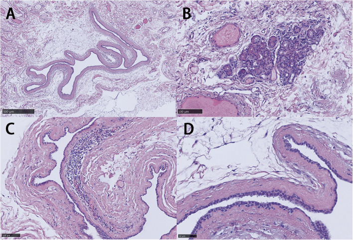
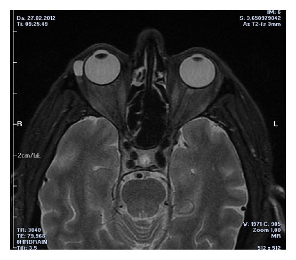
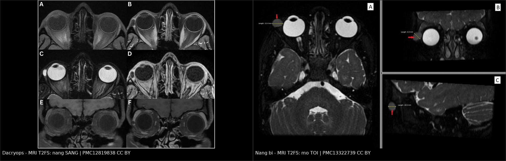
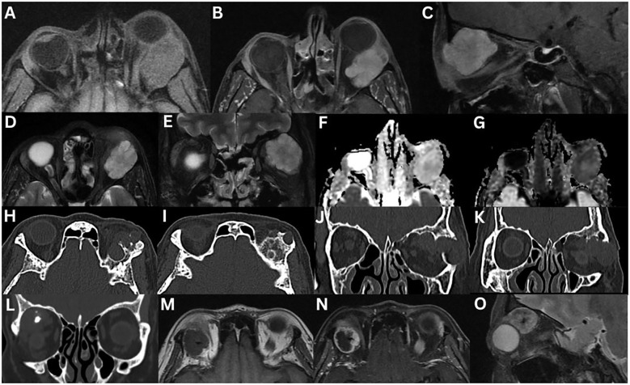
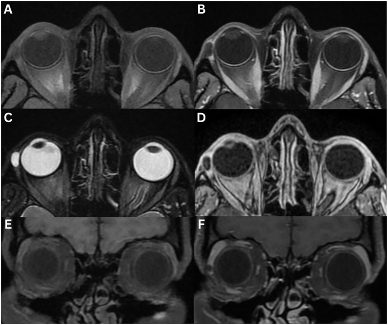
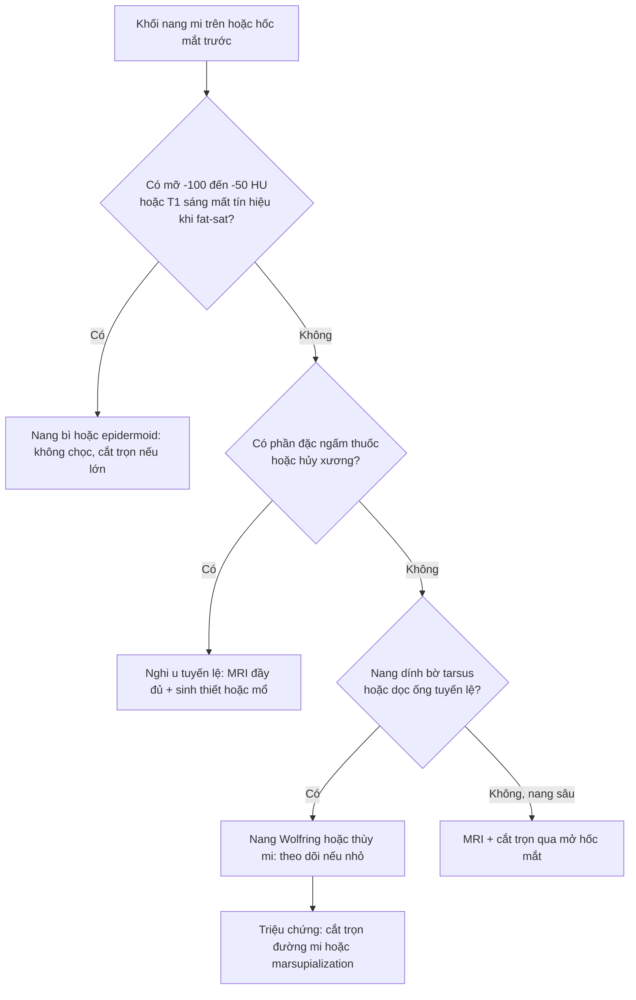
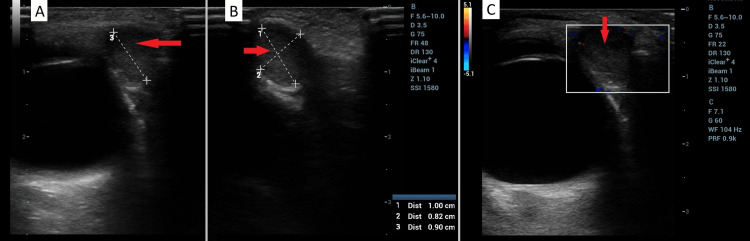
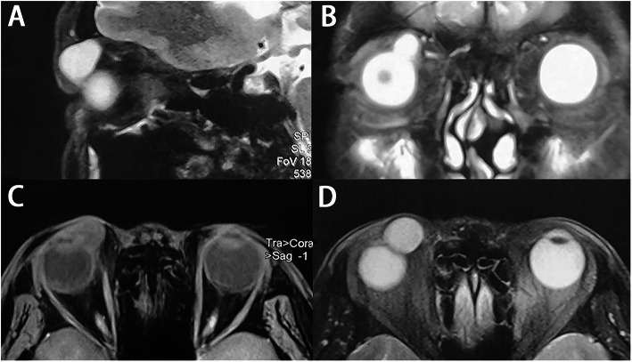
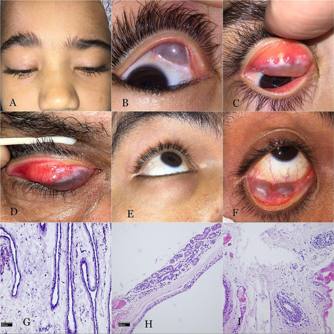

# 3319 — Nang tuyến lệ (dacryops): "nang nước mắt" ở mi trên và gamut khối nang vùng mi trên – hốc mắt

**Tags:** `pattern:nang` `pattern:nang-tuyen-le` `pattern:phu-mi` `pattern:sa-truc-nhan-cau` `pattern:loi-mat` `pattern:khong-ngam-thuoc` `vung:mat` `vung:mi` `vung:hoc-mat` `protocol:MRI-hoc-mat` `protocol:CT-hoc-mat` `protocol:sieu-am-B` `protocol:cat-tron` `protocol:marsupialization`

**Mức chắc chắn (certainty):** tổng hợp y văn (literature synthesis) — 1 loạt **58 mẫu / 55 bệnh nhân** (PMID 34324876), 1 loạt **48 mắt** nang ống tuyến Wolfring (PMC11020823), 1 loạt **23 ca** (PMC6074379), 1 loạt **7 bệnh nhân** marsupialization (PMID 21956544), 1 tổng quan hình ảnh tuyến lệ (PMC12819838), 1 nghiên cứu proteomics **4 ca** (PMC7619048), các ca có ảnh MRI/CT/mô bệnh (PMC7513315; PMC3867892; PMC8355906) và 1 tổng quan nang hốc mắt (PMC13539507). **Không có thử nghiệm ngẫu nhiên**; mọi so sánh điều trị là loạt ca nhỏ, chỗ ngoại suy được đánh dấu **[suy luận]**.

> **Vì sao bài này quan trọng:** dacryops là khối nang lành tính, nhưng ba sai lầm hay gặp đều biến nó thành bệnh: (1) **chọc hút "cho biết dịch gì"** — nang tái đầy, không có giá trị mô học, và trong loạt 48 mắt có **6 bệnh nhân đã chọc hút/chọc kim trước khi chuyển đến và bị tái phát** (PMC11020823); (2) **gọi mọi nang vùng tuyến lệ là dacryops** — bỏ sót **nang bì** (mỡ **−100 đến −50 HU**) hoặc một **u tuyến lệ làm tắc ống dẫn**; (3) **mổ "lấy trọn" mà không kiểm tra chức năng lệ** — trường hợp viêm kết mạc màng sau có **Schirmer 1 mm so với 18 mm** mắt bên, toàn bộ ống tuyến bị xơ bít, chỉ còn **một ống dẫn lệ lạc chỗ** (PMC10391419). Chẩn đoán đúng **trên MRI/CT + soi lật mi** cho phép chọn **theo dõi – cắt trọn – marsupialization** đúng bệnh nhân.

## 1. Tổng quan bệnh học – cơ chế hình ảnh

### 1.1. Dacryops là gì: giãn ống tuyến, không phải u

- **Định nghĩa:** dacryops (lacrimal ductal cyst, lacrimal gland duct cyst) là **giãn ống bài tiết của tuyến lệ** thành nang chứa dịch giống nước mắt; thành nang là **biểu mô 2 lớp trụ–lập phương** trên mô xơ, dày **0,1–0,2 mm** (PMC7513315). Tổ chức tuyến lệ nằm cạnh thành nang là "chìa khóa mô học", nhưng **chỉ thấy ở khoảng 1/4** bệnh nhân trong một loạt 48 ca vì acini teo dần trong quá trình tạo nang (PMC11020823).
- **Phân loại theo vị trí (Bullock), 4 thể:** (1) nang **thùy mi (palpebral lobe)** — "simple dacryops", hay gặp nhất; (2) nang **thùy ổ mắt (orbital lobe)** — sâu, gây lồi mắt; (3) nang **tuyến lệ phụ Krause** (trong cùng đồ kết mạc) và **Wolfring** (sát bờ tarsus trên); (4) nang **tuyến lệ lạc chỗ (ectopic/choristomatous)** — mi, góc mắt ngoài, kết mạc, củng mạc, **caruncle**, giác mạc, mống mắt, hắc mạc, hốc mắt (PMC12819838; PMC7513315).
- **Dịch tễ:** dacryops chiếm **3–6% tổn thương tuyến lệ** (PMC12819838) và khoảng **2% khối hốc mắt** (dẫn Shields, trong PMC7513315). Tại Ả Rập Xê Út, tỷ lệ nang ống tuyến lệ phụ ước tính **1/6.800 dân** (PMC6074379). Tuổi trung bình **41,2 (4–78)** ở loạt 58 mẫu (PMID 34324876); nang tuyến lệ phụ trẻ hơn (**28,5 tuổi, 3–66**) so với nang tuyến lệ chính (**48–52 tuổi**) (PMC11020823). Nữ **64,6–75%** (PMC11020823; dẫn Shields).
- **Vị trí:** mi trên **60,3%**; tuyến lệ phụ **55,2%**, tuyến lệ chính **32,8%**, lạc chỗ **12%**, caruncle **6,9%** (58 mẫu, PMID 34324876). Loạt Wolfring: mi trên **73,9%**, đau không đau **91,3%** (PMC6074379).
- **Kích thước thực tế:** **11 × 6,5 mm** (PMC3867892), **16,2 × 13,7 mm** (PMC7513315), mẫu mổ **20 × 15 × 8 mm** (PMC8355906), **18 × 10 × 5 mm** sau khi xẹp (PMC7513315), trên CT **1 × 0,8 cm** (PMID 10445458). Nang lớn gây **lồi mắt, lệch nhãn cầu, hạn chế vận nhãn, sụp mi cơ học, song thị** — đã có ca **nhãn áp 36 mmHg** do chèn ép (PMC7513315).

*Mô bệnh: (a) khoang nang lớn lót **2 lớp biểu mô lập phương**, không có tế bào hình đài; (b) mô tuyến lệ; (c) viêm mạn quanh thành; (d) **snout bào tương** kiểu apocrine. Nguồn: BMC Ophthalmol 2020 (PMC7513315), CC BY 4.0.*

### 1.2. TẠI SAO nang "sáng trên T2, tối trên T1, không ngấm thuốc"

- **Bản chất dịch:** nang chứa **dịch tiết giống nước mắt** — nước, apolipoprotein, immunoglobulin, yếu tố bổ thể, ít tế bào (proteomics: **190 protein tăng, 52 protein giảm** so với nước mắt lành; tăng **MMP-7, MMP-10**, protein ma trận ngoại bào, yếu tố bổ thể — PMC7619048). Vì **nước chiếm ưu thế**, thời gian T1 dài → **tín hiệu thấp/trung gian trên T1**, T2 rất dài → **tín hiệu rất cao trên T2/T2 fat-sat**. Dịch tự do, độ nhớt thấp → **không hạn chế khuếch tán** trên DWI/ADC **[suy luận từ vật lý dịch tự do — bài gốc không đo ADC cho dacryops]**.
- **TẠI SAO không ngấm thuốc:** thành nang chỉ là **mô xơ mỏng 0,1–0,2 mm**, không có mô đệm giàu mạch bên trong; thuốc cản quang chỉ có thể làm **viền mỏng** của thành. Trong ảnh MRI của tổng quan, dacryops **"không ngấm thuốc, không có thành phần đặc"** (PMC12819838). Đây là điểm khác cốt lõi với **u tuyến đa dạng (pleomorphic adenoma)** — khối đặc, ngấm thuốc mạnh và không đồng nhất.
- **TẠI SAO trên CT là "dịch":** nước = **0 HU**, mỡ = **−50 đến −150 HU**, máu = **+40 đến +80 HU** (PMC12660082). Dacryops đồng nhất, đậm độ dịch, **không vôi hóa**, **không phá xương**; nang ở thùy mi nằm **trước bờ ổ mắt**, không có biến đổi xương (PMC12819838). **Chưa có ngưỡng HU riêng** cho dacryops — không được dùng một con số HU để "chốt" chẩn đoán.
- **TẠI SAO trên siêu âm là nang:** thành mỏng, **hình cầu, hồi âm thấp bên trong, thành tăng hồi âm**, tăng hồi âm phía sau (PMC12819838). Không có tín hiệu mạch bên trong — khác khối đặc.

### 1.3. Sinh bệnh học: xơ bít ống + viêm quanh ống, không chỉ "tắc ống đơn thuần"

- **Cơ chế cũ:** chấn thương/viêm → tổn thương thành ống, **giảm khả năng co bóp** của ống và **tăng tiết** → giãn ống (PMC3867892). Yếu tố liên quan: **trachoma, viêm kết mạc, viêm kết mạc bọng nước (OCP), hội chứng Stevens–Johnson, chấn thương, bỏng hóa chất, sa tuyến lệ, IgA cao** (PMC7513315; PMC11020823).
- **Bằng chứng mới (proteomics 2026, 4 ca):** thành nang **mất AQP5 và mất mạng thần kinh quanh ống (β-III tubulin âm)**, tăng **MMP-7/MMP-10**, **xơ dưới biểu mô**, thâm nhiễm **CD20+ và CD138+** → tác giả kết luận dacryops là **giãn ống phản ứng sau viêm**, không phải nang bẩm sinh (PMC7619048).
- **Hệ quả thực hành:** vì là bệnh **mắc phải do xơ/viêm**, dacryops hay đi kèm **sẹo kết mạc** (loạt Wolfring: **87,5%** có sẹo kết mạc mi, **79,2% do trachoma**, **8,3% do viêm kết mạc dị ứng mùa**) (PMC11020823). Khám **lật mi + tìm sẹo/symblepharon** quan trọng ngang với chụp hình.

## 2. Mẫu hình + chẩn đoán phân biệt theo vị trí (gamut)

**Mẫu hình chung:** khối **nang bờ rõ, thành mỏng, dịch đồng nhất, không ngấm thuốc, không phá xương**, ở **mi trên/hốc mắt trước**. Ba câu hỏi phải trả lời trước khi gọi tên:

1. **Có mỡ trong nang không?** (dermoid/epidermoid) — đo HU và so T1 trước/sau fat-sat.
2. **Có thành phần đặc/ngấm thuốc/hủy xương không?** (u tuyến lệ, ACC) — nếu có, không phải nang đơn thuần.
3. **Nang nằm dọc đường ống tuyến lệ hay dính bờ tarsus không?** (dacryops thùy mi/Wolfring) — khám lật mi là chìa khóa.

### 2.1. Gamut theo vị trí giải phẫu

- **Thùy mi (palpebral lobe) — "simple dacryops":** khối **dưới–thái dương mi trên**, nhìn thấy khi lật mi, **trong, xanh xám, di động, chiếu sáng xuyên (transillumination dương)**, không đau (PMC11020823). Đây là thể hay gặp và dễ chẩn đoán nhất. Nang nhỏ vẫn có thể gây **song thị** nếu nằm sát cơ trực ngoài (**11 × 6,5 mm**) (PMC3867892).

*T2 axial: nang **11 × 6,5 mm** tăng tín hiệu, bờ rõ, sát cơ trực ngoài phải; song thị khi liếc trái và **hết sau mổ**. Nguồn: Case Rep Ophthalmol Med 2013 (PMC3867892), CC BY 3.0.*
- **Tuyến lệ phụ Wolfring:** **dưới kết mạc, dính chặt bờ tarsus không phải bờ mi**, thường **vùng mi trên giữa/giữa–trong**; có **dải xơ ngang bờ tarsus**; không di động (PMC11020823).
- **Tuyến lệ phụ Krause:** trong **cùng đồ kết mạc**, **không dính bờ tarsus** — phân biệt với Wolfring bằng nghiệm pháp lật mi và độ di động.
- **Thùy ổ mắt (orbital lobe):** sâu sau vách, **lồi mắt, đẩy nhãn cầu xuống–vào trong**, có thể **chèn ép thần kinh thị → giảm thị lực, VEP chậm, nhãn áp tăng** (PMC7513315). Thể này **không thấy khi lật mi**.
- **Lạc chỗ (ectopic):** bất kỳ nơi nào có mô tuyến lệ — **caruncle**, mi, góc mắt ngoài, thậm chí **hốc mắt trong**; vị trí bất thường làm **bỏ sót chẩn đoán** (58 mẫu: chẩn đoán trước mổ đúng chỉ **44,8%**) (PMID 34324876).

### 2.2. Gamut theo loại biểu mô lót thành nang (cách nhớ "5 loại nang")

Tổng quan nang hốc mắt phân loại theo **tế bào thành nang**: **biểu mô da** (dermoid/epidermoid), **biểu mô kết mạc** (inclusion cyst), **biểu mô hô hấp** (mucocele xoang), **biểu mô tuyến mồ hôi/apocrine** (hidrocystoma), **tuyến lệ** (dacryops) và **tế bào thần kinh** (PMC13539507). Cùng một "khối nang" nhưng **mỡ, chất sừng, chất nhầy, mồ hôi hay nước mắt** cho **tín hiệu và cách xử trí khác nhau**.

*Trái: dacryops thùy mi phải — T2 fat-sat **sáng**, không ngấm thuốc (PMC12819838, CC BY 4.0). Phải: nang bì trên–thái dương — T2 fat-sat **tối vì mỡ**, kèm "sack of marbles" trên siêu âm (PMC13322739, CC BY 4.0). Ảnh ghép letterbox, không crop/kéo giãn.*

### 2.3. Kẻ bắt chước đặc (solid mimics) — không được nhầm với nang

- **U tuyến đa dạng (pleomorphic adenoma):** khối **đặc, không đồng nhất, ngấm thuốc mạnh**, có thể **vôi hóa, tạo xương, nang hóa từng phần**; **không hạn chế khuếch tán** trên ADC; **chèn ép cơ trực ngoài** (PMC12819838). Nang hóa trong u tạo "ổ dịch" nhưng **phần đặc ngấm thuốc** là chốt loại nang đơn thuần.
- **Định lượng ADC giúp phân tầng khối tuyến lệ:** u tuyến đa dạng **1,37**, u ác **1,03**, lymphoma **0,55 × 10⁻³ mm²/s**; ngưỡng **1,14** và **0,76** (bài [3230](../3230-khoi-tuyen-le/lesson.md)) — nhưng **dacryops là nang dịch, không có phần đặc để đo ADC**, nên ADC không dùng để "chốt dacryops".
- **Carcinoma tuyến nang (adenoid cystic carcinoma):** khối **không đều, xâm lấn cơ/dây thần kinh thị**, **hoại tử trung tâm**, **hủy xương**, **dấu nêm bên (lateral wedge sign)**; đau và liệt thần kinh là red flag (PMC12819838).
- **Lymphoma tuyến lệ:** khối **đồng nhất, ngấm thuốc, hạn chế khuếch tán**, có thể hai bên; **không phải nang** (PMC12819838).

*U tuyến đa dạng tuyến lệ trái: T1, T1 fat-sat sau tiêm, T2, ADC và CT — khối đặc, không đồng nhất, ngấm thuốc, khác hẳn nang dịch đồng nhất không ngấm thuốc. Nguồn: Front Ophthalmol 2025 (PMC12819838), CC BY 4.0.*

## 3. Bảng so sánh phân biệt (ma trận đối chiếu)

| Thực thể (entity) | Hình ảnh điển hình (US/CT/MRI) | Chốt vào (rule-in) | Chốt loại (rule-out) | Gợi ý xác nhận |
|---|---|---|---|---|
| **Dacryops thùy mi (simple dacryops)** | Nang **trong, thành mỏng 0,1–0,2 mm**, dịch đồng nhất; CT đậm độ dịch; MRI **T1 thấp/trung gian, T2 rất cao, không ngấm thuốc** | **Lật mi thấy nang dưới kết mạc ở thùy mi/cùng đồ trên–thái dương + transillumination dương + không ngấm thuốc** | Có **mỡ (−100 đến −50 HU)** → nang bì; có **phần đặc ngấm thuốc** → u | MRI hốc mắt T1 + T2 fat-sat + T1 fat-sat sau tiêm; theo dõi nếu nhỏ |
| **Dacryops Wolfring/Krause** | Nang **dưới kết mạc**, dính **bờ tarsus** (Wolfring) hoặc trong cùng đồ (Krause); thường **< 10 mm** | **Dính bờ tarsus không di động + dải xơ ngang + sẹo kết mạc (trachoma 79,2%)** | Nang không dính, di động, ở mi → nang kết mạc/inclusion | Lật mi đo kích thước; cắt trọn đường mi nếu có triệu chứng |
| **Dacryops thùy ổ mắt/lạc chỗ** | Nang **sâu sau vách**, có thể **16,2 × 13,7 mm**, đẩy nhãn cầu, **chèn ép thị thần kinh** | **Nang dịch đơn thuần + không có khối đặc + vị trí dọc tuyến lệ** | **Hủy xương, ngấm thuốc, xâm lấn** → u/ACC | MRI + VEP/nhãn áp nếu chèn ép; cắt trọn qua mở hốc mắt |
| **Nang bì (dermoid)** | **Mỡ −100 đến −50 HU**, T1 **sáng**, **T2 fat-sat tối**, vôi hóa vỏ, **lõm/xói xương mịn**, thường **bờ khớp trán–gò má** | **Mỡ + vôi hóa + xói xương mịn + vị trí bờ khớp** | **Không mỡ, không vôi hóa, thành mỏng đều** → dacryops | CT xương ≤ 1 mm; MRI T1 trước/sau fat-sat |
| **Nang epidermoid** | Giống dermoid nhưng **không vôi hóa**, có thể **hạn chế khuếch tán** do keratin đặc | **Keratin đặc + không mỡ rõ + bờ nhẵn** | Hạn chế khuếch tán đơn thuần **không** loại trừ nang lành | MRI DWI/ADC + mô bệnh sau cắt |
| **Nang kết mạc/inclusion cyst** | Nang **trong, thành mỏng**, thường **sau chấn thương/mổ**, có thể dính kết mạc | **Tiền sử chấn thương/mổ + biểu mô trụ tầng không sừng hóa nhiều lớp** | **Không tiền sử + biểu mô 2 lớp lập phương + dính tarsus** → dacryops | Mô bệnh sau cắt |
| **Hidrocystoma (apocrine)** | Nang **nhỏ 1–3 mm**, trong/xanh, ở **bờ mi/góc mắt trong**, thành mỏng | **Vị trí bờ mi + kích thước nhỏ + không đau** | Nang lớn, sâu, dính bờ tarsus → dacryops | Lâm sàng; sinh thiết nếu không điển hình |
| **Mucocele xoang trán** | Khối **đậm độ dịch**, **làm mỏng/tiêu xương xoang trán**, liên tục với xoang | **Liên tục với xoang trán + tiêu xương + viêm xoang** | **Không liên tục xoang, không tiêu xương** → nang hốc mắt | CT xương; MRI T2; nội soi mũi xoang |
| **U tuyến đa dạng nang hóa** | Khối **đặc không đồng nhất + ổ dịch**, **ngấm thuốc mạnh**, có thể vôi hóa/tạo xương | **Phần đặc ngấm thuốc + không hạn chế khuếch tán + chèn ép cơ** | **Nang thuần dịch, không phần đặc** → dacryops | MRI + sinh thiết/mổ nguyên khối (không sinh thiết rạch) |
| **Carcinoma tuyến nang** | Khối **xâm lấn, hoại tử, hủy xương**, dấu nêm bên, lan quanh thần kinh | **Đau + liệt thần kinh + hủy xương + xâm lấn cơ** | **Bờ nhẵn, không xâm lấn, không hủy xương** → nang/u lành | MRI + sinh thiết; CT xương |

**Ba dấu hiệu chốt "nang nước mắt" trên hình ảnh:** (1) **dịch đồng nhất, không có phần đặc**; (2) **không ngấm thuốc** (chỉ có thể viền thành mỏng); (3) **không phá xương** — và trên lâm sàng: **lật mi thấy nang dưới kết mạc dọc đường ống tuyến lệ**.

## 4. Protocol chụp + hệ phân độ/điểm chuẩn hóa

### 4.1. Khám lâm sàng trước khi chụp (quyết định chẩn đoán)

- **Lật mi toàn bộ**, đo kích thước nang, xem **màu (xanh xám/trong), độ di động, dính bờ tarsus, dải xơ ngang, sẹo kết mạc, symblepharon, dấu trachoma** (PMC11020823).
- **Transillumination** dương; **không ấn đau**; đo **Schirmer** hai mắt trước khi can thiệp — vì cắt trọn có thể làm mất ống dẫn còn lại (ca Schirmer **1 mm vs 18 mm**, PMC10391419).
- Khám **vận nhãn, lồi mắt, nhãn áp, thị lực, VEP** khi nang sâu/lớn (ca **16,2 × 13,7 mm** có nhãn áp **36 vs 18 mmHg**, VEP P100 chậm **19,8 ms**, thị lực **12/20 → 20/20** sau mổ) (PMC7513315).

### 4.2. Chọn modality

| Bước | Khi nào | Nội dung | Ngưỡng/ghi chú |
|---|---|---|---|
| Siêu âm B / đầu dò tần số cao | Khối nông, mi trên, trẻ | Nang **trong, thành mỏng, hồi âm thấp, tăng hồi âm sau**, không mạch trong nang | Phân biệt nang **đơn thuần** với khối đặc; không đo được HU |
| CT hốc mắt **≤ 1 mm**, không + có cản quang | Nghi tổn thương xương, nang sâu, chuẩn bị mổ | Đậm độ dịch, **không vôi hóa**, không phá xương, không ngấm thuốc | **Mỡ −100 đến −50 HU** = dermoid; **nước 0 HU**, máu **+40 đến +80 HU** (PMC12660082) |
| MRI hốc mắt: **T1, T2 fat-sat, T1 fat-sat sau tiêm**, ± DWI/ADC | Nang sâu/lạc chỗ, nghi u, chèn ép thị thần kinh | **T1 thấp/trung gian, T2 rất cao, không ngấm thuốc**, không có phần đặc | MRI đồng thuận mô bệnh **42%** so với CT **12%** trong tổng quan tuyến lệ (PMC12819838) |
| Mô bệnh | Sau cắt trọn | **Biểu mô 2 lớp trụ–lập phương**, có thể **apocrine snout**, không có goblet ở nang tuyến lệ chính; **CK19+**, **AQP5 âm** | Không sinh thiết rạch/u nguyên khối nếu nghi u tuyến lệ |

*Dacryops thùy mi phải: T1 fat-sat (A), T1 fat-sat sau tiêm (B), T2 fat-sat (C), 3D sau tiêm (D), T1/T1 sau tiêm coronal (E, F). Nang **sáng trên T2 fat-sat**, **không ngấm thuốc**, không chèn ép cấu trúc cạnh. Nguồn: Front Ophthalmol 2025 (PMC12819838), CC BY 4.0.*

### 4.3. Không có hệ phân độ — quyết định theo triệu chứng và vị trí

- **Theo dõi:** nang nhỏ, không triệu chứng, không lớn dần — đa số dacryops **lành, đứng yên** (PMID 31512543). Theo dõi bằng **ảnh + đo kích thước** mỗi **6–12 tháng** [suy luận thực hành — chưa có lịch chuẩn].
- **Cắt trọn (complete excision):** lựa chọn chính khi có triệu chứng. Đường **mi (transcutaneous)** cho nang thùy mi/Wolfring: loạt 48 mắt cho thấy **rách nang trong mổ 18,8%**, **ghép kết mạc 14,6%**, **tái phát 2/48 (4,2%)**; đường **kết mạc** rách nang nhiều hơn (**p = 0,009**) và **sụp mi sau mổ nhiều hơn** (PMC11020823).
- **Marsupialization (mở nắp nang):** an toàn, ít xâm lấn; loạt **7 bệnh nhân** (2 hai bên), **6 mổ**, theo dõi **trung bình 20 tháng (10 tháng – 2 năm)**, **không khô mắt** sau mổ (PMID 21956544). Phù hợp nang thùy mi lớn, thành mỏng, bệnh nhân khô mắt — nhưng có thể tái phát và để lại sẹo.
- **Cắt trọn qua mở hốc mắt:** bắt buộc với nang **thùy ổ mắt sâu** (PMID 31512543; PMC7513315).

### 4.4. Biến chứng và điều trị hỗ trợ

- **Nang lớn:** sụp mi cơ học (**3/55** bệnh nhân trong loạt 58 mẫu), lồi mắt, song thị, hạn chế vận nhãn (PMID 34324876; PMC3867892).
- **Nhiễm trùng/hemorrhage trong nang:** nang **lớn nhanh** — không mặc định là ác tính, nhưng cần khám và có thể phải mổ sớm (PubMed review, PMID 31512543).
- **Sỏi trong nang (dacryolith):** đã ghi nhận **nhiều sỏi** trong một ca marsupialization (PMID 21956544) và trong nang ở thú (không dùng làm bằng chứng người).
- **Chuyển dạng ác tính:** đã có báo cáo **ung thư biểu mô vảy** phát triển từ thành nang — hiếm, nhưng là lý do **không theo dõi vô hạn** một nang lớn dần (PMC12819838).
- **Khô mắt sau mổ:** nguy cơ thật khi toàn bộ ống tuyến đã bị xơ bít; đo Schirmer trước mổ và **giữ lại ống dẫn lành** khi có thể (PMC10391419).

## 5. Biến thể bình thường và cạm bẫy

- **Tuyến lệ "sa" khi nhìn lên:** thùy mi có thể lộ ra ở cùng đồ trên–thái dương khi mắt liếc lên — **không phải nang**; bờ nhẵn, mềm, không trong suốt, không dính tarsus.
- **Bất đối xứng tuyến lệ sinh lý:** tuyến lệ hai bên có thể lệch nhẹ; chỉ gọi bệnh khi có **khối nang bờ rõ** hoặc **to tiến triển**.
- **Cạm bẫy 1 — chọc hút "để xem dịch":** nang tái đầy, không cho mô học, có thể gây nhiễm và rò; **6 bệnh nhân** đã chọc hút/chọc kim trước khi chuyển đến và bị tái phát (PMC11020823). Không chọc nang nếu chưa loại trừ u.
- **Cạm bẫy 2 — nang bì có hạn chế khuếch tán:** keratin đặc có thể **hạn chế khuếch tán**, dễ bị đọc thành áp-xe/u; **T1 sáng + T2 fat-sat tối + mỡ −100 đến −50 HU** mới là chốt (PMC13322739; PMC12660082).

*Nang bì vùng trên–thái dương: B-mode thấy ổ dịch với các hạt hồi âm mịn ("sack of marbles"), Doppler màu không thấy mạch trong nang. Nguồn: Cureus 2026 (PMC13322739), CC BY 4.0.*

- **Cạm bẫy 3 — nang thứ phát sau u:** dacryops có thể do **u tuyến lệ nhỏ làm tắc ống dẫn** (PMC12819838). Luôn đọc **toàn bộ tuyến lệ** trên MRI/CT, không chỉ nhìn nang; nếu có phần đặc/ngấm thuốc → tìm u.
- **Cạm bẫy 4 — "nang lành nên không cần mô bệnh":** chẩn đoán trước mổ chỉ đúng **44,8%**, và **26,9%** bị gọi nhầm là **hidrocystoma**, **11,5%** là **inclusion cyst**, **7,7%** là **dermoid** (PMID 34324876). Với nang cắt ra, luôn gửi mô bệnh.
- **Cạm bẫy 5 — bỏ sót sẹo kết mạc:** **87,5%** nang Wolfring có sẹo kết mạc mi; khám kết mạc có thể phát hiện **trachoma/OCP/SJS** và giải thích vì sao nang tái phát sau mổ (PMC11020823).
- **Cạm bẫy 6 — chẩn đoán "dacryops" ở nang vùng mi trên mà không lật mi:** nang ở thùy ổ mắt sâu **không thấy khi lật mi**, dễ bị bỏ qua hoặc gọi nhầm là "nang bì" — cần MRI/CT (PMC7513315).

## 6. Tự lượng giá — Blind Quiz

**Ca 1 — Nam 53 tuổi, khối mi trên phải 2 tháng, lớn nhanh trong 10 ngày, nhìn lên hạn chế, nhãn áp 36 mmHg.**

- Câu hỏi: Mô tả tín hiệu nang trên T1/T2. Vì sao nhãn áp tăng? Ba chẩn đoán phân biệt và dấu hiệu nào chốt?

<b>Bấm để hiện đáp án (findings + chẩn đoán)</b>

- **Dấu hiệu:** nang **16,2 × 13,7 mm** ở hốc mắt trên–trong phải, sát ròng rọc/cơ chéo trên; **T1 trung gian, T2 rất cao**, không có phần đặc, không ngấm thuốc; nhãn cầu bị đẩy, **nhãn áp 36 mmHg**, VEP P100 chậm **19,8 ms**, thị lực **12/20**.
- **Chẩn đoán:** **dacryops lạc chỗ thùy ổ mắt** — nang chèn ép làm tăng nhãn áp và suy giảm dẫn truyền thị giác; cắt trọn đường da, sau mổ **nhãn áp 18,2 mmHg**, thị lực **20/20 ngay ngày 1**, không tái phát **5 tháng**.
- **Phân biệt:** nang bì (có mỡ, T1 sáng, T2 fat-sat tối), u tuyến đa dạng nang hóa (phần đặc ngấm thuốc), nang kết mạc (tiền sử chấn thương/mổ).
- **Nguồn ảnh:** *BMC Ophthalmol* 2020;20:380 (PMC7513315), CC BY 4.0.

**Ca 2 — Bé gái 6 tuổi, khối mi trên phải, không đau; lật mi thấy nang xanh xám ở cùng đồ trên–trong, dính bờ tarsus, có dải xơ ngang.**

- Câu hỏi: Chẩn đoán? Vì sao nang **dính bờ tarsus** lại quan trọng? Chọn đường mổ nào và vì sao?

<b>Bấm để hiện đáp án (findings + chẩn đoán)</b>

- **Dấu hiệu:** nang **dưới kết mạc, xanh xám, trong**, dính **bờ tarsus không phải bờ mi**, kèm **dải xơ ngang** và sẹo kết mạc; mô bệnh: **biểu mô lập phương 2 lớp, lòng nang ngoằn ngoèo**, mô tuyến lệ cạnh thành.
- **Chẩn đoán:** **nang ống tuyến Wolfring (Wolfring gland ductal cyst)** — thể dacryops của tuyến lệ phụ.
- **Vì sao quan trọng:** dính bờ tarsus + dải xơ ngang + sẹo kết mạc là bộ ba phân biệt với **nang kết mạc/inclusion cyst** (không dính, thường có tiền sử chấn thương/mổ, biểu mô nhiều lớp).
- **Đường mổ:** loạt 48 mắt cho thấy đường **kết mạc** rách nang nhiều hơn (**p = 0,009**) và **sụp mi sau mổ** nhiều hơn; đường **mi** cho phép bộc lộ rộng, bóc tách xa vùng xơ dính — **tái phát 2/48 (4,2%)**.
- **Nguồn ảnh:** *BMC Ophthalmol* 2024;24:164 (PMC11020823), CC BY 4.0.

**Ca 3 — Hai khối nang vùng hốc mắt trước, cùng "không ngấm thuốc": khối nào là dacryops?**

- Câu hỏi: Nhìn T2 fat-sat, vì sao một nang **sáng** và một nang **tối**? Cần thêm chuỗi xung nào để chốt?

<b>Bấm để hiện đáp án (findings + chẩn đoán)</b>

- **Dấu hiệu:** bên trái — nang nhỏ ở **thùy mi phải**, **T2 fat-sat sáng**, không ngấm thuốc, không có mỡ → **dacryops**. Bên phải — nang **trên–thái dương**, **T2 fat-sat tối**, T1 sáng, **mỡ −100 đến −50 HU**, "sack of marbles" trên siêu âm → **nang bì**.
- **Vì sao:** dacryops chứa **dịch nước** (T2 dài → sáng, không mất tín hiệu khi fat-sat); nang bì chứa **mỡ** (T1 ngắn → sáng, **mất tín hiệu trên T2 fat-sat**).
- **Chốt:** **T1 trước và sau fat-sat** + **CT đo HU**; không dựa vào một chuỗi T2.
- **Nguồn ảnh:** PMC12819838 (CC BY 4.0) và PMC13322739 (CC BY 4.0); ảnh ghép letterbox.

## 7. Câu hỏi nghiên cứu & điểm chưa đồng thuận (tính đến 11/2026)

1. **[Tranh cãi] Ở dacryops thùy mi có triệu chứng, marsupialization hay cắt trọn cho tỷ lệ tái phát và biến chứng thấp hơn?**
   - **Đã biết:** cắt trọn là "chuẩn" nhưng loạt 48 mắt vẫn **tái phát 2/48 (4,2%)**, rách nang **18,8%**, cần ghép kết mạc **14,6%** (PMC11020823); marsupialization ở 7 bệnh nhân **không tái phát, không khô mắt** trong **20 tháng** (PMID 21956544); tổng quan khuyến cáo **cả hai** tùy vị trí (PMID 31512543).
   - **Chưa rõ:** không có thử nghiệm ngẫu nhiên hay so sánh đối đầu; cỡ mẫu nhỏ, theo dõi ngắn, thiếu tiêu chí tái phát thống nhất.
   - **Hướng nghiên cứu:** so sánh tiền cứu marsupialization vs cắt trọn theo vị trí (thùy mi vs Wolfring), đo kết cục **tái phát, khô mắt, sụp mi, thẩm mỹ**.
   - **Nguồn:** DOI 10.1097/IOP.0b013e31822ddda7 (PMID 21956544); PMC11020823; DOI 10.1080/01676830.2019.1608564 (PMID 31512543).

2. **[Khoảng trống] Có tiêu chí hình ảnh định lượng nào phân biệt dacryops với nang hóa trong u tuyến đa dạng?**
   - **Đã biết:** dacryops là **nang dịch đồng nhất, không ngấm thuốc** (PMC12819838); u tuyến đa dạng có **phần đặc ngấm thuốc, không hạn chế khuếch tán**, có thể vôi hóa/tạo xương (PMC12819838); proteomics cho thấy dịch nang giàu **apolipoprotein, immunoglobulin, MMP-7/10** (PMC7619048).
   - **Chưa rõ:** chưa có **ngưỡng ADC, HU hay tỷ lệ thể tích phần đặc** được kiểm chứng; MRI đồng thuận mô bệnh chỉ **42%** (PMC12819838), nên "nang" trên hình vẫn có thể là u.
   - **Hướng nghiên cứu:** đo ADC/HU/thể tích phần đặc trên các loạt có mô bệnh; thử **phân tích lipid/protein dịch hút** như dấu ấn phân biệt trước mổ.
   - **Nguồn:** PMC12819838; PMC7619048; PMC7513315.

3. **[Khác biệt thực hành] Chọc hút/chọc kim nang "để chẩn đoán" có chỗ đứng nào không khi nang tái đầy và có thể làm mất ống dẫn cuối cùng?**
   - **Đã biết:** chọc hút làm nang tái đầy và không cho mô học; **6 bệnh nhân** trong loạt 48 đã chọc hút/chọc kim trước khi chuyển đến và bị tái phát (PMC11020823). Ở bệnh nhân có sẹo kết mạc toàn bộ, chỉ còn **một ống dẫn lạc chỗ** và **Schirmer 1 mm** — can thiệp mù có thể gây khô mắt tuyệt đối (PMC10391419).
   - **Chưa rõ:** dữ liệu hiện có đều là hồi cứu, chọn bệnh; không có phân tích đối đầu định lượng nguy cơ rò/tái phát sau chọc hút so với không can thiệp.
   - **Hướng nghiên cứu:** theo dõi dọc nhóm chỉ theo dõi vs chọc hút vs cắt trọn, ghi **tái phát, nhiễm, rò, khô mắt**; xác định tiêu chí "nang cần mô bệnh".
   - **Nguồn:** PMC11020823; PMC10391419; PMC6074379.

## Bài liên quan chéo
- [424 – Tuyến lệ: viêm vs u](../424-tuyen-le/lesson.md) (gamut tuyến lệ to, IgG4, u tuyến đa dạng)
- [3230 – Khối tuyến lệ PA/ACC/lymphoma/IgG4](../3230-khoi-tuyen-le/lesson.md) (ADC, wedge sign, xâm lấn xương — phân tầng khối đặc)
- [3318 – Nang biểu mô mống mắt và tiền phòng](../3318-nang-bieu-mo-mong-mat-tien-phong/lesson.md) (nang vùng mắt, chọc hút gây gieo biểu mô)
- [3250 – U mạch máu thể hang hốc mắt](../3250-u-mach-mau-the-hang-hoc-mat/lesson.md) (khối hốc mắt, định vị trong/ngoài nón)
- [1483 – Nang túi lệ bẩm sinh & tắc lệ đạo ở trẻ](../1483-nang-tui-le-va-tac-le-dao-o-tre/lesson.md) (nang vùng góc mắt trong)
- [1485 – Viêm túi lệ cấp & áp-xe túi lệ](../1485-viem-tui-le-cap-va-ap-xe-tui-le/lesson.md) (khối vùng túi lệ, khác tuyến lệ)
- [1461 – Áp-xe dưới màng xương hốc mắt ở trẻ](../1461-ap-xe-duoi-mang-xuong-hoc-mat-o-tre/lesson.md) (khối hốc mắt cấp, cần phân biệt)

## Ảnh
- Tên file theo quy ước `3319_...`; nguồn + giấy phép từng ảnh trong `images/CREDITS.md`.
- Ảnh nang bì đối chiếu (PMC13322739) và u tuyến đa dạng (PMC12819838) dùng **nguyên bản**, không crop; ảnh ghép tạo bằng `tools/make_composite.py` (letterbox, không kéo giãn).

> Không dùng để chẩn đoán độc lập khi chưa có người hướng dẫn.
