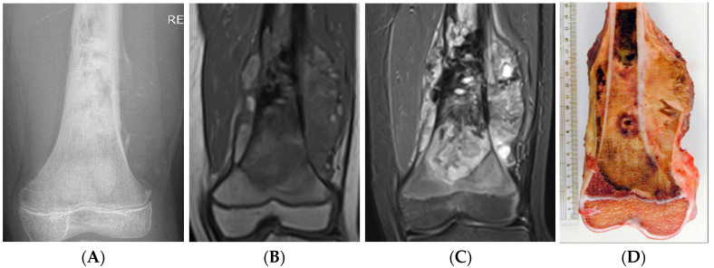
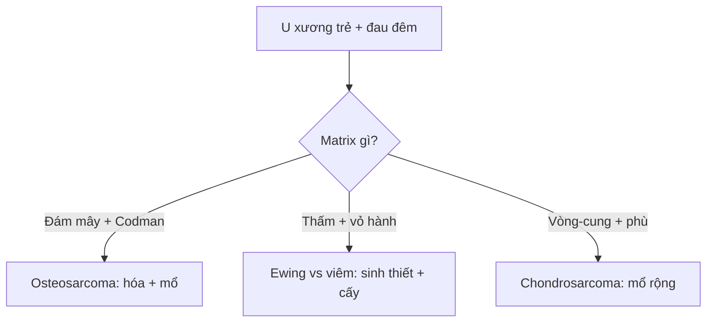

# 332 — Sarcoma nguyên phát: osteosarcoma, Ewing, chondrosarcoma / Sarcomas

**Tags:** `pattern:sarcoma-nguyen-phat` `vung:xuong`
**Mức chắc chắn (certainty):** tổng hợp y văn (literature synthesis) — nhóm tự biên từ y văn mở, chưa gắn ca nguyên văn đơn lẻ.

## 1. Tổng quan — tuổi + matrix + màng xương ác tính là tam giác chẩn đoán

- Osteosarcoma (10–25 tuổi, hành xương gối): tạo xương ác → **đám mây đặc ngà (cloud-like)** + nâng màng xương (Codman) + tia mặt trời (sunburst) — TẠI SAO: u đẻ xương non hỗn loạn, màng xương bị đội lên tạo tam giác + tia.
- Ewing (5–20 tuổi, thân xương): tế bào tròn nhỏ → **thấm + vỏ hành (onion-skin)** + khối mềm lớn hơn phù xương — TẠI SAO giống viêm: thấm + sốt + CRP tăng (sinh thiết mới phân biệt!).
- Chondrosarcoma (> 40 tuổi): sụn ác → **vôi vòng-cung + scalloping sâu + phù quanh u** (enchondroma không phù!) + mũ sụn u xương sụn > 1,5–2 cm hóa ác.

## 2. Gamut u nguyên phát (Gamut)

- **Đám mây ngà + Codman + gối trẻ:** osteosarcoma — hóa tân bổ trợ + mổ rộng.
- **Thấm thân xương + vỏ hành + sốt:** Ewing vs viêm — sinh thiết + cấy (đừng kháng sinh mù).
- **Vòng-cung + scalloping + phù + > 40 tuổi:** chondrosarcoma — mổ rộng (kháng hóa-xạ).
- **Phù lan >> u + T1 lan rộng:** đánh giá đáp ứng hóa (phù giảm = đáp ứng).

## 3. Bảng so sánh phân biệt (ma trận đối chiếu)

| Thực thể (entity) | Hình ảnh điển hình | Chốt vào (rule-in) | Chốt loại (rule-out) | Gợi ý xác nhận |
|---|---|---|---|---|
| Osteosarcoma | **Đám mây ngà + Codman + sunburst + hành gối trẻ** | **Cloud-like + màng ác + 10–25 tuổi** | Vòng-cung → sụn | Hóa trước + mổ + đánh giá hoại tử |
| Ewing | **Thấm thân + vỏ hành + mềm lớn + 5–20 tuổi** | **Thấm + sốt + CD99** | Viền đặc + tự khỏi → NOF | Sinh thiết + EWSR1 + hóa-xạ |
| Chondrosarcoma | **Vòng-cung + scalloping + phù + > 40 tuổi** | **Phù quanh sụn + mũ > 2 cm** | Không phù → enchondroma | Mổ rộng (kháng hóa) |
| Viêm giả sarcoma | **Thấm + phù lan + sốt + cấy (+)** | **Cấy/mủ + đáp ứng KS** | Mềm lớn + CD99 → Ewing | Cấy + KS trước sinh thiết u |

*(A) XR đám mây + Codman; (B–C) T1/STIR lan mềm; (D) bệnh phẩm. Nguồn: Raja et al., Cancers 2025 Fig. 11, CC BY 4.0.*

## 4. Protocol sarcoma

- **X-quang (matrix + màng xương) → MRI toàn xương + ngực (di căn phổi) → sinh thiết trung tâm sarcoma** (đường mổ trong đường mổ triệt căn!) + đánh giá đáp ứng (phù + hoại tử ≥ 90% = tốt).

## 5. Cạm bẫy

- **Ewing kháng sinh mù** mất thời gian vàng — sốt + thấm là sinh thiết + cấy song song.
- **Sinh thiết ngoài trung tâm** nhiễm bẩn khoang — chuyển tuyến sarcoma trước mọi sinh thiết.
- **STIR đánh giá lan rộng quá mức** — T1 mới là ranh giới mổ thật (phù ≠ u).

## 6. Tự lượng giá — Blind Quiz

**Ca 1 — Trẻ đau đùi + sưng. Đọc XR + MRI + bệnh phẩm.**

- Hỏi: matrix gì? Màng xương kiểu gì? Chẩn đoán + trình tự điều trị?

<b>Bấm để hiện đáp án</b>

- Dấu hiệu (findings): đám mây đặc ngà + tam giác Codman + khối mềm lan rộng.
- Chẩn đoán (diagnosis): **osteosarcoma đùi xa** — hóa tân bổ trợ → mổ rộng → hóa tiếp (hoại tử ≥ 90% = đáp ứng tốt).
- Nguồn: Raja et al., Fig. 11, CC BY 4.0.

**Ca 2 — Thân xương đùi 12 tuổi + thấm + vỏ hành + sốt 38,5:** Ewing hay viêm? Bước đầu? *(Bảng mục 3.)*

<b>Bấm để hiện đáp án</b>

- **Chưa phân biệt được:** sinh thiết + cấy song song (đừng kháng sinh mù cũng đừng hóa mù).

## Bài liên quan chéo
- [300 – Tổng quan MSK](../300-tong-quan-he-co-xuong-khop/lesson.md)
- [330 – U xương](../330-tiep-can-u-xuong-va-dont-touch/lesson.md) (Lodwick + ABC)
- [331 – Myeloma/di căn](../331-u-ac-nguoi-lon/lesson.md) (> 40 tuổi)

> Không dùng để chẩn đoán độc lập khi chưa có người hướng dẫn.
