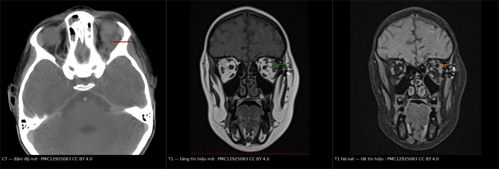
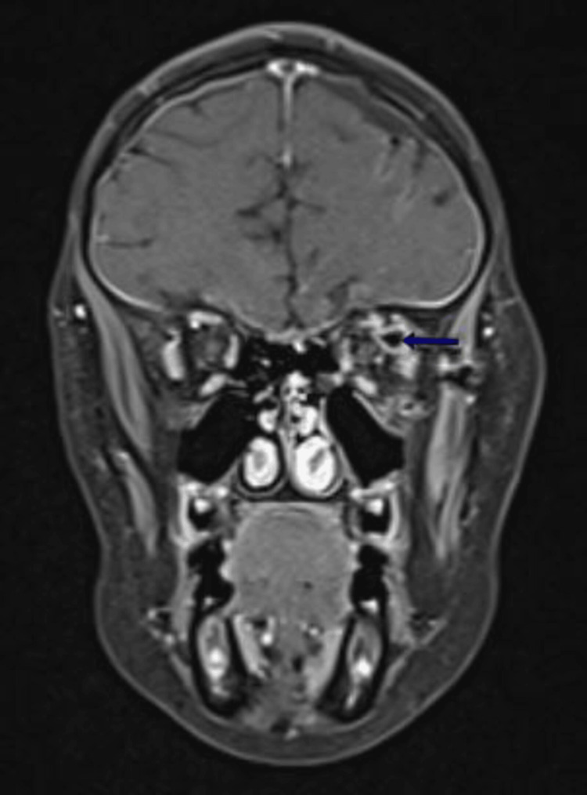
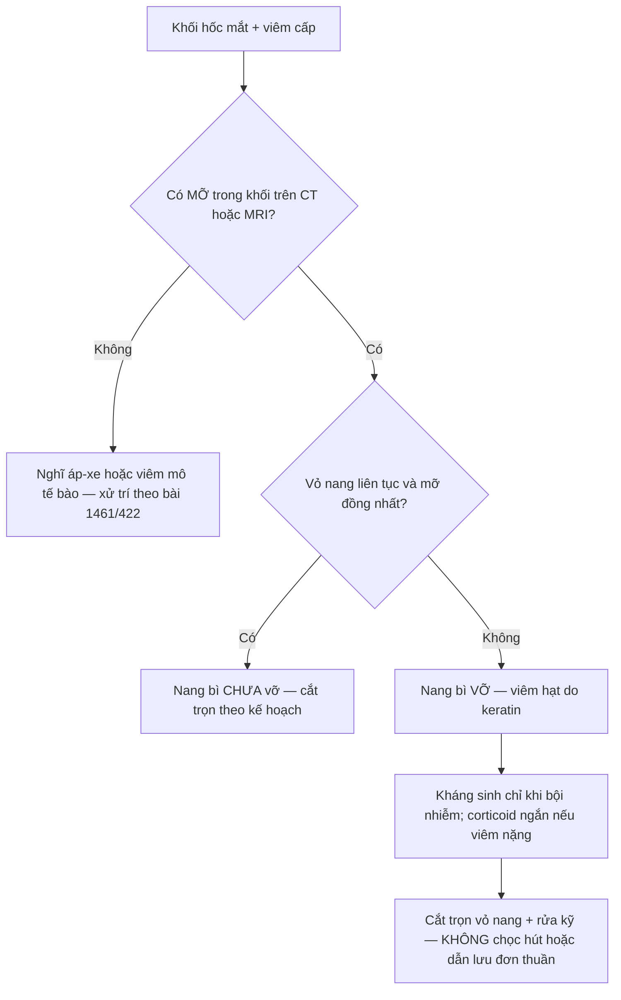
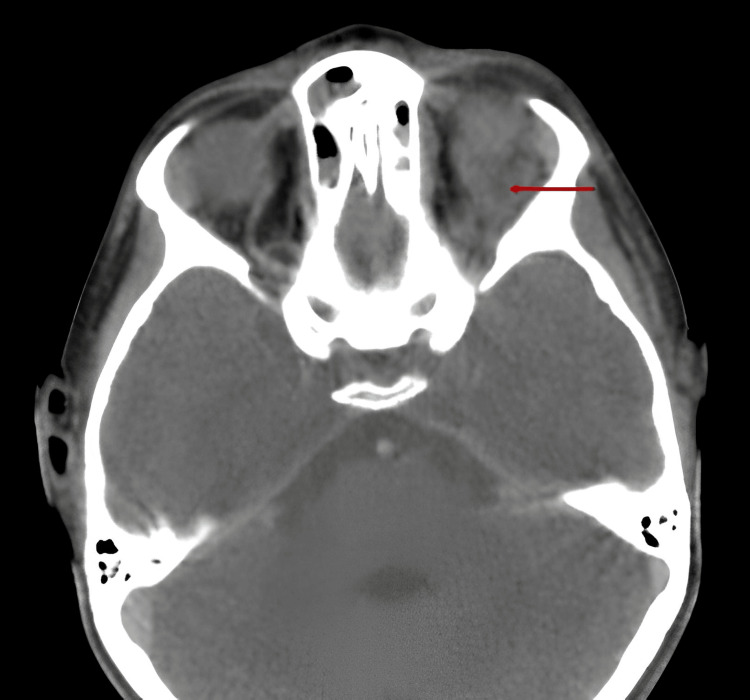
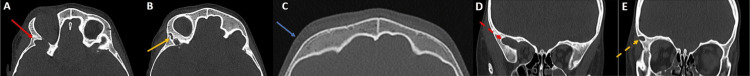
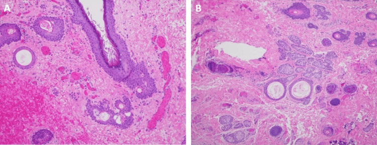

# 3320 — Nang bì hốc mắt VỠ: từ "khối mỡ im lặng" đến viêm mô mỡ cấp / Ruptured orbital dermoid cyst

**Tags:** `pattern:nang` `pattern:mo` `pattern:vo-nang` `pattern:viem-mo-hoc-mat` `pattern:loi-mat` `pattern:han-che-van-nhan` `vung:mat` `vung:hoc-mat` `vung:mi` `anatomy:hoc-mat` `protocol:MRI-hoc-mat` `protocol:CT-hoc-mat` `protocol:sieu-am-B` `protocol:cat-tron`

**Mức chắc chắn (certainty):** tổng hợp y văn (literature synthesis) — 1 loạt **270 tổn thương** (PMID 35549983), 1 loạt **203 bệnh nhân** trẻ/người lớn (PMID 33198489), 1 loạt **86 nang bì có vỡ** (PMID 27429223), 1 loạt **42 nang bì + đối chiếu CT–mô bệnh** (PMID 28991502), 1 loạt **97 trẻ** (PMID 31520721), 1 loạt **153 ca** (PMID 27599687), dân số học Olmsted County **54 trẻ** (PMID 30260262) và các ca có ảnh CT/MRI/mô bệnh (PMC12925083; PMC10154989; PMC12897684). **Không có thử nghiệm ngẫu nhiên**; mọi so sánh điều trị là loạt ca hồi cứu, chỗ ngoại suy được đánh dấu **[suy luận]**.

> **Câu chốt:** nang bì hốc mắt là **khối mỡ bọc trong vỏ biểu mô** — im lặng cho đến khi vỏ **nứt**, keratin/sebum/hair tràn vào mô mỡ và gây **viêm hạt do dị vật (lipogranuloma)**, chứ không phải nhiễm khuẩn. Vì vậy bệnh cảnh cấp **bắt chước viêm mô tế bào/áp-xe hốc mắt**, nhưng điều trị đúng là **cắt trọn vỏ nang**, không phải kháng sinh đơn thuần hay chọc hút.

## 1. Tổng quan bệnh học – cơ chế hình ảnh

### 1.1. Nang bì là gì: choristoma dọc đường khớp, lớn vì keratin bong ra

- **Bản chất:** nang bì (dermoid cyst) là **choristoma bẩm sinh** do mô **ngoại bì bị giam** dọc đường hàn phôi (embryonic fusion lines); vỏ là **biểu mô lát tầng sừng hóa** kèm **phần phụ da** (nang lông, tuyến bã, tuyến mồ hôi), lòng chứa **keratin, sebum, hair** (PMID 35086291; PMC12925083).
- **Vị trí:** **60,4%** ở góc trên–thái dương (270 tổn thương, PMID 35549983); **81,5%** ở bờ ổ mắt trên–thái dương trong loạt trẻ **54 ca** (PMID 30260262); dạng **dumbbell** chui qua khớp trán–gò má vào hốc mắt, dạng **intraosseous** nằm trong xương, dạng **deep orbital** sát đỉnh hốc mắt.
- **Dịch tễ:** **1/638 trẻ sinh sống** (Olmsted County 1986–2005, 54 trẻ; PMID 30260262); chiếm **3–9%** khối hốc mắt, **80%** nang bì toàn cơ thể ở vùng đầu–cổ (PMID 35086291). Tuổi chẩn đoán trung bình ở trẻ **12 tháng** (1–60 tháng) (PMID 30260262).
- **Lớn dần vì sao:** biểu mô **bong sừng liên tục** vào lòng kín → nang to chậm, không phải do tăng sinh tế bào; vỏ nang **không có mạch máu riêng** nên phần lớn **không ngấm thuốc**.

### 1.2. TẠI SAO tín hiệu là "mỡ" — vật lý T1/T2/CT

- **CT:** mỡ (sebum, cholesterol) có **−100 đến −50 HU** (dải thực hành rộng **−40 đến −120 HU**); dịch thuần **0–20 HU**, máu tươi **50–90 HU**. Nang bì **đồng nhất, bờ rõ, không vôi hóa** (vôi hóa gặp ở teratoma nhiều hơn) — đây là **mốc phân biệt với áp-xe** (dịch 0–20 HU) và **máu tụ** (PMID 28991502; PMC12819838; bài 1461).
- **T1:** mỡ có **thời gian T1 rất ngắn** → **tăng tín hiệu mạnh** trên T1 không xóa mỡ; **T2** mỡ vẫn **tăng tín hiệu** nhưng kém hơn nước tự do. Vì vậy nang bì **sáng trên cả T1 và T2** — khác nang dịch (T1 tối, T2 rất sáng).
- **Fat-sat:** mỡ **mất tín hiệu hoàn toàn** trên T1/T2 fat-sat → **chốt "mỡ thật"**, phân biệt với **máu bán cấp (methemoglobin)** vẫn sáng sau fat-sat, và với **protein/mucin đặc** (PMC12925083).
- **DWI:** nang bì **có thể hạn chế khuếch tán** do keratin đặc — ca 4 tuổi trong PMC12925083 có **restriction trên DWI/ADC** dù hoàn toàn lành tính. **Không dùng DWI để loại nang bì** (điểm phản biện quan trọng, xem mục 5).
- **TẠI SAO không ngấm thuốc:** vỏ nang là **biểu mô + mô xơ mỏng**, không có mô đệm giàu mạch; sau tiêm chỉ thấy **viền mỏng** của vỏ. Khi **vỡ**, mô hạt viêm quanh nang **ngấm thuốc** thành **viền dày không đều** — chính là dấu hiệu giả "áp-xe".

### 1.3. TẠI SAO vỡ gây viêm dữ dội: keratin là "chất kích thích hóa học"

- **Cơ chế:** keratin và sebum lọt vào mô mỡ hốc mắt → **phản ứng hạt do dị vật** với **đại bào tử, histiocyte, hoại tử mỡ** và xơ hóa; **không cần vi khuẩn**. Mô bệnh điển hình: **keratin trong mô mỡ + tế bào khổng lồ dị vật** (PMC10154989; PMID 30215530).
- **Vì sao cấp tính:** một lượng lớn keratin thoát ra trong **vài giờ–vài ngày** gây phù, đau, đỏ, lồi mắt, hạn chế vận nhãn — bệnh cảnh **giống viêm mô tế bào/áp-xe** nhưng **không sốt cao, không tăng bạch cầu** điển hình. Chấn thương nhẹ hoặc **phẫu thuật** là yếu tố khởi phát (PMID 41720178).
- **Vì sao mạn tính:** rò keratin từng đợt tạo **viêm hạt mạn, xơ hóa, dính cơ**, có thể **tiêu xương/bờ xương khuyết (bone scalloping)** và **nang nhiều thùy tái tạo** (PMID 30215530; PMID 28991502).

### 1.4. Tần suất vỡ — con số quyết định thái độ điều trị

| Bối cảnh | Số liệu | Nguồn |
|---|---|---|
| Vỡ tự phát khu trú + phản ứng hạt (đối chiếu mô bệnh) | **61,9%** (26/42) | PMID 28991502 |
| Thay đổi viêm mạn (đại bào, đứt biểu mô) ở trẻ | **16,5%** (16/97) | PMID 31520721 |
| Vỡ rõ trên lâm sàng (86 nang bì) | **29 ca**: **93% do mổ**, **7% tự phát** | PMID 27429223 |
| Viêm dai dẳng sau vỡ | **50%** (1/2) khi tự phát vs **3,7%** (1/27) khi do mổ | PMID 27429223 |
| Vỡ trong mổ | **10,4%** (5/48) — loạt trẻ; **18%** (18/100); **56,3%** ở thể exophytic mổ qua đường nếp mi | PMID 30260262; PMID 28089745; PMID 27599687 |
| Tái phát | **4,2%** (2/48); **6,3%** ở nhóm vỡ trong mổ đường nếp mi | PMID 30260262; PMID 27599687 |
| Yếu tố nguy cơ vỡ | **tuổi lớn hơn** (p = 0,01), **dính xương** (p = 0,001); nang **nhỏ hơn** dễ vỡ trong mổ (p < 0,001) | PMID 27429223; PMID 28089745 |

> **Đọc số cho đúng:** "vỡ" trong mô bệnh học **không đồng nghĩa** với "vỡ cấp trên lâm sàng". Phần lớn nang bì **đã có vi vỡ mạn** mà không ai biết; chỉ **một phần nhỏ** biểu hiện viêm cấp. Vì vậy **không được** lấy tỷ lệ 61,9% để nói "đa số nang bì sẽ viêm cấp".

## 2. Mẫu hình + chẩn đoán phân biệt theo vị trí (gamut)

**Mẫu hình chung:** **khối mỡ bờ rõ, vỏ mỏng, không ngấm thuốc (khi chưa vỡ)**, nằm sát đường khớp trán–gò má hoặc sâu trong hốc mắt. Ba câu hỏi phải trả lời trước khi gọi tên:

1. **Trong khối có mỡ thật không?** (HU âm, T1 sáng, tắt trên fat-sat).
2. **Vỏ nang còn liên tục không?** (vỡ = mỡ lan ra ngoài vỏ, mỡ "bẩn", viền ngấm dày).
3. **Có dấu hiệu nhiễm khuẩn/áp-xe thật không?** (khí trong ổ, mức dịch–mủ, sốt, tăng bạch cầu, viêm xoang kế cận).

### 2.1. Gamut theo vị trí giải phẫu

- **Ngoài nón, góc trên–thái dương (superotemporal):** thể hay gặp nhất, **mềm/di động**, lớn chậm; khi vỡ → sưng mi, đỏ, đau, **có thể nhầm với viêm mô tế bào mi**.
- **Ngoài nón, góc trên–mũi (superonasal):** gần ròng rọc/cơ chéo trên, dễ gây **lệch nhãn cầu, song thị**; ít gặp hơn nhưng **hay được chụp hình hơn** (p = 0,073) (PMID 28089745).
- **Trong nón/đỉnh hốc mắt (deep orbital):** lồi mắt, đau sau mắt, **giảm thị lực/thị trường** nếu chèn thị thần kinh; có thể **dumbbell** qua khe ổ mắt trên hoặc **intraosseous** (PMC5340050; PMC12897684).
- **Trong xương (intraosseous) + đường rò da:** trẻ có **lỗ da vùng trán–thái dương**, chảy dịch tái diễn, **viêm mô tế bào tái phát** — dermoid + dermal sinus tract (PMC10154989).

### 2.2. Gamut "khối MỠ trong hốc mắt"

**Nang bì · nang biểu mô (epidermoid) · lipoma · lipodermoid · teratoma · steatocystoma · cholesterol granuloma · u mỡ ác (liposarcoma, rất hiếm) · thoát vị mỡ ổ mắt sau chấn thương.**

- **Nang bì vs epidermoid:** epidermoid chỉ có **biểu mô sừng hóa, KHÔNG có phần phụ da**, nên ít mỡ hơn, thường **dịch/keratin** và **hạn chế khuếch tán rõ**; nang bì có **mỡ + hair + tuyến bã**, có thể **vôi hóa** và **dạng dumbbell** (PMID 35086291).
- **Lipoma:** mỡ **đồng nhất, không vỏ**, không ngấm thuốc, **không có thành**; nang bì luôn có **vỏ mỏng** (có thể chỉ thấy trên MRI lát mỏng).
- **Steatocystoma:** nang tuyến bã, thành **gấp nếp**, dịch **không phải mỡ thuần**; có ca **giả nang bì** ở trẻ, chẩn đoán chỉ sau mô bệnh (PMC13344080).

### 2.3. Gamut "viêm hốc mắt CẤP có khối nang"

**Nang bì vỡ · nang bì bội nhiễm · áp-xe dưới màng xương (1461) · viêm mô tế bào hốc mắt (422) · dị dạng bạch mạch xuất huyết · máu tụ trong nang · rhabdomyosarcoma hoại tử · pseudotumor/IGg4.**

- **Khác biệt cốt lõi:** nang bì vỡ có **mỡ** trong/quant khối và **không có ổ mủ**; áp-xe có **dịch 0–20 HU**, **khí** (đôi khi), **viêm xoang kế cận** và **không có mỡ** (1461).
- **Dị dạng bạch mạch xuất huyết:** khối **đa thùy, mức dịch–dịch**, **không có mỡ**, thường **tăng dần sau viêm/nhiễm**; đau cấp khi xuất huyết trong nang.
- **Rhabdomyosarcoma:** khối **đặc, ngấm thuốc mạnh, phá xương**, ở trẻ **< 10 tuổi**, tiến triển **tuần**; **không có mỡ** — nếu thấy mỡ, gần như loại.

## 3. Bảng so sánh phân biệt (ma trận đối chiếu)

| Thực thể (entity) | Hình ảnh điển hình | Chốt vào (rule-in) | Chốt loại (rule-out) | Gợi ý xác nhận |
|---|---|---|---|---|
| **Nang bì CHƯA vỡ** | Khối **mỡ −100…−50 HU**, vỏ mỏng, bờ rõ, **không ngấm**, T1/T2 sáng, **tắt trên fat-sat** | **Mỡ thật + vỏ liên tục + không viêm quanh** | Có thành phần đặc ngấm thuốc, phá xương → u; dịch 0–20 HU → nang khác | MRI hốc mắt T1 + T2 fat-sat; CT ≤ 1 mm nếu sát xương |
| **Nang bì VỠ** | Khối mỡ **bờ mất rõ**, **mỡ "bẩn" (stranding)**, **viền ngấm dày không đều**, phù mô mỡ/mi, ± tiêu xương bờ | **Mỡ + vỏ đứt/bờ mất liên tục + viêm mô mỡ quanh** | Mỡ đồng nhất, vỏ liền, không viêm → chưa vỡ; ổ dịch 0–20 HU + khí → áp-xe | MRI T1 fat-sat sau tiêm + T2 fat-sat; đối chiếu mô bệnh |
| **Áp-xe dưới màng xương (1461)** | Ổ **dịch 0–20 HU**, hình thấu kính sát thành trong, **viêm xoang sàng**, ± khí | **Vị trí sát xương + viêm xoang cùng bên + khuyết lamina papyracea** | Có mỡ trong ổ → nang bì; không viêm xoang → nghĩ nguyên nhân khác | CT ≤ 1 mm có cản quang; MRI nếu nghi nội sọ |
| **Viêm mô tế bào hốc mắt (422)** | Dày mô mỡ lan tỏa, **không ổ dịch**, cơ to **cả gân**, ± viêm xoang | **Phù/đỏ lan tỏa + sốt + không khối mỡ** | Có khối mỡ bờ rõ → nang bì; có ổ dịch → áp-xe | CT/MRI cản quang; theo dõi đáp ứng kháng sinh |
| **Epidermoid** | Nang **keratin/dịch**, T1 trung–thấp, **hạn chế khuếch tán rõ**, **không có mỡ nhiều**, không phần phụ da | **Restriction mạnh + không mỡ + không hair** | Mỡ nhiều + hair/tuyến bã → nang bì | MRI DWI/ADC; mô bệnh |
| **Dị dạng bạch mạch xuất huyết** | Khối **đa thùy**, **mức dịch–dịch**, không mỡ, tăng thể tích sau viêm | **Mức dịch–dịch + không mỡ + đau cấp** | Có mỡ → nang bì; đặc ngấm mạnh → u | MRI T2; siêu âm Doppler |
| **Steatocystoma** | Nang **thành mỏng gấp nếp**, dịch **không đồng nhất**, không mỡ thuần | **Thành gấp nếp + mô bệnh** | Mỡ −80 HU + hair → nang bì | Mô bệnh sau cắt |
| **Rhabdomyosarcoma** | Khối **đặc**, ngấm mạnh, **phá xương**, tiến triển nhanh | **Đặc + ngấm mạnh + phá xương ở trẻ** | **Có mỡ → gần như loại** | MRI + sinh thiết |

*Trái: CT trục — khối **đậm độ mỡ** (âm, tương đương mỡ hốc mắt), bờ rõ, không phá xương. Giữa: T1 không xóa mỡ — tăng tín hiệu đồng nhất. Phải: T1 fat-sat — tín hiệu **tắt hoàn toàn**, chốt mỡ thật. Cùng một ca (Cureus 2026, PMC12925083), CC BY 4.0; ảnh ghép letterbox.*

### Ba dấu hiệu "chốt vỡ" trên hình ảnh

1. **Vỏ nang mất liên tục** — thấy rõ nhất trên MRI T2 fat-sat/T1 sau tiêm lát mỏng; đôi khi chỉ là **một chỗ mỏng, mất đường viền đen**.
2. **Mỡ lan ra ngoài vỏ** — **dải/giọt T1 sáng** trong mô mỡ quanh nang, **tắt trên fat-sat**; trên CT là **stranding mỡ "bẩn"** quanh khối.
3. **Viền ngấm thuốc dày không đều + phù mô mỡ/mi** — mô hạt viêm; **không có ổ mủ trung tâm** (khác áp-xe).

> **Vì sao CT dễ bỏ vỡ:** CT chỉ thấy **đậm độ**, không thấy **vỏ nang** rõ nếu < 1 mm và không thấy **mỡ lan theo mặt phẳng**; trong loạt 42 ca, **gờ xương (bone scalloping)** là dấu liên quan chặt nhất với vỡ tự phát, còn **mỡ trong nang có tác dụng bảo vệ** (PMID 28991502). Vì vậy **MRI + tương phản** là khảo sát quyết định khi nghi vỡ.

*Cùng ca: T1 fat-sat sau gadolinium — khối **không ngấm thuốc** (chỉ có thể thấy viền vỏ mỏng), phù hợp nang bì chưa vỡ. Nguồn: Cureus 2026 (PMC12925083), CC BY 4.0.*

## 4. Protocol chụp + phân tầng xử trí

### 4.1. Protocol

- **CT hốc mắt + xoang, ≤ 1 mm, có cản quang**, tái tạo trục–tránh–đứng dọc, **cửa sổ xương riêng**: khảo sát đầu tay khi **cấp** (loại áp-xe, viêm xoang, khuyết xương, dị vật); đo **HU** tại khối và mô mỡ quanh.
- **MRI hốc mắt**: **T1 không fat-sat**, **T2 fat-sat**, **T1 fat-sat sau gadolinium**, **DWI/ADC**; lát **≤ 3 mm** (≤ 1 mm nếu nghi vỡ/đỉnh hốc mắt). Đây là bộ **bắt buộc** khi: khối sâu/trong nón, nghi vỡ, nghi u, hoặc CT không kết luận.
- **Siêu âm B** (đầu dò cao tần): khối **nang, hồi âm hỗn hợp, "sack of marbles"** (mỡ/keratin thành hạt), **không có tín hiệu mạch trong lòng** — hữu ích ở trẻ, khối nông (PMC12925083).
- **Không chọc hút để "xem dịch"**: không cho mô học, làm nang tái đầy và có thể tạo đường rò keratin **[suy luận từ cơ chế và ca lipogranuloma sau vỡ — PMID 18645450]**.

### 4.2. Phân tầng xử trí

- **Nang bì chưa vỡ, không triệu chứng:** theo dõi là lựa chọn hợp lý ở trẻ nhỏ; **cắt trọn** khi lớn nhanh, gây lệch trục/sụp mi, hoặc bố mẹ lo thẩm mỹ. Với thể **superotemporal đơn giản**, chụp hình trước mổ **không làm thay đổi kế hoạch mổ** ở 38/42 ca được chụp (PMID 28089745).
- **Nang bì vỡ cấp:** mục tiêu là **lấy hết vỏ biểu mô** — phần vỏ còn lại là nguồn keratin tái phát. Rửa **dung dịch muối nhiều lần**, lấy sạch mô hạt/keratin; **không cắt bỏ cơ/tuyến lệ lành** chỉ vì viêm.
- **Corticoid:** giảm phù/viêm nhanh trong thể viêm dữ dội, nhưng **không thay** việc lấy vỏ; dùng **ngắn ngày**, sau khi đã loại trừ nhiễm khuẩn thật **[suy luận — không có RCT]**.
- **Kháng sinh:** chỉ khi **bội nhiễm** (sốt, mủ, khí trong ổ, viêm xoang kế cận) — nang bì vỡ thuần túy là **viêm vô khuẩn** (PMC10154989; PMID 30215530).
- **Theo dõi:** tái phát **4,2–6,3%**, cao hơn khi **vỡ trong mổ** và **vỏ không lấy hết** (PMID 30260262; PMID 27599687). Chụp lại MRI nếu sưng/lồi mắt tái diễn.

### 4.3. Vì sao "chọc hút/dẫn lưu" là bẫy

- Chọc hút chỉ lấy **một phần dịch/keratin**, **không lấy vỏ** → nang **tái đầy** và **viêm lặp**; dẫn lưu đơn thuần có thể để lại **đường rò keratin mạn** ra da/kết mạc (đã mô tả **giọt mỡ dưới kết mạc + lipogranuloma** sau vỡ — PMID 18645450).
- Với nang **nhiều thùy do vỡ tái diễn**, mô bệnh cho thấy **nhiều khoang biểu mô** — cắt trọn khó hơn nhưng vẫn là cách duy nhất (PMID 30215530).

## 5. Biến thể bình thường và cạm bẫy

- **"Mỡ bẩn" giả do fat-sat không đều:** gần xương sàng/xương bướm, **T1 fat-sat** có thể tắt không hoàn toàn → giả "ngấm thuốc". So **ảnh trước và sau tiêm cùng chuỗi**, dùng **phép trừ (subtraction)** và **ROI mô mỡ lành** làm chuẩn.
- **Máu bán cấp giả mỡ:** máu **methemoglobin** sáng trên T1 **và vẫn sáng sau fat-sat**; nếu tắt hoàn toàn sau fat-sat → **mỡ thật**. Đừng chỉ dựa vào T1 sáng.
- **DWI hạn chế KHÔNG loại nang bì:** ca 4 tuổi **restriction rõ** trên DWI/ADC vẫn là nang bì lành (PMC12925083); keratin đặc làm giảm ADC. **Không dùng DWI để "loại"**, chỉ dùng để phân biệt với epidermoid (restriction mạnh hơn, không mỡ).
- **Vỡ không cần chấn thương:** **2/29** ca vỡ **tự phát** trong loạt 86 ca (PMID 27429223); đừng đòi tiền sử chấn thương mới nghĩ vỡ.
- **Nang NHỎ dễ vỡ trong mổ hơn nang lớn** (p < 0,001, 100 ca) — vì khó bóc tách, vỏ mỏng; đừng chủ quan với "nang bé" (PMID 28089745).
- **Satisfaction of search:** thấy viêm mô mỡ → dừng ở "viêm mô tế bào", bỏ qua **khối mỡ** ở ngoại vi. Luôn cuộn **toàn bộ chuỗi** và **hai bên**, đo HU/T1 tại mọi khối.
- **Bờ xương khuyết giả u ác:** **bone scalloping** là dấu **mạn tính của nang bì**, không phải phá xương ác; bờ **nhẵn, xơ hóa** giúp phân biệt (PMID 28991502).
- **Trẻ + lỗ da vùng trán–thái dương:** nghĩ **dermoid + dermal sinus**, không chỉ "viêm mô tế bào tái phát"; CT thấy **khuyết xương + đường rò** (PMC10154989).

## 6. Tự lượng giá — Blind Quiz

**Ca 1 — Bé 4 tuổi, khối góc trên–thái dương trái, không đau. CT trục không cản quang.**

- Câu hỏi: đậm độ của khối? Có dấu hiệu phá xương không? Ba chẩn đoán phân biệt?

<b>Bấm để hiện đáp án (findings + chẩn đoán)</b>

- Khối **bầu dục, bờ rõ**, **đậm độ mỡ** (âm, tương đương mỡ hốc mắt), **không phá xương**, nằm **ngoài nón** góc trên–thái dương trái; không thấy thành phần đặc.
- Chẩn đoán: **nang bì chưa vỡ**. Phân biệt: **lipoma** (không vỏ), **epidermoid** (ít mỡ, hạn chế khuếch tán), **nang bì vỡ** (bờ mất rõ, viêm quanh).
- Nguồn ảnh: Boulahcen Z và cs, *Cureus* 2026 (PMC12925083), CC BY 4.0.

**Ca 2 — Cùng bệnh nhi: T1, T1 fat-sat và CT đặt cạnh nhau.**

- Câu hỏi: chuỗi xung nào **chốt** bản chất mỡ? Nếu khối **không tắt** trên fat-sat thì nghĩ gì?

<b>Bấm để hiện đáp án</b>

- **T1 fat-sat** là chuỗi chốt: tín hiệu **tắt hoàn toàn** = mỡ thật (sebum/cholesterol). Nếu **vẫn sáng sau fat-sat** → nghĩ **máu bán cấp/methemoglobin**, **protein đặc**, hoặc **fat-sat không đều**.
- Đối chiếu: T1 không xóa mỡ sáng đồng nhất; CT đậm độ mỡ; không có thành phần ngấm thuốc.
- Nguồn ảnh: Boulahcen Z và cs, *Cureus* 2026 (PMC12925083), CC BY 4.0.

**Ca 3 — Bé 3 tuổi, sưng đỏ quanh hốc mắt phải, có lỗ da nhỏ vùng trán–thái dương, sốt nhẹ.**

- Câu hỏi: vì sao không thể chỉ điều trị "viêm mô tế bào"? Dấu hiệu nào trên CT hướng tới nang bì?

<b>Bấm để hiện đáp án (findings + chẩn đoán + mô bệnh)</b>

- CT: **khuyết xương** trong xương bướm/xương gò má sau bên, **nang trong xương** có **đậm độ mỡ**, kèm **đường rò da** đi vào ổ; phù mô mỡ quanh hốc mắt.
- Chẩn đoán: **nang bì trong xương + đường rò da, bội nhiễm gây viêm mô tế bào hốc mắt**. Chỉ kháng sinh sẽ tái phát vì **vỏ biểu mô + đường rò** vẫn còn.
- Mô bệnh: **nang bì vỡ, viêm**, có **keratin** và **phản ứng đại bào tử dị vật** — chứng cứ của vỡ/vỡ vi mô.

- Nguồn ảnh: Menousek JP và cs, *Cureus* 2023 (PMC10154989), CC BY 4.0.

## 7. Câu hỏi nghiên cứu & điểm chưa đồng thuận (tính đến 11/2026)

1. **[Tranh cãi] Ở trẻ có nang bì hốc mắt vỡ cấp với viêm mô mỡ nặng, corticoid trước rồi mổ trì hoãn có giảm viêm mà không tăng nhiễm/tái phát so với mổ ngay không?**
   - **Đã biết:** viêm dai dẳng sau vỡ **tự phát 50%** so với **3,7%** sau vỡ do mổ, và vỡ do mổ không làm tăng biến chứng (PMID 27429223); corticoid chỉ là điều trị hỗ trợ, không lấy được vỏ nang (PMC10154989).
   - **Chưa rõ:** không có so sánh đối đầu **"corticoid + mổ trì hoãn" vs "mổ ngay"**, thiếu định nghĩa thống nhất "viêm nặng", thời điểm mổ và tỷ lệ nhiễm.
   - **Hướng nghiên cứu:** đoàn hệ tiến cứu/registry ghi **thời gian từ vỡ đến mổ, liều corticoid, nhiễm, tái phát, thẩm mỹ**.
   - **Nguồn:** PMID 27429223 (DOI 10.1097/IOP.0000000000000735); PMC10154989.

2. **[Khoảng trống] Tiêu chí hình ảnh nào có độ nhạy/độ đặc hiệu đủ để chẩn đoán vỡ nang bì mà không cần mô bệnh?**
   - **Đã biết:** loạt 42 ca cho thấy **61,9%** vỡ tự phát khu trú, **bone scalloping** liên quan với vỡ, **mỡ trong nang bảo vệ**; nhưng đây là phân tích hồi cứu, không báo cáo Se/Sp của từng dấu (PMID 28991502).
   - **Chưa rõ:** chưa có **ngưỡng độ dày viền ngấm, mức lan mỡ, hay tỷ lệ tín hiệu fat-sat** được kiểm chứng; "vỏ đứt" trên MRI chưa được đối chiếu mù với mô bệnh.
   - **Hướng nghiên cứu:** nghiên cứu **diagnostic accuracy** tiền cứu, đọc mù, chuẩn tham chiếu mô bệnh; so **CT vs MRI T2 fat-sat vs T1 sau tiêm**.
   - **Nguồn:** PMID 28991502 (DOI 10.1080/08820538.2017.1375126); PMID 31520721 (DOI 10.1016/j.jaapos.2019.06.006).

3. **[Khác biệt thực hành] Có nên chụp hình trước mổ cho mọi nang bì vùng góc trên–thái dương ở trẻ, hay chỉ khi có dấu hiệu hốc mắt?**
   - **Đã biết:** ở 38/42 ca **superotemporal/superonasal đơn giản**, kết quả chụp **không thay đổi kế hoạch mổ**; chỉ **4 ca phức tạp** có dấu hiệu hốc mắt mới cần chụp (PMID 28089745). Ngược lại, người lớn có nhiều bất thường xương/dumbbell hơn và **vỡ trong mổ nhiều hơn** (p = 0,009) (PMID 33198489).
   - **Chưa rõ:** chưa có tiêu chí **"nang nào cần MRI"** thống nhất giữa trẻ và người lớn; chi phí–lợi ích của MRI thường quy chưa được đo.
   - **Hướng nghiên cứu:** so sánh chiến lược **"chụp tất cả" vs "chụp theo dấu hiệu"** với kết cục **tái phát, thời gian mổ, biến chứng, chi phí**.
   - **Nguồn:** PMID 28089745 (DOI 10.1016/j.jaapos.2016.09.023); PMID 33198489 (DOI 10.1177/1120672120964686).

## Bài liên quan chéo
- [3319 – Nang tuyến lệ (dacryops)](../3319-nang-tuyen-le-dacryops/lesson.md) (nang vùng mi trên, phân biệt mỡ – dịch)
- [1461 – Áp-xe dưới màng xương hốc mắt ở trẻ](../1461-ap-xe-duoi-mang-xuong-hoc-mat-o-tre/lesson.md) (áp-xe 0–20 HU, viêm xoang, ngưỡng dẫn lưu)
- [422 – Cellulitis vs giả u viêm hốc mắt](../422-viem-gia-u/lesson.md) (viêm mô mỡ lan tỏa, không ổ dịch)
- [424 – Tuyến lệ: viêm vs u](../424-tuyen-le/lesson.md) (khối vùng tuyến lệ)
- [3250 – U mạch máu thể hang hốc mắt](../3250-u-mach-mau-the-hang-hoc-mat/lesson.md) (khối hốc mắt, định vị trong/ngoài nón)
- [1485 – Viêm túi lệ cấp & áp-xe túi lệ](../1485-viem-tui-le-cap-va-ap-xe-tui-le/lesson.md) (khối vùng góc mắt trong)

## Ảnh
- Tên file theo quy ước `3320_...`; nguồn + giấy phép từng ảnh trong `images/CREDITS.md`.
- Ảnh nang bì **vỡ cấp** trên MRI hốc mắt: xem thêm ca Radiopaedia "Ruptured orbital dermoid cyst" (chỉ dẫn link, không tải).

> Không dùng để chẩn đoán độc lập khi chưa có người hướng dẫn.
