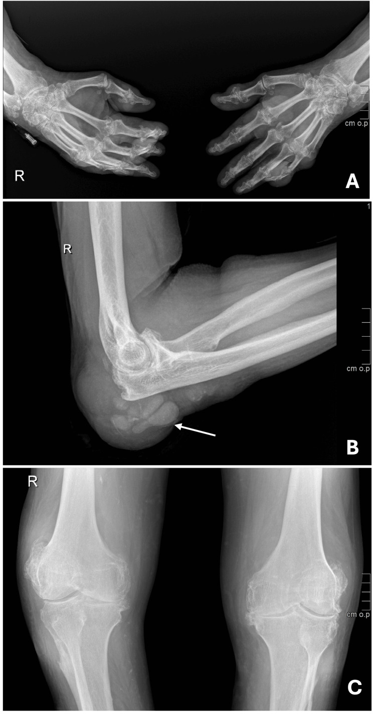
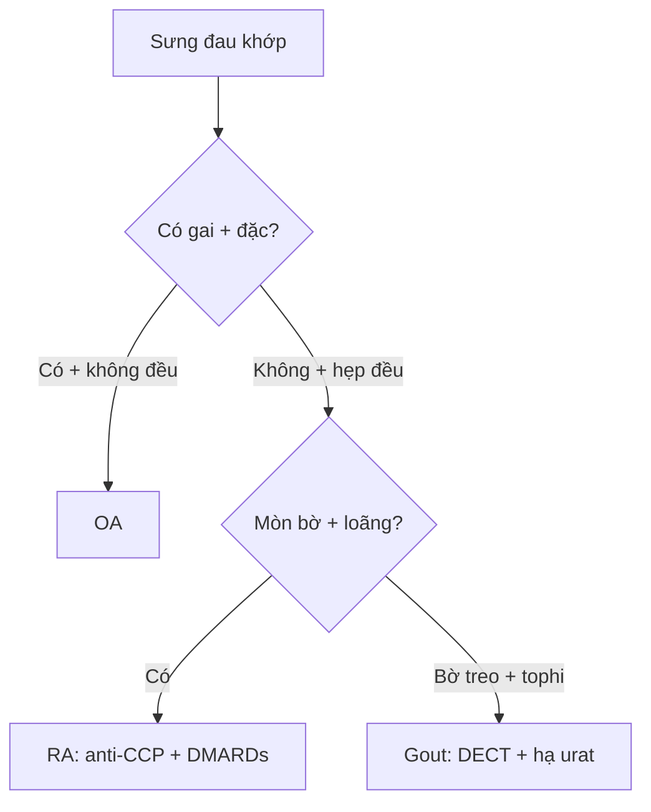

# 340 — Khớp: OA vs RA vs PsA vs Gout / Arthritis

**Tags:** `pattern:hep-khe-khop` `pattern:mon-xuong` `vung:khop`
**Mức chắc chắn (certainty):** tổng hợp y văn (literature synthesis) — nhóm tự biên từ y văn mở, chưa gắn ca nguyên văn đơn lẻ.

## 1. Tổng quan — sụn mòn kiểu gì + xương đáp ứng kiểu gì

- Thoái hóa (OA): sụn mòn cơ học vùng chịu lực → xương đáp ứng bằng **tạo xương (gai + đặc dưới sụn)** — TẠI SAO hẹp KHÔNG ĐỀU + gai + đặc: tải lệch bào mòn một khoang, xương cứng hóa bù.
- Viêm dạng thấp (RA): màng hoạt dịch viêm ăn sụn đều + xương quanh khớp loãng — TẠI SAO hẹp ĐỀU + loãng cạnh khớp + mòn bờ mà KHÔNG gai: viêm toàn khớp, không có tạo xương (khác OA/PsA).
- Gout: tinh thể urat lắng + đại thực bào → mòn cạnh khớp + hạt tophi — TẠI SAO **bờ treo (overhanging edge)** + khe bảo tồn muộn: tophi ăn từ ngoài vào, sụn lâu mới hỏng; tophi **160–170 HU** + xanh lá DECT.

## 2. Gamut đau-sưng khớp (Gamut)

- **Hẹp không đều + gai + đặc + DIP Heberden:** OA — giảm cân + NSAID + thay khớp khi nặng.
- **Hẹp đều + loãng cạnh khớp + mòn bờ + MCP/PIP, chừa DIP:** RA — DMARDs sớm (methotrexate + sinh học).
- **Bút chì-nắp + cánh hải âu + ngón dồi + DIP:** PsA — sinh học IL-17.
- **Bờ treo + tophi 160 HU + giữ khe:** Gout — hạ urat (< 360 µmol/L) + colchicine cơn cấp.

## 3. Bảng so sánh phân biệt (ma trận đối chiếu)

| Thực thể (entity) | Hình ảnh điển hình | Chốt vào (rule-in) | Chốt loại (rule-out) | Gợi ý xác nhận |
|---|---|---|---|---|
| OA | **Hẹp không đều + gai + đặc + geodes + DIP** | **Gai + đặc + không đều** | Hẹp đều + loãng → RA | Kellgren-Lawrence + thay khớp |
| RA | **Hẹp đều + loãng cạnh khớp + mòn bờ + MCP/PIP, chừa DIP** | **Mòn bare area + đối xứng + không gai** | Có gai → OA/PsA | Anti-CCP/RF + MRI sớm + DMARDs |
| PsA | **Mòn trung tâm + tạo xương lông tơ + pencil-cup + gull-wing + DIP** | **Vừa mòn vừa tạo xương + ngón dồi** | Hẹp đều không gai → RA | PASI + IL-17 |
| Gout | **Bờ treo + tophi 160–170 HU + giữ khe + DECT xanh lá** | **Overhanging + tophi + urat cao** | Hẹp đều + loãng → RA | Urat máu + DECT + hạ urat |

*(A) bàn tay mòn + gai; (B) khuỷu đục lỗ + bờ treo + đặc phần mềm; (C) gối thoái hóa + mòn đầu trên xương mác. Nguồn: Ambrósio et al., Cureus 2026 Fig. 3, CC BY 4.0.*

## 4. Protocol

- **X-quang thẳng-chếch 2 tay/chân + siêu âm (double contour) + DECT** khi tinh thể; **MRI sớm** khi RA chưa mòn (viêm màng + phù tủy).

## 5. Cạm bẫy

- **Gout tay giả RA** (ca trên!) — bờ treo + tophi + DECT phân biệt, đừng DMARDs mù.
- **Urat máu bình thường trong cơn cấp** (ca trên 4,6 mg/dL!) — cơn cấp đào thải urat, chẩn đoán bằng tinh thể/DECT.
- **PsA DIP giả OA DIP** — pencil-cup + ngón dồi + vảy nến da mới là PsA.

## 6. Tự lượng giá — Blind Quiz

**Ca 1 — Nam 63 tuổi đa khớp biến dạng + chảy bột trắng khuỷu. Đọc X-quang.**

- Hỏi: mòn kiểu gì? RA hay Gout? Urat máu bình thường loại được Gout không?

<b>Bấm để hiện đáp án</b>

- Dấu hiệu (findings): mòn đục lỗ (punched-out) + **bờ xương treo (overhanging)** + đặc phần mềm tophi + khe tương đối giữ.
- Chẩn đoán (diagnosis): **gout tophi đa khớp mạn** — urat máu bình thường trong cơn cấp KHÔNG loại trừ (chẩn đoán bằng tinh thể + DECT + bờ treo).
- Nguồn: Ambrósio et al., Fig. 3, CC BY 4.0.

**Ca 2 — Hẹp đều MCP/PIP + loãng cạnh khớp + mòn bờ, chừa DIP:** OA hay RA? Thuốc gì sớm? *(Bảng mục 3.)*

<b>Bấm để hiện đáp án</b>

- **RA:** anti-CCP/RF + DMARDs sớm (methotrexate) — khác OA có gai + đặc.

**Ca 3 — Ngón dồi + pencil-cup DIP + vảy nến da:** PsA hay OA? *(Bảng mục 3.)*

<b>Bấm để hiện đáp án</b>

- **PsA:** vừa mòn vừa tạo xương + DIP — sinh học IL-17 (OA DIP chỉ gai Heberden).

## Bài liên quan chéo
- [300 – Tổng quan MSK](../300-tong-quan-he-co-xuong-khop/lesson.md)
- [341 – Trục cột sống (dự kiến viết sau)]
- [360 – Khớp gối](../360-mri-khop-goi-day-chang-sun-chem/lesson.md) (OA khoang trong)

> Không dùng để chẩn đoán độc lập khi chưa có người hướng dẫn.
