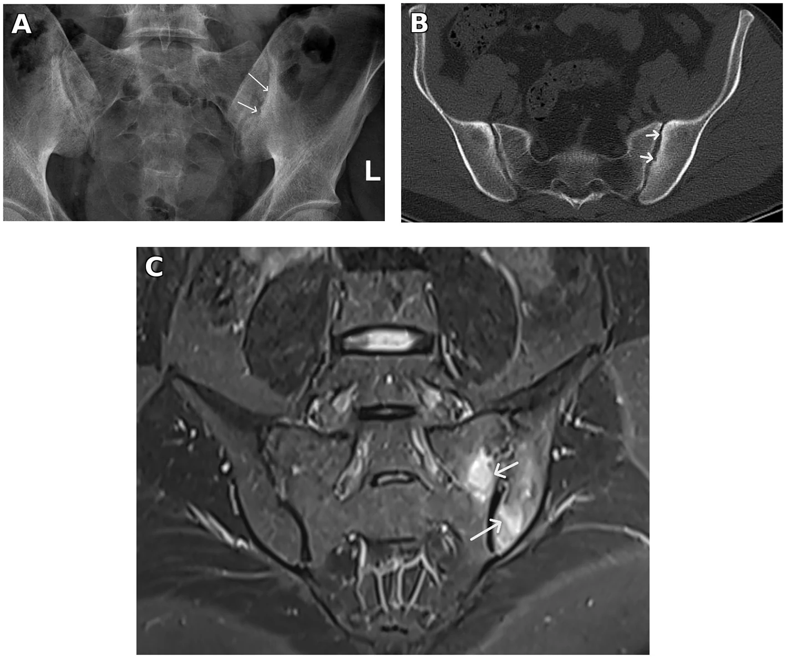
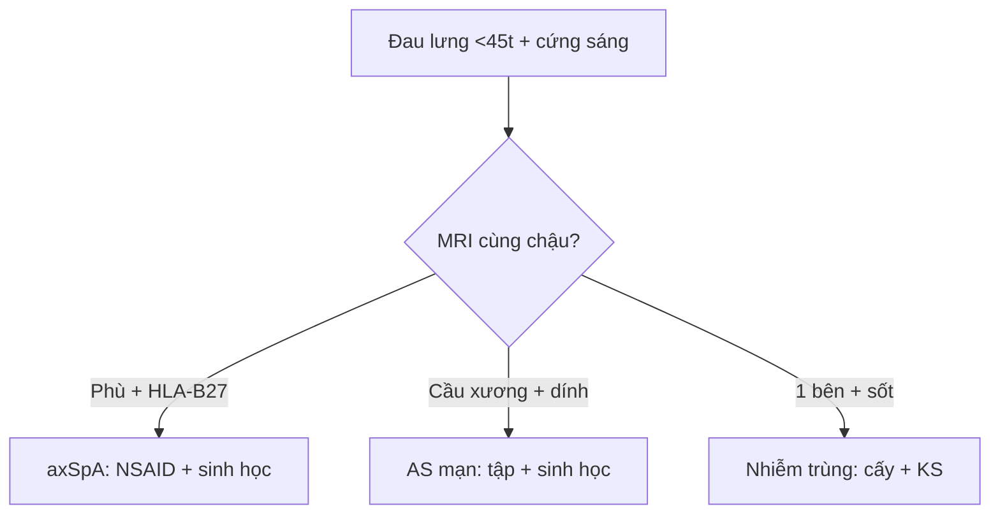

# 341 — Viêm cột sống: sacroiliitis ASAS, AS & PsA / Axial SpA

**Tags:** `pattern:viem-cot-song` `vung:cot-song` `score:ASAS`
**Mức chắc chắn (certainty):** tổng hợp y văn (literature synthesis) — nhóm tự biên từ y văn mở, chưa gắn ca nguyên văn đơn lẻ.

## 1. Tổng quan — viêm điểm bám gân + HLA-B27 + phù tủy cùng chậu

- Viêm cột sống dính khớp (AS): viêm điểm bám (enthesitis) + cùng chậu → cầu xương (syndesmophyte) + tre nứa (bamboo) — TẠI SAO đau lưng viêm (sáng sớm > 30 phút, đỡ vận động, khởi phát < 45 tuổi): viêm điểm bám cứng về đêm, vận động bơm máu giảm viêm.
- ASAS-MRI: phù tủy dưới sụn cùng chậu (≥ 1 ổ/2 lát liên tiếp hoặc ≥ 2 ổ/1 lát) = viêm hoạt tính — TẠI SAO STIR thấy sớm hơn X-quang nhiều năm: phù (nước) đến trước mòn-xơ-dính.
- HLA-B27 (+) 85–95% AS da trắng + viêm gân Achilles + viêm mống mắt là bộ ba ngoài trục.

## 2. Gamut đau lưng trẻ + cứng sáng (Gamut)

- **Phù cùng chậu + HLA-B27 + < 45 tuổi:** axSpA — NSAID + sinh học TNF/IL-17.
- **Cầu xương + tre nứa + dính:** AS mạn — vật lý trị liệu + sinh học (đừng nắn bẻ!).
- **Ngón dồi + DIP + vảy nến:** PsA trục — IL-17 + da liễu.
- **1 bên + sốt + cấy (+):** viêm cùng chậu nhiễm trùng (brucella/lao) — kháng sinh, đừng sinh học.

## 3. Bảng so sánh phân biệt (ma trận đối chiếu)

| Thực thể (entity) | Hình ảnh điển hình | Chốt vào (rule-in) | Chốt loại (rule-out) | Gợi ý xác nhận |
|---|---|---|---|---|
| axSpA sớm | **Phù tủy cùng chậu STIR + HLA-B27 + viêm điểm bám** | **ASAS-MRI (+) + < 45 tuổi + cứng > 30 phút** | 1 bên + sốt → nhiễm trùng | NSAID + MRI theo dõi + sinh học |
| AS mạn | **Syndesmophyte + tre nứa + dính cùng chậu** | **Cầu xương + bamboo + HLA-B27** | Giữ khe + bờ treo → gout | Vật lý trị liệu + TNF/IL-17 |
| PsA trục | **Cầu xương to lệch + ngón dồi + DIP + vảy nến** | **Parasyndesmophyte + da + DIP** | Đối xứng + HLA-B27 → AS | IL-17 + PASI |
| Nhiễm trùng | **1 bên + áp-xe + sốt + cấy (+)** | **Đơn bên + sốt + CRP cao** | 2 bên + HLA-B27 → SpA | Cấy + kháng sinh dài ngày |

*(A) XR xơ nhẹ; (B) CT xơ + mòn sớm; (C) STIR phù tủy dưới sụn 2 bên = ASAS (+). Nguồn: Bedaiwi, Front Med 2026 Fig. 1, CC BY 4.0.*

## 4. Protocol + ASAS flowchart

- **MRI cùng chậu STIR/T1 + HLA-B27 + CRP** khi đau lưng viêm < 45 tuổi; X-quang chỉ thấy muộn.

## 5. Cạm bẫy

- **Chờ X-quang dính mới chẩn đoán** = trễ 5–10 năm — MRI STIR + HLA-B27 chẩn đoán sớm.
- **Viêm cùng chậu nhiễm trùng cho sinh học** = thảm họa — 1 bên + sốt là cấy trước.
- **Nắn bẻ cột tre nứa** gãy ngang — loãng + cứng = gãy minor trauma, nẹp chứ không nắn.

## 6. Tự lượng giá — Blind Quiz

**Ca 1 — Nam 31 tuổi viêm gân gót + CT chậu mờ, không đau lưng. Đọc 3 ảnh.**

- Hỏi: STIR thấy gì? Đủ ASAS-MRI không? Thuốc gì trị cả da lẫn khớp?

<b>Bấm để hiện đáp án</b>

- Dấu hiệu (findings): phù tủy dưới sụn xương chậu + xương cùng 2 bên trên các lát liên tiếp.
- Chẩn đoán (diagnosis): **viêm cùng chậu hoạt tính ASAS (+) trong SpA** — adalimumab (trị cả HS da + khớp, phù giảm sau 6 tháng).
- Nguồn: Bedaiwi, Fig. 1, CC BY 4.0.

**Ca 2 — Đau lưng 25 tuổi + cứng 1 giờ sáng + HLA-B27 (+), XR bình thường:** AS không? Bước tiếp? *(Bảng mục 3.)*

<b>Bấm để hiện đáp án</b>

- **Nghi axSpA sớm:** MRI STIR cùng chậu (đừng chờ X-quang dính).

## Bài liên quan chéo
- [300 – Tổng quan MSK](../300-tong-quan-he-co-xuong-khop/lesson.md)
- [340 – Khớp ngoại vi](../340-viem-khop-va-thoai-hoa-khop/lesson.md) (RA/PsA/Gout)
- [365 – Cổ chân](../365-co-chan-ban-chan/lesson.md) (viêm gân Achilles)

> Không dùng để chẩn đoán độc lập khi chưa có người hướng dẫn.
