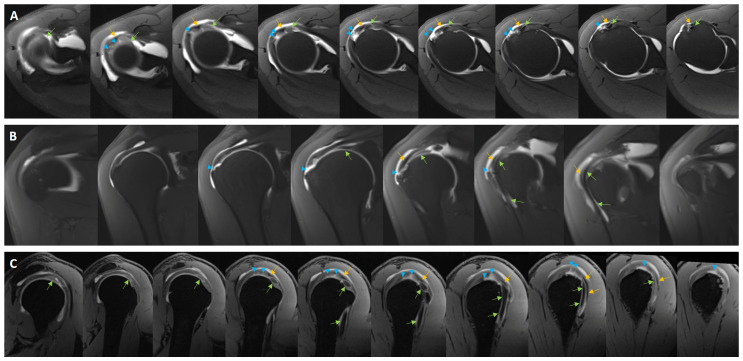
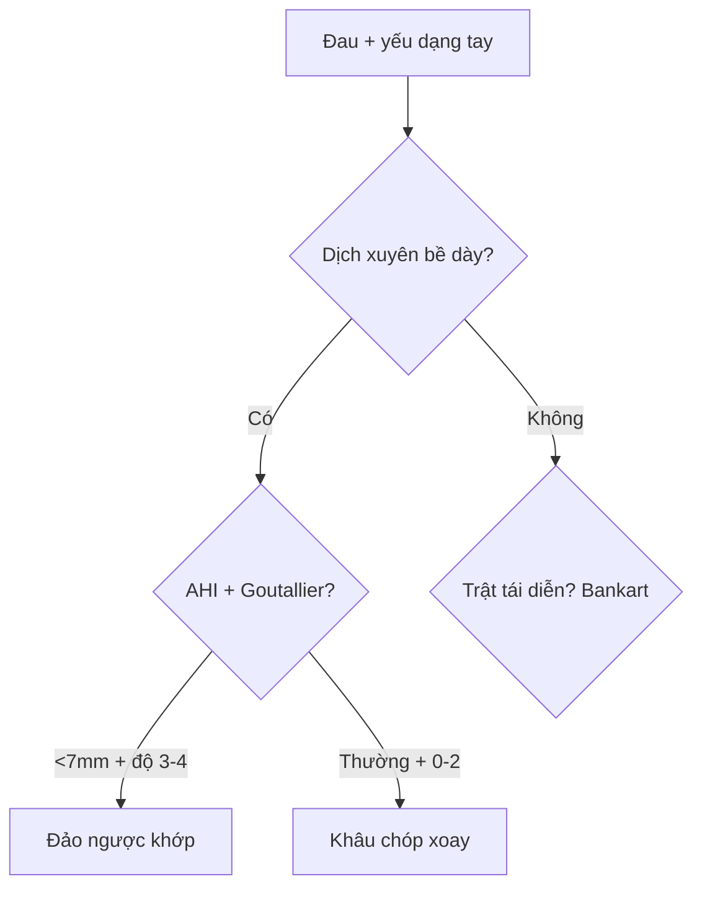

# 350 — Vai: rách chóp xoay, AHI & Goutallier / Rotator cuff

**Tags:** `pattern:rach-chop-xoay` `vung:khop-vai` `score:Goutallier` `protocol:MRI-khop-vai`
**Mức chắc chắn (certainty):** tổng hợp y văn (literature synthesis) — nhóm tự biên từ y văn mở, chưa gắn ca nguyên văn đơn lẻ.

## 1. Tổng quan — gân thoái hóa + chỏm di lệch lên + cơ hóa mỡ

- Gân trên gai (supraspinatus) thoái hóa theo tuổi (rách toàn bộ > 25% sau 65 tuổi) — TẠI SAO rách toàn bộ bề dày làm **thông ổ khớp với túi dưới mỏm cùng-delta**: gân là mái ngăn duy nhất giữa 2 khoang, đứt là thuốc cản quang/dịch tràn qua.
- Chỏm di lệch lên khi mất chóp xoay — TẠI SAO **AHI < 7 mm** = mạn không khâu được: cơ delta kéo chỏm lên, khớp đảo ngược mới cứu.
- Cơ hóa mỡ (Goutallier 3–4: mỡ = hoặc > cơ) — TẠI SAO khâu vô ích: cơ đã mất đơn vị co rút, rách lại 50–70%.
- **Ảo ảnh góc thần kỳ (magic angle ~55°):** gân sáng giả trên T1/PD TE ngắn — kiểm tra T2 TE dài > 60 ms, biến mất là giả.

## 2. Gamut đau vai + yếu dạng (Gamut)

- **Dày gân + tín hiệu trung gian, T2 không sáng bằng dịch:** viêm gân (tendinosis) — vật lý trị liệu + chích.
- **Dịch xuyên toàn bộ bề dày + AHI < 7 mm + Goutallier 3–4:** rách mạn không khâu — thay khớp đảo ngược.
- **Rách mặt khớp + vận động viên ném:** Bankart/SLAP — nội soi khâu sụn viền.
- **Vôi gân + đau cấp:** viêm gân vôi hóa — chích rửa (barbotage).

## 3. Bảng so sánh phân biệt (ma trận đối chiếu)

| Thực thể (entity) | Hình ảnh điển hình | Chốt vào (rule-in) | Chốt loại (rule-out) | Gợi ý xác nhận |
|---|---|---|---|---|
| Viêm gân | **Dày + tín hiệu trung gian, T2 < dịch; magic angle mất ở TE > 60 ms** | **Không xuyên bề dày** | Dịch xuyên → rách toàn bộ | Vật lý trị liệu + chích |
| Rách toàn bộ mạn | **Dịch T2 xuyên articular-bursal + AHI < 7 mm + Goutallier 3–4** | **Thông 2 khoang + mỡ ≥ cơ** | Goutallier 0–2 + AHI thường → khâu được | Thay khớp đảo ngược khi 3–4 |
| Bankart/SLAP | **Sụn viền trước-dưới rách + Hill-Sachs + thuốc vào ổ** | **Trật tái diễn + Bankart xương/mềm** | Không trật → chóp xoay | MRA + nội soi Bankart |
| Vôi hóa gân | **Nốt vôi + phù + đau cấp, không đứt sợi** | **Vôi + cấp + còn sợi** | Mất sợi → rách | Barbotage + NSAID |

*Rách gân trên gai lan rộng (mũi tên) trên axial/coronal/sagittal. Nguồn: Ertogrul et al., Medicina 2026 Fig. 2, CC BY 4.0.*

## 4. Protocol MRI vai

- **MRI 3T + PD/T2 fat-sat 3 mặt + T1 sagittal chữ Y (Goutallier) + MRA** khi nghi sụn viền; đo AHI trên coronal (thường 7–14 mm).

## 5. Cạm bẫy

- **Magic angle ~55°** gọi nhầm rách bán phần — T2 TE > 60 ms mới kết luận.
- **Rách không triệu chứng sau 65 tuổi (> 25%)** mổ oan — lâm sàng + test Jobe/drop-arm mới mổ.
- **Bỏ sót rách dưới vai (subscapularis)** khi chỉ nhìn trên gai — axial + lift-off test.

## 6. Tự lượng giá — Blind Quiz

**Ca 1 — Đau yếu dạng mạn, không giơ tay quá đầu. Đọc MRA.**

- Hỏi: rách gân nào? Lan mấy gân? AHI bao nhiêu thì hết khâu được?

<b>Bấm để hiện đáp án</b>

- Dấu hiệu (findings): rách trên gai lan rộng nhiều mặt cắt (mũi tên), có thể kèm dưới gai/dưới vai.
- Chẩn đoán (diagnosis): **rách chóp xoay rộng** — khâu được khi AHI 7–14 mm + Goutallier 0–2; AHI < 7 mm + độ 3–4 → thay khớp đảo ngược.
- Nguồn: Ertogrul et al., Fig. 2, CC BY 4.0.

**Ca 2 — Gân dày + sáng PD nhưng T2 fat-sat tối:** viêm hay rách? Vì sao? *(Bảng mục 3.)*

<b>Bấm để hiện đáp án</b>

- **Viêm gân/magic angle:** không sáng bằng dịch T2 + mất ở TE > 60 ms — vật lý trị liệu, không mổ.

**Ca 3 — Trật vai tái diễn 3 lần + lõm Hill-Sachs:** chóp xoay hay Bankart? *(Bảng mục 3.)*

<b>Bấm để hiện đáp án</b>

- **Bankart trước-dưới:** MRA + nội soi khâu sụn viền (khác rách chóp xoay tuổi già).

## Bài liên quan chéo
- [300 – Tổng quan MSK](../300-tong-quan-he-co-xuong-khop/lesson.md)
- [330 – U xương](../330-tiep-can-u-xuong-va-dont-touch/lesson.md) (ABC mỏm quạ đau vai)
- [310 – Xương phụ](../310-giai-phau-xuong-khop-va-bien-the/lesson.md) (os acromiale giả rách)

> Không dùng để chẩn đoán độc lập khi chưa có người hướng dẫn.
