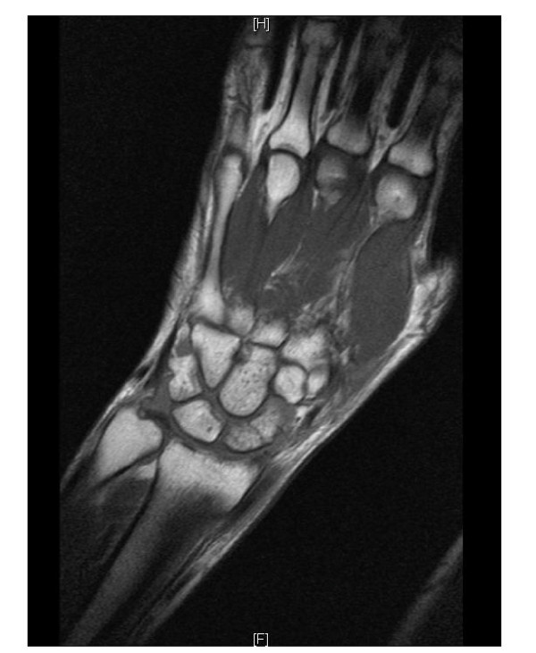
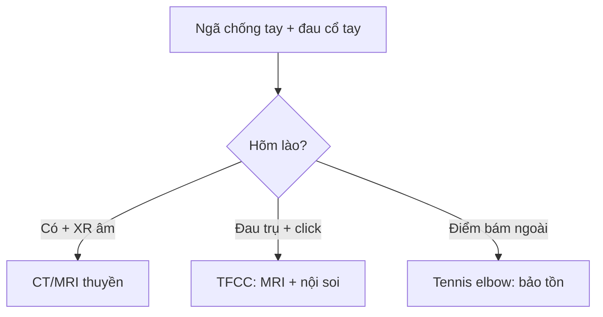

# 355 — Khuỷu & cổ tay: tennis elbow, TFCC, Kienböck & thuyền / Elbow & wrist

**Tags:** `pattern:co-tay` `vung:chi-tren`
**Mức chắc chắn (certainty):** tổng hợp y văn (literature synthesis) — nhóm tự biên từ y văn mở, chưa gắn ca nguyên văn đơn lẻ.

## 1. Tổng quan — gân duỗi chung + sụn chêm cổ tay + xương thuyền thiếu máu

- Viêm mỏm trên lồi cầu ngoài (tennis elbow): gân duỗi chung (ECRB) thoái hóa điểm bám — TẠI SAO đau khi duỗi cổ tay có lực: ECRB chịu kéo lặp đi lặp lại ở điểm bám hẹp.
- TFCC (phức hợp sụn sợi tam giác): sụn chêm + dây chằng cổ tay trụ — TẠI SAO đau mặt trụ + click khi xoay: TFCC chịu tải + ổn định khớp quay-trụ xa.
- Xương thuyền (scaphoid): 70% gãy ở eo + nuôi ngược dòng từ cực xa — TẠI SAO cực gần hoại tử vô mạch: mạch vào từ xa, gãy eo cắt nguồn nuôi cực gần.

## 2. Gamut đau khuỷu-cổ tay (Gamut)

- **Đau điểm bám ngoài + duỗi có lực:** tennis elbow — nghỉ + nẹp + chích PRP.
- **Đau mặt trụ + click xoay:** TFCC — nẹp + nội soi khâu khi rách.
- **Hõm lào + sưng + X-quang mờ:** gãy thuyền — CT/MRI + vít khi lệch > 1 mm.
- **Nguyệt sáng T1 tối + xẹp:** Kienböck (hoại tử xương nguyệt) — mổ giảm tải.

## 3. Bảng so sánh phân biệt (ma trận đối chiếu)

| Thực thể (entity) | Hình ảnh điển hình | Chốt vào (rule-in) | Chốt loại (rule-out) | Gợi ý xác nhận |
|---|---|---|---|---|
| Tennis elbow | **Dày + tín hiệu ECRB điểm bám, không đứt** | **Đau duỗi có lực + điểm bám ngoài** | Mất sợi → đứt gân | Nghỉ + nẹp + chích |
| TFCC | **Rách sụn trụ + tràn dịch + DRUJ mất vững** | **Đau trụ + click xoay** | Hõm lào + eo → thuyền | MRI + nội soi khâu |
| Gãy thuyền | **Đường gãy eo + phù MRI + hõm lào sưng** | **Hõm lào + CT/MRI (+) dù XR âm 15%** | Tròn vỏ kín → xương phụ | Vít khi lệch > 1 mm (cực gần hoại tử!) |
| Kienböck | **Nguyệt T1 tối + xẹp + giai đoạn Lichtman** | **Đau cổ tay + T1 tối nguyệt** | Eo thuyền → gãy thuyền | Giảm tải/mổ theo giai đoạn |

*Đường gãy eo + phù tủy, XR thường âm tính. Nguồn: Rhemrev et al., Int J Emerg Med 2011 Fig. 5, CC BY 4.0.*

## 4. Protocol

- **X-quang thuyền 4 hướng + CT/MRI** khi hõm lào đau dù XR âm; **MRI khuỷu-cổ tay** khi gân/sụn.

## 5. Cạm bẫy

- **Gãy thuyền XR âm cho về** = hoại tử cực gần — hõm lào đau là CT/MRI, bột dự phòng.
- **Kienböck tưởng bong gân** — T1 tối nguyệt + đau kéo dài là MRI sớm.
- **TFCC bỏ sót sau gãy đầu xa quay** — đau trụ + DRUJ lỏng là nội soi.

## 6. Tự lượng giá — Blind Quiz

**Ca 1 — Ngã chống tay + hõm lào sưng, XR mờ. Đọc MRI.**

- Hỏi: gãy ở đâu? Vì sao cực gần nguy hiểm? Vít hay bột?

<b>Bấm để hiện đáp án</b>

- Dấu hiệu (findings): đường gãy eo xương thuyền + phù tủy lan tỏa.
- Chẩn đoán (diagnosis): **gãy eo thuyền** — máu nuôi ngược từ xa nên cực gần dễ hoại tử; vít khi lệch > 1 mm, bột + CT khi không lệch.
- Nguồn: Rhemrev et al., Fig. 5, CC BY 4.0.

**Ca 2 — Thợ sửa xe đau mặt trụ + click khi vặn:** TFCC hay thuyền? *(Bảng mục 3.)*

<b>Bấm để hiện đáp án</b>

- **TFCC:** đau trụ + click xoay — MRI + nội soi khâu (thuyền là hõm lào).

## Bài liên quan chéo
- [300 – Tổng quan MSK](../300-tong-quan-he-co-xuong-khop/lesson.md)
- [310 – Xương phụ](../310-giai-phau-xuong-khop-va-bien-the/lesson.md) (os centrale giả gãy)
- [321 – Gãy trẻ em](../321-gay-tre-em/lesson.md) (cổ tay trẻ)

> Không dùng để chẩn đoán độc lập khi chưa có người hướng dẫn.
