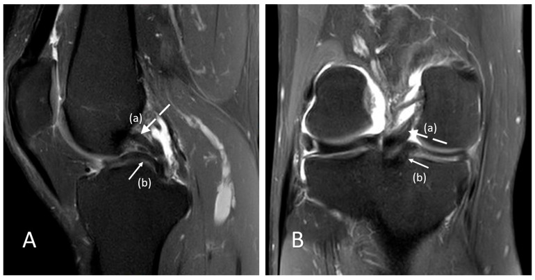
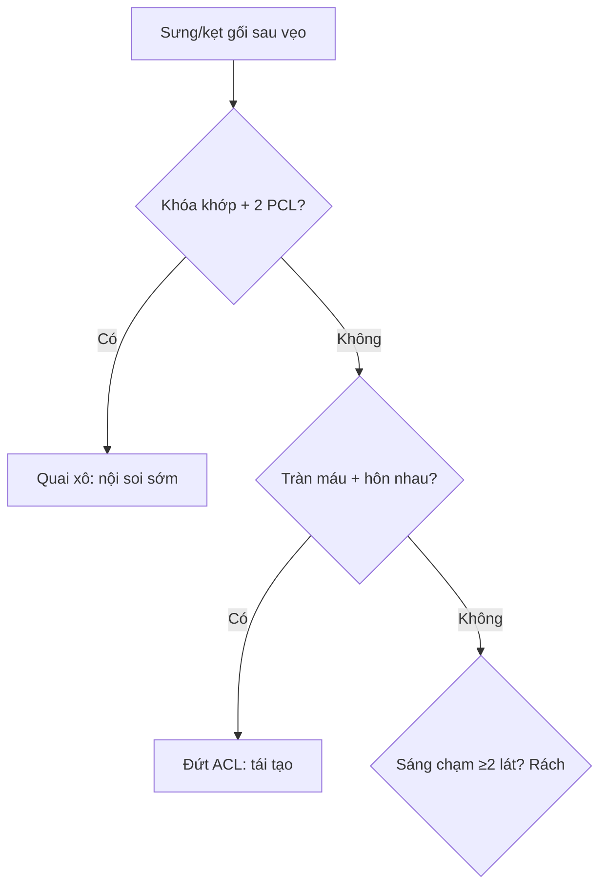

# 360 — Gối: ACL, sụn chêm 2-lát-cắt & quai xô / Knee MRI

**Tags:** `pattern:rach-sun-chem` `pattern:dut-ACL` `vung:khop-goi` `protocol:MRI-khop-goi`
**Mức chắc chắn (certainty):** tổng hợp y văn (literature synthesis) — nhóm tự biên từ y văn mở, chưa gắn ca nguyên văn đơn lẻ.

## 1. Tổng quan — sụn đen chạm mặt mới là rách + pivot-shift để lại dấu hôn

- Sụn chêm bình thường tối đen đồng nhất mọi xung — TẠI SAO **quy tắc chạm 2 lát cắt** đạt PPV > 90–95%: tín hiệu nội sụn độ I/II (thoái hóa nhầy) rất thường gặp sau 40 tuổi, chỉ khi đường sáng **chạm mặt khớp trên ≥ 2 lát liên tiếp** mới chắc chắn rách thông (độ III).
- Cơ chế pivot-shift (vẹo ngoài-xoay trong): lồi cầu ngoài + mâm chày sau ngoài đập vào nhau — TẠI SAO **đụng dập hôn nhau (kissing contusions)** đúng 2 điểm này + trượt chày **> 5–7 mm** + PCL chùng = đứt ACL: chày trượt trước, PCL mất căng cong gập.
- Rách quai xô: mảnh dọc lật vào liên lồi cầu — **2 PCL + mất nơ (≤ 1 bow-tie)** = kẹt khớp cấp cứu.

## 2. Gamut sưng gối sau chấn thương vẹo (Gamut)

- **Kẹt khóa khớp + 2 PCL + mất nơ:** quai xô sụn chêm trong — nội soi sớm (khâu/cắt).
- **Tràn máu + hôn nhau + trượt > 5–7 mm:** đứt ACL — tái tạo (hamstring/patellar).
- **Đường sáng nội sụn không chạm mặt:** thoái hóa nhầy — bảo tồn, đừng nội soi.
- **Mức mỡ-máu + vỡ mâm:** gãy mâm chày (bài 320) — CT + mổ.

## 3. Bảng so sánh phân biệt (ma trận đối chiếu)

| Thực thể (entity) | Hình ảnh điển hình | Chốt vào (rule-in) | Chốt loại (rule-out) | Gợi ý xác nhận |
|---|---|---|---|---|
| Rách sụn chêm | **Sáng chạm mặt khớp ≥ 2 lát + sagittal và coronal** | **Two-slice-touch, PPV > 90–95%** | Nội sụn không chạm → nhầy | Nội soi khâu khi kẹt/trẻ |
| Quai xô | **2 PCL + mất nơ ≤ 1 + kẹt khóa** | **Mảnh liên lồi cầu + khóa khớp** | Humphrey/Wrisberg → giả 2 PCL | Nội soi cấp cứu |
| Đứt ACL | **Mất sợi + hôn nhau + trượt > 5–7 mm + PCL chùng** | **Pivot-shift + Lachman + MRI** | Sợi còn + không trượt → bong điểm bám | Tái tạo + tập phục hồi |
| Thoái hóa nhầy | **Sáng nội sụn I/II không chạm mặt** | **Không chạm + > 40 tuổi + không kẹt** | Chạm ≥ 2 lát → rách | Bảo tồn, không nội soi |

*(A) sagittal: dải thấp song song trước PCL = mảnh sụn chêm trong lật vào; (B) coronal: mất cấu trúc thân sụn. Nguồn: Koutserimpas et al., Reports 2026 Fig. 1, CC BY 4.0.*

## 4. Protocol MRI gối

- **MRI 1.5–3T + PD fat-sat 3 mặt + T2 + T1:** nơ sụn chêm (≥ 2 bow-tie thường), ACL sagittal, hôn nhau coronal/sagittal; Lachman + pivot-shift lâm sàng trước MRI.

## 5. Cạm bẫy

- **Dây chằng Humphrey/Wrisberg + PCL nhầy tram-track** giả 2 PCL — coronal + mất nơ mới chốt quai xô.
- **Thoái hóa nhầy nội soi oan** ở người trung niên — không chạm mặt = không rách, dù lâm sàng đau.
- **Bong điểm bám chày ACL ở trẻ** tưởng đứt giữa — X-quang/CT gai chày + vít cố định, đừng tái tạo như người lớn.

## 6. Tự lượng giá — Blind Quiz

**Ca 1 — Nam 34 tuổi đau kẹt gối 3 tháng sau xoay người. Đọc PD-FS.**

- Hỏi: dải thấp trước PCL là gì? Chẩn đoán + xử trí (khâu hay cắt)?

<b>Bấm để hiện đáp án</b>

- Dấu hiệu (findings): dải thấp song song trước PCL (a) = mảnh sụn + coronal mất thân sụn trong (b).
- Chẩn đoán (diagnosis): **rách quai xô sụn chêm trong trật vào liên lồi cầu (double PCL)** — mạn 3 tháng vùng đỏ-trắng khó khâu → cắt chọn lọc + tập phục hồi (khâu khi cấp + vùng đỏ-đỏ).
- Nguồn: Koutserimpas et al., Fig. 1, CC BY 4.0.

**Ca 2 — Tràn máu + hôn nhau lồi cầu ngoài-mâm chày + trượt 8 mm:** đứt ACL không? *(Bảng mục 3.)*

<b>Bấm để hiện đáp án</b>

- **Đứt ACL:** pivot-shift + trượt > 5–7 mm — tái tạo + tập (khác bong điểm bám trẻ).

**Ca 3 — Sáng nội sụn sau không chạm mặt, 55 tuổi, không kẹt:** rách hay nhầy? Nội soi không? *(Bảng mục 3.)*

<b>Bấm để hiện đáp án</b>

- **Thoái hóa nhầy độ I/II:** không chạm mặt — bảo tồn, tuyệt đối không nội soi oan.

## Bài liên quan chéo
- [300 – Tổng quan MSK](../300-tong-quan-he-co-xuong-khop/lesson.md)
- [320 – Gãy & trật khớp](../320-gay-xuong-trat-khop-cap-cuu/lesson.md) (mâm chày + mỡ-máu)
- [340 – Khớp OA/RA](../340-viem-khop-va-thoai-hoa-khop/lesson.md) (OA khoang trong)

> Không dùng để chẩn đoán độc lập khi chưa có người hướng dẫn.
