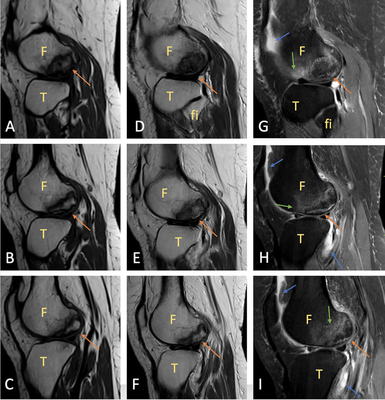
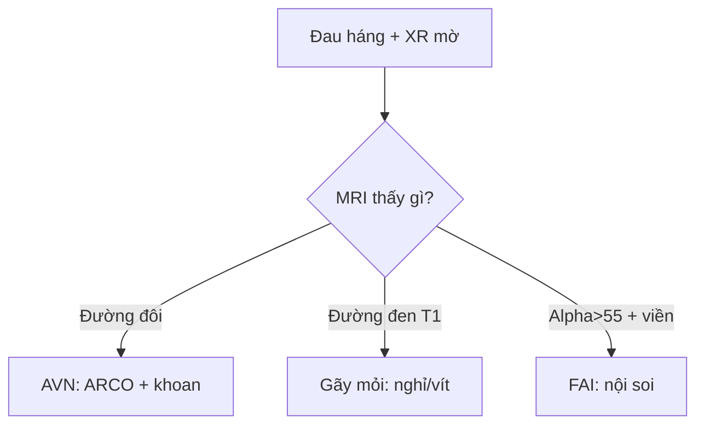

# 361 — Háng: AVN đường đôi, gãy mỏi & FAI / Hip MRI

**Tags:** `pattern:khop-hang` `vung:khop-hang` `score:ARCO`
**Mức chắc chắn (certainty):** tổng hợp y văn (literature synthesis) — nhóm tự biên từ y văn mở, chưa gắn ca nguyên văn đơn lẻ.

## 1. Tổng quan — chỏm đùi thiếu máu + cổ đùi chịu uốn + cùng đùi-chậu va chạm

- AVN chỏm đùi (corticoid, rượu, lặn, hồng cầu liềm): tắc mạch nuôi → hoại tử + ranh giới sửa chữa — TẠI SAO **đường đôi (double-line: ngoài đen xơ + trong sáng mạch)** trên T2: viền xơ (đen) + mô hạt mạch (sáng) bao quanh vùng chết.
- Gãy mỏi cổ xương đùi: đường đen T1 vuông góc bè xương bờ trong (compression) — TẠI SAO gãy bờ trong nguy hơn ngoài: trong chịu nén tiến triển lún, ngoài chịu kéo toác.
- FAI cam: chỏm-mấu nối lồi (alpha > 55°) va vành ổ cối khi gấp-xoay — TẠI SAO rách sụn viền + thoái hóa sớm: cam cào sụn mỗi lần gấp sâu.

## 2. Gamut đau háng (Gamut)

- **Đường đôi + phù + corticoid/rượu:** AVN sớm — khoan giảm áp + ARCO theo dõi.
- **Đường đen T1 bờ trong + VĐV/lính:** gãy mỏi — nghỉ + vít khi lệch.
- **Alpha > 55° + đau gấp-xoay + sụn viền:** FAI cam — nội soi gọt cam + khâu viền.
- **Hẹp khe + gai + > 60 tuổi:** OA háng — thay khớp khi nặng.

## 3. Bảng so sánh phân biệt (ma trận đối chiếu)

| Thực thể (entity) | Hình ảnh điển hình | Chốt vào (rule-in) | Chốt loại (rule-out) | Gợi ý xác nhận |
|---|---|---|---|---|
| AVN sớm | **Đường đôi T2 + phù + chưa xẹp (ARCO I–II)** | **Double-line + nguy cơ + chưa xẹp** | Xẹp + lưỡi liềm → ARCO III–IV | Khoan giảm áp + MRI |
| Gãy mỏi cổ đùi | **Đường đen T1 vuông bè + phù + bờ trong** | **Đen T1 + VĐV + đau cơ học** | Đường đôi + nguy cơ → AVN | Nghỉ/vít, cấm chịu lực |
| FAI cam | **Alpha > 55° + rách viền + phù cùng** | **Cam + FADIR (+) + trẻ thể thao** | Hẹp + gai + già → OA | Nội soi gọt + khâu viền |
| OA háng | **Hẹp cực trên + gai + đặc + nang** | **Già + hẹp + gai** | Đường đôi → AVN | Thay khớp toàn phần |

*Vùng địa lý + viền đôi + phù tủy + tràn dịch nhẹ, sụn còn nguyên. Nguồn: Gulghane et al., Radiol Case Rep 2025 Fig. 1, CC BY-NC-ND 4.0 (giữ nguyên bản; minh họa đường đôi áp dụng được cho chỏm đùi).*

## 4. Protocol MRI háng

- **MRI coronal T1/STIR + axial oblique + đo alpha** khi đau háng + XR mờ; ARCO I–IV quyết định giữ hay thay chỏm.

## 5. Cạm bẫy

- **AVN gọi nhầm gãy mỏi** khoan oan — đường đôi + nguy cơ là AVN, đường đen đơn + VĐV là mỏi.
- **FAI bỏ sót thành OA sớm** — alpha + viền ở người trẻ thể thao phải đo, đừng chỉ NSAID.
- **Gãy mỏi bờ trong chịu lực tiếp** = di lệch hoại tử — cấm chịu lực + vít sớm.

## 6. Tự lượng giá — Blind Quiz

**Ca 1 — Nữ 38 tuổi đứng 12 giờ/ngày + đau gối ngoài 4 tuần. Đọc MRI.**

- Hỏi: tên dấu? AVN hay OCD? Sụn còn không?

<b>Bấm để hiện đáp án</b>

- Dấu hiệu (findings): vùng địa lý + **đường đôi (ngoài đen + trong sáng)** + phù + tràn dịch, sụn nguyên vẹn.
- Chẩn đoán (diagnosis): **hoại tử vô mạch (AVN)** — bảo tồn + giảm tải + NSAID (sớm, chưa xẹp; OCD là mảnh sụn-xương bong).
- Nguồn: Gulghane et al., Fig. 1, CC BY-NC-ND 4.0 (nguyên bản; đường đôi là dấu chung mọi vị trí AVN).

**Ca 2 — Lính + đau háng + đường đen T1 bờ trong:** AVN hay gãy mỏi? *(Bảng mục 3.)*

<b>Bấm để hiện đáp án</b>

- **Gãy mỏi:** cấm chịu lực + vít (đường đôi + corticoid mới là AVN).

## Bài liên quan chéo
- [300 – Tổng quan MSK](../300-tong-quan-he-co-xuong-khop/lesson.md)
- [325 – Gãy mỏi](../325-gay-kin-mo/lesson.md) (mệt vs thiếu)
- [360 – Khớp gối](../360-mri-khop-goi-day-chang-sun-chem/lesson.md) (AVN lồi cầu)

> Không dùng để chẩn đoán độc lập khi chưa có người hướng dẫn.
