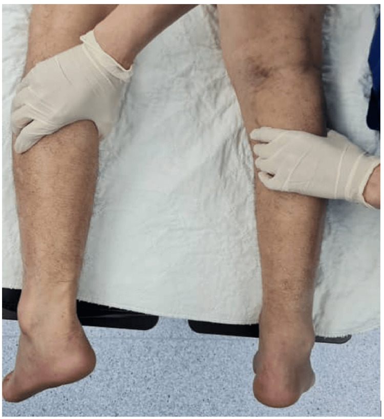
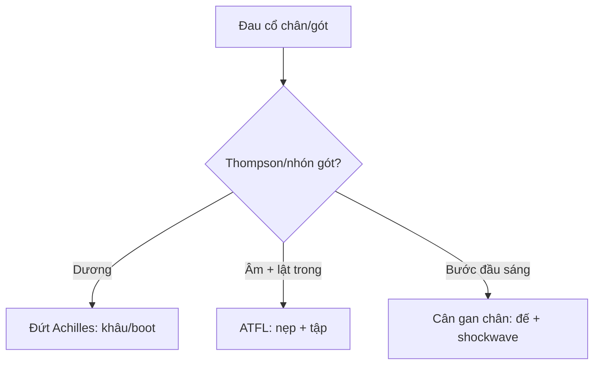

# 365 — Cổ chân–bàn chân: Achilles, ATFL & cân gan chân / Ankle & foot

**Tags:** `pattern:co-chan` `vung:co-chan`
**Mức chắc chắn (certainty):** tổng hợp y văn (literature synthesis) — nhóm tự biên từ y văn mở, chưa gắn ca nguyên văn đơn lẻ.

## 1. Tổng quan — gân Achilles yếu nhất ở vùng thiếu máu + ATFL yếu nhất mắt cá ngoài

- Đứt Achilles ở **1–6 cm trên bám gót** (vùng watershed) — TẠI SAO: đoạn này ít mạch nhất + chịu lực gấp 10 lần trọng lượng khi chạy nhảy; Thompson (+) = bóp bắp chân không gấp gan chân.
- ATFL (sên-mác trước) là dây yếu nhất phức hợp ngoài — TẠI SAO lật trong (inversion) đứt ATFL trước rồi mới đến CFL: ATFL căng nhất khi gấp gan + lật trong.
- Viêm cân gan chân: cân dày > 4 mm + gai gót — TẠI SAO đau bước đầu buổi sáng: đêm cân co ngắn, sáng kéo đột ngột.

## 2. Gamut đau cổ chân-gót (Gamut)

- **Nghe "bốp" + Thompson (+) + hõm gân:** đứt Achilles cấp — khâu sớm (< 2 tuần) hoặc boot + vật lý trị liệu.
- **Lật trong + sưng ngoài + ATFL mất:** bong gân độ III — nẹp + tập (mổ khi mất vững mạn).
- **Đau gót bước đầu + cân > 4 mm:** viêm cân gan chân — đế + chích + shockwave.
- **Đau gót + viêm điểm bám + HLA-B27:** enthesitis SpA (bài 341) — NSAID + sinh học.

## 3. Bảng so sánh phân biệt (ma trận đối chiếu)

| Thực thể (entity) | Hình ảnh điển hình | Chốt vào (rule-in) | Chốt loại (rule-out) | Gợi ý xác nhận |
|---|---|---|---|---|
| Đứt Achilles | **Mất liên tục + tụ máu + Thompson (+)** | **Bốp + không nhón gót + khe 1–6 cm** | Sợi còn + phù → viêm | Siêu âm/MRI + khâu/boot |
| Bong ATFL | **ATFL mất/phù + tràn dịch + lật trong** | **Lật trong + drawer (+)** | Hõm gân + Thompson → Achilles | Nẹp + tập cảm giác sâu |
| Viêm cân gan chân | **Cân > 4 mm + phù + gai gót** | **Đau bước đầu + cân dày** | Điểm bám gót + HLA-B27 → SpA | Đế + shockwave + chích |
| Viêm điểm bám SpA | **Phù điểm bám + mòn + HLA-B27** | **Trẻ + B27 + lưng viêm** | Cân dày đơn thuần → cơ học | NSAID + sinh học |

*Bóp bắp chân không gấp gan chân = đứt hoàn toàn. Nguồn: Mohd Khalid et al., Cureus 2026 Fig. 1, CC BY 4.0.*

## 4. Protocol

- **Siêu âm động + MRI** khi nghi đứt/rách gân-dây; Thompson + nhón gót lâm sàng trước mọi MRI.

## 5. Cạm bẫy

- **Đứt Achilles bỏ sót 20–25%** (tưởng bong gân) — Thompson + nhón gót mọi sưng gót sau chấn thương.
- **Viêm điểm bám SpA cho corticoid tại chỗ mãi** — HLA-B27 + lưng viêm là sinh học toàn thân.
- **Bong ATFL mạn mất vững** thành OA — drawer (+) kéo dài là nội soi khâu.

## 6. Tự lượng giá — Blind Quiz

**Ca 1 — Đá cầu nghe "bốp" gót + không nhón được. Nhìn nghiệm pháp.**

- Hỏi: tên nghiệm pháp? Đứt hay bong gân? Khâu hay boot?

<b>Bấm để hiện đáp án</b>

- Dấu hiệu (findings): bóp bắp chân không gấp gan chân = **Thompson (+)**.
- Chẩn đoán (diagnosis): **đứt gân Achilles hoàn toàn** — khâu sớm khi trẻ/thể thao, boot + tập khi già/mổ nguy cơ cao.
- Nguồn: Mohd Khalid et al., Fig. 1, CC BY 4.0.

**Ca 2 — Lật trong + sưng mắt cá ngoài + drawer (+):** Achilles hay ATFL? *(Bảng mục 3.)*

<b>Bấm để hiện đáp án</b>

- **Đứt ATFL:** nẹp + tập cảm giác sâu (Thompson chỉ cho Achilles).

## Bài liên quan chéo
- [300 – Tổng quan MSK](../300-tong-quan-he-co-xuong-khop/lesson.md)
- [341 – Cột sống SpA](../341-khop-cot-song/lesson.md) (enthesitis gót)
- [320 – Gãy & trật khớp](../320-gay-xuong-trat-khop-cap-cuu/lesson.md) (gãy mắt cá)

> Không dùng để chẩn đoán độc lập khi chưa có người hướng dẫn.
