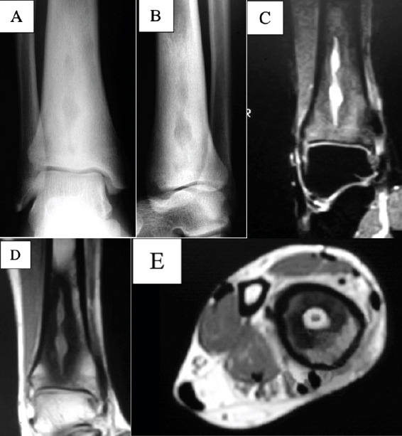
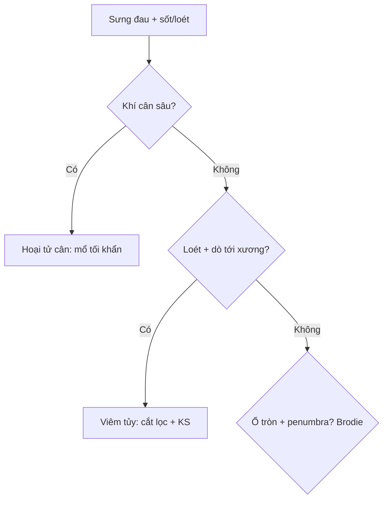

# 370 — Nhiễm trùng MSK: viêm tủy, Brodie, Charcot & hoại tử cân / MSK infection

**Tags:** `pattern:nhiem-trung-msk` `vung:xuong-mo-mem`
**Mức chắc chắn (certainty):** tổng hợp y văn (literature synthesis) — nhóm tự biên từ y văn mở, chưa gắn ca nguyên văn đơn lẻ.

## 1. Tổng quan — vi khuẩn ăn xương theo mạch + áp lực tủy + đường vào da

- Viêm xương tủy cấp (trẻ, metaphysis): vi khuẩn kẹt quai mạch hành xương — TẠI SAO phù lan >> ổ mủ + T1 tối lan rộng: mủ + xung huyết lan theo tủy trước khi khu trú.
- Brodie (bán cấp, miễn dịch tốt + vi khuẩn yếu): mủ khu trú có viền xơ — **dấu quầng (penumbra: viền T1 sáng quanh ổ mủ)** nhạy 75% đặc hiệu 99%.
- Bàn chân đái tháo đường: tắc mạch + mất cảm giác + loét — TẠI SAO khó phân biệt Charcot vs viêm tủy: cả 2 cùng phù + biến dạng; **loét + đường dò (sinus tract) tới xương + khí** = viêm tủy.
- **Dấu bóng ma (ghost sign):** xương chết (sequestrum) mất viền đặc trong ổ viêm mạn — TẠI SAO: xương chết không còn máu nuôi nên không đặc hóa theo.
- U phần mềm **> 5 cm + sâu dưới mạc + không đồng nhất** bắt buộc nghi sarcoma — TẠI SAO: kích thước + độ sâu là 2 yếu tố nguy cơ độc lập (bài 375: vách > 2 mm + MDM2).
- Viêm cân hoại tử: độc tố lan cân sâu — khí dọc cân + phù lan + sốc = mổ tối khẩn (tử vong tăng theo giờ!).

## 2. Gamut sưng-đau + sốt (Gamut)

- **Phù lan + T1 tối rộng + sốt + cấy (+):** viêm tủy cấp — kháng sinh + dẫn lưu/mổ.
- **Ổ tròn viền xơ + penumbra + mạn không sốt:** Brodie — nạo + cấy (50–78% tụ cầu, 20% âm tính).
- **ĐTĐ + loét + dò tới xương + khí:** viêm tủy bàn chân — cắt lọc + kháng sinh + offloading.
- **Khí cân sâu + đau ngoài tổn thương + sốc:** hoại tử cân — mổ cắt lọc tối khẩn + ICU.

## 3. Bảng so sánh phân biệt (ma trận đối chiếu)

| Thực thể (entity) | Hình ảnh điển hình | Chốt vào (rule-in) | Chốt loại (rule-out) | Gợi ý xác nhận |
|---|---|---|---|---|
| Viêm tủy cấp | **Phù lan + T1 tối rộng + sequestrum/involucrum** | **Sốt + CRP + cấy máu/mủ** | Ổ tròn penumbra → Brodie | KS + mổ dẫn lưu |
| Brodie | **Ổ tròn viền xơ + penumbra T1 + hành/xương chày** | **Mạn + không sốt + penumbra** | Phù lan + sốt → cấp | Nạo + cấy (âm tính vẫn nạo) |
| Charcot vs viêm tủy | **Cả 2: phù + biến dạng; viêm tủy: loét + dò + khí** | **Dò tới xương/khí = viêm tủy** | Không loét + giữa bàn chân → Charcot | Probe-to-bone + MRI + offloading |
| Hoại tử cân | **Khí dọc cân sâu + phù lan + sốc** | **Khí + đau > tổn thương + sốc** | Không khí → viêm mô tế bào | Mổ tối khẩn + KS phổ rộng |

*(a–b) XR: sáng hình rắn viền xơ; (c–e) MRI: dịch trong ổ + ngấm viền. Nguồn: Warburton et al., JOCR 2024 Fig. 2, CC BY-NC-SA 4.0 (phi thương mại, chia sẻ tương tự).*

## 4. Protocol nhiễm trùng MSK

- **MRI + gadolinium + cấy máu/mủ + CRP** khi sưng-đau + sốt/loét; probe-to-bone bàn chân ĐTĐ; CT khi cần khí/sequestrum.

## 5. Cạm bẫy

- **Brodie gọi nhầm u** sinh thiết rộng oan — penumbra + mạn + không sốt là nạo hạn chế + cấy.
- **Charcot bó bột mù khi đang viêm tủy** = lan hoại tử — probe-to-bone + MRI trước offloading.
- **Chờ cấy mới mổ hoại tử cân** = chết — khí + sốc là mổ ngay, cấy sau.
- **Chỉ đọc T2FS/STIR bỏ qua T1W thường** = nâng phù phản ứng thành viêm tủy — T1W còn mỡ lấm tấm là Charcot/phù (viêm thật đen hoàn toàn!), luôn đọc T1W trước!

## 6. Tự lượng giá — Blind Quiz

**Ca 1 — Đau sưng cổ chân mạn 6 tháng, không sốt. Đọc XR + MRI.**

- Hỏi: bờ ổ thế nào? U hay mủ? Có cần kháng sinh dài ngày khi cấy âm?

<b>Bấm để hiện đáp án</b>

- Dấu hiệu (findings): ổ sáng hình rắn viền xơ đặc + dịch trong + ngấm viền, không khối mềm.
- Chẩn đoán (diagnosis): **áp-xe Brodie (viêm bán cấp)** — nạo + cấy; cấy âm tính thì không cần kháng sinh dài ngày.
- Nguồn: Warburton et al., Fig. 2, CC BY-NC-SA 4.0.

**Ca 2 — ĐTĐ + loét gan chân + dò tới xương + khí:** Charcot hay viêm tủy? *(Bảng mục 3.)*

<b>Bấm để hiện đáp án</b>

- **Viêm xương tủy bàn chân:** cắt lọc + kháng sinh + offloading (Charcot đơn thuần không loét/dò/khí).

**Ca 3 — Đau đùi dữ + khí dọc cân + sốc, da còn bình thường:** viêm mô tế bào hay hoại tử cân? *(Bảng mục 3.)*

<b>Bấm để hiện đáp án</b>

- **Viêm cân hoại tử:** mổ cắt lọc tối khẩn + ICU + kháng sinh phổ rộng (tử vong tăng theo giờ).

## Bài liên quan chéo
- [300 – Tổng quan MSK](../300-tong-quan-he-co-xuong-khop/lesson.md)
- [330 – U xương](../330-tiep-can-u-xuong-va-dont-touch/lesson.md) (Brodie giả u)
- [222 – Viêm đốt sống](../222-viem-dot-song/lesson.md) (Pott vs vi khuẩn)

> Không dùng để chẩn đoán độc lập khi chưa có người hướng dẫn.
