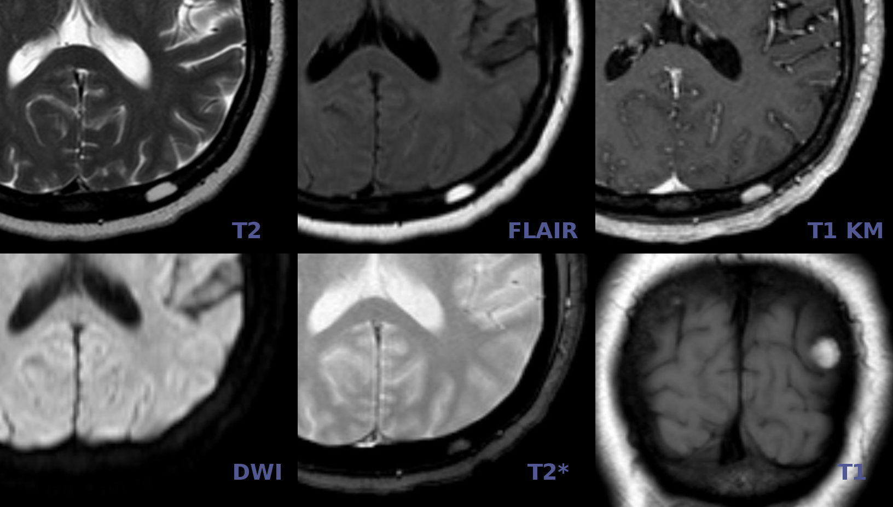
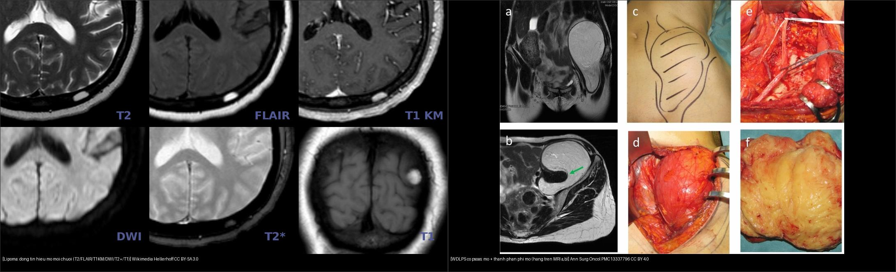
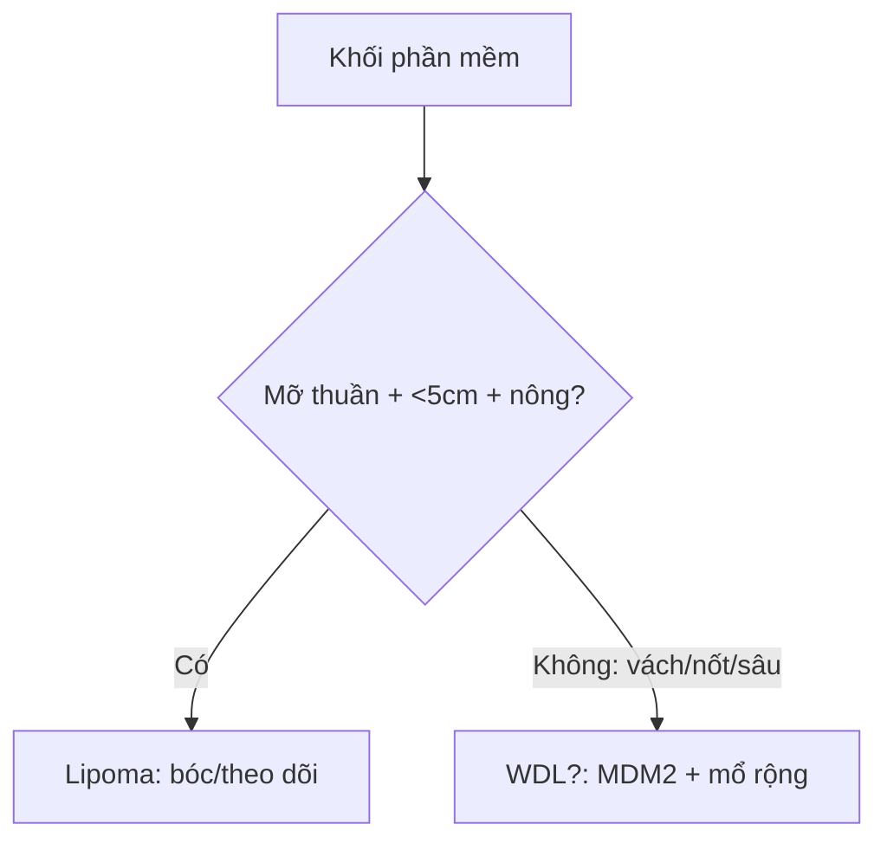
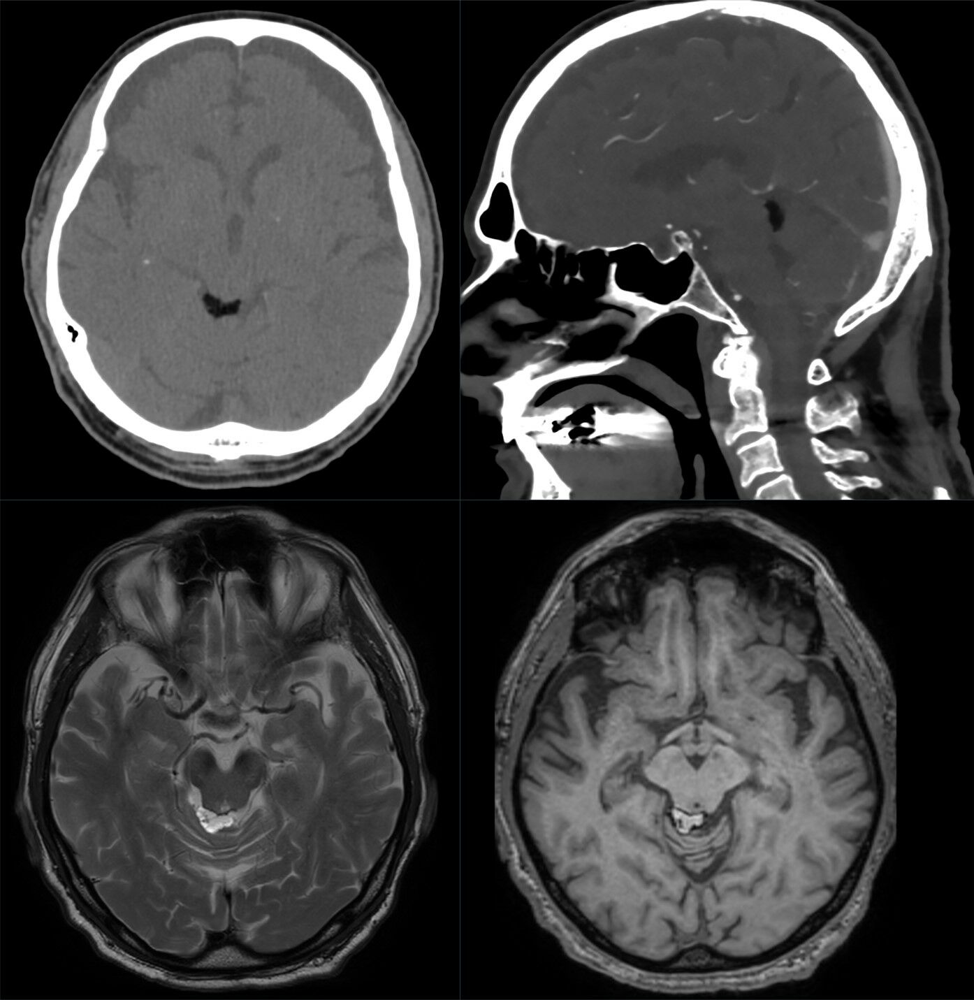
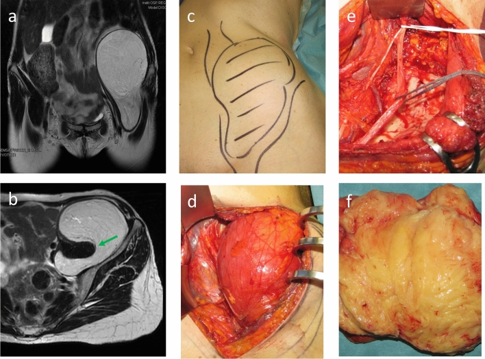

# 375 — U phần mềm: lipoma vs liposarcoma biệt hóa tốt / Soft tissue tumors

**Tags:** `pattern:u-phan-mem` `vung:phan-mem`
**Mức chắc chắn (certainty):** tổng hợp y văn (literature synthesis) — nhóm tự biên từ y văn mở, chưa gắn ca nguyên văn đơn lẻ.

## 1. Tổng quan — mỡ thuần vs mỡ lẫn thịt + MDM2/CDK4

- Lipoma: mỡ trưởng thành thuần — TẠI SAO đồng tín hiệu mỡ mọi xung + mất hoàn toàn trên fat-sat + không ngấm: 100% tế bào mỡ, không thành phần thịt.
- Liposarcoma biệt hóa tốt (ALT/WDL): mỡ + vách xơ + nốt thịt + MDM2/CDK4 (+) — TẠI SAO vách dày **> 2 mm** + nốt đặc ngấm là ác: thành phần phi mỡ tăng sinh.
- Ngưỡng: sâu + > 10 cm + vách > 2 mm + nốt đặc = ác đến khi chứng minh ngược lại; nông + < 5 cm + đồng nhất = lành.
- Ngưỡng độc lập với kích thước: **khuếch đại MDM2 mức cao là tiêu chuẩn vàng mô học (pathognomonic) của WDL/DD** và loại trừ các dưới nhóm khác (myxoid round cell, pleomorphic). Trong đoàn hệ 254 ca, u WDL khoang sau phúc mạc **rất lớn** (trung vị **20 cm** ở nhóm cơ đái chậu, **25 cm** nhóm khoang sau phúc mạc khác) so với **15 cm** ở chi.

*Sáu chuỗi xung (T2 – FLAIR – T1 sau tiêm – DWI – T2* – T1) của một lipoma: tổn thương **đồng tín hiệu với mỡ dưới da trên MỌI chuỗi** (sáng trên T1/T2, **tối trên FLAIR/fat-sat**, không ngấm). Nguồn: Hellerhoff, Wikimedia Commons, CC BY-SA 3.0.*

## 2. Gamut khối phần mềm (Gamut)

- **Mỡ thuần + nông + < 5 cm + không ngấm:** lipoma — bóc đơn giản/theo dõi.
- **Vách > 2 mm + nốt đặc + sâu + > 10 cm + MDM2 (+):** WDL/ALT — mổ rộng + theo dõi tái phát/biệt hóa xấu.
- **Myxoid + mạch lưới + T2 sáng:** myxosarcoma — mổ + xạ.
- **Máu tụ sau chấn thương + không ngấm + teo dần:** hematoma — theo dõi, đừng sinh thiết vội.

## 3. Bảng so sánh phân biệt (ma trận đối chiếu)

| Thực thể (entity) | Hình ảnh điển hình | Chốt vào (rule-in) | Chốt loại (rule-out) | Gợi ý xác nhận |
|---|---|---|---|---|
| Lipoma | **Mỡ thuần + mất hoàn toàn fat-sat + không ngấm + nông < 5 cm** | **Đồng mỡ + không vách/nốt** | Vách > 2 mm + nốt → WDL | Bóc/theo dõi |
| WDL/ALT | **Vách > 2 mm + nốt đặc ngấm + sâu + > 10 cm + MDM2/CDK4 (+)** | **Vách/nốt + sâu + lớn + MDM2** | Mỡ thuần → lipoma | Mổ rộng + FISH MDM2 |
| Myxosarcoma | **Myxoid T2 sáng + mạch lưới + ngấm lan** | **Nhầy + mạch + sâu** | Mỡ thuần → lipoma | Mổ + xạ |
| Hematoma | **Sau chấn thương + mức dịch-máu + không ngấm + teo dần** | **Chấn thương + teo theo thời gian** | Lớn dần + ngấm → u | Theo dõi 6–8 tuần, sinh thiết khi lớn dần |

*Trái: lipoma — mỡ thuần, đồng tín hiệu mỡ mọi chuỗi, mất tín hiệu khi fat-sat, không ngấm. Phải: WDLPS cơ đái chậu — mỡ lớn nhưng **có thành phần phi mỡ/thành dày** (hàng trên a,b là MRI). Nguồn: Hellerhoff/Wikimedia CC BY-SA 3.0 & Ann Surg Oncol PMC13337796 CC BY 4.0. Ảnh ghép letterbox.*

### Vì sao fat-sat là chốt phân biệt mỡ
- **Bản chất vật lý:** mô mỡ T1W **sáng** (thời gian T1 ngắn) và T2W **sáng**; chuỗi **bão hòa mỡ (fat-sat) triệt tín hiệu mỡ** → lipoma **mất tín hiệu hoàn toàn (tối đen)**, còn **thành phần thịt/máu/nhầy không phải mỡ sẽ còn sáng**.
- **Chốt vào:** đồng tín hiệu mỡ trên **T1 + T2** và **tắt hoàn toàn trên fat-sat** = mỡ thuần.
- **Chốt loại:** còn **nốt/thành sáng ≥ 2 mm không tắt** trên fat-sat, hoặc **ngấm thuốc** = có thành phần phi mỡ → cảnh giác WDL/ALT.

## 4. Protocol u phần mềm

- **MRI + gadolinium + đo 3 chiều + MDM2/CDK4/FISH** khi sâu + > 5 cm + không đồng nhất; sinh thiết lõi có kế hoạch (tránh đường mổ triệt căn).

## 5. Cạm bẫy

- **Hematoma mạn vôi hóa giả sarcoma** — chấn thương + teo dần + không ngấm là theo dõi.
- **Sinh thiết WDL đường sai** nhiễm bẩn khoang — trung tâm sarcoma phần mềm trước.
- **Lipoma sâu > 10 cm** vẫn có thể WDL — kích thước + vị trí sâu là sinh thiết, đừng bóc mù.
- **CT đo được mỡ:** lipoma có tỷ trọng **mỡ (−30 đến −100 HU)**, đồng tỷ trọng với mỡ dưới da; **nhưng mỡ đơn thuần trên CT KHÔNG loại được WDL** vì WDL phần lớn là mỡ — phải **MRI fat-sat** mới thấy thành phần phi mỡ.
- **Hội chứng đè ép/thẩm mỹ:** khối mỡ lành nhưng chèn ép thần kinh-mạch (lipoma cơ, lipoma dây chằng) vẫn có chỉ định mổ — quyết định theo triệu chứng, không chỉ mô học.

*Trên: CT (ngang + dọc) — tổn thương mỡ tỷ trọng thấp (đen). Dưới: MRI T2 (trái) và T1 (phải) — mỡ sáng trên T1/T2. Nguồn: Hellerhoff, Wikimedia Commons, CC BY-SA 4.0.*

## 6. Tự lượng giá — Blind Quiz (ảnh trơn ngoài, đáp án ẩn)

**Ca 1 — Tình cờ phát hiện tổn thương nhỏ ở vòm sọ trên MRI. So 6 chuỗi xung: tổn thương "đi theo" mô nào?**

- Gợi ý: không đau, không tiền sử chấn thương; tổn thương nhỏ, bờ rõ.
- Câu hỏi: Tín hiệu tổn thương so với mỡ dưới da? Chuỗi nào chốt bản chất mỡ? Chẩn đoán + xử trí?

<b>Bấm để hiện đáp án (findings + chẩn đoán)</b>

- Tổn thương **đồng tín hiệu với mỡ dưới da trên mọi chuỗi**: sáng trên **T1/T2**, **tắt trên FLAIR** (fat-sat), **không ngấm** sau tiêm — **lipoma**.
- Xử trí: **theo dõi**, chỉ bóc khi chèn ép/vì thẩm mỹ; không sinh thiết rộng.
- Nguồn ảnh: Hellerhoff, Wikimedia Commons, CC BY-SA 3.0.

**Ca 2 — Khối cơ đái chậu, MRI mỡ lớn nhưng có phần phi mỡ. Lipoma hay ác?**

- Gợi ý: khối lớn, sâu, không đau nhiều; MDM2 (+) trên mô học.
- Câu hỏi: Dấu hiệu nào phá vỡ "lipoma"? Xét nghiệm nào chốt? Vì sao không bóc đơn thuần?

<b>Bấm để hiện đáp án (findings + chẩn đoán)</b>

- **WDLPS (ALT)**: mỡ chiếm ưu thế **nhưng có thành phần phi mỡ/dải xơ dày** (mũi tên xanh ở mặt phẳng ngang b) — **vách > 2 mm/ngấm** = chốt loại lipoma.
- Chốt xác nhận: **MDM2/CDK4 (FISH)** — khuếch đại mức cao đặc trưng WDL/DD LPS; **mổ rộng** (không bóc mù), theo dõi tái phát; u khoang sau phúc mạc trung vị **20–25 cm**.
- Nguồn ảnh: Tseng et al., Ann Surg Oncol 2026 (PMC13337796), Fig 1 (hàng trên a,b = MRI), CC BY 4.0.

**Ca 3 — Khối đùi nông 3 cm, mỡ thuần, mất hoàn toàn trên fat-sat, 2 năm không đổi:** xử trí? *(Bảng mục 3.)*

<b>Bấm để hiện đáp án</b>

- **Lipoma:** theo dõi/bóc đơn giản khi vướng (không sinh thiết rộng).

**Ca 4 — Khối đùi sâu 12 cm + vách 4 mm + nốt đặc ngấm:** lipoma hay WDL? Xét nghiệm nào chốt? *(Bảng mục 3.)*

<b>Bấm để hiện đáp án</b>

- **WDL/ALT:** vách > 2 mm + nốt + sâu + > 10 cm — FISH MDM2/CDK4 (+) + mổ rộng (không bóc đơn thuần).

## Bài liên quan chéo
- [300 – Tổng quan MSK](../300-tong-quan-he-co-xuong-khop/lesson.md)
- [330 – U xương](../330-tiep-can-u-xuong-va-dont-touch/lesson.md) (Lodwick)
- [370 – Nhiễm trùng MSK](../370-nhiem-trung-msk/lesson.md) (myositis giả u)

## Ảnh
- Tên file: `NNN_slug_Modality_SourceID.jpg`. Chi tiết nguồn + giấy phép từng ảnh: `images/CREDITS.md` và `sources.md`.
- Ảnh ghép đối chiếu tạo bằng `tools/make_composite.py` (letterbox, không crop/kéo giãn).

> Không dùng để chẩn đoán độc lập khi chưa có người hướng dẫn.
