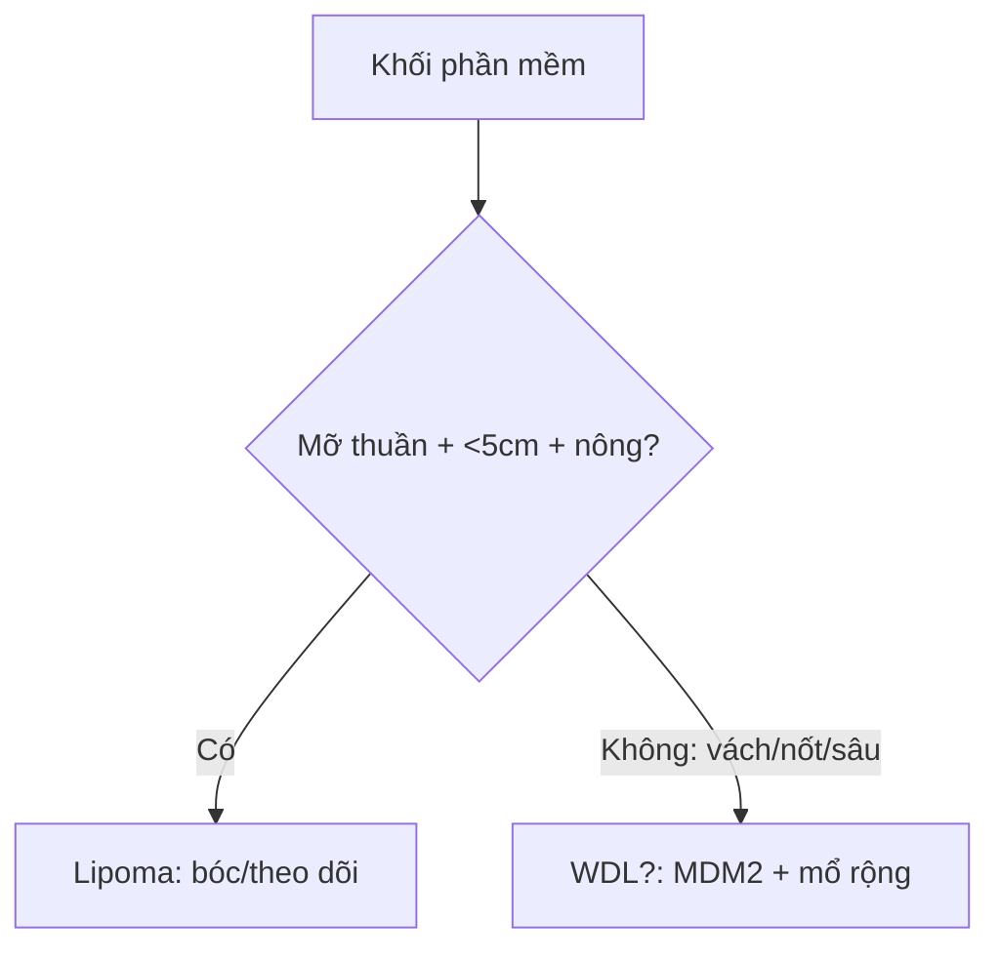

# 375 — U phần mềm: lipoma vs liposarcoma biệt hóa tốt / Soft tissue tumors

**Tags:** `pattern:u-phan-mem` `vung:phan-mem`
**Mức chắc chắn (certainty):** tổng hợp y văn (literature synthesis) — nhóm tự biên từ y văn mở, chưa gắn ca nguyên văn đơn lẻ.

## 1. Tổng quan — mỡ thuần vs mỡ lẫn thịt + MDM2/CDK4

- Lipoma: mỡ trưởng thành thuần — TẠI SAO đồng tín hiệu mỡ mọi xung + mất hoàn toàn trên fat-sat + không ngấm: 100% tế bào mỡ, không thành phần thịt.
- Liposarcoma biệt hóa tốt (ALT/WDL): mỡ + vách xơ + nốt thịt + MDM2/CDK4 (+) — TẠI SAO vách dày **> 2 mm** + nốt đặc ngấm là ác: thành phần phi mỡ tăng sinh.
- Ngưỡng: sâu + > 10 cm + vách > 2 mm + nốt đặc = ác đến khi chứng minh ngược lại; nông + < 5 cm + đồng nhất = lành.

## 2. Gamut khối phần mềm (Gamut)

- **Mỡ thuần + nông + < 5 cm + không ngấm:** lipoma — bóc đơn giản/theo dõi.
- **Vách > 2 mm + nốt đặc + sâu + > 10 cm + MDM2 (+):** WDL/ALT — mổ rộng + theo dõi tái phát/biệt hóa xấu.
- **Myxoid + mạch lưới + T2 sáng:** myxosarcoma — mổ + xạ.
- **Máu tụ sau chấn thương + không ngấm + teo dần:** hematoma — theo dõi, đừng sinh thiết vội.

## 3. Bảng so sánh phân biệt (ma trận đối chiếu)

| Thực thể (entity) | Hình ảnh điển hình | Chốt vào (rule-in) | Chốt loại (rule-out) | Gợi ý xác nhận |
|---|---|---|---|---|
| Lipoma | **Mỡ thuần + mất hoàn toàn fat-sat + không ngấm + nông < 5 cm** | **Đồng mỡ + không vách/nốt** | Vách > 2 mm + nốt → WDL | Bóc/theo dõi |
| WDL/ALT | **Vách > 2 mm + nốt đặc ngấm + sâu + > 10 cm + MDM2/CDK4 (+)** | **Vách/nốt + sâu + lớn + MDM2** | Mỡ thuần → lipoma | Mổ rộng + FISH MDM2 |
| Myxosarcoma | **Myxoid T2 sáng + mạch lưới + ngấm lan** | **Nhầy + mạch + sâu** | Mỡ thuần → lipoma | Mổ + xạ |
| Hematoma | **Sau chấn thương + mức dịch-máu + không ngấm + teo dần** | **Chấn thương + teo theo thời gian** | Lớn dần + ngấm → u | Theo dõi 6–8 tuần, sinh thiết khi lớn dần |

## 4. Protocol u phần mềm

- **MRI + gadolinium + đo 3 chiều + MDM2/CDK4/FISH** khi sâu + > 5 cm + không đồng nhất; sinh thiết lõi có kế hoạch (tránh đường mổ triệt căn).

## 5. Cạm bẫy

- **Hematoma mạn vôi hóa giả sarcoma** — chấn thương + teo dần + không ngấm là theo dõi.
- **Sinh thiết WDL đường sai** nhiễm bẩn khoang — trung tâm sarcoma phần mềm trước.
- **Lipoma sâu > 10 cm** vẫn có thể WDL — kích thước + vị trí sâu là sinh thiết, đừng bóc mù.

## 6. Tự lượng giá — Blind Quiz

**Ca 1 — Khối đùi sâu 12 cm + vách 4 mm + nốt đặc ngấm:** lipoma hay WDL? Xét nghiệm nào chốt? *(Bảng mục 3.)*

<b>Bấm để hiện đáp án</b>

- **WDL/ALT:** vách > 2 mm + nốt + sâu + > 10 cm — FISH MDM2/CDK4 (+) + mổ rộng (không bóc đơn thuần).

**Ca 2 — Khối vai nông 3 cm mỡ thuần mất hoàn toàn fat-sat, 2 năm không đổi:** xử trí? *(Bảng mục 3.)*

<b>Bấm để hiện đáp án</b>

- **Lipoma:** theo dõi/bóc đơn giản khi vướng (không sinh thiết rộng).

## Bài liên quan chéo
- [300 – Tổng quan MSK](../300-tong-quan-he-co-xuong-khop/lesson.md)
- [330 – U xương](../330-tiep-can-u-xuong-va-dont-touch/lesson.md) (Lodwick)
- [370 – Nhiễm trùng MSK](../370-nhiem-trung-msk/lesson.md) (myositis giả u)

> Không dùng để chẩn đoán độc lập khi chưa có người hướng dẫn.
