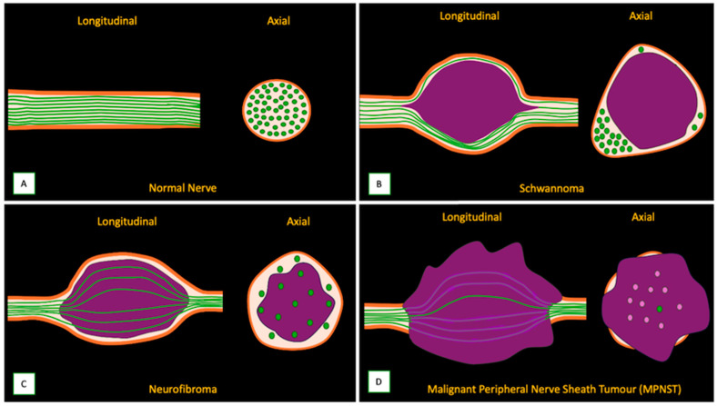
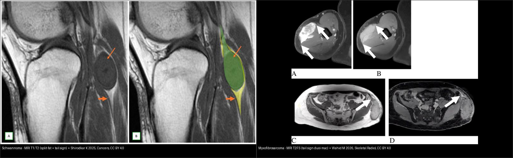
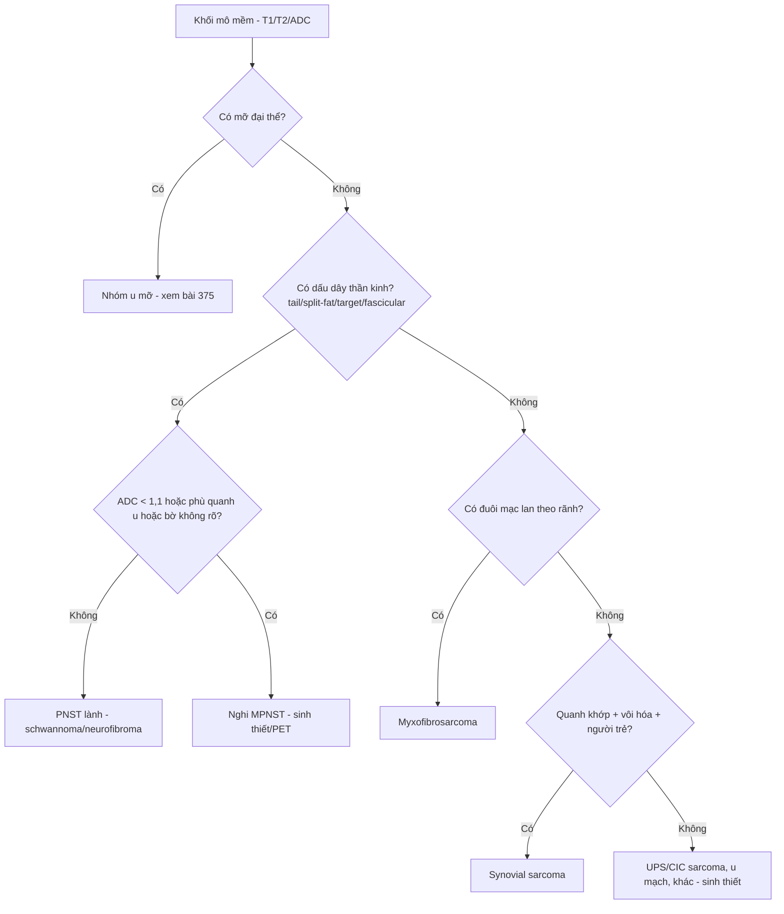
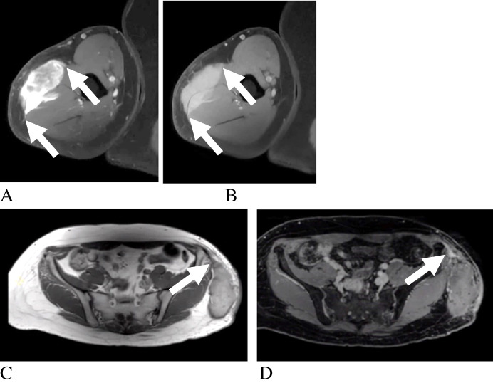
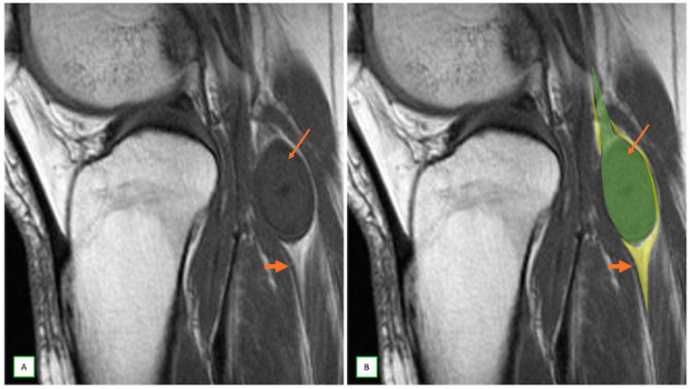
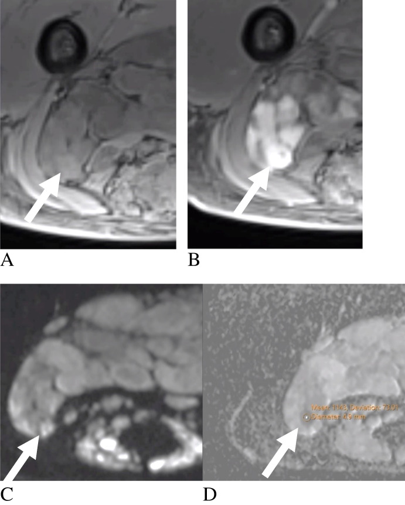

# 376 — U phần mềm KHÔNG mỡ: schwannoma vs sarcoma myxoid / u bao hoạt dịch / Non-fat soft-tissue masses

**Tags:** `pattern:u-phan-mem` `pattern:u-than-kinh-ngoai-vi` `vung:mo-mem` `score:ADC` `protocol:MRI-mo-mem`
**Mức chắc chắn (certainty):** tổng hợp y văn (literature synthesis) — tổng hợp từ 1 bài tổng quan u trong dây thần kinh + 1 systematic review MRI lành/ác mô mềm + 1 pictorial review u bao dây thần kinh, tất cả CC BY.

## 1. Tổng quan bệnh học – cơ chế hình ảnh

### 1.1 Bước 0 luôn phải làm: có mỡ đại thể không?

- Khối mô mềm (soft-tissue mass): câu hỏi đầu tiên trên MRI là **"có mỡ đại thể không?"** — dùng **T1W + T1W xóa mỡ (fat-sat) / chemical shift**. Có mỡ → nhóm u mỡ (lipoma, ALT/WDLPS, myxoid liposarcoma — xem bài 375). **KHÔNG mỡ** → nhóm bài này: u bao dây thần kinh ngoại vi (peripheral nerve sheath tumor — PNST), u **myxoid** (myxofibrosarcoma), **sarcoma bao hoạt dịch (synovial sarcoma)**, sarcoma không biệt hóa, u mạch máu–cơ…
- **TẠI SAO mọi khối "không mỡ" đều sáng T2**: bất kỳ thành phần chứa nhiều nước tự do — **chất nền nhầy (myxoid matrix)**, hoại tử, kén, phù — đều cho **T2 rất sáng + T1 tối**. Vì vậy "T2 sáng" **không** phân biệt lành/ác. Phải đọc thêm: **bờ**, **phù quanh u**, **dấu hiệu liên quan dây thần kinh**, và **DWI/ADC** (vùng đặc bào của sarcoma hạn chế khuếch tán).
- **Schwannoma**: u bao dây thần kinh lành, phát triển **lệch trục (eccentric)** đẩy sợi trục ra ngoại vi; cấu trúc **Antoni A** (đặc bào, sợi xơ) xen **Antoni B** (nhầy, thưa). Vật lý tín hiệu: vùng Antoni A nhiều sợi xơ → **T2 tối trung tâm**; vùng Antoni B giàu nước → **T2 sáng ngoại vi** → tạo **dấu bia (target sign)**.
- **Myxofibrosarcoma** (u mô mềm người lớn hay gặp): đặc trưng là **đuôi mạc (fascial "tail sign")** — tín hiệu lan theo mạc/rãnh mô mềm, giải thích vì sao bờ "mờ" và nguy cơ tái phát cao.
- **Synovial sarcoma**: u mô mềm quanh khớp ở người trẻ, **T2 rất sáng, bờ rõ giả vỏ**, hay **vôi hóa (~1/4)**; vùng đặc bào tăng độ ác → **ADC thấp**.

### 1.2 Ngưỡng định lượng (từ systematic review MRI lành/ác)

- **PNST: ADC < 1,1 ×10⁻³ mm²/s** gợi **ác (MPNST) vs lành** — **Se 93% / Sp 95%** (Wilson 2021, n = 798).
- **PNST: phù cạnh u (perilesional edema)** gợi **ác** — **Se 60% / Sp 94%** (Wilson 2021, n = 798). Sp cao → phù quanh u là "chốt loại lành" tốt hơn là chốt ác.
- **MPNST: bờ không rõ (ill-defined)** gặp **78,6%** (22/28); **PNST lành: bờ rõ** gặp **84,2%** (48/57) (Jin 2023).
- **MPNST: tín hiệu T2 không đồng nhất** gặp **81,0%** (17/21) (Chhabra 2011); **dấu đuôi (tail sign) ở MPNST chỉ 28,6%** (6/21) → dấu đuôi thiên về **PNST lành**.
- **Myxofibrosarcoma: dấu đuôi mạc** gặp **82,4%** (14/17) (Eleti 2022).
- **Lipoma: vách < 2 mm** (100%) — dùng để tách với ALT/WDLPS có vách dày/nốt.
- **Synovial sarcoma: T2W sáng** 100% (15/15); **ADC thấp tương quan độ mô học cao** 100% (15/15) (Ashikyan 2021).

## 2. Mẫu hình + chẩn đoán phân biệt theo vị trí (gamut)

Sau khi loại mỡ, hỏi tiếp theo thứ tự:
**(a) Khối có liên quan dây thần kinh không?** → có **dấu đuôi (tail sign)**, **dấu tách mỡ (split-fat sign)**, **dấu bia (target sign)**, **dấu bó (fascicular sign)** → **PNST**.
**(b) Có "đuôi" lan theo mạc/rãnh?** → **myxofibrosarcoma**.
**(c) Vị trí & tuổi**: quanh khớp, người trẻ, có vôi hóa → **synovial sarcoma**; sâu, lớn, không đồng nhất → **UPS/CIC-rearranged sarcoma**; dưới da nhỏ, đau → u mạch (angioleiomyoma "reticular sign", glomus T2 rất sáng + ngấm mạnh).

- **Theo vị trí – quan hệ với dây thần kinh**:
  - **Trong/nằm dọc dây thần kinh** → PNST (schwannoma, neurofibroma, perineurioma) hoặc **MPNST** (ác, hay ở NF1).
  - **Quanh khớp** → synovial sarcoma, u bao hoạt dịch.
  - **Mạc/nông** → myxofibrosarcoma (đuôi mạc), viêm cân nhịp (nodular fasciitis).
  - **Cơ sâu, lớn** → UPS, sarcoma có đảo CIC.

*Sơ đồ: (A) dây thần kinh bình thường; (B) **schwannoma** mọc **lệch trục** đẩy sợi trục ra ngoại vi; (C) **neurofibroma** xòe các bó sợi quanh u; (D) **MPNST** phá hủy cấu trúc bó. Nguồn: Shirodkar K et al., Cancers 2025 (PMC11763772), CC BY 4.0.*

## 3. Bảng so sánh phân biệt (ma trận đối chiếu)

| Thực thể (entity) | Hình ảnh điển hình (T1/T2/ADC) | Chốt vào (rule-in) | Chốt loại (rule-out) | Gợi ý xác nhận |
|---|---|---|---|---|
| **Schwannoma (lành)** | T1 tối, T2 sáng; **dấu bia** (lõi T2 tối + viền sáng), **dấu tách mỡ**, **dấu bó**, **dấu đuôi**; ngấm đồng nhất–không đồng nhất | **Dấu tách mỡ + dấu đuôi + bờ rõ + không phù quanh u** | Phù quanh u + ADC < 1,1 → nghi MPNST | MRN/DTI men theo dây; theo dõi nếu không triệu chứng |
| **Neurofibroma / plexiform** | T2 sáng, **dấu bia** rõ; hình "dây lớn"; thường liên quan NF1 | **Dấu bia + tổn thương đa dây/plexiform + NF1** | Chuyển dạng ác khi đau tăng nhanh, lớn nhanh, ADC thấp | PET/ADC tầm soát chuyển dạng; MRI toàn thân |
| **MPNST (ác)** | **Không đồng nhất T2 (81%)**, hoại tử/xuất huyết, **bờ không rõ (79%)**, **phù quanh u (Sp 94%)**, **ADC thấp < 1,1** | **ADC < 1,1 + phù quanh u + bờ không rõ + lớn nhanh** | Nếu ADC cao, bờ rõ, không phù → thiên lành | Sinh thiết hướng vùng ngấm/ADC thấp; PET-CT |
| **Myxofibrosarcoma** | T2 rất sáng (nhầy), **đuôi mạc (82%)** lan theo rãnh; ngấm muộn không đồng nhất | **Đuôi mạc (fascial tail) + bờ mờ + nhầy sáng T2** | Không đuôi + bờ rõ → ít nghĩ | MRI + tiêm cản quang (đuôi ngấm muộn), rộng biên phẫu thuật |
| **Synovial sarcoma** | Quanh khớp, **T2 sáng (100%)**, **vôi hóa ~1/4**, bờ "vỏ giả", **ADC thấp ↔ độ ác cao** | **Quanh khớp + vôi hóa + ADC thấp ở người trẻ** | ADC cao toàn bộ + không vôi hóa → ít nghĩ | Sinh thiết; X-quang/CT tìm vôi hóa |
| **U mạch (angioleiomyoma / glomus)** | **Angioleiomyoma: dấu lưới T2** (reticular sign); **Glomus: T2 rất sáng + ngấm mạnh, bờ rõ** | **Dấu lưới / T2 cực sáng + ngấm mạnh + bờ rõ** | Bờ mờ + phù quanh + ADC thấp → loại | Siêu âm Doppler + MRI |
| **Myxoid liposarcoma** (có mỡ) | T1 có **mỡ thưa**, T2 sáng; nốt đặc | **Có mỡ + nốt đặc/ vách dày** | Không mỡ → không phải nhóm này (bài 375) | T1 fat-sat + sinh thiết |

*Trái: **schwannoma** — sagittal T1: **dấu tách mỡ (split-fat, mũi tên mảnh)** và **dấu đuôi (tail sign, mũi tên — dây thần kinh vào/ra u)**; ảnh bên phải là overlay minh họa. Phải: **myxofibrosarcoma** — T2FS/post-contrast: **đuôi mạc (fascial tail sign)** lan theo mạc (mũi tên). Nguồn: Shirodkar K 2025, Cancers (PMC11763772) + Wahid M 2026, Skeletal Radiol (PMC13139302) — CC BY 4.0. Ảnh ghép letterbox.*

### Dấu "chốt" cần thuộc lòng
- **Tail sign** (dây thần kinh vào/ra u) — đặc trưng PNST, **nhưng vẫn có ở ~29% MPNST** → không dùng một mình để loại ác.
- **Target sign** (lõi T2 tối + viền T2 sáng) — schwannoma/neurofibroma.
- **Fascial tail** (đuôi mạc) — myxofibrosarcoma.
- **ADC < 1,1 ×10⁻³ mm²/s** — hướng MPNST (Se 93%/Sp 95%).
- **Phù quanh u** — Sp 94% cho ác (chốt loại lành mạnh).

## 4. Protocol chụp + lưu đồ

- **MRI mô mềm chuẩn**: **T1W**, **T2W xóa mỡ (fat-sat)/STIR**, **DWI + bản đồ ADC**, **T1W fat-sat sau tiêm cản quang**. Nếu u liên quan dây thần kinh: thêm **MR neurography (MRN)** + **DTI** để vẽ đường đi sợi trục phục vụ phẫu thuật.
- **Nhắm sinh thiết**: lấy vùng **ngấm mạnh / ADC thấp / không hoại tử**, tránh lõi hoại tử và vùng phù quanh u. U nghi sarcoma → **chuyển trung tâm sarcoma**, **không sinh thiết bừa qua nhiều khoang**.
- **Không có RADS riêng** cho u mô mềm; dùng bộ dấu hiệu + ADC + hội chẩn đa chuyên khoa (theo WHO 2020).
- **CT/X-quang**: tìm **vôi hóa** (synovial sarcoma), đánh giá xương kế cận.

## 5. Biến thể bình thường và cạm bẫy

- **U bao dây thần kinh myxoid lành** cho **T2 cực sáng** — dễ nhầm myxoma/myxoid sarcoma nếu chỉ nhìn "T2 sáng + nhầy". Không có dấu tách mỡ/đuôi + không hạn chế khuếch tán → thiên lành.
- **Schwannoma thoái hóa kén**: nhiều vách + **mức dịch–dịch (fluid-fluid level)** + ngấm không đồng nhất → **giả ác**; đối chiếu bờ rõ + dấu tách mỡ giúp trấn an.
- **Nang hạch trong dây thần kinh (intraneural ganglion cyst)**: T1 tối/T2 sáng như khối đặc — nhưng **không ngấm cản quang** → phân biệt với u đặc.
- **T2 shine-through vs hạn chế khuếch tán thật**: **luôn đọc bản đồ ADC**, không kết luận ác chỉ vì DWI sáng (dịch/u nhầy cũng sáng DWI).
- **Đuôi mạc** cũng gặp trong viêm cân/nodular fasciitis và MPNST → đọc trong bối cảnh.
- **Phù cơ do mất chi phối (denervation edema)** có thể trông như "khối" ngấm thuốc; tìm dấu hiệu thần kinh nguồn (khối dọc dây) mới đúng tổn thương nguyên phát.

*Hai bệnh nhân myxofibrosarcoma: khối mô mềm không đồng nhất có **phần lan theo mạc (đuôi mạc — mũi tên)**; cần đánh dấu phần đuôi khi lập kế hoạch mổ vì đây là nguồn tái phát. Nguồn: Wahid M et al., Skeletal Radiol 2026 (PMC13139302), CC BY 4.0.*

## 6. Tự lượng giá — Blind Quiz

**Ca 1 — Người 48 tuổi, khối khoeo chân. Nhìn ảnh trước.**

- Câu hỏi: Hai dấu hiệu chốt trên lát T1 là gì? Nghĩ nhóm u nào? Cần đo gì thêm để loại trừ ác tính?

<b>Bấm để hiện đáp án</b>

- Dấu hiệu (findings): **dấu tách mỡ (split-fat sign — mũi tên mảnh)** — lớp mỡ còn bao quanh u; **dấu đuôi (tail sign — mũi tên)** — dây thần kinh chui vào và ra khỏi u. U bờ rõ, tín hiệu đồng nhất.
- Chẩn đoán (diagnosis): **u bao dây thần kinh lành (schwannoma)** — vì tách mỡ + đuôi + bờ rõ là bộ dấu hiệu đặc trưng PNST lành. Cần **ADC** (loại MPNST nếu ≥ 1,1) và tìm **phù quanh u**.
- Nguồn ảnh: Shirodkar K et al., Cancers 2025 (PMC11763772), CC BY 4.0 — Fig 3.

**Ca 2 — Khối mô mềm ở đùi, T2 rất sáng. Nhìn ảnh trước.**

<b>Bấm để hiện đáp án</b>

- Dấu hiệu (findings): khối không đồng nhất, **phần mô lan theo mạc/rãnh mô mềm (đuôi mạc — mũi tên)**; đuôi ngấm thuốc muộn.
- Chẩn đoán (diagnosis): **myxofibrosarcoma** — vì dấu đuôi mạc gặp ~82% ở myxofibrosarcoma và phản ánh sự lan theo mạc (nguyên nhân tái phát nếu bỏ sót phần đuôi). Phải đánh dấu toàn bộ phần đuôi trước mổ.
- Nguồn ảnh: Wahid M et al., Skeletal Radiol 2026 (PMC13139302), CC BY 4.0 — Fig 5.

**Ca 3 — Ảnh ghép: hai khối không mỡ. Nhìn ngoài, tự phân biệt.**

- Câu hỏi: Bên nào là u lành? Dấu hiệu nào giúp chốt? Cần bổ sung chuỗi xung nào?

<b>Bấm để hiện đáp án — findings + chẩn đoán</b>

- **Trái = schwannoma lành**: có **dấu tách mỡ + dấu đuôi** (dây thần kinh vào/ra u), bờ rõ.
- **Phải = myxofibrosarcoma**: **đuôi mạc** lan theo rãnh, bờ mờ, không có quan hệ dây thần kinh.
- Cần bổ sung: **DWI/ADC** (hạn chế khuếch tán ở sarcoma đặc bào) + **T1 fat-sat sau tiêm** để đánh giá đuôi ngấm muộn.
- Nguồn ảnh: ghép từ Shirodkar K 2025 (PMC11763772) + Wahid M 2026 (PMC13139302), CC BY 4.0; `tools/make_composite.py`.

**Ca 4 — U dọc dây thần kinh, không đồng nhất, lớn nhanh ở bệnh nhân NF1. Nhìn ảnh trước.**

<b>Bấm để hiện đáp án</b>

- Dấu hiệu (findings): tổn thương plexiform ở mông; **DWI (C) hạn chế khuếch tán khu trú + bản đồ ADC (D) ADC = 1,1 ×10⁻³ mm²/s** (mũi tên).
- Chẩn đoán (diagnosis): **MPNST (u bao dây thần kinh ác tính)** — vì **ADC < 1,1 ×10⁻³ mm²/s** hướng ác (Se 93%/Sp 95%), cộng bờ không rõ + phù quanh u; sinh thiết hướng đúng vùng ADC thấp.
- Phản biện (critique): ADC 1,1 nằm **ngay ngưỡng** — không kết luận chỉ bằng một con số; phải phối hợp bờ, phù quanh u, tốc độ lớn và bối cảnh NF1.
- Nguồn ảnh: Wahid M et al., Skeletal Radiol 2026 (PMC13139302), CC BY 4.0 — Fig 7.

## Bài liên quan chéo
- [300 – Tổng quan Cơ–Xương–Khớp](../300-tong-quan-he-co-xuong-khop/lesson.md)
- [375 – U phần mềm (nhóm có mỡ: lipoma vs WDLPS)](../375-u-phan-mem/lesson.md)
- [332 – Sarcoma xương nguyên phát](../332-u-nguyen-phat/lesson.md)
- [331 – U ác người lớn: di căn/myeloma](../331-u-ac-nguoi-lon/lesson.md)
- [213 – U não](../213-u-nao/lesson.md) (nguyên lý DWI/ADC, ngấm thuốc)

## Ảnh
- Ảnh tải về + giấy phép từng file: `images/CREDITS.md`. Toàn bộ ảnh **CC BY 4.0** (được phép ghép/điều chỉnh, ghi nguồn).
- Ảnh ghép đối chiếu tạo bằng `tools/make_composite.py` (letterbox nền đen, giữ aspect).

> Không dùng để chẩn đoán độc lập khi chưa có người hướng dẫn.
