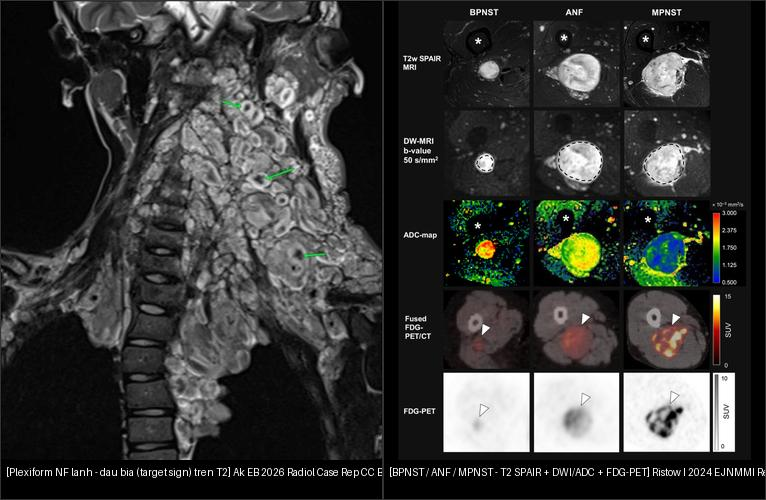
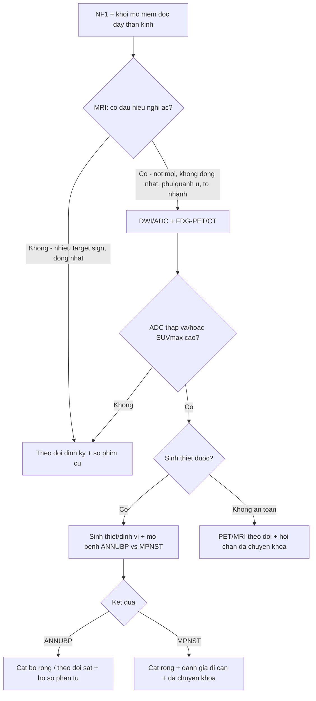
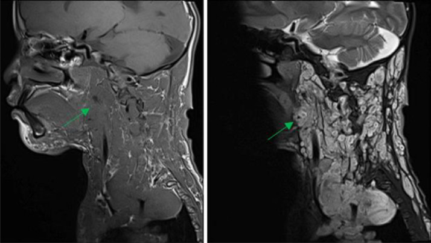
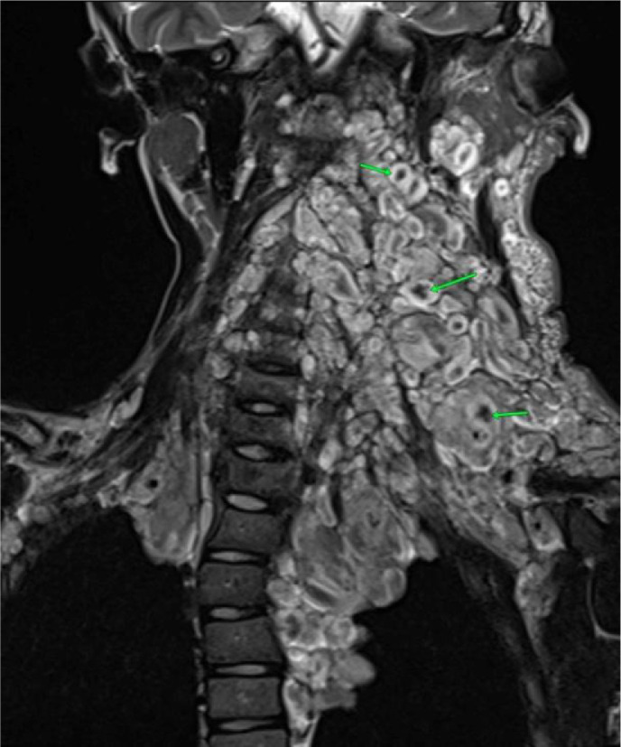
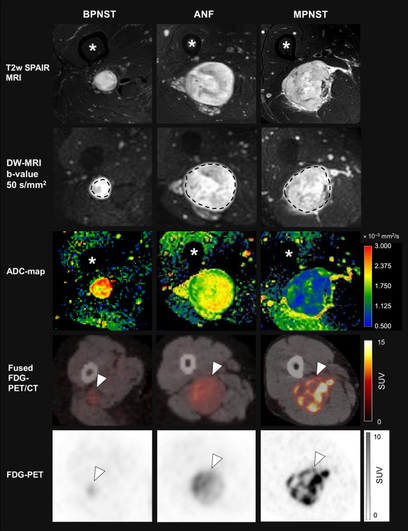
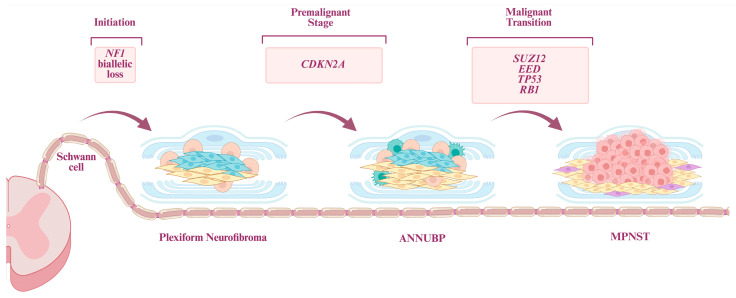
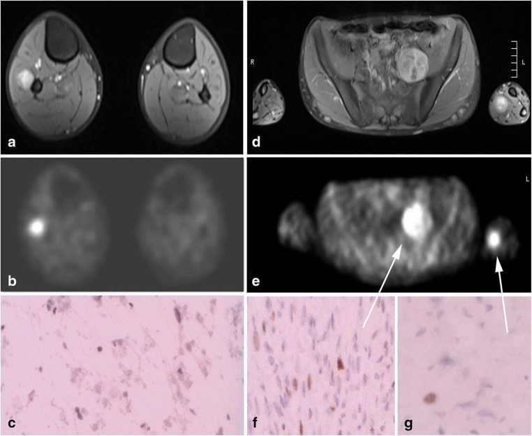
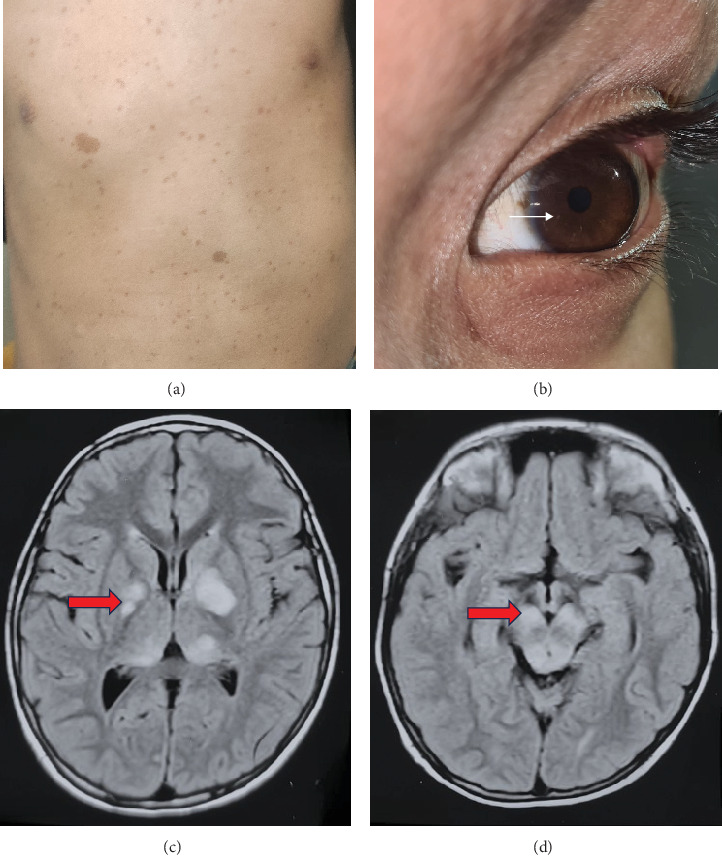
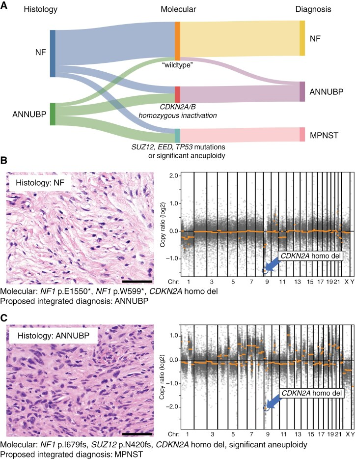

# 377 — U bao dây thần kinh dạng đám rối (plexiform neurofibroma) & chuyển dạng MPNST ở NF1 / Plexiform neurofibroma & malignant transformation in NF1

**Tags:** `pattern:u-than-kinh-ngoai-vi` `pattern:u-phan-mem` `pattern:dam-roi-than-kinh` `vung:mo-mem` `score:ADC` `score:SUVmax` `protocol:MRI-mo-mem` `protocol:WB-MRI` `protocol:PET-CT`
**Mức chắc chắn (certainty):** tổng hợp y văn (literature synthesis) — tổng hợp từ consensus mô bệnh học/hình ảnh + nghiên cứu so sánh PET/CT–DWI + ca nguyên văn CC BY; phần ca quiz là ca nguyên văn của bài gốc.

## 1. Tổng quan bệnh học – cơ chế hình ảnh

### 1.1 NF1 và con đường tiến triển PN → ANNUBP → MPNST

- **Neurofibromatosis type 1 (NF1)** là bệnh **di truyền trội nhiễm sắc thể thường**, do đột biến gen **NF1 (neurofibromin, đường truyền RAS)**. Chẩn đoán lâm sàng theo **tiêu chuẩn 2021: ≥ 2 trong 7 tiêu chí** (≥ 6 đốm café-au-lait; tàn nhang vùng nếp gấp; **≥ 2 u thần kinh** hoặc **1 u dạng đám rối (plexiform)**; u thần kinh thị; ≥ 2 nốt Lisch; loạn sản xương; người thân bậc 1 mắc NF1).
- **U dạng đám rối (plexiform neurofibroma — PN)** là u bao dây thần kinh **lành**, phát triển **mất tổ chức của toàn bộ thành phần dây thần kinh**, **gần như chỉ gặp ở NF1**, **~50% bệnh nhân NF1** có PN; có từ lúc sinh và lớn dần. Vì bản chất xâm nhập dọc dây thần kinh, PN hay **bao bọc mạch–thần kinh** và gây chèn ép.
- **Con đường phân tử tiến triển (stepwise):** mất **cả hai alen NF1** ở dòng tế bào Schwann → PN → **mất CDKN2A/B** (thường là bất thường **sớm nhất**, xuất hiện ở **ANNUBP**) → mất **SUZ12/EED (phức hợp PRC2)** kèm **mất H3K27me3** → **MPNST**. Vì vậy hình ảnh "u to lên + nốt mới trong u cũ" phản ánh **một dòng tế bào đã tích lũy thêm đột biến**.
- **Nguy cơ & tiên lượng:** nguy cơ MPNST **suốt đời 8–15%** ở NF1; MPNST là nguyên nhân tử vong hàng đầu (giảm tuổi thọ **8–15 năm**). **U thần kinh dạng da (cutaneous) hầu như không chuyển dạng** — chỉ PN/NF ngoài da mới chuyển.

### 1.2 TẠI SAO hình ảnh phản ánh đúng bản chất mô

- **Dấu "bia bắn" (target sign) trên T2** — u lành: **lõi trung tâm xơ (fibrous core) tín hiệu THẤP** + **viền ngoại vi myxoid tín hiệu CAO** → hình bia. PN thường có **nhiều dấu bia**. Sự hiện diện target sign giúp phân biệt **u thần kinh lành với MPNST** (MPNST mất cấu trúc đều đặn này).
- **Dấu "tách mỡ" (split-fat sign)** và **dấu "đuôi" (tail sign)**: u nằm dọc dây thần kinh, tách lớp mỡ → gợi ý gốc thần kinh.
- **ADC thấp ở MPNST — TẠI SAO:** MPNST **giàu tế bào (hypercellular)** → khoảng ngoại bào chật → **khuếch tán bị hạn chế** → ADC giảm. Trên DWI, ADC **trung bình** giảm dần theo mức ác tính: **BPNST 2,13 → ANF 1,66 → MPNST 1,37 (× 10⁻³ mm²/s)**.
- **FDG-PET dương ở MPNST — TẠI SAO:** tế bào ác tính tăng **chuyển hóa glucose** → **SUVmax tăng**. Lưu ý **chồng lấp SUVmax** giữa MPNST và tổn thương lành/viêm → PET **không tự quyết định**, phải kết hợp MRI + mô bệnh.
- **Định lượng hiệu năng:** phân biệt **BPNST vs (ANF + MPNST)** — **AUC SUVmax 94,0%**; **AUC ADCmean/min/dark 91,6% / 90,1% / 92,5%**. Ngưỡng tham chiếu: **SUVmax ≥ 3,5 → Se 0,99 / Sp 0,75** (BPNST vs MPNST); ngưỡng **5** cho ANF+MPNST → **Se 85,2% / Sp 92,3%**; **ADCmin ≤ 1,0 × 10⁻³ mm²/s** và **ADCdark ≤ 1,54 × 10⁻³ mm²/s** gợi ý ác.

### 1.3 Tiêu chuẩn mô bệnh ANNUBP & MPNST (2017, codified WHO 2021/2022)

- **ANNUBP (atypical neurofibromatous neoplasm of uncertain biologic potential):** u bao dây thần kinh có **≥ 2 trong 4 đặc điểm**: (a) **dị dạng tế bào (cytologic atypia)**, (b) **mất cấu trúc u thần kinh**, (c) **tăng mật độ tế bào (hypercellularity)**, (d) **chỉ số phân bào > 1/50 HPF và < 3/10 HPF** — **có hoặc không** kèm mất CDKN2A/B.
- **MPNST độ thấp (low-grade):** đặc điểm ANNUBP nhưng **chỉ số phân bào 3–9/10 HPF và KHÔNG hoại tử**.
- **MPNST độ cao (high-grade):** **≥ 10 phân bào/10 HPF**, hoặc **3–9/10 HPF kèm hoại tử**.
- **Đề xuất 2024:** gọi **"low-grade MPNST" → "ANNUBP với tăng sinh"** để tránh dùng chữ "ác tính" cho nhóm tiên lượng còn chưa rõ.

## 2. Mẫu hình + chẩn đoán phân biệt theo vị trí (gamut)

- **Mẫu hình gốc:** khối mô mềm **dọc theo dây thần kinh** (chi/thân/đám rối) ở bệnh nhân **có NF1**. Hỏi 4 câu: **(1) có dấu bia/split-fat/tail không? (2) có nốt mới trong u cũ không? (3) ADC có thấp không? (4) SUVmax bao nhiêu?**
- **Gamut theo bản chất:**
  - **Lành:** u thần kinh dạng da (cutaneous NF), **PN** (đám rối), u thần kinh dây (neurofibroma), **schwannoma** (thường NF2/schwannomatosis, đơn độc).
  - **Trung gian (tiền ác):** **ANNUBP**.
  - **Ác:** **MPNST** độ thấp/độ cao (thường mọc trong PN sẵn có, không mọc từ u dạng da).
- **Dấu hiệu nghi ác trên hình ảnh (worrisome):** **kích thước lớn**, **tín hiệu T1 không đồng nhất**, **ngấm thuốc ngoại vi**, **thoái hóa nang**, **vùng phù quanh u (edema-like zone)**, **nốt mới trong u cũ**, **phát triển nhanh**, **đau mới/tăng**. Trên lâm sàng: "nốt phát triển nhanh/đau, thay đổi độ chắc, thiếu hụt thần kinh mới" là dấu hiệu cảnh báo.

## 3. Bảng so sánh phân biệt (ma trận đối chiếu)

| Thực thể (entity) | Hình ảnh điển hình | Chốt vào (rule-in) | Chốt loại (rule-out) | Gợi ý xác nhận |
|---|---|---|---|---|
| **U thần kinh dạng đám rối (PN) lành** | Khối dọc dây thần kinh, **nhiều dấu bia trên T2**, split-fat sign, tail sign; ngấm thuốc lan tỏa; bao bọc mạch–thần kinh | **Nhiều target sign + tín hiệu đồng nhất + bệnh cảnh NF1 lâu năm** | Nốt mới/không đồng nhất/vùng phù quanh u → không đơn thuần lành | MRI T1 + T2 fat-sat + DWI/ADC; so phim cũ |
| **ANNUBP** | Trong u cũ: **nốt mới**, tín hiệu **kém đồng nhất** hơn, có thể **ADC giảm nhẹ**; chưa có hoại tử lan rộng | **Nốt mới trong u cũ + mất cấu trúc đều** (không dựa vào một thông số đơn) | U đồng nhất, ADC cao, không nốt mới → nghĩ lành | Sinh thiết/định vị + **mô bệnh** (≥ 2/4 tiêu chí) ± CDKN2A/B |
| **MPNST độ cao** | Khối **lớn, tín hiệu T1 không đồng nhất**, **ngấm ngoại vi**, **thoái hóa nang**, **vùng phù quanh u**, mất dấu bia; **ADC thấp**, **SUVmax cao** | **ADC thấp (ADCmin ≤ 1,0; ADCmean ~1,37) + SUVmax cao (≥ 3,5–5) + không đồng nhất/phù quanh u** | Target sign rõ + ADC cao + SUVmax thấp → ít nghĩ MPNST (nhưng không loại trừ tuyệt đối) | PET/CT hoặc PET/MRI + **sinh thiết/mô bệnh** (phân bào/hoại tử) |
| **Schwannoma** | Bờ rõ, **có thể có target sign**, **thoái hóa nang/đốm xuất huyết**, gắn vào một dây thần kinh; thường NF2/schwannomatosis | **Bờ rõ + lệch dây thần kinh (không đan xen)** | Đan xen toàn bộ dây + NF1 + nhiều tổn thương → nghĩ neurofibroma/PN | MRI; bệnh cảnh (NF1 vs NF2/schwannomatosis) |
| **U thần kinh dạng da (cutaneous NF)** | Nốt ở da/dưới da, nhỏ, đồng nhất, không xâm nhập dây lớn | **Nốt nhỏ ở da + không dọc dây lớn** | Xâm nhập dây lớn/đám rối → nghĩ PN | Lâm sàng + siêu âm/MRI nông |

*Trái: **PN lành** — dấu bia (target sign) trên T2 (mũi tên xanh). Phải: **BPNST / ANF / MPNST** — hàng T2 SPAIR (giải phẫu), hàng DWI b=50, hàng bản đồ ADC, hàng PET/CT hợp nhất và FDG-PET; từ trái sang phải tổn thương **ngày càng giàu tế bào (ADC giảm) và tăng chuyển hóa (FDG tăng)**. Nguồn: Ak EB 2026, Radiol Case Rep (PMC12853764); Ristow I 2024, EJNMMI Res (PMC11680535) — CC BY 4.0. Ảnh ghép letterbox.*

### Nhìn gì trước để không bỏ sót chuyển dạng?
- **So phim cũ:** một **nốt mới trong u cũ** hoặc **u to nhanh** quan trọng hơn kích thước tuyệt đối.
- **Không đồng nhất + phù quanh u + mất dấu bia** → nghi ác.
- **Định lượng:** **ADC thấp** và/hoặc **SUVmax cao** củng cố nghi ác, nhưng **chỉ mô bệnh mới chốt**.

## 4. Protocol chụp + hệ phân độ/điểm + lưu đồ

- **MRI vùng tổn thương (regional MRI):** **T1W**, **T2W fat-sat**, **DWI + bản đồ ADC**, **T1W sau tiêm** — đánh giá kích thước, đồng nhất, dấu bia, phù quanh u, bao bọc mạch–thần kinh.
- **WB-MRI (whole-body MRI)**: khuyến nghị **tại thời điểm chuyển tiếp sang người lớn (healthcare transition)** để xác lập **"gánh nặng u nội bộ" (internal tumour burden)** — yếu tố dự báo nguy cơ MPNST. Trẻ em cần cân nhắc **ALARA** (không chụp lặp vô ích).
- **FDG-PET/CT hoặc PET/MRI**: khi MRI nghi ngờ hoặc có dấu lâm sàng cảnh báo; dùng **SUVmax** (tham chiếu ngưỡng **3,5** cho BPNST vs MPNST; **5** cho ANF+MPNST).
- **Nguy cơ cao MPNST nếu ≥ 1 tiêu chí:** tiền sử **ANNUBP**; **gánh nặng u nội bộ cao**; **PN lớn/nhiều**; **tiền sử xạ trị**; **người thân NF1 + MPNST**; **NF1 vi mất đoạn (gồm SUZ12)** hoặc **đột biến missense codon 844–848**.
- **Xác nhận:** **sinh thiết/định vị có hướng** + **mô bệnh** theo tiêu chuẩn ANNUBP/MPNST + **hồ sơ phân tử** (CDKN2A/B, H3K27me3).
- **Không có RADS riêng** cho NF1 → dùng **lưu đồ quyết định** dưới đây.

## 5. Biến thể bình thường và cạm bẫy

- **U thần kinh dạng da hầu như KHÔNG chuyển dạng** — đừng hù dọa bệnh nhân có nhiều u da nhỏ; chỉ **PN/NF ngoài da** mới là nguồn chuyển dạng.
- **Dấu bia không loại trừ tuyệt đối ác tính:** target sign gợi ý lành nhưng **một số u lành vẫn thiếu dấu bia** và **ANNUBP/MPNST sớm có thể còn dấu bia** → đừng dựa vào một dấu.
- **Chồng lấp SUVmax:** viêm, u lành, schwannoma, ANNUBP đều có thể **tăng FDG** → **PET dương không đồng nghĩa ác**; luôn đối chiếu MRI + mô bệnh.
- **DWI/ADC: coi chừng "T2 shine-through"** — đọc **bản đồ ADC**, không chỉ ảnh DWI; đo **cùng ROI** ở vùng tín hiệu thấp nhất.
- **Thuật ngữ:** "ANNUBP" **không phải** "MPNST độ thấp" theo nghĩa cũ — 2024 đề xuất đổi tên để tránh điều trị quá mức.
- **Thỏa mãn tìm kiếm:** NF1 thường **đa tổn thương** → đừng chỉ đọc một khối; đánh giá **toàn thân (WB-MRI)** và tìm tổn thương thứ hai.

## 6. Tự lượng giá — Blind Quiz

**Ca 1 — Trẻ 10 tuổi NF1, khối vùng cổ. Nhìn ảnh trước, mô tả.**

- Gợi ý lâm sàng: trẻ 10 tuổi, NF1, khối vùng cổ lan rộng.
- Câu hỏi: Tín hiệu T1 và T2 thế nào? Có dấu hiệu gì giúp phân biệt u lành với MPNST? Biến chứng tại chỗ?

<b>Bấm để hiện đáp án</b>

- Dấu hiệu (findings): tổn thương **giảm tín hiệu trên T1** và **tăng tín hiệu trên T2** (mũi tên xanh), **bao bọc mạch–thần kinh** và **chèn ép tủy sống**.
- Chẩn đoán (diagnosis): **u thần kinh dạng đám rối (plexiform neurofibroma)** lành — mô bệnh xác nhận không ác tính. **Dấu bia (target sign) trên T2** giúp phân biệt u thần kinh lành với MPNST.
- Nguồn ảnh: Ak EB et al., Radiol Case Rep 2026 (PMC12853764), CC BY 4.0 — Fig 3.

**Ca 2 — Cùng bệnh nhân: dấu hiệu đặc trưng của u thần kinh lành. Nhìn ảnh trước.**

<b>Bấm để hiện đáp án</b>

- Dấu hiệu (findings): khối **giảm tín hiệu T1**, **tăng tín hiệu với "dấu bia" (target sign)** trên T2 (mũi tên xanh) — lõi xơ trung tâm tín hiệu thấp + viền myxoid tín hiệu cao.
- Chẩn đoán (diagnosis): **plexiform neurofibroma** — u thần kinh lành; dấu bia trên T2 giúp phân biệt với MPNST.
- Nguồn ảnh: Ak EB et al., Radiol Case Rep 2026 (PMC12853764), CC BY 4.0 — Fig 4.

**Ca 3 — Ba tổn thương cùng ở đùi, ba mức độ. Nhìn ảnh trước, xếp hạng.**

- Câu hỏi: Ở mỗi cột (BPNST / ANF / MPNST), DWI và bản đồ ADC thay đổi thế nào? FDG-PET thay đổi thế nào? Ngưỡng định lượng gợi ý ác?

<b>Bấm để hiện đáp án</b>

- Dấu hiệu (findings): từ trái sang phải (BPNST → ANF → MPNST), **DWI sáng dần**, **bản đồ ADC tối dần** (khuếch tán hạn chế), **FDG-PET ngấm tăng dần** (SUVmax tăng).
- Chẩn đoán (diagnosis): xếp hạng **lành → tiền ác (ANF/ANNUBP) → ác (MPNST)**. Định lượng: **ADCmean BPNST 2,13 → ANF 1,66 → MPNST 1,37 (× 10⁻³ mm²/s)**; **ADCmin ≤ 1,0** và **ADCdark ≤ 1,54** gợi ý ác; **SUVmax ≥ 3,5** (Se 0,99/Sp 0,75) và ngưỡng **5** cho ANF+MPNST (Se 85,2%/Sp 92,3%). AUC: SUVmax 94,0%, ADC 90,1–92,5%.
- Nguồn ảnh: Ristow I et al., EJNMMI Res 2024 (PMC11680535), CC BY 4.0 — Fig 1.

**Ca 4 — Con đường phân tử từ u lành đến MPNST. Nhìn sơ đồ.**

<b>Bấm để hiện đáp án</b>

- Dấu hiệu (findings): tế bào Schwann **mất NF1** → **plexiform neurofibroma** → **mất CDKN2A** → **ANNUBP** → **mất SUZ12/EED (PRC2)** → **MPNST**.
- Chẩn đoán (diagnosis): sơ đồ **tiến triển từng bước** giải thích vì sao "nốt mới trong u cũ" = tích lũy đột biến thêm; **CDKN2A/B** là bất thường sớm, **H3K27me3 mất** ở phần lớn MPNST.
- Nguồn ảnh: Vargas JV et al., Diagnostics 2026 (PMC13360066), CC BY 4.0 — Fig 1.

**Ca 5 — Bé trai 15 tuổi NF1, khối đau cẳng tay trái. Nhìn ảnh trước.**

- Gợi ý lâm sàng: bé trai 15 tuổi NF1, khối đau ở cẳng tay trái; siêu âm sàng lọc cho thấy nhiều u dây thần kinh chi + khối tiểu khung trái.
- Câu hỏi: (a) WB-MRI phát hiện gì? Vì sao cần đánh giá toàn thân ở NF1?

<b>Bấm để hiện đáp án</b>

- Dấu hiệu (findings): (a) **WB-MRI** cho thấy **ba tổn thương lớn với ngấm thuốc không đồng nhất**; (d) MRI trục tương ứng; (b, e) hình PET/hình ảnh chức năng; (c, f, g) mô bệnh.
- Chẩn đoán (diagnosis): **u bao dây thần kinh đa ổ ở NF1** — WB-MRI giúp xác lập **gánh nặng u nội bộ** (yếu tố dự báo nguy cơ MPNST) và phát hiện tổn thương không sờ thấy. Lưu ý **u thần kinh dạng da hầu như không chuyển dạng**, chỉ PN/NF ngoài da mới chuyển.
- Nguồn ảnh: Zipfel J et al., Childs Nerv Syst 2020 (PMC8272701), CC BY 4.0 — Fig 4.

**Ca 6 — Bé trai NF1: biểu hiện lâm sàng + hình ảnh não. Nhìn ảnh trước.**

<b>Bấm để hiện đáp án</b>

- Dấu hiệu (findings): (a) đốm **café-au-lait** ngực–bụng; (b) **nốt Lisch** trên mống mắt; (c, d) FLAIR axial có **các ổ tăng tín hiệu khu trú (FASI)** ở hạch nền/đồi thị và thân não (mũi tên đỏ).
- Chẩn đoán (diagnosis): **NF1** — FASI là tổn thương não hay gặp ở trẻ NF1 (thường lành, có thể thoái triển). Nhắc lại **tiêu chuẩn chẩn đoán NF1 2021: ≥ 2/7 tiêu chí**.
- Nguồn ảnh: Choudhary PK et al., Case Rep Radiol 2025 (PMC12151614), CC BY 4.0 — Fig 1.

**Ca 7 — Quy trình chẩn đoán tích hợp u bao dây thần kinh ở NF1. Nhìn sơ đồ.**

<b>Bấm để hiện đáp án</b>

- Dấu hiệu (findings): (A) sơ đồ tích hợp **mô bệnh + phân tử → chẩn đoán**; (B) mô bệnh u thần kinh (NF) vs **ANNUBP** kèm hồ sơ methyl hóa/phân tử; (C) ANNUBP.
- Chẩn đoán (diagnosis): **tiếp cận tích hợp 2024** — phân loại **NF / ANNUBP / MPNST** bằng **tiêu chuẩn mô bệnh (≥ 2/4) + hồ sơ phân tử (CDKN2A/B, H3K27me3)**; đề xuất đổi "low-grade MPNST" → "ANNUBP với tăng sinh".
- Nguồn ảnh: Lucas CG et al., Neuro Oncol 2025 (PMC11889724), CC BY 4.0 — Fig 1.

## Bài liên quan chéo
- [300 – Tổng quan Cơ – Xương – Khớp](../300-tong-quan-he-co-xuong-khop/lesson.md)
- [375 – U phần mềm](../375-u-phan-mem/lesson.md)
- [376 – U phần mềm KHÔNG mỡ: schwannoma vs sarcoma myxoid](../376-u-phan-mem-khong-mo/lesson.md)
- [330 – Tiếp cận u xương & don't touch](../330-tiep-can-u-xuong-va-dont-touch/lesson.md)
- [332 – Sarcoma nguyên phát](../332-u-nguyen-phat/lesson.md)
- [213 – U não](../213-u-nao/lesson.md) (u hố sau/PNST nội sọ)

## Ảnh
- Ảnh tải về + giấy phép từng file: `images/CREDITS.md`. Toàn bộ ảnh trong bài **CC BY 4.0** (cho phép ghép/điều chỉnh, ghi nguồn).
- Ảnh ghép đối chiếu tạo bằng `tools/make_composite.py` (letterbox nền đen, giữ aspect).

> Không dùng để chẩn đoán độc lập khi chưa có người hướng dẫn.
