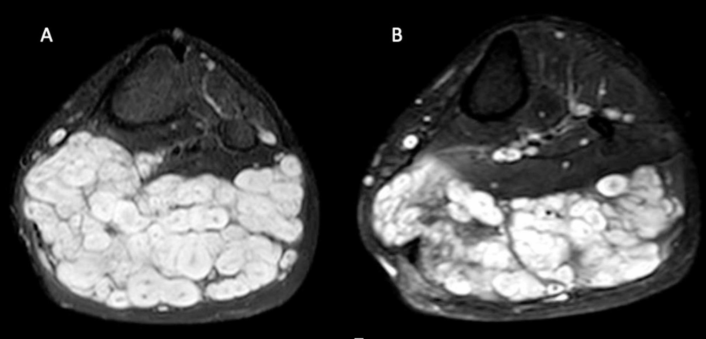
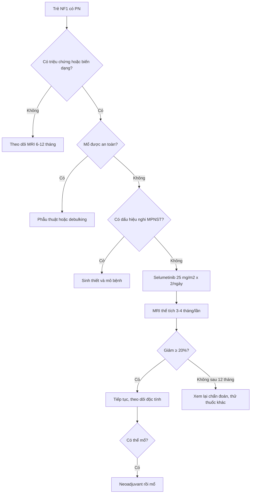
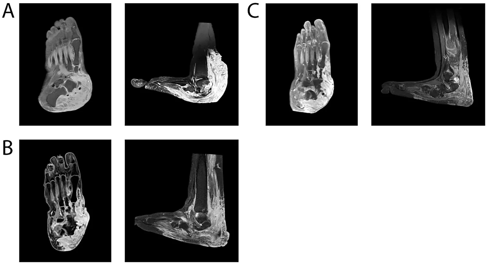

# 378 — Điều trị u dây thần kinh dạng đám rối ở NF1: selumetinib & theo dõi thể tích / MEK inhibition for plexiform neurofibroma

**Tags:** `pattern:u-thanh-kinh-ngoai-vi` `pattern:dam-roi-thanh-kinh` `vung:mo-mem` `protocol:MRI-mo-mem` `protocol:MRI-the-tich` `score:dap-ung-the-tich`
**Mức chắc chắn (certainty):** tổng hợp y văn (literature synthesis) — tổng hợp chuỗi ca tiến cứu 6 năm, thử nghiệm pha I/II, ca neoadjuvant và tiêu chí đáp ứng thể tích; phần quiz giữ đúng mô tả ca gốc.

## 1. Tổng quan bệnh học – cơ chế hình ảnh và cơ chế thuốc

### 1.1 Vì sao PN ở NF1 lại "ăn" vào đường RAS–MAPK

- **NF1** là bệnh di truyền trội nhiễm sắc thể thường do mất chức năng **neurofibromin** — một **GAP** thúc đẩy thủy phân RAS-GTP → RAS-GDP. Khi mất neurofibromin, **RAS-GTP tích lũy** → **RAF → MEK1/2 → ERK** hoạt hóa liên tục → tăng sinh và sống sót tế bào Schwann.
- **PN (plexiform neurofibroma)** là u lành nhưng **xâm nhập dọc toàn bộ dây thần kinh**, gặp ở **~50% bệnh nhân NF1**; có từ lúc sinh, **tăng nhanh trong tuổi thiếu niên, đạt đỉnh trước dậy thì** rồi thường chững lại sau dậy thì.
- **Selumetinib** là **ức chế MEK1/2 đường uống**, chặn dòng tín hiệu RAS–RAF–MEK–ERK → giảm phosphoryl hóa ERK → giảm tăng sinh tế bào Schwann và mô đệm. Đây là **điều trị cơ chế (etiological)**, không phải hóa trị độc tế bào.
- **TẠI SAO phải đo thể tích, không đo đường kính:** PN **không có hình cầu**, bờ ngoằn ngoèo, lan theo nhiều khoang và bọc mạch–thần kinh; đo 3 trục sẽ **bỏ sót phần u lan xa** và dao động theo người đo. **MRI thể tích (3D segmentation)** trên **STIR/T2** là chuẩn theo dõi.

### 1.2 Ngưỡng đáp ứng và ý nghĩa lâm sàng

- **Đáp ứng một phần (partial response, PR):** **giảm ≥ 20% thể tích** so với ban đầu.
- **Bệnh ổn định (stable disease, SD):** thay đổi **trong khoảng −20% đến +20%**.
- **Tiến triển (progressive disease, PD):** **tăng ≥ 20%** thể tích; nên **xác nhận trên 2 lần MRI liên tiếp**.
- **Vì sao 20%:** đây là ngưỡng được dùng trong các thử nghiệm selumetinib (Dombi 2016, SPRINT) và các nghiên cứu thể tích; nó cân bằng giữa **sai số đo** và **thay đổi có ý nghĩa sinh học**.
- **Lợi ích lâm sàng có thể đến trước khi u nhỏ đi:** bệnh nhân thường thấy u **mềm hơn, bớt đau, dễ vận động** sau vài tháng; trên MRI, **tín hiệu STIR giảm** có thể xuất hiện trước khi thể tích giảm 20%.

### 1.3 Hiệu quả định lượng

- **Pha I (Dombi 2016):** **17/24 trẻ (71%)** đạt PR ≥ 20% thể tích; không có tiến triển; giảm đau và cải thiện chức năng.
- **Pha II/SPRINT:** khoảng **70%** có giảm thể tích bền vững; hiệu quả tối đa thường sau **18–24 tháng** rồi ổn định.
- **Chuỗi ca 6 năm (23 bệnh nhân, theo dõi trung bình 1085 ngày):** **57% giảm > 20%**, **30% ổn định**, **13% tăng thể tích**; **giảm thể tích trung vị 23%**.
- **Trẻ nhỏ đáp ứng nhanh hơn:** ở lần đánh giá thứ 3, **56,0% trẻ < 16 tuổi** đạt PR so với **18,2% thanh thiếu niên ≥ 16 tuổi** (OR 5,7; 95% CI 1,02–32; p = 0,035).

## 2. Mẫu hình + chẩn đoán phân biệt theo tình huống điều trị (gamut)

- **Câu hỏi trước khi kê thuốc:** (1) PN có **triệu chứng** không (đau, hạn chế vận động, chèn ép đường thở/thần kinh, biến dạng)? (2) có **mổ được** không? (3) có dấu hiệu **chuyển dạng ác** không? (4) trẻ đang ở **tuổi nào** và có **bệnh nền tim/mắt**?
- **Gamut theo quyết định:**
  - **PN không triệu chứng, ổn định:** theo dõi MRI định kỳ, chưa cần thuốc.
  - **PN có triệu chứng, không mổ được/an toàn kém:** **selumetinib**.
  - **PN mổ được, không di chứng nặng:** **phẫu thuật** (cắt bỏ/debulking); tái phát sau debulking **40–50%**.
  - **PN "tiền mổ" quá lớn:** **selumetinib neoadjuvant** để giảm thể tích rồi mổ.
  - **Nghi MPNST/ANNUBP:** ưu tiên **chẩn đoán mô bệnh** (xem bài 377), không điều trị mù bằng MEK inhibitor.
  - **Thất bại/không dung nạp selumetinib:** thử **mirdametinib**, **trametinib**, hoặc thuốc thử nghiệm (cabozantinib, abemaciclib) — bằng chứng còn hạn chế.
- **Mnemonic "SURGERY hay SELUMETINIB":** **S**ymptomatic? **U**nresectable? **R**apid growth? **G**enetic NF1? **E**fficacy expected? **R**isk of MPNST? **Y**oung age? — nếu Symptomatic + Unresectable + không nghi MPNST → selumetinib.

## 3. Bảng so sánh phân biệt (ma trận đối chiếu)

| Thực thể / chiến lược | Hình ảnh – lâm sàng điển hình | Chốt vào (rule-in) | Chốt loại (rule-out) | Gợi ý xác nhận |
|---|---|---|---|---|
| **PN lành có triệu chứng, không mổ được** | Khối dọc dây thần kinh, nhiều dấu bia T2, tăng thể tích theo tuổi, đau/hạn chế vận động | **NF1 + PN + triệu chứng + không mổ an toàn** | Có nốt mới/không đồng nhất/phù quanh u → nghi chuyển dạng | MRI thể tích + đánh giá chức năng; **selumetinib 25 mg/m² × 2/ngày** |
| **PN mổ được** | Tổn thương khu trú, bờ tương đối rõ, không xâm nhập mạch–thần kinh quan trọng | **Mổ lấy được mà không mất chức năng** | Lan rộng, bọc mạch–thần kinh, nguy cơ mất chức năng → không mổ | CT/MRI + hội chẩn ngoại; tái phát 40–50% sau debulking |
| **PN không triệu chứng, ổn định** | U đồng nhất, không nốt mới, thể tích thay đổi < 20%/năm | **Không đau, không chèn ép, không tiến triển** | Tăng nhanh/đau mới → không còn "theo dõi đơn thuần" | MRI mỗi 6–12 tháng; WB-MRI nếu nhiều u |
| **ANNUBP/MPNST** | Nốt mới trong u cũ, T1 không đồng nhất, ngấm ngoại vi, phù quanh u, ADC thấp, FDG cao | **Nốt mới + không đồng nhất + ADC thấp/SUVmax cao** | Target sign rõ + ADC cao + SUVmax thấp → ít nghĩ ác (không loại trừ) | Sinh thiết/mô bệnh; xem bài 377 |
| **Selumetinib neoadjuvant** | PN lớn, mổ được nhưng nguy cơ cao; giảm thể tích sau 9–12 tháng | **PN chuyển từ không mổ được → mổ được** | U không giảm sau 12 tháng → xem lại chẩn đoán/liệu pháp | MRI thể tích trước–sau; phối hợp ngoại–ung thư |
| **Thuốc MEK khác / thử nghiệm** | Mirdametinib, trametinib, cabozantinib, abemaciclib | **Thất bại/không dung nạp selumetinib** | Chưa có chỉ định chuẩn → chỉ trong thử nghiệm | Theo dõi thể tích + độc tính |

*Trái (A): trước điều trị — khối đa thùy T2 rất sáng, nhiều "dấu bia" trong cơ cẳng chân. Phải (B): sau 8 tháng selumetinib — khối nhỏ hơn và tín hiệu giảm. Nguồn: Baldo F et al., BMC Pediatr 2026 (PMC13474747), Fig. 2, CC BY-NC-ND 4.0 — giữ nguyên, không cắt/ghép.*

## 4. Protocol theo dõi + tiêu chí đáp ứng

### 4.1 Chụp và đo thể tích

- **Baseline:** MRI toàn vùng tổn thương, **STIR hoặc T2 fat-sat**, lát **3–4 mm**, cùng máy/cùng chuỗi cho mọi lần sau; chụp **toàn bộ u** (không chỉ một mặt cắt).
- **Phân đoạn thể tích (3D segmentation):** vẽ thủ công/bán tự động trên từng lát, cộng thể tích; ghi rõ **chuỗi xung và người đo**.
- **Theo dõi:** **3–4 tháng/lần trong năm đầu**, sau đó **6 tháng/lần** khi ổn định; **WB-MRI** nếu nhiều PN hoặc đánh giá gánh nặng u.
- **Không dùng RECIST đường kính** làm tiêu chí chính cho PN — thể tích là chuẩn; RECIST có thể dùng bổ sung cho tổn thương dạng khối.

### 4.2 Liều và theo dõi an toàn

- **Selumetinib:** **25 mg/m² × 2 lần/ngày** (uống, cách xa bữa ăn theo nhãn); giảm liều **20 mg/m² × 2 lần/ngày** khi độc tính; ngừng tạm nếu độc tính nặng.
- **Trước điều trị:** CBC, chức năng gan–thận, **CPK**, lipid, **HbA1c/đường huyết**, **siêu âm tim (LVEF)**, **khám mắt** (đáy mắt, thị lực), đánh giá tăng trưởng/dậy thì.
- **Trong điều trị:** lặp lại **CPK, men gan, công thức máu** định kỳ; **siêu âm tim mỗi 3–6 tháng**; khám da (acneiform rash, paronychia), mắt (mờ, đau), tiêu hóa (tiêu chảy).
- **Ngừng thuốc:** khi tiến triển, độc tính không chấp nhận, hoặc sau mổ ổn định — nhưng **có thể tái phát sau ngừng**, cần theo dõi tiếp.

### 4.3 Luồng quyết định

## 5. Biến thể bình thường và cạm bẫy

- **U mềm hơn/tín hiệu giảm trước khi thể tích giảm:** đừng đổi thuốc quá sớm; đánh giá lại sau **6–12 tháng** nếu lâm sàng cải thiện.
- **Tăng CPK không triệu chứng rất thường gặp (96%):** không ngừng thuốc chỉ vì CPK cao; kiểm tra **triệu chứng đau cơ, nước tiểu sẫm màu**, và loại trừ vận động mạnh.
- **Acneiform rash** gặp ở **65%**, paronychia **91%**, khô da/eczema **57%** — chủ yếu điều trị hỗ trợ; hiếm khi phải ngừng.
- **Độc tính tim–mắt:** giảm LVEF và bệnh võng mạc huyết thanh (RPED) là biến chứng nặng dù hiếm; **khám mắt định kỳ** và siêu âm tim.
- **Tái phát sau ngừng thuốc:** ca neoadjuvant cho thấy u **mọc lại sau khi ngừng 3 năm**; cần theo dõi dài hạn và khởi động lại nếu cần.
- **Nhầm PN với MPNST:** u **to nhanh, đau mới, nốt mới trong u, không đồng nhất** → **không tăng liều selumetinib**, phải **chẩn đoán mô bệnh** (bài 377).
- **Sai số thể tích:** khác chuỗi xung, khác lát cắt, hoặc đo cả mô lành quanh u → **sai lệch > 20%** giả; luôn so sánh trên **cùng chuỗi**.
- **Tương tác thuốc:** selumetinib chuyển hóa qua CYP3A4 — thận trọng với **azole kháng nấm, rifampicin, một số thuốc chống động kinh**.

## 6. Tự lượng giá — Blind Quiz

**Ca 1 — Bé trai 13 tuổi NF1, khối cẳng chân to dần, đau khi đi lại.**

- Gợi ý lâm sàng: PN cẳng chân đã biết, không mổ được vì lan rộng; đau tăng, hạn chế vận động.
- Câu hỏi: Mô tả tín hiệu và cấu trúc khối? Tiêu chí đáp ứng với selumetinib? Kết quả hình ảnh này gợi ý gì?

<b>Bấm để hiện đáp án (findings + chẩn đoán)</b>

- Dấu hiệu: khối **đa thùy, T2 rất sáng**, nhiều **dấu bia (target sign)** — lõi xơ tối + viền myxoid sáng; sau **8 tháng selumetinib** khối nhỏ hơn, tín hiệu giảm.
- Chẩn đoán: **PN lành ở NF1**; đáp ứng được định nghĩa là **giảm ≥ 20% thể tích** trên MRI thể tích, ổn định là −20% đến +20%, tiến triển là **tăng ≥ 20%**.
- Kết quả: phù hợp với dữ liệu chuỗi ca — **57% giảm > 20%**, **giảm trung vị 23%**; lợi ích lâm sàng (giảm đau) có thể xuất hiện trước khi thể tích giảm.
- Nguồn ảnh: Baldo F et al., BMC Pediatr 2026 (PMC13474747), Fig. 2, CC BY-NC-ND 4.0.

**Ca 2 — Bé gái 13 tuổi NF1, PN bàn chân từ nhỏ, không mổ được vì nguy cơ chảy máu và mất chức năng.**

- Gợi ý lâm sàng: u xâm nhập khớp sên–gót, biến dạng bàn chân, không đi giày thường được.
- Câu hỏi: Vai trò của selumetinib ở đây? Sau mổ có nên ngừng thuốc ngay? Biến chứng cần theo dõi?

<b>Bấm để hiện đáp án (findings + chẩn đoán)</b>

- Dấu hiệu: PN lớn xâm nhập mô mềm và xương bàn chân; sau **12 tháng selumetinib** thể tích giảm đủ để **mổ cắt u + tái tạo chỉnh hình**.
- Vai trò: **neoadjuvant** — chuyển u từ **không mổ được → mổ được**, giảm nguy cơ chảy máu và mất chức năng.
- Sau mổ: ca gốc **ngừng selumetinib 3 năm sau mổ** để đánh giá ổn định, nhưng **u mọc lại** và phải **dùng lại** — cần theo dõi dài hạn, không mặc định "mổ xong là khỏi".
- Theo dõi: CPK, men gan, siêu âm tim, khám mắt, da/paronychia, tăng trưởng–dậy thì.
- Nguồn ảnh: Front Pediatr 2026 (PMC13574963), Fig. 2, CC BY 4.0.

**Ca 3 — Trẻ 8 tuổi đang selumetinib 4 tháng, xét nghiệm CPK 1.126 U/L, không đau cơ, nước tiểu bình thường.**

- Gợi ý lâm sàng: không sốt, không vận động mạnh, không dùng statin; da có mụn mủ nhẹ và móng viêm.
- Câu hỏi: Xử trí CPK tăng đơn độc? Khi nào phải ngừng thuốc? Cần hỏi thêm gì?

<b>Bấm để hiện đáp án (findings + chẩn đoán)</b>

- Nhận định: **tăng CPK không triệu chứng** là độc tính thường gặp nhất (**96%** trong chuỗi ca); giá trị cao nhất ghi nhận **1.126 U/L** (bình thường 60–190 U/L), thường tăng trong những tháng đầu và **trở về bình thường trong tối đa 2 năm**.
- Xử trí: hỏi **đau cơ, yếu cơ, nước tiểu sẫm màu**, loại trừ vận động mạnh/chấn thương; nếu không triệu chứng → **tiếp tục thuốc + theo dõi**, không giảm liều máy móc.
- Ngừng/giảm liều khi: **đau cơ kèm CPK tăng cao**, **rhabdomyolysis**, hoặc CPK tăng kèm suy thận; đồng thời xử lý **paronychia/acne** tại chỗ.
- Nguồn số liệu: Baldo F et al., BMC Pediatr 2026 (PMC13474747), Bảng 4; không dùng ảnh cho ca này.

## Bài liên quan chéo
- [377 – U dây thần kinh dạng đám rối & chuyển dạng MPNST ở NF1: chẩn đoán, WB-MRI, ADC, FDG-PET](../377-u-than-kinh-dang-dam-roi-va-mpnst-nf1/lesson.md)
- [300 – Tổng quan Hệ Cơ – Xương – Khớp](../300-tong-quan-he-co-xuong-khop/lesson.md)
- [376 – U phần mềm KHÔNG mỡ: schwannoma vs sarcoma myxoid](../376-u-phan-mem-khong-mo/lesson.md)
- [375 – U phần mềm nhóm mỡ: lipoma vs WDLPS](../375-u-phan-mem/lesson.md)

> Không dùng để chẩn đoán độc lập khi chưa có người hướng dẫn.
