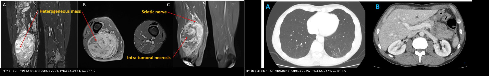
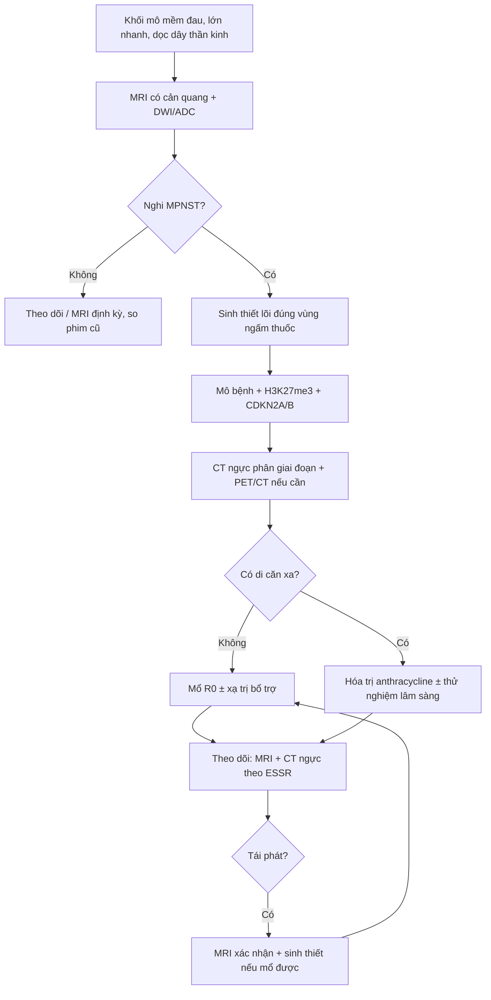
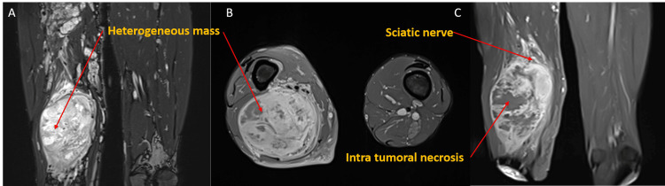
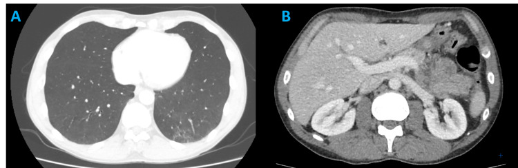
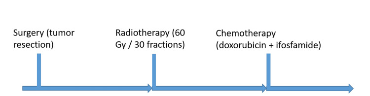

# 379 — MPNST: điều trị đa mô thức & theo dõi di căn phổi / Malignant peripheral nerve sheath tumor: multimodality treatment & pulmonary surveillance

**Tags:** `pattern:u-phan-mem` `pattern:u-thanh-kinh-ngoai-vi` `vung:mo-mem` `vung:phoi` `score:SUVmax` `score:ADC` `score:TNM` `protocol:MRI-mo-mem` `protocol:PET-CT` `protocol:CT-nguc` `incidentaloma:di-can-phoi`
**Mức chắc chắn (certainty):** tổng hợp y văn (literature synthesis) — tổng hợp guideline thực hành MPNST 2026, cohort quốc gia Đan Mạch, đồng thuận ESSR 2024 về theo dõi sarcoma và ca nguyên văn CC BY 4.0; phần ca quiz là ca nguyên văn của bài gốc.

## 1. Tổng quan bệnh học – cơ chế hình ảnh

### 1.1 MPNST là gì và ai mắc?

- **MPNST (malignant peripheral nerve sheath tumor — u bao dây thần kinh ngoại vi ác tính)** là sarcoma mô mềm **hiếm, hung hãn**, xuất phát từ **dây thần kinh ngoại vi hoặc bao dây**, chiếm **5–10%** toàn bộ sarcoma mô mềm. Đặc trưng: **phát triển nhanh, tái phát tại chỗ cao, di căn sớm** (chủ yếu phổi).
- **Gần 50%** MPNST gắn với **NF1 (neurofibromatosis type 1 — bệnh u sợi thần kinh type 1)**; nguy cơ MPNST suốt đời ở NF1 **8–15%**. MPNST là **nguyên nhân tử vong hàng đầu** ở NF1.
- **Tuổi mắc:** thể **lẻ tẻ (sporadic)** quanh **50 tuổi**; thể **NF1** sớm hơn, **25–35 tuổi**; thể **do xạ trị (radiation-induced)** xuất hiện **nhiều thập kỷ sau xạ**, tiên lượng xấu nhất.
- **Tiên lượng định lượng:** **OS 5 năm 34–50%** nói chung; sau mổ **47%**; ở bệnh khu trú, cohort Đan Mạch 2000–2020: **nfMPNST 44% vs sMPNST 63%** (p = 0,03). Cùng cohort: u **> 5 cm gặp 88% ở nfMPNST vs 50% ở sMPNST**; **R0 chỉ 35% vs 66%**; **tái phát 69% vs 49%**; **thời gian tái phát trung vị 2,2 vs 3,4 năm**.

### 1.2 Con đường mô bệnh học: PN → ANNUBP → MPNST

- **Plexiform neurofibroma (PN — u dây thần kinh dạng đám rối)** là tổn thương **lành**, nhưng ở NF1 có thể tiến triển từng bước: mất **cả hai alen NF1** → **ANNUBP (atypical neurofibromatous neoplasm of uncertain biologic potential — u thần kinh không điển hình, tiềm năng sinh học chưa rõ)** → **MPNST**.
- **Đột biến then chốt:** **mất CDKN2A/B** (thường sớm nhất), sau đó **SUZ12/EED (mất PRC2)** → **mất H3K27me3** trên hóa mô miễn dịch; thêm **TP53**.
- **Tiêu chuẩn mô bệnh (WHO 2021/2022):**
  - **ANNUBP:** ≥ 2 trong 4 đặc điểm — **dị dạng tế bào**, **mất cấu trúc u thần kinh**, **tăng mật độ tế bào**, **phân bào > 1/50 HPF và < 3/10 HPF**.
  - **MPNST độ cao:** **≥ 10 phân bào/10 HPF**, hoặc **3–9 phân bào/10 HPF kèm hoại tử địa lý (geographic necrosis)**.
  - **H3K27me3 mất hoàn toàn** là dấu thay thế đặc hiệu cho **bất hoạt PRC2** ở u độ cao; **S100/SOX10 giảm hoặc mất** (khác u lành còn bộc lộ mạnh).

### 1.3 TẠI SAO hình ảnh phản ánh đúng mô bệnh

- **MRI là chuẩn vàng** vì tương phản mô mềm cao: MPNST điển hình là **khối không đồng nhất**, có **ổ hoại tử (T2 rất sáng, không ngấm thuốc)** và **ổ xuất huyết (T1 sáng do methemoglobin)**; phần u sống **ngấm thuốc không đều, kiểu viền/nốt**.
- **DWI/ADC:** u **giàu tế bào** → khoảng ngoại bào chật → **khuếch tán hạn chế → ADC thấp**. Đây là lý do ADC giúp phân biệt **PN lành (ADC cao)** với **MPNST (ADC thấp)**, dù không đủ để chẩn đoán một mình.
- **FDG-PET:** tế bào ác tính tăng chuyển hóa glucose → **SUVmax cao**; nhưng **viêm, ANNUBP và một số u lành cũng tăng FDG** → PET **không thay thế mô bệnh**.
- **CT:** không phải chuẩn cho u nguyên phát, nhưng cần để **phân giai đoạn phổi** và đánh giá **xâm lấn xương**; **di căn phổi** là đích di căn hàng đầu (khoảng **80%** di căn của sarcoma mô mềm nói chung).

## 2. Mẫu hình + chẩn đoán phân biệt theo vị trí (gamut)

- **Mẫu hình gốc:** người lớn (hoặc NF1 trẻ) với **khối mô mềm lớn, đau, lớn nhanh**, nằm **dọc trục một dây thần kinh lớn** hoặc **sâu trong trục cơ thể**, kèm **thiếu hụt thần kinh mới**.
- **Gamut theo vị trí:**
  - **Chi (đùi, vai, cánh tay, khoeo):** hay gặp nhất; dọc **dây thần kinh hông to, dây thần kinh quay, dây thần kinh trụ**; khối lớn, dễ hoại tử.
  - **Trục thân / cạnh sống / sau phúc mạc:** khó mổ R0, tiên lượng xấu; dễ nhầm sarcoma sau phúc mạc khác.
  - **Đầu – cổ:** liệt dây sọ, hội chứng lỗ chẩm; khối lan theo khoang cổ sâu.
  - **Tạng (dạ dày, ruột, bàng quang, tử cung):** hiếm; **ngưỡng nghi MPNST cao hơn**, phải loại trừ sarcoma biểu mô/tiêu hóa.
- **Bắt chước (mimics) bắt buộc loại trừ:** **synovial sarcoma thể đơn pha**, **melanoma dạng tế bào thoi/thể mô tả**, **leiomyosarcoma**, **fibrosarcoma**, **ANNUBP**, **PN lành**.
- **Mnemonic lâm sàng “PAIN-GROW”:** **P**ain mới/tăng, **A**xis dọc dây thần kinh, **I**ncreasing size nhanh, **N**eurologic deficit mới, **G**rowth trên phim cũ, **R**adiation trước đó, **O**ld NF1 với PN, **W**orrisome imaging (không đồng nhất/hoại tử).

## 3. Bảng so sánh phân biệt (ma trận đối chiếu)

| Thực thể (entity) | Hình ảnh điển hình (MRI/CT) | Chốt vào (rule-in) | Chốt loại (rule-out) | Gợi ý xác nhận |
|---|---|---|---|---|
| **PN lành (plexiform neurofibroma)** | Khối dọc dây thần kinh, **nhiều dấu bia (target sign) trên T2**, tín hiệu đồng nhất, **split-fat sign**, ngấm thuốc lan tỏa | **Nhiều target sign + đồng nhất + NF1 lâu năm + không nốt mới** | **Nốt mới trong u cũ, không đồng nhất, phù quanh u, ADC thấp** → không còn đơn thuần lành | MRI T1/T2 fat-sat + DWI; so phim cũ |
| **ANNUBP** | Trong PN cũ xuất hiện **nốt mới**, mất cấu trúc đều; ADC giảm nhẹ; chưa hoại tử lan rộng | **Nốt mới trong u cũ + mất cấu trúc** (≥ 2/4 tiêu chí mô bệnh) | U đồng nhất, ADC cao, không nốt mới → nghĩ PN lành | Sinh thiết đúng vùng nốt + mô bệnh ± CDKN2A/B |
| **MPNST (độ cao)** | **Khối lớn, T1 không đồng nhất, T2 hỗn hợp**, **hoại tử/xuất huyết**, **ngấm viền/nốt**, **phù quanh u**, mất target sign; **ADC thấp**, **SUVmax cao** | **Khối > 5 cm + đau/lớn nhanh + không đồng nhất/hoại tử + ADC thấp + SUVmax cao** | Target sign rõ + ADC cao + SUVmax thấp **không loại trừ tuyệt đối** | **Mô bệnh** (phân bào/hoại tử/H3K27me3); PET/CT |
| **Schwannoma** | Bờ rõ, có thể **thoái hóa nang/đốm xuất huyết**, gắn một dây thần kinh, **không đan xen** toàn bộ dây | **Bờ rõ + lệch dây thần kinh + không đan xen** | Đan xen đám rối + NF1 + nhiều tổn thương → nghĩ PN/MPNST | MRI; bệnh cảnh NF2/schwannomatosis |
| **Synovial sarcoma thể đơn pha** | Khối mô mềm sâu, **vôi hóa 20–30%**, không rõ gốc dây thần kinh; có thể giống hệt MPNST | **Vôi hóa trong khối + không liên tục với dây thần kinh** | **Dọc dây thần kinh + NF1** → nghĩ MPNST hơn | Mô bệnh + **SYT-SSX (SS18-SSX)** |

*Trái: **MPNST đùi** — MRI T2 fat-sat, khối không đồng nhất lan dọc trục, có ổ hoại tử. Phải: **CT ngực/bụng** ở thì tĩnh mạch cửa — dùng để tìm di căn phổi và đánh giá tạng. Nguồn: Cureus 2026 (PMC13210674), CC BY 4.0. Ảnh ghép letterbox, không crop/kéo giãn.*

## 4. Protocol chụp + phân giai đoạn + phác đồ điều trị

### 4.1 Protocol chẩn đoán và phân giai đoạn

- **MRI toàn bộ khoang chứa u** (không chỉ vùng đau): **T1W, T2W fat-sat/STIR, DWI/ADC, T1W sau tiêm gadolinium**; đo **đường kính lớn nhất (mm)**, độ sâu **trên/dưới mạc cơ (superficial/deep)**, khoảng cách tới **bó mạch–thần kinh** và **xương**.
- **CT ngực có cản quang** ở thì nền (baseline) để tìm **di căn phổi**; **CT/MRI bụng** nếu u trục thân hoặc nghi di căn tạng.
- **FDG-PET/CT** khi: NF1 có PN lớn, nghi chuyển dạng, hoặc phân biệt u sống/hoại tử sau điều trị. **PET dương không chốt ác** — vẫn cần mô bệnh.
- **Sinh thiết lõi (core needle biopsy)** trước mổ: lấy **vùng ngấm thuốc/không hoại tử**, có thể **nhiều mảnh** vì u không đồng nhất; **đường sinh thiết phải nằm trong trường mổ** để cắt trọn cùng khối u.
- **Phân giai đoạn AJCC 8th (sarcoma mô mềm chi/thân):** **T1 ≤ 5 cm; T2 > 5–10 cm; T3 > 10–15 cm; T4 > 15 cm**; **N1** hạch vùng; **M1** di căn; độ mô học **G1–G3**. MPNST mặc định xử trí như **sarcoma độ cao**.

### 4.2 Điều trị đa mô thức — các con số quyết định

- **Phẫu thuật:** là **phương thức duy nhất có khả năng chữa khỏi**; mục tiêu **R0 (bờ âm)**. Ưu tiên **bảo tồn chi** nếu đạt R0; **cắt cụt/cắt khoang** khi không thể R0, liệt nặng hoặc đau không kiểm soát. **R0 là yếu tố tiên lượng mạnh nhất**; ở NF1 phải **lấy bờ rộng hơn** vì u không đồng nhất.
- **Xạ trị (RT):** chỉ định cho **u độ cao, bờ sát/dương, u lớn**; liều **> 50 Gy**, bắt đầu **4–6 tuần sau mổ** khi vết mổ ổn (ca minh họa dùng **60 Gy/30 phân liều**). **MONACO:** RT giảm tái phát tại chỗ ở nhóm **lẻ tẻ (47%)** nhưng **không cải thiện OS**, và **không rõ lợi ích ở NF1**; **brachytherapy/IOERT** đạt **kiểm soát tại chỗ 5 năm 88%**. Ở NF1, cân nhắc vì **nguy cơ u nguyên phát thứ hai do xạ**.
- **Hóa trị:** **không có chỉ định hóa trị bổ trợ thường quy** cho MPNST khu trú; cân nhắc **từng ca** (u lớn, độ cao, trẻ, bờ sát). **Bệnh không mổ được/di căn:** **anthracycline** là nền tảng — **đáp ứng 21%, PFS 17 tuần, OS 48 tuần**; **doxorubicin–ifosfamide** vượt doxorubicin đơn trị về đáp ứng/PFS; sau tiến triển **gemcitabine + docetaxel** đáp ứng **10–15%**. **NF1 liên quan kháng hóa trị hơn**.
- **Điều trị đích/miễn dịch:** chủ yếu trong **thử nghiệm lâm sàng** — **BRAF V600E → vemurafenib**; **mất PRC2 (SUZ12/EED) → tazemetostat (EZH2 inhibitor)**; **ức chế MEK** đang thử; **ức chế điểm kiểm soát** chỉ có hoạt tính lẻ tẻ.
- **Theo dõi sau điều trị (ESSR 2024):**
  - **Mốc nền không sớm hơn 3 tháng sau mổ** (tránh nhầm mô hạt/seroma với tái phát).
  - **Độ cao:** năm 1–3 **mỗi 3–4 tháng**; năm 4–5 **mỗi 6 tháng**; năm 6–10 **mỗi năm**.
  - **Độ thấp:** năm 1–3 **mỗi 6 tháng**; năm 4–10 **mỗi năm**.
  - **MRI vùng mổ + CT ngực** là cặp theo dõi chuẩn; **tái phát → khởi động lại phác đồ**; theo dõi **ít nhất 10 năm**.

## 5. Biến thể bình thường và cạm bẫy

- **“Đau” ở PN không phải lúc nào cũng là MPNST:** PN lớn có thể đau do **chèn ép/thoái hóa**, nhưng **đau mới, tăng nhanh, kèm thiếu hụt thần kinh** là **cờ đỏ**.
- **Bẫy lấy mẫu trong NF1:** u có **vùng lành và vùng ác xen kẽ**; sinh thiết một chỗ có thể **âm tính giả**. Phải lấy **nhiều mảnh, đúng nốt ngấm thuốc/FDG**, và **cắt trọn u** khi mổ.
- **PET dương tính giả:** viêm, sau sinh thiết, **ANNUBP**, một số u lành; **SUVmax không có ngưỡng tuyệt đối** thay thế mô bệnh.
- **Sau mổ:** **mô hạt, seroma, xơ xạ** có thể ngấm thuốc và giả tái phát; **MRI nền ≥ 3 tháng** và so sánh nhiều thời điểm.
- **Nốt phổi nhỏ:** **u hạt lành** vs di căn; **không sinh thiết ngay nốt 3–4 mm** — chụp lại theo lịch, đánh giá **tăng kích thước/thời gian nhân đôi**.
- **Xạ trị ở NF1:** nguy cơ **u nguyên phát thứ hai**; không dùng RT tràn lan khi không có chỉ định.
- **Cạm bẫy mặt cắt:** khối sau phúc mạc/cạnh sống dễ bị đọc là **u cơ trơn/thận/thượng thận**; luôn truy vết **dọc dây thần kinh** và hỏi **NF1**.

## 6. Tự lượng giá — Blind Quiz

**Ca 1 — Nam 40 tuổi, NF1, khối đùi sau lớn nhanh, đau tăng 3 tháng.**

- Câu hỏi: Mô tả tín hiệu và cấu trúc khối. Vì sao khối này không còn giống PN lành? 3 chẩn đoán phân biệt?

<b>Bấm để hiện đáp án (findings + chẩn đoán)</b>

- **Dấu hiệu:** khối lớn lan dọc trục cơ đùi, **T2 fat-sat không đồng nhất** với vùng tăng tín hiệu mạnh (hoại tử/nhầy) xen vùng trung gian; mất cấu trúc “bia” đều của PN; bờ không đều, lan dọc **dây thần kinh hông to**.
- **Chẩn đoán:** **MPNST** phát triển từ PN/NF1 — vì u mất cấu trúc đều, có hoại tử và lớn nhanh; cần **mô bệnh** xác nhận (phân bào/hoại tử/H3K27me3).
- **Phân biệt:** ANNUBP (nốt mới, chưa hoại tử lan rộng), synovial sarcoma thể đơn pha, leiomyosarcoma.
- **Nguồn ảnh:** Cureus 2026, Fig. 2, PMCID [PMC13210674](https://pmc.ncbi.nlm.nih.gov/articles/PMC13210674/), CC BY 4.0.

**Ca 2 — Cùng bệnh nhân, CT ngực ở thì nền trước mổ.**

- Câu hỏi: CT ngực nhằm mục đích gì? Nếu thấy một nốt đặc 4 mm ở thùy dưới phải thì xử trí thế nào?

<b>Bấm để hiện đáp án (findings + chẩn đoán)</b>

- **Mục đích:** **phân giai đoạn phổi** — phổi là đích di căn hàng đầu của sarcoma mô mềm; CT ngực có độ nhạy cao hơn X-quang. Trong ca này **không thấy nốt di căn** trên CT ngực/bụng.
- **Nốt 4 mm:** **không sinh thiết ngay**; đây là nốt **không xác định (indeterminate)** — chụp CT lặp lại theo lịch sarcoma (thường 3 tháng), đánh giá **tăng kích thước**. Nốt **≥ 5–6 mm** hoặc tăng dần cần cân nhắc PET/CT/sinh thiết.
- **Nguồn ảnh:** Cureus 2026, Fig. 3, PMCID [PMC13210674](https://pmc.ncbi.nlm.nih.gov/articles/PMC13210674/), CC BY 4.0.

**Ca 3 — Phác đồ đã thực hiện sau mổ.**

- Câu hỏi: Sau cắt u, thời điểm và liều xạ trị? Có chỉ định hóa trị bổ trợ thường quy không?

<b>Bấm để hiện đáp án (findings + chẩn đoán)</b>

- **Xạ trị:** bắt đầu **4–6 tuần sau mổ**, tổng liều **60 Gy/30 phân liều** trong ca này (nguyên tắc **> 50 Gy** cho u độ cao/bờ sát).
- **Hóa trị bổ trợ:** **không thường quy**; ca này nhận **doxorubicin + ifosfamide** theo quyết định đa chuyên khoa (u lớn, độ cao). Với bệnh di căn, anthracycline là nền tảng: **đáp ứng 21%, PFS 17 tuần, OS 48 tuần**.
- **Nguồn ảnh:** Cureus 2026, Fig. 7, PMCID [PMC13210674](https://pmc.ncbi.nlm.nih.gov/articles/PMC13210674/), CC BY 4.0.

## Bài liên quan chéo
- [377 – U dây thần kinh dạng đám rối & chuyển dạng MPNST ở NF1](../377-u-than-kinh-dang-dam-roi-va-mpnst-nf1/lesson.md)
- [378 – Điều trị PN ở NF1 bằng selumetinib](../378-dieu-tri-u-dam-roi-nf1-selumetinib/lesson.md)
- [376 – U phần mềm không mỡ](../376-u-phan-mem-khong-mo/lesson.md)
- [375 – U phần mềm nhóm mỡ](../375-u-phan-mem/lesson.md)
- [300 – Tổng quan hệ Cơ – Xương – Khớp](../300-tong-quan-he-co-xuong-khop/lesson.md)

> Không dùng để chẩn đoán độc lập khi chưa có người hướng dẫn.
