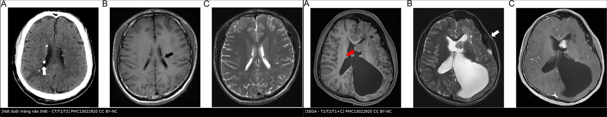
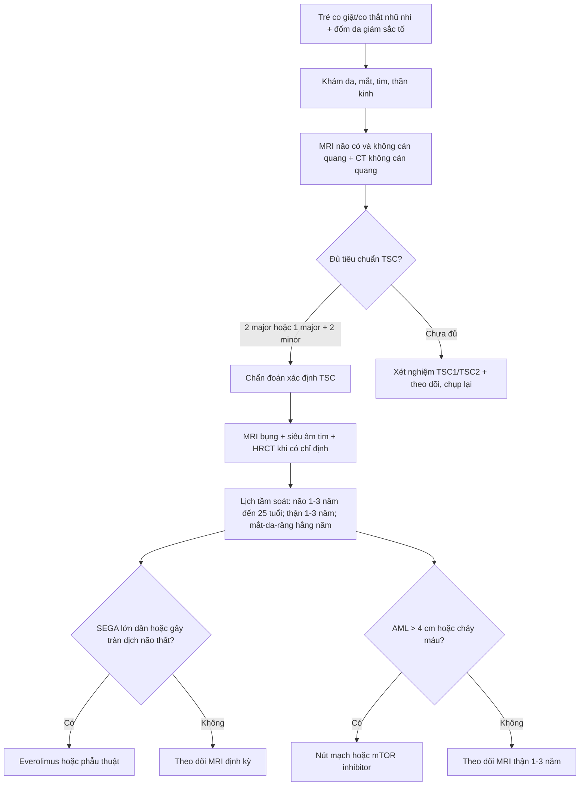
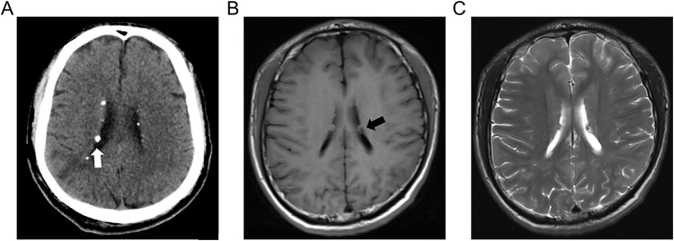
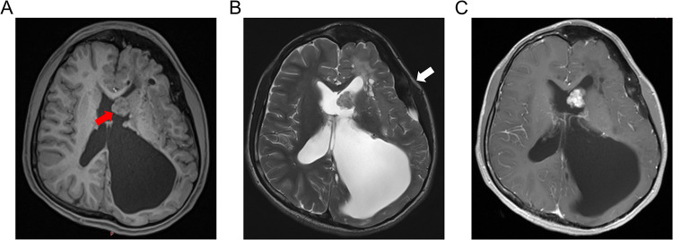
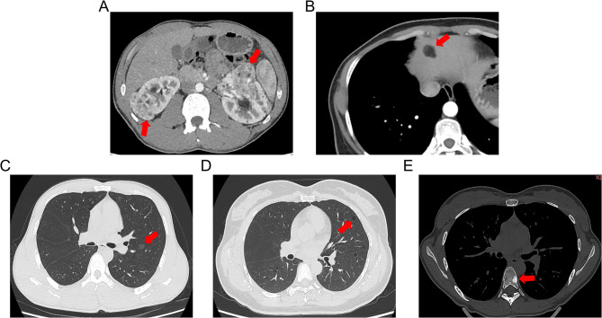
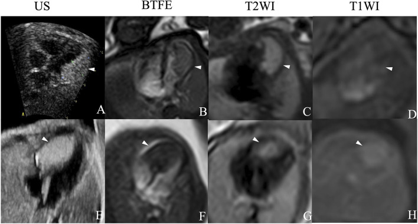

# 380 — Bệnh xơ cứng củ ở trẻ: bản đồ tổn thương đa cơ quan & lịch tầm soát / Tuberous sclerosis complex in children

**Tags:** `pattern:ton-thuong-da-co-quan` `pattern:not` `pattern:nang` `vung:nao` `vung:than` `vung:tim` `vung:phoi` `protocol:MRI-nao` `protocol:MRI-bung` `protocol:HRCT` `incidentaloma:AML`
**Mức chắc chắn (certainty):** tổng hợp y văn (literature synthesis) — tổng hợp 2 cohort trẻ em (PMC10308728, PMC13022920), một nghiên cứu thực hành everolimus 10 năm (PMC13213303) và tiêu chuẩn chẩn đoán – tầm soát quốc tế 2021; phần quiz là **ca nguyên văn** của các bài gốc (ghi PMCID từng ảnh).

## 1. Tổng quan bệnh học – cơ chế hình ảnh

### 1.1 Vì sao một gen lại gây tổn thương ở não, thận, tim, phổi?

- **TSC (tuberous sclerosis complex — bệnh xơ cứng củ)** là bệnh **di truyền trội nhiễm sắc thể thường (autosomal dominant)** do đột biến **TSC1 (9q34 — hamartin)** hoặc **TSC2 (16p13.3 — tuberin)**. Hai protein này tạo phức hợp ức chế **mTORC1**; mất chức năng → **mTORC1 bật liên tục** → tăng sinh – tăng kích thước tế bào ở **nhiều cơ quan**, tạo ra các **hamartoma (u mô thừa lành tính)** chứ không phải một khối ung thư đơn độc.
- **Dịch tễ:** khoảng **1/10.000** ca sinh; **~1/3** có tiền sử gia đình, còn lại là **đột biến mới (de novo)** — nên **không có tiền sử gia đình không loại trừ TSC** (PMC13022920). Bệnh thường biểu hiện **trước 10 tuổi** và **tích lũy tổn thương theo tuổi** — đây là lý do phải **tầm soát lặp lại**, không chỉ chụp một lần.
- **Kiểu gen – kiểu hình:** đột biến **TSC2** thường nặng hơn TSC1; **mất đoạn liên tiếp TSC2–PKD1** gây **nang thận khởi phát rất sớm, hai bên, rất to** (thể nang thận nặng của trẻ nhỏ).

### 1.2 Cơ chế hình ảnh của từng tổn thương (TẠI SAO, không chỉ "tăng/giảm tín hiệu")

- **Cortical tuber (củ vỏ não):** vùng vỏ não **mất phân biệt chất xám – chất trắng**, chứa **tế bào khổng lồ (giant cells) và tế bào thần kinh loạn sản**, myelin hóa kém và tăng nước mô → **T2/FLAIR tăng tín hiệu**, **T1 giảm tín hiệu**, bờ nhòe hình nón cụt hướng về não thất ("vỏ não dày, chất trắng dưới vỏ sáng"). Sau tuổi dậy thì **~50% có vôi hóa** → thấy rõ trên CT.
- **Subependymal nodule (SEN — nốt dưới màng não thất):** các ổ **chất xám lạc chỗ** nằm dưới nội tủy dọc thành não thất bên; **canxi hóa tăng dần theo tuổi**. Vì canxi có **hệ số suy giảm tia cao (HU > 100)**, **CT nhạy hơn MRI rất nhiều**: trong cohort 57 trẻ, **CT phát hiện 100% (46/46) còn MRI thường quy chỉ 68,4% (13/19), p < 0,001** (PMC13022920).
- **SEGA (subependymal giant cell astrocytoma — u tế bào hình sao khổng lồ dưới màng não thất):** u **độ thấp (WHO grade 1)** mọc ở **lỗ Monro**, thường xuất phát từ một SEN. U **giàu tế bào và mạch** → **T2 tăng tín hiệu, ngấm thuốc mạnh, đồng nhất hoặc không đồng nhất**; khi lớn **chặn lỗ Monro → tràn dịch não thất (hydrocephalus)**. Vì u nằm trong não thất, **MRI là phương thức theo dõi**, CT chỉ bổ sung khi cần đánh giá vôi hóa/não thất.
- **Renal AML (angiomyolipoma — u mạch cơ mỡ):** ba thành phần **mỡ + cơ trơn + mạch loạn dạng**. **Mỡ đại thể** có **−10 đến −100 HU** trên CT không cản quang và **T1 sáng, tắt hoàn toàn khi fat-sat**; mạch loạn dạng tạo **vi phình trong u** → nguy cơ **vỡ, chảy máu sau phúc mạc (Wunderlich)**. **AML "nghèo mỡ" (fat-poor)** chỉ có ~10–20% mỡ vi mô nên **giả u đặc** — đây là bẫy lớn nhất trên CT.
- **Nang thận:** nang đơn thuần vỏ mỏng, dịch **0–20 HU**, không ngấm thuốc; ở trẻ TSC thường **hai bên, nhiều nang** và có thể rất to do mất đoạn TSC2–PKD1.
- **Cardiac rhabdomyoma (u cơ tim dạng sợi cơ vân):** tế bào chứa **glycogen**, gọi là **"spider cells"**; **T2 rất sáng** so với cơ tim, **T1 đồng tín hiệu**, thường **nhiều ổ, ở thành thất và vách liên thất**. Đa số **thoái triển tự nhiên** trong những năm đầu đời — đây là lý do **không mổ ngay** nếu không tắc nghẽn.
- **LAM (lymphangioleiomyomatosis):** tăng sinh tế bào cơ trơn quanh mạch bạch huyết → phá hủy vách phế nang bằng metalloproteinase → **nang tròn, thành mỏng, lan tỏa đối xứng** trên HRCT.
- **MMPH (multifocal micronodular pneumocyte hyperplasia):** tăng sinh tế bào phế nang type II quanh tiểu phế quản → **nốt kính mờ (ground-glass) nhỏ, nhiều ổ, đối xứng**, không vôi hóa.
- **Tổn thương xương – răng – mắt:** **đảo xương đặc (sclerotic bone lesions)** do dày xương trabecular; **hamartoma võng mạc** (astrocytic hamartoma) là tổn thương dạng tổ ong/vôi hóa ở đĩa thị hoặc võng mạc.

### 1.3 Tần suất tổn thương ở trẻ (số để nhớ)

| Cơ quan | Tần suất trong cohort trẻ TSC | Nguồn |
|---|---|---|
| Động kinh (epilepsy) | **82,7%** | PMC10308728 (52 trẻ) |
| U cơ tim (cardiac rhabdomyoma) phát hiện trước sinh/sơ sinh | **69,2%** (thập niên gần nhất) | PMC10308728 |
| Nang thận | **53%** | PMC10308728 |
| AML thận | **47%** | PMC10308728 |
| Hamartoma võng mạc (astrocytic hamartoma) | **28%** | PMC10308728 |
| Nốt dưới màng não thất | **89,5%** (CT 100%, MRI 68,4%) | PMC13022920 (57 trẻ) |
| Loạn sản vỏ não (cortical dysplasia) | **33,3%** (MRI 84,2% vs CT 21,7%) | PMC13022920 |
| SEGA | **19,3%** (11/19 ca có MRI) | PMC13022920 |
| AML gan | **23,8%** | PMC13022920 |
| MMPH | **33,3%** (5/15 ca có CT ngực) | PMC13022920 |
| LAM | **20,0%** (3/15) | PMC13022920 |
| Đảo xương đặc | **36,1%** (13/36) | PMC13022920 |

## 2. Mẫu hình + chẩn đoán phân biệt theo vị trí (gamut)

- **Mẫu hình gốc:** trẻ **động kinh khởi phát sớm (đặc biệt co thắt nhũ nhi — infantile spasms)**, **chậm phát triển**, **đốm da giảm sắc tố (hypomelanotic macules)** + **một chuỗi tổn thương đa cơ quan** trên hình ảnh. Không có một "dấu hiệu vàng" duy nhất — chẩn đoán là **tổ hợp**.
- **Gamut theo vị trí:**
  - **Não – não thất:** cortical tuber, **SEN**, **SEGA**, loạn sản vỏ não dạng dải (radial migration lines), **u mạch máu – dị dạng mạch** (hiếm).
  - **Thận:** **AML** (đơn hoặc nhiều, hai bên), **nang thận**, hiếm hơn **RCC** (nguy cơ tăng nhẹ ở TSC) và **u mô thừa ống thận**.
  - **Tim:** **rhabdomyoma** (nhiều ổ) — u tim hay gặp nhất ở bào thai/trẻ nhỏ.
  - **Phổi:** **LAM** (nữ), **MMPH** (cả hai giới) — thường không triệu chứng ở trẻ.
  - **Da – mắt – răng – xương:** angiofibroma mặt, mảng shagreen, ungual fibroma, **hamartoma võng mạc**, **đảo xương đặc**, **u men răng (enamel pits)**.
- **Gamut theo tuổi (mẫu hình hay gặp theo lứa):**
  - **Bào thai – sơ sinh:** **u cơ tim** (thường là biểu hiện đầu tiên, phát hiện trên siêu âm thai) → nghĩ TSC; có thể có **u não** đã thấy trên MRI thai.
  - **Nhũ nhi – nhỏ:** **co thắt nhũ nhi/động kinh kháng trị**, **cortical tuber**, **SEN**; AML/nang thận bắt đầu xuất hiện.
  - **Trẻ lớn – dậy thì:** **SEGA** (đỉnh 8–18 tuổi), **AML to lên**, **tăng huyết áp** do AML/chèn ép mạch thận.
  - **Người trưởng thành:** **LAM** (nữ), **AML chảy máu**, **u ác tính** (RCC, u não), biến chứng tim – phổi.

## 3. Bảng so sánh phân biệt (ma trận đối chiếu)

| Thực thể (entity) | Hình ảnh điển hình | Chốt vào (rule-in) | Chốt loại (rule-out) | Gợi ý xác nhận |
|---|---|---|---|---|
| **Cortical tuber** | Vỏ não dày, **mất phân biệt xám–trắng**, T2/FLAIR tăng, T1 giảm, **hình nón cụt hướng về não thất**; ~50% vôi hóa sau dậy thì | **Nhiều ổ vỏ não + động kinh sớm + tổn thương cơ quan khác** | Tổn thương **một ổ, không phù, không đè đẩy** → ít nghĩ tuber đơn độc | MRI 3D T1 + FLAIR lát mỏng; đối chiếu lâm sàng |
| **SEN** | Nốt **dưới nội tủy**, dọc não thất bên, **vôi hóa** (CT sáng), T2 hỗn hợp | **Canxi hóa dưới nội tủy + nhiều nốt** | Không vôi hóa, không nằm sát não thất → nghĩ tổn thương khác | **CT không cản quang** (nhạy 100%) + MRI |
| **SEGA** | Khối **ở lỗ Monro**, **> 1 cm**, T2 tăng, **ngấm mạnh**, có thể **tràn dịch não thất** | **Vị trí lỗ Monro + lớn dần + ngấm thuốc + não thất giãn** | Nốt nhỏ < 1 cm, không ngấm, không lớn → SEN, không phải SEGA | MRI có+Gd, so phim cũ; theo dõi 1–3 năm |
| **Loạn sản vỏ não khu trú (FCD)** | Vỏ dày, nhòe ranh giới xám–trắng, **"transmantle sign"** hướng vào não thất; không tổn thương cơ quan khác | **Một vùng FCD + động kinh kháng trị, không tổn thương ngoài não** | **Nhiều tuber hai bán cầu + tổn thương thận/tim** → TSC | MRI 3D; **không** dựa vào canxi hóa |
| **AML thận** | Khối **có mỡ đại thể (−10 đến −100 HU)**, T1 sáng **tắt khi fat-sat**, mạch rõ | **Mỡ trong khối + nhiều ổ hai bên + trẻ** | Mỡ **không mất tín hiệu trên fat-sat** → nghĩ u khác; AML nghèo mỡ **không loại trừ được bằng CT** | MRI T1 in/opposed phase; **không sinh thiết mù** |
| **RCC (ung thư tế bào thận)** | Khối đặc **không mỡ**, ngấm không đồng nhất, có thể **canxi hóa**, xâm lấn xoang thận | **Không có mỡ đại thể + ngấm mạnh + hạch/tĩnh mạch** | Có mỡ đại thể điển hình → AML | CT 4 thì/MRI; sinh thiết chỉ khi mổ được |
| **U cơ tim (rhabdomyoma)** | Nhiều ổ trong cơ tim, **T2 rất sáng**, không vôi hóa, **thoái triển theo tuổi** | **Nhiều ổ + TSC + thoái triển** | Khối **một ổ, vôi hóa, không thoái triển** → nghĩ fibroma/teratoma | Siêu âm tim + MRI tim; theo dõi |
| **LAM** | **Nang tròn đều, thành mỏng, lan tỏa**, ưu thế đáy; có thể tràn khí/tràn dưỡng trấp | **Nang lan tỏa + nữ + TSC/AML** | Nang **ưu thế đỉnh, bờ không đều, quanh bạch mạch** → nghĩ BHD/khí phế thũng | HRCT; VEGF-D; hội chẩn phổi |
| **MMPH** | **Nốt kính mờ nhỏ, nhiều ổ, đối xứng**, không vôi hóa, không đông đặc | **Kính mờ rải rác hai bên + TSC** | Nốt **đặc, có vôi hóa, tập trung thùy** → lao/di căn | HRCT; theo dõi, thường lành tính |

*Trái: **nốt dưới màng não thất** — CT thấy vôi hóa (mũi tên trắng), T1/T2 thấy nốt sát não thất (mũi tên đen). Phải: **SEGA** ở lỗ Monro (mũi tên đỏ), T2 tăng tín hiệu, ngấm thuốc mạnh, kèm **tràn dịch não thất** bên trái. Nguồn: *Neuropsychiatric Disease and Treatment* 2026 (PMC13022920) Fig. 1 và Fig. 3, CC BY-NC. Ảnh ghép letterbox, không crop/kéo giãn.*

### Dấu hiệu đọc nhanh trên từng chuỗi

- **CT không cản quang:** "**vôi hóa dưới nội tủy**" là dấu hiệu rẻ, nhạy nhất để phát hiện SEN; đồng thời đánh giá **đảo xương đặc** và **mỡ trong AML**.
- **MRI T2/FLAIR:** tổn thương **vỏ não – chất trắng** (tuber, dải di trú) — CT bỏ sót tới **78%** các tổn thương này trong cohort trên.
- **MRI T1 + gadolinium:** **SEGA** (ngấm mạnh) và **biến chứng tràn dịch não thất**; cần **lát cắt mỏng qua lỗ Monro**.
- **Siêu âm tim:** u cơ tim **nhiều ổ**, theo dõi thoái triển; MRI tim khi cần đánh giá tắc nghẽn/xâm lấn.

## 4. Protocol chụp + tiêu chuẩn chẩn đoán & lịch tầm soát

### 4.1 Tiêu chuẩn chẩn đoán TSC (đồng thuận quốc tế 2021)

- **Chẩn đoán xác định** khi có **2 đặc điểm chính (major)** hoặc **1 major + 2 đặc điểm phụ (minor)**, **hoặc** có **đột biến gây bệnh TSC1/TSC2** (tiêu chuẩn di truyền đứng độc lập).
- **Major:** đốm giảm sắc tố ≥ 3 (≥ 5 mm); angiofibroma ≥ 3 hoặc mảng xơ trán; ungual fibroma ≥ 2; mảng shagreen; hamartoma võng mạc đa ổ; **loạn sản vỏ não/tuber**; **nốt dưới màng não thất**; **SEGA**; **u cơ tim**; **LAM**; **AML ≥ 2**.
- **Minor:** đốm "confetti" trên da; **hố men răng ≥ 3**; u xơ trong miệng ≥ 2; đốm võng mạc giảm sắc tố; **nang thận nhiều**; **hamartoma ngoài thận khác**.
- **Bẫy chẩn đoán:** trẻ **chỉ có một tổn thương** (ví dụ một u cơ tim đơn độc) **chưa đủ chẩn đoán** — cần tiếp tục tìm tổn thương khác và theo dõi; **TSC thể khảm (mosaic)** có thể biểu hiện rất kín đáo, xét nghiệm máu có thể âm.

### 4.2 Lịch chụp/tầm soát (khuyến cáo đồng thuận 2021)

| Cơ quan | Lúc chẩn đoán | Theo dõi định kỳ | Khi nào chụp thêm |
|---|---|---|---|
| **Não (MRI)** | MRI có + không cản quang, lát mỏng qua lỗ Monro | **mỗi 1–3 năm đến 25 tuổi** (tìm SEGA) | Đau đầu, nôn, thay đổi ý thức, SEGA lớn nhanh |
| **Thận (MRI ưu tiên)** | MRI bụng (T1, T2 fat-sat, T1+C) | **mỗi 1–3 năm** | Đau hông lưng, đái máu, thiếu máu, tăng huyết áp |
| **Tim (siêu âm)** | Siêu âm tim | Theo dõi đến khi u thoái triển (thường vài năm đầu) | Loạn nhịp, suy tim, tắc nghẽn đường ra |
| **Phổi (HRCT)** | Khi có triệu chứng hoặc nữ trưởng thành | **nữ ≥ 18 tuổi: HRCT định kỳ** (LAM) | Khó thở, tràn khí màng phổi tự phát |
| **Mắt – da – răng – thần kinh – phát triển** | Khám lúc chẩn đoán | **hằng năm** (đáy mắt, da, răng, tầm soát tâm thần – phát triển) | Thay đổi thị lực, co giật mới |
| **Điện não đồ (EEG)** | Khi nghi động kinh/co thắt nhũ nhi | Theo chỉ định thần kinh | Nghi co thắt nhũ nhi — **cấp cứu, không chờ** |

- **Nguyên tắc ALARA:** trẻ TSC **chụp nhiều lần suốt đời** → ưu tiên **MRI không bức xạ** cho não/thận; **CT chỉ khi cần trả lời câu hỏi cụ thể** (vôi hóa SEN, đảo xương, cấp cứu chảy máu AML).
- **Điều trị đích mTOR:** **everolimus** được dùng cho **SEGA đang lớn/gây tràn dịch não thất hoặc không mổ được**, **AML > 3 cm** hoặc AML chảy máu tái phát, và **LAM** có chỉ định. Trong cohort 43 bệnh nhân SEGA (trung vị 79 tháng điều trị), **thể tích SEGA giảm trung vị 21,6–26,6%**, **37,2% đạt giảm ≥ 30%**, **11,6% tiến triển**, **không ca nào cần mổ hoặc bị tràn dịch não thất trong thời gian theo dõi** (PMC13213303).
- **AML:** chỉ can thiệp khi **có triệu chứng, > 4 cm, hoặc có vi phình mạch > 5 mm**; lựa chọn **nút mạch (embolization)** khi chảy máu cấp, **mTOR inhibitor** khi nhiều ổ/hai bên, **mổ bảo tồn thận** khi không kiểm soát được. Trong cohort 253 AML người lớn (kể cả TSC), **khối 4 cm có 50% khả năng được theo dõi, 6 cm còn 75% khả năng được can thiệp** — kích thước là yếu tố quyết định (PMC10210137).

## 5. Biến thể bình thường và cạm bẫy

- **SEN ≠ SEGA:** mọi nốt dưới nội tủy **không phải u**. Chốt SEGA khi nốt **> 1 cm, nằm ở lỗ Monro, ngấm thuốc, lớn dần trên phim cũ**; **không sinh thiết** tổn thương trong não thất ở trẻ TSC.
- **Bỏ sót tuber vì chỉ chụp CT:** CT chỉ thấy **21,7%** loạn sản vỏ não so với **84,2%** trên MRI (PMC13022920). Trẻ có động kinh **bắt buộc MRI**, không dừng ở CT.
- **Bỏ sót SEN vì chỉ chụp MRI thường quy:** MRI thường quy chỉ thấy **68,4%** nốt canxi hóa; **thêm CT không cản quang** khi nghi TSC.
- **AML nghèo mỡ giả RCC:** **không sinh thiết mù** khối thận giàu mạch ở trẻ TSC (nguy cơ chảy máu); dùng **MRI in/opposed phase**, theo dõi tăng kích thước, hội chẩn niệu – ung thư.
- **U cơ tim "biến mất" không phải chẩn đoán sai:** rhabdomyoma **thoái triển tự nhiên**; ngược lại **fibroma không thoái triển** và có thể vôi hóa — cần phân biệt vì fibroma có chỉ định mổ.
- **LAM ở trẻ em gái TSC:** nang phổi có thể **không triệu chứng**; đừng gọi là "khí phế thũng" hay "nang bẩm sinh" khi có TSC.
- **MMPH không phải lao:** nốt kính mờ **đối xứng, không vôi hóa, không đông đặc**, ở trẻ **không sốt, không ho** — tránh điều trị lao oan.
- **Đảo xương đặc giả di căn:** nhiều ổ xương đặc ở trẻ TSC **lành tính**, không cần sinh thiết; phân biệt với **di căn đặc (blastic)** bằng bối cảnh và theo dõi.
- **Cạm bẫy "một cơ quan":** đọc CT bụng thấy AML rồi dừng — **phải khám da, mắt, tim, não**; ngược lại trẻ co giật được chụp MRI não mà **không ai siêu âm tim/bụng** sẽ bỏ sót u cơ tim và AML.

## 6. Tự lượng giá — Blind Quiz

**Ca 1 — Bé trai 3 tuổi, co thắt nhũ nhi khởi phát 5 tháng, chậm phát triển. Ảnh CT và MRI não:**

- Câu hỏi: Mô tả 3 chuỗi ảnh (A–C). Vì sao CT và MRI cho câu trả lời khác nhau? Chẩn đoán gợi ý?

<b>Bấm để hiện đáp án (findings + chẩn đoán)</b>

- **Dấu hiệu:** (A) CT không cản quang — **nốt canxi hóa dưới nội tủy** dọc não thất bên (mũi tên trắng); (B) T1 — nốt **giảm nhẹ tín hiệu** sát não thất (mũi tên đen); (C) T2 — nốt **tăng tín hiệu** cùng vị trí nhưng khó thấy hơn canxi.
- **Chẩn đoán:** **bệnh xơ cứng củ (TSC)** — nốt dưới màng não thất (SEN) là một **major feature**. CT nhạy hơn vì canxi **suy giảm tia mạnh**, còn MRI thường quy bỏ sót nốt nhỏ/không vôi hóa.
- **Vì sao quan trọng:** SEN là **tiền thân của SEGA** → cần **MRI định kỳ 1–3 năm** và **lát mỏng qua lỗ Monro**.
- **Nguồn ảnh:** *Neuropsychiatric Disease and Treatment* 2026, Fig. 1, PMCID [PMC13022920](https://pmc.ncbi.nlm.nih.gov/articles/PMC13022920/), CC BY-NC.

**Ca 2 — Bé gái 11 tuổi TSC, đau đầu buổi sáng và nôn. MRI não:**

- Câu hỏi: Khối nằm ở đâu, chuỗi xung nào chốt? Vì sao có giãn não thất? Hai lựa chọn điều trị?

<b>Bấm để hiện đáp án (findings + chẩn đoán)</b>

- **Dấu hiệu:** khối **ở lỗ Monro bên trái** (mũi tên đỏ), **T2 tăng tín hiệu** (B), **ngấm thuốc mạnh, đồng nhất** (C); **não thất bên trái giãn rất lớn** do tắc lưu thông dịch; đường giữa lệch.
- **Chẩn đoán:** **SEGA** — u tế bào hình sao khổng lồ dưới màng não thất, **WHO grade 1**, thường mọc từ SEN ở lỗ Monro và gây **tràn dịch não thất tắc nghẽn**.
- **Điều trị:** **everolimus** (ức chế mTOR) khi u lớn/không mổ được — cohort 10 năm cho thấy **giảm thể tích trung vị ~22–27%**, 37,2% giảm ≥ 30% (PMC13213303); **phẫu thuật** khi tắc nghẽn cấp, thị lực/thị trường đe dọa hoặc u không đáp ứng thuốc.
- **Nguồn ảnh:** *Neuropsychiatric Disease and Treatment* 2026, Fig. 3, PMCID [PMC13022920](https://pmc.ncbi.nlm.nih.gov/articles/PMC13022920/), CC BY-NC.

**Ca 3 — Bé gái 9 tuổi TSC, đau hông lưng phải sau va chạm nhẹ, hemoglobin giảm. CT bụng – ngực – xương:**

- Câu hỏi: Kể tên 5 loại tổn thương trong ảnh (A–E). Tổn thương nào **không được sinh thiết** và vì sao?

<b>Bấm để hiện đáp án (findings + chẩn đoán)</b>

- **Dấu hiệu:** (A) **nhiều AML thận hai bên** — khối lẫn mỡ, có thể có máu tụ quanh thận; (B) **AML gan hạ phân thùy IV**; (C) **MMPH** — nốt kính mờ nhỏ rải rác; (D) **LAM** — nang thành mỏng lan tỏa; (E) **đảo xương đặc** ở đốt sống.
- **Chẩn đoán:** **TSC đa cơ quan**. AML **có mỡ đại thể (−10 đến −100 HU)** nên chẩn đoán bằng hình ảnh; **AML nghèo mỡ** mới là chỗ khó.
- **Không sinh thiết:** **AML thận** — khối giàu mạch, nguy cơ **chảy máu nặng**; chẩn đoán bằng CT/MRI và theo dõi. **MMPH** và **đảo xương** cũng lành tính, không cần sinh thiết.
- **Xử trí:** AML **> 4 cm hoặc có vi phình > 5 mm hoặc chảy máu** → **nút mạch**; nhiều ổ/hai bên → **mTOR inhibitor**; theo dõi MRI thận **1–3 năm**.
- **Nguồn ảnh:** *Neuropsychiatric Disease and Treatment* 2026, Fig. 4, PMCID [PMC13022920](https://pmc.ncbi.nlm.nih.gov/articles/PMC13022920/), CC BY-NC.

**Ca 4 — Thai 32 tuần, siêu âm tim thai thấy nhiều ổ tăng âm trong thành thất; MRI thai bổ sung. Chẩn đoán và tư vấn?**

- Câu hỏi: Dấu hiệu trên siêu âm và MRI? Vì sao **không mổ ngay**? Cần tầm soát gì sau sinh?

<b>Bấm để hiện đáp án (findings + chẩn đoán)</b>

- **Dấu hiệu:** siêu âm — **nhiều ổ tăng âm** trong thành thất/vách liên thất; MRI thai — **T2 rất sáng** so với cơ tim (A–H, đầu mũi tên), T1 đồng tín hiệu; không xâm lấn màng tim.
- **Chẩn đoán:** **u cơ tim (cardiac rhabdomyoma)** — u tim hay gặp nhất ở bào thai, **~69%** trẻ TSC được phát hiện trước sinh/sơ sinh (PMC10308728); phần lớn **thoái triển tự nhiên**.
- **Vì sao không mổ ngay:** chỉ mổ khi **tắc nghẽn đường ra, loạn nhịp kháng trị hoặc suy tim**; mổ sớm không cải thiện thoái triển và làm tăng nguy cơ.
- **Sau sinh:** **MRI não** (SEN/SEGA), **MRI bụng** (AML/nang thận), **EEG** nếu co giật, **khám mắt/da**, theo dõi tim đến khi u thoái triển; tư vấn **nguy cơ 50% cho con** nếu bố/mẹ bệnh và **xét nghiệm TSC1/TSC2**.
- **Nguồn ảnh:** *Frontiers in Oncology* 2026, Fig. 4, PMCID [PMC13389842](https://pmc.ncbi.nlm.nih.gov/articles/PMC13389842/), CC BY 4.0.

## Bài liên quan chéo
- [156 – Hội chứng di truyền u thận](../156-hoi-chung-di-truyen-u-than/lesson.md) (AML trong TSC, phân biệt với VHL/HLRCC)
- [151 – U thận đặc](../151-u-than-dac/lesson.md) (AML nghèo mỡ vs RCC)
- [696 – LAM: nang phổi lan tỏa](../696-lam-nang-phoi-lan-toa/lesson.md) (LAM trong và ngoài TSC)
- [379 – MPNST: điều trị & theo dõi di căn phổi](../379-mpnst-dieu-tri-di-can-phoi/lesson.md) (NF1 — bệnh di truyền có u đa cơ quan, cần phân biệt với TSC)
- [675 – Tư vấn tiền sản: MRI hố sau](../675-tu-van-tien-san-mri-ho-sau/lesson.md) (bối cảnh chẩn đoán trước sinh)
- [600 – Tổng quan hệ Nhi khoa](../600-tong-quan-nhi-khoa/lesson.md)

## Ảnh
- Tên file: `380_tsc_*_PMC*.jpg`; composite `composite_tsc-nao.jpg` (letterbox, không crop/kéo giãn).
- Nguồn + giấy phép từng ảnh: `images/CREDITS.md`; liên kết gốc: `sources.md`.
- Ảnh **CC BY-NC** (PMC13022920) dùng cho giáo dục phi thương mại, ghi nguồn đầy đủ; ảnh **CC BY 4.0** (PMC13389842).

> Không dùng để chẩn đoán độc lập khi chưa có người hướng dẫn.
