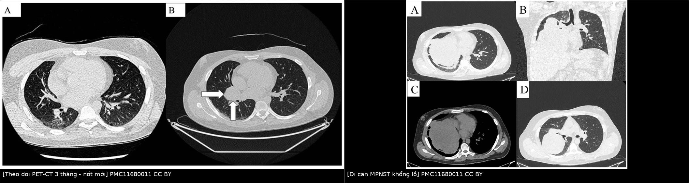
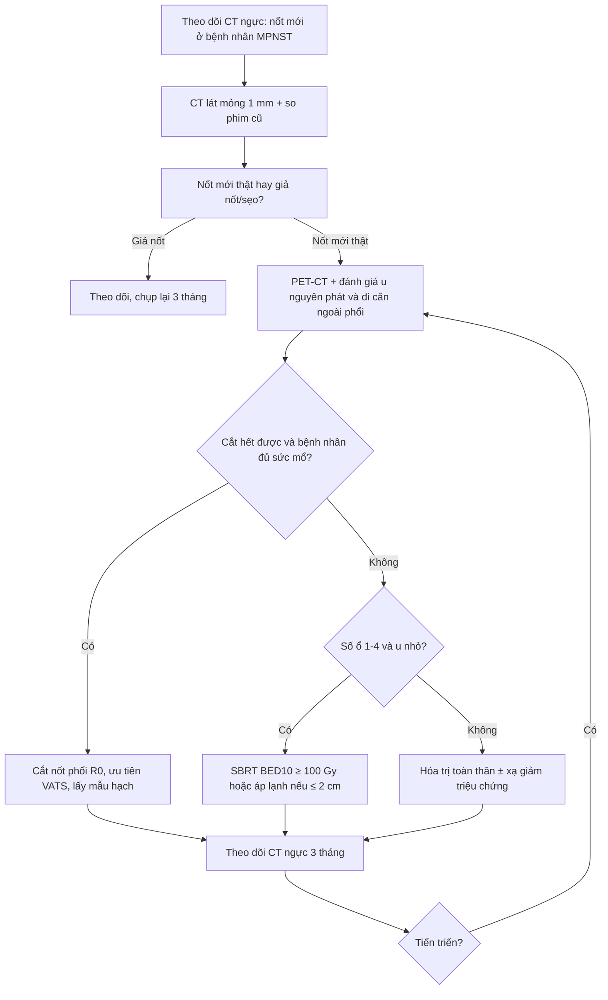
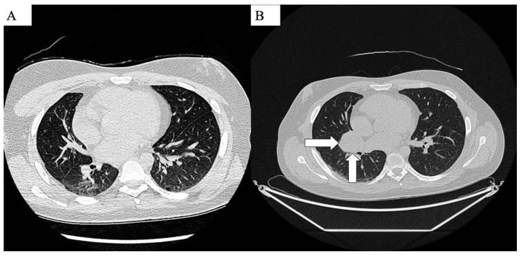
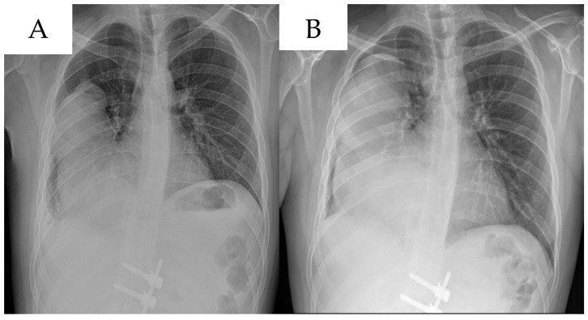
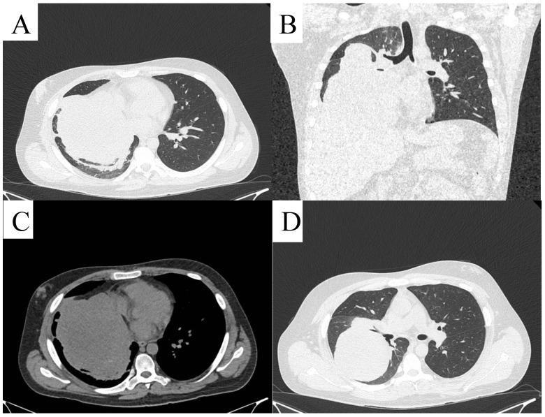

# 381 — Di căn phổi của MPNST: cắt nốt phổi hay xạ định vị / MPNST lung metastases: metastasectomy versus SBRT

**Tags:** `pattern:not` `pattern:da-not` `pattern:di-can` `vung:phoi` `score:RECIST` `protocol:CT-nguc` `protocol:PET-CT` `protocol:SBRT` `incidentaloma:not-phoi`
**Mức chắc chắn (certainty):** tổng hợp y văn (literature synthesis) — tổng hợp 3 cohort sarcoma mô mềm có cắt nốt phổi (PMC13604907, PMC12222427, PMC11557538), 1 cohort SBRT sarcoma (PMC12558367), 1 phân tích gộp cắt nốt vs SBRT (PMC13358817) và 1 cohort áp lạnh (PMC13595653); phần quiz là **ca nguyên văn** của bài gốc (PMC11680011). **Chưa có thử nghiệm ngẫu nhiên riêng cho MPNST** — số liệu là của sarcoma mô mềm nói chung.

## 1. Tổng quan bệnh học – cơ chế hình ảnh

### 1.1 Vì sao phổi là đích di căn đầu tiên?

- **MPNST** là sarcoma **độ cao, kháng hóa – xạ tương đối**, di căn theo đường máu. Tế bào u theo **tĩnh mạch chủ → tuần hoàn phổi**, bị giữ lại ở **giường mao mạch phổi** (giường mao mạch đầu tiên sau tim phải) → **phổi là nơi di căn hay gặp nhất**; với sarcoma mô mềm nói chung, **~80%** di căn xa là phổi (bài 379).
- **Hệ quả hình ảnh:** di căn phổi thường **nhiều nốt, tròn, đặc, phân bố ngoại vi và ưu thế đáy** (nơi lưu lượng máu cao nhất) — khác **di căn lymphangitic** (dày vách, nốt quanh mạch bạch huyết) và khác **ung thư phổi nguyên phát** (một khối, có xâm lấn/xẹp phế quản).
- **Tốc độ:** sarcoma độ cao có **thời gian nhân đôi thể tích ngắn**; sau cắt nốt phổi, **DFS trung vị chỉ 7,0–7,4 tháng** (PMC13604907, PMC12222427) — nghĩa là **tái phát/di căn mới rất sớm**, và **khoảng không bệnh (DFI) > 12 tháng** là yếu tố tiên lượng tốt (OS HR **0,42**; PMC12222427).

### 1.2 Vì sao "cắt được hết" là biến số mạnh nhất?

- Cắt nốt phổi **không phải là chữa khỏi toàn thân** — nó **loại bỏ ổ di căn lớn nhất**, nhưng vi di căn vẫn tồn tại. Vì vậy:
  - **Cắt trọn (R0)** là yếu tố tiên lượng mạnh nhất: cắt không hết làm **OS xấu đi HR 6,54 (2,49–17,14)** và **DFS HR 8,66** (PMC13604907).
  - **Số nốt cắt được không phải yếu tố tiên lượng độc lập** trong cohort này; **kích thước nốt > 2 cm** mới là yếu tố xấu: **DFS HR 2,60**, **OS HR 5,6** (PMC12222427). Đây là lý do câu hỏi lâm sàng đúng là "**còn cắt hết được không?**" chứ không phải "**bao nhiêu nốt?**".
- **Vì sao kích thước quan trọng:** nốt lớn hơn có **nhân tế bào ác nhiều hơn, hoại tử trung tâm, đề kháng hóa trị cao hơn**, và **dễ phát tán thêm**; đồng thời nốt > 2 cm **khó kiểm soát bằng SBRT** hơn nốt nhỏ.

### 1.3 Vì sao SBRT có thể thay thế ở một số ca?

- SBRT đưa **liều sinh học rất cao, khu trú**, gây **hoại tử tế bào u** qua **tổn thương DNA trực tiếp và gián tiếp (gốc tự do)** trong khi **sparing mô phổi lành** nhờ nhiều trường chiếu hội tụ.
- **Ngưỡng liều hay dùng:** **BED10 ≥ 100 Gy** (BED10 = n·d·[1 + d/10]). Trong cohort sarcoma phổi, **79,2% tổn thương** được điều trị với **BED10 ≥ 100 Gy**, **trung vị 105,6 Gy (67,2–180 Gy)** (PMC12558367).
- **Giới hạn:** kiểm soát tại chỗ của SBRT trong sarcoma **không cao như ở ung thư phổi** — **thất bại tại chỗ 32,0% / 45,3% / 47,2% ở 1 / 2 / 3 năm** (PMC12558367). Vì vậy SBRT **không thay thế phẫu thuật một cách phổ quát**, mà dành cho ca **không mổ được** hoặc **u nhỏ, ít ổ**.

### 1.4 Chọn bệnh nhân: các con số của phẫu thuật

| Chỉ số | Số liệu | Nguồn |
|---|---|---|
| OS trung vị sau cắt nốt phổi (sarcoma) | **34,0 tháng** | PMC13604907 |
| OS 1 / 3 / 5 năm | **82,5% / 46,7% / 32,6%** | PMC13604907 |
| Tỉ lệ R0 | **91,2%** | PMC13604907 |
| Biến chứng chu phẫu | **13,8%** (nặng ≥ IIIa: 2%) | PMC13604907, PMC12222427 |
| Hạch di căn ẩn (occult nodal) | **6,5%** | PMC13604907 |
| OS 5 năm (cohort Đài Loan, 110 ca) | **62,9%** | PMC11557538 |
| DFS trung vị sau lần cắt đầu | **7,0–7,4 tháng** | PMC13604907, PMC12222427 |

> **Lưu ý trung thực:** các cohort trên gồm **leiomyosarcoma, synovial sarcoma, UPS, sarcoma xương** — **không tách riêng MPNST**. MPNST có tiên lượng xấu hơn trung bình sarcoma (OS 5 năm 34–50%, bài 379), nên số thực tế ở MPNST **có thể thấp hơn**; không suy diễn ngược.

## 2. Mẫu hình + chẩn đoán phân biệt theo số lượng và phân bố (gamut)

- **Mẫu hình gốc:** bệnh nhân MPNST đã điều trị u nguyên phát, **theo dõi CT ngực định kỳ**, xuất hiện **1 hoặc vài nốt đặc mới**, thường **không triệu chứng**; ho ho ra máu/tràn khí chỉ khi nốt ăn mòn phế quản/màng phổi.
- **Gamut theo số lượng – phân bố:**
  - **Nốt đơn độc (solitary):** dễ nhầm **u phổi nguyên phát** hoặc **nốt lành (u hạt, hamartoma)**; cần so phim cũ và **PET/CT**.
  - **Ít nốt một bên (oligometastatic, 1–4 nốt):** **ứng viên tốt nhất cho cắt nốt** hoặc SBRT; trong cohort SBRT, **trung vị 2 tổn thương/lần (1–4)** (PMC12558367).
  - **Nhiều nốt hai bên:** nếu **cắt hết được về mặt kỹ thuật** vẫn có thể mổ **theo thì** (bilateral staged thoracotomy/VATS); nếu không → **hóa trị toàn thân ± SBRT triệu chứng**.
  - **Khối lớn (> 5–10 cm), chèn ép trung thất:** thường **không mổ được**, nguy cơ chảy máu/hoại tử; ưu tiên **giảm triệu chứng** (xạ, can thiệp).
  - **Nốt hang (cavitating):** gợi ý **hoại tử trung tâm** hoặc **bội nhiễm**, dễ nhầm **áp-xe/lao**; ở bệnh nhân sarcoma phải nghĩ di căn hoại tử.
  - **Tràn khí màng phổi tự phát:** di căn **vỡ vào màng phổi** hoặc **nốt sát màng phổi** — dấu hiệu ít gặp nhưng phải nghĩ ở sarcoma.
  - **Hình thái lymphangitic:** hiếm, tiên lượng rất xấu, **không mổ**.
- **Mimics bắt buộc loại trừ:** **nốt lành (u hạt lành tính, hamartoma, nốt viêm)**, **u phổi nguyên phát thứ hai**, **di căn của ung thư khác**, **nhiễm nấm/lao**, **xẹp phổi cục bộ**, **giả nốt do mạch máu cắt ngang**.

## 3. Bảng so sánh phân biệt (ma trận đối chiếu)

| Thực thể (entity) | Hình ảnh điển hình | Chốt vào (rule-in) | Chốt loại (rule-out) | Gợi ý xác nhận |
|---|---|---|---|---|
| **Di căn MPNST đơn độc** | Nốt đặc, tròn, bờ rõ, **ngoại vi/ưu thế đáy**, mới xuất hiện so phim cũ; có thể **hoại tử/ hang** | **Nốt mới + bệnh sử MPNST + tăng kích thước theo thời gian** | Nốt **vôi hóa đều, bờ tua gai, ổn định nhiều năm** → nghĩ lành | So phim cũ; **PET/CT**; **không sinh thiết nếu cắt được** |
| **U phổi nguyên phát (SCC/adeno)** | Khối **trung tâm hoặc ngoại vi**, **bờ tua gai**, co kéo màng phổi, **hạch rốn phổi**, có thể xẹp phổi | **Một khối + hạch rốn + bờ tua gai + tiền sử hút thuốc** | **Nhiều nốt hai bên bờ rõ** → nghĩ di căn | CT có cản quang, PET/CT, sinh thiết phế quản |
| **Nốt lành (granuloma/hamartoma)** | Nốt **nhỏ < 1 cm**, vôi hóa trung tâm ("popcorn"), **ổn định ≥ 2 năm** | **Vôi hóa điển hình + không tăng kích thước** | **Nốt mới/tăng nhanh ở bệnh nhân sarcoma** → không được coi là lành | So phim cũ; theo dõi 3–6 tháng |
| **Di căn hoại tử/hang** | Nốt **có hang, thành dày, mức khí – dịch**, có thể bội nhiễm | **Hang mới trong bệnh cảnh sarcoma tiến triển** | **Hang thành mỏng đều + nốt vệ tinh** → nghĩ lao | CT lát mỏng; AFB/PCR nếu nghi lao |
| **SBRT – viêm phổi do xạ** | **Kính mờ/đông đặc conformal theo trường chiếu**, xuất hiện **1–6 tháng** sau SBRT, bờ thẳng theo hình học chùm tia | **Hình dạng khớp trường xạ + thời điểm + không có nốt mới ngoài trường** | **Nốt mới ngoài trường xạ, tăng dần, có FDG** → nghĩ tiến triển | So phim trước – sau; PET/CT; hội chẩn xạ trị |
| **Sẹo mổ / thay đổi sau VATS** | Đường mổ, **kẹp kim loại**, dày màng phổi khu trú, có thể **tụ dịch/seroma** | **Vị trí đúng đường mổ + kẹp + ổn định** | **Nốt mới xa vị trí mổ, tăng kích thước** → nghĩ di căn | So phim; CT mỏng; không sinh thiết ngay |

*Trái: **PET/CT (cửa sổ CT)** cùng bệnh nhân — (A) tháng 4/2024 chưa có tổn thương, (B) tháng 7/2024 xuất hiện **nốt mới ở đáy phổi phải** (mũi tên) — đây là mẫu hình "di căn xuất hiện trong 3 tháng". Phải: **di căn MPNST khổng lồ** ở phổi phải, đặc không đồng nhất, **đẩy lệch trung thất**, kèm tràn dịch màng phổi. Nguồn: *Life* 2024 (PMC11680011) Fig. 3 và Fig. 6, CC BY 4.0. Ảnh ghép letterbox, không crop/kéo giãn.*

### Ba câu hỏi trước khi quyết định (dấu hiệu đọc nhanh)

1. **Có cắt hết được không?** (số nốt, vị trí, khả năng giữ phổi lành, chức năng phổi).
2. **Có di căn ngoài phổi đang hoạt động không?** (PET/CT, MRI não nếu có triệu chứng).
3. **U nguyên phát đã kiểm soát chưa?** (R0, không tái phát tại chỗ).

## 4. Protocol chụp + tiêu chí điều trị + hệ phân tầng

### 4.1 Protocol chẩn đoán – theo dõi

- **CT ngực lát mỏng ≤ 1 mm, không cản quang** là chuẩn phát hiện nốt phổi; **có cản quang** khi cần đánh giá xâm lấn trung thất/mạch máu hoặc phân biệt u nguyên phát.
- **PET/CT** khi: phân biệt nốt lành/ác, tìm di căn ngoài phổi, đánh giá đáp ứng sau điều trị. **PET âm giả** với nốt **< 8–10 mm**, tổn thương **hoại tử/nhầy** và **sarcoma độ thấp** — không dùng PET để loại trừ nốt nhỏ.
- **Lịch theo dõi sau điều trị u nguyên phát (bài 379):** năm 1–3 **mỗi 3–4 tháng**, năm 4–5 **mỗi 6 tháng**, năm 6–10 **mỗi năm** — **CT ngực là thành phần bắt buộc**.
- **Trước mổ:** **CT ngực lát mỏng + chức năng hô hấp (FEV₁, DLCO)**, đánh giá khả năng chịu đựng cắt phổi; **không sinh thiết nốt có thể cắt được** (nguy cơ gieo mầm/tràn khí, và không đổi được quyết định mổ).

### 4.2 Tiêu chí cắt nốt phổi (kinh điển, vẫn dùng trong sarcoma)

1. **U nguyên phát đã kiểm soát** (R0, không tái phát tại chỗ).
2. **Không có di căn ngoài phổi không kiểm soát được** (hoặc di căn ngoài phổi đã/đang điều trị triệt để).
3. **Cắt hết được tất cả tổn thương** với **bờ âm** và **bảo tồn đủ phổi lành** (thường ưu tiên **cắt hình chêm/VATS**, không nhất thiết cắt thùy).
4. **Bệnh nhân đủ sức chịu mổ** và **đồng ý**; **không có chống chỉ định gây mê**.
5. **Số nốt không phải tiêu chí loại trừ tuyệt đối** — nhưng **càng nhiều nốt, khả năng R0 và lợi ích sống còn càng giảm**; cohort cho thấy **số nốt không phải yếu tố tiên lượng độc lập**, còn **R0 và kích thước > 2 cm** thì có (PMC13604907, PMC12222427).

### 4.3 SBRT và áp lạnh — khi nào thay thế phẫu thuật?

- **SBRT:** chỉ định khi **không mổ được** (chức năng phổi kém, nhiều ổ, bệnh nhân từ chối) và **số ổ ít (1–4)**, **kích thước nhỏ**, **không có di căn ngoài phổi**. Liều: **BED10 ≥ 100 Gy**, thường **30–60 Gy chia 3–8 phân liều**; cohort sarcoma dùng **BED10 trung vị 105,6 Gy**, **không ghi nhận độc tính SBRT** (PMC12558367).
- **Kết quả cần nói thật:** **thất bại tại chỗ 32,0% / 45,3% / 47,2% ở 1 / 2 / 3 năm**; **STFS trung vị 26 tháng**, **OS 1–2 năm 71%** (PMC12558367) — SBRT **hợp lý để trì hoãn hóa trị**, nhưng **không "ngang" phẫu thuật ở mọi ca**.
- **Áp lạnh (cryoablation) qua da:** cho **nốt ≤ 2 cm**, bệnh nhân không mổ được; **84 tổn thương**, **tiến triển tại chỗ 14,3%**, **hiệu quả chính 88,8% / 79,1% / 79,1% ở 1 / 3 / 5 năm**; **biến chứng 58,5% số phiên nhưng toàn bộ độ 1–2**, **không có độ ≥ 3** (PMC13595653). **Nốt > 2 cm kiểm soát kém hơn** (p = 0,024).
- **So sánh cắt nốt vs SBRT:** phân tích gộp **1.535 bệnh nhân** (949 mổ, 586 SBRT) cho thấy **mổ tốt hơn về OS (HR 0,74; 0,61–0,90)** trong dữ liệu thực hành, nhưng **khi phân tích chỉ các nghiên cứu đã hiệu chỉnh nguy cơ, khác biệt KHÔNG còn ý nghĩa (HR 0,70; 0,45–1,10)** (PMC13358817). Diễn giải đúng: **khác biệt phần lớn do chọn bệnh**, không phải do phương thức; **ở cùng nhóm bệnh nhân, hai cách có thể tương đương**.

### 4.4 Sơ đồ quyết định

## 5. Biến thể bình thường và cạm bẫy

- **"Nốt mới" sau SBRT không phải lúc nào cũng là tiến triển:** **viêm phổi do xạ** xuất hiện **1–6 tháng**, **kính mờ/đông đặc conformal theo trường chiếu**, bờ **thẳng hình học** — đối chiếu **bản đồ liều xạ** trước khi kết luận; **PET/CT** giúp nhưng viêm xạ cũng có thể tăng nhẹ FDG.
- **Sẹo mổ và kẹp kim loại:** sau VATS, **dày màng phổi khu trú, tụ dịch nhỏ, xẹp phổi dưới phân thùy** có thể giả nốt; **so phim và vị trí đường mổ** là chốt.
- **Nốt < 5 mm:** CT có thể bỏ sót hoặc gọi nhầm mạch máu cắt ngang; **không sinh thiết, không mổ** — chụp lại **3 tháng**; **không dùng PET** để loại trừ.
- **Sinh thiết nốt có thể cắt được:** có nguy cơ **tràn khí, gieo mầm đường kim, và làm mất khả năng cắt R0** — **không sinh thiết thường quy** nếu nốt nằm trong kế hoạch mổ.
- **Đếm nốt sai:** CT và phẫu thuật có thể **lệch số nốt** (nốt nhỏ < 3 mm không sờ thấy); **đánh dấu bằng hook-wire/keo** trước mổ với nốt sâu, nhỏ.
- **Bỏ sót di căn ngoài phổi:** luôn **PET/CT toàn thân** trước khi quyết định mổ phổi; di căn não/xương đang hoạt động **đổi hoàn toàn mục tiêu điều trị**.
- **Cạm bẫy mặt cắt:** nốt **cạnh màng phổi** có thể bị đọc là **dày màng phổi**; nốt **trong nhu mô sát rốn phổi** dễ nhầm **hạch**. Luôn đọc **đa bình diện** và **cửa sổ trung thất**.

## 6. Tự lượng giá — Blind Quiz

**Ca 1 — Nam 34 tuổi, MPNST sau phúc mạc đã mổ 8 tháng, theo dõi định kỳ. Hai thời điểm 3 tháng cách nhau:**

- Câu hỏi: So sánh A và B. Nốt mới nằm ở đâu? Bước tiếp theo nên làm gì?

<b>Bấm để hiện đáp án (findings + chẩn đoán)</b>

- **Dấu hiệu:** (A) tháng 4/2024 — phổi hai bên không có nốt; (B) tháng 7/2024 — **nốt đặc mới cạnh rốn phổi phải** (mũi tên), bờ rõ, nằm sát trung thất.
- **Chẩn đoán:** **di căn phổi MPNST** — xuất hiện trong **3 tháng**, phù hợp tốc độ nhân đôi nhanh của sarcoma độ cao.
- **Bước tiếp theo:** **CT ngực lát mỏng 1 mm** để đếm chính xác số nốt + **PET/CT toàn thân** tìm di căn ngoài phổi; nếu **nốt đơn độc, cắt được** và u nguyên phát kiểm soát → **cắt nốt (VATS)**, không sinh thiết trước.
- **Nguồn ảnh:** *Life* 2024, Fig. 3, PMCID [PMC11680011](https://pmc.ncbi.nlm.nih.gov/articles/PMC11680011/), CC BY 4.0.

**Ca 2 — Cùng bệnh nhân, 1 tháng sau, X-quang ngực thẳng (A) và sau đó (B):**

- Câu hỏi: Mô tả thay đổi trên X-quang. Vì sao X-quang không đủ để theo dõi sarcoma?

<b>Bấm để hiện đáp án (findings + chẩn đoán)</b>

- **Dấu hiệu:** (A) mờ không đồng nhất vùng phổi phải; (B) **mờ rộng hơn, đẩy lệch trung thất nhẹ** — tiến triển trong **1 tháng**.
- **Vì sao không đủ:** X-quang chỉ phát hiện tổn thương **> 8–10 mm** ở vùng phổi sáng, bỏ sót **nốt nhỏ, sau tim, sau cơ hoành, sát màng phổi**; sarcoma cần **CT lát mỏng** để đếm nốt và lập kế hoạch mổ.
- **Chẩn đoán:** **di căn phổi tiến triển nhanh** — phù hợp sinh học MPNST; cần **đánh giá lại toàn thân** trước khi can thiệp.
- **Nguồn ảnh:** *Life* 2024, Fig. 5, PMCID [PMC11680011](https://pmc.ncbi.nlm.nih.gov/articles/PMC11680011/), CC BY 4.0.

**Ca 3 — Cùng bệnh nhân, CT ngực khi khối đã lớn:**

- Câu hỏi: Mô tả tổn thương (A–D). Còn chỉ định cắt nốt không? Vì sao?

<b>Bấm để hiện đáp án (findings + chẩn đoán)</b>

- **Dấu hiệu:** (A, B) **khối lớn choán gần toàn bộ phổi phải**, đặc không đồng nhất, **đẩy lệch trung thất sang trái**, xẹp phổi phải; (C) cửa sổ trung thất — khối **xâm lấn/đè ép**, có thể kèm **tràn dịch màng phổi**; (D) mặt cắt thấp hơn — khối vẫn còn, phổi phải xẹp một phần.
- **Chẩn đoán:** **di căn MPNST khổng lồ** — không còn là "nốt phổi" mà là **khối xâm lấn**, đe dọa hô hấp.
- **Còn cắt nốt?** **Không theo nghĩa cắt nốt phổi đơn thuần**; cần **hội chẩn đa chuyên khoa** (lồng ngực – ung thư – xạ trị): nếu **cắt được toàn bộ** và bệnh nhân chịu được → **cắt khối + tái tạo**, nhưng nguy cơ cao; nếu không → **hóa trị ± xạ**, hoặc **phẫu thuật giảm nhẹ**.
- **Bài học:** **kích thước > 2 cm** đã là yếu tố tiên lượng xấu (DFS HR 2,60; PMC12222427); khối lớn **mất cửa sổ phẫu thuật** — nên **theo dõi CT đúng lịch** để bắt ở giai đoạn còn cắt được.
- **Nguồn ảnh:** *Life* 2024, Fig. 6, PMCID [PMC11680011](https://pmc.ncbi.nlm.nih.gov/articles/PMC11680011/), CC BY 4.0.

## Bài liên quan chéo
- [379 – MPNST: điều trị đa mô thức & theo dõi di căn phổi](../379-mpnst-dieu-tri-di-can-phoi/lesson.md)
- [377 – U dây thần kinh dạng đám rối & chuyển dạng MPNST ở NF1](../377-u-than-kinh-dang-dam-roi-va-mpnst-nf1/lesson.md)
- [378 – Điều trị PN ở NF1 bằng selumetinib](../378-dieu-tri-u-dam-roi-nf1-selumetinib/lesson.md)
- [016 – Nốt phổi ở bệnh nhân có tiền sử ung thư](../016-not-phoi-tien-su-ung-thu/lesson.md)
- [021 – Đa nốt phổi](../021-da-not-phoi/lesson.md)
- [022 – Khối phổi & phân giai đoạn TNM](../022-khoi-phoi-TNM/lesson.md)
- [300 – Tổng quan hệ Cơ – Xương – Khớp](../300-tong-quan-he-co-xuong-khop/lesson.md)

## Ảnh
- Tên file: `381_mpnst-di-can-phoi_*_PMC11680011.jpg`; composite `composite_mpnst-di-can.jpg` (letterbox, không crop/kéo giãn).
- Nguồn + giấy phép từng ảnh: `images/CREDITS.md`; liên kết gốc: `sources.md`.
- Ảnh **CC BY 4.0** — được tái sử dụng và tạo tác phẩm phái sinh kèm ghi công.

> Không dùng để chẩn đoán độc lập khi chưa có người hướng dẫn.
